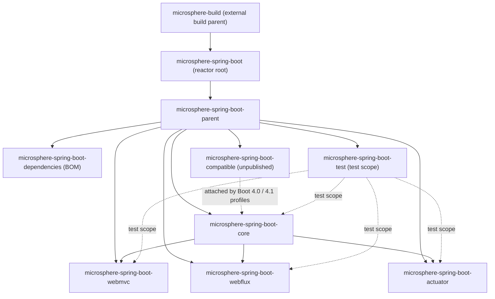

# Microsphere Spring Boot — Documentation Home

> [中文](./zh/README.md)

This directory holds the complete documentation set for the two maintained version lines of
`microsphere-spring-boot`. It is split into a **user guide** (what each module does and how to use it) and a
**developer guide** (how the code is organised and how the build works), each published for both branches and in both
languages.

---

## 1. Documentation sets

| Set | Directory | Audience | Contents |
|---|---|---|---|
| User Guide | [`user-guide/`](./user-guide/README.md) · [中文](./user-guide/zh/README.md) | Application and library users | Per-module API explanations, runnable code examples taken from the modules' test cases, installation snippets, property reference tables, version and compatibility ranges |
| Developer Guide | [`developer-guide/`](./developer-guide/README.md) · [中文](./developer-guide/zh/README.md) | Contributors and maintainers | Package layout, source analysis of the load-bearing classes, design patterns, Mermaid flow/sequence diagrams of the startup and runtime paths, build system, CI and release pipeline, contribution recipes |
| Source Diff | [`diff/source/`](#source-diff-reports) | Contributors and maintainers | Module-by-module source comparisons between the two version lines (per tag pair or branch pair), `src/main` and `src/test` reported separately, with the cause of each difference explained |

Each set contains one directory per branch and one file per Maven module, mirrored in Chinese under a `zh/`
sub-directory.

### Source diff reports

| Comparison | Scope | English | 中文 |
|---|---|---|---|
| Tags `0.2.34` vs `0.1.34` | `src/main` | [`diff/source/main-diff-0.2.34-vs-0.1.34.md`](./diff/source/main-diff-0.2.34-vs-0.1.34.md) | [中文](./diff/source/zh/main-diff-0.2.34-vs-0.1.34.md) |
| Tags `0.2.34` vs `0.1.34` | `src/test` | [`diff/source/test-diff-0.2.34-vs-0.1.34.md`](./diff/source/test-diff-0.2.34-vs-0.1.34.md) | [中文](./diff/source/zh/test-diff-0.2.34-vs-0.1.34.md) |

All reports exclude Java 8 vs Java 17 syntax/API differences and Java EE vs Jakarta EE API differences, and ignore
modules that do not match by name between the two sides.

---

## 2. Branches and version lines

| Docs dir | Branch | Version line | Spring Boot range | Java | CI matrix | Latest release |
|---|---|---|---|---|---|---|
| `current/` | `release` | `0.2.x` | `3.0.13` – `3.5.16`, `4.0.8` – `4.1.1` (patch pinned per minor) | 17+ | JDK `17 / 21 / 25` × 8 Boot profiles = 24 jobs | `0.2.34` |
| `1.x/` | `release-1.x` | `0.1.x` | `2.1.18.RELEASE` – `2.7.18` (patch pinned per minor) | 8+ (CI starts at JDK 8) | JDK `8 / 11 / 17 / 21 / 25` × 7 Boot profiles = 35 jobs | `0.1.34` |

Entry points per branch:

| Branch | User guide | User guide (zh) | Developer guide | Developer guide (zh) |
|---|---|---|---|---|
| `release` (0.2.x) | [`user-guide/current/README.md`](./user-guide/current/README.md) | [中文](./user-guide/current/zh/README.md) | [`developer-guide/current/README.md`](./developer-guide/current/README.md) | [中文](./developer-guide/current/zh/README.md) |
| `release-1.x` (0.1.x) | [`user-guide/1.x/README.md`](./user-guide/1.x/README.md) | [中文](./user-guide/1.x/zh/README.md) | [`developer-guide/1.x/README.md`](./developer-guide/1.x/README.md) | [中文](./developer-guide/1.x/zh/README.md) |

> **Scope.** Only `release` and `release-1.x` are documented. `main`, `dev` and `dev-1.x` are working branches and are
> never used as a documentation baseline. Matrices are read from each branch's `microsphere-spring-boot-parent/pom.xml`
> (supported) and `.github/workflows/maven-build.yml` (actually tested).

The two lines are **not interchangeable**: no artifact supports Boot 2 and Boot 3/4 together, because the servlet
namespace (`javax` vs `jakarta`), the auto-configuration registration mechanism (`spring.factories` vs
`AutoConfiguration.imports`) and the `SpringBootVersion` enum range all differ.

---

## 3. Module map

Eight Maven modules make up the reactor. The diagram shows the `release` (0.2.x) branch; the `1.x` branch has the same
shape, with `compatible` attached under Boot `2.1`–`2.3` instead of Boot `4.x`.

| Module | Published | Documented in |
|---|---|---|
| `microsphere-spring-boot` (root aggregator) | — | user guide [`parent.md`](./user-guide/current/parent.md) · dev guide [`parent.md`](./developer-guide/current/parent.md) |
| `microsphere-spring-boot-parent` | Yes (pom) | same as above |
| `microsphere-spring-boot-dependencies` | Yes (BOM) | [`dependencies.md`](./user-guide/current/dependencies.md) |
| `microsphere-spring-boot-core` | Yes | [`core.md`](./user-guide/current/core.md) |
| `microsphere-spring-boot-actuator` | Yes | [`actuator.md`](./user-guide/current/actuator.md) |
| `microsphere-spring-boot-webmvc` | Yes | [`webmvc.md`](./user-guide/current/webmvc.md) |
| `microsphere-spring-boot-webflux` | Yes | [`webflux.md`](./user-guide/current/webflux.md) |
| `microsphere-spring-boot-test` | Yes | [`test.md`](./user-guide/current/test.md) |
| `microsphere-spring-boot-compatible` | **No** | [`compatible.md`](./user-guide/current/compatible.md) |

---

## 4. Where to start

| I want to … | Read |
|---|---|
| Add these libraries to a Boot 3/4 application | [user guide, `current` branch](./user-guide/current/README.md) |
| Add these libraries to a Boot 2 application | [user guide, `1.x` branch](./user-guide/1.x/README.md) |
| Ship overridable default properties from my own library | [core (user guide)](./user-guide/current/core.md) |
| Understand which actuator endpoints exist and their defaults | [actuator (user guide)](./user-guide/current/actuator.md) |
| Know how the listeners are wired at startup | [core (developer guide)](./developer-guide/current/core.md) |
| See the extension points and design patterns | [developer guide overview](./developer-guide/current/README.md) |
| Build, test one Boot profile, or cut a release | [build and release](./developer-guide/current/build-and-release.md) |
| Add a new module or a new Boot version profile | [developer guide overview, contribution section](./developer-guide/current/README.md) |

---

## 5. Conventions

| Convention | Detail |
|---|---|
| Language layout | English is the default language and lives at the primary path; Chinese mirrors it file-for-file under a `zh/` directory with identical filenames. Every page links to its counterpart at the top. |
| Branch layout | Inside each set: `current/` for the `release` branch (0.2.x), `1.x/` for the `release-1.x` branch (0.1.x). |
| One file per module | Each Maven module has its own document in each set; the POM modules (`parent`, `dependencies`) are documented too. |
| Source of truth | Class names, method signatures, property keys, default values and version literals are taken from that branch's sources or POMs, never inferred. |
| Code examples | Taken from the modules' own test classes wherever possible; the source file is named next to the snippet. |
| Version tags | Listed Boot versions are the patch each minor line is built and tested against; other patches in the same minor line are expected to work. |
| Unpublished module | `microsphere-spring-boot-compatible` must never be a dependency of an application; see its document. |

---

## 6. Related resources

| Resource | Link |
|---|---|
| Project README (`main`) | [../README.md](../README.md) |
| Single-file quick guide (`main`) | [../user-guide.md](../user-guide.md) |
| Release notes | [../release-notes.md](../release-notes.md) |
| Issue tracker | https://github.com/microsphere-projects/microsphere-spring-boot/issues |
| Generated documentation | https://deepwiki.com/microsphere-projects/microsphere-spring-boot · https://zread.ai/microsphere-projects/microsphere-spring-boot |

License: Apache License 2.0.
