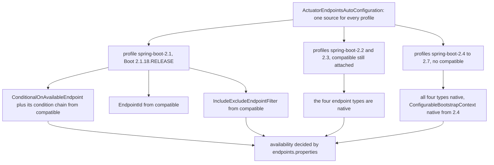

# Actuator Module — `release-1.x`

> [中文](./zh/actuator.md) · [Documentation index](../README.md) ·
> [Same document for the `release` branch](../current/actuator.md)

> **Branch:** `release-1.x` · **Version line:** `0.1.x` · **Artifact:** `microsphere-spring-boot-actuator`
> **Spring Boot:** `2.1.18.RELEASE` – `2.7.18` · **Java source level:** 8

Contents:
[1 Scope and Pairing](#1-scope-and-pairing) ·
[2 What Is Identical on This Line](#2-what-is-identical-on-this-line) ·
[3 Dual Registration For This Module](#3-dual-registration-for-this-module) ·
[4 The OperationResponseBody Delta](#4-the-operationresponsebody-delta) ·
[5 Which Types Come From The Shim](#5-which-types-come-from-the-shim) ·
[6 MonitoredThreadPoolTaskScheduler On Boot 2](#6-monitoredthreadpooltaskscheduler-on-boot-2) ·
[7 Property Constants And The Jolokia Pin](#7-property-constants-and-the-jolokia-pin) ·
[8 Design Patterns On This Line](#8-design-patterns-on-this-line) ·
[9 Tests](#9-tests) ·
[10 Recipes](#10-recipes) ·
[11 Troubleshooting](#11-troubleshooting) ·
[12 See Also](#12-see-also)

---

## 1. Scope and Pairing

[../current/actuator.md](../current/actuator.md) documents the module in full — the ten classes, both auto-configuration classes, the endpoint model, the scheduler instrumentation and the default-properties posture. None of that is restated here. `release-1.x` builds this module against Boot `2.1.18.RELEASE`–`2.7.18` at Java 8, and the tree diff shows it is **more** identical across the branches than `core` is: exactly four things differ — `endpoint/ConfigurationMetadataEndpoint.java`, `endpoint/ConfigurationPropertiesEndpoint.java`, `pom.xml`, and one extra file, `src/main/resources/META-INF/spring.factories`, that does not exist on `release`. Every other main source, every test source and every other resource is byte-for-byte the same. Line numbers below are read from the `release-1.x` tree.

| Question | Read there | Read here |
|---|---|---|
| Which classes exist, endpoint ids, operation signatures | sections 2 and 4 | section 2 — identical |
| Endpoint posture and the TTL ladder | sections 8 and 9 | section 2 — the file is byte-identical |
| How auto-configuration is registered | section 3 | section 3 — two files here |
| Response DTO shape | section 4 | section 4 — `OperationResponseBody` |
| Why the shim module matters here | section 7 (says it does not) | section 5 |
| Task-scheduler instrumentation | section 6 | section 6 — same code, older Micrometer |
| Conditions and property constants | sections 7 and 8 | section 7 |
| Tests | section 11 | section 9 — the tests do not differ |

---

## 2. What Is Identical on This Line

Verified with `diff -rq microsphere-spring-boot-actuator/src/main` and `.../src/test` over the two worktrees.

* **Class inventory**: 10 files under `src/main/java/io/microsphere/spring/boot/actuate/`, same paths on both branches — `MonitoredThreadPoolTaskScheduler`, `autoconfigure.{ActuatorAutoConfiguration,ActuatorEndpointsAutoConfiguration}`, `condition.{ConditionalOnActuatorEndpointPresent,ConditionalOnConfigurationProcessorPresent}`, `constants.PropertyConstants`, and the four `endpoint.*` classes.
* **Byte-identical main sources**: `autoconfigure/`, `condition/`, `constants/` and `endpoint/{ArtifactsEndpoint,WebEndpoints}.java` all diff clean. `ActuatorEndpointsAutoConfiguration.java:28` imports `org.springframework.boot.actuate.autoconfigure.endpoint.condition.ConditionalOnAvailableEndpoint` on **both** branches — which is exactly why this line needs a shim (section 5).
* **Byte-identical resources**: `META-INF/config/default/endpoints.properties` (md5 `881b6caca484bef5b7b68241092c3549` on both trees) and the `ConfigurationPropertyLoader` service file. Read `../current/actuator.md` sections 8 and 9 for the enabled-by-default policy, the web-exposure/JMX asymmetry, the `microsphere.cache.*` TTL ladder and the four path mappings; the bytes are the same here, so re-listing them would only invite drift.
* **Endpoint ids**: `artifacts`, `webEndpoints`, `configMetadata`, `configProperties`, each with exactly one parameterless `@ReadOperation` and no selector, writer or deleter — unchanged.
* **Byte-identical tests**: `diff -rq` over `src/test` produces **no output at all** (section 9 shows how one test body serves two Boot generations).

---

## 3. Dual Registration For This Module

`release` registers this module's auto-configuration in one file; this line registers the same two classes in two files. `microsphere-spring-boot-actuator/src/main/resources/META-INF/spring.factories` — three lines, and this file **does not exist on `release`**:

```
org.springframework.boot.autoconfigure.EnableAutoConfiguration=\
io.microsphere.spring.boot.actuate.autoconfigure.ActuatorAutoConfiguration,\
io.microsphere.spring.boot.actuate.autoconfigure.ActuatorEndpointsAutoConfiguration
```

`META-INF/spring/org.springframework.boot.autoconfigure.AutoConfiguration.imports` is byte-identical to `release`: the same two class names, same order, one per line. The reading rules by Boot version are the whole reason both files exist.

| Boot version | Reads `spring.factories` `EnableAutoConfiguration` | Reads `AutoConfiguration.imports` | Consequence for this module |
|---|---|---|---|
| `2.1` – `2.6` | yes | file is ignored | `spring.factories` alone registers both auto-configurations. |
| `2.7` | yes | yes | Both are read; Boot de-duplicates the repeated names, so registering twice is safe. |
| `3.0` and later | **no** | yes | Why `release` deleted `spring.factories`; deleting it here disables the module for `2.1`–`2.6`. |

Two maintenance rules follow. **Order in `spring.factories` is load order, not precedence** — neither file expresses ordering; the module's ordering comes from `@AutoConfigureOrder(LOWEST_PRECEDENCE)` on `ActuatorAutoConfiguration` (`:39`) plus bean and class conditions. **Nested configurations must never be listed in either file**: `ActuatorEndpointsAutoConfiguration.ConfigurationProcessorConfiguration` (`:96`) is reached only through `@Import` (`:44`); promoting it would bypass its `@ConditionalOnConfigurationProcessorPresent` isolation intent.

---

## 4. The `OperationResponseBody` Delta

Both endpoint response types are plain DTOs here:

```java
// endpoint/ConfigurationMetadataEndpoint.java — release
import org.springframework.boot.actuate.endpoint.OperationResponseBody;
public static class ConfigurationMetadataDescriptor implements OperationResponseBody {
// release-1.x, :79 — the import is deleted, the implements clause is deleted
public static class ConfigurationMetadataDescriptor {

// endpoint/ConfigurationPropertiesEndpoint.java — release, :134
public static class ConfigurationPropertiesDescriptor implements OperationResponseBody {
// release-1.x, :133
public static class ConfigurationPropertiesDescriptor {
```

On the second class the delta also reworded the javadoc, from "implementing `OperationResponseBody` for actuator endpoint serialization" to "Descriptor class that holds a collection of `ConfigurationProperty` instances for actuator endpoint serialization." Why it is absent here: `org.springframework.boot.actuate.endpoint.OperationResponseBody` is a Boot 2.4+ type (`@since 2.4.0`) and this module must compile under profile `spring-boot-2.1`. Unlike the `core` cases no reflective probe is used, because a marker interface cannot be applied conditionally — an `implements` clause is resolved at class-load time. The two legal options were shimming the interface in `compatible` or dropping it; the branch dropped it, and that is safe because it is a **pure marker** declaring no methods. Serialisation behaviour, the DTO fields (`Collection<ItemMetadata> groups`, `Collection<ItemMetadata> properties`, `List<ConfigurationProperty> configurationProperties`), the getters and the package-private fluent `addConfigurationProperties(List)` are all unchanged, and `diff` shows no other line in either file.

Porting consequence: a change to either DTO's *shape* ports cleanly in both directions. A change that **adds** the interface is a `release`-only change; porting it here also means adding the interface to `compatible` and re-attaching profiles — a much larger step than the one-line diff suggests.

---

## 5. Which Types Come From The Shim

This is the largest architectural difference for the module, and `../current/actuator.md` section 7 states it in reverse ("`microsphere-spring-boot-compatible` packages no actuator shim"). Here, this module's use of `@ConditionalOnAvailableEndpoint` — four occurrences, at `ActuatorEndpointsAutoConfiguration.java:61`, `:80`, `:146` and `:165` — compiles only because `compatible` supplies the annotation, its condition and its dependencies for profiles `2.1`–`2.3`. The shim module carries 12 sources on this line, five of which exist for this module's benefit: `actuate/endpoint/EndpointId`, `actuate/autoconfigure/endpoint/condition/{AbstractEndpointCondition,ConditionalOnAvailableEndpoint,OnAvailableEndpointCondition}`, `actuate/autoconfigure/endpoint/expose/IncludeExcludeEndpointFilter`, plus `context/properties/ConstructorBinding` which serves `core`'s binding path. Their `@since` values are recorded in the forked sources themselves: `ConditionalOnAvailableEndpoint.java:101` `@since 2.2.0`, `IncludeExcludeEndpointFilter.java:41` `@since 2.2.7`, `EndpointId.java:35` `@since 2.0.6` with `of(Environment, String)` at `:127` `@since 2.2.0`.



The decision rule is the one in `core`'s document: a type that appears in a **signature** is shimmed, because a missing import fails compilation before any condition can be evaluated. The annotation appears on `@Bean` methods, and `IncludeExcludeEndpointFilter` and `EndpointId` appear as constructor and parameter types inside `OnAvailableEndpointCondition`, so all three live in `compatible` rather than behind a reflective probe. Note the asymmetry: `compatible` is attached by profiles `2.1`, `2.2` **and** `2.3` (`microsphere-spring-boot-core/pom.xml:91-127`) even though Boot `2.2` already provides the endpoint condition classes; the reason is the bootstrap-context shims `core` needs, and the fact that the module is attached per-profile, not per-class. The shims are never published (`microsphere-spring-boot-compatible/pom.xml` skips deploy and central publishing), so nothing leaks to consumers.

---

## 6. MonitoredThreadPoolTaskScheduler On Boot 2

`actuate/MonitoredThreadPoolTaskScheduler.java` is **byte-identical** to `release`, so the mechanism lives in `../current/actuator.md` section 6 and only the version-sensitive facts are repeated. The class binds exactly three collaborators, all resolved at compile time:

| Type | Import line | Used at | Age constraint on this line |
|---|---|---|---|
| `io.micrometer.core.instrument.MeterRegistry` | `:19` | `:118`, `context.getBean(MeterRegistry.class)` | Managed by Boot's BOM in every profile, so no pin for this type itself. |
| `io.micrometer.core.instrument.binder.jvm.ExecutorServiceMetrics`, static `monitor` | `:20`, `:32` | `:120`, `delegate.setDelegate(monitor(registry, scheduledExecutor, beanName))` | This is the type the `micrometer-core` pin exists to keep resolvable. |
| `io.microsphere.concurrent.DelegatingScheduledExecutorService` | `:21` | `:49`, `:84` | Microsphere, not Boot; version from `microsphere-spring.version=0.1.39`. |

`createExecutor(int, ThreadFactory, RejectedExecutionHandler)` (`:82`) and `getScheduledExecutor()` (`:102`) override Spring Framework 5.x's `ThreadPoolTaskScheduler` on this line, and `afterSingletonsInstantiated()` (`:117-121`) only wraps what `super.getScheduledExecutor()` returns; the class references no Boot actuator metrics type at all. The version pin is `microsphere-spring-boot-actuator/pom.xml:98-117`, a profile block that exists only on this branch:

```xml
<profiles>
    <profile>
        <id>spring-boot-2.1</id>
        <dependencies>
            <dependency>
                <groupId>io.micrometer</groupId>
                <artifactId>micrometer-core</artifactId>
                <version>1.3.20</version>
                <optional>true</optional>
            </dependency>

            <dependency>
                <groupId>org.springframework</groupId>
                <artifactId>spring-core</artifactId>
                <version>5.2.25.RELEASE</version>
                <optional>true</optional>
            </dependency>
        </dependencies>
    </profile>
</profiles>
```

Read it as a **floor**, not an upgrade: Boot `2.1`'s own dependency management resolves a `micrometer-core` older than the binder API this class calls, so the profile overrides the managed coordinate with `1.3.20` and marks it `optional`, keeping it off consumers' compile classpaths while making the module itself compile and test. The paired `spring-core:5.2.25.RELEASE` entry is the same device applied to the framework: Boot `2.1.18` ships an older Spring whose `5.2.x` surface this module is compiled against, and pinning a `5.2` patch release keeps the build reproducible. Both entries are optional and profile-scoped, so no published POM carries them.

Because `ActuatorAutoConfiguration` declares `@AutoConfigureOrder(LOWEST_PRECEDENCE)` (`:39`) and gates the bean on `@ConditionalOnBean(type = METER_REGISTRY_CLASS_NAME)` (`:112`) — the by-name form, `"io.micrometer.core.instrument.MeterRegistry"` at `:94` — nothing here changes across Boot generations: Micrometer is never linked at condition level, and the constant is re-asserted against `MeterRegistry.class.getName()` in the test, so a coordinate change breaks the build instead of silently disabling the scheduler.

---

## 7. Property Constants And The Jolokia Pin

`actuate/constants/PropertyConstants.java` is byte-identical to `release`: a two-constant interface at `:32` and `:37`, composing `MICROSPHERE_SPRING_BOOT_ACTUATOR_PROPERTY_NAME_PREFIX = MICROSPHERE_SPRING_BOOT_PROPERTY_NAME_PREFIX + "actuator."` and `TASK_SCHEDULER_PROPERTY_NAME_PREFIX = MICROSPHERE_SPRING_BOOT_ACTUATOR_PROPERTY_NAME_PREFIX + "task-scheduler."`, with the parent prefix statically imported from `core` (`:19`). The two concrete keys built from it — `microsphere.spring.boot.actuator.task-scheduler.pool-size` and `...thread-name-prefix` — are declared in `ActuatorAutoConfiguration` at `:55` and `:76`, each annotated `@ConfigurationProperty(defaultValue = …, source = APPLICATION_SOURCE)`. The line-specific facts are only the values they resolve to, which equal the in-code fallbacks used on `release`: pool size `1` (`:45`) and thread-name prefix `microsphere-spring-boot-actuator-task-`. Neither key appears in `endpoints.properties` on either branch, so the scheduler's defaults come from the `@Value` expressions rather than the default property source — the same separation of documentation from enforcement described in `../current/actuator.md` section 8.

The `jolokia` delta is entirely in POMs. `microsphere-spring-boot-parent/pom.xml` sets `<jolokia.version>1.7.2</jolokia.version>` here versus `2.6.3` on `release`, and the module declares the dependency without a version (`microsphere-spring-boot-actuator/pom.xml:37-41`):

```xml
<!-- Jolokia -->
<dependency>
    <groupId>org.jolokia</groupId>
    <artifactId>jolokia-core</artifactId>
</dependency>
```

The split mirrors the servlet namespace: `jolokia-core` `1.x` is the `javax`-era artifact, `2.x` targets the `jakarta` era that `release` supports. `endpoints.properties` is identical on both branches and still carries `management.endpoint.jolokia.enabled = true` (line 31), so the endpoint is enabled here against the `1.7.2` implementation — do not "align" the parent property with `release`; that would put a `jakarta`-built Jolokia on a Boot 2 classpath. The same reasoning covers the neighbouring parent pins on this line, `microsphere-spring.version=0.1.39` and `junit-jupiter.version=5.14.4`.

---

## 8. Design Patterns On This Line

Shared patterns are in `../current/actuator.md` section 10; these are the ones whose *reason* changes on Boot 2.

| Pattern | Class or artifact | Why it is forced on this line |
|---|---|---|
| Compile-time shim for a gating annotation | `compatible` `ConditionalOnAvailableEndpoint` and its condition chain | An `@Bean`-method annotation is a signature-level reference; it cannot be probed reflectively (section 5). |
| Marker-interface omission instead of a shim | both endpoint descriptor classes | `OperationResponseBody` is `@since 2.4.0` and an `implements` clause cannot be conditional, so the branch drops it (section 4). |
| Profile-scoped optional pin acting as a floor | `micrometer-core:1.3.20`, `spring-core:5.2.25.RELEASE` in `actuator/pom.xml:98-117` | Keeps one source file compiling across Boot generations without leaking a version into published artifacts. |
| By-name condition | `@ConditionalOnBean(type = METER_REGISTRY_CLASS_NAME)` | Portable across every Boot in range; Micrometer is never linked at condition level. |
| Meta-annotation composition | `@ConditionalOnActuatorEndpointPresent`, `@ConditionalOnConfigurationProcessorPresent` | Their payload is one `@ConditionalOnClass(name = ...)`, so they cost nothing to keep on both lines. |
| Late initialization | `MonitoredThreadPoolTaskScheduler.afterSingletonsInstantiated()` | Unchanged; it exists because `@AutoConfigureOrder(LOWEST_PRECEDENCE)` lets the `MeterRegistry` arrive after this bean. |
| Dual registration as a compatibility adapter | both `META-INF` registration files | One artifact serving two mutually exclusive Boot discovery mechanisms (section 3). |
| Convention over configuration | `endpoints.properties` | Byte-identical here, so the posture is a shared invariant, not a branch-specific one. |

---

## 9. Tests

`diff -rq` over `src/test` reports **no differences**: all five classes under `src/test/java/io/microsphere/spring/boot/actuate/` and `src/test/resources/application.properties` are the same files on both branches. That is the interesting fact — the tests are written so that one body pins two Boot generations.

| Test file | What it pins | How it stays Boot-2-safe |
|---|---|---|
| `autoconfigure/ActuatorAutoConfigurationTest.java` | `testConstants()` asserts `"1"`, both task-scheduler property names and `METER_REGISTRY_CLASS_NAME`, the last twice — against the literal and against `MeterRegistry.class.getName()`. `MeterRegistryPresent` boots `webEnvironment = NONE` with `pool-size=2`, `thread-name-prefix=my-prefix` and walks `getPoolSize()` `0 → 1 → 2`; `MeterRegistryAbsent` asserts the bean is `null`. | The assertions touch only Spring's `ThreadPoolTaskScheduler` API and Micrometer's `MeterRegistry`, both stable across `2.1`–`2.7`. The double assertion on the by-name constant turns a coordinate change into a build failure rather than a silently disabled scheduler. |
| `autoconfigure/ActuatorEndpointsAutoConfigurationTest.java` | `Defaults` autowires all four endpoints and exercises `artifacts`, `webEndpoints`, `configMetadata`, `configProperties`; `Disabled` sets the four `management.endpoint.<id>.enabled=false` keys and asserts all four beans are absent. | It relies on `@ConditionalOnAvailableEndpoint`, native from `2.2` and shimmed under `2.1`, so the same assertions hold either way; `@Order(1)`/`@Order(2)` guarantee "bean exists" runs before "bean absent", so a context-cache hit cannot mask a failed exclusion. |
| `constants/PropertyConstantsTest.java` | `testConstants()` freezes both prefixes. | Property names are branch-neutral, so a `core` refactor that moves the namespace fails on both lines. |
| `endpoint/WebEndpointsTest.java` | Mockito tests for the fan-out predicates: a `WRITE` operation yields an empty map, a bare `ExposableWebEndpoint` is skipped, `null` is not exposable, a real `DiscoveredOperationMethod` over a write method is rejected. The inner `WebEndpoint` and `DiscoveredOperationImpl` are the stand-ins. | It hand-builds actuator internals instead of booting them, so the only version surface is the `DiscoveredEndpoint`/`WebOperation`/`OperationType` API — present and unchanged in `2.1`–`2.7`. |
| `env/DefaultPropertiesTest.java` | Reads the shipped keys through the injected `Environment` and asserts `enabled-by-default=false`, `web.exposure.include=*`, `jmx.exposure.exclude=*` and every per-endpoint flag, including `loggers` as `false` although `endpoints.properties` line 22 says `true`. | The `false` comes from `src/test/resources/application.properties`, so this asserts the `core` default-properties precedence contract from inside this module and depends on nothing Boot-3-specific. |

One Boot-2-specific expectation lives in the exclusion list both nested contexts push through `microsphere.autoconfigure.exclude` (`ActuatorAutoConfigurationTest.java:117-121`): indices `[0]` and `[1]` are `org.springframework.boot.actuate.autoconfigure.metrics.MetricsAutoConfiguration` and `.CompositeMeterRegistryAutoConfiguration` — the Boot `2.x`/`3.x` layout this line targets — while `[2]` and `[3]` are `org.springframework.boot.micrometer.metrics.autoconfigure.*` names that only Boot `4` knows. The filter drops non-existent names silently, so one literal list works on both branches. Do not prune the "unused" entries when porting to this line: they are what keeps the file identical.

---

## 10. Recipes

### 10.1 Add an endpoint on this line

1. Create `src/main/java/io/microsphere/spring/boot/actuate/endpoint/<Name>Endpoint.java` with `@Endpoint(id = "<camelCaseId>")`, or `@WebEndpoint` when it needs a web-only collaborator, and take collaborators through the constructor; nothing in this module uses field injection.
2. Model any structured payload as a nested `public static` DTO **without** `implements OperationResponseBody` (section 4); adding the interface here is a shim decision, not a one-line edit.
3. Register the bean in `ActuatorEndpointsAutoConfiguration` with `@Bean` + `@ConditionalOnMissingBean` + `@ConditionalOnAvailableEndpoint`, or inside `ConfigurationProcessorConfiguration` when it references `spring-boot-configuration-processor` types.
4. Add nothing to the imports file — the outer class is already listed there. Verify `META-INF/spring.factories` still lists `ActuatorEndpointsAutoConfiguration`, since Boot `2.1`–`2.6` read only that file.
5. Add the posture lines to `endpoints.properties` under a `### <Name> Endpoint` header: `enabled`, `management.endpoints.web.path-mapping.<id>`, and `management.endpoints.<id>.cache.time-to-live` pointing at a `microsphere.cache.*` key. Keep the file byte-identical to `release` by editing it on one branch and porting it.
6. Extend `Defaults` and `Disabled` in `ActuatorEndpointsAutoConfigurationTest` and assert the new keys in `env/DefaultPropertiesTest`.
7. Document in both languages (`docs/user-guide/1.x/actuator.md` and its `zh/` mirror, plus the `release` pair if the endpoint ships there), then verify at both ends on JDK 8 or 11: `./mvnw -pl microsphere-spring-boot-actuator -am -Pspring-boot-2.1 test` and `-Pspring-boot-2.7`.

### 10.2 Port an endpoint change between the lines

1. Everything under `endpoint/` except the two descriptors, plus `autoconfigure/`, `condition/` and `constants/`, is byte-identical: copy it unchanged in either direction.
2. When a descriptor changes, carry the shape only. `release` to this line: strip the `OperationResponseBody` import and the `implements` clause. This line to `release`: re-add both.
3. If the change uses a Boot actuator API newer than `2.1.18`, apply the rule from section 5: signature-level presence means a `compatible` shim attached by profiles `2.1`/`2.2`/`2.3`, body-level presence means a probe, a gate means a by-name condition. Never add an unconditional import of a Boot 3 type.
4. New auto-configuration classes need **two** registrations here and **one** on `release`.
5. Version changes belong in POM properties (`microsphere-spring-boot-parent/pom.xml`) or a profile block (`actuator/pom.xml:98-117`), never in source.
6. Re-run the shared tests without editing them; they are byte-identical for a reason. A test change needed by only one branch signals that the main-source change broke portability.

---

## 11. Troubleshooting

| Symptom | Cause | Check and fix |
|---|---|---|
| No endpoint beans at all under `-Pspring-boot-2.1`, fine under `2.7` | `compatible` not attached, so `ConditionalOnAvailableEndpoint`, `EndpointId` and `IncludeExcludeEndpointFilter` fail to resolve. | Confirm profiles `2.1`/`2.2`/`2.3` in `microsphere-spring-boot-core/pom.xml:91-127` still declare `microsphere-spring-boot-compatible:${revision}` and that the module was built first (`-am`). |
| `NoClassDefFoundError` for `...endpoint.condition.ConditionalOnAvailableEndpoint` in a consumer on Boot `2.1` | The shim is build-time only and never published, so it is absent at the consumer's runtime. | The condition classes exist natively from Boot `2.2`; raise the consumer's floor or gate the bean so the annotation is not loaded. |
| Compile failure on `micrometer` types only under `spring-boot-2.1` | The `micrometer-core:1.3.20` floor was removed or overridden by a consumer BOM. | Restore `actuator/pom.xml:98-117`; the pin is profile-scoped and `optional`, so it must not be hoisted into the parent. |
| Task-scheduler bean missing while a `MeterRegistry` exists | `@ConditionalOnBean(type = ...)` matches by name, so a relocated Micrometer coordinate no longer matches. | `testConstants()` compares `METER_REGISTRY_CLASS_NAME` with `MeterRegistry.class.getName()`; update the constant at `ActuatorAutoConfiguration.java:94`, not the annotation shape. |
| Endpoint enabled but no route under `2.7` after adding a class | Listed in only one of the two registration files. | Both files must list the class on this line (section 3): `2.7` reads both, `2.1`–`2.6` read only `spring.factories`. |
| Endpoint present on `release`, absent here after a merge | The `EnableAutoConfiguration` block was removed while "syncing with `release`". | Restore it; Boot 3 ignores the key, Boot `2.1`–`2.6` depend on it exclusively. |
| `ClassCastException` on `getMergedBeanDefinition` surfaces through `configProperties` | `core`'s `ConfigurationPropertiesBeanContext.java:413` casts to `RootBeanDefinition`. | A `core`-line constraint; see `core.md` section 7.1 rather than changing the endpoint. |

---

## 12. See Also

| Document | Scope |
|---|---|
| [README.md](./README.md) | Developer-guide index for the `release-1.x` branch. |
| [core.md](./core.md) | The default-properties chain and the signature-versus-probe rule this module inherits. |
| [compatible.md](./compatible.md) | The twelve Boot-2 shims, including the four endpoint classes this module compiles against. |
| [test.md](./test.md) | The `microsphere-spring-boot-test` base classes used by the tests in section 9. |
| [../current/actuator.md](../current/actuator.md) | The `release` architecture document; read first. |
| [../../user-guide/1.x/actuator.md](../../user-guide/1.x/actuator.md) | Endpoint URLs, sample responses and user configuration on the `0.1.x` line. |
