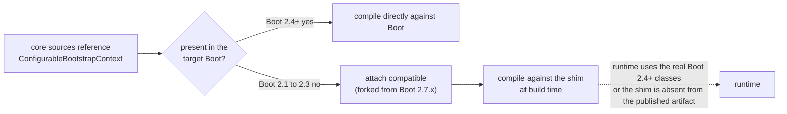
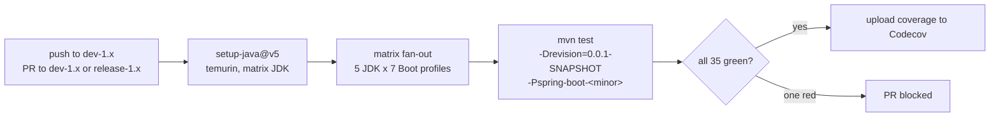
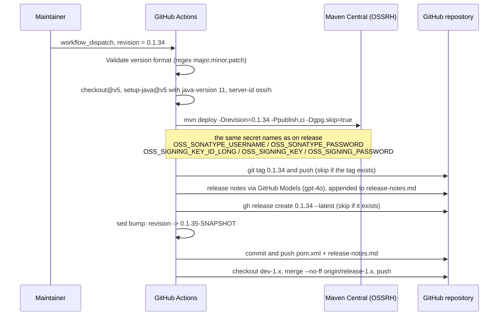
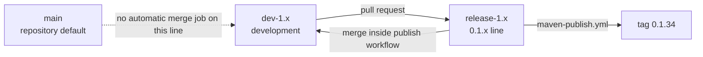

# Build and Release Pipeline — `release-1.x`

> [中文](./zh/build-and-release.md) · [Documentation index](../README.md) ·
> [User Guide for this branch](../../user-guide/1.x/README.md)

> **Branch:** `release-1.x` · **Version line:** `0.1.x` · **Scope:** Maven reactor + GitHub Actions
> This document covers the **deltas** from [../current/build-and-release.md](../current/build-and-release.md),
> which explains the shared machinery in full.

Contents:
[1 How to Read This Document](#1-how-to-read-this-document) ·
[2 Reactor Shape on This Line](#2-reactor-shape-on-this-line) ·
[3 Version Facts](#3-version-facts) ·
[4 Spring Boot Profile Table](#4-spring-boot-profile-table) ·
[5 Shim Attachment and Extra Pins](#5-shim-attachment-and-extra-pins) ·
[6 Local Build Commands](#6-local-build-commands) ·
[7 CI Anatomy](#7-ci-anatomy) ·
[8 The Release Pipeline](#8-the-release-pipeline) ·
[9 Branch Model](#9-branch-model) ·
[10 Porting Between the Two Lines](#10-porting-between-the-two-lines) ·
[11 Troubleshooting on This Line](#11-troubleshooting-on-this-line) ·
[12 See Also](#12-see-also)

---

## 1. How to Read This Document

Both lines are built by the same shape of POM and the same two workflows. Where the mechanism is identical, this
document links to the `release` version instead of repeating it. Everything asserted here was read from the
`release-1.x` tree.

---

## 2. Reactor Shape on This Line

```mermaid
graph TD
    BUILD["microsphere-build:0.3.14<br/>(external parent)"]
    ROOT["microsphere-spring-boot (root)<br/>revision=0.1.35-SNAPSHOT"]
    P["...-parent"]
    D["...-dependencies (BOM)"]
    C["...-compatible<br/>(12 shims, never published)"]
    T["...-test"]
    CORE["...-core"]
    MVC["...-webmvc"]
    FLUX["...-webflux"]
    ACT["...-actuator"]

    BUILD --> ROOT
    ROOT --> P
    ROOT --> D
    ROOT --> C
    ROOT --> T
    ROOT --> CORE
    ROOT --> MVC
    ROOT --> FLUX
    ROOT --> ACT
    P -. inheritance .-> C
    P -. inheritance .-> T
    P -. inheritance .-> CORE
    P -. inheritance .-> MVC
    P -. inheritance .-> FLUX
    P -. inheritance .-> ACT
    CORE -. test scope .-> T
    MVC --> CORE
    FLUX --> CORE
    ACT --> CORE
    CORE -. profiles 2.1 and 2.2 and 2.3 .-> C
```

The `<modules>` list and its order are byte-for-byte the same as on `release`
(parent, dependencies, compatible, test, core, webmvc, webflux, actuator). Only the POM *bodies* differ.

---

## 3. Version Facts

| Item | Value on `release-1.x` | Contrast with `release` |
|---|---|---|
| `<revision>` | `0.1.35-SNAPSHOT` | `0.2.35-SNAPSHOT` |
| `<java.version>` | **absent** from the root POM | `17` |
| Build parent | `microsphere-build:0.3.14` | `0.3.16` |
| `microsphere-spring.version` | `0.1.39` | `0.2.39` |
| `jolokia.version` | `1.7.2` | `2.6.3` |
| `junit-jupiter.version` | `5.14.4` | `6.1.3` |
| `<repositories>` in the parent | none | a `spring-milestone` repository |

Because `<java.version>` is not set here, the effective compiler level comes from `microsphere-build`. The CI
matrix still starts at JDK 8, which is the practical floor for this line's source code: no pattern-matching
`instanceof`, no text blocks, no `switch` expressions.

---

## 4. Spring Boot Profile Table

Defined in `microsphere-spring-boot-parent/pom.xml`:

| Profile | `spring-boot.version` | Extra effects |
|---|---|---|
| `spring-boot-2.1` | `2.1.18.RELEASE` | attaches `compatible` to `core`; pins `spring-core:5.2.25.RELEASE` in `compatible`; pins `micrometer-core:1.3.20` in `actuator` |
| `spring-boot-2.2` | `2.2.13.RELEASE` | attaches `compatible` to `core` |
| `spring-boot-2.3` | `2.3.12.RELEASE` | attaches `compatible` to `core` |
| `spring-boot-2.4` | `2.4.13` | |
| `spring-boot-2.5` | `2.5.15` | |
| `spring-boot-2.6` | `2.6.15` | |
| `spring-boot-2.7` | `2.7.18` | `activeByDefault` |

The `.RELEASE` suffix on the first three entries is the upstream versioning scheme for Boot `2.1`–`2.3`; from
`2.4` on, Spring Boot publishes plain `major.minor.patch` versions. A dependency request for `2.1.18` without
the suffix does not resolve, which is why the suffix survives in the profile even though it looks inconsistent.

The `activeByDefault` semantics are identical to `release`: activating any profile explicitly (for example
`-Pspring-boot-2.1`) deactivates the implicit `2.7` selection.

---

## 5. Shim Attachment and Extra Pins

`microsphere-spring-boot-core/pom.xml` lines 91–127 declare profiles `spring-boot-2.1`, `spring-boot-2.2` and
`spring-boot-2.3`, each attaching `microsphere-spring-boot-compatible:${revision}`. The mechanism — a profile in
the *depending* module rather than an optional dependency inside the shim — is the same one described in
[../current/build-and-release.md](../current/build-and-release.md); the direction is inverted:



Two extra pins exist only on this line:

| Module | Profile | Pin | Why |
|---|---|---|---|
| `microsphere-spring-boot-compatible` | `spring-boot-2.1` | `org.springframework:spring-core:5.2.25.RELEASE` (optional) | the forked bootstrap sources need a Spring Framework release that carries the APIs they reference |
| `microsphere-spring-boot-actuator` | `spring-boot-2.1` | `io.micrometer:micrometer-core:1.3.20` | Boot `2.1`'s managed Micrometer predates the binder APIs the scheduler metrics use |

Neither pin changes the published artifacts: they apply only while building under that profile.

---

## 6. Local Build Commands

```bash
# default line (2.7.18) — needs JDK 8 or 11 to match the low end of the matrix
./mvnw clean verify

# oldest supported combination
./mvnw -pl microsphere-spring-boot-core -am -Pspring-boot-2.1 test

# does the shim attach under 2.1 but not under 2.4?
./mvnw -pl microsphere-spring-boot-core -am -Pspring-boot-2.1 dependency:tree | grep compatible
./mvnw -pl microsphere-spring-boot-core -am -Pspring-boot-2.4 dependency:tree | grep compatible

# one matrix cell, exactly as CI runs it
mvn --batch-mode --update-snapshots --file pom.xml \
    -Drevision=0.0.1-SNAPSHOT \
    -Dsurefire.useSystemClassLoader=false \
    test --activate-profiles test,coverage,spring-boot-2.1
```

Selecting a profile that does not exist on this line (for example `-Pspring-boot-4.0`) produces a Maven warning
that the profile cannot be activated and silently falls back to the default `2.7` build.

---

## 7. CI Anatomy

`.github/workflows/maven-build.yml` on `release-1.x`:

| Element | Value |
|---|---|
| Triggers | push to `dev-1.x`; pull request targeting `dev-1.x`, `release-1.x` |
| Runner | `ubuntu-latest` |
| JDK matrix | `8`, `11`, `17`, `21`, `25` |
| Boot profile matrix | `spring-boot-2.1` … `spring-boot-2.7` (7 entries) |
| Jobs per push | 5 × 7 = 35 |
| Actions | `actions/checkout@v5`, `actions/setup-java@v5`, `codecov/codecov-action@v5` |
| Build command | identical to the `release` branch, including `-Drevision=0.0.1-SNAPSHOT` |
| Post-step | coverage upload with `CODECOV_TOKEN` and slug `microsphere-projects/microsphere-spring-boot` |



Two observations worth keeping in mind:

* `main` and `release-1.x` are **not** build triggers for pushes, so a direct push to `release-1.x` is validated
  only by the pull request that preceded it and by the publish workflow's own `deploy` (which runs the tests).
* Both lines upload to the same Codecov slug, so the coverage trend for the repository mixes `0.1.x` and `0.2.x`
  runs.

---

## 8. The Release Pipeline

`.github/workflows/maven-publish.yml` on this line is the same two-job pipeline as on `release`, with three
substitutions. Trigger: push to `release-1.x`, or `workflow_dispatch` with a `revision` input.



| Step | Same as `release`? | Note |
|---|---|---|
| Version validation | yes | `^[0-9]+\.[0-9]+\.[0-9]+$` — the input is the *project* version and never carries Boot's `.RELEASE` suffix |
| Deployment | yes | same `./mvnw ... deploy --activate-profiles publish,ci -Dgpg.skip=true` |
| Publishing JDK | **no** | JDK `11` here, `17` on `release` — the artifact is built with the line's own baseline |
| Tag and GitHub Release | yes | both existence-checked, so re-runs stay idempotent |
| Release notes | yes | same GitHub Models `gpt-4o` call and the same `release-notes.md` append |
| Patch bump | yes | `major.minor.(patch+1)-SNAPSHOT` |
| Merge-back target | **no** | `dev-1.x`, with the commit message `chore: merge release-1.x into dev-1.x [skip ci]` |

The idempotence and no-drift properties described for the `release` pipeline hold here unchanged, because the
steps are the same steps.

---

## 9. Branch Model



| Workflow | Present on this line | Behaviour |
|---|---|---|
| `maven-build.yml` | yes | 35-cell matrix, triggered from `dev-1.x` |
| `maven-publish.yml` | yes | deploys from `release-1.x`, merges into `dev-1.x` |
| `merge-main-to-branches.yml` | **no** | there is no automation carrying `main` into the `0.1.x` branches |
| `sync-branches-from-upstream.yml` | yes | same fork-only, `--force-with-lease` sync, triggered by pushes to `main`, `dev`, `dev-1.x` and a `*/5 * * * *` schedule |

Consequence: the `0.1.x` line receives changes only through its own branch pair (`dev-1.x` → `release-1.x`). A
fix merged into `main` does not appear here automatically, in either direction.

---

## 10. Porting Between the Two Lines

When a fix exists on one line and must land on the other, the build-side steps are:

1. Reproduce the change on the target branch and re-check the source-level constraints listed in
   [README.md](./README.md) (Java 8 idioms, Boot 2.1 API floor, reflective capability probes).
2. Re-run the narrow matrix slice locally: `./mvnw -pl <module> -am -Pspring-boot-2.1 test` and
   `-Pspring-boot-2.7`.
3. Confirm registration files on this line: `spring.factories` **and** `AutoConfiguration.imports`.
4. Confirm that no `compatible` shim became necessary or obsolete — shims attach only under `2.1`/`2.2`/`2.3`.
5. Update the affected module document on the target branch in both languages.
6. Never cherry-pick a version-literal change: each line owns its own `<revision>`.

---

## 11. Troubleshooting on This Line

| Symptom | Cause | Action |
|---|---|---|
| `The requested profiles [spring-boot-4.0] could not be activated` | that profile exists only on `release` | pick a `2.x` profile |
| Build fails under `-Pspring-boot-2.1` but passes under `2.7` | a Boot API newer than 2.1 is imported directly | route it by name or reflection, or add a `compatible` shim |
| `microsphere-spring-boot-compatible` cannot be resolved | `core` built alone | add `-am`, or build from the root |
| Compilation rejects `instanceof X x` / text blocks | Java 8 source level on this line | rewrite in Java 8 form as the existing sources do |
| Boot dependency does not resolve | missing `.RELEASE` suffix for `2.1`–`2.3` | use the exact string from the profile table |
| CI red only on JDK 8 | the change uses a newer language feature | fix the source, do not drop the JDK from the matrix |
| Coverage job reports a diff against the other line | both lines share one Codecov slug | expected; interpret the badge per-run, not per-line |

---

## 12. See Also

| Document | Scope |
|---|---|
| [../current/build-and-release.md](../current/build-and-release.md) | The shared machinery, explained in full |
| [README.md](./README.md) | This line's architecture, extension points and cross-branch source diff |
| [parent.md](./parent.md) | The Boot 2 profile table in the Parent POM |
| [compatible.md](./compatible.md) | The twelve shims and their attaching profiles |
| [dependencies.md](./dependencies.md) | The 0.1.x BOM |
| [../../user-guide/1.x/parent.md](../../user-guide/1.x/parent.md) | Consumer-facing view of the same POM |
