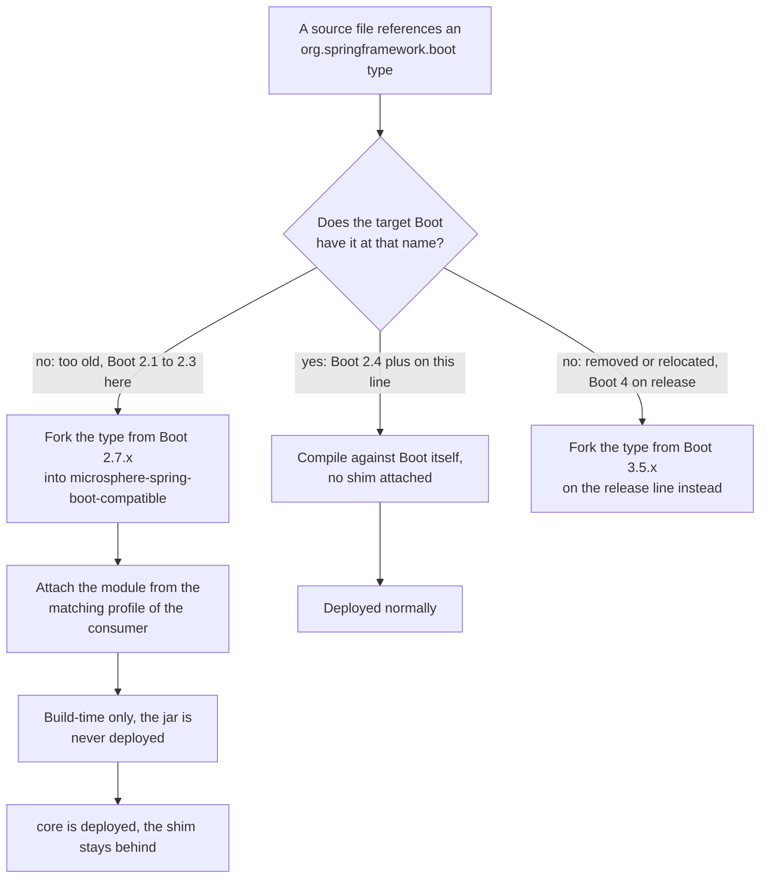

# Compatible Module — `release-1.x`

> [中文](./zh/compatible.md) · [Documentation index](../README.md) ·
> [Same document for the `release` branch](../current/compatible.md)

> **Branch:** `release-1.x` · **Version line:** `0.1.x` · **Artifact:** `microsphere-spring-boot-compatible`
> **Status:** not published · not in the BOM · build-time only · **Shim source:** Spring Boot `2.7.x`

Contents:
[1 Scope and Pairing](#1-scope-and-pairing) ·
[2 Inverted Direction Versus the Release Line](#2-inverted-direction-versus-the-release-line) ·
[3 The Twelve Shim Files](#3-the-twelve-shim-files) ·
[4 Profile Attachment in the Core POM](#4-profile-attachment-in-the-core-pom) ·
[5 A Framework Pin Inside the Shim Module](#5-a-framework-pin-inside-the-shim-module) ·
[6 Two Kill-Switches for Publication](#6-two-kill-switches-for-publication) ·
[7 Why the Shims Collide but Stay Safe](#7-why-the-shims-collide-but-stay-safe) ·
[8 Servlet and Properties Asymmetry](#8-servlet-and-properties-asymmetry) ·
[9 Recipes](#9-recipes) ·
[10 Invariants](#10-invariants) ·
[11 See Also](#11-see-also)

---

## 1. Scope and Pairing

This document covers `microsphere-spring-boot-compatible` **on `release-1.x` only**. The module exists on both
lines with the same artifact id, packaging, forked-package strategy and publication kill-switches; that shared
machinery is explained in full in [../current/compatible.md](../current/compatible.md) and is not repeated here.

| Topic | Delta on `release-1.x` |
|---|---|
| Shim direction | Fills APIs early Boot 2 **did not have yet** (`release` patches APIs Boot 4 **removed or relocated**) |
| File count | 12 source files (`release`: 10) |
| Fork provenance | Spring Boot `2.7.x(latest)` (`release`: `3.5.x`) |
| Attaching profiles | `spring-boot-2.1`, `2.2`, `2.3` (`release`: `4.0`, `4.1`) |
| Own POM profiles | one `spring-boot-2.1` profile pinning `spring-core:5.2.25.RELEASE` (`release`: none) |
| Servlet dependency | absent (`release`: optional `jakarta.servlet:jakarta.servlet-api`) |

Everything asserted here was read from `microsphere-spring-boot-compatible/pom.xml`, its `src/main/java/org/springframework/boot/` tree, `microsphere-spring-boot-core/pom.xml` lines 91–127, and the consuming files listed in §3.

---

## 2. Inverted Direction Versus the Release Line

Both lines keep **one** source tree that must compile against every Boot version their profiles name. This module
is the escape valve when the tree needs a type the target Boot does not expose at that coordinate; the lines
differ in *why* it is missing.

| Aspect | `release-1.x` (0.1.x) | `release` (0.2.x) |
|---|---|---|
| Target Boot range, forked from | `2.1.18.RELEASE` – `2.7.18`, Boot `2.7.x(latest)` | `3.0.13` – `4.1.1`, Boot `3.5.x` |
| Why the type is absent | **too old**: the API was not introduced yet | **too new**: the API was removed or relocated |
| Examples | `ConfigurableBootstrapContext` (`@since 2.4.0`), `ConditionalOnAvailableEndpoint` (`@since 2.2.0`) | `ServerProperties`, `JacksonProperties`, `MultipartConfigFactory` |
| Attaching profiles | `spring-boot-2.1`, `spring-boot-2.2`, `spring-boot-2.3` | `spring-boot-4.0`, `spring-boot-4.1` |
| Servlet namespace | none needed | `jakarta.servlet` (optional) |



Read the middle branch as this line's reality: `core` takes a `ConfigurableBootstrapContext` parameter, Boot `2.1.18.RELEASE` has no such type, so the fork supplies it. On `release` the same question is answered by the right-hand branch — which is why that line attaches the module from its **newest** profiles and this line from its **oldest**.

---

## 3. The Twelve Shim Files

All twelve live under `microsphere-spring-boot-compatible/src/main/java/org/springframework/boot/` and keep Spring
Boot's own package names. The `@since` column quotes the tags actually present in each file.

| File | Type and visibility | `@since` in the file | Attached by | Consumed in this reactor |
|---|---|---|---|---|
| `BootstrapContext.java` | `public interface BootstrapContext` | `2.4.0` | 2.1, 2.2, 2.3 | Reached via `ConfigurableBootstrapContext` |
| `BootstrapContextClosedEvent.java` | `public class`, extends `ApplicationEvent` | `2.4.0` | 2.1, 2.2, 2.3 | Reached via `BootstrapRegistry.addCloseListener` |
| `BootstrapRegistry.java` | `public interface`; nested `@FunctionalInterface interface InstanceSupplier<T>`, nested `enum Scope` | `2.4.0`; both nested members `2.4.2` | 2.1, 2.2, 2.3 | Super-interface of `ConfigurableBootstrapContext` |
| `ConfigurableBootstrapContext.java` | `public interface`, extends `BootstrapRegistry` and `BootstrapContext` | `2.4.0` | 2.1, 2.2, 2.3 | `core` `listener/SpringApplicationRunListenerAdapter.java:3`, `core` `listener/LoggingSpringApplicationRunListener.java:21` |
| `DefaultBootstrapContext.java` | `public class`, implements `ConfigurableBootstrapContext` | `2.4.0` | 2.1, 2.2, 2.3 | `core` test `listener/LoggingSpringApplicationRunListenerTest.java:23` |
| `actuate/endpoint/EndpointId.java` | `public final class EndpointId` | `2.0.6`; `of(Environment, String)` `2.2.0` | 2.1, 2.2, 2.3 | Internal to the shim set (both condition classes call it) |
| `actuate/autoconfigure/endpoint/condition/AbstractEndpointCondition.java` | `abstract class`, package-private, extends `SpringBootCondition` | none, authors only | 2.1, 2.2, 2.3 | Super-class of `OnAvailableEndpointCondition` |
| `actuate/autoconfigure/endpoint/condition/ConditionalOnAvailableEndpoint.java` | `public @interface`, `@Conditional(OnAvailableEndpointCondition.class)`, attribute `endpoint()` default `Void.class` | `2.2.0` | 2.1, 2.2, 2.3 | `actuator` `autoconfigure/ActuatorEndpointsAutoConfiguration.java:28` |
| `actuate/autoconfigure/endpoint/condition/OnAvailableEndpointCondition.java` | `class`, package-private; nested `static class Exposure extends IncludeExcludeEndpointFilter<ExposableEndpoint<?>>` | none, authors only | 2.1, 2.2, 2.3 | Bound to the annotation above |
| `actuate/autoconfigure/endpoint/expose/IncludeExcludeEndpointFilter.java` | `public class IncludeExcludeEndpointFilter<E extends ExposableEndpoint<?>> implements EndpointFilter<E>`; nested `enum DefaultIncludes` (deprecated), nested `private static class EndpointPatterns` | `2.2.7`; `match(EndpointId)` `2.6.0` | 2.1, 2.2, 2.3 | Super-class of `Exposure` |
| `context/properties/ConstructorBinding.java` | `public @interface`, `@Target({ElementType.TYPE, ElementType.CONSTRUCTOR})` | `2.2.0` | 2.1, 2.2, 2.3 | `core` test `context/properties/TestConstructorBindingConfigurationProperties.java:21` |
| `package-info.java` | package javadoc | `1.0.0` | 2.1, 2.2, 2.3 | Records the fork provenance |

> `package-info.java` reads: "The classes in this package or sub-packages are forked from the Spring Boot
> 2.7.x(latest), which will be used to be compatible with the lower versions of Spring Boot." (`@since 1.0.0`.) On
> `release` the same sentence reads "forked from the Spring Boot 3.5.x" — each line forks from **its own newest
> supported Boot**.

Two details for review: the nested enum of `BootstrapRegistry` is named `Scope`, not `InstanceScope`; and the member of `IncludeExcludeEndpointFilter` dated `2.6.0` is `public final boolean match(EndpointId endpointId)` — the two `DefaultIncludes`-taking constructors are annotated `@Deprecated` "since 2.6.0 for removal in 3.0.0", not added then.

---

## 4. Profile Attachment in the Core POM

`core` is the only module that names the shim. `microsphere-spring-boot-core/pom.xml` lines 91–127, verbatim:

```xml
    <profiles>
        <profile>
            <id>spring-boot-2.1</id>
            <dependencies>
                <!-- Compatible -->
                <dependency>
                    <groupId>io.github.microsphere-projects</groupId>
                    <artifactId>microsphere-spring-boot-compatible</artifactId>
                    <version>${revision}</version>
                </dependency>
            </dependencies>
        </profile>

        <profile>
            <id>spring-boot-2.2</id>
            <dependencies>
                <!-- Compatible -->
                <dependency>
                    <groupId>io.github.microsphere-projects</groupId>
                    <artifactId>microsphere-spring-boot-compatible</artifactId>
                    <version>${revision}</version>
                </dependency>
            </dependencies>
        </profile>

        <profile>
            <id>spring-boot-2.3</id>
            <dependencies>
                <!-- Compatible -->
                <dependency>
                    <groupId>io.github.microsphere-projects</groupId>
                    <artifactId>microsphere-spring-boot-compatible</artifactId>
                    <version>${revision}</version>
                </dependency>
            </dependencies>
        </profile>
    </profiles>
```

The version is `${revision}`, not a parent-managed property, so the reactor resolves it from the sibling module and
`core` needs `-am` or a root build. Scope is plain compile but inside a profile: `spring-boot-2.4` … `2.7` add
nothing, and `webmvc`, `webflux`, `test`, `actuator` never declare it — `actuator` receives the endpoint shims
transitively through `core`, which is what lets `ActuatorEndpointsAutoConfiguration` use
`@ConditionalOnAvailableEndpoint` under `-Pspring-boot-2.1`. The equivalent block on `release` sits at lines 97–121
with ids `spring-boot-4.0` and `spring-boot-4.1`, same shape; `compatible` precedes `core` in the root `<modules>`
list, so one reactor build compiles the shims before the module that needs them.

---

## 5. A Framework Pin Inside the Shim Module

The module declares a profile of its own, `microsphere-spring-boot-compatible/pom.xml` lines 72–84:

```xml
    <profiles>
        <profile>
            <id>spring-boot-2.1</id>
            <dependencies>
                <dependency>
                    <groupId>org.springframework</groupId>
                    <artifactId>spring-core</artifactId>
                    <version>5.2.25.RELEASE</version>
                    <optional>true</optional>
                </dependency>
            </dependencies>
        </profile>
    </profiles>
```

Why the forks need their own framework pin although the parent already selects a Boot line: under
`spring-boot-2.1` the imported `spring-boot-dependencies:2.1.18.RELEASE` manages Spring Framework `5.1.x`, but the
forks are Boot `2.7` code importing later Framework APIs — `AbstractEndpointCondition` uses
`org.springframework.core.annotation.MergedAnnotations`, `MergedAnnotation`, `AnnotationAttributes` and
`org.springframework.util.ConcurrentReferenceHashMap`; `BootstrapRegistry` and `DefaultBootstrapContext` use
`org.springframework.core.env.Environment`, `org.springframework.util.Assert` and the `ApplicationContext` event
types. Pinning one artifact beats raising the whole Boot line, which would defeat the profile's purpose, and
`optional` keeps it out of every transitive graph. The pin applies only while building **this module** under
`spring-boot-2.1`, so it cannot reach a consumer (§6).

The same technique appears at `microsphere-spring-boot-actuator/pom.xml` lines 98–117, whose `spring-boot-2.1`
profile pins `io.micrometer:micrometer-core:1.3.20` and `org.springframework:spring-core:5.2.25.RELEASE`. No such
pin exists on `release`, whose oldest profile is recent enough for the code.

---

## 6. Two Kill-Switches for Publication

`microsphere-spring-boot-compatible/pom.xml` lines 51–69 disable deployment twice — once for the classic deploy
path, once for the Central publisher:

```xml
    <build>
        <plugins>
            <plugin>
                <groupId>org.apache.maven.plugins</groupId>
                <artifactId>maven-deploy-plugin</artifactId>
                <configuration>
                    <skip>true</skip>
                </configuration>
            </plugin>

            <plugin>
                <groupId>org.sonatype.central</groupId>
                <artifactId>central-publishing-maven-plugin</artifactId>
                <configuration>
                    <skipPublishing>true</skipPublishing>
                </configuration>
            </plugin>
        </plugins>
    </build>
```

Both blocks are byte-identical to `release`, for the same reason: a jar whose classes live in `org.springframework.boot.*` must never be downloadable. Keeping **both** matters because the external `microsphere-build` parent decides which publishing path the `publish` profile uses; disabling only one leaks the artifact.

---

## 7. Why the Shims Collide but Stay Safe

Every forked class carries Spring Boot's own fully-qualified name. On a Boot `2.4+` classpath, where Boot ships
`BootstrapContext`, `EndpointId`, `IncludeExcludeEndpointFilter` and the rest itself, the shim jar puts two
definitions of one name on the classpath; which wins is classpath order, and the loser's static caches and
annotation defaults then diverge silently. That hazard is why the module is not published. The reactor stays safe
because the shim is confined to a compile-time role:

* **Profile-scoped:** only `spring-boot-2.1`, `2.2`, `2.3` depend on it, so the default `2.7.18` build never puts a duplicate class on any classpath.
* **Never deployed** (§6), so no consumer can resolve `microsphere-spring-boot-compatible:0.1.34`; the published `0.1.x` jars contain only `io.microsphere.*` classes. **Not in the BOM** either — see [./dependencies.md](./dependencies.md).
* **Dependency profiles are not evaluated:** the block in §4 does travel inside the published `core` POM, but Maven evaluates profiles of the project being built and of its parents only. `microsphere-build` also sets `<embedBuildProfileDependencies>false</embedBuildProfileDependencies>` for the flatten plugin, so an active build profile's dependencies are not hoisted into the published `<dependencies>` either.
* **Runtime reality:** a Boot `2.4+` application resolves the real classes; an application on Boot `2.1`–`2.3` must not be handed this reactor's copies.

Consequence for local work: `-Pspring-boot-2.1` produces `core` bytecode referencing
`org.springframework.boot.ConfigurableBootstrapContext` — fine inside the matrix, not a publishable artifact for a
Boot `2.1` application.

---

## 8. Servlet and Properties Asymmetry

The `javax`/`jakarta` split sits at Boot `3.0`, below this line's entire range: everything here is `javax`, and the
shim module needs no servlet artifact at all.

| Concern | `release-1.x` | `release` |
|---|---|---|
| Servlet namespace in code | `javax.servlet` — `test/pom.xml` lines 85–87 declare `javax.servlet:javax.servlet-api`; `webmvc` `ConditionalOnWebMvcAvailable` names `"javax.servlet.Servlet"` | `jakarta.servlet` |
| Servlet dependency inside `compatible` | **none** | optional `jakarta.servlet:jakarta.servlet-api`, needed by `ServerProperties`, `MultipartProperties`, `MultipartConfigFactory` |
| Boot configuration-property forks | not needed — Boot 2 ships these types at those names | `autoconfigure/web/ServerProperties`, `autoconfigure/web/servlet/MultipartProperties`, `autoconfigure/jackson/JacksonProperties`, `web/servlet/MultipartConfigFactory` |
| Actuator endpoint forks | five files — `EndpointId`, the three condition classes, `IncludeExcludeEndpointFilter` | not needed — Boot 3 ships them |
| Binding annotation forks | `context/properties/ConstructorBinding` | not needed |

The two shim sets intersect in one group only: the five bootstrap types, which both lines fork because both lines
have a target Boot that lacks them at that coordinate. Answering "should `ServerProperties` be ported to
`release-1.x`?": no — Boot `2.1` already has `org.springframework.boot.autoconfigure.web.ServerProperties`, so a
fork would be a duplicate on every profile this line builds.

---

## 9. Recipes

### 9.1 Add a fork for an API missing before Boot 2.2

1. Copy the type from the Boot `2.7` sources into `microsphere-spring-boot-compatible/src/main/java/<boot package path>/`, keeping package, type name and member signatures identical, with the upstream `@author` lines and the real `@since` tag.
2. If the fork needs more than the module's four optional dependencies (`spring-boot-autoconfigure`, `spring-boot-actuator-autoconfigure`, `spring-core`, `spring-context`), add it **as optional** — and add no servlet API unless the fork truly references a servlet type.
3. No attachment change is needed: §4 already pulls the module under `2.1`, `2.2`, `2.3`. A Framework API newer than Boot `2.1`'s managed Spring is handled by extending the `spring-core` pin of §5, not the parent.
4. Check both ends of the range, which is where forks break:

   ```bash
   ./mvnw -pl microsphere-spring-boot-compatible -am -Pspring-boot-2.1 clean install
   ./mvnw -pl microsphere-spring-boot-core -am -Pspring-boot-2.1 test
   ./mvnw -pl microsphere-spring-boot-core -am -Pspring-boot-2.7 test
   ```

### 9.2 Retire a fork once the floor rises

If the branch drops `2.1`, `2.2`, `2.3` and its floor becomes `2.4`, every forked type exists in every supported Boot and the module is dead weight:

1. Delete the whole `<profiles>` block at `microsphere-spring-boot-core/pom.xml` lines 91–127 (three ids, one artifact).
2. Remove `<module>microsphere-spring-boot-compatible</module>` from the root `pom.xml` `<modules>` list, keeping the order of the remaining entries.
3. Delete the directory only after `-Pspring-boot-2.4` … `-Pspring-boot-2.7` builds are green without it.
4. Update [README.md](./README.md) §7, [./build-and-release.md](./build-and-release.md) §5, this document and `docs/user-guide/1.x/compatible.md` — in both languages.

### 9.3 Verify attachment

```bash
./mvnw -pl microsphere-spring-boot-core -am -Pspring-boot-2.1 dependency:tree | grep compatible   # the shim appears
./mvnw -pl microsphere-spring-boot-core -am -Pspring-boot-2.4 dependency:tree | grep compatible   # no match
./mvnw -pl microsphere-spring-boot-core -am             dependency:tree | grep compatible         # default 2.7.18, no match
```

An empty result under `-Pspring-boot-2.1` means the profile id is misspelled. Activating any profile explicitly does
deactivate the `activeByDefault` `spring-boot-2.7` selection, but it never renames the one you asked for.

---

## 10. Invariants

1. Twelve source files, all under `org.springframework.boot`, all forked from Boot `2.7.x`; `package-info.java` records that provenance and must change with it.
2. Forked type names, packages and member signatures stay identical to Spring Boot's — substitutes, not wrappers.
3. The module is never deployed and never listed in the BOM; both kill-switches of §6 stay in place.
4. Only `core` may depend on it, only under profiles `spring-boot-2.1`, `2.2`, `2.3`, always at `${revision}`.
5. Its own dependencies stay `optional`; the only version literal allowed inside the module is the `spring-core` pin of its `spring-boot-2.1` profile.
6. No Boot `3` or Boot `4` profile exists on this line, so none may attach the shim here; and forked code must compile at Java 8, the language level of the whole line.

---

## 11. See Also

| Document | Scope |
|---|---|
| [README.md](./README.md) | Branch overview, the shim-direction section, the cross-branch source diff |
| [./build-and-release.md](./build-and-release.md) | Reactor shape, profile table, extra pins, CI matrix |
| [./core.md](./core.md) | The only module that attaches the shims |
| [./actuator.md](./actuator.md) | Consumer of `@ConditionalOnAvailableEndpoint`, the `micrometer-core` pin |
| [../current/compatible.md](../current/compatible.md) | The `release` shim set and the shared machinery |
| [../../user-guide/1.x/compatible.md](../../user-guide/1.x/compatible.md) | Consumer-facing view of the same module |
