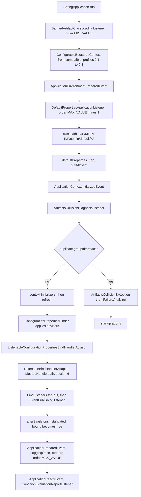
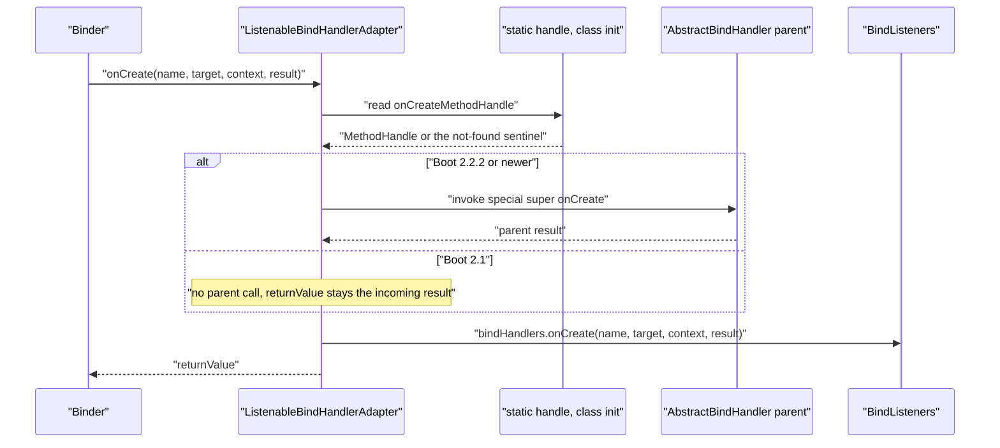

# Core Module — `release-1.x`

> [中文](./zh/core.md) · [Documentation index](../README.md) ·
> [Same document for the `release` branch](../current/core.md)

> **Branch:** `release-1.x` · **Version line:** `0.1.x` · **Artifact:** `microsphere-spring-boot-core`
> **Spring Boot:** `2.1.18.RELEASE` – `2.7.18` · **Java source level:** 8

Contents:
[1 Scope and Pairing](#1-scope-and-pairing) ·
[2 What Is Identical on This Line](#2-what-is-identical-on-this-line) ·
[3 Dual Auto-Configuration Registration](#3-dual-auto-configuration-registration) ·
[4 Java 8 Source-Level Constraints](#4-java-8-source-level-constraints) ·
[5 Reflective Capability Probing](#5-reflective-capability-probing) ·
[6 ListenableBindHandlerAdapter MethodHandle Workaround](#6-listenablebindhandleradapter-methodhandle-workaround) ·
[7 Bean Context and Run Listener Deltas](#7-bean-context-and-run-listener-deltas) ·
[8 SpringBootVersion on This Line](#8-springbootversion-on-this-line) ·
[9 Design Patterns on This Line](#9-design-patterns-on-this-line) ·
[10 Porting Recipes](#10-porting-recipes) ·
[11 Tests That Differ Between the Branches](#11-tests-that-differ-between-the-branches) ·
[12 See Also](#12-see-also)

---

## 1. Scope and Pairing

This is a **difference document**. [../current/core.md](../current/core.md) explains the shared architecture in full — package map, extension-point wiring, advisor chain, both diagnostics pipelines, the default-properties mechanism and the `@Enable*` registrar — and nothing here repeats it. `release-1.x` maintains the `0.1.x` line against Boot `2.1`–`2.7` at Java 8: the class inventory is **identical** (47 main classes; `diff` of the two relative-path lists is empty) and exactly **twelve** files under `src/main` differ. That authoritative list is: `SpringBootVersion.java`, `autoconfigure/ConfigurableAutoConfigurationImportFilter.java`, `context/properties/bind/ConfigurationPropertiesBeanContext.java`, `context/properties/bind/ListenableBindHandlerAdapter.java`, `context/properties/bind/util/BindUtils.java`, `context/properties/source/util/ConfigurationPropertyUtils.java`, `diagnostics/ArtifactsCollisionDiagnosisListener.java`, `listener/FailureReportSpringApplicationRunListener.java`, `listener/LoggingSpringApplicationRunListener.java`, `listener/SpringApplicationRunListenerAdapter.java`, `util/SpringApplicationUtils.java`, plus the resource `META-INF/spring.factories`. (`microsphere-spring-boot-core/pom.xml` differs too; it belongs to `build-and-release.md`.) Every statement below is the output of `diff -u msb-current/<path> msb-1x/<path>` over two detached worktrees; line numbers are read from the `release-1.x` tree.

| Question | Read there | Read here |
|---|---|---|
| What the module does; which classes exist | sections 1–3 | section 2 — inventory is identical |
| How it is registered | section 3 | section 3 — one extra legacy key here |
| Ordering and startup sequence | section 4 | section 2 — values identical |
| Advisor chain semantics | section 5 | sections 5–6 |
| Why the source text differs at all | — | sections 4–7 |
| Which Boot versions the code names | section 2 | section 8 |
| How to port a change either direction | — | section 10 |
| Which tests guard the delta | section 10 | section 11 |

---

## 2. What Is Identical on This Line

* **Class inventory**: 47 files under `src/main/java/io/microsphere/spring/boot/`, same paths on both branches. Naming this set exactly is what makes a port mechanical rather than a redesign.
* **`spring.factories` keys**: all seven keys `release` has are present with the same values (`ApplicationContextInitializer`, `SpringApplicationRunListener`, `ApplicationListener`, `SpringBootExceptionReporter`, `FailureAnalyzer`, `AutoConfigurationImportFilter`, and the module-private `io.microsphere.spring.boot.env.DefaultPropertiesPostProcessor`). This line adds one key — section 3.
* **Default properties**: `META-INF/config/default/core.properties` is byte-identical, md5 `ee9c9aea67bbf0fc5f4c266fbc3e6998` on both trees. Read `../current/core.md` section 7; there is nothing to add.
* **Ordering constants**, verified by grep here: `setOrder(HIGHEST_PRECEDENCE)` at `classloading/BannedArtifactClassLoadingListener.java:79`, `return HIGHEST_PRECEDENCE + 99;` at `autoconfigure/ConfigurableAutoConfigurationImportFilter.java:277`, `DEFAULT_ORDER = LOWEST_PRECEDENCE - 1` at `env/DefaultPropertiesApplicationListener.java:76`, order `0` from the adapter constructor at `listener/SpringApplicationRunListenerAdapter.java:42`. `setOrder`/`getOrder` stay `final` at `listener/SpringApplicationRunListenerAdapter.java:224` and `:240` and at `context/OnceApplicationPreparedEventListener.java:209` and `:226`.
* **Startup sequence**: same listeners, same events, same chain. The flowchart keeps only what this line registers and marks the two version-dependent spots — the bootstrap shim and the `onCreate` handle.



---

## 3. Dual Auto-Configuration Registration

On `release`, auto-configuration is registered only through the Boot 2.7+ file; here it is registered **twice**. The appended block is the *only* difference between the two copies of `microsphere-spring-boot-core/src/main/resources/META-INF/spring.factories` (lines 33–35):

```
# @EnableAutoConfiguration
org.springframework.boot.autoconfigure.EnableAutoConfiguration=\
io.microsphere.spring.boot.context.autoconfigure.ConfigurationPropertiesAutoConfiguration
```

`META-INF/spring/org.springframework.boot.autoconfigure.AutoConfiguration.imports` is one line and byte-identical on both branches: `io.microsphere.spring.boot.context.autoconfigure.ConfigurationPropertiesAutoConfiguration`. The registered class is also identical (`context/autoconfigure/ConfigurationPropertiesAutoConfiguration.java:35-42`): by-name `@ConditionalOnClass(name = "io.microsphere.spring.context.annotation.BeanCapableImportCandidate")`, by-name `@AutoConfigureBefore(name = "org.springframework.boot.autoconfigure.context.ConfigurationPropertiesAutoConfiguration")`, then `@EnableConfigurationPropertiesExtension`. The history that forces the duplication: `AutoConfiguration.imports` arrived in Boot `2.7`, which reads **both** files, while Boot `2.1`–`2.6` read only the `EnableAutoConfiguration` key; Boot `3.0` then dropped the legacy key entirely. One artifact spanning `2.1`–`2.7` must carry both, and the redundancy is harmless because Boot de-duplicates candidates it discovers twice.

| A new auto-configuration added to only one file | Boot `2.1`–`2.6` | Boot `2.7` | What the maintainer sees |
|---|---|---|---|
| `AutoConfiguration.imports` only | not imported | imported | Green under the default `2.7.18` profile, silently absent under `-Pspring-boot-2.1`. |
| `spring.factories` only | imported | imported, de-duplicated | Works here; `release` has no such key, so a port to `release` loses the class. |
| Deleted from `spring.factories` while "syncing with `release`" | silently disabled | unaffected | Invisible unless `-Pspring-boot-2.1 test` runs. |

Never synchronise these two files by copying `release` over this branch: `release` omits the key because Boot 3 ignores it, whereas here it is the only thing `2.1`–`2.6` read.

---

## 4. Java 8 Source-Level Constraints

The reactor sets **no `<java.version>` property** — `pom.xml` carries only `<revision>0.1.35-SNAPSHOT</revision>` — so the source level comes from the external `microsphere-build:0.3.14` parent and is 8. Three Java features used on `release` are illegal here; every real instance is in the table.

| Construct and location on `release-1.x` | `release` (Boot 3+, Java 17) | `release-1.x` (Boot 2, Java 8) |
|---|---|---|
| Pattern-matching `instanceof`, `autoconfigure/ConfigurableAutoConfigurationImportFilter.java:143-144` | `if (property instanceof String exclude) {` | `if (property instanceof String) {` then `String exclude = (String) property;` |
| Pattern-matching `instanceof`, `diagnostics/ArtifactsCollisionDiagnosisListener.java:175-176` | `if (artifact instanceof MavenArtifact mavenArtifact) {` | `if (artifact instanceof MavenArtifact) {` then `MavenArtifact mavenArtifact = (MavenArtifact) artifact;` |
| Text block, `util/SpringApplicationUtils.java:142` | `String messagePattern = """` … ten lines … `""";` | `String messagePattern = "SpringApplication: " + "    main class : '{}' ," + …` |
| `switch` expression, `util/SpringApplicationUtils.java:165` | `case "TRACE" -> { … }` … `default -> { … }` | `case "TRACE": { … break; }` … `default: { … break; }` |

The `log(...)` delta is not only syntactic: `release` binds ten placeholders including `springApplication.getAdditionalProfiles()`, while this line's `ofArray(...)` (`util/SpringApplicationUtils.java:153-159`) omits that call, so the template has nine. Two further asymmetries in the same method are visible in the diff and both are behavioural. `release` guards `TRACE`/`DEBUG` with `logger.isTraceEnabled()` / `isDebugEnabled()` whereas this line calls `logger.trace(...)` / `logger.debug(...)` unguarded, so a careless merge changes call volume with no test to catch it. And the `default` branch logs `"Logging is off"` here versus `"The logger is off"` on `release` — do not normalise that string silently if anything greps for it.

---

## 5. Reflective Capability Probing

The second class of difference is API absence rather than language level. Boot APIs newer than `2.1.18` cannot be imported, because the artifact must still compile under `-Pspring-boot-2.1`; such types are resolved **by name at class-initialisation time** and degrade to `null` when missing.

### 5.1 `BindUtils` against `BindConstructorProvider` (absent before Boot 2.2.1)

`release` writes `import static org.springframework.boot.context.properties.bind.BindConstructorProvider.DEFAULT` and calls `DEFAULT.getBindConstructor(...)`; that import cannot compile against Boot `2.1`. Here, `context/properties/bind/util/BindUtils.java` loads the class by name and reads its static field (`:67`, `:74`, `:81`):

```java
private static final String BIND_CONSTRUCTOR_PROVIDER_CLASS_NAME = "org.springframework.boot.context.properties.bind.BindConstructorProvider";
private static final Class<?> BIND_CONSTRUCTOR_PROVIDER_CLASS = loadClass(classLoader, BIND_CONSTRUCTOR_PROVIDER_CLASS_NAME);
private static final Object BIND_CONSTRUCTOR_PROVIDER = getStaticFieldValue(BIND_CONSTRUCTOR_PROVIDER_CLASS, "DEFAULT");
```

using `io.microsphere.util.ClassLoaderUtils.loadClass` and `io.microsphere.reflect.FieldUtils.getStaticFieldValue`. The public entry point delegates to a wider overload, and that signature is the contract to preserve (`:292-302`, with `MethodUtils.findMethod` / `MethodUtils.invokeMethod`):

```java
@Nullable
public static Constructor<?> getBindConstructor(Bindable<?> bindable, boolean isNestedConstructorBinding) {
    return getBindConstructor(BIND_CONSTRUCTOR_PROVIDER, bindable, isNestedConstructorBinding);
}

protected static Constructor<?> getBindConstructor(Object bindConstructorProvider, Bindable<?> bindable,
                                                   boolean isNestedConstructorBinding) {
    if (bindConstructorProvider == null) { // Spring Boot < 2.2.1
        return null;
    }
    Method method = findMethod(BIND_CONSTRUCTOR_PROVIDER_CLASS, "getBindConstructor", Bindable.class, boolean.class);
    return execute(() -> invokeMethod(bindConstructorProvider, method, bindable, isNestedConstructorBinding), e -> {
```

`protected`, with the provider as an `Object` first parameter, is deliberate: a test or a subclass can drive both the present and the absent branch without a Boot 2.1 classpath. The `// Spring Boot < 2.2.1` comment names the version the probe guards against.

### 5.2 `ConfigurationPropertyUtils` against `DataObjectPropertyName` (absent before Boot 2.2.3)

`context/properties/source/util/ConfigurationPropertyUtils.java:62-67` resolves the type by name through `io.microsphere.util.ClassLoaderUtils.resolveClass` into `private static final Class<?> DATA_OBJECT_PROPERTY_NAME_CLASS`, whose javadoc reads "The class name as a constant since Spring Boot 2.2.3". `toDashedForm` branches on it (`:158-163`) and the fallback is a maintained copy of Boot's algorithm:

```java
public static String toDashedForm(String name) {
    if (DATA_OBJECT_PROPERTY_NAME_CLASS != null) {
        return invokeStaticMethod(DATA_OBJECT_PROPERTY_NAME_CLASS, "toDashedForm", name);
    }
    return toDashedForm(name, 0);
}
```

The fallback is declared `protected static String toDashedForm(String name, int start)` (`:174`): it replaces `_` with `-`, then lowercases each character, inserting `-` before an upper-case character only when the buffer is non-empty and does not already end in `-`. Its javadoc records the provenance — "Source from `org.springframework.boot.context.properties.bind.BeanPropertyName` before Spring Boot 2.2.3". `release` deletes both methods and calls `DataObjectPropertyName.toDashedForm(name)` directly. Three smaller asymmetries belong to the same edit: `toDashedForm(String)` loses its `@Nonnull` here; `classLoader` comes from `ConfigurationPropertyUtils.class.getClassLoader()` (`:55`) rather than `ConfigurationProperties.class.getClassLoader()`; and `getParent` (`:136-139`) avoids a method that exists but is not portable across this range, returning the statically imported `ConfigurationPropertyName.EMPTY` when `name.getNumberOfElements() <= 1` and otherwise `name.chop(numberOfElements - 1)`, where `release` is the single line `return name.getParent();`.

### 5.3 Decision rule: probe reflectively, shim, or condition by name

| Option | Choose when | Example on this branch |
|---|---|---|
| **Reflective probe** | The API is a static member or a single utility method whose absence only means "less capability", and `null` is a legal answer. | `BindUtils` on `BindConstructorProvider.DEFAULT` (Boot 2.2.1); `ConfigurationPropertyUtils` on `DataObjectPropertyName` (Boot 2.2.3). |
| **`MethodHandle` probe** | The API is an instance method you must dispatch on `super`, so plain reflection would change the semantics you are preserving. | `ListenableBindHandlerAdapter` on `AbstractBindHandler.onCreate` — section 6. |
| **Shim in `compatible`** | The type appears in a **signature** — parameter, return, annotation, `extends` — so it is needed at compile time. | `context.properties.ConstructorBinding`, `actuate.endpoint.EndpointId`, `actuate.autoconfigure.endpoint.condition.{AbstractEndpointCondition,ConditionalOnAvailableEndpoint,OnAvailableEndpointCondition}`, `ConfigurableBootstrapContext`; attached by profiles `2.1`/`2.2`/`2.3` at `microsphere-spring-boot-core/pom.xml:91-127`. |
| **By-name condition** | The type is only a **gate** and never referenced in code. | `@ConditionalOnClass(name = "io.microsphere.spring.context.annotation.BeanCapableImportCandidate")` at `ConfigurationPropertiesAutoConfiguration.java:35-37`. |
| **Maintained copy** | The API is absent, small, and its algorithm is stable. | `toDashedForm(String, int)`; the `compatible` sources, marked "forked from the Spring Boot 2.7.x(latest)". |

Tie-breaker: **in a signature, shim it; in a body, probe it.**

---

## 6. `ListenableBindHandlerAdapter` MethodHandle Workaround

`context/properties/bind/ListenableBindHandlerAdapter.java:50-51` states the constraint: `BindHandler#onCreate(ConfigurationPropertyName, Bindable, BindContext, Object)` "was introduced in Spring Boot 2.2.2". Because the module must **compile** under Boot `2.1`, the class can contain neither `super.onCreate(...)` nor `@Override` — `release` has both, and on this line the parent call is resolved once through a trusted lookup (`:53-62`):

```java
static final MethodHandle onCreateMethodHandle;

static {
    Lookup lookup = lookup(AbstractBindHandler.class, TRUSTED);
    MethodType methodType = methodType(Object.class, ConfigurationPropertyName.class, Bindable.class, BindContext.class, Object.class);
    onCreateMethodHandle = execute(
            () -> lookup.findSpecial(AbstractBindHandler.class, "onCreate", methodType, ListenableBindHandlerAdapter.class),
            e -> null
    );
}
```

using `MethodHandleUtils.LookupMode.TRUSTED`, `MethodHandleUtils.lookup` and `ThrowableSupplier.execute`. The override drops `@Override`, keeps the signature and defines the degradation path (`:160-167`):

```java
public Object onCreate(ConfigurationPropertyName name, Bindable<?> target, BindContext context, Object result) {
    Object returnValue = result;
    if (onCreateMethodHandle != NOT_FOUND_METHOD_HANDLE) {
        returnValue = execute(() -> onCreateMethodHandle.invoke(this, name, target, context, result));
    }
    bindHandlers.onCreate(name, target, context, result);
    return returnValue;
}
```

`findSpecial(..., ListenableBindHandlerAdapter.class)` is what preserves semantics: it yields a `super`-style handle bound to the *special* parent invocation rather than a virtual call back into this override, which would recurse. `NOT_FOUND_METHOD_HANDLE` (`io.microsphere.invoke.MethodHandlesLookupUtils`) is the sentinel compared against, and the `e -> null` fallback in the initialiser is what makes the constant `null` when `AbstractBindHandler` has no such method at all. Two consequences: when the handle is unavailable the adapter returns the **incoming `result`** unchanged and still broadcasts to listeners — so under Boot `2.1` the parent's `onCreate` post-processing never runs, which is documented degradation, not something to "fix" by returning `null`; and the fan-out stays unconditional, so the return-value discipline of `../current/core.md` section 5 holds on every Boot in range.



---

## 7. Bean Context and Run Listener Deltas

### 7.1 `ConfigurationPropertiesBeanContext`

Inside `buildConfigurationPropertiesBeanContexts` (`context/properties/bind/ConfigurationPropertiesBeanContext.java:408`), lines `:413-414` read

```java
RootBeanDefinition beanDefinition = (RootBeanDefinition) beanFactory.getMergedBeanDefinition(beanName);
ResolvableType beanType = getResolvableType(beanDefinition);
```

where `release` writes `BeanDefinition beanDefinition = beanFactory.getMergedBeanDefinition(beanName);` followed by `beanDefinition.getResolvableType()`. Two changes arrive together and must be ported together. The cast exists because `io.microsphere.spring.beans.factory.config.BeanDefinitionUtils.getResolvableType(...)` (statically imported at `:54`) takes `RootBeanDefinition`, not the `BeanDefinition` interface; the cast holds only because `getMergedBeanDefinition` returns a `RootBeanDefinition`, and the utility exists because the interface method resolved types less reliably on the older Spring. The import list changes with it: this line adds `io.microsphere.reflect.FieldUtils` (`:22`) and `org.springframework.beans.factory.support.RootBeanDefinition` (`:27`) and drops `org.springframework.beans.factory.config.BeanDefinition`, so copying only the two body lines yields an uncompilable file.

### 7.2 `SpringApplicationRunListenerAdapter`

The highest-risk delta, because the compiler cannot see it. `release` annotates the class `@Deprecated(since = "0.2.9", forRemoval = true)`; here there is no annotation and no `SpringApplicationEvent` / `ApplicationListener` import (both appear only inside `release`'s `@deprecated` javadoc), and `listener/LoggingSpringApplicationRunListener` plus `listener/FailureReportSpringApplicationRunListener` likewise lose their annotations. And this line alone forwards the bootstrap hook (`listener/SpringApplicationRunListenerAdapter.java:59-61`):

```java
public void starting(ConfigurableBootstrapContext bootstrapContext) {
    starting();
}
```

On `release` that one-line body is gone, so the two hooks are independent no-ops. The consequence in each direction: copying the annotation into a `0.1.x` release announces a removal this line never decided and `forRemoval = true` turns every downstream build into a warning; dropping the forwarding line means Boot `2.4`+ consumers never fire their `starting()` hook, because Boot calls the bootstrap-context overload and funnelling it is this adapter's whole purpose; porting the forwarding **to** `release` double-fires every `starting()` hook on Boot `3`/`4`, where both overloads are dispatched. Finally, `ConfigurableBootstrapContext` is itself a `compatible` shim here (`org.springframework.boot.ConfigurableBootstrapContext`, `@since 2.4.0`), so the signature compiles at all only because profiles `2.1`–`2.3` attach that module — which is why subclasses must override **both** `starting()` and `starting(ConfigurableBootstrapContext)` to run across the whole line.

---

## 8. SpringBootVersion on This Line

The largest textual delta and the smallest semantic one: only the constant block differs, while `CURRENT`, both constructors, `resolveVersion`, the three accessors and the twelve comparison methods are byte-identical to `release`.

| Aspect | `release` | `release-1.x` |
|---|---|---|
| Javadoc | "the released Spring Boot versions since 3.0" | "the released Spring Boot versions since 2.0" |
| First constant | `SPRING_BOOT_3_0` | `SPRING_BOOT_2_0` (`:38`) |
| Last constant | `SPRING_BOOT_4_1_0` (`:236`) | `SPRING_BOOT_2_7_18` (`:294`) |
| Range covered | Boot `3.0` … `4.1` | **129** constants, Boot `2.0` … `2.7` |
| Terminal entry | `CURRENT(ofVersion(org.springframework.boot.SpringBootVersion.class))` | the same, `:296` |

Version checks are performed on the wrapped `Version` through the short forms `gt`, `ge`, `lt`, `le`, `eq` or the long forms `isGreaterThan` and friends, and the names are parsed rather than declared (`SpringBootVersion.java:308-311`):

```java
static Version resolveVersion(String name) {
    String version = name.substring(12).replace(UNDER_SCORE_CHAR, DOT_CHAR);
    return of(version);
}
```

`substring(12)` strips exactly the `SPRING_BOOT_` prefix, so every constant must be that prefix plus the version with dots as underscores: `SPRING_BOOT_2_7` is `2.7` (a bare minor, read as `2.7.0`) and `SPRING_BOOT_2_7_18` is `2.7.18`; a minor **range** is the bare constant followed by its patches. The enum is a vocabulary for guards, not a dispatcher — the only constant-based gate on this line is `CURRENT.ge(SPRING_BOOT_2_2)` in `BindableConfigurationBeanBinderTest` (section 11). When the line gains a Boot minor version: append the bare `SPRING_BOOT_2_8` constant first and then `_0`, `_1`, … in ascending order, keeping `CURRENT` last because its constructor argument is what separates it from the name-parsing constructor; add `testVersionRange(SPRING_BOOT_2_8, 0, N);` to `SpringBootVersionTest.testVersionRange` and correct the previous minor's trailing patch count; re-point the operator fixture (`getMajor`/`getMinor`/`getPatch` plus the twelve assertions) at the newest constant so a mis-parsed name fails loudly instead of comparing equal; and add the matching `spring-boot-2.8` profile to `microsphere-spring-boot-parent/pom.xml` and the CI matrix, since a constant without a profile — or a profile without constants — is a silent gap either way. Note one existing inconsistency rather than copying it: the comments read `2.3 -> [2.3.0, 2.3.13]` while the call is `testVersionRange(SPRING_BOOT_2_3, 0, 12)`, and `2.0` claims `[2.0.0, 2.0.9]`. Trust the assertion, fix the comment.

---

## 9. Design Patterns on This Line

`../current/core.md` section 8 catalogues the shared patterns; listed here are only those that exist **because** of Boot 2 age or Java 8, i.e. the ones a port to `release` should usually delete.

| Pattern | Class | Forced by |
|---|---|---|
| Reflective lookup of a static constant | `bind/util/BindUtils` (`loadClass` + `getStaticFieldValue` + `findMethod`/`invokeMethod`) | `BindConstructorProvider` absent before Boot `2.2.1` |
| Reflective lookup of a static method plus inlined algorithm | `source/util/ConfigurationPropertyUtils` (`resolveClass`, `invokeStaticMethod`, `toDashedForm(String,int)`) | `DataObjectPropertyName` absent before Boot `2.2.3` |
| Cached `MethodHandle` special invocation from a static initialiser | `bind/ListenableBindHandlerAdapter` (`TRUSTED` lookup, `findSpecial`) | `AbstractBindHandler.onCreate` absent before Boot `2.2.2`, and `super.` is not reflective |
| Null-object / sentinel degradation, `static final` sentinel instead of `Optional` | `MethodHandlesLookupUtils.NOT_FOUND_METHOD_HANDLE`, `bindConstructorProvider == null`, `DATA_OBJECT_PROPERTY_NAME_CLASS == null`, `ListenableBindHandlerAdapter.onCreateMethodHandle` | Any probe may miss at runtime and startup diagnostics must not abort the application; Java 8 has no pattern matching, and `Optional` on a hot bind callback is noise |
| Widened `protected` overload to reach the "API absent" branch | `BindUtils.getBindConstructor(Object, Bindable, boolean)` | A Boot 2.1 classpath cannot produce that branch |
| Cast-to-implementation then helper dispatch | `ConfigurationPropertiesBeanContext` on `BeanDefinitionUtils.getResolvableType(RootBeanDefinition)` | Older `BeanDefinition.getResolvableType()` behaviour |
| Compile-time shim module attached by profile | `microsphere-spring-boot-compatible`, profiles `2.1`/`2.2`/`2.3` (`core/pom.xml:91-127`) | Types used in signatures that early Boot 2 did not have |
| Template Method *without* `@Override` | `ListenableBindHandlerAdapter.onCreate` | `@Override` would not compile against the Boot 2.1 interface set |
| Version gate in tests rather than production code | `CURRENT.ge(SPRING_BOOT_2_2)` | Keeps capability probes out of main sources where a shim suffices |
| Name-parsed enum version constants | `SpringBootVersion` (`substring(12)`, underscore to dot) | No `record`/`sealed` to express the range; 129 releases to cover |

---

## 10. Porting Recipes

### 10.1 `release` to `release-1.x`

1. Check each touched file against the authoritative twelve-file list in section 1; a file outside it means you are creating the first divergence there — confirm that is intended.
2. Downgrade language features: `instanceof T x` → `instanceof T` plus cast; text block → concatenation; `switch` expression → `switch` statement with `break`; no `var`, records or sealed types; collection factories stay `io.microsphere.collection.*` (`ofList`, `ofSet`, `ofArray`).
3. Apply section 5.3 to every Boot API newer than `2.1.18`: in a signature check `compatible` first and add the shim with attaching profiles `2.1`/`2.2`/`2.3`; in a body probe by name with a `null`/sentinel degradation; as a gate keep it by name (`name = "..."`, `type = "..."`).
4. Strip `@Deprecated(since = ..., forRemoval = true)` unless it was announced on the `0.1.x` line, and re-add forwarding such as `starting(bootstrapContext) → starting()` that `release` removed (section 7.2).
5. Register any new auto-configuration in **both** `AutoConfiguration.imports` **and** `spring.factories`, and do **not** copy new `SpringBootVersion` constants — re-express the guard on the nearest `SPRING_BOOT_2_x` constant instead.
6. Build both ends of the range on a JDK 8 or JDK 11 toolchain; the reactor sets no `java.version`, so an accidental JDK-17 source level is not caught from the POM here:

   ```bash
   ./mvnw -pl microsphere-spring-boot-core -am -Pspring-boot-2.1 test
   ./mvnw -pl microsphere-spring-boot-core -am -Pspring-boot-2.7 test
   ```

### 10.2 `release-1.x` to `release`

1. Delete probes that no longer degrade: restore `import static ...BindConstructorProvider.DEFAULT` and the direct call, restore `DataObjectPropertyName.toDashedForm(name)` and delete the local `toDashedForm(String, int)`, restore `return name.getParent();`.
2. Restore `@Override` plus `super.onCreate(name, target, context, result)` in `ListenableBindHandlerAdapter`, and delete `onCreateMethodHandle`, its static block and the `java.lang.invoke` / `io.microsphere.invoke` imports.
3. Restore `BeanDefinition` and `beanDefinition.getResolvableType()`; drop the `RootBeanDefinition` cast, its import and the `BeanDefinitionUtils.getResolvableType` static import.
4. Re-apply `@Deprecated(since = "0.2.9", forRemoval = true)` to the three `listener` classes where it belongs, delete the `starting(bootstrapContext) → starting()` line, and delete the `EnableAutoConfiguration` block from `core`'s `spring.factories` — Boot 3 ignores it, and keeping it makes the two registration files drift for real.
5. Restore Java 17 idioms, the `additionalProfiles` field and the `isTraceEnabled()` / `isDebugEnabled()` guards in `SpringApplicationUtils.log`.

### 10.3 Invariants that must not move in either direction

Ordering values `MIN_VALUE`, `MIN_VALUE + 99`, `MAX_VALUE - 1`, `MAX_VALUE` and the adapter's order `0`; `BindListener` callbacks stay `void`; every `BindHandler` callback returns the parent's value and never a listener's; `onFailure` broadcasts only when the parent throws; default-property merging stays `putIfAbsent`.

---

## 11. Tests That Differ Between the Branches

`diff -rq` over `microsphere-spring-boot-core/src/test` reports exactly ten differing files, all under `src/test/java/io/microsphere/spring/boot/`; test **resources** are byte-identical on both branches.

| Test file | Difference | What it pins down |
|---|---|---|
| `SpringBootVersionTest.java` | imports `SPRING_BOOT_2_0 … 2_7_4`; ranges become `testVersionRange(SPRING_BOOT_2_0, 0, 9)` … `testVersionRange(SPRING_BOOT_2_7, 0, 18)`; operator fixtures move onto `SPRING_BOOT_2_7_4` and `SPRING_BOOT_2_7_3` | This line's constant range, `substring(12)` parsing for both `2.7` and `2.7.4`, and that `2.7.3` compares below `2.7.4` — numeric ordering, not lexicographic. |
| `autoconfigure/ApplicationAutoConfigurationTest.java` | `jakarta.annotation.Resource` becomes `javax.annotation.Resource` | The annotation-namespace split at Boot 3.0: injection must work with the `javax` annotations this Boot line uses. |
| `context/LoggingOnceMainApplicationPreparedEventListenerTest.java` | `context.setClassLoader(new URLClassLoader(...))` replaced by a helper calling `context.getDefaultListableBeanFactory().setBeanClassLoader(...)`, with the local kept as `GenericApplicationContext` | How the bean class loader is reachable on this Spring version. The asserted behaviour — `isIgnored` false and `isMainApplicationContext` true with the Spring Cloud class unresolvable — is unchanged, so only the wiring differs. |
| `context/config/BindableConfigurationBeanBinderTest.java` | `assertThrows(BindException.class, () -> beanBinder.bind(properties, false, true, user))` wrapped in `if (CURRENT.ge(SPRING_BOOT_2_2))` | Boot `2.1` does not raise `BindException` for an invalid field when `ignoreInvalidFields` is set; the one legitimate version gate in this module's tests. |
| `context/properties/TestConstructorBindingConfigurationProperties.java` | imports `org.springframework.boot.context.properties.ConstructorBinding` (the shim package) instead of `...properties.bind.ConstructorBinding`; `@ConstructorBinding` moves onto the constructor; adds a no-arg constructor, drops `final`, adds setters | Constructor binding at `2.2`/`2.3` is annotation-on-constructor and pre-`2.2` has no bind constructor at all, so the fixture must stay JavaBean-bindable for the low end. |
| `context/properties/bind/EventPublishingConfigurationPropertiesBeanPropertyChangedListenerTest.java` | deletes the `WebProperties` fixture, its five `spring.web.*` properties, the `Locale` and `FIXED` imports and the whole `testWebProperties(int)` case | `org.springframework.boot.autoconfigure.web.WebProperties` does not exist before Boot 3.0; the change-detection contract is exercised here through `TestConfigurationProperties` instead. |
| `context/properties/bind/ListenableBindHandlerAdapterTest.java` | static-imports `onCreateMethodHandle` and `NOT_FOUND_METHOD_HANDLE`; `testOnCreate()` asserts the degraded path returns `null` under the comment `// before Spring Boot 2.2.0`, otherwise invokes `Binder.bindOrCreate` reflectively via `findMethod`/`invokeMethod`; `createBinder(...)` returns `ListenableBindHandlerAdapter` not `BindHandler` | Both halves of section 6: the handle-absent path returns the incoming result, the handle-present path still delegates and returns the parent's object. The reflective `bindOrCreate` lookup is itself the Boot-2-safe way to reach that method. |
| `context/properties/bind/util/BindUtilsTest.java` | `testGetBindConstructor` asserts `assertNull(...)` for `TestConstructorBindingConfigurationProperties` where `release` asserts `assertNotNull`; uses `of(...)` not `forClass(...)`, passes `false` explicitly, comments out the `TestBindConstructorClass` expectations | That `getBindConstructor` must return `null` rather than throw when the provider is absent or the constructor is not bindable — the probe's degradation contract, and the reason the test rather than the main code differs. |
| `context/properties/source/util/ConfigurationPropertyUtilsTest.java` | adds `testToDashedFormWithStart()` over `my-name`, `myName`, `MyName`, `my_name`, plus `assertToDashedForm(String name)` asserting `toDashedForm(name)` equals `toDashedForm(name, 0)` | That the maintained fallback agrees exactly with the reflective Boot call for both underscore and camel-case input; without it, the copied algorithm could rot silently. |
| `diagnostics/ArtifactsCollisionFailureAnalyzerTest.java` | adds `@Component` to the test class | Boot 2 requires the failing `CommandLineRunner` to be a bean for `springApplication.run()` to fail as the test expects; on Boot 3 the discovery path differs. |

See `../current/core.md` section 10 for the shared suite; those files are identical here.

---

## 12. See Also

| Document | Scope |
|---|---|
| [README.md](./README.md) | Developer-guide index for `release-1.x`, with the cross-branch difference table this document expands. |
| [actuator.md](./actuator.md) | The same delta treatment for `microsphere-spring-boot-actuator`. |
| [compatible.md](./compatible.md) | The twelve Boot-2 shims this module leans on under profiles `2.1`–`2.3`. |
| [test.md](./test.md) | `microsphere-spring-boot-test` base classes used by the tests in section 11. |
| [../current/core.md](../current/core.md) | The `release` architecture document; read first. |
| [../../user-guide/1.x/core.md](../../user-guide/1.x/core.md) | User-facing configuration on the `0.1.x` line. |
