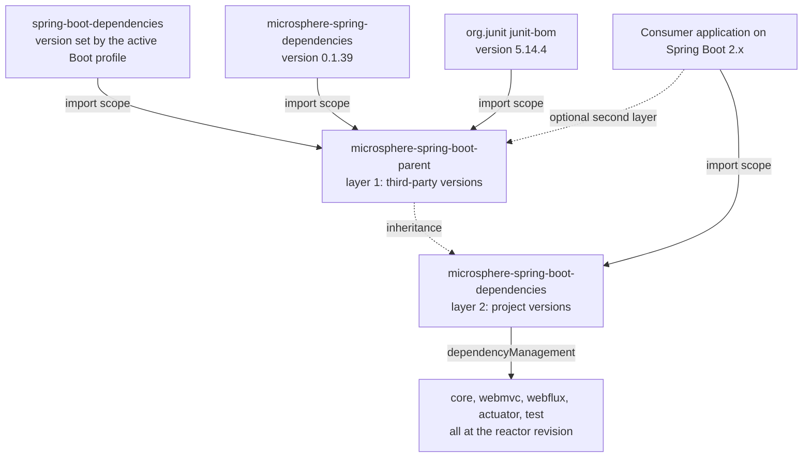

# Dependencies BOM — `release-1.x`

> [中文](./zh/dependencies.md) · [Documentation index](../README.md) ·
> [Same document for the `release` branch](../current/dependencies.md)

> **Branch:** `release-1.x` · **Version line:** `0.1.x` · **Artifact:** `microsphere-spring-boot-dependencies`
> **Packaging:** pom (BOM) · **Manages:** 5 artifacts

Contents:
[1 Scope and Pairing](#1-scope-and-pairing) ·
[2 The Two-Layer BOM Design](#2-the-two-layer-bom-design) ·
[3 The Five Managed Entries](#3-the-five-managed-entries) ·
[4 Same Artifact Set, Different Version Line](#4-same-artifact-set-different-version-line) ·
[5 Why compatible and parent Stay Out](#5-why-compatible-and-parent-stay-out) ·
[6 The Parent Element and Its Consequences](#6-the-parent-element-and-its-consequences) ·
[7 Boot Line Pairing](#7-boot-line-pairing) ·
[8 Adding a Sixth Module](#8-adding-a-sixth-module) ·
[9 Consumer-Side Import](#9-consumer-side-import) ·
[10 See Also](#10-see-also)

---

## 1. Scope and Pairing

`microsphere-spring-boot-dependencies` is the published version contract of the `0.1.x` line: a `<packaging>pom</packaging>` module whose whole content is one `<dependencyManagement>` block naming the five shippable artifacts — no properties, no profiles, no build section, no repositories. The design is shared with `release` and explained there in full: [../current/dependencies.md](../current/dependencies.md).

This document is the delta view, and the delta is remarkable: **the two POMs are byte-for-byte identical.** A `diff` of `microsphere-spring-boot-dependencies/pom.xml` between the two worktrees produces no output at all — same five entries, same order, same `${revision}` placeholders, same `<parent>`. What differs is only what those coordinates resolve to, because the surrounding POMs select a different Spring Boot generation and a different `microsphere-spring` line (`0.1.39` here, `0.2.39` there).

| Aspect | `release-1.x` | `release` |
|---|---|---|
| BOM POM body | identical | identical |
| `${revision}` resolves to | `0.1.35-SNAPSHOT` (tip), `0.1.34` (last published) | `0.2.35-SNAPSHOT` (tip) |
| Boot range the artifacts are built against | `2.1.18.RELEASE` – `2.7.18` | `3.0.13` – `4.1.1` |
| Servlet namespace inside the jars | `javax.*` | `jakarta.*` |
| Auto-configuration registration | `spring.factories` **and** `AutoConfiguration.imports` | `AutoConfiguration.imports` only |

---

## 2. The Two-Layer BOM Design

Two version layers exist and they never overlap: the **parent** imports third-party BOMs and manages everything that is not this project, while the **dependencies** module manages this project's own artifacts and imports nothing.



| Layer | File | Manages | A consumer must |
|---|---|---|---|
| 1, parent | `microsphere-spring-boot-parent/pom.xml` | Boot, Framework, Jackson, Micrometer, JUnit, Jolokia, `microsphere-spring-*` | not required to use it; `spring-boot-starter-parent` usually fills the same role |
| 2, BOM | `microsphere-spring-boot-dependencies/pom.xml` | the five `microsphere-spring-boot-*` artifacts | import it, or state versions by hand |

The BOM inherits layer 1 (§6) but re-exports none of it: importing this artifact pins `core` at `0.1.34` and says nothing about Spring Boot, which is why §9 pairs the BOM import with an ordinary `spring-boot-starter-parent`.

---

## 3. The Five Managed Entries

`microsphere-spring-boot-dependencies/pom.xml` lines 21–55, verbatim:

```xml
    <dependencyManagement>
        <dependencies>

            <dependency>
                <groupId>io.github.microsphere-projects</groupId>
                <artifactId>microsphere-spring-boot-core</artifactId>
                <version>${revision}</version>
            </dependency>

            <dependency>
                <groupId>io.github.microsphere-projects</groupId>
                <artifactId>microsphere-spring-boot-webmvc</artifactId>
                <version>${revision}</version>
            </dependency>

            <dependency>
                <groupId>io.github.microsphere-projects</groupId>
                <artifactId>microsphere-spring-boot-webflux</artifactId>
                <version>${revision}</version>
            </dependency>

            <dependency>
                <groupId>io.github.microsphere-projects</groupId>
                <artifactId>microsphere-spring-boot-actuator</artifactId>
                <version>${revision}</version>
            </dependency>

            <dependency>
                <groupId>io.github.microsphere-projects</groupId>
                <artifactId>microsphere-spring-boot-test</artifactId>
                <version>${revision}</version>
            </dependency>

        </dependencies>
    </dependencyManagement>
```

That order — `core`, `webmvc`, `webflux`, `actuator`, `test` — is the whole file's management section; all five carry `<version>${revision}</version>` and nothing else (no `<type>`, no `<scope>`, no `<exclusions>`), so they are pure pin-down entries and every consumer states its own scope. `webmvc` is the servlet stack (`javax.servlet` at runtime), `webflux` the reactive one, `actuator` needs `spring-boot-starter-actuator` present in the application, and `test` (the JUnit 5 base classes) is normally used in `test` scope, including inside this reactor.

---

## 4. Same Artifact Set, Different Version Line

The five artifact ids are the same on both lines, in the same order, at the same placeholder. The only difference a consumer sees is the version — `0.1.x` here, `0.2.x` there — and that one number carries a large compatibility contract.

| Mixing `0.1.x` and `0.2.x` | What happens |
|---|---|
| Both BOMs imported | first import wins per artifact, so the two lines interleave at unpredictable versions |
| A `0.2.x` jar on a Boot 2 classpath | `NoClassDefFoundError` for `jakarta.servlet.*` and Boot 3 types; `AutoConfiguration.imports`-only registration is ignored by Boot `2.1`–`2.6` |
| A `0.1.x` jar on a Boot 3 classpath | classes compiled against the Boot 2 endpoint and binding APIs, and the `spring.factories` auto-configuration key is ignored from Boot 3 onward |
| Same line, different patch | supported — the five artifacts are released together and always share `${revision}` |

The rule when answering an issue: one application uses exactly one version line, chosen by its Spring Boot generation. Never advise "just pin one module to the other line"; the modules cross-depend on each other at `${revision}` internally, so a mixed set breaks inside the first transitive hop.

---

## 5. Why compatible and parent Stay Out

| Excluded module | Reason | Evidence |
|---|---|---|
| `microsphere-spring-boot-compatible` | Never deployed, so an entry could never resolve; its classes live in `org.springframework.boot.*` and must not reach a repository | `maven-deploy-plugin` `<skip>true</skip>` and `central-publishing-maven-plugin` `<skipPublishing>true</skipPublishing>`, lines 51–69 of its POM; attached to `core` only under profiles `spring-boot-2.1`, `2.2`, `2.3` — see [./compatible.md](./compatible.md) |
| `microsphere-spring-boot-parent` | A parent POM is inherited, not depended upon; listing it would invite a `<dependency>` on a `pom` artifact | Its content is `properties` + `dependencyManagement` + profiles — see [./parent.md](./parent.md) |

Both exclusions are identical on `release`, for the same two reasons. What differs between the lines is *which* shims `compatible` carries (twelve Boot 2.4-era and actuator types here, ten Boot 4 relocations there) and *which* profiles attach it — neither of which is visible from the BOM.

---

## 6. The Parent Element and Its Consequences

The BOM is **not** standalone. Lines 5–10 of `microsphere-spring-boot-dependencies/pom.xml`, verbatim:

```xml
    <parent>
        <groupId>io.github.microsphere-projects</groupId>
        <artifactId>microsphere-spring-boot-parent</artifactId>
        <version>${revision}</version>
        <relativePath>../microsphere-spring-boot-parent/pom.xml</relativePath>
    </parent>
```

Byte-identical POMs mean this element, including its `<relativePath>`, exists on `release` too. Three consequences worth stating explicitly:

* **Inside the reactor**, `<relativePath>` lets Maven resolve the parent from disk, so a root build needs no published `0.1.35-SNAPSHOT` parent in the local repository.
* **`${revision}` is inherited from the root aggregator**, one level above the parent, and serves both as this POM's own `<version>` and as the version of all five entries. The reactor never deploys an unresolved `${revision}` because `microsphere-build:0.3.14` wires `flatten-maven-plugin` 1.7.3 with `flatten.mode=resolveCiFriendliesOnly`, the mode that substitutes the CI-friendly version elements and keeps the rest of the POM structure.
* **A published flattened BOM still names its parent**, so a consumer importing `microsphere-spring-boot-dependencies:0.1.34` must also be able to resolve `microsphere-spring-boot-parent:0.1.34` from Central — which is why a release deploys the whole reactor, `parent` included ([./build-and-release.md](./build-and-release.md)). Inherited content is not re-exported either: the parent's three `dependencyManagement` imports do not travel to consumers of this BOM, because inheritance and import are different relations. So `mvn dependency:tree` in a consumer that imports only this BOM should show `microsphere-spring-boot-core:jar:0.1.34` next to whatever Boot version the consumer's own parent selects.

---

## 7. Boot Line Pairing

| Boot line | `microsphere-spring-boot` version | Boot versions the line is built and tested against | `microsphere-spring` |
|---|---|---|---|
| Spring Boot `2.1` – `2.7` | `0.1.x` (BOM `microsphere-spring-boot-dependencies:0.1.34`) | `2.1.18.RELEASE`, `2.2.13.RELEASE`, `2.3.12.RELEASE`, `2.4.13`, `2.5.15`, `2.6.15`, `2.7.18` | `0.1.39` |
| Spring Boot `3.0` – `4.1` | `0.2.x` | `3.0.13` … `3.5.16`, `4.0.8`, `4.1.1` | `0.2.39` |

Selection rules: an application on Boot `2.x` takes the `0.1.x` line and imports `microsphere-spring-boot-dependencies:0.1.34`; on `3.x` or `4.x` it takes `0.2.x`. On Boot `2.1`–`2.3` the `0.1.x` line still applies — those are just the profiles that need the shim module *inside this reactor*, and the published jars do not carry it. A Boot version unlisted above is covered by neither line; build that Boot version locally before promising support.

---

## 8. Adding a Sixth Module

A new `microsphere-spring-boot-<name>` jar that ships to Central touches six places, in this order:

1. **BOM entry** — add a `<dependency>` with `<version>${revision}</version>` to the `dependencyManagement` block of `microsphere-spring-boot-dependencies/pom.xml`, in the existing style: groupId first, blank line between entries, no scope.
2. **Root `<modules>`** — add `<module>microsphere-spring-boot-<name></module>` to `pom.xml`; order matters only for readability, but the current list (parent, dependencies, compatible, test, core, webmvc, webflux, actuator) is topological, so insert the newcomer after everything it depends on.
3. **Parent declaration** — the new POM declares `<artifactId>microsphere-spring-boot-parent</artifactId>` at `${revision}` with `<relativePath>../microsphere-spring-boot-parent/pom.xml</relativePath>`, packs as `jar`, and then declares dependencies **without versions** wherever the parent's imports already cover them.
4. **Profile and shim decision** — if the module needs an API that Boot `2.1`–`2.3` lack, depend on `microsphere-spring-boot-compatible` inside profiles named exactly `spring-boot-2.1`, `spring-boot-2.2` and `spring-boot-2.3`, as `core` does, and never in the default scope; if it needs a Framework or Micrometer version newer than Boot `2.1` manages, add a `spring-boot-2.1` profile with an `optional` pin, as `actuator` and `compatible` do.
5. **CI matrix** — `.github/workflows/maven-build.yml` needs no per-module entry because it builds the whole reactor, but every cell must stay green, so run the seven profile ids locally and at least the two extremes: `./mvnw -pl microsphere-spring-boot-<name> -am -Pspring-boot-2.1 test` and the same with `-Pspring-boot-2.7`.
6. **Docs in both languages** — `docs/developer-guide/1.x/<name>.md` plus `docs/developer-guide/1.x/zh/<name>.md`, `docs/user-guide/1.x/<name>.md` plus its `zh` mirror, and the module tables in both `README.md` files; a published module belongs in the entry list of §3 here and in `docs/user-guide/1.x/dependencies.md`, a build-time helper like `compatible` belongs in §5 instead.

---

## 9. Consumer-Side Import

An application on Boot `2.7` keeps `spring-boot-starter-parent` (here `2.7.18`, the default profile of this line) as its build parent and imports this BOM on top of it, then declares the artifacts it needs without versions:

```xml
<dependencyManagement>
    <dependencies>
        <dependency>
            <groupId>io.github.microsphere-projects</groupId>
            <artifactId>microsphere-spring-boot-dependencies</artifactId>
            <version>0.1.34</version>
            <type>pom</type>
            <scope>import</scope>
        </dependency>
    </dependencies>
</dependencyManagement>
```

Below it, `<dependencies>` then lists e.g. `microsphere-spring-boot-webmvc` with **no** `<version>` — that is the whole point of the BOM. To hold one artifact back without abandoning it, declare that `<dependency>` in `dependencyManagement` **above** the import, since Maven keeps the first managed version it sees, e.g. `microsphere-spring-boot-actuator` at `0.1.30` while the other four follow the BOM. Both shapes are version-line specific: `0.1.34` requires the application to be on Spring Boot `2.x`.

---

## 10. See Also

| Document | Scope |
|---|---|
| [README.md](./README.md) | Branch overview and module inventory |
| [./parent.md](./parent.md) | Layer 1: the parent whose imports this BOM does not re-export |
| [./compatible.md](./compatible.md) | The module deliberately left out of this BOM |
| [./core.md](./core.md) | The first managed artifact |
| [./build-and-release.md](./build-and-release.md) | What the release pipeline deploys, and in which order |
| [../current/dependencies.md](../current/dependencies.md) | The identical POM on the `release` line |
| [../../user-guide/1.x/dependencies.md](../../user-guide/1.x/dependencies.md) | Consumer-facing install and import |
