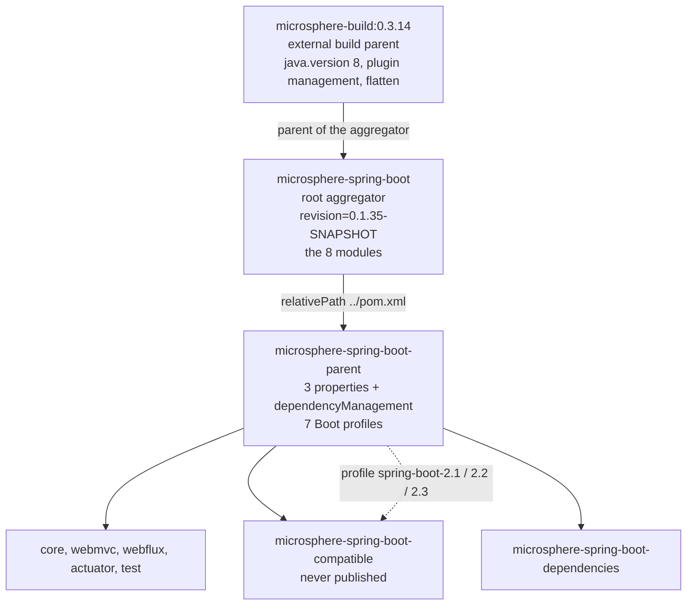

# Parent POM — `release-1.x`

> [中文](./zh/parent.md) · [Documentation index](../README.md) ·
> [Same document for the `release` branch](../current/parent.md)

> **Branch:** `release-1.x` · **Version line:** `0.1.x` · **Artifact:** `microsphere-spring-boot-parent`
> **Packaging:** pom · **Build parent:** `io.github.microsphere-projects:microsphere-build:0.3.14`

Contents:
[1 Scope and Pairing](#1-scope-and-pairing) ·
[2 The Inheritance Chain](#2-the-inheritance-chain) ·
[3 Managed Properties and Their Consumers](#3-managed-properties-and-their-consumers) ·
[4 The dependencyManagement Block](#4-the-dependencymanagement-block) ·
[5 The Spring Boot Profile Table](#5-the-spring-boot-profile-table) ·
[6 Default Profile Semantics](#6-default-profile-semantics) ·
[7 Absence of a Repository Block](#7-absence-of-a-repository-block) ·
[8 What a Module Gains From This Parent](#8-what-a-module-gains-from-this-parent) ·
[9 Recipes](#9-recipes) ·
[10 Troubleshooting](#10-troubleshooting) ·
[11 See Also](#11-see-also)

---

## 1. Scope and Pairing

`microsphere-spring-boot-parent/pom.xml` is the single version layer of the `release-1.x` reactor: every module inherits it, so no dependency inside the project carries a literal version, and the Spring Boot generation is chosen by activating a profile rather than by editing a POM. The role, shape and mechanism are identical on `release` and documented in full in [../current/parent.md](../current/parent.md); this file is the delta list, and the deltas are concentrated in three property values, seven profile ids instead of eight, and one deleted `<repositories>` block.

| Element | `release-1.x` | `release` |
|---|---|---|
| Root `<revision>`, root `<java.version>` | `0.1.35-SNAPSHOT`, **absent** | `0.2.35-SNAPSHOT`, `17` |
| External build parent (declared on the aggregator) | `microsphere-build:0.3.14` | `microsphere-build:0.3.16` |
| `microsphere-spring.version` / `jolokia.version` / `junit-jupiter.version` | `0.1.39` / `1.7.2` / `5.14.4` | `0.2.39` / `2.6.3` / `6.1.3` |
| Boot profiles | `spring-boot-2.1` … `spring-boot-2.7`, default `2.7.18` | `spring-boot-3.0` … `spring-boot-4.1`, default `3.5.16` |
| Version string style | `.RELEASE` suffix on `2.1`–`2.3`, plain from `2.4` | plain everywhere |
| `<repositories>` | **none** | a `spring-milestone` repository |

All facts were read from `microsphere-spring-boot-parent/pom.xml`, the root `pom.xml`, the eight module POMs and `.github/workflows/maven-build.yml`.

---

## 2. The Inheritance Chain

One subtlety the table above can hide: this POM does **not** name `microsphere-build` itself. That build parent is declared by the root aggregator `pom.xml` (lines 5–9, `<artifactId>microsphere-build</artifactId>` / `<version>0.3.14</version>`), and this module inherits it one level further down, because its own `<parent>` is `microsphere-spring-boot:${revision}` with `<relativePath>../pom.xml</relativePath>`.



Aggregation — the root `<modules>` list in the order parent, dependencies, compatible, test, core, webmvc, webflux, actuator, byte-for-byte the same on both lines — decides what one build command compiles; inheritance decides what a POM receives. Two consequences of the extra aggregator level: `<revision>` is defined **above** this parent, so this POM can use `${revision}` but cannot redefine the reactor coordinate; and the Java level arrives from `microsphere-build:0.3.14`, whose own `<java.version>8</java.version>` is why the root POM here sets no `<java.version>` while `release` raises its root's to `17`.

---

## 3. Managed Properties and Their Consumers

Lines 21–26 declare exactly three properties. `spring-boot.version` is not among them — it exists only inside profiles (§5).

| Property | Value | Who consumes it in this reactor |
|---|---|---|
| `microsphere-spring.version` | `0.1.39` | Versions the `microsphere-spring-dependencies` import (line 60), which supplies `microsphere-annotation-processor` (core, webmvc, webflux, actuator, test), `microsphere-spring-context` (core line 32, test line 60), `microsphere-spring-test` (test line 66), `microsphere-spring-webmvc` (webmvc line 40) and `microsphere-spring-webflux` (webflux line 40) — every one declared without a version |
| `jolokia.version` | `1.7.2` | Versions the direct `org.jolokia:jolokia-core` entry (line 44); `microsphere-spring-boot-actuator/pom.xml` lines 38–41 declare that artifact version-less |
| `junit-jupiter.version` | `5.14.4` | Versions the `org.junit:junit-bom` import (line 35); `org.junit.jupiter:junit-jupiter` is then declared without a version in core line 57, webmvc line 66, webflux line 65, actuator line 77 and test line 32 — optional in `test`, whose public surface is JUnit itself |
| `spring-boot.version` | profile-only | Set only by the seven profiles; feeds the `spring-boot-dependencies` import (line 51) and thereby versions every `org.springframework.boot:*` and `org.springframework:*` declaration in the reactor |
| `revision` | `0.1.35-SNAPSHOT` | Declared one level up in the root aggregator; the version of this POM and of all modules |

The three values are line-appropriate rather than merely older: Jolokia `1.7.x` is the last `javax`-based line, matching Boot 2's JMX stack; `5.14.4` stays on the JUnit 5 `5.x` bom this Boot generation assumes; and `0.1.39` pairs the line with the `0.1.x` series of the sibling `microsphere-spring` project.

---

## 4. The dependencyManagement Block

Lines 28–66, verbatim:

```xml
    <dependencyManagement>
        <dependencies>

            <!-- JUnit Jupiter -->
            <dependency>
                <groupId>org.junit</groupId>
                <artifactId>junit-bom</artifactId>
                <version>${junit-jupiter.version}</version>
                <type>pom</type>
                <scope>import</scope>
            </dependency>

            <!-- Jolokia -->
            <dependency>
                <groupId>org.jolokia</groupId>
                <artifactId>jolokia-core</artifactId>
                <version>${jolokia.version}</version>
            </dependency>

            <!-- Spring Boot Dependencies -->
            <dependency>
                <groupId>org.springframework.boot</groupId>
                <artifactId>spring-boot-dependencies</artifactId>
                <version>${spring-boot.version}</version>
                <type>pom</type>
                <scope>import</scope>
            </dependency>

            <!-- Microsphere Spring Dependencies -->
            <dependency>
                <groupId>io.github.microsphere-projects</groupId>
                <artifactId>microsphere-spring-dependencies</artifactId>
                <version>${microsphere-spring.version}</version>
                <type>pom</type>
                <scope>import</scope>
            </dependency>

        </dependencies>
    </dependencyManagement>
```

| Entry | Kind | Why it sits here |
|---|---|---|
| `org.junit:junit-bom` | import, **first** | Maven keeps the first managed version it sees, so ordering it before `spring-boot-dependencies` guarantees JUnit comes from `${junit-jupiter.version}` |
| `org.jolokia:jolokia-core` | direct entry | No BOM manages it; pinned for the actuator JMX tests |
| `org.springframework.boot:spring-boot-dependencies` | import | The single knob the profiles turn |
| `io.github.microsphere-projects:microsphere-spring-dependencies` | import | The sibling project's artifact versions at `0.1.39` |

Because the Boot BOM is imported through `${spring-boot.version}`, one profile switch swaps the entire graph rather than one artifact: `2.1.18.RELEASE` pulls Spring Framework `5.1.x`, Micrometer `1.1.x`, Jackson `2.9.x` and `javax.servlet:javax.servlet-api`; `2.7.18` pulls Framework `5.3.x`, Micrometer `1.9.x` and Jackson `2.13.x`. Not one module POM changes between those two builds — which is also why two modules need a per-module escape hatch under `spring-boot-2.1`: `micrometer-core:1.3.20` plus `spring-core:5.2.25.RELEASE` in `microsphere-spring-boot-actuator/pom.xml` lines 98–117, and `spring-core:5.2.25.RELEASE` in `microsphere-spring-boot-compatible/pom.xml` lines 72–84. See [./actuator.md](./actuator.md) and [./compatible.md](./compatible.md).

---

## 5. The Spring Boot Profile Table

Lines 68–120 define seven profiles, each with exactly one property and no `<dependencies>`, no `<build>` and no JDK activation. Profile bodies from that block, verbatim:

```xml
        <profile>
            <id>spring-boot-2.1</id>
            <properties>
                <spring-boot.version>2.1.18.RELEASE</spring-boot.version>
            </properties>
        </profile>
```

| Profile | `spring-boot.version` | Extra effects elsewhere in the reactor |
|---|---|---|
| `spring-boot-2.1` | `2.1.18.RELEASE` | attaches `compatible` to `core`; pins `spring-core:5.2.25.RELEASE` in `compatible`; pins `micrometer-core` and `spring-core` in `actuator` |
| `spring-boot-2.2` | `2.2.13.RELEASE` | attaches `compatible` to `core` |
| `spring-boot-2.3` | `2.3.12.RELEASE` | attaches `compatible` to `core` |
| `spring-boot-2.4` | `2.4.13` | none |
| `spring-boot-2.5` | `2.5.15` | none |
| `spring-boot-2.6` | `2.6.15` | none |
| `spring-boot-2.7` | `2.7.18` | `<activeByDefault>true</activeByDefault>` (lines 111–119), the only profile in this POM with an `<activation>` element |

The `.RELEASE` suffix on `2.1`–`2.3` and its absence from `2.4` on are not an inconsistency but the published Maven version strings: Spring Boot shipped `major.minor.patch.RELEASE` up to the `2.3` generation and switched to plain `major.minor.patch` with `2.4`. Maven compares version strings literally, so `2.3.12.RELEASE` and `2.3.12` are two different artifacts and only the suffixed one exists in Central. `release` needs no suffix because its oldest profile (`spring-boot-3.0`) already sits past that switch; never "normalise" the suffix away when porting a change.

---

## 6. Default Profile Semantics

`activeByDefault` is the weakest activation in Maven, and this POM relies on nothing else:

* No `-P` at all: `spring-boot-2.7` is active and the reactor builds against `2.7.18`.
* Activating a profile **of this POM** explicitly deactivates that implicit selection — including the CI trio `-Ptest,coverage,<id>`. If no Boot profile ends up active, `spring-boot.version` stays undefined and the `spring-boot-dependencies` import cannot resolve.
* An id that does not exist here (for example `-Pspring-boot-4.0`) is a different failure: Maven warns `The requested profiles [spring-boot-4.0] could not be activated` and the `activeByDefault` `2.7.18` build proceeds, quietly, with none of the module profiles you meant to attach.
* That is why `.github/workflows/maven-build.yml` makes the Boot line a matrix dimension (lines 26–28) and passes `--activate-profiles test,coverage,${{ matrix.maven-profile-spring-boot }}`: 5 JDKs × 7 profiles = 35 cells, each naming its Boot explicitly.
* Two Boot profiles at once is legal Maven and meaningless here: both set the same property, last one wins.

```bash
./mvnw clean verify                                  # 2.7.18
./mvnw clean verify -Pspring-boot-2.1                # oldest cell, shim attached
./mvnw -pl microsphere-spring-boot-core -am -Pspring-boot-2.3 help:effective-pom | grep spring-boot.version
```

---

## 7. Absence of a Repository Block

This POM has no `<repositories>` element. `release` declares one, at lines 68–74 of its own `microsphere-spring-boot-parent/pom.xml`:

```xml
    <repositories>
        <repository>
            <id>spring-milestone</id>
            <name>Spring Portfolio Milestone Repository</name>
            <url>https://repo.spring.io/milestone</url>
        </repository>
    </repositories>
```

Consequences: every coordinate on this line must come from Central, so only GA versions can be named by a profile; a build reproduces against a single mirror; and no `-SNAPSHOT`/milestone Boot can be resolved here even by mistake. The absence is a consequence, not a cause — all seven versions in §5 have been GA for years, so milestone access would have nothing to fetch. Keep it out: a stale `spring-milestone` entry slows artifact resolution, weakens reproducibility and is never consulted by a `2.x` coordinate. Publishing is unaffected either way, because distribution management comes from `microsphere-build` and that parent also configures the flatten plugin with `flatten.pomElements.repositories` set to `remove`.

---

## 8. What a Module Gains From This Parent

Every module points at it with `<relativePath>../microsphere-spring-boot-parent/pom.xml</relativePath>` — for example `microsphere-spring-boot-actuator/pom.xml` lines 5–10 and `microsphere-spring-boot-dependencies/pom.xml` lines 5–10.

| Gained | Source |
|---|---|
| Version-less `org.springframework.boot:*`, `org.springframework:*`, Jackson, Micrometer, servlet and test libraries | the `spring-boot-dependencies` import, at the active profile's version |
| Version-less `org.junit.jupiter:junit-jupiter` | the `junit-bom` import |
| Version-less `org.jolokia:jolokia-core` | the direct entry |
| Version-less `microsphere-spring-*` and `microsphere-annotation-processor` | the `microsphere-spring-dependencies` import |
| The reactor coordinate `${revision}` plus name, description, url, licenses, developers and scm metadata | the root aggregator above this POM |
| Compiler, jar, source, javadoc, surefire, failsafe, checkstyle, jacoco, enforcer, flatten and git-commit-id plugin management, and the Java 8 baseline | `microsphere-build:0.3.14`, inherited through the aggregator |
| The seven Boot profile ids, so a module profile matches a documented Boot line | this POM |

What it deliberately does not provide: the versions of the five published Microsphere Spring Boot artifacts (`microsphere-spring-boot-dependencies`, see [./dependencies.md](./dependencies.md)), any `spring-boot-maven-plugin` configuration (that belongs to `spring-boot-starter-parent`), any repository, and any dependency on `microsphere-spring-boot-compatible` — attaching the shim is `core`'s decision, not the parent's.

---

## 9. Recipes

### 9.1 Add a Spring Boot 2 minor line

Insert a profile at the end of the `<profiles>` block in `microsphere-spring-boot-parent/pom.xml` (before line 120), in the same one-property shape quoted in §5. Then add the id to the `maven-profile-spring-boot` matrix in `.github/workflows/maven-build.yml` lines 26–28; decide the shim question — on this line only profiles **below** `2.4` attach it, so a newer minor line gets **no** entry in `microsphere-spring-boot-core/pom.xml` lines 91–127; move `<activeByDefault>` if the new line becomes the recommended one; and update §5 here plus `docs/user-guide/1.x/parent.md` in both languages.

### 9.2 Raise the floor of the line

To drop `spring-boot-2.1`, four files move together: delete the profile in `microsphere-spring-boot-parent/pom.xml` (lines 69–74), the `<profile>` in `microsphere-spring-boot-core/pom.xml` (lines 92–102), the one in `microsphere-spring-boot-actuator/pom.xml` (lines 99–116), the one in `microsphere-spring-boot-compatible/pom.xml` (lines 73–83), and the matrix entry in the workflow. Half a removal is worse than a failure: the unknown id only warns, CI stays green on the default `2.7.18`, and the surviving module profiles for that id attach nothing at all.

### 9.3 Remove a profile the line no longer needs

The same multi-file edit, minus module pins that only that profile set, plus one audit: `grep -rn "spring-boot-2.4" --include=pom.xml .` must come back with nothing but the parent's own definition. A module profile whose id exists nowhere else is dead configuration. If the removed id held `<activeByDefault>`, promote the newest survivor in the same commit — never leave the reactor without a default Boot line.

---

## 10. Troubleshooting

| Symptom | Cause | Action |
|---|---|---|
| `'dependencies.dependency.version' for … is missing` | No Boot profile of this POM is active, so `spring-boot.version` never resolved | Activate an id from §5 explicitly |
| `Could not find artifact …:spring-boot-starter:jar:2.1.18` | The `.RELEASE` suffix was dropped | Ask for `2.1.18.RELEASE` |
| `The requested profiles [spring-boot-3.5] could not be activated` | That id belongs to `release` | Pick a `2.x` id |
| A milestone or `-SNAPSHOT` Boot cannot be found | This POM declares no repositories by design | Stay on GA versions |
| `package jakarta.servlet does not exist` | A `0.2.x` artifact leaked into a `0.1.x` build | Exclude it; the lines are not interchangeable |
| `${revision}` appears literally in an installed POM | Built without the flatten plugin, e.g. a partial reactor | Build from the root |
| Compiler rejects `instanceof X x`, text blocks, `switch` expressions | `microsphere-build:0.3.14` sets `java.version` to `8` | Rewrite in Java 8 form, as the existing sources do |

---

## 11. See Also

| Document | Scope |
|---|---|
| [README.md](./README.md) | Branch overview and the cross-branch source diff |
| [./build-and-release.md](./build-and-release.md) | Version facts and the 35-cell CI matrix |
| [./dependencies.md](./dependencies.md) | The BOM managing the five published artifacts |
| [./compatible.md](./compatible.md) | The shim module attached by the three oldest profiles |
| [./actuator.md](./actuator.md) | Where the `spring-boot-2.1` pins live |
| [../current/parent.md](../current/parent.md) | The `release` parent, explained in full |
| [../../user-guide/1.x/parent.md](../../user-guide/1.x/parent.md) | Consumer-facing view of the same POM |
