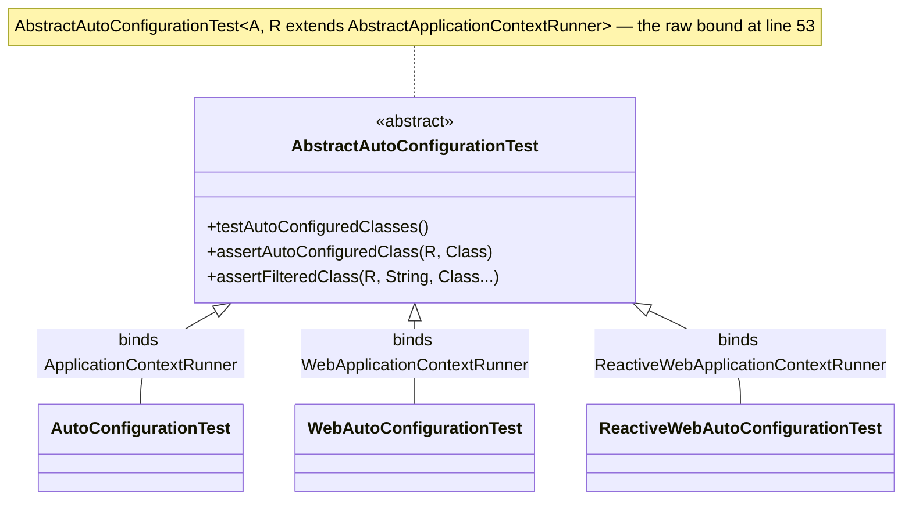

# Test Module — `release-1.x`

> [中文](./zh/test.md) · [Documentation index](../README.md) ·
> [Same document for the `release` branch](../current/test.md)

> **Branch:** `release-1.x` · **Version line:** `0.1.x` · **Artifact:** `microsphere-spring-boot-test`
> **Spring Boot:** `2.1.18.RELEASE` – `2.7.18` · **Java source level:** 8

Contents:
[1 Scope and Pairing](#1-scope-and-pairing) ·
[2 Class Hierarchy and the Generic Bound](#2-class-hierarchy-and-the-generic-bound) ·
[3 The Template-Method Contract](#3-the-template-method-contract) ·
[4 The POM Delta](#4-the-pom-delta) ·
[5 Use Inside This Reactor](#5-use-inside-this-reactor) ·
[6 The Two Differing Test Fixtures](#6-the-two-differing-test-fixtures) ·
[7 JUnit Bounds on This Line](#7-junit-bounds-on-this-line) ·
[8 Design Patterns](#8-design-patterns) ·
[9 Recipes](#9-recipes) ·
[10 See Also](#10-see-also)

---

## 1. Scope and Pairing

[../current/test.md](../current/test.md) describes the module itself — why four abstract base classes exist, the
constructor algorithm, the runner bindings, the helpers and the worked examples. This document covers only what differs
on `release-1.x`, and the headline is unusual: **every file under `src/main/java` is byte-identical to `release`**. The
deltas are one POM coordinate and two test fixtures (§4, §6); §5 and §7 record the Boot-2 and Jupiter constraints the
identical code relies on.

| Area | Count | Files |
|---|---|---|
| `src/main/java` | 4 | `AbstractAutoConfigurationTest`, `AutoConfigurationTest`, `WebAutoConfigurationTest`, `ReactiveWebAutoConfigurationTest` in `io/microsphere/spring/boot/test/`, all byte-identical |
| `src/main/resources` | 0 | no `spring.factories`, no `.imports`, no metadata: the artifact registers nothing, on both lines |
| `src/test/java` | 5 | `HttpAutoConfiguration`, `HttpAutoConfigurationTest`, `JmxAutoConfigurationTest`, `ReactiveWebApplicationAutoConfiguration`, `ReactiveWebApplicationAutoConfigurationTest` — two differ (§6) |
| `pom.xml` | 1 | one dependency coordinate differs (§4) |

## 2. Class Hierarchy and the Generic Bound

The four declarations, from `AbstractAutoConfigurationTest.java:53` and line `33` of each subclass:

```java
public abstract class AbstractAutoConfigurationTest<A, R extends AbstractApplicationContextRunner> {
public abstract class AutoConfigurationTest<A> extends AbstractAutoConfigurationTest<A, ApplicationContextRunner> {}
public abstract class WebAutoConfigurationTest<A> extends AbstractAutoConfigurationTest<A, WebApplicationContextRunner> {}
public abstract class ReactiveWebAutoConfigurationTest<A> extends AbstractAutoConfigurationTest<A, ReactiveWebApplicationContextRunner> {}
```

`A` is the auto-configuration class under test and `R` the Boot runner that starts it. The bound is deliberately the
**raw** `AbstractApplicationContextRunner`, not Boot's five-parameter self-type: that is what lets a subclass bind a
runner without repeating the recursion, and the fully-bounded form appears only on the three static helpers (§3).



## 3. The Template-Method Contract

The constructor (`:88`–`:102`) is the algorithm, and it is why a malformed subclass cannot be constructed by accident:

| Step | Line | Effect |
|---|---|---|
| Read its own `@SpringBootTest` | `:90`–`:91` | `assertNotNull(springBootTest, "The @SpringBootTest must not be annotated on " + type)` |
| Wrap it as attribute metadata, derive web-ness | `:92`–`:93` | `GenericAnnotationAttributes.of(springBootTest)`, then `isWebApplication = !NONE.equals(springBootTestAttributes.get("webEnvironment"))` — web-ness comes from the annotation, not from which subclass was extended; no context is started |
| Resolve `(A, R)` | `:94`–`:96` | `forClass(getClass()).as(AbstractAutoConfigurationTest.class)` then `resolveGeneric(0)` / `resolveGeneric(1)`; a meaningless type argument compiles and fails here |
| Build the runner | `:97` | `this.runner = newRunner()`, needing an accessible no-arg constructor on `R` |
| Guard the non-web case | `:98`–`:101` | `assertInstanceOf(ApplicationContextRunner.class, this.runner, format(...))` whenever `webEnvironment = NONE` |

`newRunner()` (`:104`–`:107`) is `newInstance(runnerClass)` followed by `initRunner(runner)`, the seam a subclass uses
to reseed the context: `initRunner` (`:109`–`:115`) chains `withPropertyValues(getPropertyValues())`,
`withConfiguration(of(this.autoConfigurationClass))` and `withConfiguration(of(getClasses()))`, casting back to `R`.

| Member | Modifier | Line | Contract |
|---|---|---|---|
| `testAutoConfiguredClasses()` / `testOnGlobalDisabledProperty()` / `testOnGlobalMissingClass()` | `@Test protected` | `:117`–`:136` | `hasSingleBean` for each auto-configured class; then a re-run per `key=value` and a re-run per missing class inside a `FilteredClassLoader`, each asserting `doesNotHaveBean` |
| `getPropertyValues()` / `getClasses()` | `protected final` | `:139`, `:165`–`:167` | the `properties` and `classes` arrays of `@SpringBootTest` |
| `getAutoConfiguredClasses()` | `protected final` | `:144`–`:149` | seeds the set with `this.autoConfigurationClass` **before** the hook runs, so a subclass can add but never replace |
| `getGlobalDisabledPropertyValues()` / `getGlobalMissingClasses()` | `protected final` | `:152`–`:163` | wrap a `newLinkedHashSet()` and delegate to the hooks |
| `configureAutoConfiguredClasses(Set<Class<?>>)` | `protected abstract` | `:174` | slot 1 — beans that must exist |
| `configureGlobalDisabledPropertyValues(Set<String>)` | `protected abstract` | `:181` | slot 2 — properties that must remove them |
| `configureGlobalMissingClasses(Set<Class<?>>)` | `protected abstract` | `:188` | slot 3 — classes to hide from the classloader |
| `assertAutoConfiguredClass` / `assertDisabledProperty` / `assertFilteredClass` — instance forms `:190`–`:200`, static forms `:202`–`:216` | `protected` / `public static` | see left | the instance forms are open delegates passing `this.runner`; the static ones take a caller-supplied runner, so tests that are not subclasses reuse the same assertions |
| `assertFilteredClass(R, String, Class<?>...)` | `public static` | `:218`–`:225` | `runner.withClassLoader(new FilteredClassLoader(filteredClass))` — the **string-name** variant, hiding a class without loading it; all three static helpers carry `<R extends AbstractApplicationContextRunner<R, C, A>, C extends ConfigurableApplicationContext, A extends ApplicationContextAssertProvider<C>>`, the only place the fully-bounded runner type appears |

## 4. The POM Delta

`microsphere-spring-boot-test/pom.xml` differs from `release` in one dependency block, `:84`–`:88`:

```diff
         <!-- Servlet API -->
         <dependency>
-            <groupId>jakarta.servlet</groupId>
-            <artifactId>jakarta.servlet-api</artifactId>
+            <groupId>javax.servlet</groupId>
+            <artifactId>javax.servlet-api</artifactId>
             <optional>true</optional>
         </dependency>
```

| Dependency | Lines | Optional | Notes |
|---|---|---|---|
| `microsphere-annotation-processor`, `spring-boot-configuration-processor`, `spring-boot-autoconfigure-processor` | `:23`–`:27`, `:37`–`:41`, `:44`–`:48` | yes | tooling only |
| `org.junit.jupiter:junit-jupiter` | `:30`–`:34` | yes | version from `junit-bom` (§7) |
| `spring-boot-starter-test` | `:51`–`:55` | yes | supplies the runners, `FilteredClassLoader`, AssertJ |
| `microsphere-spring-context` | `:58`–`:61` | **no** | the compiled class imports `GenericAnnotationAttributes` (`:21`) and the `io.microsphere` utilities used at `:33`–`:36` |
| `microsphere-spring-test` | `:63`–`:67` | **no** | transitively exported, yet referenced by no source file here |
| `spring-boot-starter-web` / `spring-boot-starter-webflux`, `jackson-annotations` / `jackson-databind`, `com.h2database:h2` | `:69`–`:74`, `:76`–`:81`, `:91`–`:95`, `:97`–`:101`, `:104`–`:108` | yes | the starters are needed only by the servlet / reactive bindings; the Jackson and H2 coordinates are referenced by no source file here |
| `javax.servlet:javax.servlet-api` | `:84`–`:88` | yes | **`jakarta.servlet:jakarta.servlet-api` on `release`** — the module's only POM delta |
| `ch.qos.logback:logback-classic` | `:113`–`:117` | `test` scope | not part of the published contract |

No dependency declares a version — the file's only `<version>` tags are the parent block (`:8`) and the module version
(`:15`) — so every coordinate resolves through the parent. Consequences for a consumer: optional means "on my compile
classpath, not transitive to you", so declaring this artifact alone buys only `microsphere-spring-context` and
`microsphere-spring-test`, and a subclass will not load unless the consumer also adds `junit-jupiter` and
`spring-boot-starter-test`; neither web starter is compile scope because a non-web consumer must not inherit Tomcat or
Reactor Netty. The `javax.servlet` swap applies that isolation to a namespace: Boot 2 containers publish
`javax.servlet`, so a `jakarta.servlet-api` entry would hand consumers types no Boot 2 test can use
(`release-notes.md:441`, `0.1.29`). Nothing in this module's sources references either Servlet artifact — the only
occurrence of the word is the Javadoc line at `WebAutoConfigurationTest.java:24` — so the coordinate is consumer
convenience, not a compile requirement.

## 5. Use Inside This Reactor

The root POM lists the module before its consumers, `pom.xml:61`–`:65` (`test`, `core`, `webmvc`, `webflux`,
`actuator`), and all four declare it in `test` scope with `${revision}` instead of the managed version
(`microsphere-spring-boot-core/pom.xml:69`–`:74`, `microsphere-spring-boot-webmvc/pom.xml:78`–`:83`,
`microsphere-spring-boot-webflux/pom.xml:77`–`:82`, `microsphere-spring-boot-actuator/pom.xml:89`–`:94`) — a repetition
that is load-bearing, because `test` scope is not transitive and `webmvc` cannot inherit the artifact through `core`;
third parties take the version from the BOM (`microsphere-spring-boot-dependencies/pom.xml:48`–`:52`). Exactly one
class outside this module extends the contract, on either branch — `core`'s
`ConfigurationPropertiesAutoConfigurationTest.java`, byte-identical between the branches, binding
`AutoConfigurationTest<ConfigurationPropertiesAutoConfiguration>` (`:44`) with `webEnvironment = NONE` (`:42`), four
bind-advisor and listener classes in slot 1 (`:47`–`:52`), an empty slot 2 (`:55`) and `BeanCapableImportCandidate` in
slot 3 (`:59`). The `webmvc` and `webflux` suites depend on the artifact but build their own `MockMvc` / `WebTestClient`
fixtures instead ([./webmvc.md](./webmvc.md) §7, [./webflux.md](./webflux.md) §7).

Boot-2 constraints this imposes: the non-web guard at `:98`–`:101` is satisfied by `ApplicationContextRunner`, which
exists since Boot `2.0`, so no branch-specific variant is needed; the string-name `FilteredClassLoader` constructor at
`:220` is present from Boot `2.1` onward (confirmed with `javap` against `spring-boot-test-2.1.1.RELEASE`), so
`testOnGlobalMissingClass` runs on the oldest profile; properties reach the context only through `getPropertyValues()`
at `:110`, i.e. the `properties` attribute of the subclass's own `@SpringBootTest` — `JmxAutoConfigurationTest.java:39`–`:41` switches JMX on that way; and `AutoConfigurations.of(...)` at `:113`–`:114` is the Boot 2 spelling `release` still compiles against, so no `compatible` shim is involved.

## 6. The Two Differing Test Fixtures

`src/test/java` differs in exactly two files, both making the same substitution: the reactive sample
auto-configuration borrows a different Boot property class. In `ReactiveWebApplicationAutoConfiguration.java` the
import at `:23` and the annotations at `:36` and `:38` change together:

```diff
-import org.springframework.boot.autoconfigure.jmx.JmxProperties;
+import org.springframework.boot.autoconfigure.jackson.JacksonProperties;
 @ConditionalOnWebApplication(type = REACTIVE)
-@ConditionalOnClass(value = JmxProperties.class)
+@ConditionalOnClass(value = JacksonProperties.class)
 @ConditionalOnProperty(name = "reactive.web-app.enabled", matchIfMissing = true)
-@EnableConfigurationProperties(value = JmxProperties.class)
+@EnableConfigurationProperties(value = JacksonProperties.class)
```

In `ReactiveWebApplicationAutoConfigurationTest.java` the import at `:20` and slots 1 and 3 at `:41` and `:51` follow
it; slot 2 (`reactive.web-app.enabled=false`, `:46`) is unchanged:

```diff
-        autoConfiguredClasses.add(JmxProperties.class);
+        autoConfiguredClasses.add(JacksonProperties.class);
-        globalMissingClasses.add(JmxProperties.class);
+        globalMissingClasses.add(JacksonProperties.class);
```

What this proves: the reactive binding is still exercised through all three contract slots — presence of the enabled
properties bean, absence under the disabled property, absence under `FilteredClassLoader` — so the substitution tests
the *mechanism*, not a Boot-specific behaviour (`release-notes.md:485`, "Used `JacksonProperties` in reactive test
configuration", `0.1.31`). What it does **not** prove is that JMX is unavailable on Boot 2: the non-web fixture
`JmxAutoConfigurationTest.java`, byte-identical on both lines, still imports
`org.springframework.boot.autoconfigure.jmx.JmxAutoConfiguration` at `:20` and puts `MBeanExporter` into slot 3 at
`:55`. Treat the property class as a stand-in: when porting, keep the three slots consistent across both files and pick a type that exists on every Boot generation you target.

## 7. JUnit Bounds on This Line

The parent pins Jupiter explicitly — `<junit-jupiter.version>5.14.4</junit-jupiter.version>`
(`microsphere-spring-boot-parent/pom.xml:25`), imported as `org.junit:junit-bom` at `:32`–`:38`, **before**
`spring-boot-dependencies` at `:48`–`:54`. That order is load-bearing here in a way it is not on `release`: Maven's
`dependencyManagement` keeps the first declaration, so `junit-bom` wins over Boot's own pin, which the locally
available Boot BOMs set as follows:

| Profile | `spring-boot.version` | Jupiter managed by Boot |
|---|---|---|
| `spring-boot-2.1` / `spring-boot-2.2` | `2.1.18.RELEASE` / `2.2.13.RELEASE` | `5.3.2` / `5.5.2` |
| `spring-boot-2.3` / `spring-boot-2.4` | `2.3.12.RELEASE` / `2.4.13` | `5.6.3` / `5.7.2` |
| `spring-boot-2.6` / `spring-boot-2.7` | `2.6.15` / `2.7.18` | `5.8.2` |

The module needs Jupiter **5.8 or newer**: the constructor calls
`org.junit.jupiter.api.Assertions.assertInstanceOf` — imported at `AbstractAutoConfigurationTest.java:38`, used at
`:99`–`:100` with the `(Class, Object, String)` overload — and `assertInstanceOf` is a 5.8 addition (the `5.8.2` jar in
the local repository exposes the overloads). Boot's own pin would suffice under `2.7` but not under `2.1`–`2.4`, which
is the practical reason `junit-bom` comes first; the `spring-boot-2.5` BOM was not available locally for this check.
This is an API floor, not a preference: a consumer pinning Jupiter below 5.8 cannot use these base classes.

## 8. Design Patterns

| Pattern | Where | Reading on this line |
|---|---|---|
| Template Method | three `protected abstract` hooks (`:174`, `:181`, `:188`) under the fixed `@Test` trio (`:117`–`:136`) | One algorithm, three data slots; unchanged between the branches because it touches no Boot API that moved. |
| Annotation-as-metadata | `:90`–`:93` reading its own `@SpringBootTest` through `GenericAnnotationAttributes` | `webEnvironment` decides web-ness, `properties` and `classes` seed the runner — no context boot, so the same class serves Boot 2 and Boot 4. |
| Self-type binding | the three one-line subclasses (`:33` each) | Each closes `R` in the `extends` clause because the base class reads it back out of the subclass signature at `:95`–`:96`. |
| Guarded invariant | `assertNotNull` at `:91`, `assertInstanceOf` at `:99` | Misuse fails at construction with a message instead of inside an assertion; the second guard sets the Jupiter floor (§7), and both also exist as `public static` helpers (`:202`–`:225`) for non-subclasses. |

## 9. Recipes

**Add a runner variant.** Boot `2.1`–`2.7` exposes no runner beyond the three already bound. Create
`src/main/java/io/microsphere/spring/boot/test/<Name>AutoConfigurationTest.java` with the Apache header, the body
`public abstract class <Name>AutoConfigurationTest<A> extends AbstractAutoConfigurationTest<A, <RunnerClass>> {}`, an
import from `org.springframework.boot.test.context.runner` and a Javadoc block (`@param <A>`, `@author`, two `@see`,
`@since`). Check the guard at `:98`–`:101` first: it assumes "not web implies `ApplicationContextRunner`", so a runner
that is neither web nor plain needs that condition widened — in **both** branches, since the file is shared byte for
byte.

**Add a contract assertion.** Declare `protected abstract void configureGlobal…(Set<…>)` beside `:174`–`:188` plus a
`protected final` getter seeding a `newLinkedHashSet()`; add a `@Test protected void testOnGlobal…()` loop beside
`:117`–`:136`; add the fully-bounded `public static` helper and an open `protected` delegate passing `this.runner`;
then update `core`'s `ConfigurationPropertiesAutoConfigurationTest` and the three fixtures here. A new abstract hook
breaks external users on both lines, so give it an empty default body when it need not be mandatory.

**Port a change to `release`.** The main sources port as a no-op today (`diff` proves they are identical), so: (1) keep
`src/main/java` in sync — if you had to change it, ask whether the change is Boot-2-only and prefer a by-name or
reflective form, as `core` does elsewhere on this line; (2) mirror any POM addition, substituting `javax.servlet` →
`jakarta.servlet`; (3) carry the two fixture files as-is unless the stand-in class moved upstream; (4) never introduce
pattern-matching `instanceof`, text blocks or `switch` expressions here, and rewrite them into the Java 8 form when
porting down.

```bash
# oldest profile — the cell that proves the Jupiter floor (§7)
JAVA_HOME=/path/to/jdk8 ./mvnw -pl microsphere-spring-boot-test -am -Pspring-boot-2.1 test
# newest profile (the activeByDefault one)
JAVA_HOME=/path/to/jdk11 ./mvnw --batch-mode -pl microsphere-spring-boot-test -am -Pspring-boot-2.7 test
# the only external consumer, on both edges
JAVA_HOME=/path/to/jdk8 ./mvnw -pl microsphere-spring-boot-core -am -Pspring-boot-2.1 test
```

CI runs JDK `8`, `11`, `17`, `21`, `25` (`.github/workflows/maven-build.yml:25`) against the seven profiles (`:26`–`:28`), so the `2.1` cell on JDK 8 is the binding constraint for this module.

## 10. See Also

| Document | Scope |
|---|---|
| [README.md](./README.md) | This branch's developer-guide index, including the dual-registration rules this module does **not** need. |
| [../current/test.md](../current/test.md) | The non-delta description of the same four classes. |
| [core.md](./core.md) | The only external consumer of the base classes in this reactor. |
| [webmvc.md](./webmvc.md) · [webflux.md](./webflux.md) | Modules that depend on this artifact in `test` scope but do not extend it. |
| [../../user-guide/1.x/test.md](../../user-guide/1.x/test.md) | Consumer-facing usage and examples for this line. |
