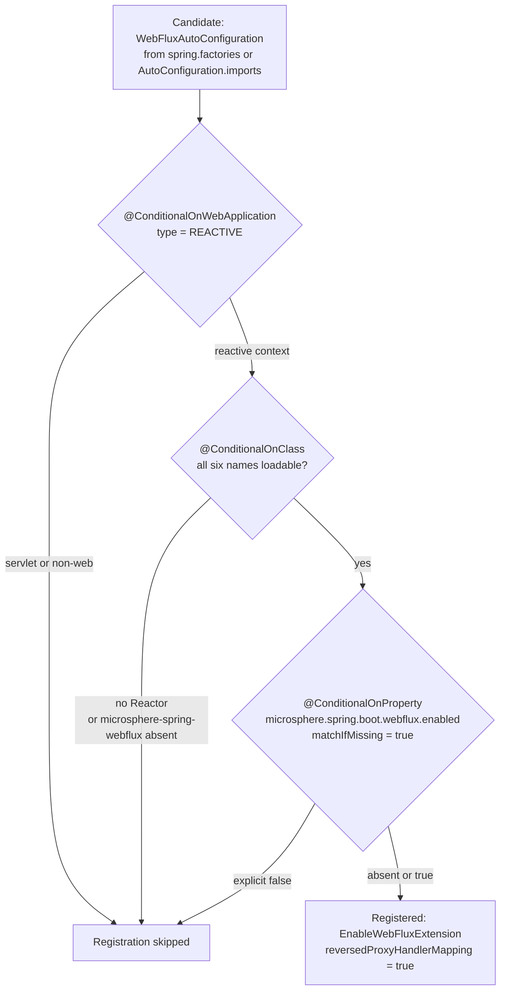

# WebFlux Module — `release-1.x`

> [中文](./zh/webflux.md) · [Documentation index](../README.md) ·
> [Same document for the `release` branch](../current/webflux.md)

> **Branch:** `release-1.x` · **Version line:** `0.1.x` · **Artifact:** `microsphere-spring-boot-webflux`
> **Spring Boot:** `2.1.18.RELEASE` – `2.7.18` · **Java source level:** 8

Contents:
[1 Scope and Pairing](#1-scope-and-pairing) ·
[2 Identical Except for Two Places](#2-identical-except-for-two-places) ·
[3 The Reactive Availability Condition](#3-the-reactive-availability-condition) ·
[4 The Single-Name AutoConfigureAfter Ordering](#4-the-single-name-autoconfigureafter-ordering) ·
[5 Dual Registration Files](#5-dual-registration-files) ·
[6 Property Namespace and Switches](#6-property-namespace-and-switches) ·
[7 Tests](#7-tests) ·
[8 Porting Recipes](#8-porting-recipes) ·
[9 Design Patterns on This Line](#9-design-patterns-on-this-line) ·
[10 See Also](#10-see-also)

---

## 1. Scope and Pairing

The delta companion of [../current/webflux.md](../current/webflux.md), which carries the module's purpose, package map,
upstream boundary against `microsphere-spring-webflux` and the property table. Everything below was read from the
`release-1.x` tree and cross-checked against `release` with `diff -ru microsphere-spring-boot-webflux`.

| Area | Count | Files |
|---|---|---|
| `src/main/java` | 3 | `autoconfigure/WebFluxAutoConfiguration.java`, `autoconfigure/condition/ConditionalOnWebFluxAvailable.java`, `constants/PropertyConstants.java` |
| `src/main/resources` | 2 | `META-INF/spring.factories`, `META-INF/spring/org.springframework.boot.autoconfigure.AutoConfiguration.imports` |
| `src/test/java` | 4 | `autoconfigure/AbstractWebFluxAutoConfigurationTest`, `autoconfigure/WebFluxAutoConfigurationTest`, `autoconfigure/WebFluxAutoConfigurationAllDisabledTest`, `autoconfigure/WebFluxAutoConfigurationAllEnabledTest` |

## 2. Identical Except for Two Places

The diff of the whole module between the branches produces exactly two findings — the rows marked below — and §3–§7 are short by design rather than padded.

| Artifact | Status against `release` |
|---|---|
| `pom.xml` | byte-identical — same optional `spring-boot-starter-webflux`, same `core` compile dependency, same test-scope block at `pom.xml:76`–`:82` |
| `autoconfigure/condition/ConditionalOnWebFluxAvailable.java` | byte-identical, all six class names included (§3) |
| `constants/PropertyConstants.java` | byte-identical |
| All four test sources and `META-INF/spring/…AutoConfiguration.imports` | byte-identical |
| `autoconfigure/WebFluxAutoConfiguration.java` | differs in two places only: the Javadoc `@see` list and the `@AutoConfigureAfter` name list (§4) |
| `META-INF/spring.factories` | **exists only on this branch**; `release` ships no such file (§5) |

## 3. The Reactive Availability Condition

`ConditionalOnWebFluxAvailable.java:45`–`:54` — the three `java.lang` meta-annotations at `:42`–`:44` are omitted — byte-identical on both branches and quoted because it needs no port:

```java
@ConditionalOnWebApplication(type = REACTIVE)
@ConditionalOnClass(name = {
        "reactor.core.publisher.Flux",                                         // Reactor API
        "org.springframework.context.ApplicationContext",                      // Spring Context API
        "org.springframework.web.method.HandlerMethod",                        // Spring Web API
        "org.springframework.web.reactive.DispatcherHandler",                  // Spring WebFlux API
        "io.microsphere.spring.web.method.support.HandlerMethodInterceptor",   // Microsphere Spring Web API
        "io.microsphere.spring.webflux.annotation.EnableWebFluxExtension"      // Microsphere Spring WebFlux API
})
@ConditionalOnProperty(name = MICROSPHERE_SPRING_BOOT_WEBFLUX_ENALBED_PROPERTY_NAME, matchIfMissing = true)
```

Why this annotation survives the branch split unchanged while its servlet twin does not: none of its six names lives in
a namespace Spring Boot relocated — the Reactor, Spring Context, Spring Web and Spring WebFlux types, plus the two
Microsphere types, keep their FQCNs from Boot `2.0`
to the current `release` line, so one spelling is correct on both, whereas `webmvc` had to fork because the Servlet API itself moved.



Evaluation follows the same conjunction-in-declaration-order rule as `webmvc`: the first miss is what the condition
report names, so an app lacking the upstream `microsphere-spring-webflux` jar stops at the second diamond instead of
failing to start.

## 4. The Single-Name AutoConfigureAfter Ordering

`WebFluxAutoConfiguration.java:31`–`:37`, the complete class body:

```java
@ConditionalOnWebFluxAvailable
@AutoConfigureAfter(name = {
        "org.springframework.boot.autoconfigure.web.reactive.WebFluxAutoConfiguration"  // Spring Boot API
})
@EnableWebFluxExtension(reversedProxyHandlerMapping = true)
public class WebFluxAutoConfiguration {
}
```

The full diff against `release` — two deletions and one comment rewrite, nothing else in the file:

```diff
- * @see org.springframework.boot.webflux.autoconfigure.WebFluxAutoConfiguration
 @AutoConfigureAfter(name = {
-        "org.springframework.boot.autoconfigure.web.reactive.WebFluxAutoConfiguration", // Spring Boot API [2.0, 4.0)
-        "org.springframework.boot.webflux.autoconfigure.WebFluxAutoConfiguration"       // Spring Boot APP [4.0,)
+        "org.springframework.boot.autoconfigure.web.reactive.WebFluxAutoConfiguration"  // Spring Boot API
 })
```

Unlike `webmvc`, this is not a pure deletion: on `release` the Boot 2 name carries the range comment
`// Spring Boot API [2.0, 4.0)` (the Boot 4 line reads `// Spring Boot APP [4.0,)`, a typo in that branch), while this
line annotates the same name with the bare `// Spring Boot API` — comment text is part of the port. Everything else is
identical, the single `@EnableWebFluxExtension(reversedProxyHandlerMapping = true)` attribute and the absence of any
`@Bean` method included. Boot keeps that FQCN stable across `2.1`–`2.7` (`microsphere-spring-boot-parent/pom.xml:68`–`:120`), an unmatched by-name entry is ignored rather than reported, and `compatible` ships no reactive shim, so by-name ordering is again the only cross-version mechanism.

## 5. Dual Registration Files

As in `webmvc`, the only structural difference, and a resource difference. Both files list exactly one class — `microsphere-spring-boot-webflux/src/main/resources/META-INF/spring.factories`:

```properties
org.springframework.boot.autoconfigure.EnableAutoConfiguration=\
io.microsphere.spring.boot.webflux.autoconfigure.WebFluxAutoConfiguration
```

and `microsphere-spring-boot-webflux/src/main/resources/META-INF/spring/org.springframework.boot.autoconfigure.AutoConfiguration.imports`:

```text
io.microsphere.spring.boot.webflux.autoconfigure.WebFluxAutoConfiguration
```

| Boot version | Reads `spring.factories` | Reads `AutoConfiguration.imports` | Effective outcome |
|---|---|---|---|
| `2.1` – `2.6` | yes | mechanism does not exist | the class is contributed only by `spring.factories` |
| `2.7` | yes | yes | both files are read, the duplicate entry is de-duplicated, registration happens once |

`release-notes.md:211` records "Registered WebFlux auto-configuration using `spring.factories`" in `0.1.20`, the
release that added the module; `.imports` came later, alongside it rather than instead of it. The failure modes are
the `webmvc` ones: omit `spring.factories` and the module is invisible on `2.1`–`2.6` — no condition report entry, no error, default `2.7` build still green; omit `.imports` and nothing breaks until the line moves past a Boot release that drops the legacy key.

## 6. Property Namespace and Switches

No delta: `PropertyConstants.java` is byte-identical. The interface declares exactly one switch — prefix
`microsphere.spring.boot.webflux.` at line `36`, default `"true"` at line `41`, key
`MICROSPHERE_SPRING_BOOT_WEBFLUX_ENALBED_PROPERTY_NAME` at line `51` with its `@ConfigurationProperty` block at
`:46`–`:50`. Unlike `webmvc` there are no sub-namespaces, no filter or logging switches and no opt-in key, because the
class registers no beans, so `microsphere.spring.boot.webflux.enabled` is the only knob and switching it off removes the `@EnableWebFluxExtension` import as well; the module also has no `PropertyConstantsTest` on either line.

## 7. Tests

Four test sources, all byte-identical to `release`; that document walks them through, this table records what they pin.

| Test | Pins down |
|---|---|
| `AbstractWebFluxAutoConfigurationTest` | Fixture, `@Disabled` (`:51`), `@WebAppConfiguration` (`:52`), `@SpringJUnitConfig` with `TestController` **and** `RouterFunctionTestConfig` (`:53`–`:56`); binds a `WebTestClient` (`:67`–`:70`), runs six endpoint checks (`:94`, including `testUpdatePerson()` at `:175`), then asserts every class from the abstract `getRegisteredComponentClasses()` (`:82`) is present (`:72`–`:80`). |
| `WebFluxAutoConfigurationTest` | Defaults: no `@TestPropertySource`; expects `HandlerMappingWebEndpointMappingResolver`, `InterceptingHandlerMethodProcessor`, `RequestHandledEventPublishingWebFilter`, `ReversedProxyHandlerMapping` (`:46`–`:51`). |
| `WebFluxAutoConfigurationAllDisabledTest` | The off case: `microsphere.spring.boot.webflux.enabled=false` (`:39`–`:43`) with an empty expected set (`:48`–`:50`) — the module's only kill-switch proof. |
| `WebFluxAutoConfigurationAllEnabledTest` | The on case: sets `@EnableWebFluxExtension` keys explicitly (`:45`–`:50`) and widens the expected set. |

Note the asymmetry with `webmvc`: the reactive fixture keeps the functional-endpoint collaborator the servlet fixture drops, so `RouterFunction` coverage exists here and not in `webmvc` ([./webmvc.md](./webmvc.md) §7), and this module needed no Java 8 rewrite of its assertions either.

## 8. Porting Recipes

**Between the lines.** Three edits, each direction the inverse of the other: (1) add or remove the
`org.springframework.boot.webflux.autoconfigure.WebFluxAutoConfiguration` entry and its `@see` line; (2) restore or
delete the `[2.0, 4.0)` / `APP` comment text on the retained Boot 2 name (§4); (3) keep `spring.factories` and
`.imports` listing the same classes — on this branch **both** must be updated. No condition, property or test change is
ever a porting concern here, and nothing in the module uses a Java 9+ construct.

**Verify on this line.** Source level 8; CI runs JDK `8`, `11`, `17`, `21`, `25` (`.github/workflows/maven-build.yml:25`)
against all seven profiles (`:26`–`:28`) — and because the condition is namespace-independent, the interesting axis is the Boot version rather than the JDK:

```bash
# oldest Boot target: spring.factories is the only mechanism that works
JAVA_HOME=/path/to/jdk8 ./mvnw -pl microsphere-spring-boot-webflux -am -Pspring-boot-2.1 test
# the activeByDefault profile, where both files are read and de-duplicated
JAVA_HOME=/path/to/jdk11 ./mvnw -pl microsphere-spring-boot-webflux -am -Pspring-boot-2.7 test
# one matrix cell, exactly as CI runs it
mvn --batch-mode --update-snapshots --file pom.xml -Drevision=0.0.1-SNAPSHOT \
    -Dsurefire.useSystemClassLoader=false test --activate-profiles test,coverage,spring-boot-2.1
```

`-am` is required: `core` is a compile dependency and the test artifact a test dependency (`pom.xml:31`–`:35`, `:76`–`:82`). A profile that does not exist here, say `-Pspring-boot-3.0`, warns and builds the default `2.7`.

## 9. Design Patterns on This Line

| Pattern | Where | Line-specific reading |
|---|---|---|
| Namespace-free condition | `ConditionalOnWebFluxAvailable.java:46`–`:53` | No listed type moved between Boot generations, so one annotation body serves both branches — the control case that shows why `webmvc` needed a `javax`/`jakarta` fork. |
| Redundant registration as compatibility strategy | both resource files (§5) | Same trade-off as `webmvc`: two files instead of profile-filtered resources, safe because Boot `2.7` de-duplicates. |
| Single-name ordering with drifting comment text | `WebFluxAutoConfiguration.java:32`–`:34` | The comment here carries no range, unlike the `release` twin; treat comment text as part of the code when porting. |

## 10. See Also

| Document | Scope |
|---|---|
| [README.md](./README.md) | This branch's developer-guide index: reactor shape, dual registration, cross-branch delta table. |
| [webmvc.md](./webmvc.md) | The servlet sibling — where the `javax`/`jakarta` fork and the richer property namespace live. |
| [core.md](./core.md) | The compile dependency behind this module. |
| [../current/webflux.md](../current/webflux.md) | The full non-delta description of this module on the `release` line. |
| [../../user-guide/1.x/webflux.md](../../user-guide/1.x/webflux.md) | What an end user of this line configures. |
