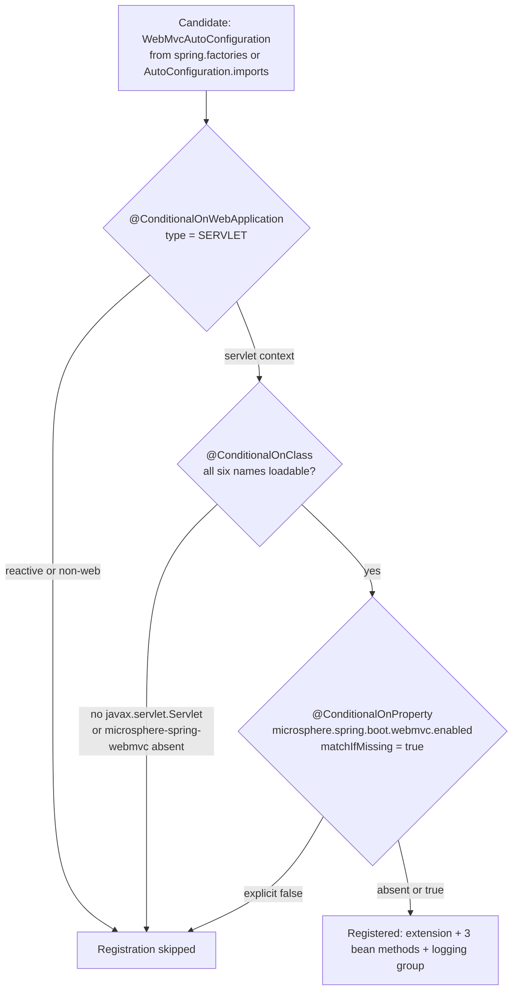

# WebMvc Module — `release-1.x`

> [中文](./zh/webmvc.md) · [Documentation index](../README.md) ·
> [Same document for the `release` branch](../current/webmvc.md)

> **Branch:** `release-1.x` · **Version line:** `0.1.x` · **Artifact:** `microsphere-spring-boot-webmvc`
> **Spring Boot:** `2.1.18.RELEASE` – `2.7.18` · **Java source level:** 8

Contents:
[1 Scope and Pairing](#1-scope-and-pairing) ·
[2 What Is Identical](#2-what-is-identical) ·
[3 The javax.servlet Availability Condition](#3-the-javaxservlet-availability-condition) ·
[4 The Single-Name AutoConfigureAfter Ordering](#4-the-single-name-autoconfigureafter-ordering) ·
[5 Dual Registration Files](#5-dual-registration-files) ·
[6 Property Namespace and Switches](#6-property-namespace-and-switches) ·
[7 Tests](#7-tests) ·
[8 Porting Recipes](#8-porting-recipes) ·
[9 Design Patterns on This Line](#9-design-patterns-on-this-line) ·
[10 See Also](#10-see-also)

---

## 1. Scope and Pairing

A **delta document**: purpose, package map, upstream boundary, bean-by-bean anatomy and the full property table live
in [../current/webmvc.md](../current/webmvc.md). Everything below was read from the `release-1.x` tree and
cross-checked against `release` with `diff -ru microsphere-spring-boot-webmvc`.

| Area | Count | Files |
|---|---|---|
| `src/main/java` | 3 | `autoconfigure/WebMvcAutoConfiguration.java`, `autoconfigure/condition/ConditionalOnWebMvcAvailable.java`, `constants/PropertyConstants.java` |
| `src/main/resources` | 2 | `META-INF/spring.factories`, `META-INF/spring/org.springframework.boot.autoconfigure.AutoConfiguration.imports` |
| `src/test/java` | 5 | `autoconfigure/AbstractWebMvcAutoConfigurationTest`, `autoconfigure/WebMvcAutoConfigurationTest`, `autoconfigure/WebMvcAutoConfigurationAllDisabledTest`, `autoconfigure/WebMvcAutoConfigurationAllEnabledTest`, `constants/PropertyConstantsTest` |

## 2. What Is Identical

Byte-identical to `release`: `constants/PropertyConstants.java`, `pom.xml` (same dependencies and optionality, same
test block at `pom.xml:77`–`:83`), `WebMvcAutoConfigurationTest.java`, `WebMvcAutoConfigurationAllDisabledTest.java`,
`PropertyConstantsTest.java` and `AutoConfiguration.imports`. Identical in content as well: both
`@EnableWebMvcExtension` attributes, the `@Import` of the logging block, the four guarded beans, the nested
`LoggingConfiguration`, five of the six `@ConditionalOnClass` names, the `type = SERVLET` guard and the master switch
at `matchIfMissing = true`. The `AllDisabled` fixture's caveats therefore carry over verbatim — two of its property
lines do not match the keys the conditions read, and its optional injections are never asserted.

`WebMvcAutoConfiguration.java` is 84 lines here against 86, so citations shift by two from line `44` onward; and the
Java 8 source level produces **no** difference in `src/main/java` (only the two string literals of §3 and §4) but one
in the tests (§7).

## 3. The javax.servlet Availability Condition

`ConditionalOnWebMvcAvailable.java:42`–`:54`, quoted in full from this branch:

```java
@Target({TYPE, METHOD})
@Retention(RUNTIME)
@Documented
@ConditionalOnWebApplication(type = SERVLET)
@ConditionalOnClass(name = {
        "javax.servlet.Servlet",                                               // Servlet API
        "org.springframework.context.ApplicationContext",                      // Spring Context API
        "org.springframework.web.method.HandlerMethod",                        // Spring Web API
        "org.springframework.web.servlet.DispatcherServlet",                   // Spring Web MVC API
        "io.microsphere.spring.web.method.support.HandlerMethodInterceptor",   // Microsphere Spring Web API
        "io.microsphere.spring.webmvc.annotation.EnableWebMvcExtension"        // Microsphere Spring Web MVC API
})
@ConditionalOnProperty(name = MICROSPHERE_SPRING_BOOT_WEBMVC_ENALBED_PROPERTY_NAME, matchIfMissing = true)
```

The entire diff of this file is that first class name:

```diff
-        "jakarta.servlet.Servlet",                                             // Servlet API
+        "javax.servlet.Servlet",                                               // Servlet API
```

Boot `3.0` sits on the Servlet package rename, so the annotation is not a compatibility layer but a **namespace
declaration**: `javax` here, `jakarta` on `release`, and each spelling would never match on the other line.



Boot evaluates the three meta-annotations as a conjunction in declaration order and stops at the first miss — the entry
the condition report prints. A WebFlux application stops at the first diamond, so the two web modules coexist; a Boot
`3`/`4` application stops at the second and fails *silently in the safe direction*, the only cross-generation guard here.

## 4. The Single-Name AutoConfigureAfter Ordering

`WebMvcAutoConfiguration.java:45`–`:48`:

```java
@ConditionalOnWebMvcAvailable
@AutoConfigureAfter(name = {
        "org.springframework.boot.autoconfigure.web.servlet.WebMvcAutoConfiguration", // Spring Boot API [2.0, 4.0)
})
```

The complete diff against `release` deletes both Boot `4.0` references — exactly these two lines, nothing else:

```diff
- * @see org.springframework.boot.webmvc.autoconfigure.WebMvcAutoConfiguration
-        "org.springframework.boot.webmvc.autoconfigure.WebMvcAutoConfiguration"       // Spring Boot API [4.0,)
```

The attributes at `:49`–`:52`, the `@Import` at `:53`–`:55` and the beans at `:58`–`:83` are unchanged. What the single name implies:

* Boot keeps that FQCN stable across the whole profiled range (`spring-boot-2.1` = `2.1.18.RELEASE` … `spring-boot-2.7` = `2.7.18`, `microsphere-spring-boot-parent/pom.xml:68`–`:120`), so one name is unambiguous; the retained comment `[2.0, 4.0)` names a range this branch can never exceed, and keeping it verbatim is what makes the port a pure deletion.
* A missing ordering name never throws: `@AutoConfigureAfter` only sequences processing, so with an empty input Boot may register this extension before its `RequestMappingHandlerMapping` and `ContentNegotiationManager` definitions exist — a bean-overlap risk visible only in behaviour, hence §8's two-edge verification.
* `compatible` ships no Web MVC shim here, so by-name ordering is the only cross-version mechanism this module has.

## 5. Dual Registration Files

The largest structural delta between the lines, and a resource delta rather than a code one. Both files name exactly
one class — `microsphere-spring-boot-webmvc/src/main/resources/META-INF/spring.factories`:

```properties
org.springframework.boot.autoconfigure.EnableAutoConfiguration=\
io.microsphere.spring.boot.webmvc.autoconfigure.WebMvcAutoConfiguration
```

and `microsphere-spring-boot-webmvc/src/main/resources/META-INF/spring/org.springframework.boot.autoconfigure.AutoConfiguration.imports`:

```text
io.microsphere.spring.boot.webmvc.autoconfigure.WebMvcAutoConfiguration
```

| Boot version | Reads `spring.factories` | Reads `AutoConfiguration.imports` | Effective outcome |
|---|---|---|---|
| `2.1` – `2.6` | yes | mechanism does not exist | the class is contributed only by `spring.factories` |
| `2.7` | yes | yes | both files are read and the duplicate entry de-duplicated, so it registers once |

`spring.factories` is a properties file with a `\` continuation and CRLF endings; `.imports` is a plain one-class-per-line list. `release-notes.md:235` dates the `spring.factories` entry to `0.1.20`: the legacy file predates the new mechanism and was kept, not replaced. All four auto-configuring modules here carry both.

* **Forgetting `spring.factories`** — on `2.1`–`2.6` the class is never a candidate: no condition evaluation, no report entry, `microsphere.spring.boot.webmvc.enabled=true` does nothing, and the default `2.7` build stays green, so the break only surfaces under §8's `2.1` command.
* **Forgetting `.imports`** — harmless today, fatal once the line widens past a Boot release that drops the legacy key. **One file only, to avoid duplication** — rejected: de-duplication makes the redundancy free, profile-filtered resources would add a build dimension to every change.

## 6. Property Namespace and Switches

No difference in the keys: `PropertyConstants.java` is byte-identical, so the master
`microsphere.spring.boot.webmvc.enabled`, `…webmvc.filter.enabled`, `…webmvc.logging.enabled` and the non-boot
`microsphere.spring.webmvc.content-negotiation.enabled` behave exactly as tabulated in the `release` document, and a
properties file written for `0.2.x` configures `0.1.x`. What differs is what sits behind them:
`microsphere-spring-webmvc` resolves through `${microsphere-spring.version}` = `0.1.39` (`microsphere-spring-boot-parent/pom.xml:22`), so behaviour fixed upstream in `0.2.x` is **not** fixed here, and `EXCLUSIVE_VIEW_RESOLVER_BEAN_NAME_PROPERTY_NAME` is still imported from upstream (`WebMvcAutoConfiguration.java:36`, used at `:70`) without `matchIfMissing`, so it remains the only opt-in bean.

## 7. Tests

Three of the five tests are byte-identical: `PropertyConstantsTest` (every key literal),
`WebMvcAutoConfigurationAllDisabledTest` (content negotiation off only) and `WebMvcAutoConfigurationTest` — the
defaults proof, with four required injections (`:46`–`:56`), the listener injected `required = false`
(`:58`–`:59`), `assertNotNull` × 4 and `assertNull(listener)` at `:61`–`:69`. Two differ.

**`AbstractWebMvcAutoConfigurationTest`** drops the functional-endpoint collaborator:

```diff
-import io.microsphere.spring.test.webmvc.RouterFunctionTestConfig;
-import jakarta.servlet.ServletException;
+import javax.servlet.ServletException;
 @SpringJUnitConfig(classes = {
-        TestController.class,           // Test Controller
-        RouterFunctionTestConfig.class  // Test RouterFunction
+        TestController.class           // Test Controller
 })
```

With it go `testUpdatePerson()`, its call in `testWebEndpoints()` and its `@see` entry, leaving five endpoint checks
(`:79`–`:85`) instead of six. The import hunk mirrors §3 inside the tests: `testError()` (`:134`–`:137`) expects
`javax.servlet.ServletException`. This is *not* "functional endpoints are untested here" —
`AbstractWebFluxAutoConfigurationTest` on this branch still registers `RouterFunctionTestConfig` (`:53`–`:56`) and runs
`testUpdatePerson()` (`:175`).

**`WebMvcAutoConfigurationAllEnabledTest`** strengthens `assertContentNegotiationManager` and rewrites it for Java 8:
its import hunk is `assertFalse` → `assertTrue`, and the 1.x body (blank lines and the unused `strategy1` elided) is

```java
        List<ContentNegotiationStrategy> strategies = contentNegotiationManager.getStrategies();
        assertEquals(2, strategies.size());
        ContentNegotiationStrategy strategy2 = strategies.get(1);
        assertTrue(strategy2 instanceof ParameterContentNegotiationStrategy);
        ParameterContentNegotiationStrategy parameterContentNegotiationStrategy = (ParameterContentNegotiationStrategy) strategy2;
        assertEquals("p", parameterContentNegotiationStrategy.getParameterName());
```

Two facts are pinned and must be ported as a unit. (1) With the `AllEnabled` properties set (`:51`–`:64`,
`favorParameter=true` with `parameterName=p`) this line expects **exactly two** strategies with the
`ParameterContentNegotiationStrategy` at index `1`, whereas `release` requires only a non-empty list and walks it
looking for that strategy — position-sensitivity is a Boot-2 assumption, not a design rule. (2) `assertTrue(x instanceof Y)` plus an explicit cast is the Java 8 form of pattern matching, unavailable reactor-wide. The six required injections (`:68`–`:84`) are unchanged, so a missing bean still fails context creation.

## 8. Porting Recipes

**`release` down to `release-1.x`.** (1) Delete the Boot `4.0` ordering name and its `@see` line, leaving the list
syntax intact. (2) Replace `jakarta.servlet.*` with `javax.servlet.*` in conditions and imports, production and test.
(3) For a new auto-configuration class, edit **both** resource files (§5). (4) Rewrite Java 9+ constructs: pattern
matching → `instanceof` + cast, text blocks → concatenation, `switch` expressions → `switch` with `break`. (5) Re-check tests that index or walk a Spring/Boot collection (§7).

**`release-1.x` up to `release`.** (1) Restore the Boot `4.0` FQCN and the `@see` line. (2) Swap `javax.servlet` back
to `jakarta.servlet`. (3) Ignore `spring.factories` — `release` ships none, so reflect the change in `.imports` only.
(4) Relax Boot-2 assumptions before landing: `assertEquals(2, …)` and index-based `get(1)`.

**Verify.** Source level 8; CI runs JDK `8`, `11`, `17`, `21`, `25` (`.github/workflows/maven-build.yml:25`) against
all seven profiles (`:26`–`:28`). Locally, pin JDK 8 or 11:

```bash
# oldest Boot target here — the only place spring.factories is read
JAVA_HOME=/path/to/jdk8 ./mvnw -pl microsphere-spring-boot-webmvc -am -Pspring-boot-2.1 test
# newest Boot target, and the activeByDefault profile
JAVA_HOME=/path/to/jdk11 ./mvnw -pl microsphere-spring-boot-webmvc -am -Pspring-boot-2.7 test
# one matrix cell, exactly as CI runs it
mvn --batch-mode --update-snapshots --file pom.xml -Drevision=0.0.1-SNAPSHOT \
    -Dsurefire.useSystemClassLoader=false test --activate-profiles test,coverage,spring-boot-2.1
```

`-am` is required: this module needs `core` at compile scope (`pom.xml:31`–`:35`) and the test artifact at test scope
(`:78`–`:83`). A profile that does not exist here, say `-Pspring-boot-3.5`, only warns and then builds `2.7`.

## 9. Design Patterns on This Line

| Pattern | Where | Line-specific reading |
|---|---|---|
| Namespace-declaring condition | `ConditionalOnWebMvcAvailable.java:46`–`:53` | The by-name `@ConditionalOnClass` list is where the Servlet namespace is declared for the whole module; nothing else in `src/main/java` uses either spelling. |
| Redundant registration as compatibility strategy | both resource files (§5) | Two files for one class, chosen over profile-filtered resources because Boot `2.7` de-duplicates; `release` collapses to one file once the legacy key is out of range. |
| By-name ordering with a single entry | `WebMvcAutoConfiguration.java:46`–`:48` | The array form survives with one element, so porting between the lines is always an added or removed line, never a syntax change. |
| Java 8 assertion idiom | `WebMvcAutoConfigurationAllEnabledTest.java:100`–`:109` | `assertTrue(x instanceof Y)` then an explicit cast — copy this when porting `release` tests that use pattern matching. |

## 10. See Also

| Document | Scope |
|---|---|
| [README.md](./README.md) | This branch's developer-guide index: reactor shape, dual registration, cross-branch delta table. |
| [webflux.md](./webflux.md) | The reactive sibling — the same two delta kinds in an otherwise untouched module. |
| [core.md](./core.md) | The compile dependency behind this module, and the Boot-2 reflection workarounds absent here. |
| [../current/webmvc.md](../current/webmvc.md) | The full non-delta description: package map, bean inventory, upstream boundary, property table, test semantics. |
| [../../user-guide/1.x/webmvc.md](../../user-guide/1.x/webmvc.md) | What an end user of this line configures. |
