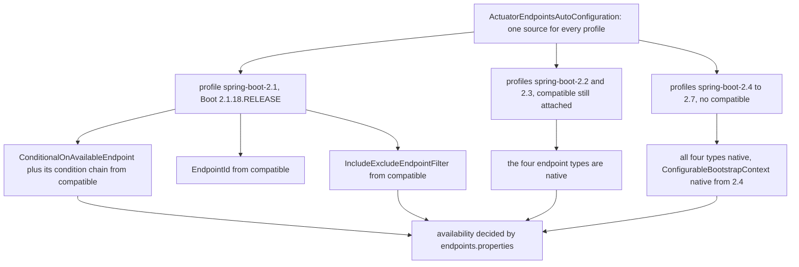

# Actuator 模块 — `release-1.x`

> [English](../actuator.md) · 文档索引：[中文](../../zh/README.md) ·
> `release` 分支的同名文档：[中文](../../current/zh/actuator.md)

> **分支：** `release-1.x` · **版本线：** `0.1.x` · **Artifact：** `microsphere-spring-boot-actuator`
> **Spring Boot：** `2.1.18.RELEASE` – `2.7.18` · **Java 源码级别：** 8

目录：
[1 范围与对照](#1-范围与对照) ·
[2 本分支上相同的部分](#2-本分支上相同的部分) ·
[3 本模块的双重注册](#3-本模块的双重注册) ·
[4 OperationResponseBody 的差异](#4-operationresponsebody-的差异) ·
[5 哪些类型来自垫片](#5-哪些类型来自垫片) ·
[6 MonitoredThreadPoolTaskScheduler 在 Boot 2 上](#6-monitoredthreadpooltaskscheduler-在-boot-2-上) ·
[7 属性常量与 jolokia 版本固定](#7-属性常量与-jolokia-版本固定) ·
[8 本分支上的设计模式](#8-本分支上的设计模式) ·
[9 测试](#9-测试) ·
[10 配方](#10-配方) ·
[11 故障排查](#11-故障排查) ·
[12 参考](#12-参考)

---

## 1. 范围与对照

[../current/actuator.md](../../current/actuator.md) 已经完整地记录了本模块：十个类、两个自动配置类、endpoint 模型、调度器埋点以及默认属性的姿态，本文不重复这些内容。`release-1.x` 在 Java 8 上针对 Boot `2.1.18.RELEASE`–`2.7.18` 构建本模块，而目录树对比显示它跨分支的一致程度比 `core` **更高**：整个模块只有四处差异——`endpoint/ConfigurationMetadataEndpoint.java`、`endpoint/ConfigurationPropertiesEndpoint.java`、`pom.xml`，以及一个在 `release` 上根本不存在的多余文件 `src/main/resources/META-INF/spring.factories`。其余每一个主源文件、每一个测试源文件、每一个资源文件都逐字节相同。下文行号取自 `release-1.x` 树。

| 问题 | 在那里读 | 在这里读 |
|---|---|---|
| 有哪些类、endpoint id、操作签名 | 第 2 与第 4 节 | 第 2 节——完全相同 |
| endpoint 姿态与 TTL 阶梯 | 第 8 与第 9 节 | 第 2 节——该文件字节级相同 |
| 自动配置如何注册 | 第 3 节 | 第 3 节——本分支是两个文件 |
| 响应 DTO 的形状 | 第 4 节 | 第 4 节——`OperationResponseBody` |
| 垫片模块为何在此重要 | 第 7 节（说不重要） | 第 5 节 |
| 任务调度器埋点 | 第 6 节 | 第 6 节——同样的代码，更旧的 Micrometer |
| 条件注解与属性常量 | 第 7 与第 8 节 | 第 7 节 |
| 测试 | 第 11 节 | 第 9 节——测试没有差异 |

---

## 2. 本分支上相同的部分

用 `diff -rq microsphere-spring-boot-actuator/src/main` 与 `.../src/test` 在两个工作树上验证。

* **类清单**：`src/main/java/io/microsphere/spring/boot/actuate/` 下 10 个文件，两个分支路径一致——`MonitoredThreadPoolTaskScheduler`、`autoconfigure.{ActuatorAutoConfiguration,ActuatorEndpointsAutoConfiguration}`、`condition.{ConditionalOnActuatorEndpointPresent,ConditionalOnConfigurationProcessorPresent}`、`constants.PropertyConstants` 以及四个 `endpoint.*` 类。
* **字节级相同的主源文件**：`autoconfigure/`、`condition/`、`constants/` 和 `endpoint/{ArtifactsEndpoint,WebEndpoints}.java` 全部 diff 干净。`ActuatorEndpointsAutoConfiguration.java:28` 在**两个**分支上都导入 `org.springframework.boot.actuate.autoconfigure.endpoint.condition.ConditionalOnAvailableEndpoint`——这正是本分支需要垫片的原因（第 5 节）。
* **字节级相同的资源**：`META-INF/config/default/endpoints.properties`（两棵树的 md5 均为 `881b6caca484bef5b7b68241092c3549`）与 `ConfigurationPropertyLoader` 服务文件。默认启用策略、web 暴露与 JMX 暴露的不对称、`microsphere.cache.*` TTL 阶梯和四条路径映射请读 `../current/actuator.md` 第 8、9 节；这里的字节完全一样，重新罗列只会引入漂移。
* **endpoint id**：`artifacts`、`webEndpoints`、`configMetadata`、`configProperties`，每个恰好有一个无参 `@ReadOperation`，没有 selector、writer 或 deleter——未变。
* **字节级相同的测试**：对 `src/test` 执行 `diff -rq` **没有任何输出**（第 9 节说明同一份测试体如何同时服务两代 Boot）。

---

## 3. 本模块的双重注册

`release` 只用一个文件注册本模块的自动配置；本分支把同样的两个类注册进了两个文件。`microsphere-spring-boot-actuator/src/main/resources/META-INF/spring.factories`——三行，而且这个文件在 `release` 上**不存在**：

```
org.springframework.boot.autoconfigure.EnableAutoConfiguration=\
io.microsphere.spring.boot.actuate.autoconfigure.ActuatorAutoConfiguration,\
io.microsphere.spring.boot.actuate.autoconfigure.ActuatorEndpointsAutoConfiguration
```

`META-INF/spring/org.springframework.boot.autoconfigure.AutoConfiguration.imports` 与 `release` 字节级相同：同样的两个类名、同样的顺序、每行一个。按 Boot 版本划分的读取规则，就是两个文件同时存在的全部理由。

| Boot 版本 | 读取 `spring.factories` 的 `EnableAutoConfiguration` | 读取 `AutoConfiguration.imports` | 对本模块的后果 |
|---|---|---|---|
| `2.1` – `2.6` | 是 | 该文件被忽略 | 只有 `spring.factories` 注册了这两个自动配置类。 |
| `2.7` | 是 | 是 | 两者都会被读取；Boot 会对重复的类名去重，因此注册两次是安全的。 |
| `3.0` 及以后 | **否** | 是 | 这正是 `release` 删掉 `spring.factories` 的原因；在此删除它会让 `2.1`–`2.6` 上整个模块失效。 |

由此得出两条维护规则。**`spring.factories` 里的顺序是加载顺序，不是优先级**——两个文件都不表达顺序；本模块的顺序完全来自 `ActuatorAutoConfiguration` 上的 `@AutoConfigureOrder(LOWEST_PRECEDENCE)`（`:39`）以及 bean/类条件。**嵌套配置绝不可写进任一文件**：`ActuatorEndpointsAutoConfiguration.ConfigurationProcessorConfiguration`（`:96`）只能通过 `@Import`（`:44`）到达；把它提升为顶层自动配置会绕过它 `@ConditionalOnConfigurationProcessorPresent` 的隔离意图。

---

## 4. OperationResponseBody 的差异

在本分支上，两个 endpoint 的响应类型都是朴素 DTO：

```java
// endpoint/ConfigurationMetadataEndpoint.java — release
import org.springframework.boot.actuate.endpoint.OperationResponseBody;
public static class ConfigurationMetadataDescriptor implements OperationResponseBody {
// release-1.x, :79 — the import is deleted, the implements clause is deleted
public static class ConfigurationMetadataDescriptor {

// endpoint/ConfigurationPropertiesEndpoint.java — release, :134
public static class ConfigurationPropertiesDescriptor implements OperationResponseBody {
// release-1.x, :133
public static class ConfigurationPropertiesDescriptor {
```

第二个类的差异还顺带改写了 javadoc，从 "implementing `OperationResponseBody` for actuator endpoint serialization" 变成 "Descriptor class that holds a collection of `ConfigurationProperty` instances for actuator endpoint serialization."。此处之所以没有它：`org.springframework.boot.actuate.endpoint.OperationResponseBody` 是 Boot 2.4+ 的类型（`@since 2.4.0`），而本模块必须能在 profile `spring-boot-2.1` 下编译。与 `core` 的情形不同，这里没有使用反射探测，因为标记接口无法有条件地施加——`implements` 子句在类加载时就被解析。合法的选项只有两个：在 `compatible` 中提供该接口的垫片，或者干脆去掉。本分支选择去掉，而且这样做是安全的，因为它是一个**纯标记**，不声明任何方法。序列化行为、DTO 字段（`Collection<ItemMetadata> groups`、`Collection<ItemMetadata> properties`、`List<ConfigurationProperty> configurationProperties`）、getter 以及包级私有的链式 `addConfigurationProperties(List)` 全都不变，`diff` 也显示这两个文件再无其他行。

移植后果：改动任一 DTO 的*形状*都能在两个方向上干净地移植。而**新增**该接口的改动只能属于 `release`；要移植到本分支，还必须把该接口加进 `compatible` 并重新挂载 profile——远比这一行 diff 看起来的分量大。

---

## 5. 哪些类型来自垫片

这是本模块最大的架构差异，而 `../current/actuator.md` 第 7 节恰好说反了（"`microsphere-spring-boot-compatible` 不含任何 actuator 垫片"）。在本分支上，`@ConditionalOnAvailableEndpoint` 的四处使用——`ActuatorEndpointsAutoConfiguration.java:61`、`:80`、`:146`、`:165`——之所以能编译，全赖 `compatible` 为 profile `2.1`–`2.3` 提供了该注解、它的条件以及依赖。垫片模块在本分支携带 12 个源文件，其中五个正是为本模块而存在：`actuate/endpoint/EndpointId`、`actuate/autoconfigure/endpoint/condition/{AbstractEndpointCondition,ConditionalOnAvailableEndpoint,OnAvailableEndpointCondition}`、`actuate/autoconfigure/endpoint/expose/IncludeExcludeEndpointFilter`，另外还有服务于 `core` 绑定路径的 `context/properties/ConstructorBinding`。它们的 `@since` 值就记录在这些 fork 来的源码里：`ConditionalOnAvailableEndpoint.java:101` `@since 2.2.0`、`IncludeExcludeEndpointFilter.java:41` `@since 2.2.7`、`EndpointId.java:35` `@since 2.0.6`（其中 `of(Environment, String)` 在 `:127` 标注 `@since 2.2.0`）。



决策规则与 `core` 文档中一致：出现在**签名**里的类型用垫片，因为缺失的 import 会在任何条件被求值之前就让编译失败。该注解标注在 `@Bean` 方法上，而 `IncludeExcludeEndpointFilter` 与 `EndpointId` 作为 `OnAvailableEndpointCondition` 内部的构造器与参数类型出现，所以三者都住在 `compatible` 里，而不是藏在反射探测之后。注意图中的不对称：`compatible` 由 profile `2.1`、`2.2` **和** `2.3` 挂载（`microsphere-spring-boot-core/pom.xml:91-127`），尽管 Boot `2.2` 已经原生提供 endpoint 条件类；原因是 `core` 还需要那些 bootstrap 上下文垫片，而且垫片模块是按 profile 挂载、不是按类挂载。这些垫片从不发布（`microsphere-spring-boot-compatible/pom.xml` 跳过 deploy 与中央仓库发布），因此不会泄漏给使用者。

---

## 6. MonitoredThreadPoolTaskScheduler 在 Boot 2 上

`actuate/MonitoredThreadPoolTaskScheduler.java` 与 `release` **字节级相同**，所以机制描述留在 `../current/actuator.md` 第 6 节，这里只重复与版本有关的事实。该类恰好绑定三个协作类型，全部在编译期解析：

| 类型 | import 行 | 使用位置 | 本分支上的年龄约束 |
|---|---|---|---|
| `io.micrometer.core.instrument.MeterRegistry` | `:19` | `:118`，`context.getBean(MeterRegistry.class)` | 每个 profile 都由 Boot 的 BOM 管理，故该类型本身无需固定版本。 |
| `io.micrometer.core.instrument.binder.jvm.ExecutorServiceMetrics` 及其静态 `monitor` | `:20`、`:32` | `:120`，`delegate.setDelegate(monitor(registry, scheduledExecutor, beanName))` | `micrometer-core` 版本固定正是为了让这个类型保持可解析。 |
| `io.microsphere.concurrent.DelegatingScheduledExecutorService` | `:21` | `:49`、`:84` | 来自 Microsphere 而非 Boot；版本取自 `microsphere-spring.version=0.1.39`。 |

`createExecutor(int, ThreadFactory, RejectedExecutionHandler)`（`:82`）与 `getScheduledExecutor()`（`:102`）在本分支覆写的是 Spring Framework 5.x 的 `ThreadPoolTaskScheduler`；`afterSingletonsInstantiated()`（`:117-121`）只是包装 `super.getScheduledExecutor()` 的返回值，该类完全不引用 Boot actuator 的指标类型。版本固定本身位于 `microsphere-spring-boot-actuator/pom.xml:98-117`，是只在本分支存在的 profile 块：

```xml
<profiles>
    <profile>
        <id>spring-boot-2.1</id>
        <dependencies>
            <dependency>
                <groupId>io.micrometer</groupId>
                <artifactId>micrometer-core</artifactId>
                <version>1.3.20</version>
                <optional>true</optional>
            </dependency>

            <dependency>
                <groupId>org.springframework</groupId>
                <artifactId>spring-core</artifactId>
                <version>5.2.25.RELEASE</version>
                <optional>true</optional>
            </dependency>
        </dependencies>
    </profile>
</profiles>
```

要把它读成**下限**而不是升级：Boot `2.1` 自带的依赖管理解析出的 `micrometer-core` 比该类所调用的 binder API 更旧，于是该 profile 用 `1.3.20` 覆盖被管理的坐标并标记为 `optional`，让使用者的编译类路径不受影响，同时保证模块自身能编译与测试。成对出现的 `spring-core:5.2.25.RELEASE` 是同一手法施加在框架上：Boot `2.1.18` 携带的 Spring 更旧，本模块是针对 `5.2.x` 的 API 表面编译的，固定一个 `5.2` 补丁版本可让构建可复现。两者都是 optional 且限定在 profile 内，所以发布出去的 POM 不会携带它们。

由于 `ActuatorAutoConfiguration` 声明了 `@AutoConfigureOrder(LOWEST_PRECEDENCE)`（`:39`），并把 bean 门控在 `@ConditionalOnBean(type = METER_REGISTRY_CLASS_NAME)`（`:112`）上——即按名字的形式，`:94` 处的 `"io.micrometer.core.instrument.MeterRegistry"`——这里没有任何东西需要随 Boot 代际改动：模块从不以类型方式链接 Micrometer，而该常量在测试里又被拿去与 `MeterRegistry.class.getName()` 对照断言，因此 Micrometer 坐标变动会让构建失败，而不是悄悄禁用调度器。

---

## 7. 属性常量与 jolokia 版本固定

`actuate/constants/PropertyConstants.java` 与 `release` 字节级相同：一个只有两个常量的接口，`:32` 与 `:37`，组合出 `MICROSPHERE_SPRING_BOOT_ACTUATOR_PROPERTY_NAME_PREFIX = MICROSPHERE_SPRING_BOOT_PROPERTY_NAME_PREFIX + "actuator."` 与 `TASK_SCHEDULER_PROPERTY_NAME_PREFIX = MICROSPHERE_SPRING_BOOT_ACTUATOR_PROPERTY_NAME_PREFIX + "task-scheduler."`，父前缀从 `core` 静态导入（`:19`）。由它拼出的两个具体键——`microsphere.spring.boot.actuator.task-scheduler.pool-size` 与 `...thread-name-prefix`——在 `ActuatorAutoConfiguration` 的 `:55` 与 `:76` 处声明，均带 `@ConfigurationProperty(defaultValue = …, source = APPLICATION_SOURCE)` 注解。本分支特有的事实只有它们解析到的值，而这些值与 `release` 上的代码内回退一致：池大小 `1`（`:45`）、线程名前缀 `microsphere-spring-boot-actuator-task-`。两个键都不出现在任一分支的 `endpoints.properties` 里，因此调度器的默认值来自 `@Value` 表达式而不是默认属性源——即 `../current/actuator.md` 第 8 节所述"文档与生效分离"的同一做法。

`jolokia` 的差异完全在 POM 里。`microsphere-spring-boot-parent/pom.xml` 在本分支设置 `<jolokia.version>1.7.2</jolokia.version>`，而 `release` 是 `2.6.3`，模块声明依赖时不写版本（`microsphere-spring-boot-actuator/pom.xml:37-41`）：

```xml
<!-- Jolokia -->
<dependency>
    <groupId>org.jolokia</groupId>
    <artifactId>jolokia-core</artifactId>
</dependency>
```

这个版本分野映射的是 servlet 命名空间：`jolokia-core` `1.x` 是 `javax` 时代的产物，`2.x` 面向 `release` 所支持的 `jakarta` 时代。`endpoints.properties` 两个分支相同，仍然带有 `management.endpoint.jolokia.enabled = true`（第 31 行），所以此处该 endpoint 是针对 `1.7.2` 实现启用的——不要把父 POM 的这个属性"对齐"到 `release`，那会把一个 `jakarta` 构建的 Jolokia 放到 Boot 2 的类路径上。相邻的另外两个本分支固定值也同理：父 POM 里的 `microsphere-spring.version=0.1.39` 与 `junit-jupiter.version=5.14.4`。

---

## 8. 本分支上的设计模式

共享的模式在 `../current/actuator.md` 第 10 节；下面是那些*存在理由*因 Boot 2 而改变的模式。

| 模式 | 类或产物 | 在本分支上为何是被强制的 |
|---|---|---|
| 为门控注解提供编译期垫片 | `compatible` 的 `ConditionalOnAvailableEndpoint` 及其条件链 | `@Bean` 方法上的注解是签名级引用，无法用反射探测（第 5 节）。 |
| 以省略标记接口代替垫片 | 两个 endpoint descriptor 类 | `OperationResponseBody` 是 `@since 2.4.0`，而 `implements` 子句不能有条件，于是本分支直接去掉（第 4 节）。 |
| profile 内 optional 版本固定，充当下限 | `actuator/pom.xml:98-117` 的 `micrometer-core:1.3.20` 与 `spring-core:5.2.25.RELEASE` | 让同一份源文件跨 Boot 代际保持可编译，同时不把版本泄漏进发布产物。 |
| 按名字的条件 | `@ConditionalOnBean(type = METER_REGISTRY_CLASS_NAME)` | 在区间内的每个 Boot 上都可移植；条件层面从不链接 Micrometer。 |
| 元注解组合 | `@ConditionalOnActuatorEndpointPresent`、`@ConditionalOnConfigurationProcessorPresent` | 它们的载荷只是一个 `@ConditionalOnClass(name = ...)`，因此在两条线上保留的成本都为零。 |
| 延迟初始化 | `MonitoredThreadPoolTaskScheduler.afterSingletonsInstantiated()` | 未变；它之所以存在，是因为 `@AutoConfigureOrder(LOWEST_PRECEDENCE)` 允许 `MeterRegistry` 晚于本 bean 出现。 |
| 以双重注册充当兼容适配器 | 两个 `META-INF` 注册文件 | 同一个产物服务于两种互斥的 Boot 发现机制（第 3 节）。 |
| 约定优于配置 | `endpoints.properties` | 在本分支字节级相同，因此这套姿态是共享不变量而非分支特有。 |

---

## 9. 测试

`diff -rq` 对 `src/test` **不报告任何差异**：`src/test/java/io/microsphere/spring/boot/actuate/` 下的五个类与 `src/test/resources/application.properties` 在两个分支上是同一批文件。这才是有意思的事实——这些测试是被写成"一份测试体钉住两代 Boot"的。

| 测试文件 | 它钉住了什么 | 它为何在 Boot 2 上安全 |
|---|---|---|
| `autoconfigure/ActuatorAutoConfigurationTest.java` | `testConstants()` 断言 `"1"`、两个 task-scheduler 属性名以及 `METER_REGISTRY_CLASS_NAME`，最后一项断言两次——一次对着字面量，一次对着 `MeterRegistry.class.getName()`。`MeterRegistryPresent` 以 `webEnvironment = NONE` 启动并带上 `pool-size=2`、`thread-name-prefix=my-prefix`，走一遍 `getPoolSize()` 的 `0 → 1 → 2`；`MeterRegistryAbsent` 断言该 bean 为 `null`。 | 调度器相关的断言只涉及 Spring 的 `ThreadPoolTaskScheduler` API 与 Micrometer 的 `MeterRegistry`，二者在 `2.1`–`2.7` 上稳定。对按名字常量的双重断言，正是把一个坐标变动转化为构建失败、而不是调度器被悄悄禁用的那道保险。 |
| `autoconfigure/ActuatorEndpointsAutoConfigurationTest.java` | `Defaults` 自动注入四个 endpoint 并逐一调用 `artifacts`、`webEndpoints`、`configMetadata`、`configProperties`；`Disabled` 设置四个 `management.endpoint.<id>.enabled=false` 键并断言四个 bean 都不存在。 | 它依赖 `@ConditionalOnAvailableEndpoint`，该注解从 `2.2` 起原生、在 `2.1` 下由垫片提供，因此两种情况下断言都成立；嵌套类的 `@Order(1)`/`@Order(2)` 保证"bean 存在"先于"bean 不存在"运行，从而上下文缓存命中无法掩盖一次失败的排除。 |
| `constants/PropertyConstantsTest.java` | `testConstants()` 冻结两个前缀。 | 属性名与分支无关，因此任何挪动命名空间的 `core` 重构都会在两条线上同时失败。 |
| `endpoint/WebEndpointsTest.java` | 针对聚合流程判定条件的 Mockito 用例：`WRITE` 操作产出空 map、裸的 `ExposableWebEndpoint` 被跳过、`null` 不可暴露、基于写方法的真实 `DiscoveredOperationMethod` 被拒绝。内部的 `WebEndpoint` 与 `DiscoveredOperationImpl` 就是替身。 | 它是手工拼装 actuator 内部对象而不是启动它们，所以唯一的版本表面是 `DiscoveredEndpoint`/`WebOperation`/`OperationType` API——在 `2.1`–`2.7` 上都存在且未变。 |
| `env/DefaultPropertiesTest.java` | 通过注入的 `Environment` 读取随包发布的键，断言 `enabled-by-default=false`、`web.exposure.include=*`、`jmx.exposure.exclude=*` 以及每个 endpoint 各自的开关，包括 `loggers` 为 `false`——尽管 `endpoints.properties` 第 22 行写的是 `true`。 | 这个 `false` 来自 `src/test/resources/application.properties`，所以它是在本模块内部断言 `core` 默认属性机制的优先级契约，与 Boot 3 无关。 |

唯一一处 Boot-2 特有的期望，藏在两个嵌套上下文通过 `microsphere.autoconfigure.exclude` 推下去的排除列表里（`ActuatorAutoConfigurationTest.java:117-121`）：下标 `[0]` 与 `[1]` 是 `org.springframework.boot.actuate.autoconfigure.metrics.MetricsAutoConfiguration` 和 `.CompositeMeterRegistryAutoConfiguration`——即本分支面向的 Boot `2.x`/`3.x` 包布局；而 `[2]` 与 `[3]` 是只有 Boot `4` 才认识的 `org.springframework.boot.micrometer.metrics.autoconfigure.*` 名字。该过滤器会静默丢弃不存在的名字，所以同一份字面量列表在两个分支都可用。移植到本分支时不要精简这些"没用"的条目：它们正是该文件跨分支保持一致的原因。

---

## 10. 配方

### 10.1 在本分支上新增一个 endpoint

1. 创建 `src/main/java/io/microsphere/spring/boot/actuate/endpoint/<Name>Endpoint.java`，标注 `@Endpoint(id = "<camelCaseId>")`；需要 web 专属协作者时改用 `@WebEndpoint`；协作类型一律走构造器注入，本模块没有任何字段注入。
2. 把结构化载荷建模为嵌套的 `public static` DTO，**不要**写 `implements OperationResponseBody`（第 4 节）；在此处加上该接口是一个垫片决策，而不是一行编辑。
3. 在 `ActuatorEndpointsAutoConfiguration` 中以 `@Bean` + `@ConditionalOnMissingBean` + `@ConditionalOnAvailableEndpoint` 注册 bean；若该 endpoint 引用了 `spring-boot-configuration-processor` 的类型，则注册在 `ConfigurationProcessorConfiguration` 里。
4. 不要在 imports 文件里追加任何东西——外层类已经列在其中。确认 `META-INF/spring.factories` 仍列出 `ActuatorEndpointsAutoConfiguration`，因为 Boot `2.1`–`2.6` 只读那个文件。
5. 在 `endpoints.properties` 里以 `### <Name> Endpoint` 为标题补上姿态行：`enabled`、`management.endpoints.web.path-mapping.<id>`，以及指向某个 `microsphere.cache.*` 键的 `management.endpoints.<id>.cache.time-to-live`。为保持该文件与 `release` 字节级相同，请在其中一个分支编辑后再移植。
6. 扩展 `ActuatorEndpointsAutoConfigurationTest` 的 `Defaults` 与 `Disabled`，并在 `env/DefaultPropertiesTest` 中断言新增的键。
7. 两种语言都要写文档（`docs/user-guide/1.x/actuator.md` 与其 `zh/` 镜像，若该 endpoint 也随 `release` 发布则还包括 `release` 那一对），随后在 JDK 8 或 11 上两端验证：`./mvnw -pl microsphere-spring-boot-actuator -am -Pspring-boot-2.1 test` 与 `-Pspring-boot-2.7`。

### 10.2 在两条线之间移植 endpoint 改动

1. 除两个 descriptor 之外的 `endpoint/` 内容，加上 `autoconfigure/`、`condition/`、`constants/`，全部字节级相同：两个方向都原样复制。
2. descriptor 变更时，只移植*形状*。`release` 到本分支：去掉 `OperationResponseBody` 的 import 与 `implements` 子句。本分支到 `release`：把两者加回来。
3. 若改动使用了比 `2.1.18` 更新的 Boot actuator API，套用第 5 节的规则：签名级存在意味着由 profile `2.1`/`2.2`/`2.3` 挂载的 `compatible` 垫片，方法体内存在意味着反射探测，作为门控意味着按名字的条件。绝不新增对 Boot 3 类型的无条件 import。
4. 新的自动配置类在本分支需要**两处**注册，在 `release` 只需要**一处**。
5. 涉及版本变动就落在 POM 属性（`microsphere-spring-boot-parent/pom.xml`）或 profile 块（`actuator/pom.xml:98-117`）里，绝不要写在源码里。
6. 不要修改共享测试，直接重跑；它们字节级相同是有原因的。只有一个分支才需要的测试改动，说明主源码的改动破坏了可移植性。

---

## 11. 故障排查

| 症状 | 成因 | 检查与修复 |
|---|---|---|
| `-Pspring-boot-2.1` 下完全没有 endpoint bean，`2.7` 下正常 | 未挂载 `compatible`，导致 `ConditionalOnAvailableEndpoint`、`EndpointId`、`IncludeExcludeEndpointFilter` 无法解析。 | 确认 `microsphere-spring-boot-core/pom.xml:91-127` 中 profile `2.1`/`2.2`/`2.3` 仍声明 `microsphere-spring-boot-compatible:${revision}`，并确认该模块先被构建（`-am`）。 |
| 使用者在 Boot `2.1` 上抛 `NoClassDefFoundError`，指向 `...endpoint.condition.ConditionalOnAvailableEndpoint` | 垫片只在构建期存在且从不发布，因此在使用者的运行期缺席。 | 这些条件类从 Boot `2.2` 起原生提供；抬高使用者的最低版本，或给 bean 加门控使该注解不被加载。 |
| 只在 `spring-boot-2.1` 下编译失败于 `micrometer` 类型 | `micrometer-core:1.3.20` 这个下限被删除，或被使用者的 BOM 覆盖。 | 恢复 `actuator/pom.xml:98-117`；该固定项是 profile 作用域且 `optional`，不可上提到父 POM。 |
| 存在 `MeterRegistry` 却缺失 task-scheduler bean | `@ConditionalOnBean(type = ...)` 按名字匹配，Micrometer 坐标迁移后名字不再匹配。 | `testConstants()` 会把 `METER_REGISTRY_CLASS_NAME` 与 `MeterRegistry.class.getName()` 相对照；改 `ActuatorAutoConfiguration.java:94` 的常量，而不是改注解形状。 |
| 新增类之后 endpoint 已启用，但 `2.7` 下没有路由 | 只写进了两个注册文件中的一个。 | 本分支上两个文件都必须列出该类（第 3 节）：`2.7` 两个都读，`2.1`–`2.6` 只读 `spring.factories`。 |
| `release` 上有该 endpoint，合并之后本分支没有 | "与 `release` 同步"时删掉了 `EnableAutoConfiguration` 块。 | 恢复它；Boot 3 忽略这个 key，Boot `2.1`–`2.6` 完全依赖它。 |
| `configProperties` 的输出牵出 `getMergedBeanDefinition` 的 `ClassCastException` | `core` 的 `ConfigurationPropertiesBeanContext.java:413` 强制转换为 `RootBeanDefinition`。 | 这是 `core` 分支的约束；见 `core.md` 第 7.1 节，不要改 endpoint。 |

---

## 12. 参考

| 文档 | 范围 |
|---|---|
| [README.md](./README.md) | `release-1.x` 开发者文档索引。 |
| [core.md](./core.md) | 默认属性链路，以及本模块继承的"签名 vs 探测"规则。 |
| [compatible.md](./compatible.md) | 十二个 Boot 2 垫片，含本模块编译所依赖的四个 endpoint 类。 |
| [test.md](./test.md) | 第 9 节测试所使用的 `microsphere-spring-boot-test` 基类。 |
| [../current/actuator.md](../../current/actuator.md) | `release` 分支的完整架构文档，建议先读。 |
| [../../user-guide/1.x/actuator.md](../../../user-guide/1.x/actuator.md) | `0.1.x` 版本线上的 endpoint URL、示例响应与用户配置。 |
