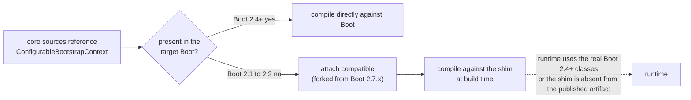
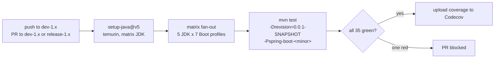
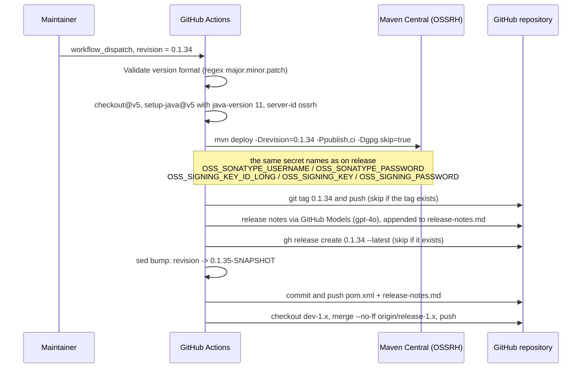
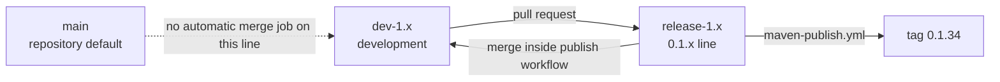

# 构建与发布流水线 — `release-1.x`

> [English](../build-and-release.md) · 文档索引：[中文](../../zh/README.md) ·
> 本分支用户文档：[中文](../../../user-guide/1.x/zh/README.md)

> **分支：** `release-1.x` · **版本线：** `0.1.x` · **范围：** Maven reactor + GitHub Actions
> 本文只记录与 [../current/zh/build-and-release.md](../../current/zh/build-and-release.md) 的**差异**，共用的机制在那份文档里完整说明。

目录：
[1 如何阅读本文](#1-如何阅读本文) ·
[2 本线的 Reactor 结构](#2-本线的-reactor-结构) ·
[3 版本事实](#3-版本事实) ·
[4 Spring Boot profile 表](#4-spring-boot-profile-表) ·
[5 垫片挂载与额外版本固定](#5-垫片挂载与额外版本固定) ·
[6 本地构建命令](#6-本地构建命令) ·
[7 CI 组成](#7-ci-组成) ·
[8 发布流水线](#8-发布流水线) ·
[9 分支模型](#9-分支模型) ·
[10 两条线之间的移植](#10-两条线之间的移植) ·
[11 本线的故障排查](#11-本线的故障排查) ·
[12 参考](#12-参考)

---

## 1. 如何阅读本文

两条线由同样形态的 POM 和同样两个工作流构建。凡是机制完全相同的地方，本文只指向 `release` 版本的说明而不重复。
本文所有断言都读自 `release-1.x` 的源码树。

---

## 2. 本线的 Reactor 结构

```mermaid
graph TD
    BUILD["microsphere-build:0.3.14<br/>(external parent)"]
    ROOT["microsphere-spring-boot (root)<br/>revision=0.1.35-SNAPSHOT"]
    P["...-parent"]
    D["...-dependencies (BOM)"]
    C["...-compatible<br/>(12 shims, never published)"]
    T["...-test"]
    CORE["...-core"]
    MVC["...-webmvc"]
    FLUX["...-webflux"]
    ACT["...-actuator"]

    BUILD --> ROOT
    ROOT --> P
    ROOT --> D
    ROOT --> C
    ROOT --> T
    ROOT --> CORE
    ROOT --> MVC
    ROOT --> FLUX
    ROOT --> ACT
    P -. inheritance .-> C
    P -. inheritance .-> T
    P -. inheritance .-> CORE
    P -. inheritance .-> MVC
    P -. inheritance .-> FLUX
    P -. inheritance .-> ACT
    CORE -. test scope .-> T
    MVC --> CORE
    FLUX --> CORE
    ACT --> CORE
    CORE -. profiles 2.1 and 2.2 and 2.3 .-> C
```

`<modules>` 列表及其顺序与 `release` 完全一致（parent、dependencies、compatible、test、core、webmvc、webflux、
actuator），不同的只是各 POM 的**内容**。

---

## 3. 版本事实

| 项目 | `release-1.x` 上的值 | 与 `release` 的对照 |
|---|---|---|
| `<revision>` | `0.1.35-SNAPSHOT` | `0.2.35-SNAPSHOT` |
| `<java.version>` | 根 POM 中**不存在** | `17` |
| 构建父工程 | `microsphere-build:0.3.14` | `0.3.16` |
| `microsphere-spring.version` | `0.1.39` | `0.2.39` |
| `jolokia.version` | `1.7.2` | `2.6.3` |
| `junit-jupiter.version` | `5.14.4` | `6.1.3` |
| Parent POM 的 `<repositories>` | 无 | 有一个 `spring-milestone` 仓库 |

由于本线没有设置 `<java.version>`，实际编译级别来自 `microsphere-build`。而 CI 矩阵仍以 JDK 8 起步，这才是本线
源码的实际下限：不使用模式匹配 `instanceof`、不使用文本块、不使用 `switch` 表达式。

---

## 4. Spring Boot profile 表

定义在 `microsphere-spring-boot-parent/pom.xml`：

| Profile | `spring-boot.version` | 额外效果 |
|---|---|---|
| `spring-boot-2.1` | `2.1.18.RELEASE` | 把 `compatible` 挂到 `core`；在 `compatible` 里固定 `spring-core:5.2.25.RELEASE`；在 `actuator` 里固定 `micrometer-core:1.3.20` |
| `spring-boot-2.2` | `2.2.13.RELEASE` | 把 `compatible` 挂到 `core` |
| `spring-boot-2.3` | `2.3.12.RELEASE` | 把 `compatible` 挂到 `core` |
| `spring-boot-2.4` | `2.4.13` | |
| `spring-boot-2.5` | `2.5.15` | |
| `spring-boot-2.6` | `2.6.15` | |
| `spring-boot-2.7` | `2.7.18` | `activeByDefault` |

前三项带 `.RELEASE` 后缀是 Boot `2.1`–`2.3` 上游的版本命名方式；从 `2.4` 起 Spring Boot 才发布纯
`major.minor.patch` 版本。不带后缀的 `2.1.18` 依赖无法解析，所以即使看起来不一致，后缀也必须保留在 profile 里。

`activeByDefault` 语义与 `release` 相同：一旦显式激活某个 profile（例如 `-Pspring-boot-2.1`），隐含的 `2.7` 选择
就失效。

---

## 5. 垫片挂载与额外版本固定

`microsphere-spring-boot-core/pom.xml` 第 91–127 行声明了 profile `spring-boot-2.1`、`spring-boot-2.2`、
`spring-boot-2.3`，每个都把 `microsphere-spring-boot-compatible:${revision}` 挂上。机制——挂载声明在*依赖方*模块
的 profile 里，而不是垫片模块内部的 optional 依赖——与
[../current/zh/build-and-release.md](../../current/zh/build-and-release.md) 描述的一致，只是方向相反：



本线独有的两处版本固定：

| 模块 | Profile | 固定版本 | 原因 |
|---|---|---|---|
| `microsphere-spring-boot-compatible` | `spring-boot-2.1` | `org.springframework:spring-core:5.2.25.RELEASE`（optional） | fork 出来的 bootstrap 源码需要引用到相应的 Spring Framework API |
| `microsphere-spring-boot-actuator` | `spring-boot-2.1` | `io.micrometer:micrometer-core:1.3.20` | Boot `2.1` 受管的 Micrometer 早于调度器指标所用的 binder API |

两处固定都只在该 profile 下构建时生效，不会改变已发布 artifact 的依赖坐标。

---

## 6. 本地构建命令

```bash
# 默认版本线（2.7.18）——要对齐矩阵低端需要 JDK 8 或 11
./mvnw clean verify

# 最老的支持组合
./mvnw -pl microsphere-spring-boot-core -am -Pspring-boot-2.1 test

# 垫片是否在 2.1 下挂载、在 2.4 下不挂载？
./mvnw -pl microsphere-spring-boot-core -am -Pspring-boot-2.1 dependency:tree | grep compatible
./mvnw -pl microsphere-spring-boot-core -am -Pspring-boot-2.4 dependency:tree | grep compatible

# 单个矩阵单元，与 CI 完全一致
mvn --batch-mode --update-snapshots --file pom.xml \
    -Drevision=0.0.1-SNAPSHOT \
    -Dsurefire.useSystemClassLoader=false \
    test --activate-profiles test,coverage,spring-boot-2.1
```

选择一个本线不存在的 profile（例如 `-Pspring-boot-4.0`）时，Maven 会告警该 profile 无法激活，并静默退回到默认的
`2.7` 构建。

---

## 7. CI 组成

`release-1.x` 上的 `.github/workflows/maven-build.yml`：

| 元素 | 值 |
|---|---|
| 触发条件 | push 到 `dev-1.x`；PR 指向 `dev-1.x`、`release-1.x` |
| Runner | `ubuntu-latest` |
| JDK 矩阵 | `8`、`11`、`17`、`21`、`25` |
| Boot profile 矩阵 | `spring-boot-2.1` … `spring-boot-2.7`（7 项） |
| 每次 push 的任务数 | 5 × 7 = 35 |
| Actions | `actions/checkout@v5`、`actions/setup-java@v5`、`codecov/codecov-action@v5` |
| 构建命令 | 与 `release` 完全一致，同样带 `-Drevision=0.0.1-SNAPSHOT` |
| 收尾步骤 | 使用 `CODECOV_TOKEN` 上传覆盖率，slug 为 `microsphere-projects/microsphere-spring-boot` |



两点值得记住：

* `main` 与 `release-1.x` 都**不是** push 触发分支，因此直接向 `release-1.x` 推送只会被它之前的 PR 验证，以及被
  发布工作流自己的 `deploy`（该生命周期会跑测试）验证。
* 两条线上传到同一个 Codecov slug，因此仓库的覆盖率趋势混合了 `0.1.x` 与 `0.2.x` 的运行结果。

---

## 8. 发布流水线

本线的 `.github/workflows/maven-publish.yml` 与 `release` 是同一个两 job 流水线，只有三处替换。触发条件：push 到
`release-1.x`，或带 `revision` 输入的 `workflow_dispatch`。



| 步骤 | 与 `release` 相同？ | 说明 |
|---|---|---|
| 版本校验 | 是 | `^[0-9]+\.[0-9]+\.[0-9]+$`——输入的是*项目*版本，永远不带 Boot 的 `.RELEASE` 后缀 |
| 发布部署 | 是 | 同样的 `./mvnw ... deploy --activate-profiles publish,ci -Dgpg.skip=true` |
| 发布用 JDK | **否** | 本线用 `11`，`release` 用 `17`——产物由该线自身的基线构建 |
| tag 与 GitHub Release | 是 | 都先做存在性检查，因此重跑保持幂等 |
| Release notes | 是 | 同样的 GitHub Models `gpt-4o` 调用，同样追加进 `release-notes.md` |
| patch 递增 | 是 | `major.minor.(patch+1)-SNAPSHOT` |
| 合并回的目标分支 | **否** | 目标是 `dev-1.x`，提交信息为 `chore: merge release-1.x into dev-1.x [skip ci]` |

`release` 流水线那两条安全属性（幂等、无版本漂移）在这里同样成立，因为步骤本身完全相同。

Secret 只以名字引用，值绝不进入文档、issue 或提交。

---

## 9. 分支模型



| 工作流 | 本线是否存在 | 行为 |
|---|---|---|
| `maven-build.yml` | 是 | 35 单元矩阵，由 `dev-1.x` 触发 |
| `maven-publish.yml` | 是 | 从 `release-1.x` 发布，并合并进 `dev-1.x` |
| `merge-main-to-branches.yml` | **否** | 没有任何自动化把 `main` 带进 `0.1.x` 分支 |
| `sync-branches-from-upstream.yml` | 是 | 同样是仅对 fork 生效、使用 `--force-with-lease` 的同步，由 push 到 `main`、`dev`、`dev-1.x` 以及 `*/5 * * * *` 定时触发 |

推论：`0.1.x` 线只能通过自己这一对分支（`dev-1.x` → `release-1.x`）接收改动。合入 `main` 的修复不会自动出现在
这里，反向也一样。

---

## 10. 两条线之间的移植

当某个修复存在于一侧、需要落到另一侧时，构建方面的步骤是：

1. 在目标分支重做改动，并逐条核对 [README.md](./README.md) 里列出的源码级约束（Java 8 写法、Boot 2.1 API 下限、
   反射式能力探测）。
2. 本地重跑窄矩阵：`./mvnw -pl <module> -am -Pspring-boot-2.1 test` 与 `-Pspring-boot-2.7`。
3. 确认本线的注册文件：`spring.factories` **和** `AutoConfiguration.imports`。
4. 确认没有垫片变成必需或多余——垫片只在 `2.1`/`2.2`/`2.3` 下挂载。
5. 更新目标分支上受影响模块的文档，中英文各一份。
6. 绝不 cherry-pick 版本字面量改动：每条线各自持有自己的 `<revision>`。

---

## 11. 本线的故障排查

| 现象 | 原因 | 处理 |
|---|---|---|
| `The requested profiles [spring-boot-4.0] could not be activated` | 该 profile 只存在于 `release` | 改选 `2.x` 的 profile |
| `-Pspring-boot-2.1` 下构建失败、`2.7` 下通过 | 直接 import 了晚于 Boot 2.1 的 API | 改为按名字或反射访问，或新增 `compatible` 垫片 |
| 无法解析 `microsphere-spring-boot-compatible` | 只单独构建了 `core` | 加上 `-am`，或从根目录构建 |
| 编译器拒绝 `instanceof X x` / 文本块 | 本线是 Java 8 源码级别 | 按现有源码的写法改回 Java 8 形式 |
| Boot 依赖解析失败 | `2.1`–`2.3` 少了 `.RELEASE` 后缀 | 使用版本表里的完整字符串 |
| 只有 JDK 8 这一列变红 | 改动用了较新的语言特性 | 修源码，不要把 JDK 从矩阵里删掉 |
| 覆盖率报告与另一条线对比异常 | 两条线共用同一个 Codecov slug | 属预期；按单次运行而非整条线解读徽标 |

---

## 12. 参考

| 文档 | 范围 |
|---|---|
| [../current/zh/build-and-release.md](../../current/zh/build-and-release.md) | 共用机制的完整说明 |
| [README.md](./README.md) | 本线的架构、扩展点与跨分支源码差异 |
| [parent.md](./parent.md) | Parent POM 里的 Boot 2 profile 表 |
| [compatible.md](./compatible.md) | 十二个垫片及其挂载 profile |
| [dependencies.md](./dependencies.md) | 0.1.x 的 BOM |
| [../../user-guide/1.x/zh/parent.md](../../../user-guide/1.x/zh/parent.md) | 同一份 POM 的使用者视角 |
