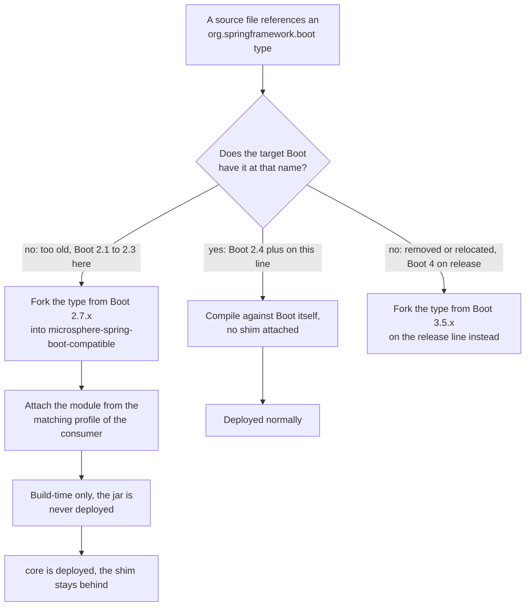

# Compatible 模块 — `release-1.x`

> [English](../compatible.md) · 文档索引：[中文](../../zh/README.md) ·
> `release` 分支的同名文档：[中文](../../current/zh/compatible.md)

> **分支：** `release-1.x` · **版本线：** `0.1.x` · **Artifact：** `microsphere-spring-boot-compatible`
> **状态：** 不发布 · 不在 BOM 中 · 仅构建期 · **垫片来源：** Spring Boot `2.7.x`

目录：
[1 范围与对照](#1-范围与对照) ·
[2 垫片方向的反转](#2-垫片方向的反转) ·
[3 十二个源文件清单](#3-十二个源文件清单) ·
[4 core 模块的 profile 挂载](#4-core-模块的-profile-挂载) ·
[5 模块自身固定 spring-core 版本](#5-模块自身固定-spring-core-版本) ·
[6 两个发布开关](#6-两个发布开关) ·
[7 垫片会冲突但为何安全](#7-垫片会冲突但为何安全) ·
[8 servlet 与属性类的不对称](#8-servlet-与属性类的不对称) ·
[9 操作手册](#9-操作手册) ·
[10 不变量](#10-不变量) ·
[11 参考](#11-参考)

---

## 1. 范围与对照

本文只覆盖 `release-1.x` 上的 `microsphere-spring-boot-compatible`。两条线上都存在该模块，artifact id、打包方式、
复制包名的策略以及两个发布开关完全一致；这套共用机制在 [../current/zh/compatible.md](../../current/zh/compatible.md)
中已完整说明，此处不再重复。

| 主题 | `release-1.x` 的差异 |
|---|---|
| 垫片方向 | 补齐早期 Boot 2 **尚不具备** 的 API（`release` 补齐 Boot 4 **删除或迁移** 的类） |
| 源文件数 | 12 个（`release`：10 个） |
| 复制来源 | Spring Boot `2.7.x(latest)`（`release`：`3.5.x`） |
| 挂载它的 profile | `spring-boot-2.1`、`2.2`、`2.3`（`release`：`4.0`、`4.1`） |
| 模块自身的 profile | 一个 `spring-boot-2.1`，固定 `spring-core:5.2.25.RELEASE`（`release`：没有） |
| servlet 依赖 | 不存在（`release`：optional 的 `jakarta.servlet:jakarta.servlet-api`） |

本文所有断言都读自 `microsphere-spring-boot-compatible/pom.xml`、其 `src/main/java/org/springframework/boot/` 源码树、
`microsphere-spring-boot-core/pom.xml` 第 91–127 行，以及第 3 节列出的消费方文件。

---

## 2. 垫片方向的反转

两条线都只用 **一棵** 源码树，却要在各自 profile 命名的每个 Boot 版本上编译成功。当源码树引用了目标 Boot 在该坐标上
不存在的类型时，本模块就是泄压阀；两条线的区别在于 *为什么* 缺。

| 维度 | `release-1.x`（0.1.x） | `release`（0.2.x） |
|---|---|---|
| 目标 Boot 区间、复制来源 | `2.1.18.RELEASE` – `2.7.18`，复制自 Boot `2.7.x(latest)` | `3.0.13` – `4.1.1`，复制自 Boot `3.5.x` |
| 类型缺失的原因 | **太旧**：API 当时还没有引入 | **太新**：API 被删除或迁移 |
| 例子 | `ConfigurableBootstrapContext`（`@since 2.4.0`）、`ConditionalOnAvailableEndpoint`（`@since 2.2.0`） | `ServerProperties`、`JacksonProperties`、`MultipartConfigFactory` |
| 挂载它的 profile | `spring-boot-2.1`、`spring-boot-2.2`、`spring-boot-2.3` | `spring-boot-4.0`、`spring-boot-4.1` |
| servlet 命名空间 | 不需要 | `jakarta.servlet`（optional） |



把中间那条分支当成本线的现实：`core` 的方法签名需要一个 `ConfigurableBootstrapContext` 参数，而 Boot `2.1.18.RELEASE`
没有这个类型，于是由复制来的源码补上。`release` 上同一个问题由右侧分支回答——这就是那条线用 **最新** 的 profile 挂载、
本线用 **最旧** 的 profile 挂载的原因。

---

## 3. 十二个源文件清单

十二个文件全部位于 `microsphere-spring-boot-compatible/src/main/java/org/springframework/boot/`，沿用 Spring Boot 自己的
包名。`@since` 一栏写的是各文件中真实存在的标签值。

| 文件 | 类型与可见性 | 文件中的 `@since` | 挂载 profile | 本仓库内的消费方 |
|---|---|---|---|---|
| `BootstrapContext.java` | `public interface BootstrapContext` | `2.4.0` | 2.1, 2.2, 2.3 | 经 `ConfigurableBootstrapContext` 间接使用 |
| `BootstrapContextClosedEvent.java` | `public class`，继承 `ApplicationEvent` | `2.4.0` | 2.1, 2.2, 2.3 | 经 `BootstrapRegistry.addCloseListener` 间接使用 |
| `BootstrapRegistry.java` | `public interface`；嵌套 `@FunctionalInterface interface InstanceSupplier<T>` 与嵌套 `enum Scope` | `2.4.0`；两个嵌套成员均为 `2.4.2` | 2.1, 2.2, 2.3 | `ConfigurableBootstrapContext` 的父接口 |
| `ConfigurableBootstrapContext.java` | `public interface`，继承 `BootstrapRegistry` 与 `BootstrapContext` | `2.4.0` | 2.1, 2.2, 2.3 | `core` 的 `listener/SpringApplicationRunListenerAdapter.java:3`、`core` 的 `listener/LoggingSpringApplicationRunListener.java:21` |
| `DefaultBootstrapContext.java` | `public class`，实现 `ConfigurableBootstrapContext` | `2.4.0` | 2.1, 2.2, 2.3 | `core` 测试 `listener/LoggingSpringApplicationRunListenerTest.java:23` |
| `actuate/endpoint/EndpointId.java` | `public final class EndpointId` | `2.0.6`；`of(Environment, String)` 为 `2.2.0` | 2.1, 2.2, 2.3 | 垫片集合内部（两个 condition 类都调用它） |
| `actuate/autoconfigure/endpoint/condition/AbstractEndpointCondition.java` | `abstract class`，包级私有，继承 `SpringBootCondition` | 无，只有作者标签 | 2.1, 2.2, 2.3 | `OnAvailableEndpointCondition` 的父类 |
| `actuate/autoconfigure/endpoint/condition/ConditionalOnAvailableEndpoint.java` | `public @interface`，`@Conditional(OnAvailableEndpointCondition.class)`，属性 `endpoint()` 默认 `Void.class` | `2.2.0` | 2.1, 2.2, 2.3 | `actuator` 的 `autoconfigure/ActuatorEndpointsAutoConfiguration.java:28` |
| `actuate/autoconfigure/endpoint/condition/OnAvailableEndpointCondition.java` | `class`，包级私有；嵌套 `static class Exposure extends IncludeExcludeEndpointFilter<ExposableEndpoint<?>>` | 无，只有作者标签 | 2.1, 2.2, 2.3 | 与上面的注解绑定 |
| `actuate/autoconfigure/endpoint/expose/IncludeExcludeEndpointFilter.java` | `public class IncludeExcludeEndpointFilter<E extends ExposableEndpoint<?>> implements EndpointFilter<E>`；嵌套 `enum DefaultIncludes`（已废弃）与嵌套 `private static class EndpointPatterns` | `2.2.7`；`match(EndpointId)` 为 `2.6.0` | 2.1, 2.2, 2.3 | `Exposure` 的父类 |
| `context/properties/ConstructorBinding.java` | `public @interface`，`@Target({ElementType.TYPE, ElementType.CONSTRUCTOR})` | `2.2.0` | 2.1, 2.2, 2.3 | `core` 测试 `context/properties/TestConstructorBindingConfigurationProperties.java:21` |
| `package-info.java` | 包级 javadoc | `1.0.0` | 2.1, 2.2, 2.3 | 记录复制来源 |

> `package-info.java` 原文："The classes in this package or sub-packages are forked from the Spring Boot 2.7.x(latest),
> which will be used to be compatible with the lower versions of Spring Boot."（`@since 1.0.0`。）`release` 上同一句话写的是
> "forked from the Spring Boot 3.5.x"——每条线都从 **自己所支持的最新** Boot 复制。

评审时请记住两处细节：`BootstrapRegistry` 的嵌套枚举名为 `Scope`，不是 `InstanceScope`；`IncludeExcludeEndpointFilter` 中标注
`2.6.0` 的成员是 `public final boolean match(EndpointId endpointId)`——两个接收 `DefaultIncludes` 的构造器写的是
`@Deprecated` "since 2.6.0 for removal in 3.0.0"，并非在该版本新增。

---

## 4. core 模块的 profile 挂载

`core` 是唯一显式引用该垫片的模块。`microsphere-spring-boot-core/pom.xml` 第 91–127 行，逐字如下：

```xml
    <profiles>
        <profile>
            <id>spring-boot-2.1</id>
            <dependencies>
                <!-- Compatible -->
                <dependency>
                    <groupId>io.github.microsphere-projects</groupId>
                    <artifactId>microsphere-spring-boot-compatible</artifactId>
                    <version>${revision}</version>
                </dependency>
            </dependencies>
        </profile>

        <profile>
            <id>spring-boot-2.2</id>
            <dependencies>
                <!-- Compatible -->
                <dependency>
                    <groupId>io.github.microsphere-projects</groupId>
                    <artifactId>microsphere-spring-boot-compatible</artifactId>
                    <version>${revision}</version>
                </dependency>
            </dependencies>
        </profile>

        <profile>
            <id>spring-boot-2.3</id>
            <dependencies>
                <!-- Compatible -->
                <dependency>
                    <groupId>io.github.microsphere-projects</groupId>
                    <artifactId>microsphere-spring-boot-compatible</artifactId>
                    <version>${revision}</version>
                </dependency>
            </dependencies>
        </profile>
    </profiles>
```

版本写的是 `${revision}` 而非父 POM 管理的属性，因此由 reactor 从同级模块解析，单独构建 `core` 必须加 `-am` 或从根构建。
作用域是普通 compile，但位于 profile 内：`spring-boot-2.4` … `2.7` 不会添加任何依赖，`webmvc`、`webflux`、`test`、`actuator`
也从不声明它——`actuator` 是通过 `core` 传递拿到端点垫片的，这正是 `-Pspring-boot-2.1` 下
`ActuatorEndpointsAutoConfiguration` 能使用 `@ConditionalOnAvailableEndpoint` 的原因。`release` 上的等价块位于第 97–121 行，
id 为 `spring-boot-4.0` 与 `spring-boot-4.1`，形状完全相同；此外根 `pom.xml` 的 `<modules>` 列表中 `compatible` 排在 `core`
之前，一次 reactor 构建会先编译垫片。

---

## 5. 模块自身固定 spring-core 版本

该模块自己声明了一个 profile，见 `microsphere-spring-boot-compatible/pom.xml` 第 72–84 行：

```xml
    <profiles>
        <profile>
            <id>spring-boot-2.1</id>
            <dependencies>
                <dependency>
                    <groupId>org.springframework</groupId>
                    <artifactId>spring-core</artifactId>
                    <version>5.2.25.RELEASE</version>
                    <optional>true</optional>
                </dependency>
            </dependencies>
        </profile>
    </profiles>
```

为什么父 POM 已经选好 Boot 版本，垫片还需要自己的框架版本锚点：在 `spring-boot-2.1` 下，导入的
`spring-boot-dependencies:2.1.18.RELEASE` 管理的是 Spring Framework `5.1.x`，而复制来的源码是 Boot `2.7` 的代码，引用了更晚
出现的 Framework API——`AbstractEndpointCondition` 使用 `org.springframework.core.annotation.MergedAnnotations`、
`MergedAnnotation`、`AnnotationAttributes` 与 `org.springframework.util.ConcurrentReferenceHashMap`；`BootstrapRegistry` 与
`DefaultBootstrapContext` 使用 `org.springframework.core.env.Environment`、`org.springframework.util.Assert` 以及
`ApplicationContext` 事件类型。固定单个artifact远胜于抬高整条 Boot 线（那会让 profile 失去意义），而 `optional` 使它不进入任何
传递依赖图。该锚点只在以 `spring-boot-2.1` 构建 **本模块** 时生效，且因为模块不发布，无法影响下游（第 6 节）。

同样的手法见 `microsphere-spring-boot-actuator/pom.xml` 第 98–117 行：其 `spring-boot-2.1` profile 同时固定
`io.micrometer:micrometer-core:1.3.20` 与 `org.springframework:spring-core:5.2.25.RELEASE`。`release` 上没有这类锚点，因为它最旧的
profile 已经足够新。

---

## 6. 两个发布开关

`microsphere-spring-boot-compatible/pom.xml` 第 51–69 行把部署关掉两次——一次针对传统 deploy 路径，一次针对 Central 发布器：

```xml
    <build>
        <plugins>
            <plugin>
                <groupId>org.apache.maven.plugins</groupId>
                <artifactId>maven-deploy-plugin</artifactId>
                <configuration>
                    <skip>true</skip>
                </configuration>
            </plugin>

            <plugin>
                <groupId>org.sonatype.central</groupId>
                <artifactId>central-publishing-maven-plugin</artifactId>
                <configuration>
                    <skipPublishing>true</skipPublishing>
                </configuration>
            </plugin>
        </plugins>
    </build>
```

两段配置与 `release` 逐字节相同，理由也一样：类位于 `org.springframework.boot.*` 的 jar 绝不可以被下载。必须 **同时** 保留两个
开关，因为 `publish` profile 究竟走哪条发布路径由外部的 `microsphere-build` 父 POM 决定，只关掉其中一个就会泄漏 artifact。

---

## 7. 垫片会冲突但为何安全

每个复制来的类都带着 Spring Boot 自己的全限定名。在 Boot `2.4+` 的 classpath 上——Boot 本身就提供 `BootstrapContext`、
`EndpointId`、`IncludeExcludeEndpointFilter` 等等——垫片 jar 会让同一个名字出现两份定义，谁生效取决于 classpath 顺序，而落败一方的
静态缓存与注解默认值会悄然错位。这正是模块不发布的原因。reactor 之所以安全，是因为垫片被限制在编译期角色：

* **受 profile 约束：** 只有 `spring-boot-2.1`、`2.2`、`2.3` 依赖它，默认的 `2.7.18` 构建不会把重复类放上任何 classpath。
* **从不部署**（第 6 节），下游无法解析 `microsphere-spring-boot-compatible:0.1.34`；已发布的 `0.1.x` jar 只含 `io.microsphere.*` 类。它也 **不在 BOM 中**——见 [./dependencies.md](./dependencies.md)。
* **依赖的 profile 不会被求值：** 第 4 节那段 `<profiles>` 确实会随 `core` 的 POM 一起发布，但 Maven 只对正在构建的工程及其父 POM 求值 profile。`microsphere-build` 还为 flatten 插件设置了 `<embedBuildProfileDependencies>false</embedBuildProfileDependencies>`，因此构建期激活的 profile 依赖也不会被塞进发布的 `<dependencies>`。
* **运行期现实：** Boot `2.4+` 的应用解析到真实类；Boot `2.1`–`2.3` 的应用绝不能被交给我们 reactor 的副本。

对本机工作的影响：`-Pspring-boot-2.1` 产出的 `core` 字节码引用了 `org.springframework.boot.ConfigurableBootstrapContext`——放在矩阵里没问题，但不是可以交付给 Boot `2.1` 应用的发布产物。

---

## 8. servlet 与属性类的不对称

`javax`/`jakarta` 的分界点在 Boot `3.0`，位于本线整个区间之下：这里一切都是 `javax`，垫片模块完全不需要 servlet artifact。

| 关注点 | `release-1.x` | `release` |
|---|---|---|
| 代码中的 servlet 命名空间 | `javax.servlet`——`test/pom.xml` 第 85–87 行声明 `javax.servlet:javax.servlet-api`；`webmvc` 的 `ConditionalOnWebMvcAvailable` 写 `"javax.servlet.Servlet"` | `jakarta.servlet` |
| `compatible` 内的 servlet 依赖 | **无** | optional 的 `jakarta.servlet:jakarta.servlet-api`，被 `ServerProperties`、`MultipartProperties`、`MultipartConfigFactory` 需要 |
| Boot 配置属性类的复制 | 不需要——Boot 2 已在这些坐标上提供它们 | `autoconfigure/web/ServerProperties`、`autoconfigure/web/servlet/MultipartProperties`、`autoconfigure/jackson/JacksonProperties`、`web/servlet/MultipartConfigFactory` |
| actuator 端点相关复制 | 五个文件——`EndpointId`、三个 condition 类、`IncludeExcludeEndpointFilter` | 不需要——Boot 3 已提供 |
| 绑定注解复制 | `context/properties/ConstructorBinding` | 不需要 |

两条线的垫片集合只有一个交集：那五个 bootstrap 类型，因为两条线都存在缺少它们的 Boot 目标。至于"要不要把 `ServerProperties`
移植到 `release-1.x`"：不要——Boot `2.1` 已经有 `org.springframework.boot.autoconfigure.web.ServerProperties`，复制过来会在本线
每一个 profile 上都变成重复类。

---

## 9. 操作手册

### 9.1 为 2.2 之前缺失的 API 新增垫片

1. 从 Boot `2.7` 源码把类型复制到 `microsphere-spring-boot-compatible/src/main/java/<boot package path>/`，包名、类型名与成员签名保持完全一致，并保留上游 `@author` 行与真实的 `@since` 标签。
2. 若垫片需要模块那四个 optional 依赖（`spring-boot-autoconfigure`、`spring-boot-actuator-autoconfigure`、`spring-core`、`spring-context`）之外的东西，就以 **optional** 方式添加——垫片不引用 servlet 类型就不要加 servlet API。
3. 挂载无需改动：第 4 节已在 `2.1`、`2.2`、`2.3` 下引入该模块。若用到比 Boot `2.1` 所管框架更新的 API，扩展第 5 节的 `spring-core` 锚点，而不是改父 POM。
4. 检查区间两端，垫片最容易在这里出问题：

   ```bash
   ./mvnw -pl microsphere-spring-boot-compatible -am -Pspring-boot-2.1 clean install
   ./mvnw -pl microsphere-spring-boot-core -am -Pspring-boot-2.1 test
   ./mvnw -pl microsphere-spring-boot-core -am -Pspring-boot-2.7 test
   ```

### 9.2 抬高版本下限后退役垫片

如果本线放弃 `2.1`、`2.2`、`2.3` 而把下限抬到 `2.4`，那么所有复制类型在每个受支持的 Boot 中都存在，模块即成死重量：

1. 删除 `microsphere-spring-boot-core/pom.xml` 第 91–127 行的整个 `<profiles>` 块（三个 id，同一个 artifact）。
2. 从根 `pom.xml` 的 `<modules>` 列表移除 `<module>microsphere-spring-boot-compatible</module>`，保持其余条目顺序不变。
3. 只有在 `-Pspring-boot-2.4` … `-Pspring-boot-2.7` 全部构建通过后，才删除目录。
4. 同步更新 [README.md](./README.md) 第 7 节、[./build-and-release.md](./build-and-release.md) 第 5 节、本文以及 `docs/user-guide/1.x/zh/compatible.md`——中英文都要改。

### 9.3 验证挂载关系

```bash
./mvnw -pl microsphere-spring-boot-core -am -Pspring-boot-2.1 dependency:tree | grep compatible   # 垫片出现
./mvnw -pl microsphere-spring-boot-core -am -Pspring-boot-2.4 dependency:tree | grep compatible   # 无匹配
./mvnw -pl microsphere-spring-boot-core -am             dependency:tree | grep compatible         # 默认 2.7.18，无匹配
```

`-Pspring-boot-2.1` 下结果为空说明 profile id 拼错了。显式激活任意 profile 确实会让 `activeByDefault` 的 `spring-boot-2.7`
失效，但不会改变你所请求的那个 profile 的名字。

---

## 10. 不变量

1. 十二个源文件，全部位于 `org.springframework.boot`，全部复制自 Boot `2.7.x`；`package-info.java` 记录了该来源，复制源变化时它必须同步。
2. 复制类型的包名、类名与成员签名与 Spring Boot 保持一致——是替代品，不是包装器。
3. 模块从不部署、从不进入 BOM；第 6 节的两个开关都要保留。
4. 只有 `core` 能依赖它，且只在 `spring-boot-2.1`、`2.2`、`2.3` 之下，版本始终是 `${revision}`。
5. 它自身的依赖保持 `optional`；模块内允许出现的唯一版本字面量是其 `spring-boot-2.1` profile 里的 `spring-core` 锚点。
6. 本线不存在 Boot `3` 或 Boot `4` 的 profile，因此它们绝不可能在此挂载垫片；复制来的代码必须能在 Java 8 编译——那是整条线的语言级别。

---

## 11. 参考

| 文档 | 范围 |
|---|---|
| [README.md](./README.md) | 分支总览、垫片方向一节、跨分支源码差异 |
| [./build-and-release.md](./build-and-release.md) | reactor 形状、profile 表、额外锚点、CI 矩阵 |
| [./core.md](./core.md) | 唯一挂载垫片的模块 |
| [./actuator.md](./actuator.md) | `@ConditionalOnAvailableEndpoint` 的消费方与 `micrometer-core` 锚点 |
| [../../current/zh/compatible.md](../../current/zh/compatible.md) | `release` 的垫片集合与共用机制 |
| [../../user-guide/1.x/zh/compatible.md](../../../user-guide/1.x/zh/compatible.md) | 同一模块面向使用者的视角 |
