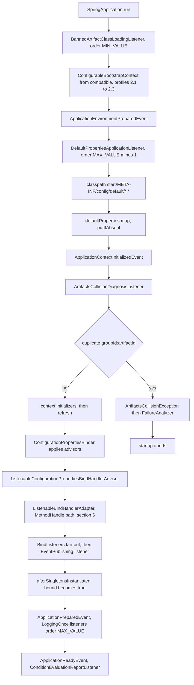
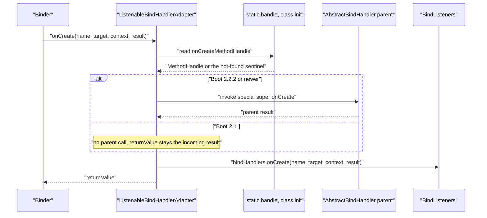

# Core 模块 — `release-1.x`

> [English](../core.md) · 文档索引：[中文](../../zh/README.md) ·
> `release` 分支的同名文档：[中文](../../current/zh/core.md)

> **分支：** `release-1.x` · **版本线：** `0.1.x` · **Artifact：** `microsphere-spring-boot-core`
> **Spring Boot：** `2.1.18.RELEASE` – `2.7.18` · **Java 源码级别：** 8

目录：
[1 范围与对照](#1-范围与对照) ·
[2 本分支上相同的部分](#2-本分支上相同的部分) ·
[3 自动配置的双重注册](#3-自动配置的双重注册) ·
[4 Java 8 源码级别约束](#4-java-8-源码级别约束) ·
[5 反射式能力探测](#5-反射式能力探测) ·
[6 ListenableBindHandlerAdapter 的 MethodHandle 绕行方案](#6-listenablebindhandleradapter-的-methodhandle-绕行方案) ·
[7 Bean 上下文与运行监听器的差异](#7-bean-上下文与运行监听器的差异) ·
[8 SpringBootVersion 在本分支](#8-springbootversion-在本分支) ·
[9 本分支上的设计模式](#9-本分支上的设计模式) ·
[10 移植配方](#10-移植配方) ·
[11 两个分支间存在差异的测试](#11-两个分支间存在差异的测试) ·
[12 参考](#12-参考)

---

## 1. 范围与对照

本文是一份**差异文档**。[../current/core.md](../../current/core.md) 已经完整地解释了共享架构——包结构图、扩展点装配、advisor 链、两条诊断流水线、默认属性机制以及 `@Enable*` 注册器——本文不重复这些内容。`release-1.x` 在 Java 8 上维护面向 Boot `2.1`–`2.7` 的 `0.1.x` 版本线：类清单与 `release` **完全相同**（47 个主类；两棵树的相对路径清单 `diff` 无输出），而 `src/main` 下恰好只有 **十二个**文件存在差异。这份权威清单是：`SpringBootVersion.java`、`autoconfigure/ConfigurableAutoConfigurationImportFilter.java`、`context/properties/bind/ConfigurationPropertiesBeanContext.java`、`context/properties/bind/ListenableBindHandlerAdapter.java`、`context/properties/bind/util/BindUtils.java`、`context/properties/source/util/ConfigurationPropertyUtils.java`、`diagnostics/ArtifactsCollisionDiagnosisListener.java`、`listener/FailureReportSpringApplicationRunListener.java`、`listener/LoggingSpringApplicationRunListener.java`、`listener/SpringApplicationRunListenerAdapter.java`、`util/SpringApplicationUtils.java`，外加资源文件 `META-INF/spring.factories`。（`microsphere-spring-boot-core/pom.xml` 同样存在差异，它由 `build-and-release.md` 负责说明。）以下每一条论断都是对两个游离工作树执行 `diff -u msb-current/<path> msb-1x/<path>` 的结果；行号取自 `release-1.x` 树。

| 问题 | 在那里读 | 在这里读 |
|---|---|---|
| 模块做什么；有哪些类 | 第 1–3 节 | 第 2 节——类清单完全相同 |
| 如何注册 | 第 3 节 | 第 3 节——本分支多一个遗留 key |
| 顺序常量与启动时序 | 第 4 节 | 第 2 节——取值相同 |
| advisor 链语义 | 第 5 节 | 第 5–6 节 |
| 源码文本为何不同 | — | 第 4–7 节 |
| 代码里点名了哪些 Boot 版本 | 第 2 节 | 第 8 节 |
| 如何在两个方向上移植改动 | — | 第 10 节 |
| 哪些测试守护这些差异 | 第 10 节 | 第 11 节 |

---

## 2. 本分支上相同的部分

* **类清单**：`src/main/java/io/microsphere/spring/boot/` 下 47 个文件，两个分支路径完全一致。把这套清单说清楚，移植才是机械劳动而不是重新设计。
* **`spring.factories` 的 key**：`release` 拥有的七个 key 在此全部存在且取值相同（`ApplicationContextInitializer`、`SpringApplicationRunListener`、`ApplicationListener`、`SpringBootExceptionReporter`、`FailureAnalyzer`、`AutoConfigurationImportFilter`，以及模块私有的 `io.microsphere.spring.boot.env.DefaultPropertiesPostProcessor`）。本分支多出一个 key——见第 3 节。
* **默认属性**：`META-INF/config/default/core.properties` 字节级相同，两棵树的 md5 均为 `ee9c9aea67bbf0fc5f4c266fbc3e6998`。请读 `../current/core.md` 第 7 节，此处无需补充。
* **顺序常量**，在本分支 grep 验证：`classloading/BannedArtifactClassLoadingListener.java:79` 的 `setOrder(HIGHEST_PRECEDENCE)`、`autoconfigure/ConfigurableAutoConfigurationImportFilter.java:277` 的 `return HIGHEST_PRECEDENCE + 99;`、`env/DefaultPropertiesApplicationListener.java:76` 的 `DEFAULT_ORDER = LOWEST_PRECEDENCE - 1`，以及适配器构造器 `listener/SpringApplicationRunListenerAdapter.java:42` 的 order `0`。`setOrder`/`getOrder` 在 `listener/SpringApplicationRunListenerAdapter.java:224` 与 `:240`、`context/OnceApplicationPreparedEventListener.java:209` 与 `:226` 处仍然是 `final`。
* **启动时序**：监听器、事件、链都相同。下面的流程图只保留本分支真正注册的部分，并标出两个随版本而变的点——bootstrap 垫片与 `onCreate` 句柄。



---

## 3. 自动配置的双重注册

在 `release` 上，自动配置只通过 Boot 2.7+ 的文件注册；在本分支上它被注册了**两次**。`microsphere-spring-boot-core/src/main/resources/META-INF/spring.factories` 两份副本之间唯一的差异就是这个追加的块（第 33–35 行）：

```
# @EnableAutoConfiguration
org.springframework.boot.autoconfigure.EnableAutoConfiguration=\
io.microsphere.spring.boot.context.autoconfigure.ConfigurationPropertiesAutoConfiguration
```

`META-INF/spring/org.springframework.boot.autoconfigure.AutoConfiguration.imports` 只有一行，且两个分支字节相同：`io.microsphere.spring.boot.context.autoconfigure.ConfigurationPropertiesAutoConfiguration`。被注册的类本身也完全相同（`context/autoconfigure/ConfigurationPropertiesAutoConfiguration.java:35-42`）：按名的 `@ConditionalOnClass(name = "io.microsphere.spring.context.annotation.BeanCapableImportCandidate")`、按名的 `@AutoConfigureBefore(name = "org.springframework.boot.autoconfigure.context.ConfigurationPropertiesAutoConfiguration")`，然后是 `@EnableConfigurationPropertiesExtension`。造成这种重复的历史原因是：`AutoConfiguration.imports` 出现于 Boot `2.7`，而 `2.7` 会**同时**读取两个文件，`2.1`–`2.6` 只读 `EnableAutoConfiguration` 这个 key；Boot `3.0` 随后彻底废弃了遗留 key。一个必须覆盖 `2.1`–`2.7` 的产物因此必须两个都带上，而且由于 Boot 会对重复发现的候选类去重，这种冗余是无害的。

| 新增的自动配置只写进了一个文件 | Boot `2.1`–`2.6` | Boot `2.7` | 维护者看到的现象 |
|---|---|---|---|
| 只有 `AutoConfiguration.imports` | 不会被导入 | 会被导入 | 在默认的 `2.7.18` profile 下全绿，在 `-Pspring-boot-2.1` 下静默失效。 |
| 只有 `spring.factories` | 会被导入 | 会被导入并去重 | 本分支正常；`release` 没有这个 key，移植到 `release` 时会丢掉该类。 |
| 在与 `release`“同步”时从 `spring.factories` 删除 | 静默失效 | 无影响 | 不跑 `-Pspring-boot-2.1 test` 就完全看不出来。 |

绝不要把 `release` 的内容直接覆盖到本分支的这两个文件上：`release` 省略该 key 是因为 Boot 3 忽略它，而在本分支它是 `2.1`–`2.6` 唯一会读取的东西。

---

## 4. Java 8 源码级别约束

整个 reactor **没有设置 `<java.version>` 属性**——`pom.xml` 里只有 `<revision>0.1.35-SNAPSHOT</revision>`——因此源码级别来自外部父 POM `microsphere-build:0.3.14`，即 8。`release` 上使用的三种 Java 语言特性在此都是非法的，下表列出全部真实实例。

| 构造及其在 `release-1.x` 上的位置 | `release`（Boot 3+，Java 17） | `release-1.x`（Boot 2，Java 8） |
|---|---|---|
| 模式匹配 `instanceof`，`autoconfigure/ConfigurableAutoConfigurationImportFilter.java:143-144` | `if (property instanceof String exclude) {` | `if (property instanceof String) {`，随后 `String exclude = (String) property;` |
| 模式匹配 `instanceof`，`diagnostics/ArtifactsCollisionDiagnosisListener.java:175-176` | `if (artifact instanceof MavenArtifact mavenArtifact) {` | `if (artifact instanceof MavenArtifact) {`，随后 `MavenArtifact mavenArtifact = (MavenArtifact) artifact;` |
| 文本块，`util/SpringApplicationUtils.java:142` | `String messagePattern = """` … 十行 … `""";` | `String messagePattern = "SpringApplication: " + "    main class : '{}' ," + …` |
| `switch` 表达式，`util/SpringApplicationUtils.java:165` | `case "TRACE" -> { … }` … `default -> { … }` | `case "TRACE": { … break; }` … `default: { … break; }` |

`log(...)` 的差异并不只是语法上的：`release` 绑定十个占位符，其中包含 `springApplication.getAdditionalProfiles()`，而本分支的 `ofArray(...)`（`util/SpringApplicationUtils.java:153-159`）完全不含该调用，模板只有九个占位符。同一方法里还有处在 diff 中可见、且都属于行为层面的差异。其一是 `release` 用 `logger.isTraceEnabled()` / `isDebugEnabled()` 保护 `TRACE`/`DEBUG` 分支，本分支则不加保护直接调用 `logger.trace(...)` / `logger.debug(...)`，因此一次粗心的合并会改变日志调用量而没有任何测试能拦住它。其二是 `default` 分支在本分支打印 `"Logging is off"`，在 `release` 上打印 `"The logger is off"`——如果有脚本按这段文本抓取日志，不要悄悄把它统一掉。

---

## 5. 反射式能力探测

第二类差异是 API 缺失，而不是语言级别。晚于 `2.1.18` 的 Boot API 不能被 import，因为产物必须在 `-Pspring-boot-2.1` 下编译通过；这类类型在**类初始化时按名解析**，缺失时降级为 `null`。

### 5.1 `BindUtils` 对 `BindConstructorProvider` 的探测（Boot 2.2.1 之前不存在）

`release` 写的是 `import static org.springframework.boot.context.properties.bind.BindConstructorProvider.DEFAULT`，并直接调用 `DEFAULT.getBindConstructor(...)`；这行 import 在 Boot `2.1` 下无法编译。本分支的 `context/properties/bind/util/BindUtils.java` 按名加载该类并读取其静态字段（`:67`、`:74`、`:81`）：

```java
private static final String BIND_CONSTRUCTOR_PROVIDER_CLASS_NAME = "org.springframework.boot.context.properties.bind.BindConstructorProvider";
private static final Class<?> BIND_CONSTRUCTOR_PROVIDER_CLASS = loadClass(classLoader, BIND_CONSTRUCTOR_PROVIDER_CLASS_NAME);
private static final Object BIND_CONSTRUCTOR_PROVIDER = getStaticFieldValue(BIND_CONSTRUCTOR_PROVIDER_CLASS, "DEFAULT");
```

这里使用 `io.microsphere.util.ClassLoaderUtils.loadClass` 与 `io.microsphere.reflect.FieldUtils.getStaticFieldValue`。公开的入口方法委托给一个参数更多的重载，而那个签名就是必须保留的契约（`:292-302`，配合 `MethodUtils.findMethod` / `MethodUtils.invokeMethod`）：

```java
@Nullable
public static Constructor<?> getBindConstructor(Bindable<?> bindable, boolean isNestedConstructorBinding) {
    return getBindConstructor(BIND_CONSTRUCTOR_PROVIDER, bindable, isNestedConstructorBinding);
}

protected static Constructor<?> getBindConstructor(Object bindConstructorProvider, Bindable<?> bindable,
                                                   boolean isNestedConstructorBinding) {
    if (bindConstructorProvider == null) { // Spring Boot < 2.2.1
        return null;
    }
    Method method = findMethod(BIND_CONSTRUCTOR_PROVIDER_CLASS, "getBindConstructor", Bindable.class, boolean.class);
    return execute(() -> invokeMethod(bindConstructorProvider, method, bindable, isNestedConstructorBinding), e -> {
```

把它设计成 `protected`、并把 provider 作为 `Object` 类型的第一个参数是刻意的：测试或子类无需 Boot 2.1 的 classpath 就能分别驱动“存在”和“缺失”两个分支。注释 `// Spring Boot < 2.2.1` 点明了这个探测所防护的 Boot 版本。

### 5.2 `ConfigurationPropertyUtils` 对 `DataObjectPropertyName` 的探测（Boot 2.2.3 之前不存在）

`context/properties/source/util/ConfigurationPropertyUtils.java:62-67` 通过 `io.microsphere.util.ClassLoaderUtils.resolveClass` 按名解析该类型，得到 `private static final Class<?> DATA_OBJECT_PROPERTY_NAME_CLASS`，其 javadoc 写的是 "The class name as a constant since Spring Boot 2.2.3"。`toDashedForm` 依据它分支（`:158-163`），而回退实现是 Boot 算法的一份受维护的副本：

```java
public static String toDashedForm(String name) {
    if (DATA_OBJECT_PROPERTY_NAME_CLASS != null) {
        return invokeStaticMethod(DATA_OBJECT_PROPERTY_NAME_CLASS, "toDashedForm", name);
    }
    return toDashedForm(name, 0);
}
```

回退实现的声明是 `protected static String toDashedForm(String name, int start)`（`:174`）：先把 `_` 替换为 `-`，再逐字符小写化，仅当缓冲区非空且末尾不是 `-` 时才在大写字母前插入 `-`。它的 javadoc 记录了出处——"Source from `org.springframework.boot.context.properties.bind.BeanPropertyName` before Spring Boot 2.2.3"。`release` 删掉了这两个方法，直接调用 `DataObjectPropertyName.toDashedForm(name)`。同一次改动还带来三处较小的不对称：本分支的 `toDashedForm(String)` 失去了 `@Nonnull`；`classLoader` 取自 `ConfigurationPropertyUtils.class.getClassLoader()`（`:55`）而不是 `ConfigurationProperties.class.getClassLoader()`；`getParent`（`:136-139`）回避了一个虽然存在、但在本版本区间内不可移植的方法——当 `name.getNumberOfElements() <= 1` 时返回静态导入的 `ConfigurationPropertyName.EMPTY`，否则返回 `name.chop(numberOfElements - 1)`，而 `release` 只有一行 `return name.getParent();`。

### 5.3 决策规则：反射探测、垫片，还是按名条件

| 方案 | 适用条件 | 本分支上的例子 |
|---|---|---|
| **反射探测** | 该 API 是一个静态成员或单个工具方法，缺失只意味着“能力更弱”，且 `null` 是合法答案。 | `BindUtils` 对 `BindConstructorProvider.DEFAULT`（Boot 2.2.1）；`ConfigurationPropertyUtils` 对 `DataObjectPropertyName`（Boot 2.2.3）。 |
| **`MethodHandle` 探测** | 该 API 是必须以 `super` 方式分派的实例方法，普通反射会改变你要保留的语义。 | `ListenableBindHandlerAdapter` 对 `AbstractBindHandler.onCreate`——见第 6 节。 |
| **`compatible` 中的垫片** | 该类型出现在**签名**里——参数、返回值、注解、`extends`——因此编译期就需要它。 | `context.properties.ConstructorBinding`、`actuate.endpoint.EndpointId`、`actuate.autoconfigure.endpoint.condition.{AbstractEndpointCondition,ConditionalOnAvailableEndpoint,OnAvailableEndpointCondition}`、`ConfigurableBootstrapContext`；由 profile `2.1`/`2.2`/`2.3` 挂载，见 `microsphere-spring-boot-core/pom.xml:91-127`。 |
| **按名条件** | 该类型只是一道**闸门**，代码中从不引用它。 | `ConfigurationPropertiesAutoConfiguration.java:35-37` 的 `@ConditionalOnClass(name = "io.microsphere.spring.context.annotation.BeanCapableImportCandidate")`。 |
| **受维护的副本** | API 缺失、体量小、算法稳定。 | `toDashedForm(String, int)`；以及 `compatible` 的源文件，标注为 "forked from the Spring Boot 2.7.x(latest)"。 |

取舍准则：**出现在签名里就上垫片，只出现在方法体里就反射探测。**

---

## 6. ListenableBindHandlerAdapter 的 MethodHandle 绕行方案

`context/properties/bind/ListenableBindHandlerAdapter.java:50-51` 说明了约束：`BindHandler#onCreate(ConfigurationPropertyName, Bindable, BindContext, Object)` "was introduced in Spring Boot 2.2.2"。由于本模块必须在 Boot `2.1` 下**编译**通过，这个类既不能写 `super.onCreate(...)`，也不能加 `@Override`——`release` 上两样都有——而在本分支，父类调用通过一次可信查找解析成句柄（`:53-62`）：

```java
static final MethodHandle onCreateMethodHandle;

static {
    Lookup lookup = lookup(AbstractBindHandler.class, TRUSTED);
    MethodType methodType = methodType(Object.class, ConfigurationPropertyName.class, Bindable.class, BindContext.class, Object.class);
    onCreateMethodHandle = execute(
            () -> lookup.findSpecial(AbstractBindHandler.class, "onCreate", methodType, ListenableBindHandlerAdapter.class),
            e -> null
    );
}
```

使用 `MethodHandleUtils.LookupMode.TRUSTED`、`MethodHandleUtils.lookup` 与 `ThrowableSupplier.execute`。重写方法去掉了 `@Override`，保持签名不变，并定义了降级路径（`:160-167`）：

```java
public Object onCreate(ConfigurationPropertyName name, Bindable<?> target, BindContext context, Object result) {
    Object returnValue = result;
    if (onCreateMethodHandle != NOT_FOUND_METHOD_HANDLE) {
        returnValue = execute(() -> onCreateMethodHandle.invoke(this, name, target, context, result));
    }
    bindHandlers.onCreate(name, target, context, result);
    return returnValue;
}
```

`findSpecial(..., ListenableBindHandlerAdapter.class)` 正是语义得以保留的关键：它产生的是绑定到父类*特殊*调用的 `super` 风格句柄，而不是回到本重写的虚调用——虚调用会递归。比较所用的哨兵值是 `NOT_FOUND_METHOD_HANDLE`（`io.microsphere.invoke.MethodHandlesLookupUtils`），而静态初始化块里的 `e -> null` 兜底，使得当 `AbstractBindHandler` 根本没有该方法时该常量为 `null`。两条必须记住的后果：其一，句柄不可用时适配器原样返回**传入的 `result`**，但仍会向监听器广播——也就是说在 Boot `2.1` 上父类的 `onCreate` 后置处理永远不会执行，这是文档化的降级，不是可以用“返回 `null`”去“修好”的缺陷；其二，广播仍然是无条件的，因此 `../current/core.md` 第 5 节描述的返回值纪律在区间内的每个 Boot 上都成立。



---

## 7. Bean 上下文与运行监听器的差异

### 7.1 `ConfigurationPropertiesBeanContext`

在 `buildConfigurationPropertiesBeanContexts`（`context/properties/bind/ConfigurationPropertiesBeanContext.java:408`）内部，第 `:413-414` 行是

```java
RootBeanDefinition beanDefinition = (RootBeanDefinition) beanFactory.getMergedBeanDefinition(beanName);
ResolvableType beanType = getResolvableType(beanDefinition);
```

而 `release` 写的是 `BeanDefinition beanDefinition = beanFactory.getMergedBeanDefinition(beanName);` 后接 `beanDefinition.getResolvableType()`。两处变更同时出现，必须一起移植。强制类型转换之所以存在，是因为 `io.microsphere.spring.beans.factory.config.BeanDefinitionUtils.getResolvableType(...)`（在 `:54` 静态导入）接收的是 `RootBeanDefinition` 而非 `BeanDefinition` 接口；该转换成立只因为 `getMergedBeanDefinition` 返回 `RootBeanDefinition`，而之所以要有这个工具方法，是因为在较旧的 Spring 上接口方法解析类型不够可靠。import 列表也随之变化：本分支新增 `io.microsphere.reflect.FieldUtils`（`:22`）与 `org.springframework.beans.factory.support.RootBeanDefinition`（`:27`），并去掉 `org.springframework.beans.factory.config.BeanDefinition`，所以只抄那两行代码会得到一个无法编译的文件。

### 7.2 `SpringApplicationRunListenerAdapter`

这是风险最高的差异，因为编译器看不见它。`release` 给该类加了 `@Deprecated(since = "0.2.9", forRemoval = true)`；本分支既没有注解，也没有 `SpringApplicationEvent` / `ApplicationListener` 的 import（两者只出现在 `release` 的 `@deprecated` javadoc 里），`listener/LoggingSpringApplicationRunListener` 与 `listener/FailureReportSpringApplicationRunListener` 同样在此失去了注解。而只有本分支会把 bootstrap 钩子转发下去（`listener/SpringApplicationRunListenerAdapter.java:59-61`）：

```java
public void starting(ConfigurableBootstrapContext bootstrapContext) {
    starting();
}
```

在 `release` 上这一行方法体已被删除，两个钩子成为互相独立的空实现。双向后果如下：把注解抄进 `0.1.x` 发布，等于宣布一次本版本线从未决定的移除，而 `forRemoval = true` 会让所有下游构建产生告警；删掉转发行，则 Boot `2.4`+ 的消费者永远不会触发它们的 `starting()` 钩子，因为 Boot 调用的是带 bootstrap 上下文的重载，而这个适配器的全部意义就是把调用汇聚起来；反过来把转发带到 `release`，在 Boot `3`/`4` 上两个重载都会被分派，于是每个 `starting()` 钩子都会重复执行。最后，`ConfigurableBootstrapContext` 本身在本分支就是 `compatible` 的垫片（`org.springframework.boot.ConfigurableBootstrapContext`，`@since 2.4.0`），也就是说这个签名能够编译，仅仅因为 profile `2.1`–`2.3` 挂载了那个模块——这也正是子类必须**同时**重写 `starting()` 与 `starting(ConfigurableBootstrapContext)` 才能覆盖整条版本线的原因。

---

## 8. SpringBootVersion 在本分支

文本差异最大、语义差异最小的一处：只有常量块不同，而 `CURRENT`、两个构造器、`resolveVersion`、三个访问器以及十二个比较方法与 `release` 字节相同。

| 方面 | `release` | `release-1.x` |
|---|---|---|
| javadoc | "the released Spring Boot versions since 3.0" | "the released Spring Boot versions since 2.0" |
| 首个常量 | `SPRING_BOOT_3_0` | `SPRING_BOOT_2_0`（`:38`） |
| 末尾常量 | `SPRING_BOOT_4_1_0`（`:236`） | `SPRING_BOOT_2_7_18`（`:294`） |
| 覆盖区间 | Boot `3.0` … `4.1` | **129** 个常量，Boot `2.0` … `2.7` |
| 终止项 | `CURRENT(ofVersion(org.springframework.boot.SpringBootVersion.class))` | 同样，位于 `:296` |

版本比较是借助包装的 `Version` 通过短形式 `gt`、`ge`、`lt`、`le`、`eq` 或长形式 `isGreaterThan` 等完成的，而版本号是从名称解析出来的（`SpringBootVersion.java:308-311`），这正是脆弱之处：

```java
static Version resolveVersion(String name) {
    String version = name.substring(12).replace(UNDER_SCORE_CHAR, DOT_CHAR);
    return of(version);
}
```

`substring(12)` 恰好剥掉 `SPRING_BOOT_` 前缀，所以每个常量名都必须是该前缀加上把点写成下划线的版本：`SPRING_BOOT_2_7` 表示 `2.7`（裸的小版本，读作 `2.7.0`），`SPRING_BOOT_2_7_18` 表示 `2.7.18`；一个小版本的**区间**就是裸常量后接它的各补丁版。本分支上唯一基于常量的判断是 `BindableConfigurationBeanBinderTest` 中的 `CURRENT.ge(SPRING_BOOT_2_2)`（见第 11 节），因此这个枚举是给守卫语句用的词汇表，而不是分发器。当本版本线新增一个 Boot 小版本时：先追加裸常量 `SPRING_BOOT_2_8`，再按升序追加 `_0`、`_1` …，并保持 `CURRENT` 位于最后——因为正是它的构造参数把它与按名解析的构造器区分开；在 `SpringBootVersionTest.testVersionRange` 中加入 `testVersionRange(SPRING_BOOT_2_8, 0, N);` 并修正前一个小版本的末尾补丁号；把运算符样本（`getMajor`/`getMinor`/`getPatch` 及十二个断言）指向最新的常量，从而使解析错误的名字大声失败而不是恰好判等；并在 `microsphere-spring-boot-parent/pom.xml` 与 CI 矩阵中加入对应的 `spring-boot-2.8` profile——有常量而无 profile、或有 profile 而无常量，两个方向都是静默的缺口。另外请注意而非复制一处现存的不一致：注释写着 `2.3 -> [2.3.0, 2.3.13]`，而调用是 `testVersionRange(SPRING_BOOT_2_3, 0, 12)`，`2.0` 的注释则声称 `[2.0.0, 2.0.9]`。以断言为准，修正注释。

---

## 9. 本分支上的设计模式

`../current/core.md` 第 8 节汇总了共享的模式；这里只列出**因为** Boot 2 的年代或 Java 8 才存在的模式，也就是移植到 `release` 时通常应当删除的那些。

| 模式 | 类 | 被迫采用的原因 |
|---|---|---|
| 对静态常量的反射查找 | `bind/util/BindUtils`（`loadClass` + `getStaticFieldValue` + `findMethod`/`invokeMethod`） | `BindConstructorProvider` 在 Boot `2.2.1` 之前不存在 |
| 对静态方法的反射查找，外加内联算法 | `source/util/ConfigurationPropertyUtils`（`resolveClass`、`invokeStaticMethod`、`toDashedForm(String,int)`） | `DataObjectPropertyName` 在 Boot `2.2.3` 之前不存在 |
| 在静态初始化块中缓存的 `MethodHandle` 特殊调用 | `bind/ListenableBindHandlerAdapter`（`TRUSTED` 查找、`findSpecial`） | `AbstractBindHandler.onCreate` 在 Boot `2.2.2` 之前不存在，而 `super.` 无法反射 |
| 空对象/哨兵式降级，用 `static final` 哨兵而非 `Optional` | `MethodHandlesLookupUtils.NOT_FOUND_METHOD_HANDLE`、`bindConstructorProvider == null`、`DATA_OBJECT_PROPERTY_NAME_CLASS == null`、`ListenableBindHandlerAdapter.onCreateMethodHandle` | 任何探测都可能运行时落空，而启动诊断绝不能中断应用；Java 8 没有模式匹配，在热点绑定回调上使用 `Optional` 只是噪声 |
| 加宽为 `protected` 的重载，用于覆盖“API 缺失”分支 | `BindUtils.getBindConstructor(Object, Bindable, boolean)` | Boot 2.1 的 classpath 无法产生该分支 |
| 先向下转型再交由工具方法分派 | `ConfigurationPropertiesBeanContext` 调用 `BeanDefinitionUtils.getResolvableType(RootBeanDefinition)` | 较旧的 `BeanDefinition.getResolvableType()` 行为 |
| 由 profile 挂载的编译期垫片模块 | `microsphere-spring-boot-compatible`，profile `2.1`/`2.2`/`2.3`（`core/pom.xml:91-127`） | 出现在签名中的类型是早期 Boot 2 尚不具备的 |
| 不带 `@Override` 的模板方法 | `ListenableBindHandlerAdapter.onCreate` | `@Override` 在 Boot 2.1 的接口集合上无法编译 |
| 版本闸门放在测试而非生产代码 | `CURRENT.ge(SPRING_BOOT_2_2)` | 在有垫片就够用的场景，把能力探测留在主源码之外 |
| 由名称解析的枚举版本常量 | `SpringBootVersion`（`substring(12)`，下划线转点） | 没有 `record`/`sealed` 来表达区间，而需要覆盖 129 个发布版本 |

---

## 10. 移植配方

### 10.1 从 `release` 到 `release-1.x`

1. 逐个文件比对第 1 节那份权威的十二文件清单；清单之外的文件意味着你正在制造该处的首次分叉——请确认这是有意的。
2. 降级语言特性：`instanceof T x` → `instanceof T` 加强制转换；文本块 → 字符串拼接；`switch` 表达式 → 带 `break` 的 `switch` 语句；不使用 `var`、record、sealed 类型；集合工厂继续用 `io.microsphere.collection.*`（`ofList`、`ofSet`、`ofArray`）。
3. 对每个晚于 `2.1.18` 的 Boot API 套用第 5.3 节规则：出现在签名中就先查 `compatible`，缺垫片则新增并把挂载 profile 设为 `2.1`/`2.2`/`2.3`；只出现在方法体中就按名反射探测并配 `null`/哨兵降级；只是闸门就保持按名（`name = "..."`、`type = "..."`）。
4. 剥离 `@Deprecated(since = ..., forRemoval = true)`，除非该废弃声明曾在 `0.1.x` 版本线上发布过；同时把 `release` 删掉的转发（如 `starting(bootstrapContext) → starting()`）补回来（见第 7.2 节）。
5. 新增的自动配置必须**同时**登记进 `AutoConfiguration.imports` **和** `spring.factories`；并且**不要**复制新的 `SpringBootVersion` 常量——应把守卫条件改写为最接近的 `SPRING_BOOT_2_x` 常量。
6. 在 JDK 8 或 JDK 11 工具链上构建区间的两端；reactor 未设置 `java.version`，因此误用 JDK-17 源码级别不会被 POM 拦住：

   ```bash
   ./mvnw -pl microsphere-spring-boot-core -am -Pspring-boot-2.1 test
   ./mvnw -pl microsphere-spring-boot-core -am -Pspring-boot-2.7 test
   ```

### 10.2 从 `release-1.x` 到 `release`

1. 删除不再需要降级的探测：恢复 `import static ...BindConstructorProvider.DEFAULT` 与直接调用，恢复 `DataObjectPropertyName.toDashedForm(name)` 并删除本地的 `toDashedForm(String, int)`，恢复 `return name.getParent();`。
2. 在 `ListenableBindHandlerAdapter` 中恢复 `@Override` 与 `super.onCreate(name, target, context, result)`，并删除 `onCreateMethodHandle`、它的静态初始化块以及 `java.lang.invoke` / `io.microsphere.invoke` 相关 import。
3. 恢复 `BeanDefinition` 与 `beanDefinition.getResolvableType()`；去掉 `RootBeanDefinition` 强转、对应 import 以及 `BeanDefinitionUtils.getResolvableType` 静态导入。
4. 在确属应当的三个 `listener` 类上重新加上 `@Deprecated(since = "0.2.9", forRemoval = true)`，删除 `starting(bootstrapContext) → starting()` 这一行，并从 `core` 的 `spring.factories` 中删除 `EnableAutoConfiguration` 块——Boot 3 会忽略它，而留着它只会让两个注册文件真正开始漂移。
5. 恢复 Java 17 写法，并在 `SpringApplicationUtils.log` 中补回 `additionalProfiles` 字段与 `isTraceEnabled()` / `isDebugEnabled()` 保护。

### 10.3 任何方向上都不得变动的不变式

顺序取值 `MIN_VALUE`、`MIN_VALUE + 99`、`MAX_VALUE - 1`、`MAX_VALUE` 以及适配器的 order `0`；`BindListener` 回调保持 `void`；每个 `BindHandler` 回调都返回父 handler 的值而绝不返回监听器的值；`onFailure` 只在父类抛出时才广播；默认属性合并保持 `putIfAbsent`。

---

## 11. 两个分支间存在差异的测试

对 `microsphere-spring-boot-core/src/test` 执行 `diff -rq` 恰好报告十个差异文件，全部位于 `src/test/java/io/microsphere/spring/boot/` 之下；测试**资源**在两个分支上字节相同。

| 测试文件 | 差异 | 它锁定了什么 |
|---|---|---|
| `SpringBootVersionTest.java` | 导入 `SPRING_BOOT_2_0 … 2_7_4`；区间断言变为 `testVersionRange(SPRING_BOOT_2_0, 0, 9)` 直到 `testVersionRange(SPRING_BOOT_2_7, 0, 18)`；运算符样本改用 `SPRING_BOOT_2_7_4` 与 `SPRING_BOOT_2_7_3` | 本分支的常量区间、`2.7` 与 `2.7.4` 两种名字的 `substring(12)` 解析，以及 `2.7.3` 比较结果低于 `2.7.4`——即数值序而非字典序。 |
| `autoconfigure/ApplicationAutoConfigurationTest.java` | `jakarta.annotation.Resource` 改为 `javax.annotation.Resource` | Boot 3.0 处的注解命名空间分裂：注入必须能使用本 Boot 版本线所配的 `javax` 注解。 |
| `context/LoggingOnceMainApplicationPreparedEventListenerTest.java` | 用调用 `context.getDefaultListableBeanFactory().setBeanClassLoader(...)` 的辅助方法取代 `context.setClassLoader(new URLClassLoader(...))`，局部变量保留为 `GenericApplicationContext` | 在本 Spring 版本上获取 bean class loader 的正确途径。被断言的行为——在 Spring Cloud 类不可解析时 `isIgnored` 为 false、`isMainApplicationContext` 为 true——并未改变，因此只有装配方式不同。 |
| `context/config/BindableConfigurationBeanBinderTest.java` | 把 `assertThrows(BindException.class, () -> beanBinder.bind(properties, false, true, user))` 包进 `if (CURRENT.ge(SPRING_BOOT_2_2))` | Boot `2.1` 在设置 `ignoreInvalidFields` 时不会为非法字段抛出 `BindException`；这是本模块测试中唯一合理的版本闸门。 |
| `context/properties/TestConstructorBindingConfigurationProperties.java` | 改为导入 `org.springframework.boot.context.properties.ConstructorBinding`（垫片包）而非 `...properties.bind.ConstructorBinding`；`@ConstructorBinding` 移到构造器上；新增无参构造器、去掉 `final`、补上 setter | `2.2`/`2.3` 的构造器绑定要求注解标注在构造器上，而 `2.2` 之前根本没有绑定构造器，因此为了让低端版本可用，该夹具必须保持 JavaBean 可绑定。 |
| `context/properties/bind/EventPublishingConfigurationPropertiesBeanPropertyChangedListenerTest.java` | 删除 `WebProperties` 夹具、它的五条 `spring.web.*` 属性、`Locale` 与 `FIXED` 的 import 以及整个 `testWebProperties(int)` 用例 | `org.springframework.boot.autoconfigure.web.WebProperties` 在 Boot 3.0 之前不存在；变更检测契约在本分支改由 `TestConfigurationProperties` 承担。 |
| `context/properties/bind/ListenableBindHandlerAdapterTest.java` | 静态导入 `onCreateMethodHandle` 与 `NOT_FOUND_METHOD_HANDLE`；`testOnCreate()` 在注释 `// before Spring Boot 2.2.0` 之下断言降级分支返回 `null`，否则通过 `findMethod`/`invokeMethod` 反射调用 `Binder.bindOrCreate`；`createBinder(...)` 的返回类型由 `BindHandler` 改为 `ListenableBindHandlerAdapter` | 第 6 节的两个半边：句柄缺失时返回传入的结果，句柄存在时仍然委托并返回父 handler 的对象。对 `bindOrCreate` 的反射查找本身就是 Boot-2 安全的调用方式。 |
| `context/properties/bind/util/BindUtilsTest.java` | `testGetBindConstructor` 对 `TestConstructorBindingConfigurationProperties` 断言 `assertNull(...)`，而 `release` 断言 `assertNotNull`；改用 `of(...)` 而非 `forClass(...)`，显式传入 `false`，并注释掉 `TestBindConstructorClass` 的期望 | 当 provider 缺失或构造器不可绑定时 `getBindConstructor` 必须返回 `null` 而不是抛异常——即探测的降级契约，也正是差异落在测试而非主源码上的原因。 |
| `context/properties/source/util/ConfigurationPropertyUtilsTest.java` | 新增 `testToDashedFormWithStart()`，覆盖 `my-name`、`myName`、`MyName`、`my_name`，并新增 `assertToDashedForm(String name)` 断言 `toDashedForm(name)` 与 `toDashedForm(name, 0)` 相等 | 受维护的回退实现在下划线与驼峰两类输入上都与反射调用的 Boot 结果完全一致；缺少它，这份复制来的算法可能悄然腐坏。 |
| `diagnostics/ArtifactsCollisionFailureAnalyzerTest.java` | 给测试类加上 `@Component` | Boot 2 要求那个会失败的 `CommandLineRunner` 必须是一个 bean，`springApplication.run()` 才会如测试所料地失败；Boot 3 的发现路径不同。 |

其余测试见 `../current/core.md` 第 10 节；那些文件在本分支上完全相同。

---

## 12. 参考

| 文档 | 范围 |
|---|---|
| [README.md](./README.md) | `release-1.x` 开发者文档索引，其中的跨分支差异表由本文展开。 |
| [actuator.md](./actuator.md) | 对 `microsphere-spring-boot-actuator` 的同样差异化说明。 |
| [compatible.md](./compatible.md) | 本模块在 profile `2.1`–`2.3` 下依赖的十二个 Boot 2 垫片。 |
| [test.md](./test.md) | 第 11 节测试所使用的 `microsphere-spring-boot-test` 基类。 |
| [../current/core.md](../../current/core.md) | `release` 分支的完整架构文档，建议先读。 |
| [../../user-guide/1.x/core.md](../../../user-guide/1.x/core.md) | `0.1.x` 版本线上面向用户的配置说明。 |
