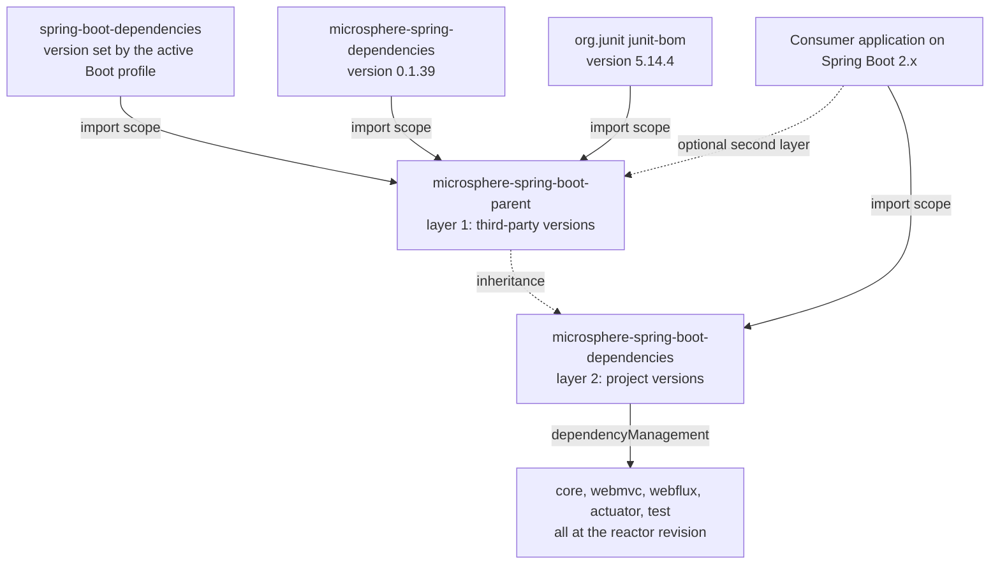

# Dependencies 模块（BOM）— `release-1.x`

> [English](../dependencies.md) · 文档索引：[中文](../../zh/README.md) ·
> `release` 分支同名文档：[中文](../../current/zh/dependencies.md)

> **分支：** `release-1.x` · **版本线：** `0.1.x` · **Artifact：** `microsphere-spring-boot-dependencies`
> **Packaging：** pom（BOM）· **受管：** 5 个 artifact

目录：
[1 范围与配对](#1-范围与配对) ·
[2 BOM 的两层设计](#2-bom-的两层设计) ·
[3 五个受管条目](#3-五个受管条目) ·
[4 相同的 artifact 集合与不同的版本线](#4-相同的-artifact-集合与不同的版本线) ·
[5 为什么 compatible 与 parent 不在 BOM 里](#5-为什么-compatible-与-parent-不在-bom-里) ·
[6 parent 元素及其影响](#6-parent-元素及其影响) ·
[7 Boot 版本线的配对](#7-boot-版本线的配对) ·
[8 新增第六个模块](#8-新增第六个模块) ·
[9 消费方的导入](#9-消费方的导入) ·
[10 参考](#10-参考)

---

## 1. 范围与配对

`microsphere-spring-boot-dependencies` 是 `0.1.x` 版本线对外发布的版本契约：一个 `<packaging>pom</packaging>` 模块，它的全部内容就是一个 `<dependencyManagement>` 块，里面点名了五个可发布的 artifact——没有 properties，没有 profiles，没有 build 段，也没有 repositories。这套设计与 `release` 分支共用，并在 [../../current/zh/dependencies.md](../../current/zh/dependencies.md) 中完整说明。

本文是差异视图，而这份差异很值得注意：**两个 POM 逐字节完全相同。** 在两个 worktree 之间对 `microsphere-spring-boot-dependencies/pom.xml` 执行 `diff`，不会产生任何输出——同样是五个条目，同样是那个顺序，同样是 `${revision}` 占位符，同样是 `<parent>`。不同的只是这些坐标各自解析到什么，因为周围的 POM 选的是不同代际的 Spring Boot，也选了另一条 `microsphere-spring` 版本线（这里是 `0.1.39`，那里是 `0.2.39`）。

| 方面 | `release-1.x` | `release` |
|---|---|---|
| BOM 的 POM 主体 | 完全相同 | 完全相同 |
| `${revision}` 解析为 | `0.1.35-SNAPSHOT`（最新提交）、`0.1.34`（最近一次发布） | `0.2.35-SNAPSHOT`（最新提交） |
| 这些 artifact 构建时所针对的 Boot 范围 | `2.1.18.RELEASE` – `2.7.18` | `3.0.13` – `4.1.1` |
| jar 内部的 Servlet 命名空间 | `javax.*` | `jakarta.*` |
| 自动配置的注册方式 | `spring.factories` **和** `AutoConfiguration.imports` | 只有 `AutoConfiguration.imports` |

---

## 2. BOM 的两层设计

这里有两个版本层，它们互不重叠：**parent** 导入第三方 BOM，并管理一切不属于本工程的东西；而 **dependencies** 模块只管理本工程自己的 artifact，不导入任何东西。



| 层 | 文件 | 管理什么 | 消费方必须做什么 |
|---|---|---|---|
| 第 1 层，parent | `microsphere-spring-boot-parent/pom.xml` | Boot、Framework、Jackson、Micrometer、JUnit、Jolokia、`microsphere-spring-*` | 并非一定要用它；`spring-boot-starter-parent` 通常就能顶替同一个角色 |
| 第 2 层，BOM | `microsphere-spring-boot-dependencies/pom.xml` | 五个 `microsphere-spring-boot-*` artifact | 要么导入它，要么手工声明版本 |

BOM 继承了第 1 层（见第 6 节），却并不把它再导出：导入这个 artifact 只会把 `core` 钉在 `0.1.34`，对 Spring Boot 只字不提，这正是第 9 节把 BOM 导入与一个普通的 `spring-boot-starter-parent` 搭配使用的原因。

---

## 3. 五个受管条目

`microsphere-spring-boot-dependencies/pom.xml` 第 `21–55` 行，逐字如下：

```xml
    <dependencyManagement>
        <dependencies>

            <dependency>
                <groupId>io.github.microsphere-projects</groupId>
                <artifactId>microsphere-spring-boot-core</artifactId>
                <version>${revision}</version>
            </dependency>

            <dependency>
                <groupId>io.github.microsphere-projects</groupId>
                <artifactId>microsphere-spring-boot-webmvc</artifactId>
                <version>${revision}</version>
            </dependency>

            <dependency>
                <groupId>io.github.microsphere-projects</groupId>
                <artifactId>microsphere-spring-boot-webflux</artifactId>
                <version>${revision}</version>
            </dependency>

            <dependency>
                <groupId>io.github.microsphere-projects</groupId>
                <artifactId>microsphere-spring-boot-actuator</artifactId>
                <version>${revision}</version>
            </dependency>

            <dependency>
                <groupId>io.github.microsphere-projects</groupId>
                <artifactId>microsphere-spring-boot-test</artifactId>
                <version>${revision}</version>
            </dependency>

        </dependencies>
    </dependencyManagement>
```

`core`、`webmvc`、`webflux`、`actuator`、`test` 这个顺序就是整个文件里管理段的全部内容；五个条目都只带 `<version>${revision}</version>`，别无其他（没有 `<type>`，没有 `<scope>`，没有 `<exclusions>`），所以它们是纯粹的钉版本条目，scope 由每个消费方自己声明。`webmvc` 是 Servlet 栈（运行时用 `javax.servlet`），`webflux` 是响应式那一套，`actuator` 要求应用里已经引入了 `spring-boot-starter-actuator`，而 `test`（JUnit 5 的那些基类）通常在 `test` scope 下使用，在本 reactor 内部也是一样。

---

## 4. 相同的 artifact 集合与不同的版本线

两条版本线上的五个 artifact id 是相同的，顺序相同，占位符也相同。消费方能看到的唯一差别就是版本——这里是 `0.1.x`，那里是 `0.2.x`——而这一个数字承载着一大套兼容性契约。

| 混用 `0.1.x` 与 `0.2.x` | 会发生什么 |
|---|---|
| 两个 BOM 都被导入 | 每个 artifact 以先导入的那个为准，于是两条线会按不可预测的版本交错在一起 |
| 在 Boot 2 的 classpath 上放 `0.2.x` 的 jar | 针对 `jakarta.servlet.*` 以及 Boot 3 类型的 `NoClassDefFoundError`；只靠 `AutoConfiguration.imports` 注册的方式在 Boot `2.1`–`2.6` 上会被忽略 |
| 在 Boot 3 的 classpath 上放 `0.1.x` 的 jar | 这些类是按 Boot 2 的 endpoint 与 binding API 编译的，而且从 Boot 3 起 `spring.factories` 的自动配置键会被忽略 |
| 同一条线、不同的补丁版本 | 支持——五个 artifact 总是一起发布，并且始终共享 `${revision}` |

回答 issue 时的规则是：一个应用只使用一条版本线，由它的 Spring Boot 代际来选。绝不要建议「把某一个模块单独钉到另一条线上」；这些模块在内部就以 `${revision}` 相互依赖，所以混用一套 artifact 会在第一个传递依赖跳数之内就崩掉。

---

## 5. 为什么 compatible 与 parent 不在 BOM 里

| 被排除的模块 | 原因 | 证据 |
|---|---|---|
| `microsphere-spring-boot-compatible` | 从不部署，所以就算写了条目也永远无法解析；它的类位于 `org.springframework.boot.*` 之下，绝不能进入仓库 | `maven-deploy-plugin` 的 `<skip>true</skip>` 与 `central-publishing-maven-plugin` 的 `<skipPublishing>true</skipPublishing>`，在其 POM 第 `51–69` 行；只在 profile `spring-boot-2.1`、`2.2`、`2.3` 下挂到 `core` 上——见 [./compatible.md](./compatible.md) |
| `microsphere-spring-boot-parent` | 父 POM 是被继承的，不是被依赖的；把它列进来只会诱导出对一个 `pom` artifact 的 `<dependency>` | 它的内容是 `properties` + `dependencyManagement` + profiles——见 [./parent.md](./parent.md) |

这两项排除在 `release` 上完全一致，理由也正是这两条。两条线之间的差别在于 `compatible` 承载的到底是*哪些*垫片（这里是十二个 Boot 2.4 时代的类型与 actuator 类型，那里是十个 Boot 4 的迁移项），以及它是被*哪些* profile 挂上去的——而这两点从 BOM 里都看不出来。

---

## 6. parent 元素及其影响

这个 BOM 并**不是**独立存在的。`microsphere-spring-boot-dependencies/pom.xml` 第 `5–10` 行，逐字如下：

```xml
    <parent>
        <groupId>io.github.microsphere-projects</groupId>
        <artifactId>microsphere-spring-boot-parent</artifactId>
        <version>${revision}</version>
        <relativePath>../microsphere-spring-boot-parent/pom.xml</relativePath>
    </parent>
```

POM 逐字节相同，就意味着这个元素（连它的 `<relativePath>` 一起）在 `release` 上也同样存在。有三点由此带来的后果值得明确说明：

* **在 reactor 内部**，`<relativePath>` 让 Maven 可以从磁盘解析到 parent，因此根构建不需要本地仓库里有一个已发布的 `0.1.35-SNAPSHOT` 父 POM。
* **`${revision}` 继承自根聚合 POM**，它位于 parent 之上的一层，既充当这个 POM 自身的 `<version>`，也充当全部五个条目的版本。reactor 之所以从不部署未解析的 `${revision}`，是因为 `microsphere-build:0.3.14` 已经配好了 `flatten-maven-plugin` 1.7.3，并使用 `flatten.mode=resolveCiFriendliesOnly`，这个模式会替换掉 CI-friendly 的那几个版本元素，而保留 POM 的其余结构。
* **发布出去的 flattened BOM 依然写着它的 parent**，所以导入 `microsphere-spring-boot-dependencies:0.1.34` 的消费方也必须能够从 Central 解析到 `microsphere-spring-boot-parent:0.1.34`——这正是每次发布都要部署整个 reactor（`parent` 也包含在内）的原因（见 [./build-and-release.md](./build-and-release.md)）。继承来的内容同样不会被再导出：parent 的那三个 `dependencyManagement` 导入不会随着这个 BOM 传到消费方那里，因为继承与导入是两种不同的关系。因此在只导入了这个 BOM 的消费方里，`mvn dependency:tree` 应当显示 `microsphere-spring-boot-core:jar:0.1.34`，与消费方自己的 parent 所选的任意 Boot 版本并排出现。

---

## 7. Boot 版本线的配对

| Boot 线 | `microsphere-spring-boot` 版本 | 该线构建与测试所针对的 Boot 版本 | `microsphere-spring` |
|---|---|---|---|
| Spring Boot `2.1` – `2.7` | `0.1.x`（BOM 为 `microsphere-spring-boot-dependencies:0.1.34`） | `2.1.18.RELEASE`、`2.2.13.RELEASE`、`2.3.12.RELEASE`、`2.4.13`、`2.5.15`、`2.6.15`、`2.7.18` | `0.1.39` |
| Spring Boot `3.0` – `4.1` | `0.2.x` | `3.0.13` … `3.5.16`、`4.0.8`、`4.1.1` | `0.2.39` |

选择规则：Boot `2.x` 上的应用取 `0.1.x` 线，并导入 `microsphere-spring-boot-dependencies:0.1.34`；`3.x` 或 `4.x` 上则取 `0.2.x`。在 Boot `2.1`–`2.3` 上用的仍然是 `0.1.x` 线——那些只不过是*本 reactor 内部*需要垫片模块的 profile，而发布出去的 jar 并不带上它。上面未列出的 Boot 版本两条线都不覆盖；在承诺支持之前，先针对那个 Boot 版本在本地构建一次。

---

## 8. 新增第六个模块

一个要发布到 Central 的新 `microsphere-spring-boot-<name>` jar 会牵动六处，按以下顺序处理：

1. **BOM 条目** — 在 `microsphere-spring-boot-dependencies/pom.xml` 的 `dependencyManagement` 块里新增一个带 `<version>${revision}</version>` 的 `<dependency>`，沿用现有风格：先写 groupId，条目之间空一行，不写 scope。
2. **根 `<modules>`** — 在 `pom.xml` 里加入 `<module>microsphere-spring-boot-<name></module>`；顺序只影响可读性，但当前的列表（parent、dependencies、compatible、test、core、webmvc、webflux、actuator）是拓扑序，所以新来的模块要插在它所依赖的一切之后。
3. **parent 声明** — 新的 POM 以 `${revision}` 声明 `<artifactId>microsphere-spring-boot-parent</artifactId>`，并带上 `<relativePath>../microsphere-spring-boot-parent/pom.xml</relativePath>`，打包方式为 `jar`，然后在 parent 的导入已经覆盖到的地方**不带版本**地声明依赖。
4. **profile 与垫片的取舍** — 如果这个模块需要 Boot `2.1`–`2.3` 所缺失的 API，就像 `core` 那样，在名字严格为 `spring-boot-2.1`、`spring-boot-2.2` 和 `spring-boot-2.3` 的 profile 里依赖 `microsphere-spring-boot-compatible`，绝不要写在默认 scope 里；如果它需要比 Boot `2.1` 所管理的更新的 Framework 或 Micrometer 版本，就照 `actuator` 与 `compatible` 的做法，加一个带 `optional` 钉版本的 `spring-boot-2.1` profile。
5. **CI 矩阵** — `.github/workflows/maven-build.yml` 不需要为每个模块单列条目，因为它构建的是整个 reactor，但每一个格子都必须保持全绿，所以要在本地把七个 profile id 都跑一遍，至少跑两个极端：`./mvnw -pl microsphere-spring-boot-<name> -am -Pspring-boot-2.1 test`，以及同样的命令换成 `-Pspring-boot-2.7`。
6. **两种语言的文档** — `docs/developer-guide/1.x/<name>.md` 加上 `docs/developer-guide/1.x/zh/<name>.md`，`docs/user-guide/1.x/<name>.md` 加上它的 `zh` 镜像，以及两个 `README.md` 里的模块表；一个会发布的模块要进本文第 3 节的条目清单，也要进 `docs/user-guide/1.x/dependencies.md`，而像 `compatible` 这样的构建期辅助模块则改放进第 5 节。

---

## 9. 消费方的导入

Boot `2.7` 上的应用会把 `spring-boot-starter-parent`（这里是 `2.7.18`，也就是本线的默认 profile）留作它的构建父 POM，并在其之上导入这个 BOM，然后不带版本地声明自己需要的 artifact：

```xml
<dependencyManagement>
    <dependencies>
        <dependency>
            <groupId>io.github.microsphere-projects</groupId>
            <artifactId>microsphere-spring-boot-dependencies</artifactId>
            <version>0.1.34</version>
            <type>pom</type>
            <scope>import</scope>
        </dependency>
    </dependencies>
</dependencyManagement>
```

在它下面，`<dependencies>` 里例如列上 `microsphere-spring-boot-webmvc` 且**不写** `<version>`——这正是 BOM 的全部意义所在。要想只把某一个 artifact 按住、又不放弃整个 BOM，就在 `dependencyManagement` 里把那条 `<dependency>` 写在导入的**上面**，因为 Maven 保留它看到的第一个受管版本，例如让 `microsphere-spring-boot-actuator` 停在 `0.1.30`，而其余四个跟随 BOM。这两种写法都是版本线相关的：`0.1.34` 要求应用处于 Spring Boot `2.x`。

---

## 10. 参考

| 文档 | 范围 |
|---|---|
| [README.md](./README.md) | 分支总览与模块清单 |
| [./parent.md](./parent.md) | 第 1 层：它的那些 import 不被这个 BOM 再导出的 parent |
| [./compatible.md](./compatible.md) | 被有意排除在这个 BOM 之外的模块 |
| [./core.md](./core.md) | 第一个受管 artifact |
| [./build-and-release.md](./build-and-release.md) | 发布流水线部署什么，以及按什么顺序部署 |
| [../../current/zh/dependencies.md](../../current/zh/dependencies.md) | `release` 线上那份完全相同的 POM |
| [../../../user-guide/1.x/zh/dependencies.md](../../../user-guide/1.x/zh/dependencies.md) | 面向消费方的安装与导入 |
