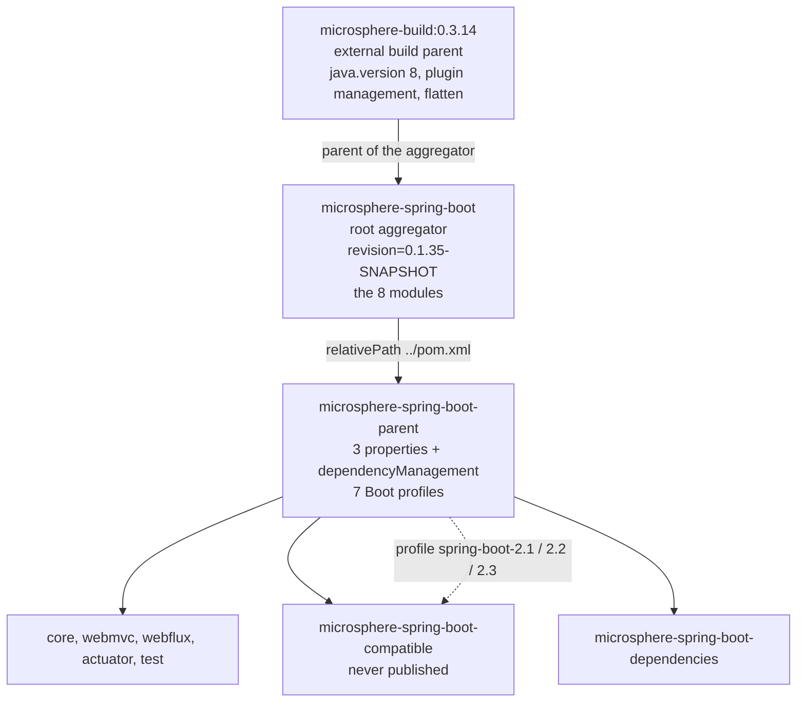

# Parent POM — `release-1.x`

> [English](../parent.md) · 文档索引：[中文](../../zh/README.md) ·
> `release` 分支的同名文档：[中文](../../current/zh/parent.md)

> **分支：** `release-1.x` · **版本线：** `0.1.x` · **Artifact：** `microsphere-spring-boot-parent`
> **Packaging：** pom · **构建父 POM：** `io.github.microsphere-projects:microsphere-build:0.3.14`

目录：
[1 范围与对照](#1-范围与对照) ·
[2 继承链](#2-继承链) ·
[3 受管属性及其消费方](#3-受管属性及其消费方) ·
[4 dependencyManagement 块](#4-dependencymanagement-块) ·
[5 Spring Boot profile 表](#5-spring-boot-profile-表) ·
[6 默认 profile 的语义](#6-默认-profile-的语义) ·
[7 缺少 repositories 块](#7-缺少-repositories-块) ·
[8 模块声明该父 POM 得到什么](#8-模块声明该父-pom-得到什么) ·
[9 操作手册](#9-操作手册) ·
[10 故障排查](#10-故障排查) ·
[11 参考](#11-参考)

---

## 1. 范围与对照

`microsphere-spring-boot-parent/pom.xml` 是 `release-1.x` reactor 唯一的版本层：所有模块都继承它，因此工程内没有任何依赖
带着版本字面量，而选用哪一代 Spring Boot 由激活 profile 决定，不需要改动 POM。该角色、形状与机制在 `release` 上完全一致，
并已在 [../../current/zh/parent.md](../../current/zh/parent.md) 中完整说明；本文只列差异，而差异集中在三个属性值、七个而非八个
profile id，以及被删除的 `<repositories>` 块。

| 元素 | `release-1.x` | `release` |
|---|---|---|
| 根 `<revision>`、根 `<java.version>` | `0.1.35-SNAPSHOT`、**不存在** | `0.2.35-SNAPSHOT`、`17` |
| 外部构建父 POM（在聚合 POM 上声明） | `microsphere-build:0.3.14` | `microsphere-build:0.3.16` |
| `microsphere-spring.version` / `jolokia.version` / `junit-jupiter.version` | `0.1.39` / `1.7.2` / `5.14.4` | `0.2.39` / `2.6.3` / `6.1.3` |
| Boot profiles | `spring-boot-2.1` … `spring-boot-2.7`，默认 `2.7.18` | `spring-boot-3.0` … `spring-boot-4.1`，默认 `3.5.16` |
| 版本字符串风格 | `2.1`–`2.3` 带 `.RELEASE` 后缀，`2.4` 起为纯版本号 | 全部为纯版本号 |
| `<repositories>` | **无** | 声明了一个 `spring-milestone` 仓库 |

上述事实全部读自 `microsphere-spring-boot-parent/pom.xml`、根 `pom.xml`、八个模块 POM 以及 `.github/workflows/maven-build.yml`。

---

## 2. 继承链

上面那张表容易掩盖一个细节：本 POM **并没有** 直接写 `microsphere-build`。那个构建父 POM 由根聚合 `pom.xml` 声明（第 5–9 行，
`<artifactId>microsphere-build</artifactId>` / `<version>0.3.14</version>`），本模块是再下一层才继承到它——因为自己的 `<parent>`
是 `microsphere-spring-boot:${revision}`，并带有 `<relativePath>../pom.xml</relativePath>`。



聚合（根 `<modules>` 列表，顺序为 parent、dependencies、compatible、test、core、webmvc、webflux、actuator，两条线逐字节相同）
决定一条构建命令编译什么；继承决定一个 POM 得到什么。多出聚合这一层带来两个后果：`<revision>` 定义在本父 POM **之上**，所以本
POM 可以使用 `${revision}` 却不能重定 reactor 坐标；Java 级别来自 `microsphere-build:0.3.14`，其自带的 `<java.version>8</java.version>`
正是本线根 POM 不写 `<java.version>`、而 `release` 把根 POM 抬到 `17` 的原因。

---

## 3. 受管属性及其消费方

第 21–26 行只声明三个属性。`spring-boot.version` 不在其中——它只存在于 profile 里（第 5 节）。

| 属性 | 值 | 本 reactor 中的消费方 |
|---|---|---|
| `microsphere-spring.version` | `0.1.39` | 为 `microsphere-spring-dependencies` 导入（第 60 行）定版，进而提供 `microsphere-annotation-processor`（core、webmvc、webflux、actuator、test）、`microsphere-spring-context`（core 第 32 行、test 第 60 行）、`microsphere-spring-test`（test 第 66 行）、`microsphere-spring-webmvc`（webmvc 第 40 行）与 `microsphere-spring-webflux`（webflux 第 40 行）——这些声明全部不带版本 |
| `jolokia.version` | `1.7.2` | 为直接的 `org.jolokia:jolokia-core` 条目（第 44 行）定版；`microsphere-spring-boot-actuator/pom.xml` 第 38–41 行不带版本地声明该 artifact |
| `junit-jupiter.version` | `5.14.4` | 为 `org.junit:junit-bom` 导入（第 35 行）定版；随后 `org.junit.jupiter:junit-jupiter` 在 core 第 57 行、webmvc 第 66 行、webflux 第 65 行、actuator 第 77 行、test 第 32 行均以无版本声明——在 `test` 中还是 optional，因为 JUnit 本身就是该模块的公开接口 |
| `spring-boot.version` | 仅在 profile 中 | 只由七个 profile 设置；驱动 `spring-boot-dependencies` 导入（第 51 行），从而为 reactor 内所有 `org.springframework.boot:*` 与 `org.springframework:*` 声明定版 |
| `revision` | `0.1.35-SNAPSHOT` | 在上一级的根聚合 POM 中定义；本 POM 与所有模块的版本 |

这三个值并非"只是更旧"，而是与本线相配：Jolokia `1.7.x` 是最后的 `javax` 分支，与 Boot 2 的 JMX 栈一致；`5.14.4` 停留在这一代
Boot 所假定的 JUnit 5 `5.x` bom 上；`0.1.39` 则把本线与兄弟项目 `microsphere-spring` 的 `0.1.x` 系列配对。

---

## 4. dependencyManagement 块

第 28–66 行，逐字如下：

```xml
    <dependencyManagement>
        <dependencies>

            <!-- JUnit Jupiter -->
            <dependency>
                <groupId>org.junit</groupId>
                <artifactId>junit-bom</artifactId>
                <version>${junit-jupiter.version}</version>
                <type>pom</type>
                <scope>import</scope>
            </dependency>

            <!-- Jolokia -->
            <dependency>
                <groupId>org.jolokia</groupId>
                <artifactId>jolokia-core</artifactId>
                <version>${jolokia.version}</version>
            </dependency>

            <!-- Spring Boot Dependencies -->
            <dependency>
                <groupId>org.springframework.boot</groupId>
                <artifactId>spring-boot-dependencies</artifactId>
                <version>${spring-boot.version}</version>
                <type>pom</type>
                <scope>import</scope>
            </dependency>

            <!-- Microsphere Spring Dependencies -->
            <dependency>
                <groupId>io.github.microsphere-projects</groupId>
                <artifactId>microsphere-spring-dependencies</artifactId>
                <version>${microsphere-spring.version}</version>
                <type>pom</type>
                <scope>import</scope>
            </dependency>

        </dependencies>
    </dependencyManagement>
```

| 条目 | 形式 | 为何放在这里 |
|---|---|---|
| `org.junit:junit-bom` | import，**排在最前** | Maven 保留它先看到的受管版本，排在 `spring-boot-dependencies` 之前可确保 JUnit 取自 `${junit-jupiter.version}` |
| `org.jolokia:jolokia-core` | 直接条目 | 没有任何 BOM 管理它；为 actuator 的 JMX 测试固定 |
| `org.springframework.boot:spring-boot-dependencies` | import | profile 拨动的那颗唯一旋钮 |
| `io.github.microsphere-projects:microsphere-spring-dependencies` | import | 以 `0.1.39` 提供兄弟项目的 artifact 版本 |

由于 Boot BOM 是通过 `${spring-boot.version}` 导入的，切换一次 profile 就换掉整张依赖图而不只是某个 artifact：`2.1.18.RELEASE`
带来 Spring Framework `5.1.x`、Micrometer `1.1.x`、Jackson `2.9.x` 与 `javax.servlet:javax.servlet-api`；`2.7.18` 带来 Framework
`5.3.x`、Micrometer `1.9.x` 与 Jackson `2.13.x`。两次构建之间没有一行模块 POM 需要改动——这也正是 `spring-boot-2.1` 下需要两个模块级
例外的原因：`microsphere-spring-boot-actuator/pom.xml` 第 98–117 行的 `micrometer-core:1.3.20` 加 `spring-core:5.2.25.RELEASE`，以及
`microsphere-spring-boot-compatible/pom.xml` 第 72–84 行的 `spring-core:5.2.25.RELEASE`。参见 [./actuator.md](./actuator.md) 与
[./compatible.md](./compatible.md)。

---

## 5. Spring Boot profile 表

第 68–120 行定义七个 profile，每个只含一个属性，没有 `<dependencies>`、没有 `<build>`、也没有按 JDK 激活。该块中的 profile 体，逐字如下：

```xml
        <profile>
            <id>spring-boot-2.1</id>
            <properties>
                <spring-boot.version>2.1.18.RELEASE</spring-boot.version>
            </properties>
        </profile>
```

| profile | `spring-boot.version` | 在 reactor 其他位置引发的额外效果 |
|---|---|---|
| `spring-boot-2.1` | `2.1.18.RELEASE` | 给 `core` 挂上 `compatible`；在 `compatible` 中固定 `spring-core:5.2.25.RELEASE`；在 `actuator` 中固定 `micrometer-core` 与 `spring-core` |
| `spring-boot-2.2` | `2.2.13.RELEASE` | 给 `core` 挂上 `compatible` |
| `spring-boot-2.3` | `2.3.12.RELEASE` | 给 `core` 挂上 `compatible` |
| `spring-boot-2.4` | `2.4.13` | 无 |
| `spring-boot-2.5` | `2.5.15` | 无 |
| `spring-boot-2.6` | `2.6.15` | 无 |
| `spring-boot-2.7` | `2.7.18` | `<activeByDefault>true</activeByDefault>`（第 111–119 行），本 POM 中唯一带 `<activation>` 的 profile |

`2.1`–`2.3` 带 `.RELEASE` 而 `2.4` 起不带，并不是风格不统一，而就是发布到仓库里的版本字符串：Spring Boot 直到 `2.3` 那一代都用
`major.minor.patch.RELEASE`，从 `2.4` 改为纯 `major.minor.patch`。Maven 逐字比较版本号，因此 `2.3.12.RELEASE` 与 `2.3.12` 是两个
不同的 artifact，而 Central 上只有带后缀的那个。`release` 不需要后缀，因为它最旧的 profile（`spring-boot-3.0`）已经越过这次切换；
移植改动时不要把后缀"顺手规范化"掉。

---

## 6. 默认 profile 的语义

`activeByDefault` 是 Maven 中最弱的激活方式，而本 POM 只依赖它：

* 完全不写 `-P` 时：`spring-boot-2.7` 生效，reactor 针对 `2.7.18` 构建。
* 显式激活 **本 POM 的** 某个 profile 就会让上述隐式选择失效——CI 的 `-Ptest,coverage,<id>` 三件套同样如此。若最终没有任何 Boot
  profile 生效，`spring-boot.version` 便没有定义，`spring-boot-dependencies` 也无法解析。
* 完全不存在的 id（例如 `-Pspring-boot-4.0`）属于另一种失败：Maven 只给出
  `The requested profiles [spring-boot-4.0] could not be activated` 警告，`activeByDefault` 的 `2.7.18` 构建照常进行，而你本想挂载的
  那些模块 profile 一个都没生效。
* 正因如此，`.github/workflows/maven-build.yml` 把 Boot 版本列为矩阵维度（第 26–28 行），并传入
  `--activate-profiles test,coverage,${{ matrix.maven-profile-spring-boot }}`：5 个 JDK × 7 个 profile = 35 个格子，每格都显式点名自己的 Boot 线。
* 同时激活两个 Boot profile 在 Maven 中合法但在此毫无意义：两者设置同一个属性，后者优先。

```bash
./mvnw clean verify                                  # 2.7.18
./mvnw clean verify -Pspring-boot-2.1                # 最旧格子，会挂上垫片
./mvnw -pl microsphere-spring-boot-core -am -Pspring-boot-2.3 help:effective-pom | grep spring-boot.version
```

---

## 7. 缺少 repositories 块

本 POM 没有 `<repositories>` 元素。`release` 有，位于其自身的 `microsphere-spring-boot-parent/pom.xml` 第 68–74 行：

```xml
    <repositories>
        <repository>
            <id>spring-milestone</id>
            <name>Spring Portfolio Milestone Repository</name>
            <url>https://repo.spring.io/milestone</url>
        </repository>
    </repositories>
```

后果是：本线的每个坐标都必须来自 Central，因此 profile 只能点名 GA 版本；构建只需一个镜像即可复现；即便是误用，Boot 的
milestone 或 `-SNAPSHOT` 在此也解析不到。这种缺失是结果而非原因——第 5 节那七个版本早已 GA 多年，milestone 访问无物可取。请保持现状：
残留的 `spring-milestone` 条目会拖慢依赖解析、削弱可复现性，而且永远不会被 `2.x` 坐标查询。发布两边都不受影响，因为分发管理来自
`microsphere-build`，而该父 POM 还把 flatten 插件的 `flatten.pomElements.repositories` 设为 `remove`。

---

## 8. 模块声明该父 POM 得到什么

每个模块都以 `<relativePath>../microsphere-spring-boot-parent/pom.xml</relativePath>` 指向它——例如
`microsphere-spring-boot-actuator/pom.xml` 第 5–10 行与 `microsphere-spring-boot-dependencies/pom.xml` 第 5–10 行。

| 得到 | 来源 |
|---|---|
| 无版本的 `org.springframework.boot:*`、`org.springframework:*`、Jackson、Micrometer、servlet 与测试库 | `spring-boot-dependencies` 导入，取激活 profile 的版本 |
| 无版本的 `org.junit.jupiter:junit-jupiter` | `junit-bom` 导入 |
| 无版本的 `org.jolokia:jolokia-core` | 直接条目 |
| 无版本的 `microsphere-spring-*` 与 `microsphere-annotation-processor` | `microsphere-spring-dependencies` 导入 |
| reactor 坐标 `${revision}`，以及 name、description、url、licenses、developers、scm 元数据 | 本 POM 之上的根聚合 POM |
| compiler、jar、source、javadoc、surefire、failsafe、checkstyle、jacoco、enforcer、flatten、git-commit-id 的插件管理，以及 Java 8 基线 | 经聚合 POM 继承的 `microsphere-build:0.3.14` |
| 七个 Boot profile id，使模块内的 profile 能对应一条有据可查的 Boot 线 | 本 POM |

它有意 **不** 提供的东西：五个已发布 Microsphere Spring Boot artifact 的版本（那是 `microsphere-spring-boot-dependencies` 的职责，见
[./dependencies.md](./dependencies.md)）、任何 `spring-boot-maven-plugin` 配置（那属于 `spring-boot-starter-parent`）、任何仓库声明，
以及对 `microsphere-spring-boot-compatible` 的依赖——挂载垫片是 `core` 的决定，不是父 POM 的决定。

---

## 9. 操作手册

### 9.1 新增一条 Spring Boot 2 小版本线

在 `microsphere-spring-boot-parent/pom.xml` 的 `<profiles>` 块末尾（第 120 行之前）插入一个 profile，形状与第 5 节引用的那段一致。
随后把该 id 加入 `.github/workflows/maven-build.yml` 第 26–28 行的 `maven-profile-spring-boot` 矩阵；决定垫片问题——本线只有 **低于**
`2.4` 的 profile 才挂垫片，因此更新的小版本线 **不会** 在 `microsphere-spring-boot-core/pom.xml` 第 91–127 行获得条目；若新线成为推荐线，
就把 `<activeByDefault>` 移过去；最后更新本文第 5 节以及 `docs/user-guide/1.x/zh/parent.md`，中英文同步。

### 9.2 抬高本线下限

要去掉 `spring-boot-2.1`，四处必须一起动：删除 `microsphere-spring-boot-parent/pom.xml` 中的 profile（第 69–74 行）、
`microsphere-spring-boot-core/pom.xml` 中的 `<profile>`（第 92–102 行）、`microsphere-spring-boot-actuator/pom.xml` 中的那一个
（第 99–116 行）、`microsphere-spring-boot-compatible/pom.xml` 中的那一个（第 73–83 行），以及工作流里的矩阵项。删一半比构建失败更糟：
未知 id 只是警告，CI 仍在默认的 `2.7.18` 上转绿，而残留下来、指向该 id 的模块 profile 什么也没挂载。

### 9.3 移除本线不再需要的 profile

同样的多文件改动，只是少了那个 profile 独有的模块锚点，并额外做一次审计：`grep -rn "spring-boot-2.4" --include=pom.xml .` 的结果必须只剩
父 POM 自己的定义。一个 id 若在别处不存在，模块里那条 profile 就是死配置。若被删掉的 id 正持有 `<activeByDefault>`，请在同一个提交里把
它提升给最新的存活 profile——绝不要让 reactor 失去默认 Boot 线。

---

## 10. 故障排查

| 症状 | 原因 | 处理 |
|---|---|---|
| `'dependencies.dependency.version' for … is missing` | 本 POM 没有任何 Boot profile 处于激活状态，`spring-boot.version` 因而没有定义 | 显式激活第 5 节中的某个 id |
| `Could not find artifact …:spring-boot-starter:jar:2.1.18` | `.RELEASE` 后缀被丢掉了 | 请求 `2.1.18.RELEASE` |
| `The requested profiles [spring-boot-3.5] could not be activated` | 那个 id 属于 `release` | 换成 `2.x` 的 id |
| milestone 或 `-SNAPSHOT` 的 Boot 找不到 | 本 POM 有意不声明任何仓库 | 只用 GA 版本 |
| `package jakarta.servlet does not exist` | `0.2.x` 的 artifact 混进了 `0.1.x` 构建 | 排除它；两条线不可互换 |
| 安装后的 POM 里仍写着 `${revision}` | 没走 `microsphere-build` 的 flatten 插件，例如只构建了部分 reactor | 从根目录构建 |
| 编译器拒绝 `instanceof X x`、文本块、`switch` 表达式 | `microsphere-build:0.3.14` 把 `java.version` 设为 `8` | 按现有源码改成 Java 8 写法 |

---

## 11. 参考

| 文档 | 范围 |
|---|---|
| [README.md](./README.md) | 分支总览与跨分支源码差异 |
| [./build-and-release.md](./build-and-release.md) | 版本事实与 35 格 CI 矩阵 |
| [./dependencies.md](./dependencies.md) | 管理五个已发布 artifact 的 BOM |
| [./compatible.md](./compatible.md) | 被三个最旧 profile 挂载的垫片模块 |
| [./actuator.md](./actuator.md) | `spring-boot-2.1` 版本锚点所在位置 |
| [../../current/zh/parent.md](../../current/zh/parent.md) | `release` 的父 POM，完整说明 |
| [../../../user-guide/1.x/zh/parent.md](../../../user-guide/1.x/zh/parent.md) | 同一 POM 面向使用者的视角 |
