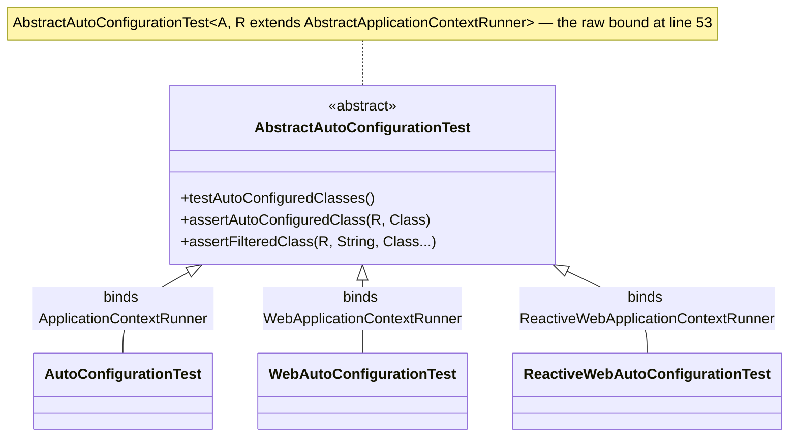

# Test 模块 — `release-1.x`

> [English](../test.md) · 文档索引：[中文](../../zh/README.md) ·
> `release` 分支的同名文档：[中文](../../current/zh/test.md)

> **分支：** `release-1.x` · **版本线：** `0.1.x` · **Artifact：** `microsphere-spring-boot-test`
> **Spring Boot：** `2.1.18.RELEASE` – `2.7.18` · **Java 源码级别：** 8

目录：
[1 范围与对照](#1-范围与对照) ·
[2 类层次与泛型上界](#2-类层次与泛型上界) ·
[3 模板方法契约](#3-模板方法契约) ·
[4 POM 差异](#4-pom-差异) ·
[5 在本 reactor 内的使用](#5-在本-reactor-内的使用) ·
[6 两处不同的测试夹具](#6-两处不同的测试夹具) ·
[7 本线的 JUnit 边界](#7-本线的-junit-边界) ·
[8 设计模式](#8-设计模式) ·
[9 配方](#9-配方) ·
[10 参考](#10-参考)

---

## 1. 范围与对照

[../../current/zh/test.md](../../current/zh/test.md) 描述模块本身——为什么存在四个抽象基类、构造器算法、runner
绑定、断言助手以及示例用法。本文只记录 `release-1.x` 上的差异，而结论相当罕见：**`src/main/java` 下的每个文件都与
`release` 逐字节相同**。差异只有一个 POM 坐标和两个测试夹具（§4、§6）；§5 与 §7 记录这些相同代码所依赖的 Boot-2 与
Jupiter 约束。

| 区域 | 数量 | 文件 |
|---|---|---|
| `src/main/java` | 4 | `io/microsphere/spring/boot/test/` 下的 `AbstractAutoConfigurationTest`、`AutoConfigurationTest`、`WebAutoConfigurationTest`、`ReactiveWebAutoConfigurationTest`，全部逐字节相同 |
| `src/main/resources` | 0 | 没有 `spring.factories`、没有 `.imports`、没有元数据：该 artifact 不注册任何东西，两条线都是如此 |
| `src/test/java` | 5 | `HttpAutoConfiguration`、`HttpAutoConfigurationTest`、`JmxAutoConfigurationTest`、`ReactiveWebApplicationAutoConfiguration`、`ReactiveWebApplicationAutoConfigurationTest`——两个有差异（§6） |
| `pom.xml` | 1 | 一个依赖坐标不同（§4） |

## 2. 类层次与泛型上界

来自 `AbstractAutoConfigurationTest.java:53` 以及三个子类各自第 `33` 行的四个声明：

```java
public abstract class AbstractAutoConfigurationTest<A, R extends AbstractApplicationContextRunner> {
public abstract class AutoConfigurationTest<A> extends AbstractAutoConfigurationTest<A, ApplicationContextRunner> {}
public abstract class WebAutoConfigurationTest<A> extends AbstractAutoConfigurationTest<A, WebApplicationContextRunner> {}
public abstract class ReactiveWebAutoConfigurationTest<A> extends AbstractAutoConfigurationTest<A, ReactiveWebApplicationContextRunner> {}
```

`A` 是被测自动配置类，`R` 是启动它的 Boot runner。上界刻意使用**原始**的 `AbstractApplicationContextRunner`，而不是
Boot 的五参数自类型：正是这一点让子类无需重复那套递归泛型就能绑定 runner，而完整约束形式只出现在三个 static 助手上
（§3）。



## 3. 模板方法契约

构造器（`:88`–`:102`）就是算法本身，也是"畸形子类无法被偶然构造"的原因：

| 步骤 | 行号 | 效果 |
|---|---|---|
| 读取自身的 `@SpringBootTest` | `:90`–`:91` | `assertNotNull(springBootTest, "The @SpringBootTest must not be annotated on " + type)` |
| 包装为属性元数据、推导 web 属性 | `:92`–`:93` | `GenericAnnotationAttributes.of(springBootTest)`，随后 `isWebApplication = !NONE.equals(springBootTestAttributes.get("webEnvironment"))`——web 与否来自注解而非继承了哪个子类；不启动任何容器 |
| 解析 `(A, R)` | `:94`–`:96` | `forClass(getClass()).as(AbstractAutoConfigurationTest.class)` 然后 `resolveGeneric(0)` / `resolveGeneric(1)`；无意义的类型参数能编译但在此处失败 |
| 构造 runner | `:97` | `this.runner = newRunner()`，要求 `R` 有可访问的无参构造器 |
| 非 web 场景守卫 | `:98`–`:101` | 只要 `webEnvironment = NONE` 就执行 `assertInstanceOf(ApplicationContextRunner.class, this.runner, format(...))` |

`newRunner()`（`:104`–`:107`）即 `newInstance(runnerClass)` 后调用 `initRunner(runner)`，后者（`:109`–`:115`）是子类
改写上下文种子的接缝：链式调用 `withPropertyValues(getPropertyValues())`、`withConfiguration(of(this.autoConfigurationClass))`
与 `withConfiguration(of(getClasses()))`，最后强转回 `R`。

| 成员 | 修饰符 | 行号 | 契约 |
|---|---|---|---|
| `testAutoConfiguredClasses()` / `testOnGlobalDisabledProperty()` / `testOnGlobalMissingClass()` | `@Test protected` | `:117`–`:136` | 对每个自动配置类断言 `hasSingleBean`；随后按 `key=value` 重跑一次、按缺失类在 `FilteredClassLoader` 中重跑一次，各自断言 `doesNotHaveBean` |
| `getPropertyValues()` / `getClasses()` | `protected final` | `:139`、`:165`–`:167` | `@SpringBootTest` 的 `properties` 与 `classes` 数组 |
| `getAutoConfiguredClasses()` | `protected final` | `:144`–`:149` | 在钩子执行**之前**就把 `this.autoConfigurationClass` 放入集合，子类只能追加不能替换 |
| `getGlobalDisabledPropertyValues()` / `getGlobalMissingClasses()` | `protected final` | `:152`–`:163` | 包装一个 `newLinkedHashSet()` 并委派给钩子 |
| `configureAutoConfiguredClasses(Set<Class<?>>)` | `protected abstract` | `:174` | 槽位 1——必须存在的 Bean |
| `configureGlobalDisabledPropertyValues(Set<String>)` | `protected abstract` | `:181` | 槽位 2——必须移除它们的属性 |
| `configureGlobalMissingClasses(Set<Class<?>>)` | `protected abstract` | `:188` | 槽位 3——需要从类加载器隐藏的类 |
| `assertAutoConfiguredClass` / `assertDisabledProperty` / `assertFilteredClass`——实例形式 `:190`–`:200`，static 形式 `:202`–`:216` | `protected` / `public static` | 见左列 | 实例形式是把 `this.runner` 传下去的开放委托；static 形式接收调用方提供的 runner，因此非子类的测试也能复用同一套断言 |
| `assertFilteredClass(R, String, Class<?>...)` | `public static` | `:218`–`:225` | `runner.withClassLoader(new FilteredClassLoader(filteredClass))`——按**类名字符串**过滤的变体，无需加载即可隐藏；三个 static 助手都带 `<R extends AbstractApplicationContextRunner<R, C, A>, C extends ConfigurableApplicationContext, A extends ApplicationContextAssertProvider<C>>`，这是完整约束形式唯一出现的地方 |

## 4. POM 差异

`microsphere-spring-boot-test/pom.xml` 与 `release` 的差异只有一个依赖块，`:84`–`:88`：

```diff
         <!-- Servlet API -->
         <dependency>
-            <groupId>jakarta.servlet</groupId>
-            <artifactId>jakarta.servlet-api</artifactId>
+            <groupId>javax.servlet</groupId>
+            <artifactId>javax.servlet-api</artifactId>
             <optional>true</optional>
         </dependency>
```

| 依赖 | 行号 | 是否 optional | 说明 |
|---|---|---|---|
| `microsphere-annotation-processor`、`spring-boot-configuration-processor`、`spring-boot-autoconfigure-processor` | `:23`–`:27`、`:37`–`:41`、`:44`–`:48` | 是 | 仅工具链 |
| `org.junit.jupiter:junit-jupiter` | `:30`–`:34` | 是 | 版本来自 `junit-bom`（§7） |
| `spring-boot-starter-test` | `:51`–`:55` | 是 | 提供 runner、`FilteredClassLoader`、AssertJ |
| `microsphere-spring-context` | `:58`–`:61` | **否** | 编译产物导入 `GenericAnnotationAttributes`（`:21`）以及 `:33`–`:36` 使用的 `io.microsphere` 工具类 |
| `microsphere-spring-test` | `:63`–`:67` | **否** | 会传递给消费者，但本模块没有任何源文件引用它 |
| `spring-boot-starter-web` / `spring-boot-starter-webflux`、`jackson-annotations` / `jackson-databind`、`com.h2database:h2` | `:69`–`:74`、`:76`–`:81`、`:91`–`:95`、`:97`–`:101`、`:104`–`:108` | 是 | 两个 starter 分别只被 servlet / reactive 绑定需要；Jackson 与 H2 坐标无源文件引用 |
| `javax.servlet:javax.servlet-api` | `:84`–`:88` | 是 | **`release` 上是 `jakarta.servlet:jakarta.servlet-api`**——本模块唯一的 POM 差异 |
| `ch.qos.logback:logback-classic` | `:113`–`:117` | `test` 作用域 | 不属于对外契约 |

没有任何依赖声明版本——文件里仅有的两个 `<version>` 标签是 parent 块（`:8`）与模块版本（`:15`）——所有坐标都由
parent 解析。对消费者的影响：optional 的含义是"在我的编译类路径上，但不传递给你"，因此只声明本 artifact 只会得到
`microsphere-spring-context` 与 `microsphere-spring-test`，子类若消费者不额外加入 `junit-jupiter` 与
`spring-boot-starter-test` 根本无法加载；两个 web starter 之所以不是 compile 作用域，是因为非 web 消费者不应被动继承
Tomcat 或 Reactor Netty。`javax.servlet` 的替换是把同一种隔离用到了命名空间上：Boot 2 的容器发布的是 `javax.servlet`，
若写 `jakarta.servlet-api`，消费者拿到的类型在 Boot 2 测试里根本用不上（`release-notes.md:441`，`0.1.29`）。本模块的
源文件既不引用 `javax.servlet` 也不引用 `jakarta.servlet`——唯一出现该词的是 `WebAutoConfigurationTest.java:24` 的
Javadoc 句子——因此该坐标是为消费者提供便利，而非编译所需。

## 5. 在本 reactor 内的使用

根 POM 把本模块列在使用者之前，`pom.xml:61`–`:65`（`test`、`core`、`webmvc`、`webflux`、`actuator`），四个使用者都以
`test` 作用域、`${revision}` 而非受管版本声明它
（`microsphere-spring-boot-core/pom.xml:69`–`:74`、`microsphere-spring-boot-webmvc/pom.xml:78`–`:83`、
`microsphere-spring-boot-webflux/pom.xml:77`–`:82`、`microsphere-spring-boot-actuator/pom.xml:89`–`:94`）——这种重复是
有承载意义的：`test` 作用域不具传递性，`webmvc` 无法经由 `core` 继承该 artifact；第三方则从 BOM 取得版本
（`microsphere-spring-boot-dependencies/pom.xml:48`–`:52`）。本模块之外只有一个类继承了这套契约，且两条线都一样——
`core` 的 `ConfigurationPropertiesAutoConfigurationTest.java`，两条线逐字节相同，绑定
`AutoConfigurationTest<ConfigurationPropertiesAutoConfiguration>`（`:44`）并设置 `webEnvironment = NONE`（`:42`），
槽位 1 放入四个 bind-advisor 与监听器类（`:47`–`:52`），槽位 2 留空（`:55`），槽位 3 隐藏
`BeanCapableImportCandidate`（`:59`）。`webmvc` 与 `webflux` 的测试虽依赖该 artifact，却自行搭建 `MockMvc` /
`WebTestClient` 夹具（见 [./webmvc.md](./webmvc.md) §7、[./webflux.md](./webflux.md) §7）。

本线由此带来的 Boot-2 约束：`:98`–`:101` 的非 web 守卫由 `ApplicationContextRunner` 满足，而它自 Boot `2.0` 就存在，
所以不需要分支特化版本；`:220` 使用的按字符串类名 `FilteredClassLoader` 构造器自 Boot `2.1` 起就存在（对
`spring-boot-test-2.1.1.RELEASE` 执行 `javap` 已确认），因此 `testOnGlobalMissingClass` 在最老的 profile 上也能跑；
属性只能经由 `:110` 的 `getPropertyValues()` 进入上下文，即子类自身 `@SpringBootTest` 的 `properties` 属性——
`JmxAutoConfigurationTest.java:39`–`:41` 就是这样打开 JMX 的；而 `:113`–`:114` 的 `AutoConfigurations.of(...)` 正是
`release` 至今仍在编译的 Boot 2 写法，所以这里不涉及任何 `compatible` 垫片。

## 6. 两处不同的测试夹具

`src/test/java` 只有两个文件不同，且两处是同一个替换：响应式示例自动配置换用了另一个 Boot 属性类。
`ReactiveWebApplicationAutoConfiguration.java` 中 `:23` 的导入与 `:36`、`:38` 两个注解同步变化：

```diff
-import org.springframework.boot.autoconfigure.jmx.JmxProperties;
+import org.springframework.boot.autoconfigure.jackson.JacksonProperties;
 @ConditionalOnWebApplication(type = REACTIVE)
-@ConditionalOnClass(value = JmxProperties.class)
+@ConditionalOnClass(value = JacksonProperties.class)
 @ConditionalOnProperty(name = "reactive.web-app.enabled", matchIfMissing = true)
-@EnableConfigurationProperties(value = JmxProperties.class)
+@EnableConfigurationProperties(value = JacksonProperties.class)
```

`ReactiveWebApplicationAutoConfigurationTest.java` 中 `:20` 的导入以及槽位 1（`:41`）、槽位 3（`:51`）随之变化；槽位 2
（`reactive.web-app.enabled=false`，`:46`）不变：

```diff
-        autoConfiguredClasses.add(JmxProperties.class);
+        autoConfiguredClasses.add(JacksonProperties.class);
-        globalMissingClasses.add(JmxProperties.class);
+        globalMissingClasses.add(JacksonProperties.class);
```

这证明了什么：响应式绑定依旧走完三个契约槽位——启用后属性 Bean 存在、关闭属性下不存在、`FilteredClassLoader` 下不存在——
因此替换检验的是*机制*而非某个 Boot 特有行为（`release-notes.md:485`，"Used `JacksonProperties` in reactive test
configuration"，`0.1.31`）。它**没有**证明的是 Boot 2 上 JMX 不可用：两条线逐字节相同的非 web 夹具
`JmxAutoConfigurationTest.java` 仍在 `:20` 导入
`org.springframework.boot.autoconfigure.jmx.JmxAutoConfiguration`，并在 `:55` 把 `MBeanExporter` 放进槽位 3。请把属性类
视为替身：移植时保持两个文件的三个槽位彼此一致，并挑选在你目标的每一个 Boot 代际上都存在的类型。

## 7. 本线的 JUnit 边界

parent 显式固定 Jupiter——`<junit-jupiter.version>5.14.4</junit-jupiter.version>`
（`microsphere-spring-boot-parent/pom.xml:25`），并以 `org.junit:junit-bom` 在 `:32`–`:38` 导入，位置**先于**
`:48`–`:54` 的 `spring-boot-dependencies`。这个顺序在本线的重要性超过 `release`：Maven 的 `dependencyManagement`
保留首个声明，因此 `junit-bom` 压过 Boot 自带的固定版本。从本地仓库中的 Boot BOM 读到的版本如下：

| Profile | `spring-boot.version` | Boot 管理的 Jupiter |
|---|---|---|
| `spring-boot-2.1` / `spring-boot-2.2` | `2.1.18.RELEASE` / `2.2.13.RELEASE` | `5.3.2` / `5.5.2` |
| `spring-boot-2.3` / `spring-boot-2.4` | `2.3.12.RELEASE` / `2.4.13` | `5.6.3` / `5.7.2` |
| `spring-boot-2.6` / `spring-boot-2.7` | `2.6.15` / `2.7.18` | `5.8.2` |

本模块需要 Jupiter **5.8 或更新版本**：构造器调用
`org.junit.jupiter.api.Assertions.assertInstanceOf`——在 `AbstractAutoConfigurationTest.java:38` 导入、在 `:99`–`:100`
以 `(Class, Object, String)` 重载使用——而 `assertInstanceOf` 是 5.8 新增的 API（本地仓库中的 `5.8.2` jar 暴露了这些
重载）。Boot 自身的版本在 `2.7` 下够用，在 `2.1`–`2.4` 下不够，这正是 `junit-bom` 必须排在第一位的现实原因；
`spring-boot-2.5` 的 BOM 本地不存在，未参与此次核对。这是 API 下限而非偏好：把 Jupiter 固定在 5.8 之下的消费者无法使用
这些基类。

## 8. 设计模式

| 模式 | 位置 | 本线的解读 |
|---|---|---|
| Template Method | 三个 `protected abstract` 钩子（`:174`、`:181`、`:188`）位于固定的 `@Test` 三件套（`:117`–`:136`）之下 | 一个算法、三个数据槽；两条线之间不变，因为它不触碰任何被 Boot 移动过的 API。 |
| 注解即元数据 | `:90`–`:93` 通过 `GenericAnnotationAttributes` 读取自身的 `@SpringBootTest` | `webEnvironment` 决定 web 属性，`properties` 与 `classes` 为 runner 播种——不启动容器，因此同一个类同时服务 Boot 2 与 Boot 4。 |
| 自类型绑定 | 三个一行长的子类（各自 `:33`） | 每个子类在 `extends` 子句里闭合 `R`，因为基类会在 `:95`–`:96` 从子类签名把它读回来。 |
| 受保护的不变式 | `:91` 的 `assertNotNull`、`:99` 的 `assertInstanceOf` | 误用在构造期就带着消息失败，而不是掉进断言里；第二个守卫确定了 Jupiter 下限（§7），两者同样以 `public static` 助手存在（`:202`–`:225`）供非子类使用。 |

## 9. 配方

**新增一种 runner 绑定。** Boot `2.1`–`2.7` 并未提供这三个之外的新 runner。在
`src/main/java/io/microsphere/spring/boot/test/<Name>AutoConfigurationTest.java` 创建文件，带 Apache 头，正文为
`public abstract class <Name>AutoConfigurationTest<A> extends AbstractAutoConfigurationTest<A, <RunnerClass>> {}`，从
`org.springframework.boot.test.context.runner` 导入 runner，并写全 Javadoc（`@param <A>`、`@author`、两个 `@see`、
`@since`）。先检查 `:98`–`:101` 的守卫：它假定"非 web 即 `ApplicationContextRunner`"，因此既非 web 也非普通的 runner
需要放宽该条件——而且要在**两条线**上同时改，因为该文件逐字节共享。

**为契约新增一种断言。** 在 `:174`–`:188` 旁声明
`protected abstract void configureGlobal…(Set<…>)`，再加一个用 `newLinkedHashSet()` 播种的 `protected final` getter；
在 `:117`–`:136` 旁加一个 `@Test protected void testOnGlobal…()` 循环；加上完整约束的 `public static` 助手与一个传入
`this.runner` 的开放 `protected` 委托；然后更新 `core` 的 `ConfigurationPropertiesAutoConfigurationTest` 与本模块的三个
夹具。新增 abstract 钩子会破坏两条线上的外部用户，所以非必要请改为空默认实现。

**把改动移植到 `release`。** 今天主源码的移植是空操作（`diff` 已证明二者一致），因此：（1）保持 `src/main/java`
同步——若你不得不改动它，先判断该改动是否只属于 Boot 2，并优先采用按名称或反射的形式，如本线 `core` 中的做法；
（2）镜像任何 POM 新增项，同时把 `javax.servlet` 换成 `jakarta.servlet`；（3）两个夹具文件原样带上，除非替身类在上游
被移动过；（4）这里绝不使用模式匹配 `instanceof`、文本块或 `switch` 表达式，向下移植时统一改写为 Java 8 形式。

```bash
# oldest profile — the cell that proves the Jupiter floor (§7)
JAVA_HOME=/path/to/jdk8 ./mvnw -pl microsphere-spring-boot-test -am -Pspring-boot-2.1 test
# newest profile (the activeByDefault one)
JAVA_HOME=/path/to/jdk11 ./mvnw --batch-mode -pl microsphere-spring-boot-test -am -Pspring-boot-2.7 test
# the only external consumer, on both edges
JAVA_HOME=/path/to/jdk8 ./mvnw -pl microsphere-spring-boot-core -am -Pspring-boot-2.1 test
```

CI 使用 JDK `8`、`11`、`17`、`21`、`25`（`.github/workflows/maven-build.yml:25`）跑七个 profile
（`:26`–`:28`），因此 JDK 8 上的 `2.1` 单元格是本模块的约束性组合。

## 10. 参考

| 文档 | 范围 |
|---|---|
| [README.md](./README.md) | 本分支开发者文档索引，包含本模块**不需要**的双注册规则。 |
| [../../current/zh/test.md](../../current/zh/test.md) | 同样四个类的非差异版说明。 |
| [core.md](./core.md) | 本 reactor 中唯一的外部使用者。 |
| [webmvc.md](./webmvc.md) · [webflux.md](./webflux.md) | 以 `test` 作用域依赖本 artifact、但并不继承它的模块。 |
| [../../../user-guide/1.x/zh/test.md](../../../user-guide/1.x/zh/test.md) | 本线面向使用者的用法与示例。 |
