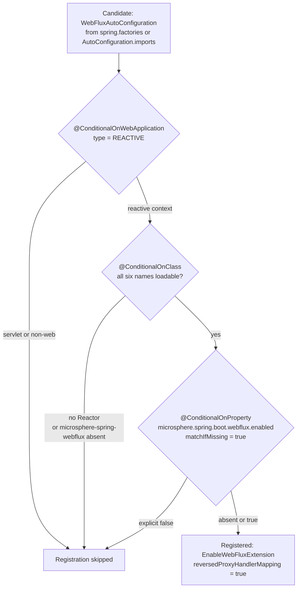

# WebFlux 模块 — `release-1.x`

> [English](../webflux.md) · 文档索引：[中文](../../zh/README.md) ·
> `release` 分支的同名文档：[中文](../../current/zh/webflux.md)

> **分支：** `release-1.x` · **版本线：** `0.1.x` · **Artifact：** `microsphere-spring-boot-webflux`
> **Spring Boot：** `2.1.18.RELEASE` – `2.7.18` · **Java 源码级别：** 8

目录：
[1 范围与对照](#1-范围与对照) ·
[2 除两处之外完全相同](#2-除两处之外完全相同) ·
[3 响应式可用性条件](#3-响应式可用性条件) ·
[4 单名称 AutoConfigureAfter 顺序](#4-单名称-autoconfigureafter-顺序) ·
[5 双注册文件](#5-双注册文件) ·
[6 属性命名空间与开关](#6-属性命名空间与开关) ·
[7 测试](#7-测试) ·
[8 移植配方](#8-移植配方) ·
[9 本线的设计模式](#9-本线的设计模式) ·
[10 参考](#10-参考)

---

## 1. 范围与对照

本文是 [../../current/zh/webflux.md](../../current/zh/webflux.md) 的差异伴随文档，模块定位、包结构、与
`microsphere-spring-webflux` 的上游边界以及属性表都在那份文档里。以下内容全部读自 `release-1.x` 源码树，并用
`diff -ru microsphere-spring-boot-webflux` 与 `release` 核对。

| 区域 | 数量 | 文件 |
|---|---|---|
| `src/main/java` | 3 | `autoconfigure/WebFluxAutoConfiguration.java`、`autoconfigure/condition/ConditionalOnWebFluxAvailable.java`、`constants/PropertyConstants.java` |
| `src/main/resources` | 2 | `META-INF/spring.factories`、`META-INF/spring/org.springframework.boot.autoconfigure.AutoConfiguration.imports` |
| `src/test/java` | 4 | `autoconfigure/AbstractWebFluxAutoConfigurationTest`、`autoconfigure/WebFluxAutoConfigurationTest`、`autoconfigure/WebFluxAutoConfigurationAllDisabledTest`、`autoconfigure/WebFluxAutoConfigurationAllEnabledTest` |

## 2. 除两处之外完全相同

两条线之间整个模块的 diff 只产生两处结论——就是下面标注出来的两行——因此 §3–§7 的简短是设计使然而非凑字数。

| 产物 | 相对 `release` 的状态 |
|---|---|
| `pom.xml` | 逐字节相同——同样的 optional `spring-boot-starter-webflux`、同样的 `core` compile 依赖、同样的测试依赖块（`pom.xml:76`–`:82`） |
| `autoconfigure/condition/ConditionalOnWebFluxAvailable.java` | 逐字节相同，六个类名全部一致（§3） |
| `constants/PropertyConstants.java` | 逐字节相同 |
| 四个测试源文件与 `META-INF/spring/…AutoConfiguration.imports` | 逐字节相同 |
| `autoconfigure/WebFluxAutoConfiguration.java` | 仅两处不同：Javadoc 的 `@see` 列表与 `@AutoConfigureAfter` 名称列表（§4） |
| `META-INF/spring.factories` | **只存在于本分支**；`release` 没有该文件（§5） |

因此，本模块的行为、条件、属性或测试的改动永远不需要在两条线之间对齐：有差异的只有顺序元数据与注册机制。

## 3. 响应式可用性条件

`ConditionalOnWebFluxAvailable.java:45`–`:54`，两条线逐字节相同，下面完整引用，因为它无需移植：

```java
@ConditionalOnWebApplication(type = REACTIVE)
@ConditionalOnClass(name = {
        "reactor.core.publisher.Flux",                                         // Reactor API
        "org.springframework.context.ApplicationContext",                      // Spring Context API
        "org.springframework.web.method.HandlerMethod",                        // Spring Web API
        "org.springframework.web.reactive.DispatcherHandler",                  // Spring WebFlux API
        "io.microsphere.spring.web.method.support.HandlerMethodInterceptor",   // Microsphere Spring Web API
        "io.microsphere.spring.webflux.annotation.EnableWebFluxExtension"      // Microsphere Spring WebFlux API
})
@ConditionalOnProperty(name = MICROSPHERE_SPRING_BOOT_WEBFLUX_ENALBED_PROPERTY_NAME, matchIfMissing = true)
```

为什么这个注解能原样跨过分支分裂、而它的 servlet 孪生体不行：六个名称没有一个落在 Boot 重定位过的命名空间里——
Reactor、Spring Context、Spring Web 与 Spring WebFlux 的类型，再加上两个 Microsphere 类型，从 Boot `2.0` 一直到当前
`release` 线都保持 FQCN 不变，所以一种拼写在两条线上都正确；而 `webmvc` 必须分叉，因为 Servlet API 自身搬迁了。



求值规则与 `webmvc` 相同：按声明顺序求合取，第一个不匹配项就是条件报告打印的内容，因此缺少上游
`microsphere-spring-webflux` 包的应用会停在第二个菱形，而不是启动失败。

## 4. 单名称 AutoConfigureAfter 顺序

`WebFluxAutoConfiguration.java:31`–`:37`，完整的类体：

```java
@ConditionalOnWebFluxAvailable
@AutoConfigureAfter(name = {
        "org.springframework.boot.autoconfigure.web.reactive.WebFluxAutoConfiguration"  // Spring Boot API
})
@EnableWebFluxExtension(reversedProxyHandlerMapping = true)
public class WebFluxAutoConfiguration {
}
```

相对 `release` 的完整 diff——两处删除加一处注释改写，文件中再无其他改动：

```diff
- * @see org.springframework.boot.webflux.autoconfigure.WebFluxAutoConfiguration
 @AutoConfigureAfter(name = {
-        "org.springframework.boot.autoconfigure.web.reactive.WebFluxAutoConfiguration", // Spring Boot API [2.0, 4.0)
-        "org.springframework.boot.webflux.autoconfigure.WebFluxAutoConfiguration"       // Spring Boot APP [4.0,)
+        "org.springframework.boot.autoconfigure.web.reactive.WebFluxAutoConfiguration"  // Spring Boot API
 })
```

与 `webmvc` 不同，这不是纯删除：`release` 上 Boot 2 名称带着区间注释 `// Spring Boot API [2.0, 4.0)`（Boot 4 那行写的是
`// Spring Boot APP [4.0,)`，是那个分支源码里的拼写错误），而本线给同一个名称只留下光秃秃的 `// Spring Boot API`——注释
文本也是移植的一部分。其余全部相同，包括唯一的 `@EnableWebFluxExtension(reversedProxyHandlerMapping = true)` 属性与
不存在任何 `@Bean` 方法这一点。Boot 在 `2.1`–`2.7` 区间保持该 FQCN 不变
（`microsphere-spring-boot-parent/pom.xml:68`–`:120`），classpath 上不存在的按名称条目会被忽略而不是报错，且
`compatible` 不提供响应式垫片，所以按名称排序依旧是唯一的跨版本机制。

## 5. 双注册文件

与 `webmvc` 一样，这是唯一的结构性差异，而且属于资源差异。两个文件都只列出一个类——
`microsphere-spring-boot-webflux/src/main/resources/META-INF/spring.factories`：

```properties
org.springframework.boot.autoconfigure.EnableAutoConfiguration=\
io.microsphere.spring.boot.webflux.autoconfigure.WebFluxAutoConfiguration
```

以及 `microsphere-spring-boot-webflux/src/main/resources/META-INF/spring/org.springframework.boot.autoconfigure.AutoConfiguration.imports`：

```text
io.microsphere.spring.boot.webflux.autoconfigure.WebFluxAutoConfiguration
```

| Boot 版本 | 读取 `spring.factories` | 读取 `AutoConfiguration.imports` | 实际结果 |
|---|---|---|---|
| `2.1` – `2.6` | 是 | 该机制尚不存在 | 类只由 `spring.factories` 提供 |
| `2.7` | 是 | 是 | 两个文件都被读取，重复项被去重，只注册一次 |

`release-notes.md:211` 在 `0.1.20`（即新增本模块的那次发布）记录下 "Registered WebFlux auto-configuration using
`spring.factories`"；`.imports` 是后来并列添加的，而非替换。失败模式与 `webmvc` 一致：漏掉 `spring.factories`，模块在
`2.1`–`2.6` 上完全隐形——没有条件报告条目、没有报错、默认的 `2.7` 构建仍然全绿；漏掉 `.imports`，眼下无事，直到本线
扩展到某个移除 legacy 键的 Boot 版本时才失效。

## 6. 属性命名空间与开关

无差异：`PropertyConstants.java` 逐字节相同。该接口只声明一个开关——第 `36` 行的前缀
`microsphere.spring.boot.webflux.`、第 `41` 行的默认值 `"true"`、第 `51` 行的键
`MICROSPHERE_SPRING_BOOT_WEBFLUX_ENALBED_PROPERTY_NAME` 及其 `:46`–`:50` 的 `@ConfigurationProperty` 块。与 `webmvc`
不同，这里没有子命名空间、没有 filter 或 logging 开关、也没有 opt-in 键，因为这个类不注册任何 Bean，所以
`microsphere.spring.boot.webflux.enabled` 是唯一的旋钮，关掉它同时也就撤掉了 `@EnableWebFluxExtension` 的导入；本模块
在两条线上都没有 `PropertyConstantsTest`。

## 7. 测试

四个测试源文件全部与 `release` 逐字节相同；那份文档逐项讲解，本表只记录它们钉住了什么。

| 测试 | 钉住的内容 |
|---|---|
| `AbstractWebFluxAutoConfigurationTest` | 夹具，`@Disabled`（`:51`）、`@WebAppConfiguration`（`:52`）、`@SpringJUnitConfig` 同时带 `TestController` **和** `RouterFunctionTestConfig`（`:53`–`:56`）；绑定 `WebTestClient`（`:67`–`:70`），跑六个端点检查（`:94`，含 `:175` 的 `testUpdatePerson()`），随后断言抽象方法 `getRegisteredComponentClasses()`（`:82`）返回的每个类都存在（`:72`–`:80`）。 |
| `WebFluxAutoConfigurationTest` | 默认值：无 `@TestPropertySource`；期望 `HandlerMappingWebEndpointMappingResolver`、`InterceptingHandlerMethodProcessor`、`RequestHandledEventPublishingWebFilter`、`ReversedProxyHandlerMapping`（`:46`–`:51`）。 |
| `WebFluxAutoConfigurationAllDisabledTest` | 关闭场景：`microsphere.spring.boot.webflux.enabled=false`（`:39`–`:43`）配合空期望集（`:48`–`:50`）——本模块唯一的总开关证明。 |
| `WebFluxAutoConfigurationAllEnabledTest` | 开启场景：显式设置 `@EnableWebFluxExtension` 相关键（`:45`–`:50`）并扩大期望集。 |

注意与 `webmvc` 的不对称：响应式夹具保留了 servlet 夹具丢掉的函数式端点协作者，所以 `RouterFunction` 覆盖存在于这里
而不在 `webmvc`（见 [./webmvc.md](./webmvc.md) §7），也因此本模块的断言不需要为 Java 8 改写。

## 8. 移植配方

**两条线之间。** 三处改动，且每个方向都是另一个方向的逆操作：（1）增加或删除
`org.springframework.boot.webflux.autoconfigure.WebFluxAutoConfiguration` 条目及其 `@see` 行；（2）恢复或删除保留的
Boot 2 名称上的 `[2.0, 4.0)` / `APP` 注释文本（§4）；（3）让 `spring.factories` 与 `.imports` 保持列出同样的类——本线
**两个**文件都要更新。条件、属性或测试的改动从来不是这里的移植负担，模块里也没有任何 Java 9+ 构造。

**在本线上验证。** 源码级别 8；CI 用 JDK `8`、`11`、`17`、`21`、`25`
（`.github/workflows/maven-build.yml:25`）跑全部七个 profile（`:26`–`:28`）——由于条件与命名空间无关，真正值得关注的
维度是 Boot 版本而不是 JDK：

```bash
# oldest Boot target: spring.factories is the only mechanism that works
JAVA_HOME=/path/to/jdk8 ./mvnw -pl microsphere-spring-boot-webflux -am -Pspring-boot-2.1 test
# the activeByDefault profile, where both files are read and de-duplicated
JAVA_HOME=/path/to/jdk11 ./mvnw -pl microsphere-spring-boot-webflux -am -Pspring-boot-2.7 test
# one matrix cell, exactly as CI runs it
mvn --batch-mode --update-snapshots --file pom.xml -Drevision=0.0.1-SNAPSHOT \
    -Dsurefire.useSystemClassLoader=false test --activate-profiles test,coverage,spring-boot-2.1
```

`-am` 是必需的：`core` 是 compile 依赖，测试模块是 test 依赖（`pom.xml:31`–`:35`、`:76`–`:82`）。本线不存在的
profile，例如 `-Pspring-boot-3.0`，只会警告然后按默认的 `2.7` 构建。

## 9. 本线的设计模式

| 模式 | 位置 | 本线的解读 |
|---|---|---|
| 与命名空间无关的条件 | `ConditionalOnWebFluxAvailable.java:46`–`:53` | 所列类型没有在 Boot 代际之间搬迁过，因此一份注解体服务两条线——它正好反衬出 `webmvc` 为什么必须做 `javax`/`jakarta` 分叉。 |
| 以冗余注册换取兼容性 | 两个资源文件（§5） | 与 `webmvc` 同样的取舍：用两份文件替代按 profile 过滤资源，因为 Boot `2.7` 会去重所以安全。 |
| 单名称排序 + 漂移的注释文本 | `WebFluxAutoConfiguration.java:32`–`:34` | 此处注释不带区间，与 `release` 孪生体不同；移植时要把注释文本当作代码对待。 |

## 10. 参考

| 文档 | 范围 |
|---|---|
| [README.md](./README.md) | 本分支开发者文档索引：reactor 结构、双注册、跨分支源码差异表。 |
| [webmvc.md](./webmvc.md) | Servlet 兄弟模块——`javax`/`jakarta` 分叉与更丰富的属性命名空间在那里。 |
| [core.md](./core.md) | 本模块的 compile 依赖。 |
| [../../current/zh/webflux.md](../../current/zh/webflux.md) | `release` 线上本模块的非差异版完整说明。 |
| [../../user-guide/1.x/zh/webflux.md](../../../user-guide/1.x/zh/webflux.md) | 本线最终用户配置什么。 |
