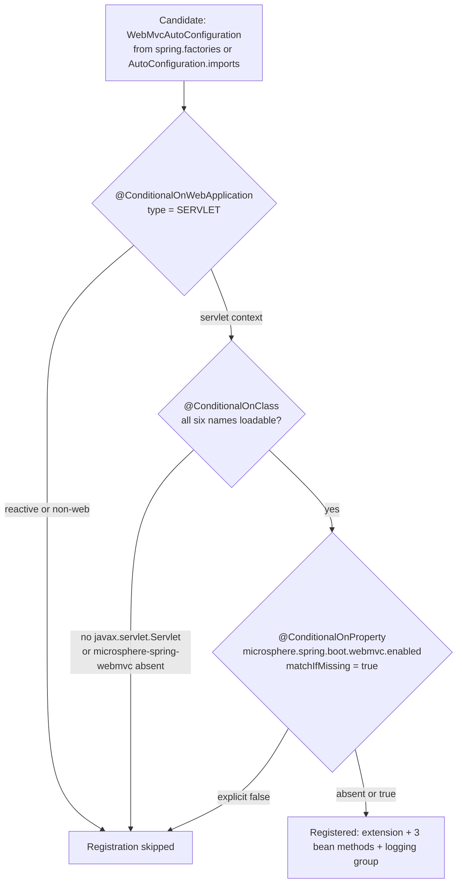

# WebMvc 模块 — `release-1.x`

> [English](../webmvc.md) · 文档索引：[中文](../../zh/README.md) ·
> `release` 分支的同名文档：[中文](../../current/zh/webmvc.md)

> **分支：** `release-1.x` · **版本线：** `0.1.x` · **Artifact：** `microsphere-spring-boot-webmvc`
> **Spring Boot：** `2.1.18.RELEASE` – `2.7.18` · **Java 源码级别：** 8

目录：
[1 范围与对照](#1-范围与对照) ·
[2 完全相同的部分](#2-完全相同的部分) ·
[3 javax.servlet 可用性条件](#3-javaxservlet-可用性条件) ·
[4 单名称 AutoConfigureAfter 顺序](#4-单名称-autoconfigureafter-顺序) ·
[5 双注册文件](#5-双注册文件) ·
[6 属性命名空间与开关](#6-属性命名空间与开关) ·
[7 测试](#7-测试) ·
[8 移植配方](#8-移植配方) ·
[9 本线的设计模式](#9-本线的设计模式) ·
[10 参考](#10-参考)

---

## 1. 范围与对照

本文是一份**差异文档**：模块定位、包结构、与 `microsphere-spring-webmvc` 的上游边界、逐 Bean 解析以及完整属性表
都在 [../../current/zh/webmvc.md](../../current/zh/webmvc.md) 中说明，此处不再重复。以下内容全部读自 `release-1.x`
源码树，并用 `diff -ru microsphere-spring-boot-webmvc` 与 `release` 逐文件核对。

| 区域 | 数量 | 文件 |
|---|---|---|
| `src/main/java` | 3 | `autoconfigure/WebMvcAutoConfiguration.java`、`autoconfigure/condition/ConditionalOnWebMvcAvailable.java`、`constants/PropertyConstants.java` |
| `src/main/resources` | 2 | `META-INF/spring.factories`、`META-INF/spring/org.springframework.boot.autoconfigure.AutoConfiguration.imports` |
| `src/test/java` | 5 | `autoconfigure/AbstractWebMvcAutoConfigurationTest`、`autoconfigure/WebMvcAutoConfigurationTest`、`autoconfigure/WebMvcAutoConfigurationAllDisabledTest`、`autoconfigure/WebMvcAutoConfigurationAllEnabledTest`、`constants/PropertyConstantsTest` |

## 2. 完全相同的部分

与 `release` 逐字节相同、无需移植的有：`constants/PropertyConstants.java`、`pom.xml`（依赖与 optional 设置相同，
测试依赖块同样位于 `pom.xml:77`–`:83`）、`WebMvcAutoConfigurationTest.java`、`WebMvcAutoConfigurationAllDisabledTest.java`、
`PropertyConstantsTest.java` 以及 `AutoConfiguration.imports`。内容层面同样相同的还有：两个
`@EnableWebMvcExtension` 属性、引入日志块的 `@Import`、四个带条件的 Bean、嵌套的 `LoggingConfiguration`、六个
`@ConditionalOnClass` 名称中的五个、`type = SERVLET` 守卫以及 `matchIfMissing = true` 的总开关。由于
`AllDisabled` 夹具逐字节相同，`release` 文档记录的缺陷在此原样成立：它的两行属性与条件实际读取的键不匹配，且其
可选注入从未被断言。

`WebMvcAutoConfiguration.java` 在本线是 84 行，`release` 是 86 行，因此从第 `44` 行起的行号引用相差两行；Java 8
源码级别在 `src/main/java` 中**没有**造成任何差异（只有 §3 与 §4 的两处字符串字面量），但在测试里造成了一处（§7）。

## 3. javax.servlet 可用性条件

`ConditionalOnWebMvcAvailable.java:42`–`:54`，本线完整引用：

```java
@Target({TYPE, METHOD})
@Retention(RUNTIME)
@Documented
@ConditionalOnWebApplication(type = SERVLET)
@ConditionalOnClass(name = {
        "javax.servlet.Servlet",                                               // Servlet API
        "org.springframework.context.ApplicationContext",                      // Spring Context API
        "org.springframework.web.method.HandlerMethod",                        // Spring Web API
        "org.springframework.web.servlet.DispatcherServlet",                   // Spring Web MVC API
        "io.microsphere.spring.web.method.support.HandlerMethodInterceptor",   // Microsphere Spring Web API
        "io.microsphere.spring.webmvc.annotation.EnableWebMvcExtension"        // Microsphere Spring Web MVC API
})
@ConditionalOnProperty(name = MICROSPHERE_SPRING_BOOT_WEBMVC_ENALBED_PROPERTY_NAME, matchIfMissing = true)
```

该文件与 `release` 的全部差异就是第一个类名：

```diff
-        "jakarta.servlet.Servlet",                                             // Servlet API
+        "javax.servlet.Servlet",                                               // Servlet API
```

Spring Boot `3.0` 正好落在 Servlet 包名重命名之上，所以这个注解不是兼容层，而是一份**命名空间声明**：本线写
`javax`，`release` 写 `jakarta`，任何一种写法在另一条线上都永远不会匹配。



Boot 按声明顺序把三个元注解当作合取式求值，遇到第一个不匹配即停止，被停止的那一项就是条件评估报告打印的内容。
WebFlux 应用停在第一个菱形，因此两个 web 模块可以共存；Boot `3`/`4` 应用停在第二个菱形，*静默地向安全方向失败*，
这是本模块唯一拥有的跨代守卫。

## 4. 单名称 AutoConfigureAfter 顺序

`WebMvcAutoConfiguration.java:45`–`:48`：

```java
@ConditionalOnWebMvcAvailable
@AutoConfigureAfter(name = {
        "org.springframework.boot.autoconfigure.web.servlet.WebMvcAutoConfiguration", // Spring Boot API [2.0, 4.0)
})
```

与 `release` 的完整差异只是删掉了两处 Boot `4.0` 引用——恰好下面这两行，文件其余部分毫无变化：

```diff
- * @see org.springframework.boot.webmvc.autoconfigure.WebMvcAutoConfiguration
-        "org.springframework.boot.webmvc.autoconfigure.WebMvcAutoConfiguration"       // Spring Boot API [4.0,)
```

`:49`–`:52` 的属性、`:53`–`:55` 的 `@Import` 以及 `:58`–`:83` 的 Bean 均未改动。单名称意味着：

* Boot 在整个 profile 区间内保持该 FQCN 不变（`spring-boot-2.1` = `2.1.18.RELEASE` … `spring-boot-2.7` = `2.7.18`，见 `microsphere-spring-boot-parent/pom.xml:68`–`:120`），所以一个名称不会产生歧义；保留的注释 `[2.0, 4.0)` 描述了一个本线永远达不到的上界，逐字保留它正是移植时只需纯删除的原因。
* 缺失的顺序名称不会抛异常：`@AutoConfigureAfter` 只排定处理顺序，因此在顺序输入为空时 Boot 可能先注册本扩展、后创建 `RequestMappingHandlerMapping` 与 `ContentNegotiationManager` 的定义——这是只能从行为上看出来的 Bean 覆盖风险，故有 §8 的两端验证。
* `compatible` 在本线不提供任何 Web MVC 垫片，所以按名称排序就是本模块唯一的跨版本机制。

## 5. 双注册文件

两条线之间最大的结构性差异，而且它属于资源文件差异而非代码差异。两个文件都只声明一个类——
`microsphere-spring-boot-webmvc/src/main/resources/META-INF/spring.factories`：

```properties
org.springframework.boot.autoconfigure.EnableAutoConfiguration=\
io.microsphere.spring.boot.webmvc.autoconfigure.WebMvcAutoConfiguration
```

以及 `microsphere-spring-boot-webmvc/src/main/resources/META-INF/spring/org.springframework.boot.autoconfigure.AutoConfiguration.imports`：

```text
io.microsphere.spring.boot.webmvc.autoconfigure.WebMvcAutoConfiguration
```

| Boot 版本 | 读取 `spring.factories` | 读取 `AutoConfiguration.imports` | 实际结果 |
|---|---|---|---|
| `2.1` – `2.6` | 是 | 该机制尚不存在 | 类只由 `spring.factories` 提供 |
| `2.7` | 是 | 是 | 两个文件都被读取，重复项被去重，因此只注册一次 |

`spring.factories` 是 properties 文件，使用 `\` 续行且行尾为 CRLF；`.imports` 是朴素的每行一个类名列表。
`release-notes.md:235` 把 `spring.factories` 条目记为 `0.1.20` 引入：旧文件先于新机制存在，被保留而不是替换。
本线四个提供自动配置的模块都同时携带两个文件。

* **漏掉 `spring.factories`** —— 在 `2.1`–`2.6` 上该类根本不是候选者：没有条件评估、报告里没有条目、`microsphere.spring.boot.webmvc.enabled=true` 不起作用，而默认的 `2.7` 构建仍然全绿，所以只有跑 §8 的 `2.1` 命令才暴露问题。
* **漏掉 `.imports`** —— 眼下无害，一旦本线扩展到某个已移除 legacy 键的 Boot 版本就会致命。**只用一个文件以避免重复** —— 已被否决：去重使冗余零成本，而按 profile 过滤资源会给每次改动增加一个构建维度。

## 6. 属性命名空间与开关

键本身没有差异：`PropertyConstants.java` 逐字节相同，因此总开关 `microsphere.spring.boot.webmvc.enabled`、
`…webmvc.filter.enabled`、`…webmvc.logging.enabled` 以及非 boot 命名空间的
`microsphere.spring.webmvc.content-negotiation.enabled` 的行为与 `release` 文档中的表格完全一致，为 `0.2.x` 写的
属性文件同样能配置 `0.1.x`。差异在于键背后的东西：`microsphere-spring-webmvc` 通过
`${microsphere-spring.version}` = `0.1.39` 解析（`microsphere-spring-boot-parent/pom.xml:22`），所以上游 `0.2.x`
修好的行为在本线**并未**修好；`EXCLUSIVE_VIEW_RESOLVER_BEAN_NAME_PROPERTY_NAME` 仍从上游导入
（`WebMvcAutoConfiguration.java:36`，用于 `:70`）且没有 `matchIfMissing`，因此它仍是唯一的 opt-in Bean。

## 7. 测试

五个测试里有三个逐字节相同：`PropertyConstantsTest`（每个键字面量）、`WebMvcAutoConfigurationAllDisabledTest`
（仅关闭内容协商）与 `WebMvcAutoConfigurationTest`——默认值证明，四个必需注入（`:46`–`:56`）、监听器以
`required = false` 注入（`:58`–`:59`）、`:61`–`:69` 的 `assertNotNull` × 4 与 `assertNull(listener)`。有两个不同。

**`AbstractWebMvcAutoConfigurationTest`** 去掉了函数式端点协作者：

```diff
-import io.microsphere.spring.test.webmvc.RouterFunctionTestConfig;
-import jakarta.servlet.ServletException;
+import javax.servlet.ServletException;
 @SpringJUnitConfig(classes = {
-        TestController.class,           // Test Controller
-        RouterFunctionTestConfig.class  // Test RouterFunction
+        TestController.class           // Test Controller
 })
```

随之而去的是 `testUpdatePerson()`、它在 `testWebEndpoints()` 中的调用以及对应的 `@see` 条目，于是端点检查从六个
变成五个（`:79`–`:85`）。导入部分的 hunk 是 §3 在测试里的镜像：`testError()`（`:134`–`:137`）断言的是
`javax.servlet.ServletException`。这**并不**意味着"本线不测函数式端点"——同一分支上的
`AbstractWebFluxAutoConfigurationTest` 仍然注册 `RouterFunctionTestConfig`（`:53`–`:56`）并运行
`testUpdatePerson()`（`:175`）。

**`WebMvcAutoConfigurationAllEnabledTest`** 强化了 `assertContentNegotiationManager`，并按 Java 8 重写：导入 hunk
是 `assertFalse` → `assertTrue`，1.x 方法体如下（省略空行与未使用的 `strategy1`）

```java
        List<ContentNegotiationStrategy> strategies = contentNegotiationManager.getStrategies();
        assertEquals(2, strategies.size());
        ContentNegotiationStrategy strategy2 = strategies.get(1);
        assertTrue(strategy2 instanceof ParameterContentNegotiationStrategy);
        ParameterContentNegotiationStrategy parameterContentNegotiationStrategy = (ParameterContentNegotiationStrategy) strategy2;
        assertEquals("p", parameterContentNegotiationStrategy.getParameterName());
```

这里钉住两个事实，必须作为一个整体移植。（1）在设置了 `AllEnabled` 属性（`:51`–`:64`，`favorParameter=true` 且
`parameterName=p`）时，本线期望**恰好两个**策略，且 `ParameterContentNegotiationStrategy` 位于下标 `1`；而
`release` 只要求列表非空并遍历寻找该策略——位置敏感是 Boot-2 的假设，不是设计规则。（2）`assertTrue(x instanceof Y)`
加显式强转是模式匹配的 Java 8 写法，整个 reactor 的源码级别都用不了后者。六个必需注入（`:68`–`:84`）未变，缺少
Bean 仍会导致上下文创建失败。

## 8. 移植配方

**从 `release` 向下到 `release-1.x`。**（1）删除 Boot `4.0` 的顺序名称及其 `@see` 行，保留列表语法。（2）把
`jakarta.servlet.*` 全部替换为 `javax.servlet.*`，条件与导入都要改，生产与测试代码都要改。（3）新增自动配置类时
**两个**资源文件都要改（§5）。（4）重写 Java 9+ 结构：模式匹配 → `instanceof` + 强转，文本块 → 字符串拼接，
`switch` 表达式 → 带 `break` 的传统 `switch`。（5）复查那些按下标或遍历 Spring/Boot 集合的测试（§7）。

**从 `release-1.x` 向上到 `release`。**（1）恢复 Boot `4.0` 的 FQCN 与 `@see` 行。（2）把 `javax.servlet` 换回
`jakarta.servlet`。（3）忽略 `spring.factories`——`release` 不提供它，改动只需体现在 `.imports` 中。（4）落地前先
放宽 Boot-2 假设：`assertEquals(2, …)` 与按下标的 `get(1)`。

**验证。** 源码级别为 8；CI 用 JDK `8`、`11`、`17`、`21`、`25`（`.github/workflows/maven-build.yml:25`）跑全部
七个 profile（`:26`–`:28`）。本地请固定 JDK 8 或 11：

```bash
# oldest Boot target here — the only place spring.factories is read
JAVA_HOME=/path/to/jdk8 ./mvnw -pl microsphere-spring-boot-webmvc -am -Pspring-boot-2.1 test
# newest Boot target, and the activeByDefault profile
JAVA_HOME=/path/to/jdk11 ./mvnw -pl microsphere-spring-boot-webmvc -am -Pspring-boot-2.7 test
# one matrix cell, exactly as CI runs it
mvn --batch-mode --update-snapshots --file pom.xml -Drevision=0.0.1-SNAPSHOT \
    -Dsurefire.useSystemClassLoader=false test --activate-profiles test,coverage,spring-boot-2.1
```

`-am` 是必需的：本模块以 compile 作用域依赖 `core`（`pom.xml:31`–`:35`），以 test 作用域依赖测试模块
（`:78`–`:83`）。本线不存在的 profile，例如 `-Pspring-boot-3.5`，只会给出警告然后按默认的 `2.7` 构建。

## 9. 本线的设计模式

| 模式 | 位置 | 本线的解读 |
|---|---|---|
| 声明命名空间的条件注解 | `ConditionalOnWebMvcAvailable.java:46`–`:53` | 按名称写出的 `@ConditionalOnClass` 列表就是整个模块声明 Servlet 命名空间的地方；`src/main/java` 其余代码不使用任一种拼写。 |
| 以冗余注册换取兼容性 | 两个资源文件（§5） | 一个类两份文件，因为 Boot `2.7` 会去重，所以优于按 profile 过滤资源；`release` 在 legacy 键退出区间后收敛为单文件。 |
| 单条目的按名称排序 | `WebMvcAutoConfiguration.java:46`–`:48` | 即使只有一个元素也保留数组写法，因此两条线之间的移植永远是增删一行，而不是改语法。 |
| Java 8 断言写法 | `WebMvcAutoConfigurationAllEnabledTest.java:100`–`:109` | 先 `assertTrue(x instanceof Y)` 再显式强转——把 `release` 使用模式匹配的测试移植下来时照此改写。 |

## 10. 参考

| 文档 | 范围 |
|---|---|
| [README.md](./README.md) | 本分支开发者文档索引：reactor 结构、双注册、跨分支源码差异表。 |
| [webflux.md](./webflux.md) | 响应式兄弟模块——在其余部分完全不变的模块里只有这两类差异。 |
| [core.md](./core.md) | 本模块的 compile 依赖，以及本线 Boot-2 反射规避手段的所在地。 |
| [../../current/zh/webmvc.md](../../current/zh/webmvc.md) | 非差异版完整说明：包结构、Bean 清单、上游边界、属性表、测试语义。 |
| [../../user-guide/1.x/zh/webmvc.md](../../../user-guide/1.x/zh/webmvc.md) | 本线最终用户配置什么。 |
