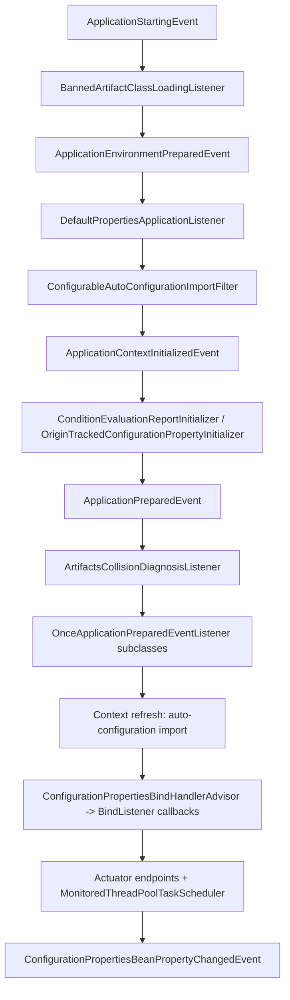
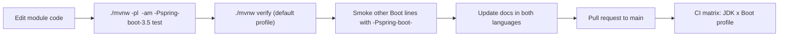

# Developer Guide

> [中文](./zh/README.md) · [Documentation home](../README.md) · [User Guide](../user-guide/README.md)

Implementation documentation for `microsphere-spring-boot`: how the code in each Maven module is organised, which
Spring Boot extension points it hooks, what design patterns it uses, how the multi-version build and release pipeline
works, and the concrete steps to change any of it safely.

If you are consuming the libraries, read the [User Guide](../user-guide/README.md) instead.

---

## 1. What this set covers

| Topic | Where |
|---|---|
| Repository shape, extension-point inventory, startup sequence, contribution checklist | [`current/README.md`](./current/README.md) · [中文](./current/zh/README.md) |
| Per-module internals: package map, class-by-class notes, patterns, flows, tests, recipes | `current/<module>.md` and `1.x/<module>.md` |
| Maven build mechanics: `${revision}` flattening, profile-driven Boot selection, publishing | [`current/parent.md`](./current/parent.md), [`current/dependencies.md`](./current/dependencies.md) |
| CI matrix, release pipeline, branch model, cutting a release | [`current/build-and-release.md`](./current/build-and-release.md) |
| What is different on the Spring Boot 2 line | [`1.x/README.md`](./1.x/README.md) and its module documents |

---

## 2. Architecture at a glance

The libraries add nothing to Spring Boot's own lifecycle; they attach to extension points Boot already calls. The
`release` (0.2.x) branch hooks the following:

| Extension point | Module | Implementing class |
|---|---|---|
| `AutoConfigurationImportFilter` | `core` | `ConfigurableAutoConfigurationImportFilter` |
| `SpringApplicationRunListener` | `core` | `BannedArtifactClassLoadingListener`, `FailureReportSpringApplicationRunListener` |
| `ApplicationListener` | `core` | `DefaultPropertiesApplicationListener`, `ArtifactsCollisionDiagnosisListener`, `ConditionEvaluationReportListener` |
| `ApplicationContextInitializer` | `core` | `ConditionEvaluationReportInitializer`, `OriginTrackedConfigurationPropertyInitializer` |
| `FailureAnalyzer` / `SpringBootExceptionReporter` | `core` | `ArtifactsCollisionFailureAnalyzer`, `ConditionEvaluationSpringBootExceptionReporter` |
| `ConfigurationPropertiesBindHandlerAdvisor` | `core` | `ListenableConfigurationPropertiesBindHandlerAdvisor` |
| `EnableAutoConfiguration` registration | `core`, `actuator`, `webmvc`, `webflux` | their `*AutoConfiguration` classes |
| `@Endpoint` / `@WebEndpoint` | `actuator` | `ArtifactsEndpoint`, `WebEndpoints`, `ConfigurationMetadataEndpoint`, `ConfigurationPropertiesEndpoint` |

---

## 3. Document inventory

One file per Maven module in each branch directory, plus a branch overview (and, on `current`, a build-and-release
document). English at the primary path, Chinese mirrored in `zh/`.

| Document | Covers |
|---|---|
| [`README.md`](./current/README.md) | Repository shape, module dependency graph, wiring table, startup sequence, contribution checklist |
| [`core.md`](./current/core.md) | Package map, listener ordering and `spring.factories` wiring, binding advisor chain, diagnostics pipeline, patterns |
| [`actuator.md`](./current/actuator.md) | Endpoint model, the aggregator operation, scheduler metrics wiring, `endpoints.properties` defaults |
| [`webmvc.md`](./current/webmvc.md) | Servlet-stack beans, conditional annotations, filter/interceptor chain, upstream boundary |
| [`webflux.md`](./current/webflux.md) | Reactive-stack auto-configuration and its condition |
| [`test.md`](./current/test.md) | Test base-class hierarchy, generic runner bounds, inherited assertions |
| [`compatible.md`](./current/compatible.md) | Same-FQCN shims, why they are unpublished, profile-driven attachment |
| [`parent.md`](./current/parent.md) | Inheritance chain, `${revision}`, Boot profile table |
| [`dependencies.md`](./current/dependencies.md) | BOM contents and what a new module needs |
| [`build-and-release.md`](./current/build-and-release.md) | Local build, CI anatomy, release pipeline, branch model |

The same set exists for the Spring Boot 2 line under [`1.x/`](./1.x/README.md), where the interesting differences are
the dual `spring.factories` + `AutoConfiguration.imports` registration, the `javax.servlet` namespace, the Java 8
baseline, and a much larger `compatible` shim set attached by Boot `2.1`–`2.3`.

---

## 4. Build and change workflow

Release cuts are made from `release` (`0.2.x`) and `release-1.x` (`0.1.x`) through the publish workflow; see
[`current/build-and-release.md`](./current/build-and-release.md).

---

## 5. Conventions used here

| Convention | Detail |
|---|---|
| Language | English at the primary path, Chinese mirrored in `zh/` with identical filenames and identical section numbering |
| Evidence | Class names, signatures, ordering constants, property keys and version literals are read from the branch sources; file paths are cited next to the claim |
| Diagrams | Mermaid `flowchart`, `sequenceDiagram`, `classDiagram` for non-obvious flows; every diagram is grounded in classes that exist on that branch |
| Branch scope | Only `release` and `release-1.x` are documented; `main`, `dev`, `dev-1.x` are working branches |
| Cross-links | Same-file anchors only; cross-file links never carry `#fragments` |
