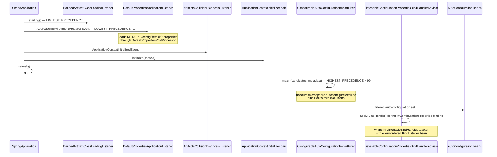

# Developer Guide — `release` branch (0.2.x)

> [中文](./zh/README.md) · [Developer Guide home](../README.md) ·
> [User Guide for this branch](../../user-guide/current/README.md)

> **Branch:** `release` · **Version line:** `0.2.x` · **Artifacts:** `microsphere-spring-boot-*`
> **Spring Boot:** `3.0.13` – `4.1.1` (profile-selected, default `3.5.16`) · **Java:** 17

Contents:
[1 What This Branch Ships](#1-what-this-branch-ships) ·
[2 Repository Shape](#2-repository-shape) ·
[3 Module Dependency Graph](#3-module-dependency-graph) ·
[4 Extension-Point Inventory](#4-extension-point-inventory) ·
[5 Startup Sequence and Ordering](#5-startup-sequence-and-ordering) ·
[6 The Binding Instrumentation Path](#6-the-binding-instrumentation-path) ·
[7 Module Documents](#7-module-documents) ·
[8 How to Read This Set](#8-how-to-read-this-set) ·
[9 Contribution Checklist](#9-contribution-checklist) ·
[10 Documentation Conventions](#10-documentation-conventions)

---

## 1. What This Branch Ships

`release` maintains the `0.2.x` line: the same source tree compiled and published against Spring Boot
`3.0` through `4.1`. Five artifacts reach Maven Central, one does not.

| Module | Artifact | Published | In BOM | Main sources | Tests |
|---|---|---|---|---|---|
| `microsphere-spring-boot-parent` | pom | yes | no | — | — |
| `microsphere-spring-boot-dependencies` | pom (BOM) | yes | — | — | — |
| `microsphere-spring-boot-compatible` | jar | **no** | **no** | 10 files | 0 |
| `microsphere-spring-boot-test` | jar | yes | yes | 4 | 5 |
| `microsphere-spring-boot-core` | jar | yes | yes | 47 | 48 |
| `microsphere-spring-boot-webmvc` | jar | yes | yes | 3 | 5 |
| `microsphere-spring-boot-webflux` | jar | yes | yes | 3 | 4 |
| `microsphere-spring-boot-actuator` | jar | yes | yes | 10 | 5 |

The libraries add no lifecycle of their own. Every class either implements a Spring Boot extension point or
supports one that is already registered.

---

## 2. Repository Shape

```text
microsphere-spring-boot/                      root aggregator, holds <revision> and <java.version>
├── pom.xml                                   8 <modules>, in build order
├── microsphere-spring-boot-parent/           spring-boot.version per profile, third-party BOM imports
├── microsphere-spring-boot-dependencies/     BOM: the five published artifacts
├── microsphere-spring-boot-compatible/       org.springframework.boot.* shims, build-time only
├── microsphere-spring-boot-test/             AbstractAutoConfigurationTest + three runner subclasses
├── microsphere-spring-boot-core/             listeners, initializers, filters, bind advisors, diagnostics
├── microsphere-spring-boot-webmvc/           servlet-stack auto-configuration
├── microsphere-spring-boot-webflux/          reactive-stack auto-configuration
├── microsphere-spring-boot-actuator/         endpoints, scheduler metrics, default endpoint policy
├── .github/workflows/                        maven-build, maven-publish, merge-main-to-branches,
│                                             sync-branches-from-upstream, wiki-publish
└── docs/                                     user-guide/ + developer-guide/, each split by branch and language
```

`compatible` and `test` sit before `core` in `<modules>` on purpose: `core`'s test scope depends on `test`, and
the Boot 4 profiles attach `compatible` to `core`.

---

## 3. Module Dependency Graph

Solid edges are compile dependencies; dotted edges are inheritance, test scope, or a profile-conditional
attachment.

```mermaid
graph TD
    PARENT["microsphere-spring-boot-parent"]
    BOM["microsphere-spring-boot-dependencies (BOM)"]
    COMPAT["microsphere-spring-boot-compatible<br/>(never published)"]
    TEST["microsphere-spring-boot-test"]
    CORE["microsphere-spring-boot-core"]
    MVC["microsphere-spring-boot-webmvc"]
    FLUX["microsphere-spring-boot-webflux"]
    ACT["microsphere-spring-boot-actuator"]
    APP["Application"]

    PARENT -. inheritance .-> BOM
    PARENT -. inheritance .-> COMPAT
    PARENT -. inheritance .-> TEST
    PARENT -. inheritance .-> CORE
    PARENT -. inheritance .-> MVC
    PARENT -. inheritance .-> FLUX
    PARENT -. inheritance .-> ACT

    BOM -. version management .-> CORE
    BOM -. version management .-> MVC
    BOM -. version management .-> FLUX
    BOM -. version management .-> ACT

    CORE -. test scope .-> TEST
    MVC --> CORE
    FLUX --> CORE
    ACT --> CORE
    CORE -. profiles spring-boot-4.0 and 4.1 .-> COMPAT

    ACT --> APP
    MVC --> APP
    FLUX --> APP
    CORE --> APP
    TEST -. test scope .-> APP
```

Consequences worth remembering:

* `core` is the only module every other jar module depends on, and it depends on none of them.
* `webmvc` and `webflux` are siblings, never a chain: each is gated by its own availability condition.
* `actuator` reaches Micrometer and Jolokia through its own POM, so a `core`-only application never pulls them.
* `compatible` is invisible outside profiles `spring-boot-4.0` and `spring-boot-4.1`, and unreachable from
  Maven Central.

---

## 4. Extension-Point Inventory

`core/src/main/resources/META-INF/spring.factories` is the whole wiring for the core module — there is no
`@ComponentScan` and no `spring-boot-autoconfigure` processor magic behind it:

| Key in `spring.factories` | Registered class | Fires during |
|---|---|---|
| `ApplicationContextInitializer` | `report.ConditionEvaluationReportInitializer` | context init |
| `ApplicationContextInitializer` | `env.config.OriginTrackedConfigurationPropertyInitializer` | context init |
| `SpringApplicationRunListener` | `classloading.BannedArtifactClassLoadingListener` | earliest, `starting()` |
| `SpringApplicationRunListener` | `listener.FailureReportSpringApplicationRunListener` | `failed()` |
| `ApplicationListener` | `diagnostics.ArtifactsCollisionDiagnosisListener` | `ApplicationContextInitializedEvent` |
| `ApplicationListener` | `report.ConditionEvaluationReportListener` | `ApplicationReadyEvent` |
| `ApplicationListener` | `env.DefaultPropertiesApplicationListener` | `ApplicationEnvironmentPreparedEvent` |
| `SpringBootExceptionReporter` | `report.ConditionEvaluationSpringBootExceptionReporter` | startup failure |
| `FailureAnalyzer` | `diagnostics.ArtifactsCollisionFailureAnalyzer` | startup failure |
| `AutoConfigurationImportFilter` | `autoconfigure.ConfigurableAutoConfigurationImportFilter` | auto-config import |
| `io.microsphere.spring.boot.env.DefaultPropertiesPostProcessor` | `env.SpringApplicationDefaultPropertiesPostProcessor` | project-specific key, loaded by the listener above |

Auto-configuration classes are registered through `META-INF/spring/AutoConfiguration.imports`, one file per module:

| Module | Registered auto-configuration |
|---|---|
| `core` | `io.microsphere.spring.boot.context.autoconfigure.ConfigurationPropertiesAutoConfiguration` |
| `actuator` | `io.microsphere.spring.boot.actuate.autoconfigure.ActuatorAutoConfiguration`, `...ActuatorEndpointsAutoConfiguration` |
| `webmvc` | `io.microsphere.spring.boot.webmvc.autoconfigure.WebMvcAutoConfiguration` |
| `webflux` | `io.microsphere.spring.boot.webflux.autoconfigure.WebFluxAutoConfiguration` |

`core`'s auto-configuration is the interesting one because it is conditional on a *Microsphere* class and is
ordered *before* Boot's own counterpart:

```java
@ConditionalOnClass(name = {
        "io.microsphere.spring.context.annotation.BeanCapableImportCandidate"
})
@AutoConfigureBefore(name = {
        "org.springframework.boot.autoconfigure.context.ConfigurationPropertiesAutoConfiguration"
})
@EnableConfigurationPropertiesExtension
public class ConfigurationPropertiesAutoConfiguration {
}
```

`@AutoConfigureBefore` uses the by-name form so the same source compiles across Boot lines where the target
class moved packages — the recurring cross-version technique in this repository.

`actuator` additionally ships `META-INF/services/io.microsphere.metadata.ConfigurationPropertyLoader`
(pointing at `io.microsphere.metadata.MetadataResourceConfigurationPropertyLoader`), which is how the module's
`META-INF/config/default/endpoints.properties` is discovered as a property source.

---

## 5. Startup Sequence and Ordering

The ordering values below are read from the branch sources, not inferred from convention:

| Class | Ordering | Source |
|---|---|---|
| `BannedArtifactClassLoadingListener` | `setOrder(HIGHEST_PRECEDENCE)` | `core/src/main/java/io/microsphere/spring/boot/classloading/BannedArtifactClassLoadingListener.java:79` |
| `ConfigurableAutoConfigurationImportFilter` | `HIGHEST_PRECEDENCE + 99` | `.../autoconfigure/ConfigurableAutoConfigurationImportFilter.java:276` |
| `DefaultPropertiesApplicationListener` | `DEFAULT_ORDER = LOWEST_PRECEDENCE - 1` | `.../env/DefaultPropertiesApplicationListener.java:76` |
| `DefaultPropertiesPostProcessor` (interface default) | `LOWEST_PRECEDENCE` | `.../env/DefaultPropertiesPostProcessor.java:67` |
| `OnceApplicationPreparedEventListener` (and its logging subclasses) | `LOWEST_PRECEDENCE` | `.../context/OnceApplicationPreparedEventListener.java:54`, `LoggingOnceApplicationPreparedEventListener.java:47` |
| `ArtifactsCollisionDiagnosisListener`, `ConditionEvaluationReportListener`, `ConditionEvaluationReportInitializer` | not `Ordered` — registration order applies | their class declarations |



`ConfigurableAutoConfigurationImportFilter` being `HIGHEST_PRECEDENCE + 99` is deliberate: Boot's own filter
ordering leaves room below it, so the exclusion logic runs before the standard metadata/pattern filters while
still allowing a user filter to preempt it.

---

## 6. The Binding Instrumentation Path

This is the design that distinguishes `core`: it turns Spring Boot's one-way binding operation into an
observable one, without touching Boot's code.

```mermaid
flowchart LR
    A["Binder.bind(...)"] --> B["ConfigurationPropertiesBindHandlerAdvisor.apply(BindHandler)"]
    B --> C["ListenableBindHandlerAdapter (decorator)"]
    C --> D["BindListener beans, sorted by Order"]
    D --> E["BindListener callbacks: pre / post / onSuccess / onError / onFinish"]
    E --> F["EventPublishingConfigurationPropertiesBeanPropertyChangedListener"]
    F --> G["ConfigurationPropertiesBeanPropertyChangedEvent"]
    G --> H["Application @EventListener methods"]
```



Contributing a listener therefore means declaring a `BindListener` bean — no registration step, no
`spring.factories` entry — and the advisor discovers it through the `BeanFactory` it is given by
`BeanFactoryAware`.

---

## 7. Module Documents

| Document | Scope |
|---|---|
| [core.md](./core.md) | Package map, `spring.factories` wiring, bind-advisor chain, diagnostics pipelines, patterns, recipes |
| [actuator.md](./actuator.md) | Endpoint model, aggregation operations, scheduler metrics wiring, `endpoints.properties` |
| [webmvc.md](./webmvc.md) | Servlet-stack beans, the availability condition, by-name ordering across Boot lines |
| [webflux.md](./webflux.md) | Reactive-stack auto-configuration and its condition |
| [test.md](./test.md) | Test base-class hierarchy, generic runner bounds, inherited assertions |
| [compatible.md](./compatible.md) | Same-FQCN shims, why the module is unpublished, profile-driven attachment |
| [parent.md](./parent.md) | Inheritance chain, managed properties, Boot profile selection |
| [dependencies.md](./dependencies.md) | BOM assembly and what a new module must do to join it |
| [build-and-release.md](./build-and-release.md) | Local build, CI matrix, release pipeline, branch automation |

---

## 8. How to Read This Set

Three useful paths through the material:

| If you are... | Read in this order |
|---|---|
| Adding a diagnostic or listener to `core` | this file, then `core.md`, then `test.md` and `build-and-release.md` |
| Adding or changing an actuator endpoint | `actuator.md`, then `core.md` for the default-properties chain |
| Supporting a new Spring Boot minor version | `build-and-release.md`, then `compatible.md`, then `parent.md` |

Each module document ends with a *See also* table; cross-document links never rely on heading anchors, because
the anchor text differs between the English and Chinese files.

---

## 9. Contribution Checklist

For a change to be complete on this branch, all of these must hold. Steps 4–7 are the ones reviewers most often
find missing.

1. **Code** compiles under the default profile: `./mvnw -pl <module> -am clean verify`.
2. **Regression coverage** exists in that module's `src/test/java`; auto-configuration changes are tested with
   the `microsphere-spring-boot-test` base classes rather than a full `@SpringBootTest`.
3. **Other Boot lines** are smoke-tested locally: `./mvnw -pl <module> -am -Pspring-boot-3.0 test`, and for a
   Boot 4 profile the reactor must include `compatible`.
4. **Cross-version API drift** is handled the right way: a relocated class goes into a by-name annotation list;
   a genuinely absent compile-time type goes into `compatible` and gets attached by the profiles that need it.
5. **Wiring** is updated where it lives — `spring.factories` for listeners/initializers/filters/analyzers,
   `AutoConfiguration.imports` for auto-configuration classes, `META-INF/config/default/*.properties` for
   defaults.
6. **CI matrix** picks the new line up: add the profile to `maven-profile-spring-boot` in
   `.github/workflows/maven-build.yml`.
7. **Docs** are updated in both languages, in the same file and with the same section numbering:
   `docs/developer-guide/current/<module>.md` and `docs/developer-guide/current/zh/<module>.md`, plus
   `docs/user-guide/current/<module>.md` and its `zh/` twin when the change is observable to a consumer.
8. **No version literals** are introduced into module POMs; versions come from `${revision}`, the parent POM, or
   the imported BOMs.
9. `compatible` is **never** added to the BOM or to a published module's compile scope.

Releases are cut from `release` only, through the publish workflow — see
[build-and-release.md](./build-and-release.md).

---

## 10. Documentation Conventions

| Convention | Detail |
|---|---|
| Branch scope | only `release` and `release-1.x` are documented; `main` and `dev` are integration surfaces |
| Evidence | class names, signatures, ordering constants and property keys are read from the branch sources, cited by path |
| Diagrams | Mermaid `graph TD`, `flowchart`, `sequenceDiagram`, `classDiagram`; every node is a class that exists on this branch |
| Language | English at this path, Chinese mirrored in `zh/` with identical filenames and section numbers |
| Secrets | workflow secret *names* may appear; values never do |
