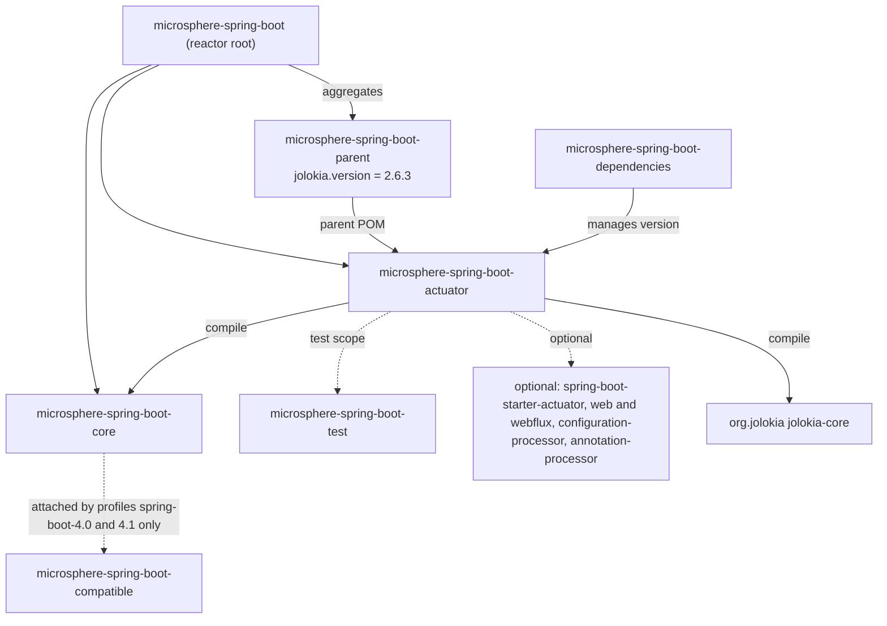
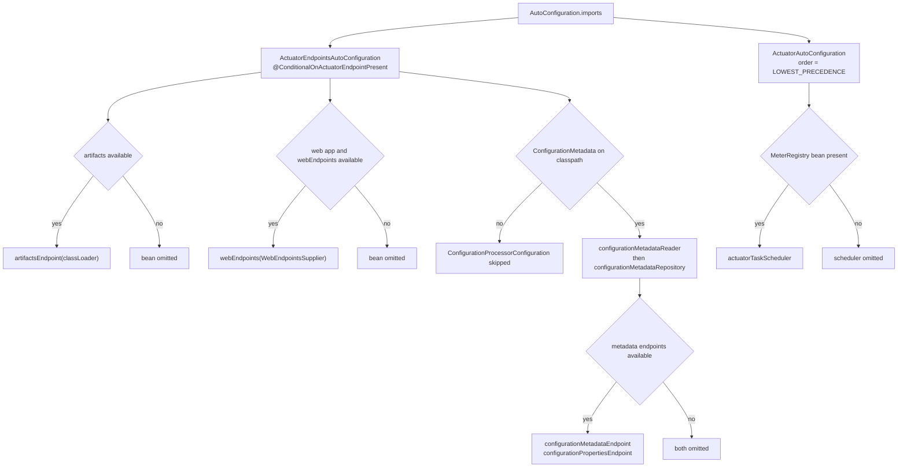
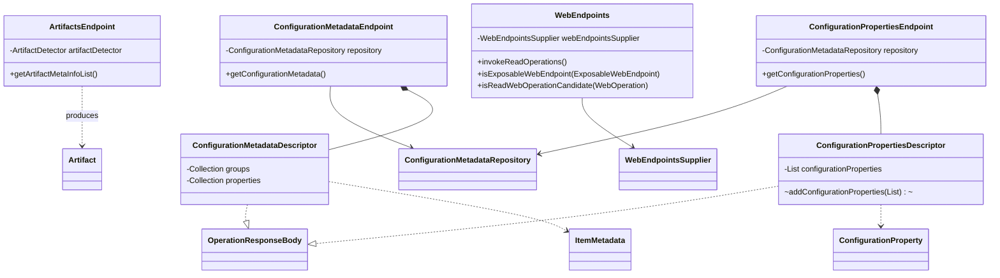
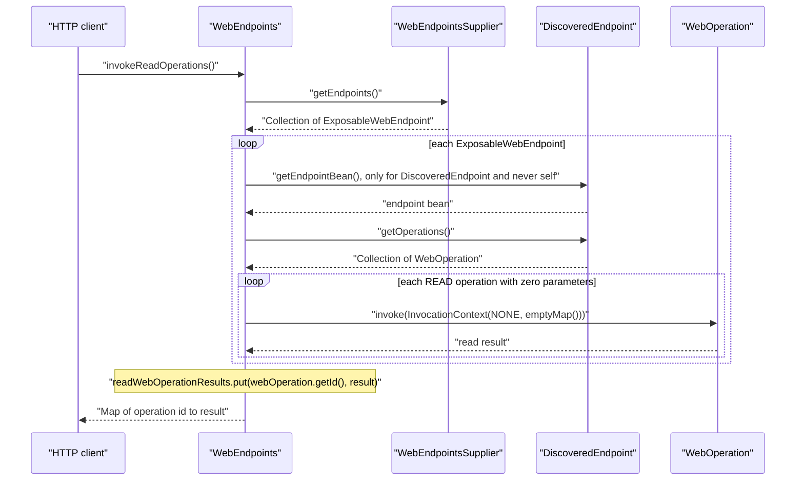
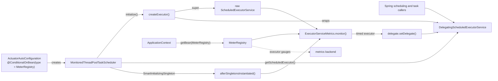
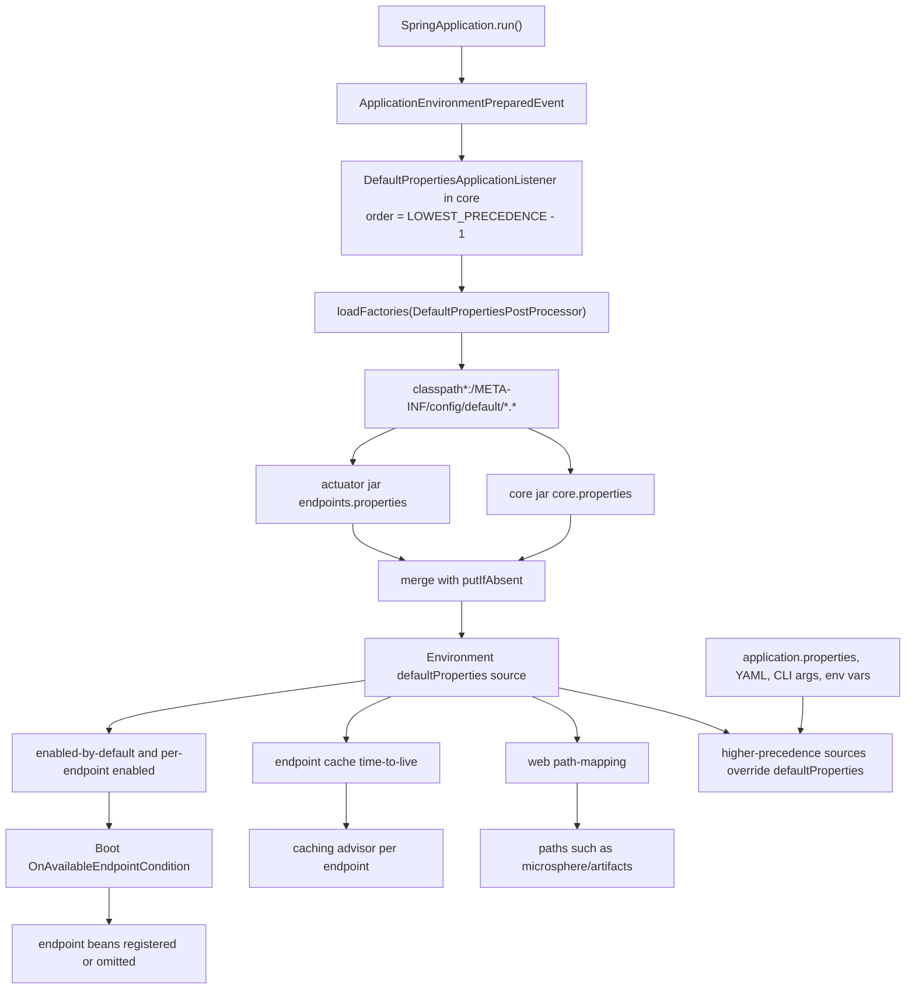

# Actuator Module

> [中文](./zh/actuator.md) · [Documentation index](../README.md) ·
> [User Guide for this module](../../user-guide/current/actuator.md)

> **Branch:** `release` · **Version line:** `0.2.x` · **Artifact:** `microsphere-spring-boot-actuator`
> **Spring Boot:** `3.0.13` – `4.1.1` · **Java:** 17

Contents:
[1 Module Position](#1-module-position) ·
[2 Package Map](#2-package-map) ·
[3 Auto-Configuration Design](#3-auto-configuration-design) ·
[4 Endpoint Model](#4-endpoint-model) ·
[5 WebEndpoints Aggregation Flow](#5-webendpoints-aggregation-flow) ·
[6 MonitoredThreadPoolTaskScheduler](#6-monitoredthreadpooltaskscheduler) ·
[7 Custom Condition Annotations](#7-custom-condition-annotations) ·
[8 PropertyConstants](#8-propertyconstants) ·
[9 Default Properties Loading](#9-default-properties-loading) ·
[10 Design Patterns](#10-design-patterns) ·
[11 Tests](#11-tests) ·
[12 Change Recipes](#12-change-recipes) ·
[13 See Also](#13-see-also)

---

## 1. Module Position

`microsphere-spring-boot-actuator` is the last module in the root aggregator (`pom.xml` line 66) and owns the observability surface: four custom endpoints, one Micrometer-instrumented task scheduler, and one default-properties file that reshapes Boot's endpoint posture for the whole application. It is a thin layer over `microsphere-spring-boot-core`, which supplies `ConfigurationMetadataReader`, `ConfigurationMetadataRepository` and the entire default-properties pipeline of section 9.



The bottom dotted edge is deliberate: `compatible` is attached to `core`, never to `actuator`. The actuator POM declares no Boot-version profiles, so this module compiles against Boot `3.0` … `4.1` unchanged; version tolerance lives instead in by-name condition attributes (section 7) and dual class-name lists in the tests (section 11). Sources: `microsphere-spring-boot-actuator/pom.xml`, `microsphere-spring-boot-parent/pom.xml:23`, `microsphere-spring-boot-core/pom.xml`.

---

## 2. Package Map

All ten production classes under `io.microsphere.spring.boot.actuate`:

| Package | Class | Responsibility |
|---|---|---|
| `actuate` | `MonitoredThreadPoolTaskScheduler` | `ThreadPoolTaskScheduler` whose `ScheduledExecutorService` is swapped for a Micrometer-monitored delegate after startup. |
| `actuate.autoconfigure` | `ActuatorAutoConfiguration` | Registers the `actuatorTaskScheduler` bean, gated on a `MeterRegistry`. |
| `actuate.autoconfigure` | `ActuatorEndpointsAutoConfiguration` | Registers the two dependency-free endpoints and imports the metadata-driven nested configuration. |
| `actuate.condition` | `ConditionalOnActuatorEndpointPresent` | Meta-annotation: Actuator `@Endpoint` API on the classpath. |
| `actuate.condition` | `ConditionalOnConfigurationProcessorPresent` | Meta-annotation: Boot configuration-processor metadata classes on the classpath. |
| `actuate.constants` | `PropertyConstants` | The `microsphere.spring.boot.actuator.` property-name prefixes. |
| `actuate.endpoint` | `ArtifactsEndpoint` | Endpoint `artifacts`: classpath artifacts detected by Microsphere's `ArtifactDetector`. |
| `actuate.endpoint` | `ConfigurationMetadataEndpoint` | Endpoint `configMetadata`: raw `ItemMetadata` groups and properties. |
| `actuate.endpoint` | `ConfigurationPropertiesEndpoint` | Endpoint `configProperties`: unified `ConfigurationProperty` list from SPI loaders plus metadata. |
| `actuate.endpoint` | `WebEndpoints` | Web endpoint `webEndpoints`: one-shot fan-out over every parameterless read operation. |

There is no DTO sub-package: both response types are nested `public static` classes (section 4).

---

## 3. Auto-Configuration Design

`META-INF/spring/org.springframework.boot.autoconfigure.AutoConfiguration.imports` holds exactly two lines, in order: `io.microsphere.spring.boot.actuate.autoconfigure.ActuatorAutoConfiguration`, then `io.microsphere.spring.boot.actuate.autoconfigure.ActuatorEndpointsAutoConfiguration`.

### 3.1 `ActuatorAutoConfiguration`

`microsphere-spring-boot-actuator/src/main/java/.../autoconfigure/ActuatorAutoConfiguration.java:39` carries exactly one ordering annotation, `@AutoConfigureOrder(LOWEST_PRECEDENCE)`. The class uses **no** `@AutoConfigureAfter` and **no** `@AutoConfigureBefore`: the only Boot auto-configuration it must follow is the metrics one, and rather than naming it — its package moved between Boot lines — the class puts itself last globally and relies on a bean condition. The rest of the class is constants: `DEFAULT_TASK_SCHEDULER_POOL_SIZE` (`"1"`, `:45`), `TASK_SCHEDULER_POOL_SIZE_PROPERTY_NAME` (`:55`), `TASK_SCHEDULER_THREAD_NAME_PREFIX_PROPERTY_NAME` (`:76`), the two derived `@Value` expressions (`:61`, `:82`), the bean name `"actuatorTaskScheduler"` (`:87`) and `METER_REGISTRY_CLASS_NAME` (`:94`). Both property-name constants carry `@ConfigurationProperty(defaultValue = …, source = APPLICATION_SOURCE)`, so the annotation processor records them as documented metadata — visible through the endpoints of section 4.

```java
@ConditionalOnBean(type = METER_REGISTRY_CLASS_NAME)
@Bean(name = ACTUATOR_TASK_SCHEDULER_SERVICE_BEAN_NAME, destroyMethod = "shutdown")
public ThreadPoolTaskScheduler actuatorTaskScheduler(
        @Value(TASK_SCHEDULER_POOL_SIZE_VALUE_EXPRESSION) int poolSize,
        @Value(TASK_SCHEDULER_THREAD_NAME_PREFIX_VALUE_EXPRESSION) String threadNamePrefix) {
```

`type = METER_REGISTRY_CLASS_NAME` (`:112`) is the by-name form of `@ConditionalOnBean`, evaluated against the string `"io.micrometer.core.instrument.MeterRegistry"` instead of a compiled reference, so Micrometer is never linked at condition level. `destroyMethod = "shutdown"` leaves the executor lifecycle to the container, and `setDaemon(true)` (`:119`) stops the pool from holding the JVM open.

### 3.2 `ActuatorEndpointsAutoConfiguration`

```java
@ConditionalOnActuatorEndpointPresent
@Import(value = {ActuatorEndpointsAutoConfiguration.ConfigurationProcessorConfiguration.class})
public class ActuatorEndpointsAutoConfiguration implements BeanClassLoaderAware {
```

(`.../autoconfigure/ActuatorEndpointsAutoConfiguration.java:43-45`) The custom condition of section 7 gates the class, so without Actuator neither it nor the imported nested class is processed. `BeanClassLoaderAware` exists only so `setBeanClassLoader` (`:182-185`) can pass the container's class loader to `ArtifactsEndpoint`.

| Bean | Lines | Conditions |
|---|---|---|
| `artifactsEndpoint()` | `:59-64` | `@Bean`, `@ConditionalOnMissingBean`, `@ConditionalOnAvailableEndpoint` |
| `webEndpoints(WebEndpointsSupplier)` | `:77-83` | `@Bean`, `@ConditionalOnMissingBean`, `@ConditionalOnWebApplication`, `@ConditionalOnAvailableEndpoint` |
| `configurationMetadataReader()` | `:109-113` | `@Bean`, `@ConditionalOnMissingBean` |
| `configurationMetadataRepository(reader)` | `:127-131` | `@Bean`, `@ConditionalOnMissingBean` |
| `configurationMetadataEndpoint(repo)` | `:144-149` | `@Bean`, `@ConditionalOnMissingBean`, `@ConditionalOnAvailableEndpoint` |
| `configurationPropertiesEndpoint(repo)` | `:163-168` | `@Bean`, `@ConditionalOnMissingBean`, `@ConditionalOnAvailableEndpoint` |

Every `@ConditionalOnAvailableEndpoint` is written **without attributes**, so Boot derives the `EndpointId` from the method's return type and consults `management.endpoint.<id>.enabled` and `management.endpoints.enabled-by-default` plus the exposure filters. That is precisely the seam `endpoints.properties` drives (section 9): flipping `management.endpoint.artifacts.enabled=false` deletes the bean definition instead of hiding a route, which `ActuatorEndpointsAutoConfigurationTest.Disabled` asserts. `@ConditionalOnWebApplication` on `webEndpoints` mirrors the fact that `WebEndpointsSupplier` exists only in a web application.

`ConfigurationProcessorConfiguration` (`:95-169`) is a package-private `static` nested class meta-conditioned with `@ConditionalOnConfigurationProcessorPresent`. Its four beans reference `org.springframework.boot.configurationprocessor.metadata.ItemMetadata`, which is absent at runtime in most applications, so isolating them keeps `artifacts` and `webEndpoints` registrable regardless. The nested class is reached only through `@Import`, never through the imports file, so it is not a top-level auto-configuration.



---

## 4. Endpoint Model

| Class | Endpoint annotation | Id | Read operation | Return type |
|---|---|---|---|---|
| `ArtifactsEndpoint` | `@Endpoint(id = "artifacts")` (`:18`) | `artifacts` | `getArtifactMetaInfoList()` `@ReadOperation` (`:48`, `:49`) | `List<Artifact>` |
| `WebEndpoints` | `@WebEndpoint(id = "webEndpoints")` (`:36`) | `webEndpoints` | `invokeReadOperations()` `@ReadOperation` (`:60`, `:61`) | `Map<String, Object>` |
| `ConfigurationMetadataEndpoint` | `@Endpoint(id = "configMetadata")` (`:37`) | `configMetadata` | `getConfigurationMetadata()` `@ReadOperation` (`:69`, `:70`) | `ConfigurationMetadataDescriptor` |
| `ConfigurationPropertiesEndpoint` | `@Endpoint(id = "configProperties")` (`:46`) | `configProperties` | `getConfigurationProperties()` `@ReadOperation` (`:78`, `:79`) | `ConfigurationPropertiesDescriptor` |

* **Read only, mostly neutral annotations.** No `@WriteOperation`, no `@DeleteOperation` and no `@Selector` exists anywhere in this module: one parameterless read operation per endpoint, therefore no sub-path operations. Three endpoints use the technology-neutral `@Endpoint`; only `WebEndpoints` uses `@WebEndpoint`, because it needs `WebEndpointsSupplier` and is web-only by construction.
* **Descriptors.** `ConfigurationMetadataEndpoint.ConfigurationMetadataDescriptor` (`.../endpoint/ConfigurationMetadataEndpoint.java:80`) implements `OperationResponseBody` over two `Collection<ItemMetadata>` fields (`:82`, `:84`) assigned straight from the repository (`:72-73`) with public getters only (`:97`, `:112`). `ConfigurationPropertiesEndpoint.ConfigurationPropertiesDescriptor` (`.../endpoint/ConfigurationPropertiesEndpoint.java:134`) implements `OperationResponseBody` over a `LinkedList<ConfigurationProperty>` (`:136`) plus a package-private fluent `addConfigurationProperties(List)` (`:166`) that the read operation chains twice (`:83-84`).
* **Adaptation.** `adaptConfigurationProperty(ItemMetadata)` (`:102-121`) maps metadata onto `ConfigurationProperty`: name, type (`String.class.getName()` when `null`), description, default value, then `Metadata.declaredClass = sourceType`, `declaredField = sourceMethod`, `sources.add(APPLICATION_SOURCE)`.
* **Construction.** All four endpoints take collaborators through constructors (`ArtifactsEndpoint.java:33`, `WebEndpoints.java:51`, `ConfigurationMetadataEndpoint.java:53`, `ConfigurationPropertiesEndpoint.java:62`); no field injection is used.



`Artifact`, `ArtifactDetector` and `ConfigurationProperty` come from Microsphere (`io.microsphere.classloading`, `io.microsphere.beans`), `ItemMetadata` from the Boot configuration-processor artifact, and `ConfigurationMetadataRepository` from `core`.

---

## 5. WebEndpoints Aggregation Flow

`WebEndpoints` does **not** decorate or replace Boot's endpoint registry. It is an ordinary `@WebEndpoint` bean that, on one read call, fans out over the endpoints Boot already exposes and invokes their read operations in-process (`.../endpoint/WebEndpoints.java:61-88`):

* The source of truth is `webEndpointsSupplier.getEndpoints()` (`:62`); nothing is registered or re-exposed.
* Only `DiscoveredEndpoint` instances qualify — `isExposableWebEndpoint` is a plain `instanceof` (`:105-107`) — which is what makes `getEndpointBean()` (`:71`) legal, and self-recursion is blocked by the identity check `endpointBean == this` (`:72-74`).
* Only operations that are `AbstractDiscoveredOperation`, whose `OperationMethod` type equals `OperationType.READ` and whose `Method.getParameterCount() == 0`, are invoked (`:121-133`); anything needing an argument is skipped rather than guessed at.
* One `InvocationContext(SecurityContext.NONE, emptyMap())` is built per request (`:66`, `:90-92`), so endpoint-side security checks see an unauthenticated, parameter-free context.
* Keys are `webOperation.getId()` (`:79`) — operation ids, not web paths — in a map pre-sized to the endpoint count (`:64`); colliding ids are last-write-wins.



Since `management.endpoint.webEndpoints.cache.time-to-live` is `${microsphere.cache.short-time-to-live}` = `15s` (section 9), Boot's caching advisor fronts the fan-out — the only reason the aggregation is affordable.

---

## 6. MonitoredThreadPoolTaskScheduler

`.../actuate/MonitoredThreadPoolTaskScheduler.java` extends `ThreadPoolTaskScheduler` and implements `ApplicationContextAware` plus `SmartInitializingSingleton` (`:43`). It uses exactly two instrumentation collaborators — `io.micrometer.core.instrument.MeterRegistry` (`:19`) and the static `ExecutorServiceMetrics.monitor` from `io.micrometer.core.instrument.binder.jvm.ExecutorServiceMetrics` (`:20`, `:32`) — plus Microsphere's `DelegatingScheduledExecutorService` (`:21`). No Boot actuator metrics class is referenced: Boot enters only through the `MeterRegistry` bean it auto-configures.

| Overridden method | Line | Effect |
|---|---|---|
| `createExecutor(int, ThreadFactory, RejectedExecutionHandler)` | `:82-86` | Calls `super.createExecutor`, stores the real executor in a new `DelegatingScheduledExecutorService`, returns the **unwrapped** executor so Spring's lifecycle still operates on the original object. |
| `getScheduledExecutor()` | `:102-104` | Returns the `delegate`, the seam that lets the target be replaced later. The override drops the parent's `IllegalStateException` guard: before initialization it returns `null`. |
| `afterSingletonsInstantiated()` | `:117-121` | Resolves `MeterRegistry` from the context, takes `super.getScheduledExecutor()` and calls `delegate.setDelegate(monitor(registry, scheduledExecutor, beanName))`. |
| `setBeanName(String)` | `:135-138` | Delegates to `super` and caches the name, which becomes the metrics name. |
| `setApplicationContext(ApplicationContext)` | `:153-155` | Stores the context for the late `MeterRegistry` lookup. |

The timing is the design: wrapping happens after *all* singletons exist, not during initialization, because the `MeterRegistry` may come from an auto-configuration ordered after this bean — and `ActuatorAutoConfiguration` does claim `LOWEST_PRECEDENCE`. Wiring at `ActuatorAutoConfiguration.java:112-122` creates the bean only when a `MeterRegistry` bean is present, names it `actuatorTaskScheduler`, feeds `poolSize` and `threadNamePrefix` from `@Value` expressions with in-code fallbacks (`1`, `microsphere-spring-boot-actuator-task-`), marks the pool daemon and shuts it down with the container.



An asymmetry the tests pin down: `getPoolSize()` observed through the bean stays `0` until work is submitted, because `ThreadPoolTaskScheduler` starts core threads lazily — `setPoolSize(2)` configures the pool, it does not pre-start it.

---

## 7. Custom Condition Annotations

Neither condition is a `SpringBootCondition` subclass. Both are **meta-annotated marker annotations**, quoted verbatim; the `name` attributes are the by-name form of `@ConditionalOnClass`, which keeps the module compilable when the checked artifact is absent and immune to Boot package relocations.

```java
@Target({TYPE, METHOD})
@Retention(RUNTIME)
@Documented
@ConditionalOnClass(name = "org.springframework.boot.actuate.endpoint.annotation.Endpoint")
public @interface ConditionalOnActuatorEndpointPresent {
}
```

(`.../condition/ConditionalOnActuatorEndpointPresent.java:39-44`)

```java
@Target({TYPE, METHOD})
@Retention(RUNTIME)
@Documented
@ConditionalOnClass(name = "org.springframework.boot.configurationprocessor.metadata.ConfigurationMetadata")
public @interface ConditionalOnConfigurationProcessorPresent {
}
```

(`.../condition/ConditionalOnConfigurationProcessorPresent.java:83-87`)

Mechanism: `@ConditionalOnClass` is itself meta-annotated with `@Conditional(OnClassCondition.class)`, and `OnClassCondition` is the Boot `SpringBootCondition` that resolves class presence through a `ClassNameFilter` without loading classes — so the module reuses Boot's evaluation machinery, including `ConditionEvaluationReport` entries and `--debug` output, while declaring no logic of its own. Neither annotation declares attributes, and both are `@Target({TYPE, METHOD})` so they can gate a class or one bean method.

| Annotation | Problem solved | Applied at |
|---|---|---|
| `@ConditionalOnActuatorEndpointPresent` | `spring-boot-starter-actuator` is an *optional* dependency, so this jar can reach an application without Actuator; referencing endpoint types would then fail while parsing configuration metadata. | `ActuatorEndpointsAutoConfiguration.java:43` |
| `@ConditionalOnConfigurationProcessorPresent` | `spring-boot-configuration-processor` is compile-time tooling usually absent at runtime, yet the metadata beans return or accept `ItemMetadata`. | `ActuatorEndpointsAutoConfiguration.java:95` |

`@Import` (`:44`) is what brings the package-private static nested class into the configuration model. Historical note: Boot `2.1`–`2.3` required hand-written shims for this kind of endpoint gating because `@ConditionalOnAvailableEndpoint` and `EndpointId` did not exist; this branch targets Boot `3.0`+, where both are native, so the annotation is used directly (`:61`, `:80`, `:146`, `:165`) and `microsphere-spring-boot-compatible` packages no actuator shim at all.

---

## 8. PropertyConstants

`.../constants/PropertyConstants.java` is a two-constant interface (`:32`, `:37`):

```java
String MICROSPHERE_SPRING_BOOT_ACTUATOR_PROPERTY_NAME_PREFIX = MICROSPHERE_SPRING_BOOT_PROPERTY_NAME_PREFIX + "actuator.";
String TASK_SCHEDULER_PROPERTY_NAME_PREFIX = MICROSPHERE_SPRING_BOOT_ACTUATOR_PROPERTY_NAME_PREFIX + "task-scheduler.";
```

The parent prefix `microsphere.spring.boot.` is inherited from `io.microsphere.spring.boot.constants.PropertyConstants` in `core`, so this module contributes exactly two namespace levels. The concrete keys built from them are declared in `ActuatorAutoConfiguration`, each annotated `@ConfigurationProperty(defaultValue = …, source = APPLICATION_SOURCE)`:

| Key | Declared at | Documented default |
|---|---|---|
| `microsphere.spring.boot.actuator.task-scheduler.pool-size` | `ActuatorAutoConfiguration.java:55` | `1` |
| `microsphere.spring.boot.actuator.task-scheduler.thread-name-prefix` | `ActuatorAutoConfiguration.java:76` | `microsphere-spring-boot-actuator-task-` |

Relationship to `endpoints.properties`: none, deliberately. The shipped file holds `management.*` keys and the `microsphere.cache.*` ladder only, never `microsphere.spring.boot.actuator.*`, so the scheduler's effective defaults come from the `@Value` fallbacks rather than the default property source. `@ConfigurationProperty` *documents* these two defaults; `endpoints.properties` *enforces* the endpoint posture. Both streams converge in `ConfigurationPropertiesEndpoint`, one via the annotation-processor SPI and one via the metadata repository.

---

## 9. Default Properties Loading

Two unrelated `META-INF` extension points ship here and are easily confused. `META-INF/services/io.microsphere.metadata.ConfigurationPropertyLoader` contains the single line `io.microsphere.metadata.MetadataResourceConfigurationPropertyLoader`; it is a plain JDK `ServiceLoader` file, and that class lives in the optional `microsphere-annotation-processor` artifact (package `io.microsphere.metadata`). Registering it is what makes `ConfigurationPropertiesEndpoint.loadFromServiceLoaders()`, which calls the static `ConfigurationPropertyLoader.loadAll()` (`.../endpoint/ConfigurationPropertiesEndpoint.java:36`, `:88-90`), return anything in an application that does not depend on the processor directly — and it has no effect on property resolution. The second file, `META-INF/config/default/endpoints.properties` (91 lines), is the one that reaches the `Environment`.

The loading chain is entirely in `core`. Its `META-INF/spring.factories` registers `io.microsphere.spring.boot.env.DefaultPropertiesApplicationListener` under `org.springframework.context.ApplicationListener` and `io.microsphere.spring.boot.env.SpringApplicationDefaultPropertiesPostProcessor` under the custom `io.microsphere.spring.boot.env.DefaultPropertiesPostProcessor` key. The listener (`.../core/src/main/java/io/microsphere/spring/boot/env/DefaultPropertiesApplicationListener.java:74`) handles `ApplicationEnvironmentPreparedEvent` at order `LOWEST_PRECEDENCE - 1` (`:76`), fetches the mutable `defaultProperties` map from the `Environment`, and iterates the post-processors found by `SpringFactoriesLoader.loadFactories` (`:126`). `SpringApplicationDefaultPropertiesPostProcessor` contributes one pattern, `DEFAULT_PROPERTIES_RESOURCES_PATTERN` (`.../env/SpringApplicationDefaultPropertiesPostProcessor.java:39`, added at `:58-60`): `classpath*:/META-INF/config/default/*.*`. Being classpath-wide, it collects `endpoints.properties` from this jar, `core.properties` from `core` — which is how `core` registers its own defaults the same way — and any file an application adds under the same path. Each resource becomes `PropertySource`s merged with `defaultProperties.putIfAbsent(...)` (`:212`): the first contributor of a key wins, later modules cannot override it, and a re-declared key logs a warning instead of replacing the value.



Precedence consequence: `defaultProperties` is the **lowest**-priority source in Boot's environment, so every application-visible configuration overrides this module's posture — forceful defaults that are never un-overridable. The test resources demonstrate it: `src/test/resources/application.properties` sets `management.endpoint.loggers.enabled = false`, which wins over `endpoints.properties:22` (`true`), and `DefaultPropertiesTest` asserts the overridden value.

The posture is three moves: `management.endpoints.enabled-by-default = false` (nothing on unless listed); `management.endpoints.web.exposure.include = *` with `management.endpoints.jmx.exposure.exclude = *` (survivors are web-visible and JMX-invisible); and explicit `management.endpoint.<id>.enabled = true` for `env`, `health`, `info`, `loggers`, `metrics`, `mappings`, `jolokia`, `prometheus` plus the four Microsphere endpoints, every other Boot endpoint pinned to `false`. The TTL ladder `microsphere.cache.no-time-to-live = 0s`, `short-time-to-live = 15s`, `middle-time-to-live = 1m`, `long-time-to-live = 1h`, `long-long-time-to-live = 1d` (`:36-40`) is referenced by every `management.endpoint.*.cache.time-to-live`, including the Microsphere pairs at `:73-91`: `artifacts` → `microsphere/artifacts` at `1d`, `webEndpoints` → `microsphere/web/endpoints` at `15s`, `configMetadata` → `microsphere/config/metadata` at `1d`, `configProperties` → `microsphere/config/properties` at `1d`. Health is pinned to `no-time-to-live` beside `show-details = always` and `show-components = always`, because a cached health response defeats its purpose; and since the ladder lives in the same default source, the `${…}` placeholders resolve even when an application overrides individual TTLs.

---

## 10. Design Patterns

| Pattern | Class or artifact | Rationale, as verified in code |
|---|---|---|
| Aggregation / fan-out | `WebEndpoints` | One read operation walks `WebEndpointsSupplier.getEndpoints()` and folds results into one map (`:61-88`). |
| Self-exclusion guard | `WebEndpoints.invokeReadOperations` | Identity check `endpointBean == this` (`:72`): the aggregator drops itself from its own aggregation. |
| Decorator | `MonitoredThreadPoolTaskScheduler` | `getScheduledExecutor()` returns a delegating wrapper whose target is replaced by `ExecutorServiceMetrics.monitor(...)` (`:102-104`, `:117-121`). |
| Late initialization | `MonitoredThreadPoolTaskScheduler.afterSingletonsInstantiated` | `SmartInitializingSingleton` defers the `MeterRegistry` lookup past all bean creation. |
| Template method | `MonitoredThreadPoolTaskScheduler.createExecutor` | Overrides a protected hook of `ThreadPoolTaskScheduler`, calling `super` first (`:82-86`). |
| Adapter | `ConfigurationPropertiesEndpoint.adaptConfigurationProperty` | Converts Boot's `ItemMetadata` into Microsphere's `ConfigurationProperty` (`:102-121`). |
| Response DTO | `ConfigurationMetadataDescriptor`, `ConfigurationPropertiesDescriptor` | Nested `public static` types implementing `OperationResponseBody`, keeping wire shape out of endpoint logic. |
| Meta-annotation composition | both `condition` annotations | Intention-revealing names whose whole logic is one `@ConditionalOnClass(name = …)`. |
| By-name condition | `METER_REGISTRY_CLASS_NAME`, `@ConditionalOnBean(type = …)` | No hard reference to optional classes; survives Boot package relocations. |
| Nested configuration plus `@Import` | `ConfigurationProcessorConfiguration` | Isolates processor-dependent beans behind their own condition (`:44`, `:95`). |
| Convention over configuration | `META-INF/config/default/endpoints.properties` | Module-wide posture delivered as data, overridable by the application. |
| Service Provider Interface | `META-INF/services/io.microsphere.metadata.ConfigurationPropertyLoader` | Adds a metadata loader without compiling against the processor. |
| Constant interface | `PropertyConstants` | Namespace composition by concatenating inherited `String` constants. |

---

## 11. Tests

| Class | What it pins down |
|---|---|
| `autoconfigure.ActuatorAutoConfigurationTest` | `testConstants()` (`:54`) freezes four literals — pool-size default `"1"`, both property names, and `METER_REGISTRY_CLASS_NAME`, the last checked against both the string and `MeterRegistry.class.getName()` (`:60`) so a Micrometer rename breaks the build instead of silently disabling the scheduler. `MeterRegistryPresent.testActuatorTaskScheduler()` (`:90`) boots `webEnvironment = NONE` with `pool-size=2` and `thread-name-prefix=my-prefix`, asserts the bean exists, the prefix matches and `getPoolSize()` grows `0 → 1 → 2` under load. `MeterRegistryAbsent.testActuatorTaskScheduler()` (`:131`) asserts the bean is `null`. |
| `autoconfigure.ActuatorEndpointsAutoConfigurationTest` | `Defaults` (`:47`) boots `RANDOM_PORT` with `management.endpoint.loggers.enabled=false`, autowires all four endpoints and runs `testArtifactsEndpoint()` (`:62`), `testInvokeReadOperations()` (`:67`), `testGetConfigurationMetadata()` (`:73`, groups and properties both non-empty) and `testGetConfigurationProperties()` (`:80`). `Disabled` (`:103`) turns off all four `management.endpoint.*.enabled` flags and its `test()` (`:118`) asserts every bean is absent. |
| `constants.PropertyConstantsTest` | `testConstants()` (`:36`) pins both prefixes, so a refactor in `core` cannot silently move the published key space. |
| `endpoint.WebEndpointsTest` | Mockito unit tests: `testWebEndpointsOnWriteOperations()` (`:54`) a `WRITE` operation yields an empty map; `testWebEndpointsOnNotDiscoveredEndpoints()` (`:65`) a bare `ExposableWebEndpoint` is skipped; `testIsExposableWebEndpoint()` (`:73`) `null` is not exposable; `testIsReadWebOperationCandidateOnWriteOperation()` (`:78`) rejects a real `DiscoveredOperationMethod` built over a test method; `testIsReadWebOperationCandidateOnNull()` (`:88`). The inner `WebEndpoint` interface (`:92`) and `DiscoveredOperationImpl` (`:95`) are the minimal Boot stand-ins. |
| `env.DefaultPropertiesTest` | `testEndpointsDefaultProperties()` (`:44`) is the contract test for section 9: 26 keys read through the injected `Environment`, including `enabled-by-default=false`, `web.exposure.include=*`, `jmx.exposure.exclude=*` and every endpoint flag — with `loggers` asserted `false` (`:60`) although `endpoints.properties:22` says `true`. |

`@TestClassOrder(OrderAnnotation.class)` with `@Order(1)`/`@Order(2)` (`ActuatorAutoConfigurationTest.java:50`, `:63`, `:107`, mirrored in the endpoints test) exists because both classes boot real contexts: "bean exists" must run before "bean absent" so a context cache hit cannot mask a failed exclusion. That exclusion list carries four entries (`:117-121`) — `org.springframework.boot.actuate.autoconfigure.metrics.*` for Boot `2.x`/`3.x` and `org.springframework.boot.micrometer.metrics.autoconfigure.*` for Boot `4.x`+ — consumed by `core`'s `ConfigurableAutoConfigurationImportFilter` through `microsphere.autoconfigure.exclude`.

---

## 12. Change Recipes

**Add a new endpoint.** Create `io/microsphere/spring/boot/actuate/endpoint/<Name>Endpoint.java` annotated `@Endpoint(id = "<camelCaseId>")` — or `@WebEndpoint` when a web-only collaborator is needed — taking collaborators through the constructor. Add at least one parameterless `@ReadOperation`, and model structured payloads as a nested `public static` class implementing `OperationResponseBody`, following `ConfigurationMetadataEndpoint.java:80`. Register the bean in `ActuatorEndpointsAutoConfiguration` with `@Bean` + `@ConditionalOnMissingBean` + `@ConditionalOnAvailableEndpoint`, or inside `ConfigurationProcessorConfiguration` when optional classes are involved. Then add three posture lines to `endpoints.properties` (`enabled`, `web.path-mapping`, and a cache TTL referencing a `microsphere.cache.*` key) under a `### <Name> Endpoint` header matching lines 73–91, and extend `Defaults`, `Disabled` and `DefaultPropertiesTest` accordingly.

**Change a default TTL.** Edit the ladder at `endpoints.properties:36-40` for a global shift, or repoint a single `management.endpoint.<id>.cache.time-to-live` line to another `microsphere.cache.*` key for a per-endpoint shift. Never inline a duration literal: the ladder is what keeps the policy legible. The TTL is applied by Boot's caching advisor around read operations, and `webEndpoints` sits at `15s` on purpose because its cost grows with the number of exposed endpoints.

**Disable an endpoint family.** Set `management.endpoints.enabled-by-default = true` in your own `application.properties` to turn the module's allow-list posture into a deny-list one, since the shipped file is only a `defaultProperties` source (section 9). To drop one endpoint, set `management.endpoint.<id>.enabled=false`: the bean definition disappears, keeping `@ConditionalOnAvailableEndpoint` and the exposure filters consistent. To restore JMX, override `management.endpoints.jmx.exposure.exclude` — but note that `web.exposure.include = *` keeps every enabled endpoint web-visible, so prefer disabling over narrowing paths.

---

## 13. See Also

| Document | Scope |
|---|---|
| [README.md](./README.md) | Developer-guide index for this branch. |
| [core.md](./core.md) | The `DefaultPropertiesPostProcessor` chain and the metadata reader/repository consumed here. |
| [compatible.md](./compatible.md) | The shim module, and why `actuator` needs no shim on Boot `3.0`+. |
| [../../user-guide/current/actuator.md](../../user-guide/current/actuator.md) | Endpoint URLs, sample responses and user-facing configuration. |
