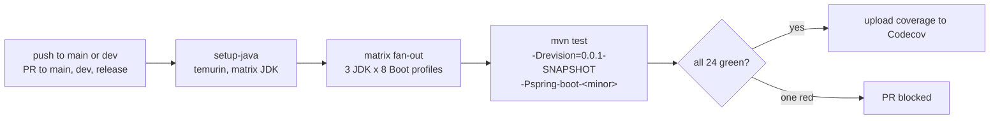
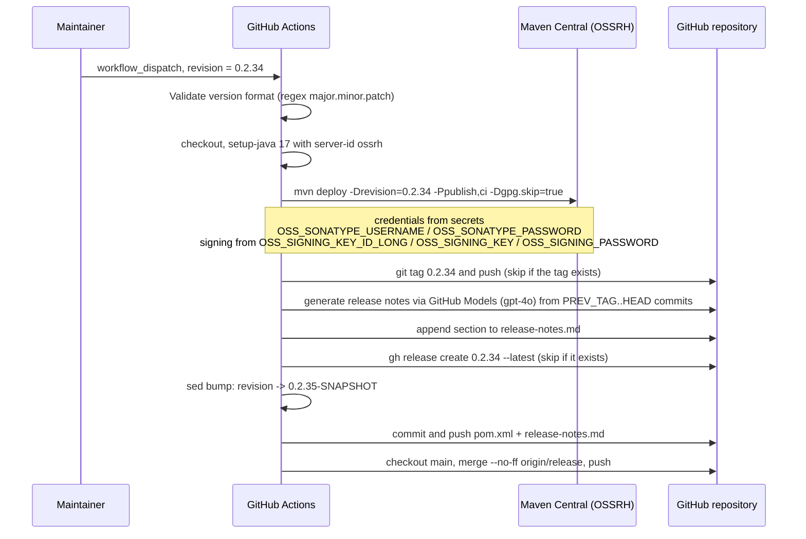
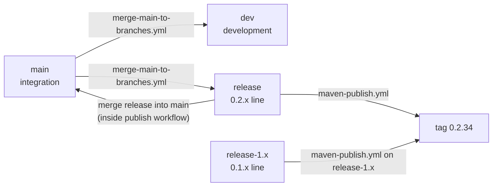

# Build and Release Pipeline

> [中文](./zh/build-and-release.md) · [Documentation index](../README.md) ·
> [User Guide for this branch](../../user-guide/current/README.md)

> **Branch:** `release` · **Version line:** `0.2.x` · **Scope:** Maven reactor + GitHub Actions

Contents:
[1 What the Build System Has to Solve](#1-what-the-build-system-has-to-solve) ·
[2 Reactor Shape](#2-reactor-shape) ·
[3 The revision Flattening Pattern](#3-the-revision-flattening-pattern) ·
[4 Profile-Driven Spring Boot Selection](#4-profile-driven-spring-boot-selection) ·
[5 Local Build Commands](#5-local-build-commands) ·
[6 CI Anatomy](#6-ci-anatomy) ·
[7 The Release Pipeline](#7-the-release-pipeline) ·
[8 Branch Model and Automation](#8-branch-model-and-automation) ·
[9 Design Patterns in the Build](#9-design-patterns-in-the-build) ·
[10 Adding a New Spring Boot Line](#10-adding-a-new-spring-boot-line) ·
[11 Troubleshooting the Pipeline](#11-troubleshooting-the-pipeline) ·
[12 See Also](#12-see-also)

---

## 1. What the Build System Has to Solve

One source tree, eight Spring Boot minor lines, four JDKs, five published artifacts, and no version
literals duplicated anywhere. Every mechanism in this section exists to serve one of those constraints:

| Constraint | Mechanism |
|---|---|
| One version for the whole reactor | `${revision}` in the root POM, inherited by every module. |
| Same code must compile against Boot `3.0` … `4.1` | Maven profiles in the Parent POM that set `spring-boot.version`, plus the `compatible` shim module attached by the Boot 4 profiles. |
| Cross-version API drift | `compatible` shims (relocated classes) and by-name condition attributes (moved classes). |
| Publication without hand-editing POMs | `maven-publish.yml`, driven by a `workflow_dispatch` input. |
| Two maintained lines sharing fixes | `merge-main-to-branches.yml` plus the `release` / `release-1.x` branch pair. |

---

## 2. Reactor Shape

The root aggregator `microsphere-spring-boot` lists eight modules, in this order
(`pom.xml` lines 58–67):

| # | Module | Packaging | Published | In BOM |
|---|---|---|---|---|
| 1 | `microsphere-spring-boot-parent` | pom | yes | no |
| 2 | `microsphere-spring-boot-dependencies` | pom | yes | — (it *is* the BOM) |
| 3 | `microsphere-spring-boot-compatible` | jar | **no** | **no** |
| 4 | `microsphere-spring-boot-test` | jar | yes | yes |
| 5 | `microsphere-spring-boot-core` | jar | yes | yes |
| 6 | `microsphere-spring-boot-webmvc` | jar | yes | yes |
| 7 | `microsphere-spring-boot-webflux` | jar | yes | yes |
| 8 | `microsphere-spring-boot-actuator` | jar | yes | yes |

The ordering is not cosmetic: `test` precedes `core` because `core`'s test scope depends on `test`, and
`compatible` precedes `core` because the Boot 4 profiles attach it to `core`.

```mermaid
graph TD
    ROOT["microsphere-spring-boot (root)<br/>revision=0.2.35-SNAPSHOT, java.version=17"]
    P["...-parent"]
    D["...-dependencies"]
    C["...-compatible"]
    T["...-test"]
    CORE["...-core"]
    MVC["...-webmvc"]
    FLUX["...-webflux"]
    ACT["...-actuator"]

    ROOT --> P
    ROOT --> D
    ROOT --> C
    ROOT --> T
    ROOT --> CORE
    ROOT --> MVC
    ROOT --> FLUX
    ROOT --> ACT

    P -. inheritance .-> D
    P -. inheritance .-> C
    P -. inheritance .-> T
    P -. inheritance .-> CORE
    CORE -. test scope .-> T
    MVC --> CORE
    FLUX --> CORE
    ACT --> CORE
    CORE -. profiles 4.0 and 4.1 .-> C

    classDef unpublished fill:#fdd,stroke:#a55;
    class C unpublished;
```

Solid edges are aggregation or compile dependencies; dashed edges are inheritance, test scope, or
profile-conditional.

---

## 3. The `revision` Flattening Pattern

Every module declares `<version>${revision}</version>` instead of a literal. The single literal version in
the repository is:

```xml
<!-- pom.xml, lines 53-56 -->
<properties>
    <revision>0.2.35-SNAPSHOT</revision>
    <java.version>17</java.version>
</properties>
```

Two consequences:

1. **A release touches one line.** The publish workflow rewrites `<revision>` once (`sed` on `pom.xml`)
   rather than sweeping eight POMs.
2. **Published POMs must be flattened.** Resolved `${revision}` requires the flatten step configured by
   the external build parent `microsphere-build`; that is why the root POM inherits
   `io.github.microsphere-projects:microsphere-build:0.3.16` and why installing from an incomplete build
   can leave a literal `${revision}` in your local repository.

BOM entries also use `${revision}`, so a release publishes all five artifacts at one version by
construction — a mixed-version BOM is not reachable by editing one entry.

---

## 4. Profile-Driven Spring Boot Selection

`spring-boot.version` has no value in the root or parent POM; it is defined only inside profiles, one per
Boot minor line:

| Profile | Boot version | Extra effects |
|---|---|---|
| `spring-boot-3.0` | `3.0.13` | |
| `spring-boot-3.1` | `3.1.12` | |
| `spring-boot-3.2` | `3.2.12` | |
| `spring-boot-3.3` | `3.3.13` | |
| `spring-boot-3.4` | `3.4.13` | |
| `spring-boot-3.5` | `3.5.16` | `activeByDefault` |
| `spring-boot-4.0` | `4.0.8` | attaches `compatible` to `core` |
| `spring-boot-4.1` | `4.1.1` | attaches `compatible` to `core` |

The Parent POM imports `spring-boot-dependencies` at `${spring-boot.version}`, so a profile switch changes
the entire transitive graph — Spring Framework, Jackson, Micrometer, the Servlet API — from one number.

The `compatible` attachment lives in the consumer, not in the shim:

```xml
<!-- microsphere-spring-boot-core/pom.xml, lines 97-121 (abridged) -->
<profile>
    <id>spring-boot-4.0</id>
    <dependencies>
        <dependency>
            <groupId>io.github.microsphere-projects</groupId>
            <artifactId>microsphere-spring-boot-compatible</artifactId>
            <version>${revision}</version>
        </dependency>
    </dependencies>
</profile>
```

Design note: the attachment is a *profile in the depending module*, not an optional dependency in
`compatible` itself. That keeps the shim invisible unless the Boot line actually needs it, and keeps
`compatible` free of any published consumer.

---

## 5. Local Build Commands

```bash
# default Boot line (3.5.16), full reactor, with tests
./mvnw clean verify

# one module and everything it needs
./mvnw -pl microsphere-spring-boot-core -am -Pspring-boot-3.1 test

# the exact invocation CI uses, for one matrix cell
mvn --batch-mode --update-snapshots --file pom.xml \
    -Drevision=0.0.1-SNAPSHOT \
    -Dsurefire.useSystemClassLoader=false \
    test --activate-profiles test,coverage,spring-boot-4.1

# does the shim get attached?
./mvnw -pl microsphere-spring-boot-core -am -Pspring-boot-4.1 dependency:tree | grep compatible
```

| Flag | Why it is there |
|---|---|
| `-Drevision=0.0.1-SNAPSHOT` | CI never needs the real version; overriding it avoids accidental deployment of a release version and keeps the local repository clean. |
| `-Dsurefire.useSystemClassLoader=false` | Required by these modules' classloading diagnostics: the tests inspect and isolate classloaders, and the default isolated system classloader interferes. |
| `--activate-profiles test,coverage,<boot-profile>` | `test` and `coverage` come from the `microsphere-build` parent; the third selects the Boot line. |
| `-am` | Builds `compatible` and `test` alongside `core` when a profile needs them from the reactor. |

---

## 6. CI Anatomy

`.github/workflows/maven-build.yml`:

| Element | Value |
|---|---|
| Triggers | push to `main`, `dev`; pull request targeting `main`, `dev`, `release` |
| Runner | `ubuntu-latest` |
| JDK matrix | `17`, `21`, `25` |
| Boot profile matrix | `spring-boot-3.0` … `spring-boot-4.1` (8 entries) |
| Jobs per push | 3 × 8 = 24 |
| Build command | the `mvn … test --activate-profiles test,coverage,${{ matrix.maven-profile-spring-boot }}` line above |
| Post-step | `codecov/codecov-action@v7.1.1`, uploads coverage for `microsphere-projects/microsphere-spring-boot` using the `CODECOV_TOKEN` secret |
| Permissions | `contents: read` |



Note what is *not* in CI: no deployment, no publishing, no signing. `maven-build.yml` only proves the
matrix compiles and passes tests.

---

## 7. The Release Pipeline

`.github/workflows/maven-publish.yml` runs two jobs. Trigger: push to `release`, or a manual
`workflow_dispatch` with a `revision` input.



Step by step, as implemented:

| Step | Detail | Failure behavior |
|---|---|---|
| Validate version | `grep -qE '^[0-9]+\.[0-9]+\.[0-9]+$'` on the `revision` input. | Exits with an error before checkout. |
| Publish | `./mvnw --batch-mode --update-snapshots --file pom.xml -Drevision=<v> -Dsurefire.useSystemClassLoader=false -Dgpg.skip=true deploy --activate-profiles publish,ci` | Job fails; no tag is created because `release` has `needs: build`. |
| Tag | Creates `<revision>` as a tag unless it already exists. | Skips silently when the tag exists. |
| Release notes | Collects `git log --oneline PREV_TAG..HEAD`, asks the GitHub Models endpoint (`gpt-4o`) for a markdown summary, appends `## v<revision>` plus a `**Full Changelog**` compare link to `release-notes.md`. | Falls back to embedding raw commits if the model call fails. |
| GitHub Release | `gh release create <revision> --title <revision> --notes-file … --latest`, skipped if the release exists. | — |
| Version bump | Rewrites `<revision>` to `major.minor.(patch+1)-SNAPSHOT`. | — |
| Commit | Commits `pom.xml` and `release-notes.md` as `chore: bump version to next patch after publishing <revision>`, then pushes. | `git diff --cached --quiet` short-circuits an empty commit. |
| Merge to main | `git checkout main` then `git merge --no-ff origin/release -m "chore: merge release into main [skip ci]"`, push. | Exits with `::error::` on missing `main` or a merge conflict — manual intervention. |

Two safety properties worth preserving when editing this workflow:

* **Idempotence.** Tag creation and release creation both check for an existing object first, so a
  re-run of a partially completed publish does not produce duplicates.
* **No version drift.** The bump step runs *after* deployment, so the tag and the deployed artifacts
  always carry the same version.

Secrets are referenced by name only (`OSS_SONATYPE_USERNAME`, `OSS_SONATYPE_PASSWORD`,
`OSS_SIGNING_KEY_ID_LONG`, `OSS_SIGNING_KEY`, `OSS_SIGNING_PASSWORD`, `CODECOV_TOKEN`, `GITHUB_TOKEN`,
`WORKFLOW_TOKEN`). Never paste a value into a document, an issue, or a commit.

---

## 8. Branch Model and Automation



| Workflow | Trigger | What it does |
|---|---|---|
| `maven-build.yml` | push to `main`/`dev`, PR to `main`/`dev`/`release` | 24-cell test matrix. |
| `maven-publish.yml` | push to `release`, or manual dispatch with `revision` | Deploy, tag, notes, release, bump, merge to `main`. |
| `merge-main-to-branches.yml` | push to `main` | `git merge --no-ff origin/main` into `dev` and `release`, one job per branch in a matrix; skips when the target branch does not exist. |
| `sync-branches-from-upstream.yml` | push to `main`/`dev`/`dev-1.x`, plus a `*/5 * * * *` schedule | If the repository is a fork, fast-forwards each shared branch from the upstream parent with `--force-with-lease`; skips fork-only branches, branches already equal, and branches that are ahead of upstream. Exits 0 when the repository is not a fork. |
| `wiki-publish.md`/`wiki-publish.yml` | see the file | Publishes documentation to the wiki. |
| `dependabot.yml` | daily for `maven`, weekly for `github-actions`, root directory, PR limit 10 | Opens version bump pull requests. |

Documentation rule for this repository: `release` and `release-1.x` are the only branches treated as
stable truth. `main` and `dev` are integration surfaces that can lag or lead, which is why this document
set pins itself to the two release branches.

---

## 9. Design Patterns in the Build

| Pattern | Where it appears | Effect |
|---|---|---|
| Single source of truth for version | `${revision}` in the root POM | One edit per release. |
| Layered BOM | Parent POM imports third-party BOMs; dependencies BOM manages this project's artifacts | Consumers pick one import; modules pick none. |
| Profile-conditional dependency | `core/pom.xml` attaching `compatible` | Version-gap code exists only when the gap exists. |
| Opt-in publication | `maven-deploy-plugin` skip plus `central-publishing-maven-plugin` skipPublishing on `compatible` | Reactor builds fine; nothing leaks to Central. |
| Build-parameterized dependency graph | `spring-boot-dependencies` imported at `${spring-boot.version}` | A whole graph swaps on one number. |
| Pipeline idempotence | tag/release existence checks | Safe re-runs. |
| Post-release normalization | patch bump then merge to `main` | Branch tip is always a `-SNAPSHOT` ahead of the last release. |

---

## 10. Adding a New Spring Boot Line

Worked recipe for "Boot `4.2` arrives" on this branch:

1. **Parent POM:** add a `spring-boot-4.2` profile pinning the first GA patch.
2. **Decide the shim question.** Run `./mvnw clean verify -Pspring-boot-4.2` and read the errors:
   * *class not found in a relocated package, referenced only by name* → add the new name to the
     by-name lists in `webmvc` / `webflux` conditions.
   * *compile-time type genuinely absent* → add it to `microsphere-spring-boot-compatible`.
3. **Attach the shim if needed:** add `spring-boot-4.2` to `microsphere-spring-boot-core/pom.xml`'s
   profiles, mirroring the `4.0`/`4.1` blocks.
4. **CI:** add the profile to `maven-profile-spring-boot` in `maven-build.yml` (the matrix grows by the
   number of JDKs).
5. **Compatibility table:** update the user-guide branch index and each affected module document, in
   English and Chinese.
6. **Do not** add `compatible` to the BOM, whatever the reason.

The same recipe on `release-1.x` is inverted: new shims are needed when Boot `2.x` *lacks* an API, which
is why profiles `2.1`–`2.3` there attach twelve classes instead of ten.

---

## 11. Troubleshooting the Pipeline

| Symptom | Cause | Action |
|---|---|---|
| Publish job fails on "version does not match the pattern" | `revision` input had a suffix such as `0.2.34-RC1`. | The pipeline publishes GA triples only; the tag and bump steps assume `major.minor.patch`. |
| Deployment succeeded, no GitHub release | `release` job aborted after `build` (notes or tag step). | Re-run the workflow with the same `revision`; the idempotence checks skip the work already done. |
| `Merge conflict detected when merging release into main` | `main` moved independently of `release`. | Merge by hand, then re-run or push the bump commit yourself. |
| CI red on one matrix cell only | A Boot-line-specific API break, usually a relocated class. | Reproduce locally with that `-P` and check whether a `compatible` shim or a by-name condition is missing. |
| `${revision}` appears in a resolved POM | Non-flattened local install. | Build through the reactor (`./mvnw install`) rather than a single module. |
| `microsphere-spring-boot-compatible` unresolvable | Only `core` was built, without `-am`. | `-pl microsphere-spring-boot-core -am`. |
| Coverage upload fails, tests green | `CODECOV_TOKEN` unavailable to the workflow (common on forks). | Not a code problem; check the repository secret exists. |

---

## 12. See Also

| Document | Scope |
|---|---|
| [parent.md](./parent.md) | Parent POM internals. |
| [dependencies.md](./dependencies.md) | How the BOM is assembled. |
| [compatible.md](./compatible.md) | The shim module's build-time mechanics. |
| [README.md](./README.md) | Repository shape, extension points, contribution checklist. |
| [../1.x/build-and-release.md](../1.x/build-and-release.md) | The same pipeline on the Boot 2 line. |
