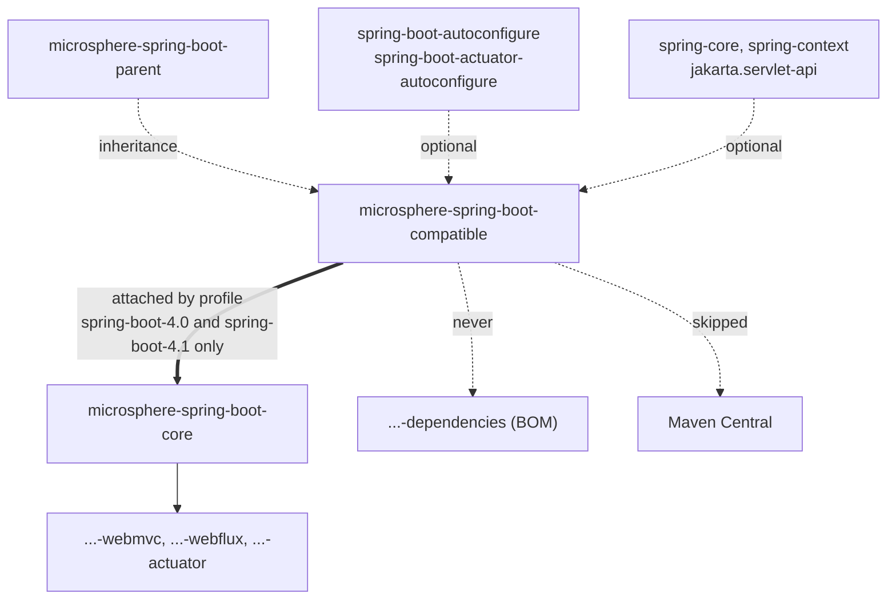

# Compatible Module

> [中文](./zh/compatible.md) · [Documentation index](../README.md) ·
> [User Guide for this module](../../user-guide/current/compatible.md)

> **Branch:** `release` · **Version line:** `0.2.x` · **Artifact:** `microsphere-spring-boot-compatible`

> **Status:** not published · not in the BOM · build-time only · 10 source files, 0 tests

Contents:
[1 The Build-Time Problem](#1-the-build-time-problem) ·
[2 Module Position](#2-module-position) ·
[3 The Ten-File Inventory](#3-the-ten-file-inventory) ·
[4 Two Publication Kill-Switches](#4-two-publication-kill-switches) ·
[5 How core Attaches the Module](#5-how-core-attaches-the-module) ·
[6 Reactor Ordering](#6-reactor-ordering) ·
[7 Same FQCN at Build Time versus Runtime](#7-same-fqcn-at-build-time-versus-runtime) ·
[8 The Class-Clash Failure Mode](#8-the-class-clash-failure-mode) ·
[9 Shim or By-Name Condition](#9-shim-or-by-name-condition) ·
[10 Recipes](#10-recipes) ·
[11 Invariants](#11-invariants) ·
[12 See Also](#12-see-also)

---

## 1. The Build-Time Problem

`core`'s sources name Spring Boot types by fully-qualified class — `SpringApplicationRunListenerAdapter.java`
line 3 and `LoggingSpringApplicationRunListener.java` line 21 both
`import org.springframework.boot.ConfigurableBootstrapContext;`, and the former declares
`public void starting(ConfigurableBootstrapContext bootstrapContext)` (line 63; the latter line 72). Test code
in `core` goes further and instantiates property classes: `new ServerProperties()`,
`Bindable<ServerProperties>`, `new ConfigurationPropertiesBeanInfo(MultipartProperties.class)`.

Those names are Boot `3.5` names, and `package-info.java` states the premise directly: "The classes in this
package or sub-packages are forked from the Spring Boot 3.5.x, which will be used to be compatible with the
lower versions of Spring Boot." The reactor must compile the same source against Boot `3.0.13` … `4.1.1`, and
javac cannot compile a type reference by string. `microsphere-spring-boot-compatible` therefore re-supplies
the Boot `3.5` types under their original names so the references resolve, and it is kept off every published
artifact and every runtime classpath to make that harmless.

The `@since` tags inside the forked files are the evidence of what each type is: `ServerProperties` `1.0.0`,
`MultipartConfigFactory` `1.4.0`, `JacksonProperties` `1.2.0`, `MultipartProperties` `2.0.0`, and the five
bootstrap types `2.4.0` (`InstanceSupplier` and `Scope` `2.4.2`).

---

## 2. Module Position



The double edge is the only production relationship the module has, and it is conditional: outside the two
Boot `4` profiles nothing depends on `compatible`, so the reactor still builds the jar but no module consumes
it. The dotted "never" and "skipped" edges are enforced by the mechanisms in §4 and §11.

---

## 3. The Ten-File Inventory

All ten files live under `microsphere-spring-boot-compatible/src/main/java`, every one in an
`org.springframework.boot.*` package. `@since` values are read from each file's javadoc.

| FQCN | Lines | Nested types | `@since` | Used in this repository by |
|---|---|---|---|---|
| `org.springframework.boot.BootstrapContext` | 92 | — | `2.4.0` | Nothing outside the shim package |
| `org.springframework.boot.BootstrapContextClosedEvent` | 56 | — | `2.4.0` | Nothing outside the shim package |
| `org.springframework.boot.BootstrapRegistry` | 196 | `InstanceSupplier<T>` (103), `Scope` (180) | `2.4.0`; nested `2.4.2` | Nothing outside the shim package |
| `org.springframework.boot.ConfigurableBootstrapContext` | 31 | — | `2.4.0` | `core` main: `listener/SpringApplicationRunListenerAdapter.java` (3, 63), `listener/LoggingSpringApplicationRunListener.java` (21, 72); `core` test: `LoggingSpringApplicationRunListenerTest.java` (22) |
| `org.springframework.boot.DefaultBootstrapContext` | 137 | — | `2.4.0` | `core` test: `LoggingSpringApplicationRunListenerTest.java` (23) |
| `org.springframework.boot.autoconfigure.jackson.JacksonProperties` | 142 | `ConstructorDetectorStrategy` (118) | `1.2.0` | `core` test: `properties/bind/ConfigurationPropertiesBeanContextTest.java` (24, 93) |
| `org.springframework.boot.autoconfigure.web.ServerProperties` | 1073 | `Servlet`, `Reactive`, `Reactive.Session`, `Tomcat`, `Tomcat.Accesslog`, `Tomcat.Threads`, `Tomcat.Resource`, `Tomcat.Mbeanregistry`, `Tomcat.Remoteip`, `Tomcat.UseApr` | `1.0.0` | `core` test only: seven files under `src/test/java/io/microsphere/spring/boot/context/properties/…` plus `util/TestUtils.java` |
| `org.springframework.boot.autoconfigure.web.servlet.MultipartProperties` | 143 | — | `2.0.0` | `core` test: `ConfigurationPropertiesBeanInfoTest.java` (23, 68) |
| `org.springframework.boot.web.servlet.MultipartConfigFactory` | 103 | — | `1.4.0` | Only the shim `MultipartProperties`, which imports it at line 21 |
| `org.springframework.boot package-info` | 24 | — | `1.0.0` | Records the fork from Boot `3.5.x` |

Two entries deserve a note. `MultipartConfigFactory` exists purely because the forked `MultipartProperties`
imports and mentions it — nothing in `core`, `webmvc`, `webflux` or `actuator` references the type — and three
of the five bootstrap files are self-referential inside the shim package, kept only so that
`ConfigurableBootstrapContext`, which extends both `BootstrapRegistry` and `BootstrapContext`, can compile.
The property classes are trimmed forks rather than copies: `JacksonProperties` declares six fields, and
`MultipartProperties` has accessors only, with `grep -c createMultipartConfigElement` returning `0` even
though the file still imports `jakarta.servlet.MultipartConfigElement`. §7 explains why that matters.

---

## 4. Two Publication Kill-Switches

Publication is disabled twice, once for the classic deploy path and once for the Sonatype Central publisher.
From `microsphere-spring-boot-compatible/pom.xml` lines 58–76:

```xml
<build>
    <plugins>
        <plugin>
            <groupId>org.apache.maven.plugins</groupId>
            <artifactId>maven-deploy-plugin</artifactId>
            <configuration>
                <skip>true</skip>
            </configuration>
        </plugin>

        <plugin>
            <groupId>org.sonatype.central</groupId>
            <artifactId>central-publishing-maven-plugin</artifactId>
            <configuration>
                <skipPublishing>true</skipPublishing>
            </configuration>
        </plugin>
    </plugins>
</build>
```

Both are needed because they gate different code paths: `maven-deploy-plugin` controls `mvn deploy` to a
repository, `central-publishing-maven-plugin` controls the Central bundle upload. Either alone leaves a route
by which a jar of fake `org.springframework.boot.*` classes could reach a consumer. The `deploy` step in
`.github/workflows/maven-publish.yml` runs `./mvnw … deploy --activate-profiles publish,ci`, so the switches
are the only thing standing between this module and Maven Central.

The module inherits `microsphere-spring-boot-parent` (lines 6–11) and declares five versionless
`<optional>true</optional>` dependencies: `spring-boot-autoconfigure` (24–28),
`spring-boot-actuator-autoconfigure` (30–34), `spring-core` (37–41), `spring-context` (43–47) and
`jakarta.servlet:jakarta.servlet-api` (50–54), under the comment
`<!-- Spring Boot (prevent forking anything) -->`. Packaging is `jar` (line 16); there is no
`<dependencyManagement>`, no plugin beyond the two above, and no test source at all.

---

## 5. How core Attaches the Module

`core` is the only consumer, and it attaches the shim inside two profiles
(`microsphere-spring-boot-core/pom.xml` lines 97–121):

```xml
<!-- microsphere-spring-boot-core/pom.xml, lines 97-121 -->
<profiles>
    <profile>
        <id>spring-boot-4.0</id>
        <dependencies>
            <!-- Compatible -->
            <dependency>
                <groupId>io.github.microsphere-projects</groupId>
                <artifactId>microsphere-spring-boot-compatible</artifactId>
                <version>${revision}</version>
            </dependency>
        </dependencies>
    </profile>

    <!-- lines 110-120: the spring-boot-4.1 profile repeats the same dependency, identical but for the id -->
</profiles>
```

The dependency carries no `<scope>`, so it is compile scope — but only while one of those two profiles is
active. Publishing activates neither (`--activate-profiles publish,ci`), so the deployed `core` POM cannot
reference an artifact that does not exist on Central. That is the single most fragile property of this design:
adding a Boot `4.x` profile to the publish command, or moving the dependency out of the profiles, would
publish a `core` that no consumer can resolve. The block is duplicated rather than shared because Maven
profiles cannot reference a fragment without a second POM, so each new Boot line adds a copy.

---

## 6. Reactor Ordering

`<modules>` in the root `pom.xml` (lines 58–67) lists `microsphere-spring-boot-compatible` at line 61 and
`microsphere-spring-boot-core` at line 63, and `microsphere-spring-boot-parent` at line 59 first of all —
`compatible` inherits from that parent, so it must be built after it. Because the profiles in §5 declare the
shim with `${revision}` rather than a `<dependencyManagement>` entry, Maven resolves it from the reactor, and
that only works if the module has already been built in the same session.

Moving `compatible` below `core` therefore breaks every Boot `4` build with an unresolvable
`io.github.microsphere-projects:microsphere-spring-boot-compatible:${revision}` — and it breaks *only* those
builds, so a default-profile CI run would not catch it. Any reordering must be verified with
`--activate-profiles spring-boot-4.1`.

---

## 7. Same FQCN at Build Time versus Runtime

At compile time, a duplicate FQCN is not a conflict: javac resolves each name against the classpath in order
and binds to exactly one class file. Nothing here merges, patches or reflections-into Boot, so the only
requirement is that *some* class with the right name and the members the source uses is present. That is why
the forks can be trimmed — `JacksonProperties` needs only the six properties `core`'s tests touch, and
`MultipartProperties` needs only its accessors.

At runtime the same jar is a liability, for three reasons specific to this branch:

- Whichever copy the classloader reaches first wins for every user of that name, including Boot itself. The
  attachment profiles make the shim visible to `core` at compile scope, so any change that leaks it into a
  published POM puts it on real applications' classpaths.
- Boot's own code calls members the trimmed forks do not declare. `MultipartProperties` has no
  `createMultipartConfigElement()`, so a call into the shim version fails with `NoSuchMethodError`.
- Some shims cannot even be driven from outside their package. `BootstrapContextClosedEvent`'s only
  constructor is package-private (line 33), so a relocated Boot class trying to publish the event would hit
  `IllegalAccessError` against the fork.

For `@ConfigurationProperties` types the failure is quieter and worse: binding the shim `JacksonProperties`
would silently accept six properties and ignore the rest of `spring.jackson.*`, because the shim is annotated
`@ConfigurationProperties("spring.jackson")` exactly like the original.

---

## 8. The Class-Clash Failure Mode

Concretely, if `microsphere-spring-boot-compatible` ever reached an application classpath on a Boot version
that also ships the real types, the symptoms would be ordered by which copy wins:

| Winner | Symptom | Timing |
|---|---|---|
| Shim | `NoSuchMethodError` on `createMultipartConfigElement()`, or `LinkageError` on the package-private event constructor | First code path that touches the type |
| Shim | Properties under `spring.jackson.*`, `server.*`, `spring.servlet.multipart.*` bind to the six-field fork, unknown properties vanish | Context refresh |
| Real Boot | `core` code compiled against the shim's shape still resolves, so nothing fails — the build looks fine while the shipped artifact is unverifiable | Never |

The third row is the trap: a leaked shim can pass a smoke test, so "it works" is not evidence. The check that
matters is §11's invariant list, plus the `dependency:tree` recipe in §10.3.

---

## 9. Shim or By-Name Condition

The rule this branch follows: a shim is only for a type the compiler must see. Everything else is a by-name
string.

| Situation | Mechanism | Evidence on this branch |
|---|---|---|
| Type used as a Java type — declaration, generic argument, `Foo.class`, `new Foo()`, method parameter | Shim class in `compatible`, attached per profile | `ServerProperties` across seven `core` test files; `ConfigurableBootstrapContext` as a `starting(…)` parameter |
| Type only *looked up* by Spring at runtime — condition evaluation, ordering by name | By-name string, zero compile dependency | `@ConditionalOnClass(name = …)` in `webmvc`/`webflux`/`actuator`/`core` |

**Shim worked example.** `core`'s `ConfigurationPropertiesBeanContextTest` declares
`private static ResolvableType beanType = forRawClass(ServerProperties.class);` and calls
`new ServerProperties()`. `Class` literals and constructors are compile-time constructs; a by-name attribute
cannot help, so `org.springframework.boot.autoconfigure.web.ServerProperties` must exist as a type, and the
profile of §5 is what puts it there for Boot `4` builds.

**By-name worked example.**
`microsphere-spring-boot-actuator/src/main/java/io/microsphere/spring/boot/actuate/condition/ConditionalOnActuatorEndpointPresent.java`
line 42 is `@ConditionalOnClass(name = "org.springframework.boot.actuate.endpoint.annotation.Endpoint")`, and
`ConditionalOnWebMvcAvailable.java` lines 46–53 list six class names as strings. The annotation never loads a
class at compile time, so the same source compiles unchanged on every Boot line — no shim, no profile.
`core`'s `ConfigurationPropertiesAutoConfiguration.java` extends the trick to ordering, with
`@AutoConfigureBefore(name = "org.springframework.boot.autoconfigure.context.ConfigurationPropertiesAutoConfiguration")`.

Choosing wrongly is expensive in both directions: a shim for a lookup-only type adds an unpublished artifact
to a build graph for no benefit, and a by-name string for a compile-time reference produces
`cannot find symbol` on the Boot `4` profiles only.

---

## 10. Recipes

### 10.1 Add a shim

1. Create the file under `microsphere-spring-boot-compatible/src/main/java/<boot package path>/`, copying
   the Boot `3.5.x` source. Keep the package, the class name, the `@since` javadoc value and the Apache
   header; the name is the entire point.
2. Reduce it to the members this repository actually references, but keep any annotation whose behaviour the
   consumer depends on — `@ConfigurationProperties("server")` on `ServerProperties` is load-bearing.
3. If the copy needs a Boot, Spring or servlet type not already on the module's classpath, add it to the
   five optional dependencies in `microsphere-spring-boot-compatible/pom.xml` — never non-optional.
4. If the consumer is `core`, no POM change is needed: the profiles of §5 already attach the jar. A different
   consumer needs its own copy of that profile block.
5. Verify with §10.3 on both Boot `4` profiles, then on the default profile.

### 10.2 Remove an obsolete shim

1. `grep -rn "SimpleTypeName" microsphere-spring-boot-*/src` and confirm the only hits are inside
   `microsphere-spring-boot-compatible` itself; a nested type counts separately, as `MultipartProperties` and
   `MultipartConfigFactory` do.
2. Delete the file, rebuild `--activate-profiles spring-boot-4.0` and `spring-boot-4.1`, then the default
   profile.
3. Never delete `BootstrapContext`, `BootstrapRegistry`, `BootstrapContextClosedEvent` while
   `ConfigurableBootstrapContext` remains: it extends both, and the event type appears in
   `addCloseListener` signatures.

### 10.3 Verify attachment

```bash
mvn --activate-profiles spring-boot-4.1 --file microsphere-spring-boot-core/pom.xml \
    dependency:tree -Dincludes=io.github.microsphere-projects:microsphere-spring-boot-compatible
mvn --activate-profiles spring-boot-3.5 --file microsphere-spring-boot-core/pom.xml \
    dependency:tree -Dincludes=io.github.microsphere-projects:microsphere-spring-boot-compatible
```

The first prints the module, the second must print nothing. Then confirm the artifact is unresolvable
downstream: `mvn dependency:get -Dartifact=io.github.microsphere-projects:microsphere-spring-boot-compatible:${revision}`
should fail against Central.

---

## 11. Invariants

| Invariant | Enforced by | Check |
|---|---|---|
| Never in the BOM | `microsphere-spring-boot-dependencies` lists five artifacts and no `compatible` entry | §2 dotted edge, §10.3 |
| Never compile scope of a *published* module's default build | Attachment lives in the `spring-boot-4.0` / `spring-boot-4.1` profiles of `core` only, and publishing activates neither | POM lines 97–121 versus the publish command |
| Never deployed | `<skip>true</skip>` and `<skipPublishing>true</skipPublishing>` | POM lines 58–76 |
| Package and class names must match Spring Boot exactly | `package-info.java` records the fork; every file begins in an `org.springframework.boot.*` package | `grep -n "^package"` over the ten files |
| No tests, no resources | Ten files, all under `src/main/java` | `find microsphere-spring-boot-compatible -type f` |
| Built before `core` | Root `<modules>` order, line 61 before line 63 | §6 |

---

## 12. See Also

- [User guide for this module](../../user-guide/current/compatible.md) — what application developers must do
- [parent.md](./parent.md) — the profiles that select the Boot line the shim is compiled against
- [dependencies.md](./dependencies.md) — the BOM that deliberately omits this module
- [core.md](./core.md) — the only consumer, and the listeners that import the bootstrap shim
- [test.md](./test.md) — a module with the opposite publication policy
- [Build and Release Pipeline](./build-and-release.md) — profile activation in CI
