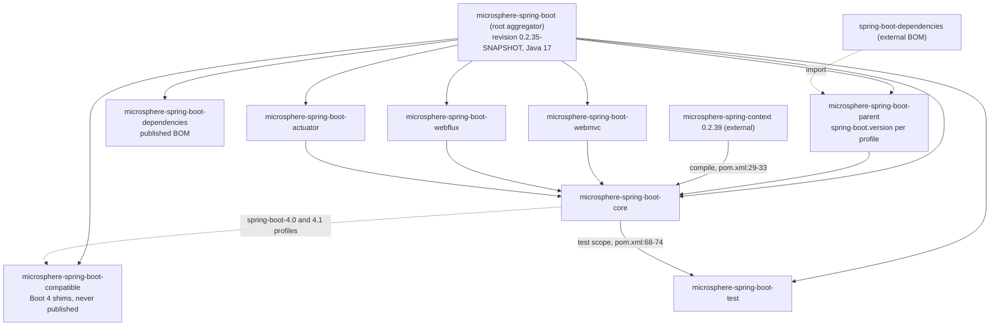
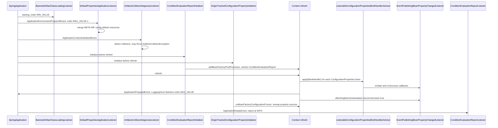
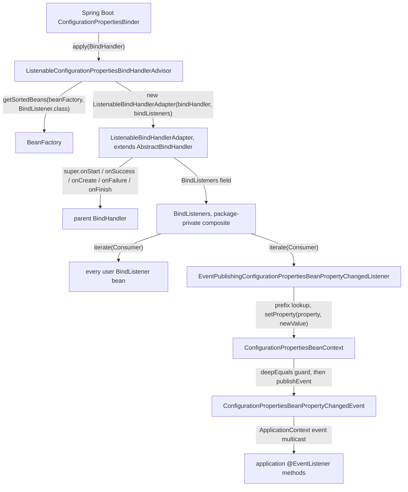
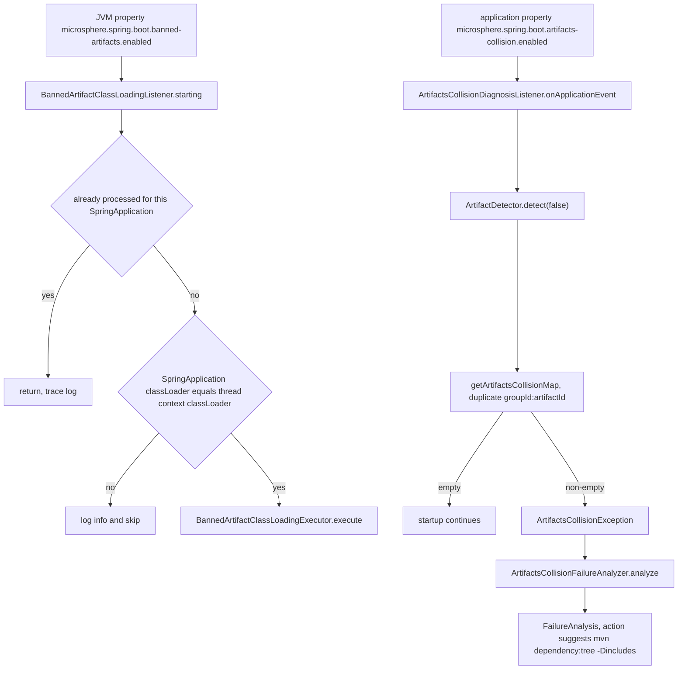
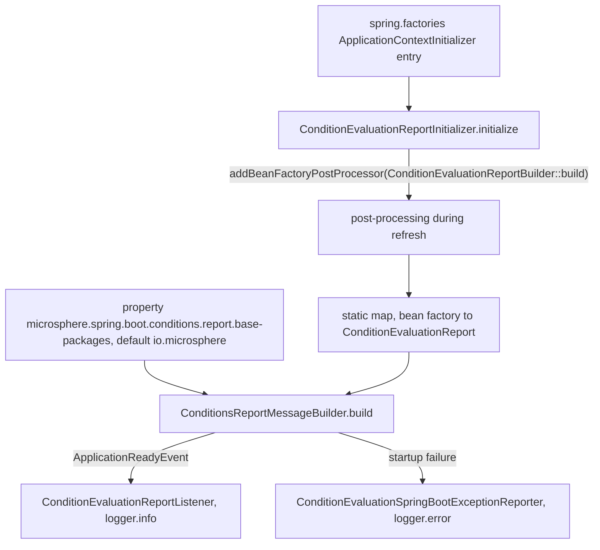
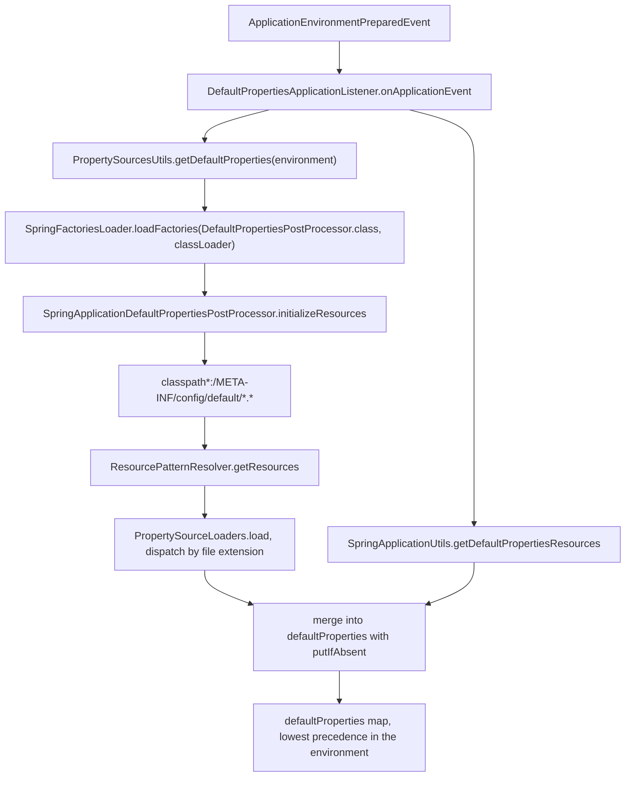

# Core Module

> [中文](./zh/core.md) · [Documentation index](../README.md) ·
> [User Guide for this module](../../user-guide/current/core.md)

> **Branch:** `release` · **Version line:** `0.2.x` · **Artifact:** `microsphere-spring-boot-core`
> **Spring Boot:** `3.0.13` – `4.1.1` · **Java:** 17

Contents:
[1 Position in the Reactor](#1-position-in-the-reactor) ·
[2 Package Map](#2-package-map) ·
[3 Extension Point Wiring](#3-extension-point-wiring) ·
[4 Startup Sequence and Ordering](#4-startup-sequence-and-ordering) ·
[5 Binding Advisor Chain](#5-binding-advisor-chain) ·
[6 Diagnostics Pipelines](#6-diagnostics-pipelines) ·
[7 Default Properties Mechanism](#7-default-properties-mechanism) ·
[8 Design Patterns Inventory](#8-design-patterns-inventory) ·
[9 Enable Configuration Properties Extension](#9-enable-configuration-properties-extension) ·
[10 Test Suite Map](#10-test-suite-map) ·
[11 Change Recipes](#11-change-recipes) ·
[12 Pitfalls and Invariants](#12-pitfalls-and-invariants) ·
[13 See Also](#13-see-also)

---

## 1. Position in the Reactor

`microsphere-spring-boot-core` is module number five of the eight-module reactor declared in the root
aggregator (`pom.xml:58-67`). It is the lowest-level *code* module: `webmvc`, `webflux` and `actuator` all
declare it as a compile dependency (`microsphere-spring-boot-webmvc/pom.xml:33`,
`microsphere-spring-boot-webflux/pom.xml:33`, `microsphere-spring-boot-actuator/pom.xml:33`), so anything
registered here is active in every downstream artifact.

Its own POM (`microsphere-spring-boot-core/pom.xml`) inherits from `microsphere-spring-boot-parent`
(lines 5–10) and therefore from the aggregator's `${revision}` = `0.2.35-SNAPSHOT` (`pom.xml:54`) and
`java.version` 17 (`pom.xml:55`). The dependency set is deliberately thin (lines 20–95):

| Dependency | Scope / optionality | Why it is there |
|---|---|---|
| `microsphere-annotation-processor` | optional, `pom.xml:23-27` | generates metadata for `@ConfigurationProperty` markers. |
| `microsphere-spring-context` | compile (no `<optional>`), `pom.xml:29-33` | supplies `Version`, `BeanSource`, `BeanPropertyChangedEvent`, `ConfigurableApplicationContextInitializer`, `ConfigurationBeanBinder`; version comes from the `microsphere-spring-dependencies` BOM `0.2.39` imported by the parent (`microsphere-spring-boot-parent/pom.xml:22`, `57-64`). |
| `spring-boot-starter` | optional, `pom.xml:36-40` | compile-time Boot API; the consumer's Boot line (set by the parent profiles, `microsphere-spring-boot-parent/pom.xml:78-132`) decides the runtime. |
| `spring-boot-configuration-processor` / `spring-boot-autoconfigure-processor` | optional, `pom.xml:42-52` | annotation processors only, never transitive. |
| `microsphere-spring-boot-test`, `spring-boot-starter-test`, `junit-jupiter`, `spring-boot-starter-web`, `spring-boot-loader`, `jakarta.annotation-api` | test, `pom.xml:55-93` | test harness only. `jakarta.annotation-api` has a visible consumer (`@Resource` injection in `autoconfigure/ApplicationAutoConfigurationTest`); `spring-boot-starter-web` and `spring-boot-loader` are declared at test scope with no direct user in this module — `util/TestUtils` builds every `SpringApplication` with `WebApplicationType.NONE` (`:49`). |
| `microsphere-spring-boot-compatible` | added **only** by the `spring-boot-4.0` and `spring-boot-4.1` profiles, `pom.xml:97-121` | build-time shim for classes Boot 4 relocated; the module itself is never deployed (`microsphere-spring-boot-compatible/pom.xml:62-64`, `70-72`). |



---

## 2. Package Map

47 classes under `io.microsphere.spring.boot.*`. Line citations are relative to
`microsphere-spring-boot-core/src/main/java/io/microsphere/spring/boot/`.

| Package | Class | Responsibility |
|---|---|---|
| root | `SpringBootVersion` | Enum of every Boot release since 3.0; the constant name is parsed into a `Version` by dropping the `SPRING_BOOT_` prefix (`SpringBootVersion.java:250-253`), `CURRENT` reads the runtime Boot version (`:238`). |
| `autoconfigure` | `ConfigurableAutoConfigurationImportFilter` | `AutoConfigurationImportFilter` honouring `microsphere.autoconfigure.exclude` (`:60`), order `HIGHEST_PRECEDENCE + 99` (`:276`). |
| `classloading` | `BannedArtifactClassLoadingListener` | Run listener that bans colliding artifacts from class loading when a **JVM** property is set (`:55`, `:135`). |
| `condition` | `ConditionalOnPropertyPrefix` | Annotation, `@Conditional(OnPropertyPrefixCondition.class)` (`:54`), matches on property-name prefixes (`:65`). |
| `condition` | `OnPropertyPrefixCondition` | `SpringBootCondition` that scans `ConfigurableEnvironment` property names for the prefixes (`:66-86`). |
| `constants` | `PropertyConstants` | `microsphere.spring.boot.` prefix (`:35`), logging-level property name and its `TRACE` default (`:40`, `:49`). |
| `constants` | `SpringBootPropertyConstants` | `spring.autoconfigure.exclude` (`:23`) and the attached `configurationProperties` source name (`:30`). |
| `context` | `OnceApplicationPreparedEventListener` | Template base: handles `ApplicationPreparedEvent` at most once per context id (`:46-48`, `:90-118`). |
| `context` | `OnceMainApplicationPreparedEventListener` | Adds Spring Cloud bootstrap filtering: ignore bootstrap contexts and non-main contexts (`:37`, `:91-96`). |
| `context` | `LoggingOnceApplicationPreparedEventListener` | Concrete one-shot listener that dumps `SpringApplication` state via `SpringApplicationUtils.log` (`:66`) and self-disables at the default level (`:86-88`). |
| `context` | `LoggingOnceMainApplicationPreparedEventListener` | Same log call, main-context-only variant (`:32`, `:65`). |
| `context.autoconfigure` | `ConfigurationPropertiesAutoConfiguration` | One-annotation class: `@ConditionalOnClass(name = "io.microsphere.spring.context.annotation.BeanCapableImportCandidate")` + `@AutoConfigureBefore` Boot's own counterpart + `@EnableConfigurationPropertiesExtension` (`:35-42`). |
| `context.config` | `BindableConfigurationBeanBinder` | `ConfigurationBeanBinder` over Boot's `Binder`, binding an arbitrary map onto an existing bean at empty prefix (`:97-115`). |
| `context.properties` | `ConfigurationPropertiesBeanInfo` | Introspection value object: bean class + annotation + prefix (annotation `prefix` else `value`, `:111`) + `PropertyDescriptor[]` (`:120-128`). |
| `context.properties` | `ListenableConfigurationPropertiesBindHandlerAdvisor` | `ConfigurationPropertiesBindHandlerAdvisor` + `BeanFactoryAware`; wraps the handler with sorted `BindListener` beans (`:95-98`). |
| `context.properties.annotation` | `EnableConfigurationPropertiesExtension` | `adviseBindListener`, `publishEvents`, `sources` switches (`:99`, `:116`, `:132`), `@Import`s the registrar (`:86`). |
| `context.properties.annotation` | `EnableConfigurationPropertiesExtensionRegistrar` | Registers the advisor, the event-publishing listener and externally discovered `BindListener` / `ConfigurationPropertiesBindHandlerAdvisor` beans (`:59-74`). |
| `context.properties.bind` | `BindListener` | Five default no-op bind callbacks mirroring `BindHandler` (`:47-99`). |
| `context.properties.bind` | `BindListeners` | Package-private composite implementing `BindListener` over an `Iterable` (`:31`, `:148-150`). |
| `context.properties.bind` | `ConfigurationPropertiesBeanContext` | Per-`@ConfigurationProperties`-bean snapshot of property values keyed by `ConfigurationPropertyName`; detects changes and publishes events (`:81`, `:303-330`, `:384-390`). |
| `context.properties.bind` | `ConfigurationPropertiesBeanProperty` | Mutable property holder: field/getter/setter + declaring type, lazy name (`:112-133`) and lazy `ResolvableType` (`:135-148`). |
| `context.properties.bind` | `ConfigurationPropertiesBeanPropertyChangedEvent` | Extends `BeanPropertyChangedEvent` with property type and the triggering `ConfigurationProperty` (`:34-56`). |
| `context.properties.bind` | `EventPublishingConfigurationPropertiesBeanPropertyChangedListener` | The `BindListener` that turns binding callbacks into change events; two-phase, snapshot until `afterSingletonsInstantiated`, publish afterwards (`:53`, `:72-93`, `:177-182`). |
| `context.properties.bind` | `ListenableBindHandlerAdapter` | `AbstractBindHandler` decorator that fans each callback out to `BindListeners` (`:37`, `:90-193`). |
| `context.properties.bind.util` | `BindHandlerUtils` | `createBindHandler(ignoreUnknownFields, ignoreInvalidFields)` composes `IgnoreErrorsBindHandler` / `NoUnboundElementsBindHandler` (`:62-71`). |
| `context.properties.bind.util` | `BindUtils` | Depth predicates (`:124`, `:153`), `bind(...)` helpers with listeners (`:190`, `:232`, `:290`), null-safe `getBindConstructor` (`:246-272`). |
| `context.properties.metadata` | `ConfigurationMetadataReader` | Merges `spring-configuration-metadata.json` and `additional-spring-configuration-metadata.json` from `classpath*:` (`:49-51`, `:69-74`). |
| `context.properties.source.util` | `ConfigurationPropertyUtils` | Prefix arithmetic over `ConfigurationPropertyName` (`:86-104`), reflective read of Boot internals (`:114`, `:160-190`), `toDashedForm` bridge (`:149`). |
| `context.properties.util` | `ConfigurationPropertiesUtils` | Holds the `@ConfigurationProperties` class token (`:37`) and finds the annotation from a `Bindable` either in its annotations or on its type (`:72-82`). |
| `diagnostics` | `ArtifactsCollisionDiagnosisListener` | `ApplicationContextInitializedEvent` listener; scans artifacts, throws on duplicates (`:60`, `:89-112`). |
| `diagnostics` | `ArtifactsCollisionException` | `RuntimeException` carrying the colliding `groupId:artifactId` set (`:11`, `:27-49`). |
| `diagnostics` | `ArtifactsCollisionFailureAnalyzer` | `AbstractFailureAnalyzer` turning the exception into a `FailureAnalysis` with a `mvn dependency:tree` action (`:17`, `:36-51`). |
| `env` | `DefaultPropertiesApplicationListener` | Loads `defaultProperties` at `ApplicationEnvironmentPreparedEvent`, order `LOWEST_PRECEDENCE - 1` (`:76`). |
| `env` | `DefaultPropertiesPostProcessor` | SPI: `initializeResources(Set)` + optional `postProcess(Map)`, `Ordered` default lowest (`:43-68`). |
| `env` | `PropertySourceLoaders` | Composite `PropertySourceLoader` dispatching by file extension, plus origin-tracking reload (`:66`, `:159`, `:177`). |
| `env` | `SpringApplicationDefaultPropertiesPostProcessor` | Contributes `classpath*:/META-INF/config/default/*.*` (`:39`, `:58-61`). |
| `env.config` | `OriginTrackedConfigurationPropertyInitializer` | Context initializer; on bean-factory freeze it replaces non-`OriginLookup` enumerable sources with origin-tracked ones (`:50`, `:95-132`). |
| `env.config.metadata` | `ConfigurationMetadataRepository` | `CommandLineRunner` that indexes metadata into group/property/hint maps (`:46`, `:232-268`). |
| `listener` | `SpringApplicationRunListenerAdapter` | Deprecated base with empty lifecycle hooks, `Ordered`, default order `0` (`:19-20`, `:43-47`). |
| `listener` | `LoggingSpringApplicationRunListener` | Deprecated adapter subclass that logs every phase (`:39-40`, `:72-196`). |
| `listener` | `FailureReportSpringApplicationRunListener` | Deprecated adapter subclass; `failed(...)` prints the stack trace to `System.err` (`:16-17`, `:52-55`). |
| `report` | `ConditionEvaluationReportBuilder` | Package-private cache of `ConditionEvaluationReport` per bean factory (`:21-39`), id via `getSerializationId` (`:80-85`). |
| `report` | `ConditionEvaluationReportInitializer` | Registers `ConditionEvaluationReportBuilder::build` as a `BeanFactoryPostProcessor` (`:30`). |
| `report` | `ConditionEvaluationReportListener` | Reports conditions at `ApplicationReadyEvent`, INFO level (`:16`, `:34-53`). |
| `report` | `ConditionEvaluationSpringBootExceptionReporter` | `SpringBootExceptionReporter` holding the context; ERROR level report on failure, returns `false` (`:17-35`, `:55-58`). |
| `report` | `ConditionsReportMessageBuilder` | Formats exclusions, unconditional classes and condition outcomes filtered by base packages (`:38`, `:71-100`, `:153-157`). |
| `util` | `SpringApplicationUtils` | Programmatic default-properties resource registry (`:37-72`), resource loader resolution (`:89-95`), level-driven `log(...)` (`:127-189`). |

---

## 3. Extension Point Wiring

`microsphere-spring-boot-core/src/main/resources/META-INF/spring.factories` is the whole wiring surface,
quoted verbatim:

```
org.springframework.context.ApplicationContextInitializer=\
io.microsphere.spring.boot.report.ConditionEvaluationReportInitializer,\
io.microsphere.spring.boot.env.config.OriginTrackedConfigurationPropertyInitializer

org.springframework.boot.SpringApplicationRunListener=\
io.microsphere.spring.boot.classloading.BannedArtifactClassLoadingListener,\
io.microsphere.spring.boot.listener.FailureReportSpringApplicationRunListener

org.springframework.context.ApplicationListener=\
io.microsphere.spring.boot.diagnostics.ArtifactsCollisionDiagnosisListener,\
io.microsphere.spring.boot.report.ConditionEvaluationReportListener,\
io.microsphere.spring.boot.env.DefaultPropertiesApplicationListener

org.springframework.boot.SpringBootExceptionReporter=\
io.microsphere.spring.boot.report.ConditionEvaluationSpringBootExceptionReporter

org.springframework.boot.diagnostics.FailureAnalyzer=\
io.microsphere.spring.boot.diagnostics.ArtifactsCollisionFailureAnalyzer

org.springframework.boot.autoconfigure.AutoConfigurationImportFilter=\
io.microsphere.spring.boot.autoconfigure.ConfigurableAutoConfigurationImportFilter

io.microsphere.spring.boot.env.DefaultPropertiesPostProcessor=\
io.microsphere.spring.boot.env.SpringApplicationDefaultPropertiesPostProcessor
```

| Extension point key | Registered class | Interface actually implemented | Registration mechanics |
|---|---|---|---|
| `ApplicationContextInitializer` | `ConditionEvaluationReportInitializer`, `OriginTrackedConfigurationPropertyInitializer` | `ApplicationContextInitializer<ConfigurableApplicationContext>` (`report/ConditionEvaluationReportInitializer.java:13`) / `ConfigurableApplicationContextInitializer` + `BeanFactoryListenerAdapter` (`env/config/OriginTrackedConfigurationPropertyInitializer.java:50`) | Boot loads them before `refresh`, i.e. before bean definitions are read. |
| `SpringApplicationRunListener` | `BannedArtifactClassLoadingListener`, `FailureReportSpringApplicationRunListener` | both extend `SpringApplicationRunListenerAdapter`, which implements `SpringApplicationRunListener, Ordered` (`listener/SpringApplicationRunListenerAdapter.java:20`) | Boot instantiates with `(SpringApplication, String[])`; the adapter constructor signature is `BannedArtifactClassLoadingListener.java:77`. |
| `ApplicationListener` | `ArtifactsCollisionDiagnosisListener`, `ConditionEvaluationReportListener`, `DefaultPropertiesApplicationListener` | typed to `ApplicationContextInitializedEvent` (`diagnostics/...:60`), `ApplicationReadyEvent` (`report/...:16`), `ApplicationEnvironmentPreparedEvent` (`env/...:74`) | Multicaster picks them by event generics; ordering only where `Ordered` is implemented. |
| `SpringBootExceptionReporter` | `ConditionEvaluationSpringBootExceptionReporter` | `SpringBootExceptionReporter` (`report/...:17`) | Constructor is `(ConfigurableApplicationContext)` (`:35`) — see section 12. |
| `FailureAnalyzer` | `ArtifactsCollisionFailureAnalyzer` | `AbstractFailureAnalyzer<ArtifactsCollisionException>` (`diagnostics/...:17`) | Analyzes the thrown exception type only. |
| `AutoConfigurationImportFilter` | `ConfigurableAutoConfigurationImportFilter` | `AutoConfigurationImportFilter, EnvironmentAware, Ordered` (`autoconfigure/...:53`) | Filters candidate auto-configuration class names before import. |
| `io.microsphere.spring.boot.env.DefaultPropertiesPostProcessor` (module-private key) | `SpringApplicationDefaultPropertiesPostProcessor` | `DefaultPropertiesPostProcessor extends Ordered` (`env/...:43`) | **Not** a Spring key: only `SpringFactoriesLoader.loadFactories(DefaultPropertiesPostProcessor.class, classLoader)` inside `DefaultPropertiesApplicationListener.java:126` reads it. |

Auto-configuration uses the Boot 2.7+ file instead:
`META-INF/spring/org.springframework.boot.autoconfigure.AutoConfiguration.imports:1` lists exactly
`io.microsphere.spring.boot.context.autoconfigure.ConfigurationPropertiesAutoConfiguration`.

---

## 4. Startup Sequence and Ordering

Ordering constants read from the code (`Ordered.HIGHEST_PRECEDENCE` = `Integer.MIN_VALUE`,
`Ordered.LOWEST_PRECEDENCE` = `Integer.MAX_VALUE`):

| Class | Ordering source | Value |
|---|---|---|
| `BannedArtifactClassLoadingListener` | `setOrder(HIGHEST_PRECEDENCE)` in constructor (`classloading/BannedArtifactClassLoadingListener.java:79`) | `Integer.MIN_VALUE` |
| `FailureReportSpringApplicationRunListener` / `LoggingSpringApplicationRunListener` | adapter constructor `this.setOrder(0)` (`listener/SpringApplicationRunListenerAdapter.java:46`); pinned by `LoggingSpringApplicationRunListenerTest.java:94` | `0` |
| `DefaultPropertiesApplicationListener` | `DEFAULT_ORDER = LOWEST_PRECEDENCE - 1` (`env/DefaultPropertiesApplicationListener.java:76`, applied `:93`) | `Integer.MAX_VALUE - 1` |
| `ConfigurableAutoConfigurationImportFilter` | `getOrder()` returns `HIGHEST_PRECEDENCE + 99` (`autoconfigure/ConfigurableAutoConfigurationImportFilter.java:275-277`) | `Integer.MIN_VALUE + 99` |
| `OnceApplicationPreparedEventListener` (and the `LoggingOnce*` subclasses) | field default `LOWEST_PRECEDENCE` (`context/OnceApplicationPreparedEventListener.java:54`) re-set explicitly at `context/LoggingOnceApplicationPreparedEventListener.java:47` and `context/LoggingOnceMainApplicationPreparedEventListener.java:45` | `Integer.MAX_VALUE` |
| `ArtifactsCollisionDiagnosisListener`, `ConditionEvaluationReportListener`, `ConditionEvaluationReportInitializer`, `OriginTrackedConfigurationPropertyInitializer` | no `Ordered` implementation at all | default |
| `DefaultPropertiesPostProcessor` implementors | interface default `getOrder()` (`env/DefaultPropertiesPostProcessor.java:66-68`), pinned by `DefaultPropertiesPostProcessorTest.java:78` | `Integer.MAX_VALUE` |

Note that both `setOrder` and `getOrder` are `final` in the adapter (`listener/SpringApplicationRunListenerAdapter.java:227`, `:243`) and in the prepared-event base
(`context/OnceApplicationPreparedEventListener.java:209`, `:226`): a subclass can change the value but can never
change *how* ordering is computed.



Two structural remarks the diagram cannot show: (a) the `LoggingOnce*PreparedEventListener` classes are **not**
registered in `main` — only in the module's test factories
(`microsphere-spring-boot-core/src/test/resources/META-INF/spring.factories:15-17`), so they are opt-in;
(b) `BannedArtifactClassLoadingListener.starting()` guards itself against a second run through a static
`ConcurrentMap<SpringApplication, Boolean>` cleared by a shutdown hook (`:57`, `:60`, `:97`).

---

## 5. Binding Advisor Chain



The exact signatures that carry the chain:

| Step | Signature | Location |
|---|---|---|
| Advisor entry | `public BindHandler apply(BindHandler bindHandler)` | `context/properties/ListenableConfigurationPropertiesBindHandlerAdvisor.java:95` |
| Listener discovery | `getSortedBeans(this.beanFactory, BindListener.class)` | same file, `:96` |
| Wrapper constructor | `public ListenableBindHandlerAdapter(BindHandler parent, Iterable<BindListener> bindListeners)` | `context/properties/bind/ListenableBindHandlerAdapter.java:69` |
| Start | `public <T> Bindable<T> onStart(ConfigurationPropertyName name, Bindable<T> target, BindContext context)` | `:90` |
| Success | `public Object onSuccess(ConfigurationPropertyName name, Bindable<?> target, BindContext context, Object result)` | `:113` |
| Create | `public Object onCreate(ConfigurationPropertyName name, Bindable<?> target, BindContext context, Object result)` | `:136` |
| Failure | `public Object onFailure(ConfigurationPropertyName name, Bindable<?> target, BindContext context, Exception error) throws Exception` | `:165` |
| Finish | `public void onFinish(ConfigurationPropertyName name, Bindable<?> target, BindContext context, Object result) throws Exception` | `:190` |
| Composite fan-out | `private void iterate(Consumer<BindListener> listenerConsumer)` | `context/properties/bind/BindListeners.java:148` |
| Event publishing hook | `void setConfigurationPropertiesBeanProperty(ConfigurationPropertyName name, Bindable<?> target, BindContext context, Object result)` | `.../EventPublishingConfigurationPropertiesBeanPropertyChangedListener.java:141` |
| Change detection | `void setProperty(ConfigurationProperty property, Object newValue)` | `.../ConfigurationPropertiesBeanContext.java:303` |
| Publication | `void publishEvent(ConfigurationProperty property, ConfigurationPropertiesBeanProperty beanProperty, Object oldValue, Object newValue)` | `.../ConfigurationPropertiesBeanContext.java:384` |

Return-value discipline is the invariant to preserve: every non-void callback returns the **parent's** value and
discards the listeners' (`ListenableBindHandlerAdapter.java:91-93`, `:114-116`, `:137-139`), because `BindListener`
callbacks are `void` (`bind/BindListener.java:47-99`). `onFailure` is the exception: listeners run only when the
parent *throws*, and the original error is rethrown (`ListenableBindHandlerAdapter.java:164-172`); a parent that
swallows the failure means `onFailure` is never broadcast — pinned by
`ListenableBindHandlerAdapterTest.java:84` (`testOnFailureWithoutThrowingException`).

The event-publishing listener is two-phase and that is what makes the events meaningful. Before the context is
fully bound it only snapshots (`onStart` → `initConfigurationPropertiesBeanContext`,
`EventPublishingConfigurationPropertiesBeanPropertyChangedListener.java:72-77`, `:95`); `afterPropertiesSet`
builds one `ConfigurationPropertiesBeanContext` per `@ConfigurationProperties` bean keyed by prefix (`:169`), and
`afterSingletonsInstantiated` finalises each snapshot and flips `bound` to `true` (`:177-182`). Only after that
does `onSuccess` → `setConfigurationPropertiesBeanProperty` (`:89-93`, `:141`) reach
`ConfigurationPropertiesBeanContext.setProperty`, which re-reads the live bean, compares with `deepEquals`
(`:337`) and publishes only on a real difference (`:324-328`).

---

## 6. Diagnostics Pipelines

### 6.1 Banned artifacts and artifact collisions

These are two independent mechanisms with one shared vocabulary; only the second raises
`ArtifactsCollisionException`.



Evidence: gate constants `classloading/BannedArtifactClassLoadingListener.java:55` (read with
`Boolean.getBoolean`, `:135`) and `diagnostics/ArtifactsCollisionDiagnosisListener.java:72` (read from the
`Environment`, `:96-100`); class-loader guard `:152-160`; duplicate detection by `ids.add(id)` failure
`diagnostics/ArtifactsCollisionDiagnosisListener.java:160-172`; throw at `:110`; analyzer
`diagnostics/ArtifactsCollisionFailureAnalyzer.java:36-51`. `ArtifactsCollisionException` is a plain
`RuntimeException` carrying the set (`diagnostics/ArtifactsCollisionException.java:11`, `:27`).

### 6.2 Condition evaluation reporting



The clever part is step two: `applicationContext.addBeanFactoryPostProcessor(ConditionEvaluationReportBuilder::build)`
(`report/ConditionEvaluationReportInitializer.java:30`) binds a method reference that takes
`ConfigurableListableBeanFactory` to a void functional interface, so the *side effect* — `reports.computeIfAbsent(beanFactory,
ConditionEvaluationReport::get)` (`report/ConditionEvaluationReportBuilder.java:37`) — is what actually populates
the cache the reporters later read through `getReportsMap()` (`:55`, imported by
`report/ConditionsReportMessageBuilder.java:15`). Report identity is the bean factory's serialization id when
available (`report/ConditionEvaluationReportBuilder.java:80-85`). Message assembly prints exclusions,
unconditional classes, then only sources starting with a configured base package
(`report/ConditionsReportMessageBuilder.java:102-136`); `ConditionEvaluationSpringBootExceptionReporter.reportException`
always returns `false` so Boot keeps its own report (`report/ConditionEvaluationSpringBootExceptionReporter.java:55-59`).

---

## 7. Default Properties Mechanism

`META-INF/config/default/core.properties` is the reason most applications using this module get graceful
shutdown without asking for it. Its real content (`microsphere-spring-boot-core/src/main/resources/META-INF/config/default/core.properties`):

| Property | Line |
|---|---|
| `server.shutdown = graceful` | `:4` |
| `spring.lifecycle.timeout-per-shutdown-phase = 60s` | `:5` |
| `spring.mvc.hiddenmethod.filter.enabled = false` | `:8` |
| `spring.mvc.formcontent.filter.enabled = false` | `:9` |
| `spring.mvc.favicon.enabled = false` | `:10` |
| `microsphere.autoconfigure.exclude=org.springframework.boot.actuate.autoconfigure.metrics.web.servlet.WebMvcMetricsAutoConfiguration` | `:16-17` |
| `microsphere.spring.event-publishing-bean.enabled = true` | `:21` |
| `microsphere.spring.listenable-autowire-candidate-resolver.enabled = false` | `:22` |
| `microsphere.spring.listenable-environment.enabled = false` | `:23` |



Ordering inside the mechanism, straight from `env/DefaultPropertiesApplicationListener.java`:

1. The mutable map is obtained once — `getDefaultProperties(environment)` (`:117`).
2. Every `DefaultPropertiesPostProcessor` from the private `spring.factories` key runs **in factory order**:
   `initializeResources(Set)` then resource loading then `postProcess(Map)` (`:126-130`, `:146-166`).
3. The programmatic registry `SpringApplicationUtils.getDefaultPropertiesResources()` is drained **after** all
   processors, as a compatibility path (`:133`, `util/SpringApplicationUtils.java:70-72`, additions via `:48-65`).
4. Resources are parsed by `PropertySourceLoaders`, a composite over the `PropertySourceLoader` factories loaded
   with `loadFactories(PropertySourceLoader.class, ...)` (`env/PropertySourceLoaders.java:115`) and dispatched by
   `path.endsWith(fileExtension)` (`:159-168`, `:214-225`) — hence `properties`, `xml`, `yml`, `yaml` all work.
5. Only `EnumerablePropertySource` results are merged (`:194`) and merging is **first-wins**: `putIfAbsent` plus a
   warning naming the ignored value (`:205-222`).

Because the map is the one backing Boot's `defaultProperties` source, every value above is the weakest possible:
`application.properties`, a YAML file, an environment variable or a CLI argument always overrides it. The
`microsphere.autoconfigure.exclude` entry is consumed by `ConfigurableAutoConfigurationImportFilter`
(`autoconfigure/ConfigurableAutoConfigurationImportFilter.java:60`, `:138-155`), which is the one place where a
default property feeds a Boot extension point rather than a bean.

---

## 8. Design Patterns Inventory

| Pattern | Classes | Why it is used here |
|---|---|---|
| Template Method | `listener/SpringApplicationRunListenerAdapter.java:20` (eight empty hooks, `:63-183`); `context/OnceApplicationPreparedEventListener.java:90` (`final` algorithm, `abstract isIgnored` `:175` and `abstract onApplicationEvent` `:195`) | The skeleton (ordering, once-per-context bookkeeping) must not be overridden; only the step bodies vary. |
| Strategy + inheritance specialisation | `context/OnceMainApplicationPreparedEventListener.java:70` (`final isIgnored` narrowing the parent hook), `LoggingOnceApplicationPreparedEventListener.java:86`, `LoggingOnceMainApplicationPreparedEventListener.java:32` | One axis of variation (which context to act on) is separated from the other (what to do). |
| Decorator / Wrapper | `bind/ListenableBindHandlerAdapter.java:37` extends `AbstractBindHandler` and calls `super.*` first, `:69-71`; `bind/util/BindHandlerUtils.java:62-71` nests `IgnoreErrorsBindHandler` and `NoUnboundElementsBindHandler` | Boot's `BindHandler` chain is extensible only by wrapping; behaviour must be added without changing the parent's result. |
| Composite | `bind/BindListeners.java:31` implements the same `BindListener` interface it aggregates, fan-out via `iterate` (`:148`) | One object can stand in for N listeners everywhere a `BindListener` is expected. |
| Registry | `bind/BindListeners` (holds the `Iterable`), `report/ConditionEvaluationReportBuilder.java:23` (static `ConcurrentHashMap` keyed by bean factory), `bind/ConfigurationPropertiesBeanContext.java:107` (map keyed by `ConfigurationPropertyName`), `autoconfigure/...java:198-242` (named `PropertySource` registered with `addFirst`) | Each decouples "who is registered" from "who iterates", and each is keyed by a stable identity. |
| Observer | `bind/BindListener.java:38`; `bind/ConfigurationPropertiesBeanPropertyChangedEvent.java:34`; the three `ApplicationListener` registrations in `spring.factories` | Binding and startup phases are broadcast, not polled; subscribers are discovered externally. |
| Factory Method / object creation | `bind/ConfigurationPropertiesBeanContext.java:406` `buildConfigurationPropertiesBeanContexts(context)`, `bind/util/BindHandlerUtils.java:62`, `env/config/metadata/ConfigurationMetadataRepository.java:68` | Construction requires context scanning or flag combinations that callers should not repeat. |
| Adapter / anti-corruption bridge | `context/properties/source/util/ConfigurationPropertyUtils.java:57-64`, `:160-190` (copies fields of Boot's non-public `JavaBeanBinder$BeanProperty` by name), `context/config/BindableConfigurationBeanBinder.java:57` (Boot `Binder` behind the `ConfigurationBeanBinder` contract) | Boot internals are not a public API; the bridge localises the reflection to one class. |
| Value Object | `context/properties/ConfigurationPropertiesBeanInfo.java:64`, `bind/ConfigurationPropertiesBeanProperty.java:45` (lazy `getName` `:112`, lazy `getType` `:135`) | Immutable-ish descriptors that must be cheap to construct and expensive to resolve. |
| Annotation-driven registration (`@Enable*`) | `annotation/EnableConfigurationPropertiesExtension.java:86` + `annotation/EnableConfigurationPropertiesExtensionRegistrar.java:52` | A library feature must be opt-in per context without auto-configuration side effects. |
| Null-object / defensive degradation | `bind/util/BindUtils.java:266` (`execute(..., e -> null)`), `env/PropertySourceLoaders.java:177-193` (returns the input when it cannot be reloaded), `context/properties/bind/ConfigurationPropertiesBeanContext.java:529-566` (candidate predicates) | Startup diagnostics must never abort the application because introspection failed. |
| Defensive copy | `bind/ConfigurationPropertiesBeanContext.java:430-435` (`clone` for `Cloneable`), `:392-404` (`cloneBean`), `:461-470` (`resolveNewPropertyValue`) | Otherwise `oldValue` and `newValue` alias the same instance and `deepEquals` never reports a change. |

---

## 9. Enable Configuration Properties Extension

`@EnableConfigurationPropertiesExtension` (`context/properties/annotation/EnableConfigurationPropertiesExtension.java:87`)
is meta-annotated `@Import(EnableConfigurationPropertiesExtensionRegistrar.class)` (`:86`) and carries three
attributes: `adviseBindListener()` default `true` (`:99`), `publishEvents()` default `true` (`:116`), and
`sources()` default `{BEAN_FACTORY, SPRING_FACTORIES, JAVA_SERVICE_PROVIDER}` (`:132`). The registrar is package-private
(`EnableConfigurationPropertiesExtensionRegistrar.java:52`) and extends
`AnnotatedBeanCapableImportBeanDefinitionRegistrar`, whose template method it implements (`:55`).

Registration logic, verbatim in structure (`:59-74`):

- If `adviseBindListener` is `true`: register `ListenableConfigurationPropertiesBindHandlerAdvisor` as a generic
  bean (`:64`); if additionally `publishEvents` is `true`, register
  `EventPublishingConfigurationPropertiesBeanPropertyChangedListener` (`:68`); then register `BindListener` beans
  discovered from `sources` (`:71`).
- **Unconditionally** (outside the `if`): register `ConfigurationPropertiesBindHandlerAdvisor` beans from `sources` (`:74`).

`ConfigurationPropertiesAutoConfiguration` (`context/autoconfigure/ConfigurationPropertiesAutoConfiguration.java:42`)
is only the carrier of three annotations: `@ConditionalOnClass(name = "io.microsphere.spring.context.annotation.BeanCapableImportCandidate")`
(`:35-37`), `@AutoConfigureBefore(name = "org.springframework.boot.autoconfigure.context.ConfigurationPropertiesAutoConfiguration")`
(`:38-40`) and bare `@EnableConfigurationPropertiesExtension` (`:41`). It is imported through
`META-INF/spring/org.springframework.boot.autoconfigure.AutoConfiguration.imports:1`. So the whole extension is
active only when the optional `microsphere-spring-context` class is present, and it deliberately runs *before*
Boot's own properties auto-configuration so its advisor is registered before any `@ConfigurationProperties` bean binds.
The by-name form of both conditions is a compatibility device — these classes moved packages across Boot lines — and
the paired test asserts both the present and the missing case, listing `BeanCapableImportCandidate` as a globally
missing class (`ConfigurationPropertiesAutoConfigurationTest.java`, `configureGlobalMissingClasses`).

---

## 10. Test Suite Map

`microsphere-spring-boot-core/src/test/java` contains 48 files — 39 `*Test.java` classes, 8 fixtures and helpers,
and 1 deliberately empty Spring Cloud stub.

| File | What it pins down |
|---|---|
| `SpringBootVersionTest.java` | Name-to-version parsing across ranges (`testVersionRange` `:50`), `CURRENT` equals the runtime Boot version (`testGetVersion` `:80`), every comparison operator (`testOperators` `:92`). |
| `autoconfigure/ApplicationAutoConfigurationTest.java` | A full `@EnableAutoConfiguration` boot with `jakarta.annotation.Resource` injection of `BeanListener` collections — a smoke test that the wiring does not break startup. |
| `autoconfigure/ConfigurableAutoConfigurationImportFilterTest.java` | `match()` result vectors (`:73`), binder-sourced excludes (`:108`), aggregation of raw property sources plus `Binder` (`:120`), `addExcludedAutoConfigurationClass` (`:155`), `isExcluded` (`:180`). |
| `classloading/BannedArtifactClassLoadingListenerTest.java` | `starting()` is idempotent per `SpringApplication` (`assertListener` `:76`), disabled by default (`:58`), and tolerated when the thread context class loader differs (`:68`). |
| `condition/OnPropertyPrefixConditionTest.java` | Match, no-match and empty-environment outcomes, including the no-match message (`:66-86`). |
| `constants/PropertyConstantsTest.java`, `constants/SpringBootPropertyConstantsTest.java` | Literal property names and prefixes — guards against accidental renames. |
| `context/AbstractApplicationPreparedEventTest.java` | Shared fixture: boots a real `SpringApplication`, renames the context id and wraps it in `ApplicationPreparedEvent` (`:36-41`). |
| `context/LoggingOnceApplicationPreparedEventListenerTest.java` | Ignored-plus-processed short-circuit (`:45`) and one case per log level (`:52-72`). |
| `context/LoggingOnceMainApplicationPreparedEventListenerTest.java` | Bootstrap-context and main-context discrimination, including the case where the Spring Cloud class is absent (`:66`, `:95`). |
| `context/autoconfigure/ConfigurationPropertiesAutoConfigurationTest.java` | Declares exactly which classes the extension must contribute and which class may be missing. |
| `context/config/BindableConfigurationBeanBinderTest.java` | Map-to-bean binding, and `BindException` when unknown/invalid fields are not ignored (`:76-78`). |
| `context/properties/ConfigurationPropertiesBeanInfoTest.java` | Prefix fallback, descriptor access, `equals`/`hashCode`/`toString` contract (`:54-100`). |
| `context/properties/ListenableConfigurationPropertiesBindHandlerAdvisorTest.java` | Boots with three listeners including `@Order(1)` and `Ordered` order `2` (`:89`, `:146`) to prove sorted discovery is wired. |
| `context/properties/TestConfigurationProperties.java`, `TestConstructorBindingConfigurationProperties.java` | Fixtures: JavaBean form (map, array, list, nested) and constructor-binding form. |
| `context/properties/TestConfigurationPropertiesBindHandlerAdvisor.java` | Pass-through advisor used as the `JAVA_SERVICE_PROVIDER` fixture. |
| `context/properties/annotation/EnableConfigurationPropertiesExtensionRegistrarTest.java` | Seven nested contexts, one per attribute/source combination — the authoritative registration matrix (see section 9). |
| `context/properties/bind/BindListenerTest.java` | All five default methods are callable and no-op (`:40-60`). |
| `context/properties/bind/ConfigurationPropertiesBeanContextTest.java` | Getter set, `initializeBean`, `setProperty`, property read/write plus the failure path, `getInstance`, and both candidate predicates (`:80-164`). |
| `context/properties/bind/ConfigurationPropertiesBeanPropertyTest.java` | Lazy name resolution from field / setter / getter and `toString` (`:60-116`). |
| `context/properties/bind/EventPublishingConfigurationPropertiesBeanPropertyChangedListenerTest.java` | End-to-end: mutates a property source, re-binds `WebProperties`, `TestConfigurationProperties` and the constructor-bound fixture, then asserts `oldValue`/`newValue` on the published event (`:150`, `:177`, `:202`) plus the null-bean branch (`:223`). |
| `context/properties/bind/ListenableBindHandlerAdapterTest.java` | Delegation to parent, `onCreate` when a parent returns `null`, and both `onFailure` branches (`:66-99`). |
| `context/properties/bind/TestBindListener.java` | Concrete listener registered through the test `spring.factories:21`. |
| `context/properties/bind/util/BindHandlerUtilsTest.java` | The four boolean combinations produce four handler chains (`:38`). |
| `context/properties/bind/util/BindUtilsTest.java` | Depth predicates, null arguments, map binding, constructor resolution (`:73-128`). |
| `context/properties/metadata/ConfigurationMetadataReaderTest.java` | Merge of both metadata files, unreadable-resource tolerance, resolver defaulting (`:49-79`). |
| `context/properties/source/util/ConfigurationPropertyUtilsTest.java` | `getPrefix` depth math, `toDashedForm`, `getParent`, and reflective `BeanProperty` copying including the null branch (`:59-118`). |
| `context/properties/util/ConfigurationPropertiesUtilsTest.java` | Annotation lookup from `Bindable` then from the type, plus the absent case (`:48-55`). |
| `diagnostics/ArtifactsCollisionDiagnosisListenerTest.java` | Disabled by default, enabled, exception path with a fake resolver, and duplicate detection over a 3-artifact list expecting exactly one collision (`:67-98`). |
| `diagnostics/ArtifactsCollisionExceptionTest.java` | The carried artifact set (`:38`). |
| `diagnostics/ArtifactsCollisionFailureAnalyzerTest.java` | The test class itself is a `CommandLineRunner` throwing the exception, so `springApplication.run()` must fail and the analyzer must render (`:37-39`, `:43-46`). |
| `diagnostics/ArtifactsCollisionResourceResolver.java` | `META-INF/services` fixture (`src/test/resources/META-INF/services/io.microsphere.classloading.ArtifactResourceResolver`) with static `enable`/`disable`. |
| `domain/User.java` | Binding target fixture for `User` properties. |
| `env/DefaultPropertiesApplicationListenerTest.java` | `test.name` resolves to `test` from `META-INF/config/default/test.properties`, and an `IOException` from the resolver leaves the property absent (`:48-56`). |
| `env/DefaultPropertiesPostProcessorTest.java` | Interface defaults: resource set untouched, map untouched, order `LOWEST_PRECEDENCE` (`:63-78`). |
| `env/PropertiesEmptyPropertySourceLoader.java` | `PropertySourceLoader` fixture returning one empty source, registered in `src/test/resources/META-INF/spring.factories:2-3`. |
| `env/PropertySourceLoadersTest.java` | Aggregated extensions are `{properties, xml, yml, yaml}` (`:58`), origin-tracked reload returns the same instance when already an `OriginLookup`, and `null`/`IOException` branches (`:62-105`). |
| `env/config/OriginTrackedConfigurationPropertyInitializerTest.java` | Initialize, replace-on-IO-failure, `ResourcePropertySource` reload, generic map wrapping into `OriginTrackedValue`, `NamedOrigin.toString` (`:68-117`). |
| `env/config/metadata/ConfigurationMetadataRepositoryTest.java` | After `run()`, groups, properties and hints are all indexed and mutually consistent (`:53-79`). |
| `listener/LoggingSpringApplicationRunListenerTest.java` | Every lifecycle hook runs, plus `testGetOrder` asserting the default order is `0` and mutable (`:94`). |
| `report/ConditionEvaluationReportBuilderTest.java` | Asserts `getBeanFactoryId(null)` returns the empty string (`:34-36`). |
| `report/ConditionEvaluationReportListenerTest.java` | The static report map is not empty after a real Boot startup — proves the `BeanFactoryPostProcessor` really registered a report (`:51-52`). |
| `report/ConditionEvaluationSpringBootExceptionReporterTest.java` | Direct `reportException` call, plus a failing `ApplicationInitializer` inside `SpringApplication.run` (`:40-47`). |
| `report/ConditionsReportMessageBuilderTest.java` | Message building over a booted context (`:50`). |
| `util/SpringApplicationUtilsTest.java` | Registry add/get, resource loader resolution, level resolution from context and from `PropertyResolver`, and `log` for every level (`:53-118`). |
| `util/TestUtils.java` | Shared `SpringApplication` factory: `WebApplicationType.NONE`, explicit class loader, `PathMatchingResourcePatternResolver` (`:43-55`). |
| `org/springframework/cloud/bootstrap/BootstrapApplicationListener.java` | Deliberately empty stub so that `isPresent(BOOTSTRAP_APPLICATION_LISTENER_CLASS_NAME, ...)` (`context/OnceMainApplicationPreparedEventListener.java:185-187`) can be exercised both ways. |

---

## 11. Change Recipes

### 11.1 Add a new `SpringApplicationRunListener`

1. Subclass `listener/SpringApplicationRunListenerAdapter` (its constructor contract `(SpringApplication, String[])`
   is exactly the one Boot invokes; `:43`). Override **both** `starting()` and
   `starting(ConfigurableBootstrapContext)` if your hook must fire on every Boot line — the adapter leaves both
   empty (`:63`, `:78`) and neither carries `@Override`.
2. Call `setOrder(...)` in your constructor if the default `0` is wrong, as
   `classloading/BannedArtifactClassLoadingListener.java:79` does.
3. Register the fully qualified class name under `org.springframework.boot.SpringApplicationRunListener` in
   `microsphere-spring-boot-core/src/main/resources/META-INF/spring.factories` (currently lines 6–9).
4. Add a test in the same package that instantiates the listener with `util/TestUtils.application(...)` and drives
   each hook, mirroring `listener/LoggingSpringApplicationRunListenerTest.java`.

### 11.2 Add a new default property

1. Edit `microsphere-spring-boot-core/src/main/resources/META-INF/config/default/core.properties`; keys use the
   `key = value` style already present (lines 4–23).
2. If the property belongs to another module, add a sibling file under the same directory instead — the loader
   pattern is `classpath*:/META-INF/config/default/*.*` (`env/SpringApplicationDefaultPropertiesPostProcessor.java:39`).
3. If it should be documented, annotate the constant that holds its name with `@ConfigurationProperty`, following
   `constants/PropertyConstants.java:45-49` or `report/ConditionsReportMessageBuilder.java:33-38`.
4. Remember first-wins: an existing key is never overwritten (`env/DefaultPropertiesApplicationListener.java:212-220`).
   To replace a value that another jar already contributed, you must register a `DefaultPropertiesPostProcessor`
   and mutate the map in `postProcess`.
5. Add a case to `env/DefaultPropertiesApplicationListenerTest.java` (assert through the `Environment`, as `:52` does).

### 11.3 Add a new bind listener

1. Implement `context/properties/bind/BindListener` and override only the callbacks you need — all five are
   `default` no-ops (`bind/BindListener.java:47-99`).
2. Decide discovery: a Spring bean (picked up by `getSortedBeans`,
   `context/properties/ListenableConfigurationPropertiesBindHandlerAdvisor.java:96`), a `spring.factories` entry under
   `io.microsphere.spring.boot.context.properties.bind.BindListener` (as the module's own test does,
   `src/test/resources/META-INF/spring.factories:19-21`), or a `META-INF/services` provider (as
   `TestConfigurationPropertiesBindHandlerAdvisor` is, `src/test/resources/META-INF/services/...`).
3. Order explicitly with `@Order` or `Ordered` if several listeners must run in sequence.
4. Callbacks are `void`: you cannot change the bound value from a `BindListener`. To veto or transform a value,
   implement `ConfigurationPropertiesBindHandlerAdvisor` instead and return a wrapped handler.
5. Cover it the way `EventPublishingConfigurationPropertiesBeanPropertyChangedListenerTest` covers the shipped
   listener: add a property, re-bind, assert the observed callbacks.

---

## 12. Pitfalls and Invariants

1. **The Boot-4 shim splits in two groups.** `microsphere-spring-boot-compatible` re-provides relocated types under
   their Boot-3 names: the bootstrap family (`org.springframework.boot.ConfigurableBootstrapContext`,
   `BootstrapContext`, `BootstrapRegistry`, `DefaultBootstrapContext`, `BootstrapContextClosedEvent`) and the
   `@ConfigurationProperties` fixtures (`ServerProperties`, `JacksonProperties`, `MultipartProperties`,
   `MultipartConfigFactory`). Main sources import from the first group only —
   `listener/SpringApplicationRunListenerAdapter.java:3` and `listener/LoggingSpringApplicationRunListener.java:21` —
   while the second group is imported by exactly eight test files
   (`.../ListenableBindHandlerAdapterTest.java`, `.../BindUtilsTest.java`, `.../ConfigurationPropertiesUtilsTest.java`,
   `.../util/TestUtils.java` and four more). The rule is therefore not "never import a relocated type" but *only
   import a relocated type the shim actually re-provides*: the dependency is attached by the `spring-boot-4.0` /
   `spring-boot-4.1` profiles alone (`microsphere-spring-boot-core/pom.xml:97-121`), and the producing module is
   excluded from deploy and publishing (`microsphere-spring-boot-compatible/pom.xml:62-64`, `70-72`), so any other
   relocated name compiles on Boot 4 and breaks every Boot 3 build.
2. **By-name conditions are load-bearing.** `ConfigurationPropertiesAutoConfiguration` uses
   `@ConditionalOnClass(name = ...)` and `@AutoConfigureBefore(name = ...)` with string class names
   (`context/autoconfigure/ConfigurationPropertiesAutoConfiguration.java:35-40`). Converting them to typed attributes
   would trigger eager class loading and break the exact profiles the strings were written for.
3. **`getOrder()` and `setOrder()` are final** in both bases
   (`listener/SpringApplicationRunListenerAdapter.java:227`, `:243`; `context/OnceApplicationPreparedEventListener.java:209`, `:226`).
   Ordering is data, not behaviour: override nothing, only call `setOrder`.
4. **Once-per-context bookkeeping is static.** `OnceApplicationPreparedEventListener` keeps a
   `Map<Class, Set<String>>` of processed context ids per listener *class* (`:48`, `:230-232`), so a context id reused
   in the same JVM is silently skipped, and two subclasses track independently. `BannedArtifactClassLoadingListener`
   is keyed per `SpringApplication` instance (`:57`) and cleared by a shutdown hook (`:60`).
5. **The advisor must not swallow the parent's return value.** `ListenableBindHandlerAdapter` returns `super.*`
   results (`:91-93`, `:114-116`, `:137-139`). Returning the listener's value or skipping `super` breaks Boot's own
   error handling, as `ListenableBindHandlerAdapterTest.testOnCreate` demonstrates (`:73`).
6. **`onFailure` only fires on a thrown parent failure** (`bind/ListenableBindHandlerAdapter.java:164-172`).
   Any handler that returns instead of throwing suppresses the notification; do not "fix" this by calling listeners
   unconditionally, because the test at `ListenableBindHandlerAdapterTest.java:84` locks the current contract.
7. **Property-change events need the two-phase flag.** `bound` (`bind/EventPublishing...Listener.java:61`) separates
   snapshot from publish; `afterSingletonsInstantiated` must run `bindPropertyValues()` first (`:177-182`), otherwise
   the very first real re-bind reports every property as changed.
8. **Only prefix collisions are detectable.** `buildConfigurationPropertiesBeanContexts` keys the map by
   `beanContext.getPrefix()` (`bind/ConfigurationPropertiesBeanContext.java:418`); two `@ConfigurationProperties`
   beans sharing a prefix silently collapse into one entry, and lookups are by prefix string
   (`EventPublishing...Listener.java:122`).
9. **Constructor-bound beans are treated differently.** When a bind constructor exists
   (`bind/util/BindUtils.getBindConstructor`, which swallows failures into `null` — `:266`), the context walks
   **fields** and strips underscores from their names (`bind/ConfigurationPropertiesBeanContext.java:288`) instead of
   JavaBean descriptors (`:212-219`), and `bindPropertyValues` re-reads from the live bean rather than writing back
   (`:228-234`).
10. **Change detection is value-based.** `setProperty` compares with `Objects.deepEquals` (`:337`) and the map is
    cloned/bean-cloned before comparison (`:430-435`, `:461-470`); publishing without that guard would emit events
    whose `oldValue == newValue`.
11. **`DefaultPropertiesPostProcessor` is a private `spring.factories` key.** Nothing in Spring reads
    `io.microsphere.spring.boot.env.DefaultPropertiesPostProcessor` (`spring.factories:29-31`) except
    `loadFactories` inside `env/DefaultPropertiesApplicationListener.java:126`, so a processor registered with a typo
    fails silently.
12. **Processor order versus the programmatic registry.** Post-processors load their resources before
    `SpringApplicationUtils.getDefaultPropertiesResources()` (`:128-133`); with `putIfAbsent` semantics that makes
    programmatic additions the weakest default of all.
13. **Filter ordering is a magic number.** `HIGHEST_PRECEDENCE + 99`
    (`autoconfigure/ConfigurableAutoConfigurationImportFilter.java:275-277`) must stay ahead of Boot's own filters; the
    exclusion set is built twice — raw scan of every property source (`:138-150`) *and* a `Binder` read (`:152-155`) —
    because indexed list syntax is invisible to the raw scan.
14. **`ConditionEvaluationReportBuilder` is package-private and stateful across contexts.** Its cache is `static`
    (`:23`) and only `getReportsMap()` is reachable from outside the package (`:55`, used via static import in
    `report/ConditionsReportMessageBuilder.java:15`). A reporter that never sees a refreshed context logs nothing
    rather than failing.
15. **Reflection into Boot internals is confined.** `context/properties/source/util/ConfigurationPropertyUtils`
    reads the private `elements`/`source` fields of `ConfigurationPropertyName` (`:114-117`) and the fields of Boot's
    non-public `JavaBeanBinder$BeanProperty`, which it loads by name (`:57`, `:64`); a Boot upgrade that renames them
    degrades to `null`/warning paths rather than throwing at start-up. Only `getPrefix(...)` is on the production path
    (static import at `EventPublishing...Listener.java:40`, call at `:121`); `newConfigurationPropertiesBeanProperty`
    (`:160`) has no production caller today and is exercised only by `ConfigurationPropertyUtilsTest.java:100`, `:120`.
    Keep any new reflection inside that class.
16. **Deprecated but still wired.** `SpringApplicationRunListenerAdapter`, `LoggingSpringApplicationRunListener` and
    `FailureReportSpringApplicationRunListener` are `@Deprecated(forRemoval = true)` since `0.2.9`
    (`listener/SpringApplicationRunListenerAdapter.java:19`, `listener/LoggingSpringApplicationRunListener.java:39`,
    `listener/FailureReportSpringApplicationRunListener.java:16`), yet `FailureReportSpringApplicationRunListener` is
    registered in `spring.factories:7-9`. Removing it is a behavioural change for every consumer, not a cleanup.

---

## 13. See Also

- [Developer guide index](./README.md)
- [Actuator Module](./actuator.md)
- [Test Module](./test.md)
- [Compatible Module](./compatible.md)
- [Parent POM](./parent.md)
- [Core module user guide](../../user-guide/current/core.md)
