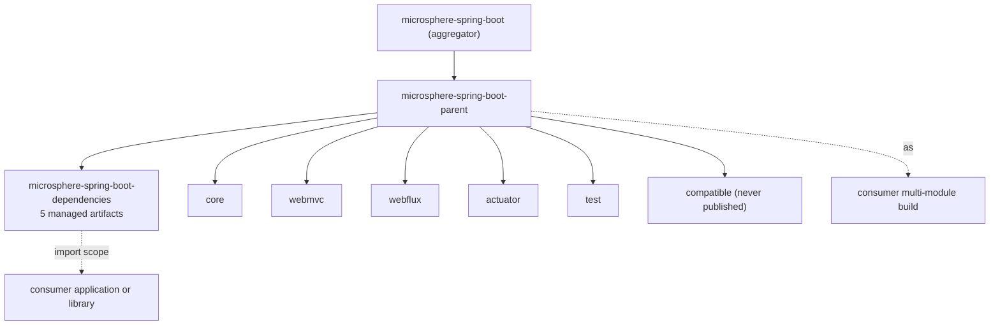

# Dependencies BOM Module

> [中文](./zh/dependencies.md) · [Documentation index](../README.md) ·
> [User Guide for this module](../../user-guide/current/dependencies.md)

> **Branch:** `release` · **Version line:** `0.2.x` · **Artifact:** `microsphere-spring-boot-dependencies`
> **Packaging:** `pom` · Published · 5 managed entries · no sources, no tests

Contents:
[1 Position in the build](#1-position-in-the-build) ·
[2 What the BOM manages](#2-what-the-bom-manages) ·
[3 What it deliberately omits](#3-what-it-deliberately-omits) ·
[4 The published POM](#4-the-published-flattened-pom) ·
[5 Boot versions are not pinned here](#5-boot-versions-are-not-pinned-here) ·
[6 Consumer recipes](#6-consumer-recipes) ·
[7 Adding a module to the BOM](#7-adding-a-module-to-the-bom) ·
[8 BOM versus parent](#8-bom-versus-parent) ·
[9 Deploy order](#9-deploy-order) ·
[10 Verification](#10-verification) ·
[11 Failure modes](#11-failure-modes) ·
[12 See Also](#12-see-also)

---

## 1. Position in the Build

`microsphere-spring-boot-dependencies` is the consumer-facing half of the version layer. Where
`microsphere-spring-boot-parent` is the **build** contract (what a module inherits while compiling), the BOM is the
**usage** contract (what an application imports to stop writing versions).



Its own `<parent>` is `microsphere-spring-boot-parent`, so the BOM inherits the profile matrix and the upstream BOM
imports — but a consumer importing only the BOM does not automatically inherit them; see §5.

---

## 2. What the BOM Manages

Exactly five artifacts, all at `${revision}`:

```xml

<dependencyManagement>
    <dependencies>
        <dependency>
            <groupId>io.github.microsphere-projects</groupId>
            <artifactId>microsphere-spring-boot-core</artifactId>
            <version>${revision}</version>
        </dependency>
        <!-- ... the same four additional entries ... -->
    </dependencies>
</dependencyManagement>
```

| Managed artifact | Published | In the BOM | Notes |
|---|---|---|---|
| `microsphere-spring-boot-core` | yes | yes | Required by every other jar module |
| `microsphere-spring-boot-webmvc` | yes | yes | Servlet stack extension |
| `microsphere-spring-boot-webflux` | yes | yes | Reactive stack extension |
| `microsphere-spring-boot-actuator` | yes | yes | Custom endpoints and monitored scheduler |
| `microsphere-spring-boot-test` | yes | yes | Test base classes, usable in `test` scope |
| `microsphere-spring-boot-compatible` | no | no | Build-time shim, see [compatible.md](./compatible.md) |
| `microsphere-spring-boot-parent` | yes | no | A `<parent>`, not a dependency |
| `microsphere-spring-boot-dependencies` | yes | no | The BOM itself |

The order of the five entries matches the dependency graph (`core` first), which keeps a diff reviewable when a sixth
module is added.

---

## 3. What it Deliberately Omits

| Omission | Reason | What to do instead |
|---|---|---|
| `microsphere-spring-boot-compatible` | It is not deployed, and its classes are Boot-4-only shims that would clash at runtime on other versions | Nothing — `core` attaches it during the build when a `4.x` profile is active |
| Upstream `microsphere-spring-*` artifacts | They are already versioned by `microsphere-spring-dependencies`, which the parent imports | Import that BOM, or rely on transitive resolution |
| `spring-boot-dependencies` | Pinning Boot inside this BOM would silently fight the application's own Boot choice | The application picks Boot; this library only declares a supported range |
| Plugin management | Owned by `microsphere-build` | Use `microsphere-build` as your build parent if you need it |
| `distributionManagement` / repositories | Flatten strips repositories from deployed POMs | Declare repositories in your own build POM |

The second row is the one to remember when adding a dependency to a module: a new upstream Microsphere artifact needs no
version **and no BOM entry**, because `microsphere-spring-dependencies` already manages it.

---

## 4. The Published, Flattened POM

`flatten.mode` = `resolveCiFriendliesOnly` replaces `${revision}` everywhere it appears, and nothing else is rewritten.
The deployed `0.2.34` BOM therefore reads:

```xml

<parent>
    <groupId>io.github.microsphere-projects</groupId>
    <artifactId>microsphere-spring-boot-parent</artifactId>
    <version>0.2.34</version>
    <relativePath>../microsphere-spring-boot-parent/pom.xml</relativePath>
</parent>
<artifactId>microsphere-spring-boot-dependencies</artifactId>
<version>0.2.34</version>
<packaging>pom</packaging>
```

Observations from the actual artifact, each of which explains a class of user report:

* All five managed versions are **literals** (`0.2.34`), never property references. A consumer cannot "override" them by
  setting a property; they must re-declare the dependency before the import to win.
* The `<parent>` block survives, with a literal version. Maven resolves that parent from the repository, ignoring the
  now-meaningless `<relativePath>`, so the BOM's effective model still includes the parent's profile list.
* No `<repositories>` block: `flatten.pomElements.repositories` = `remove`. A consumer that needs `spring-milestone` must
  declare it.
* `<url>` and `<scm>` entries carry appended module paths (for example the BOM's `<scm><connection>` repeats
  `microsphere-spring-boot-parent/microsphere-spring-boot-dependencies`). This comes from the root POM interpolating
  `${project.scm.url}` combined with flatten's `scm: resolve` policy. It is cosmetic and only affects generated POM
  metadata, never resolution — but it looks alarming in a diff of a deployed POM.

---

## 5. Boot Versions Are Not Pinned Here

The flattened BOM's `<dependencyManagement>` contains **only** the five Microsphere artifacts. It does not inline
`spring-boot-dependencies`, and the published parent keeps the import as a property reference:

```xml
<!-- microsphere-spring-boot-parent, as deployed -->
<artifactId>spring-boot-dependencies</artifactId>
<version>${spring-boot.version}</version>
```

with the eight `spring-boot-*` profiles retained verbatim in the deployed POM. Practical consequences:

* A consumer that merely `import`s this BOM does **not** get a Boot version from it. Boot's version stays under the
  application's control — which is exactly right for a library.
* A consumer that uses `microsphere-spring-boot-parent` as its `<parent>` inherits the profile menu and must activate one
  (or accept the `activeByDefault` `3.5` line), as described in section 7 of [parent.md](./parent.md).
* Because the BOM carries no Boot pin, a single published version of these artifacts is installable in a Boot 3.0
  application and a Boot 4.1 application alike. That is the intended reading of "supports `3.0.13` – `4.1.1`".

Do not "helpfully" add `spring-boot-dependencies` to this BOM. It is the one change that would convert a
version-range library into a version-pinning one and break the semantics of every existing consumer.

---

## 6. Consumer Recipes

**Import into a Boot application** (the normal case):

```xml

<dependencyManagement>
    <dependencies>
        <dependency>
            <groupId>io.github.microsphere-projects</groupId>
            <artifactId>microsphere-spring-boot-dependencies</artifactId>
            <version>0.2.34</version>
            <type>pom</type>
            <scope>import</scope>
        </dependency>
    </dependencies>
</dependencyManagement>

<dependencies>
    <dependency>
        <groupId>io.github.microsphere-projects</groupId>
        <artifactId>microsphere-spring-boot-webmvc</artifactId>
    </dependency>
</dependencies>
```

**Override one module's version.** Declare that module **before** the import, since the first managed declaration wins:

```xml

<dependencyManagement>
    <dependencies>
        <dependency>
            <groupId>io.github.microsphere-projects</groupId>
            <artifactId>microsphere-spring-boot-core</artifactId>
            <version>0.2.33</version>
        </dependency>
        <dependency>
            <!-- BOM import: must come after the pin above -->
            <artifactId>microsphere-spring-boot-dependencies</artifactId>
            <type>pom</type>
            <scope>import</scope>
        </dependency>
    </dependencies>
</dependencyManagement>
```

**Use the test module.** It is managed like any other artifact, so `microsphere-spring-boot-test` needs no version even
in `test` scope.

---

## 7. Adding a Module to the BOM

1. Create the module directory and give it `<parent>` = `microsphere-spring-boot-parent` with
   `<version>${revision}</version>`.
2. Add it to the root POM's `<modules>` list, ordered so the parent and BOM stay first.
3. Append a `<dependency>` entry to `microsphere-spring-boot-dependencies/pom.xml` using `${revision}` as the version.
4. Check the publication filters in the `publish` profile (inherited from `microsphere-build`) actually include the new
   module; an unlisted module builds but never deploys, which surfaces as a missing-artifact report weeks later.
5. If the module is a build-time-only artifact, do **not** add it to the BOM and give it the same two kill-switches
   `microsphere-spring-boot-compatible` uses — see section 4 of [compatible.md](./compatible.md).
6. Update this document, its Chinese mirror, the user-facing
   [../../user-guide/current/dependencies.md](../../user-guide/current/dependencies.md), and the module table in
   [../README.md](../README.md) in the same commit.

The BOM edit and the `<modules>` edit must land together. A module in the reactor but absent from the BOM is invisible to
consumers; a BOM entry with no matching module fails resolution for everyone who imports it.

---

## 8. BOM versus Parent

| Question | BOM | Parent |
|---|---|---|
| What does it give me? | Version numbers only | Versions, plugins, properties, profiles, repositories |
| Can I use it with `spring-boot-starter-parent`? | Yes — `import` is compatible with any existing parent | No — a POM has one parent |
| Does it pin the Boot version? | No (§5) | Only if you activate one of its profiles |
| Does changing it break consumers? | Adding/removing entries can; bumping a version does not | Anything you change is inherited |
| Which should a documentation-first consumer choose | The BOM | Only for an internal multi-module build that wants the whole build contract |

This is why both exist as separate artifacts rather than one.

---

## 9. Deploy Order

The root POM lists `microsphere-spring-boot-parent` before `microsphere-spring-boot-dependencies`, and Maven additionally
topologically sorts on the parent relation, so the deployed sequence is parent → BOM → jar modules. Two consequences:

* A partially failed release (BOM deployed, `core` not) leaves consumers with a version that resolves but delivers no
  artifacts. The publish pipeline therefore treats any module failure as a failed release rather than continuing.
* The BOM's own `<parent>` must be resolvable at deploy time, which is why `${revision}` cannot be replaced by a
  per-module version property.

---

## 10. Verification

```bash
# the managed set, straight from the source POM
grep -A1 "<artifactId>microsphere-spring-boot" microsphere-spring-boot-dependencies/pom.xml | grep artifactId

# what Maven would actually resolve for a consumer, from inside a module build
./mvnw -Pspring-boot-3.5 -pl microsphere-spring-boot-webmvc -am dependency:managedVersions

# the flattened POM that will be deployed, before deploying it
cat microsphere-spring-boot-dependencies/target/.flattened-pom.xml
```

`target/.flattened-pom.xml` is the single most useful debugging artifact here: it is exactly what lands in the repository,
so a mismatch between it and `pom.xml` explains most "works locally, missing for users" reports. Compare especially the
`<version>` literals and the absence of `<repositories>`.

---

## 11. Failure Modes

| Symptom | Cause | Fix |
|---|---|---|
| Consumer sees `'dependencies.dependency.version' ... missing` after adding a dependency | The artifact is not in the BOM (a new module, or `compatible`) | Add the entry (§7) or state the version explicitly |
| BOM import resolves but pulls an unexpected Boot version | The consumer also imports `spring-boot-dependencies`; declaration order decides | Declare Boot's BOM first, or align the versions |
| `Could not find microsphere-spring-boot-parent:0.2.35-SNAPSHOT` | A snapshot-only parent plus a consumer without a snapshot repository | Publish or use a released version; CI's `-Drevision=0.0.1-SNAPSHOT` builds are never published |
| Version property in a consumer had no effect | Flattened versions are literals, not property references (§4) | Re-declare the dependency before the import (§6) |
| Deployed `<scm>` looks corrupted | Flatten's `scm: resolve` plus `${project.scm.url}` interpolation (§4) | Cosmetic only; ignore or normalise the root POM's SCM block |
| New module builds but no one can depend on it | Missing BOM entry or publication filter | Check both items of §7 |

---

## 12. See Also

* [parent.md](./parent.md) — the build-side version contract and the profile matrix
* [compatible.md](./compatible.md) — the module intentionally absent from this BOM
* [build-and-release.md](./build-and-release.md) — publication and the release pipeline
* [../README.md](../README.md) — reactor shape
* User-facing import instructions:
  [../../user-guide/current/dependencies.md](../../user-guide/current/dependencies.md)
