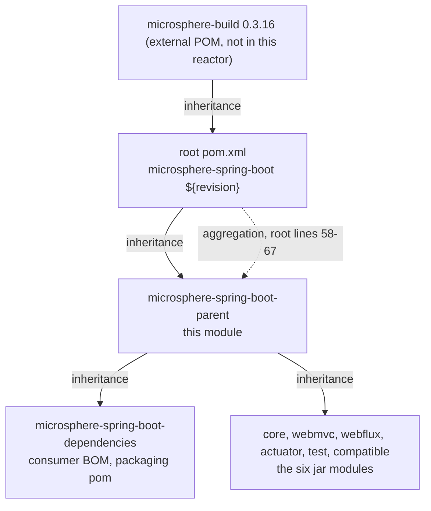

# Parent POM Module

> [中文](./zh/parent.md) · [Documentation index](../README.md) ·
> [User Guide for this module](../../user-guide/current/parent.md)

> **Branch:** `release` · **Version line:** `0.2.x` · **Artifact:** `microsphere-spring-boot-parent`
> **Packaging:** `pom` · 135 lines, no sources, no tests · published · inherited by all seven other modules · declares no
> `<modules>` of its own

Contents:
[1 Position in the build](#1-position-in-the-build) ·
[2 Three POMs, three jobs](#2-three-poms-three-jobs) ·
[3 The revision property](#3-the-revision-property) ·
[4 The Java baseline](#4-the-java-baseline) ·
[5 Managed properties and their consumers](#5-managed-properties-and-their-consumers) ·
[6 Dependency management, BOM by BOM](#6-dependency-management-bom-by-bom) ·
[7 The Spring Boot profiles](#7-the-spring-boot-profiles) ·
[8 The spring-milestone repository](#8-the-spring-milestone-repository) ·
[9 What a module gets by declaring this parent](#9-what-a-module-gets-by-declaring-this-parent) ·
[10 Boundary with microsphere-build](#10-boundary-with-microsphere-build) ·
[11 Recipes](#11-recipes) ·
[12 See Also](#12-see-also)

---

## 1. Position in the Build

Two unrelated Maven relations are in play and are easy to conflate: **inheritance** (`<parent>`, which supplies
properties, `dependencyManagement` and plugin behaviour) and **aggregation** (`<modules>`, which supplies build order).
This repository deliberately splits them across different POMs.



This parent is **both** aggregated by the root (root `pom.xml` line 59, listed first) and inherited by every other POM. It
owns no `src` directory, so building it alone produces nothing but a flattened POM.

---

## 2. Three POMs, Three Jobs

| POM | Coordinates | Packaging | Owns | Does not own |
|---|---|---|---|---|
| Root aggregator `pom.xml` | `microsphere-spring-boot:${revision}` | `pom` | `<modules>` (58–67), `<revision>0.2.35-SNAPSHOT</revision>` (54), `<java.version>17</java.version>` (55), organization, license, developer and SCM metadata (21–51) | No `dependencyManagement`, no profiles, no `<build>` |
| `microsphere-spring-boot-parent` | `${revision}`, parent = root (5–10) | `pom` (16) | Three properties (21–26), four managed entries (28–66), the `spring-milestone` repository (68–74), eight `spring-boot-*` profiles (76–135) | No `<modules>`, no `<build>` block at all |
| `microsphere-spring-boot-dependencies` | `${revision}`, parent = this parent (5–10) | `pom` (16) | `dependencyManagement` over the five published modules, all at `${revision}` (21–55) | No profiles, no repositories, no `<build>` |

Both halves are load-bearing: because the root carries `<modules>`, `mvn` at the repository root builds the whole reactor;
because this parent carries `dependencyManagement`, module POMs can omit versions entirely. Every jar module repeats the
same `<parent>` block, with `<version>${revision}</version>` and a `<relativePath>` into this directory (`core/pom.xml`
lines 5–10) — the CI-friendly pattern that removes the need for a versions plugin.

---

## 3. The Revision Property

`revision` is defined exactly once, in the root POM at line 54, so bumping a release is a one-line edit: every POM here,
including the two POM-only modules, states both its own version and its `<parent>` version as `${revision}`. Maven cannot
resolve `${revision}` for a consumer that downloads a POM from a repository, so the deployed POM must have it interpolated
first; that is the inherited `flatten-maven-plugin` in `resolveCiFriendliesOnly` mode (§9). Three consequences:

* Cross-module dependencies still write `<version>${revision}</version>` explicitly (`core` on `test`, `core/pom.xml`
  lines 69–74), while upstream Microsphere artifacts carry **no** version because the imported BOM in §6 supplies it.
* CI builds against an unrelated version to stay resolvable without a prior install: `maven-build.yml` line 45 passes
  `-Drevision=0.0.1-SNAPSHOT` for the `test` goal, and nothing is published from that run.
* Interpolation is downward only: a root property is visible to this parent and to every module, but a property defined
  only here (`microsphere-spring.version`) is invisible to the root.

---

## 4. The Java Baseline

`java.version` is the only compiler knob this repository sets, and it is set in the root (§2), not here. The external
`microsphere-build:0.3.16` POM defaults `<java.version>8</java.version>` (line 89), derives `maven.compiler.source` (58)
and `maven.compiler.target` (94) from it, and binds both into the compiler plugin (127–128); the root override to `17`
re-targets all seven inherited modules with one edit. That POM also declares the JDK-range profiles `java8+` (605),
`java9+` (628), `java11+` (637), `java16+` (668) and `java17+` (693), which is how one source tree adapts when CI runs JDK
`17`, `21` or `25` (matrix at `maven-build.yml` line 25). Never set `maven.compiler.source` or `target` in a module POM: it
bypasses the single-point override and reintroduces the Java 8 baseline on a branch that requires 17.

---

## 5. Managed Properties and Their Consumers

Lines 21–26 hold three properties, each with exactly one declaring consumer. The mapping below came from grepping every POM
in the worktree, so it doubles as the checklist of what moves when a value changes:

| Property | Declared | Value | Consumed by |
|---|---|---|---|
| `microsphere-spring.version` | 22 | `0.2.39` | The `microsphere-spring-dependencies` import (57–63), which versions the five versionless upstream dependencies: `microsphere-annotation-processor` (core 23–27, test 23–27, webmvc 24–28, webflux 24–28, actuator 24–28), `microsphere-spring-context` (core 30–33, test 58–61), `microsphere-spring-test` (test 64–67), `microsphere-spring-webmvc` (webmvc 38–41), `microsphere-spring-webflux` (webflux 38–41) |
| `jolokia.version` | 23 | `2.6.3` | The direct managed entry (41–45), requested only by `microsphere-spring-boot-actuator/pom.xml` lines 38–41 |
| `junit-jupiter.version` | 25 | `6.1.3` | The `junit-bom` import (32–38), requested by the versionless `junit-jupiter` dependency in test 30–34 (optional compile scope) and in core 55–59, webmvc 64–68, webflux 63–67 and actuator 75–79 (`test` scope) |

Two properties belong to the same contract but are not declared in this file: `spring-boot.version`, set **only** by a
profile (§7), and `java.version`, set only in the root (§4). Note also that `microsphere-spring.version` (`0.2.39`) is a
separate version line from `${revision}` (`0.2.35-SNAPSHOT`) — the upstream libraries release on their own cadence.

---

## 6. Dependency Management, BOM by BOM

Lines 28–66 declare exactly four managed entries, in declaration order: `org.junit:junit-bom` (32–38, import),
`org.jolokia:jolokia-core` (41–45, direct version),
`org.springframework.boot:spring-boot-dependencies` (48–54, import) and
`io.github.microsphere-projects:microsphere-spring-dependencies` (57–63, import). The entry that supplies every Spring and
Spring Boot version on the branch, verbatim:

```xml
<!-- microsphere-spring-boot-parent/pom.xml, lines 47-54 -->
<!-- Spring Boot Dependencies -->
<dependency>
    <groupId>org.springframework.boot</groupId>
    <artifactId>spring-boot-dependencies</artifactId>
    <version>${spring-boot.version}</version>
    <type>pom</type>
    <scope>import</scope>
</dependency>
```

**Why the order is not free.** For imported BOMs Maven applies first-declared-wins: the earliest managed declaration for a
given `groupId:artifactId` survives. Because `spring-boot-dependencies` precedes `microsphere-spring-dependencies`, any
artifact described by both keeps the Spring Boot version, and only artifacts Boot does not know about come from the
Microsphere BOM. Swapping these two blocks is a silent behaviour change that no test on this branch detects.
`jolokia-core` is the only direct pin precisely because no imported BOM covers it.

---

## 7. The Spring Boot Profiles

Lines 76–135 declare eight profiles. Each pins one Boot **patch** release; exactly one activates by default:

| Profile id | Lines | `spring-boot.version` | Activation |
|---|---|---|---|
| `spring-boot-3.0` | 77–82 | `3.0.13` | explicit `-P` |
| `spring-boot-3.1` | 84–89 | `3.1.12` | explicit `-P` |
| `spring-boot-3.2` | 91–96 | `3.2.12` | explicit `-P` |
| `spring-boot-3.3` | 98–103 | `3.3.13` | explicit `-P` |
| `spring-boot-3.4` | 105–110 | `3.4.13` | explicit `-P` |
| `spring-boot-3.5` | 112–120 | `3.5.16` | `activeByDefault` (114–116) |
| `spring-boot-4.0` | 122–127 | `4.0.8` | explicit `-P` |
| `spring-boot-4.1` | 129–134 | `4.1.1` | explicit `-P` |

The `activeByDefault` on `spring-boot-3.5` is the fragile part of this design: Maven cancels it as soon as another profile
*declared in the same POM* is activated, and then `dependencyManagement` cannot interpolate `${spring-boot.version}` at
all, so the build fails with a missing-version error rather than silently choosing a Boot line. Every CI cell therefore
names a Boot profile explicitly (`maven-build.yml` lines 26–28 and 48). The publish workflow is the instructive exception:
`maven-publish.yml` lines 48–56 pass `--activate-profiles publish,ci` with no Boot profile, and because those two ids are
declared in the external parent rather than in this POM, the default survives and a release resolves `3.5.16`. Any profile
added to *this* POM must therefore be named together with a Boot profile.

Pinning patches rather than minors keeps the 24-cell matrix (3 JDKs × 8 Boot profiles) reproducible; the cost is that a
new Boot patch is never picked up automatically, so this table needs manual maintenance (§11). Two profiles do more than
set a property: on `spring-boot-4.0` and `spring-boot-4.1`, `core/pom.xml` lines 97–121 attach the unpublished `compatible`
module as a compile dependency — see [compatible.md](./compatible.md).

---

## 8. The spring-milestone Repository

Lines 68–74 add one repository, inherited by all seven modules:

```xml
<!-- microsphere-spring-boot-parent/pom.xml, lines 68-74 -->
<repositories>
    <repository>
        <id>spring-milestone</id>
        <name>Spring Portfolio Milestone Repository</name>
        <url>https://repo.spring.io/milestone</url>
    </repository>
</repositories>
```

It exists so a `4.x` profile can point at a milestone or release-candidate build, which is the only channel through which
the otherwise patch-pinned matrix can drift: milestone artifacts stay mutable until promoted. It never reaches consumers,
because the inherited flatten configuration sets `flatten.pomElements.repositories = remove`
(`microsphere-build` line 95); a downstream project that needs a milestone must declare it itself.

---

## 9. What a Module Gets by Declaring This Parent

A POM whose `<parent>` names this artifact inherits, without writing anything:

* versions for every Spring Boot, Spring Framework, JUnit and upstream Microsphere artifact, which is what keeps module
  POMs versionless (§5, §6), plus the `spring-milestone` repository (§8) and the eight Boot profiles (§7)
* one level further up, through the root: the compiler plugin bound to `${java.version}`, plus `maven-source-plugin` and
  `flatten-maven-plugin` in `microsphere-build`'s default `<build><plugins>` (external lines 457–468)
* flatten settings that make `${revision}` publishable — `flatten.mode = resolveCiFriendliesOnly` (external 60),
  `parent = expand` (73), `properties = keep` (82), `dependencies = resolve` (56), `dependencyManagement = interpolate`
  (52), `repositories = remove` (95), `distributionManagement = remove` (63), `scm = resolve` (78),
  `developers = resolve` (80), `flatten.dependency.mode = all` (99), plugin version `1.7.3` (46)

This parent **is** published: the only publication kill-switches in the repository are `<skip>true</skip>` and
`<skipPublishing>true</skipPublishing>` at `microsphere-spring-boot-compatible/pom.xml` lines 64 and 72. Because third
parties use this POM as their `<parent>`, a `dependencyManagement` change here is API-visible and needs a minor or major
bump, not a patch.

---

## 10. Boundary with microsphere-build

What a grep over this repository proves, and nothing beyond it:

* The four profile ids CI activates — `test`, `coverage`, `publish`, `ci` — appear **nowhere** in this repository. The only
  profile ids defined locally are the eight `spring-boot-*` here (78–134) and two in `core` (99, 111), so they must come
  from the external parent, and `microsphere-build-0.3.16.pom` confirms it: `release` 480, `publish` 507, `ci` 534,
  `test` 545, `coverage` 561, `docs` 572.
* No POM here contains the strings `flatten`, `gpg`, `surefire`, `distributionManagement`, `maven-javadoc` or
  `maven-source`; each of those settings is inherited, which is why neither the root nor this parent has a `<build>`
  block. In the external POM, `publish` (507–532) activates javadoc, release, enforcer, gpg, git-commit-id and
  `central-publishing-maven-plugin`, whose target is `publishingServerId = ossrh` with `autoPublish` true (209–210);
  `test` (545–560) activates failsafe, checkstyle and surefire; `coverage` (561–571) activates JaCoCo; `ci` (534–544)
  activates `sign-maven-plugin`. That POM has no `<distributionManagement>` element either: the deployment target is a
  publishing-plugin setting, not a POM element.
* Nothing here overrides any of it. Bumping a plugin version means editing the `microsphere-build` coordinate in the root
  POM (lines 5–9), never this file.

The split keeps the build contract shared by all Microsphere repositories; a Boot-line parent that forked it would drift the moment the shared one improved.

---

## 11. Recipes

**Add a Spring Boot line** (the next `3.6` or `4.2`):

1. Append a profile block between lines 134 and 135 holding one `<spring-boot.version>` set to an **already released**
   patch version, keeping the ids in ascending order.
2. Add the id to the matrix in `.github/workflows/maven-build.yml` (lines 26–28) so a CI cell covers it.
3. If the new Boot line relocated an auto-configuration class this project orders against, extend the by-name
   `@AutoConfigure*(name = ...)` arrays instead of adding a shim — the rule is in [compatible.md](./compatible.md).
4. If the id is a `4.x` line, check whether `core/pom.xml` lines 97–121 need a matching profile that attaches `compatible`.
5. Update this document, [dependencies.md](./dependencies.md), their Chinese twins and
   `../../user-guide/current/parent.md` in the same commit.

**Bump the reactor version:** edit `<revision>` in the root POM (line 54) only. **Bump Boot within a minor:** change the one
literal in the relevant profile, then run `./mvnw -B -Pspring-boot-<minor> test`. **Pin an artifact no BOM manages:** add a
direct entry to `<dependencyManagement>` next to `jolokia-core` plus a property in lines 21–26 — never a module `<version>`.

---

## 12. See Also

* [../README.md](../README.md) — reactor shape and the module document index
* [dependencies.md](./dependencies.md) — the consumer-facing BOM assembled from this parent's output
* [compatible.md](./compatible.md) — the unpublished module the `4.x` profiles attach
* [test.md](./test.md) — a jar module that consumes the JUnit version managed here
* [build-and-release.md](./build-and-release.md) — how CI and the publish pipeline exercise these profiles
* User-facing guide: [../../user-guide/current/parent.md](../../user-guide/current/parent.md)
