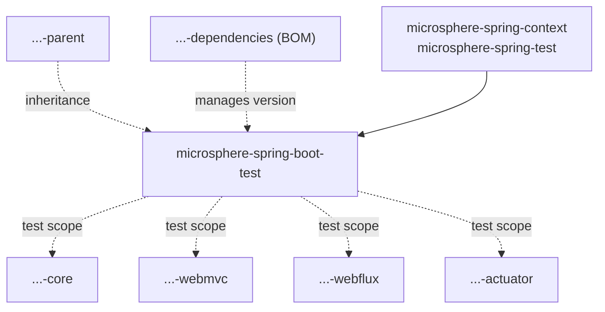
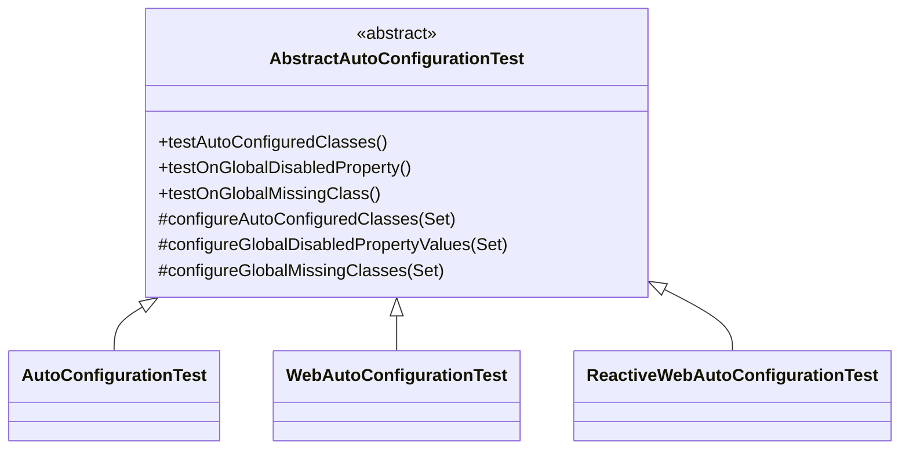

# Test Module

> [中文](./zh/test.md) · [Documentation index](../README.md) ·
> [User Guide for this module](../../user-guide/current/test.md)

> **Branch:** `release` · **Version line:** `0.2.x` · **Artifact:** `microsphere-spring-boot-test`

Contents:
[1 Module Position](#1-module-position) ·
[2 Class Hierarchy](#2-class-hierarchy) ·
[3 The Template Method Contract](#3-the-template-method-contract) ·
[4 The Three Runner Bindings](#4-the-three-runner-bindings) ·
[5 Consumption Inside the Reactor](#5-consumption-inside-the-reactor) ·
[6 The Optional Dependency Design](#6-the-optional-dependency-design) ·
[7 The Module Tests as Worked Examples](#7-the-module-tests-as-worked-examples) ·
[8 Design Patterns](#8-design-patterns) ·
[9 Recipes](#9-recipes) ·
[10 See Also](#10-see-also)

---

## 1. Module Position

`microsphere-spring-boot-test` is a published, BOM-managed jar whose entire production content is four
abstract base classes in `microsphere-spring-boot-test/src/main/java/io/microsphere/spring/boot/test`. It
exists so every module writes one test class per auto-configuration instead of one test method per condition.



`test` is a leaf: no module of this reactor is its compile-scope dependency and nothing depends on it at
compile scope; its only required dependencies, `microsphere-spring-context` and `microsphere-spring-test`, are
external (POM lines 58–67).

---

## 2. Class Hierarchy

Line 53 of `AbstractAutoConfigurationTest.java` is the whole contract:

```java
public abstract class AbstractAutoConfigurationTest<A, R extends AbstractApplicationContextRunner> {
```

`A` is the auto-configuration class under test; `R` is the Boot context runner that starts it. The bound is
the *raw* `AbstractApplicationContextRunner` on purpose: the three self-contained runners Boot exposes each
extend the five-parameter base, so the raw form is what lets subclasses pass them without repeating Boot's
recursive generics. The fully-bounded form appears only on the three static assertion helpers, at lines 202,
209 and 218 — for example
`public static <R extends AbstractApplicationContextRunner<R, C, A>, C extends ConfigurableApplicationContext, A extends ApplicationContextAssertProvider<C>> void assertAutoConfiguredClass(R runner, Class<?> autoConfiguredClass)`.



---

## 3. The Template Method Contract

### 3.1 Constructor: metadata harvesting

The constructor is `protected AbstractAutoConfigurationTest()` (line 88); its body is the contract:

```java
Class<?> type = getClass();
SpringBootTest springBootTest = type.getAnnotation(SPRING_BOOT_TEST_CLASS);
assertNotNull(springBootTest, "The @SpringBootTest must not be annotated on " + type);
this.springBootTestAttributes = GenericAnnotationAttributes.of(springBootTest);
this.isWebApplication = !NONE.equals(springBootTestAttributes.get("webEnvironment"));
this.abstractAutoConfigurationTestType = forClass(getClass()).as(AbstractAutoConfigurationTest.class);
this.autoConfigurationClass = (Class<A>) abstractAutoConfigurationTestType.resolveGeneric(0);
this.runnerClass = (Class<R>) abstractAutoConfigurationTestType.resolveGeneric(1);
this.runner = newRunner();
if (!isWebApplication) { assertInstanceOf(ApplicationContextRunner.class, this.runner, ...); }
```

Three consequences a maintainer must keep:

- The subclass **must** annotate itself with `@SpringBootTest` or construction fails at line 91. No Spring
  test context starts: the annotation is read reflectively as an attribute carrier and the module contains no
  `@ExtendWith`, so the plain Jupiter engine runs the `@Test` methods directly.
- `A` and `R` come back from `ResolvableType.as(...)` plus `resolveGeneric(0)` / `resolveGeneric(1)`, so a
  subclass binding a meaningless type variable compiles and fails at runtime instead. `runnerClass` is
  instantiated reflectively too, so each bound runner needs an accessible no-argument constructor.
- `isWebApplication` derives from `webEnvironment`, not from which subclass was extended, and the guard at
  lines 98–101 then requires `ApplicationContextRunner` when it is `NONE`; pairing
  `WebAutoConfigurationTest` with `NONE` trips `assertInstanceOf`.

### 3.2 Runner construction

`protected R newRunner()` (line 104) calls `ConstructorUtils.newInstance(runnerClass)` and hands the result to
`initRunner`, which fixes the seeding order (lines 109–115):

```java
protected R initRunner(R runner) {
    String[] propertyValues = getPropertyValues();
    Class<?>[] classes = getClasses();
    return (R) runner.withPropertyValues(propertyValues)
            .withConfiguration(of(this.autoConfigurationClass))
            .withConfiguration(of(classes));
}
```

Both are `protected` and non-`final`; `initRunner` is the seam a subclass uses to change how the context is
seeded.

### 3.3 The three inherited tests

| Signature | Line | Assertion |
|---|---|---|
| `@Test protected void testAutoConfiguredClasses()` | 117–122 | For each class of `getAutoConfiguredClasses()`: `assertThat(context).hasSingleBean(...)` |
| `@Test protected void testOnGlobalDisabledProperty()` | 124–129 | For each entry of `getGlobalDisabledPropertyValues()`: re-run with `withPropertyValues(...)`, assert `doesNotHaveBean` for every auto-configured class |
| `@Test protected void testOnGlobalMissingClass()` | 131–136 | For each entry of `getGlobalMissingClasses()`: re-run inside a `new FilteredClassLoader(...)`, assert `doesNotHaveBean` for every auto-configured class |

### 3.4 Locked versus open members

| Signature | Modifier | Line |
|---|---|---|
| `protected final String[] getPropertyValues()` | `final` | 139 |
| `protected final Class<?>[] getAutoConfiguredClasses()` | `final` | 144 |
| `protected final Set<String> getGlobalDisabledPropertyValues()` | `final` | 152 |
| `protected final Set<Class<?>> getGlobalMissingClasses()` | `final` | 159 |
| `protected final Class<?>[] getClasses()` | `final` | 165 |
| `protected abstract void configureAutoConfiguredClasses(Set<Class<?>> autoConfiguredClasses)` | abstract | 174 |
| `protected abstract void configureGlobalDisabledPropertyValues(Set<String> globalDisabledPropertyValues)` | abstract | 181 |
| `protected abstract void configureGlobalMissingClasses(Set<Class<?>> globalMissingClasses)` | abstract | 188 |
| `protected void assertAutoConfiguredClass(Class<?> autoConfiguredClass)` | open | 190 |
| `protected void assertDisabledProperty(String propertyValue, Class<?>... beanClasses)` | open | 194 |
| `protected void assertFilteredClass(String filteredClass, Class<?>... beanClasses)` | open | 198 |

The `final` getters make the hooks unavoidable: `getAutoConfiguredClasses()` seeds the set with
`this.autoConfigurationClass` (line 146) before calling the hook, so a subclass can add to the set but never
replace it. The instance `assert…` methods stay open for subclass test methods to call directly, and the
`public static` helpers exist so non-subclasses in this reactor reuse the same assertions with their own runners.

---

## 4. The Three Runner Bindings

| Subclass | Declaration, line 33 in each file | Runner bound |
|---|---|---|
| `AutoConfigurationTest` | `public abstract class AutoConfigurationTest<A> extends AbstractAutoConfigurationTest<A, ApplicationContextRunner>` | `ApplicationContextRunner` |
| `WebAutoConfigurationTest` | `public abstract class WebAutoConfigurationTest<A> extends AbstractAutoConfigurationTest<A, WebApplicationContextRunner>` | `WebApplicationContextRunner` |
| `ReactiveWebAutoConfigurationTest` | `public abstract class ReactiveWebAutoConfigurationTest<A> extends AbstractAutoConfigurationTest<A, ReactiveWebApplicationContextRunner>` | `ReactiveWebApplicationContextRunner` |

They are empty **on purpose**: each closes one type variable in the `extends` clause, because
`AbstractAutoConfigurationTest` reads `R` back out of the subclass signature at construction time, and the
runners already supply the web semantics. Putting a method in `WebAutoConfigurationTest` would break the
symmetry of the set and push servlet-specific behaviour into a class whose javadoc — `@since 1.0.0`, like all
four files — promises nothing but a binding.

---

## 5. Consumption Inside the Reactor

Four modules depend on this artifact, each in `test` scope with an explicit `${revision}` rather than a
managed version: `microsphere-spring-boot-core` (POM lines 69–74), `microsphere-spring-boot-webmvc`
(78–83), `microsphere-spring-boot-webflux` (77–82), `microsphere-spring-boot-actuator` (89–94), all with the
identical block:

```xml
<!-- Microsphere Spring Boot Test -->
<dependency>
    <groupId>io.github.microsphere-projects</groupId>
    <artifactId>microsphere-spring-boot-test</artifactId>
    <version>${revision}</version>
    <scope>test</scope>
</dependency>
```

The repetition is load-bearing: `test` scope is not transitive, so `webmvc` does not inherit the artifact
through its `core` dependency, and collapsing the four blocks would silently stop three modules' tests from
compiling. Reactor order matters for the same reason — the root `pom.xml` lists `test` at line 62 and `core`
at line 63, so the base classes build first, and moving `test` below its consumers breaks the build. Third
parties reach the artifact through the BOM (`microsphere-spring-boot-dependencies` lines 48–52) and declare it
without a version — see §6 for what actually lands on their classpath.

---

## 6. The Optional Dependency Design

Required, compile scope: `microsphere-spring-context` (POM lines 58–61) and `microsphere-spring-test`
(64–67). Optional, compile scope, each with `<optional>true</optional>`:
`microsphere-annotation-processor` (23–27), `junit-jupiter` (30–34),
`spring-boot-configuration-processor` (37–41), `spring-boot-autoconfigure-processor` (44–48),
`spring-boot-starter-test` (51–55), `spring-boot-starter-web` (70–74), `spring-boot-starter-webflux`
(77–81), `jakarta.servlet-api` (84–88), `jackson-annotations` (91–95), `jackson-databind` (97–101), `h2`
(104–108). Test scope only: `logback-classic` (113–117). That is fourteen dependencies in total.

No dependency declares a version — the file holds exactly two `<version>` tags (lines 8 and 15, the parent
block and the module version), so every coordinate resolves through `microsphere-spring-boot-parent`.

`optional` means "on my compile classpath, not transitive to you", so a consumer receives only
`microsphere-spring-context` and `microsphere-spring-test` and must supply the rest. `junit-jupiter` and
`spring-boot-starter-test` are mandatory in practice: the compiled classes reference
`org.junit.jupiter.api.Test`, `FilteredClassLoader`, `AbstractApplicationContextRunner` and
`ApplicationContextAssertProvider`, and without them a subclass will not load.
`spring-boot-starter-web` is needed only to compile a `WebAutoConfigurationTest` subclass and
`spring-boot-starter-webflux` only a `ReactiveWebAutoConfigurationTest` one, which is why neither starter is
baked in: a non-web consumer would otherwise inherit Tomcat.

Before tidying the POM, note that `jackson-annotations`, `jackson-databind`, `h2` and `jakarta.servlet-api`
are referenced by no file in this module's `src/main/java` or `src/test/java`, and `microsphere-spring-test` —
non-optional, hence transitively exported — is likewise unreferenced. Run the whole Boot matrix in §9.3
before deleting any of them, not the default profile alone.

---

## 7. The Module Tests as Worked Examples

Five files in `microsphere-spring-boot-test/src/test/java/io/microsphere/spring/boot/test` — two sample
auto-configurations and three test classes — cover all three bindings.

| Test class | Binding | `@SpringBootTest` attributes | The three hooks add |
|---|---|---|---|
| `HttpAutoConfigurationTest` | `WebAutoConfigurationTest<HttpAutoConfiguration>` | `classes = HttpAutoConfigurationTest.class` | `CharacterEncodingFilter.class` present; `server.http.enabled=false`; `CharacterEncodingFilter.class` missing |
| `JmxAutoConfigurationTest` | `AutoConfigurationTest<JmxAutoConfiguration>` | `classes = JmxAutoConfigurationTest.class`, `webEnvironment = NONE`, `properties = { "spring.jmx.enabled=true" }` | nothing present; `spring.jmx.enabled=false`; `MBeanExporter.class` missing |
| `ReactiveWebApplicationAutoConfigurationTest` | `ReactiveWebAutoConfigurationTest<ReactiveWebApplicationAutoConfiguration>` | `classes = ReactiveWebApplicationAutoConfigurationTest.class` | `JmxProperties.class` present; `reactive.web-app.enabled=false`; `JmxProperties.class` missing |

`HttpAutoConfiguration` carries `@ConditionalOnWebApplication(type = SERVLET)`,
`@ConditionalOnClass(CharacterEncodingFilter.class)`,
`@ConditionalOnProperty(name = "server.http.enabled", matchIfMissing = true)` and
`@Import(CharacterEncodingFilter.class)`, so its test is the smallest complete use of the contract: four
annotations on one side, three one-line hooks on the other. `ReactiveWebApplicationAutoConfiguration` mirrors
it with `@ConditionalOnWebApplication(type = REACTIVE)`, `@ConditionalOnClass(JmxProperties.class)`,
`@ConditionalOnProperty(name = "reactive.web-app.enabled", matchIfMissing = true)` and
`@EnableConfigurationProperties(JmxProperties.class)`.

`JmxAutoConfigurationTest` documents an asymmetry worth copying correctly: `configureAutoConfiguredClasses`
is empty because Boot's own `JmxAutoConfiguration` supplies `MBeanExporter`, which the sample registers only
as a *missing class*, and its `properties` entry reaches the context through `getPropertyValues()` inside
`initRunner`, so the positive assertion passes only because the subclass turned JMX on. The two web tests set
no `webEnvironment`, so Boot's default `MOCK` makes `isWebApplication` true and skips the
`assertInstanceOf(ApplicationContextRunner.class, …)` guard — exactly what lets them use the web runners.

---

## 8. Design Patterns

| Pattern | Where | Effect |
|---|---|---|
| Template Method | three abstract `configure…` hooks under a fixed `@Test` trio | One algorithm, three data slots |
| Annotation-as-metadata | constructor reads its own `@SpringBootTest` via `GenericAnnotationAttributes` | The annotation doubles as a DSL; no context boot needed |
| Self-type binding | the three one-line subclasses | Close `R` once per web stack so a subclass writes only `A` |
| Optional-dependency isolation | eleven `<optional>true</optional>` entries | A servlet consumer never receives WebFlux |

---

## 9. Recipes

### 9.1 Add a runner variant

Only when Boot ships a runner that is not already bound.

1. Add `src/main/java/io/microsphere/spring/boot/test/<Name>AutoConfigurationTest.java` with the Apache
   header and the body `public abstract class <Name>AutoConfigurationTest<A> extends AbstractAutoConfigurationTest<A, <RunnerClass>> {}`,
   importing the runner from `org.springframework.boot.test.context.runner`. Javadoc it with `@param <A>`,
   `@author`, `@see AbstractAutoConfigurationTest`, `@see <RunnerClass>` and an `@since`.
2. Check the guard at lines 98–101: it assumes "not web implies `ApplicationContextRunner`", so a runner that
   is neither web nor plain needs that condition widened.
3. Add a sample auto-configuration and test under `src/test/java`, mirroring §7, so the module's own build
   proves the binding.

### 9.2 Add an assertion to the contract

1. Declare a `protected abstract void configureGlobal…(Set<…>)` hook beside lines 174–188, plus a
   `protected final Set<…> getGlobal…()` wrapper that seeds and returns a `newLinkedHashSet()`.
2. Add a `@Test protected void testOnGlobal…()` loop beside lines 117–136, the matching
   `public static <R extends AbstractApplicationContextRunner<R, C, A>, …>` helper, and an open `protected`
   delegate that passes `this.runner`.
3. Update the three module tests and every subclass in `core`, `webmvc`, `webflux` and `actuator`, then
   document the new assertion in the user guide and both developer-guide languages. A new abstract hook
   breaks external users: if it need not be mandatory, give it an empty default body.

### 9.3 Verify a change

```bash
mvn --batch-mode --file microsphere-spring-boot-test/pom.xml test
mvn --batch-mode --activate-profiles spring-boot-3.5,spring-boot-4.1 test
for p in 3.0 3.1 3.2 3.3 3.4 3.5 4.0 4.1; do
    mvn --batch-mode --activate-profiles spring-boot-$p test || break
done
```

CI runs JDK `17`, `21`, `25` against `spring-boot-3.0` … `spring-boot-4.1`
(`.github/workflows/maven-build.yml` lines 25–28, 48). Two build facts survive any change here: packaging is
the default `jar` with no `<packaging>` element, and there is no `src/main/resources`, therefore no
`spring.factories` and nothing that registers itself with Boot. All nine source files carry `@since 1.0.0`,
and because the artifact is published and BOM-managed its class names and hooks are public API.

---

## 10. See Also

- [User guide for this module](../../user-guide/current/test.md) — consumer-facing usage and examples
- [core.md](./core.md) — the largest consumer of these base classes
- [dependencies.md](./dependencies.md) — how the artifact reaches a consumer's version list
- [parent.md](./parent.md) — where every unversioned coordinate in this POM resolves from
- [compatible.md](./compatible.md) — the opposite publication policy
- [Build and Release Pipeline](./build-and-release.md) — the profile matrix this module compiles against
