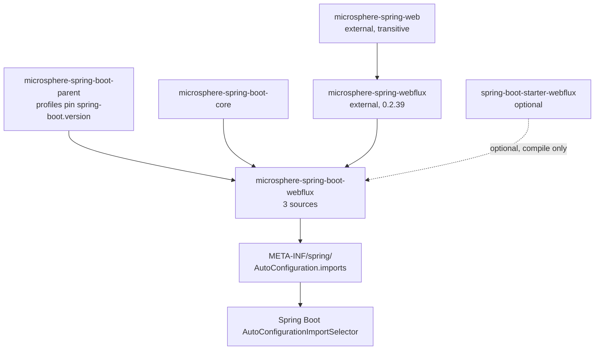
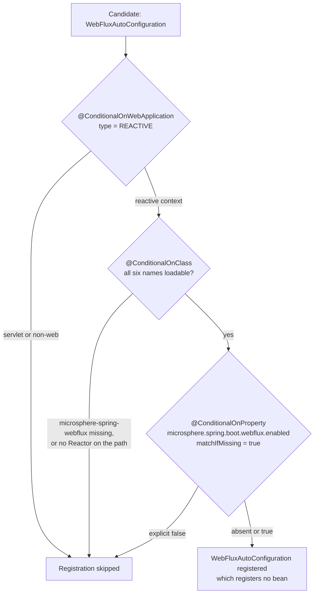
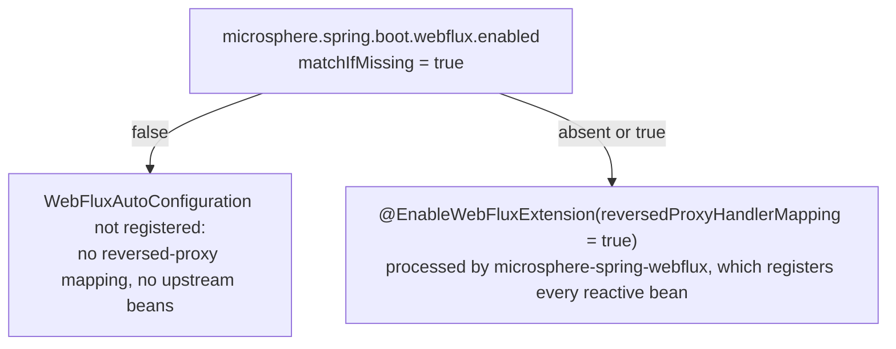

# WebFlux Module

> [中文](./zh/webflux.md) · [Documentation index](../README.md) ·
> [User Guide for this module](../../user-guide/current/webflux.md)

> **Branch:** `release` · **Version line:** `0.2.x` · **Artifact:** `microsphere-spring-boot-webflux`
> **Spring Boot:** `3.0.13` – `4.1.1` · **Java:** 17

Contents:
[1 Module Position](#1-module-position) ·
[2 Package Map](#2-package-map) ·
[3 The Availability Condition](#3-the-availability-condition) ·
[4 WebFluxAutoConfiguration Anatomy](#4-webfluxautoconfiguration-anatomy) ·
[5 The Upstream Boundary](#5-the-upstream-boundary) ·
[6 Property Namespace and Switches](#6-property-namespace-and-switches) ·
[7 Design Patterns](#7-design-patterns) ·
[8 Tests](#8-tests) ·
[9 Recipes](#9-recipes) ·
[10 See Also](#10-see-also)

---

## 1. Module Position

`microsphere-spring-boot-webflux` is the reactive counterpart of `microsphere-spring-boot-webmvc`: same shape, one
fifth of the content. Three source files — a `@Bean`-free auto-configuration class, a composed condition, a
property-constant interface with a single key. It registers no bean and imports nothing; the extension it switches
on lives entirely in `microsphere-spring-webflux`. Below, `WebFluxAutoConfiguration.java`,
`ConditionalOnWebFluxAvailable.java` and `PropertyConstants.java` denote files in
`microsphere-spring-boot-webflux/src/main/java/io/microsphere/spring/boot/webflux/`.



Edges come from `microsphere-spring-boot-webflux/pom.xml`: parent (`pom.xml:5-10`), `microsphere-spring-boot-core`
(`pom.xml:31-35`), unversioned `microsphere-spring-webflux` (`pom.xml:38-41`, managed by the
`microsphere-spring-dependencies` BOM at `${microsphere-spring.version}` = `0.2.39`,
`microsphere-spring-boot-parent/pom.xml:22`), optional `spring-boot-starter-webflux` (`pom.xml:44-48`); unlike webmvc
there is no `jackson-databind` test dependency. Discovery is one line,
`src/main/resources/META-INF/spring/org.springframework.boot.autoconfigure.AutoConfiguration.imports:1`, holding
`io.microsphere.spring.boot.webflux.autoconfigure.WebFluxAutoConfiguration`.

## 2. Package Map

| Package | Type | Responsibility |
|---|---|---|
| `io.microsphere.spring.boot.webflux.autoconfigure` | `WebFluxAutoConfiguration` | Carries the ordering and the `@EnableWebFluxExtension` switch; has an empty body (`WebFluxAutoConfiguration.java:32-39`). |
| `io.microsphere.spring.boot.webflux.autoconfigure.condition` | `ConditionalOnWebFluxAvailable` (annotation) | The reactive equivalent of the servlet gate: `REACTIVE` web type, six class names, one property (`ConditionalOnWebFluxAvailable.java:42-56`). |
| `io.microsphere.spring.boot.webflux.constants` | `PropertyConstants` (interface) | Exactly one prefix, one default and one switch key (`PropertyConstants.java:31-52`). |

No `@ConfigurationProperties` class, no `spring.factories`, no default-properties resource; the webmvc module adds
three bean methods and a nested logging block on top of this same skeleton.

## 3. The Availability Condition

`ConditionalOnWebFluxAvailable.java:42-55`, quoted in full:

```java
@Target({TYPE, METHOD})
@Retention(RUNTIME)
@Documented
@ConditionalOnWebApplication(type = REACTIVE)
@ConditionalOnClass(name = {
        "reactor.core.publisher.Flux",                                         // Reactor API
        "org.springframework.context.ApplicationContext",                      // Spring Context API
        "org.springframework.web.method.HandlerMethod",                        // Spring Web API
        "org.springframework.web.reactive.DispatcherHandler",                  // Spring WebFlux API
        "io.microsphere.spring.web.method.support.HandlerMethodInterceptor",   // Microsphere Spring Web API
        "io.microsphere.spring.webflux.annotation.EnableWebFluxExtension"      // Microsphere Spring WebFlux API
})
@ConditionalOnProperty(name = MICROSPHERE_SPRING_BOOT_WEBFLUX_ENALBED_PROPERTY_NAME, matchIfMissing = true)
```

Structurally identical to `ConditionalOnWebMvcAvailable` — same three meta-annotations, same declaration order,
same `@Target({TYPE, METHOD})` for future method-level reuse — with these substantive differences:

| Aspect | webmvc | webflux |
|---|---|---|
| Web type | `type = SERVLET` (`ConditionalOnWebMvcAvailable.java:45`) | `type = REACTIVE` (`ConditionalOnWebFluxAvailable.java:45`) |
| Framework probes | `jakarta.servlet.Servlet`, `org.springframework.web.servlet.DispatcherServlet` | `reactor.core.publisher.Flux`, `org.springframework.web.reactive.DispatcherHandler` |
| Microsphere entry | `io.microsphere.spring.webmvc.annotation.EnableWebMvcExtension` | `io.microsphere.spring.webflux.annotation.EnableWebFluxExtension` |

`HandlerMethod` and the shared `io.microsphere.spring.web.method.support.HandlerMethodInterceptor` appear in both
lists: the interception model is common to the two stacks and lives in `microsphere-spring-web`. Names replace class
literals again, so the annotation stays parseable when a type is absent (`release-notes.md:488`). One stale Javadoc
survives from the servlet module: the type comment reads "the presence of Spring Web MVC and a Servlet web
application" (`ConditionalOnWebFluxAvailable.java:35`) although the condition is `REACTIVE`.



## 4. `WebFluxAutoConfiguration` Anatomy

The complete type body, quoted verbatim (`WebFluxAutoConfiguration.java:32-39`):

```java
@ConditionalOnWebFluxAvailable
@AutoConfigureAfter(name = {
        "org.springframework.boot.autoconfigure.web.reactive.WebFluxAutoConfiguration", // Spring Boot API [2.0, 4.0)
        "org.springframework.boot.webflux.autoconfigure.WebFluxAutoConfiguration"       // Spring Boot APP [4.0,)
})
@EnableWebFluxExtension(reversedProxyHandlerMapping = true)
public class WebFluxAutoConfiguration {
}
```

| Element | Line | Notes |
|---|---|---|
| `@ConditionalOnWebFluxAvailable` | `32` | The whole gate, section 3. |
| `@AutoConfigureAfter(name = {...})` | `33-36` | Two by-name targets: Boot's reactive auto-configuration before `4.0` and its relocated `org.springframework.boot.webflux.autoconfigure` package from `4.0` on — the same technique as `WebMvcAutoConfiguration.java:47-50`, with a typo in the second line comment (`APP`). |
| `@EnableWebFluxExtension` | `37` | One attribute set: `reversedProxyHandlerMapping = true`. The servlet module sets two (`registerHandlerInterceptors` in addition, `WebMvcAutoConfiguration.java:51-54`). |
| bean methods | — | **None.** No `@Bean`, no `@Import`, no nested configuration class. |

That last row is the real difference in scope, and it is not a deficiency: the reactive stack has no servlet filter
to register (`WebFilter` beans come from upstream), no `WebMvcConfigurer` analogue, and the logging advice the
servlet module wires has no reactive twin here. The Javadoc header is a copy-paste leftover, "MicroSphere Spring
Boot WebMVC Auto-Configuration" (`WebFluxAutoConfiguration.java:25`) above reactive `@see` targets (`:28-29`).

## 5. The Upstream Boundary

This module contributes three metadata decisions — the condition, the order, one boolean passed to an upstream
annotation; where `webmvc.md` section 5 shows a policy layer over four registration points, here it has one:

| Concern | Lives upstream | Lives here |
|---|---|---|
| Reversed-proxy handler mapping | `microsphere-spring-webflux` (`io.microsphere.spring.webflux.handler.ReversedProxyHandlerMapping`) | the `reversedProxyHandlerMapping = true` attribute (`:37`) |
| Handler-interceptor interception model | `microsphere-spring-web` (`io.microsphere.spring.web.method.support.HandlerMethodInterceptor`) | a class name in the condition (`:51`) |
| Endpoint metadata resolver, intercepting handler-method processor, request-handled event publishing `WebFilter`, storing request/response interceptors | `microsphere-spring-webflux` (`...metadata`, `...method`, `...server.filter`) | nothing — they arrive via `@EnableWebFluxExtension`, proven by the tests in section 8 |
| "Is the reactive stack usable at all?" | — | `ConditionalOnWebFluxAvailable` |
| Boot ordering across `3.x` / `4.x` | — | `@AutoConfigureAfter(name = {...})` |
| Property key, default, `@ConfigurationProperty` metadata | — | `PropertyConstants` |

## 6. Property Namespace and Switches

`PropertyConstants.java:31-52` declares three constants and no more:

| Constant | Line | Resolved key | Default | Read by |
|---|---|---|---|---|
| `MICROSPHERE_SPRING_BOOT_WEBFLUX_PROPERTY_NAME_PREFIX` | `36` | `microsphere.spring.boot.webflux.` | — | namespace root |
| `DEFAULT_MICROSPHERE_SPRING_BOOT_WEBFLUX_ENABLED` | `41` | — | `true` | referenced by the annotation below |
| `MICROSPHERE_SPRING_BOOT_WEBFLUX_ENALBED_PROPERTY_NAME` | `46-51` | `microsphere.spring.boot.webflux.enabled` | `true` | `ConditionalOnWebFluxAvailable.java:54` |

The prefix composes `MICROSPHERE_SPRING_BOOT_PROPERTY_NAME_PREFIX` (`"microsphere.spring.boot."`,
`microsphere-spring-boot-core/src/main/java/io/microsphere/spring/boot/constants/PropertyConstants.java:33-35`) with
`"webflux."` and closes it with `ENABLED_PROPERTY_NAME`; the `@ConfigurationProperty` block (`:46-50`) carries
`type = boolean.class`, `defaultValue = DEFAULT_...`, `source = APPLICATION_SOURCE`.



Two structural differences plus one gap: no per-feature switch (`webmvc` gives filter, logging and content
negotiation their own keys, so a reactive feature switch needs a new constant and a new `@ConditionalOnProperty`);
no cross-namespace key; and the literals are unverified — this module has no `PropertyConstantsTest`.

## 7. Design Patterns

| Pattern | Where | Evidence |
|---|---|---|
| Composition via meta-annotation | `ConditionalOnWebFluxAvailable` | Three Boot conditions in one annotation (`:45-54`), applied once (`WebFluxAutoConfiguration.java:32`). |
| Facade auto-configuration | `WebFluxAutoConfiguration` | An empty class whose annotations are the entire public surface (`:32-39`). |
| Annotation-as-configuration | `@EnableWebFluxExtension` | Boot-side ordering plus one boolean, and the upstream registrar builds the bean graph; no `@Bean` method exists (`:37`, `:38-39`). |
| Constants-in-interface | `PropertyConstants` | `public interface PropertyConstants` of `String` constants, consumed by `import static` (`ConditionalOnWebFluxAvailable.java:28`). |
| Metadata-as-annotations | `@ConfigurationProperty` | `type = boolean.class`, `defaultValue`, `source = APPLICATION_SOURCE` (`PropertyConstants.java:46-50`), handled by the optional `microsphere-annotation-processor` (`pom.xml:24-28`). |
| By-name ordering for cross-version support | `@AutoConfigureAfter(name = {...})` | Two relocated FQCNs of Boot's reactive auto-configuration (`:33-36`). |

Two `webmvc` patterns are absent for the obvious reason: opt-in bean (no beans) and conditional group (no `@Import`).

## 8. Tests

Four test sources, in `microsphere-spring-boot-webflux/src/test/java/io/microsphere/spring/boot/webflux/autoconfigure/`.

| Test | Pins down |
|---|---|
| `AbstractWebFluxAutoConfigurationTest.java` | The base is genuinely `abstract` (`:57`), unlike the webmvc fixture. `@Disabled` (`:51`), `@WebAppConfiguration` (`:52`), `@SpringJUnitConfig(classes = {TestController.class, RouterFunctionTestConfig.class})` (`:53-56`). `init()` builds a `WebTestClient` with `bindToApplicationContext(context)` (`:67-70`, `:182-185`). It owns the executable `@Test void test()` (`:72-80`): run the six endpoint checks, then for every class returned by the abstract `getRegisteredComponentClasses()` (`:82`) assert `isBeanPresent(context, componentClass)` (static import `io.microsphere.spring.beans.BeanUtils.isBeanPresent`, `:36`). Endpoint checks: helloworld with `Accept-Language` (`:106-114`), greeting, `Mono`-bodied JSON `User` POST (`:133-148`), `/test/error?message=hello` expecting a 5xx (`:153-158`), `PUT /test/response-entity`, `PUT /test/person/{id}` (`:163-180`). |
| `WebFluxAutoConfigurationTest.java` | The defaults. `@SpringBootTest` + `@EnableAutoConfiguration` only (`:36-39`), and the expected set is four upstream classes: `HandlerMappingWebEndpointMappingResolver`, `InterceptingHandlerMethodProcessor`, `RequestHandledEventPublishingWebFilter`, `ReversedProxyHandlerMapping` (`:43-50`) — i.e. what `@EnableWebFluxExtension(reversedProxyHandlerMapping = true)` registers with nothing else turned on. |
| `WebFluxAutoConfigurationAllDisabledTest.java` | The master switch off: `microsphere.spring.boot.webflux.enabled=false` (`:39-43`) with `getRegisteredComponentClasses()` returning `ofSet()` (`:48-50`). The endpoints still have to serve, so this is really a "the reactive app survives without the extension" test — note that iterating an empty set asserts nothing about absence. |
| `WebFluxAutoConfigurationAllEnabledTest.java` | Two extra upstream components, `StoringRequestBodyArgumentInterceptor` and `StoringResponseBodyReturnValueInterceptor`, on top of the four (`:55-64`). They are requested through `@TestPropertySource` keys `microsphere.spring.@EnableWebFluxExtension.storeRequestBodyArgument=true` and `...storeResponseBodyReturnValue=true` (`:45-50`). |

That last row needs care: those two keys embed the annotation's simple name and match no constant here, where
`PropertyConstants` declares only `microsphere.spring.boot.webflux.enabled`; `release-notes.md:204` ("Fixed test
property keys for `EnableWebFluxExtension`", `0.2.20`) hints they were touched once and may still be wrong. Verify
reactive behaviour against the upstream artifact instead of these lines, and add the missing `PropertyConstantsTest`.

## 9. Recipes

**Add a reactive bean.** Nothing here registers one today, so borrow the servlet module's shapes: a `@Bean` method
guarded by `@ConditionalOnProperty` on a new key (`WebMvcAutoConfiguration.java:60-64`), or a nested `static class`
with one property condition plus `@Import` when beans switch together (`:78-85`). Extend the expected set in
`WebFluxAutoConfigurationTest` and `...AllEnabledTest`, switch the key off in `...AllDisabledTest`, and assert
absence explicitly — an empty `ofSet()` proves nothing.

**Add a switch.** Add `DEFAULT_MICROSPHERE_SPRING_BOOT_WEBFLUX_&lt;FEATURE&gt;_ENABLED` plus the composed key
(`PropertyConstants.java:41` and `:46-51` are the pattern), keep the master key at
`ConditionalOnWebFluxAvailable.java:54` as the only whole-module kill switch, and pin the literal with a new
`constants/PropertyConstantsTest`.

**Support a Boot line where a class moved.** Append the relocated FQCN as a string to `@AutoConfigureAfter(name =
{...})` (`WebFluxAutoConfiguration.java:33-36`) and keep the old entry with its range comment; fix the two stale
Javadoc strings while you are in these files (`WebFluxAutoConfiguration.java:25`,
`ConditionalOnWebFluxAvailable.java:35`). Verify both edges of the range with
`mvn -P spring-boot-3.0 -pl microsphere-spring-boot-webflux test` and the same command using `-P spring-boot-4.1`
(profiles at `microsphere-spring-boot-parent/pom.xml:76-135`, `spring-boot-3.5` active by default at `:113-115`).

## 10. See Also

| Document | Scope |
|---|---|
| [README.md](./README.md) | This branch's developer-guide index: reactor shape, extension-point inventory. |
| [core.md](./core.md) | The compile dependency this module declares. |
| [webmvc.md](./webmvc.md) | The servlet sibling: same condition shape, four registration points instead of zero. |
| [compatible.md](./compatible.md) | Relocated `org.springframework.boot.*` shims, and why this module uses by-name ordering instead. |
| [User guide: webflux](../../user-guide/current/webflux.md) | Property table and behaviour as an end user sees it. |
