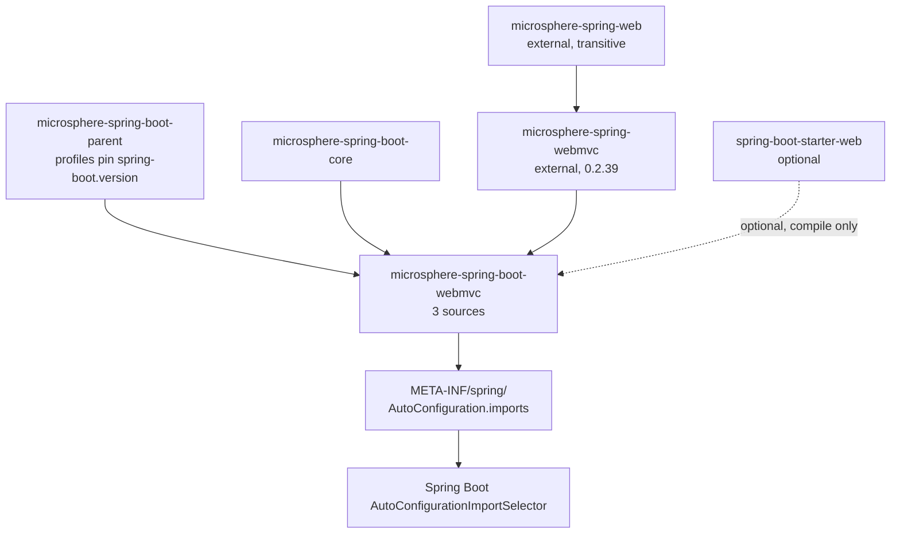
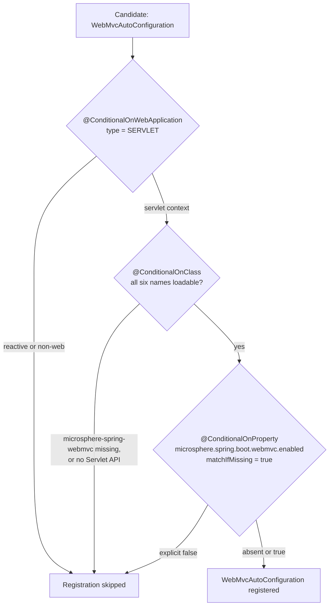
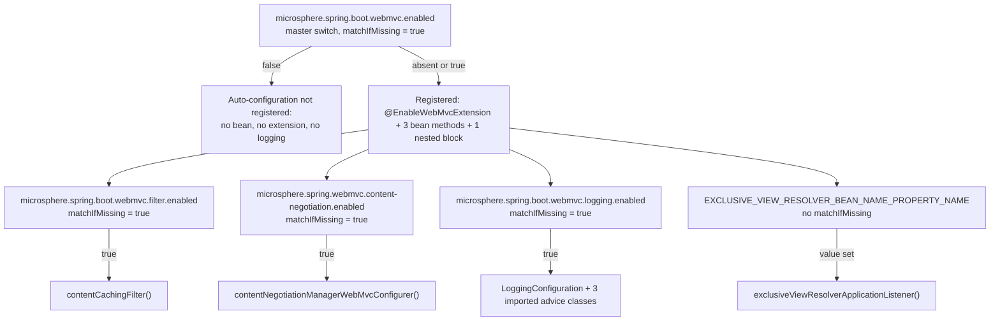

# WebMvc Module

> [中文](./zh/webmvc.md) · [Documentation index](../README.md) ·
> [User Guide for this module](../../user-guide/current/webmvc.md)

> **Branch:** `release` · **Version line:** `0.2.x` · **Artifact:** `microsphere-spring-boot-webmvc`
> **Spring Boot:** `3.0.13` – `4.1.1` · **Java:** 17

Contents:
[1 Module Position](#1-module-position) ·
[2 Package Map](#2-package-map) ·
[3 The Availability Condition](#3-the-availability-condition) ·
[4 WebMvcAutoConfiguration Anatomy](#4-webmvcautoconfiguration-anatomy) ·
[5 The Upstream Boundary](#5-the-upstream-boundary) ·
[6 Property Namespace and Switches](#6-property-namespace-and-switches) ·
[7 Design Patterns](#7-design-patterns) ·
[8 Tests](#8-tests) ·
[9 Recipes](#9-recipes) ·
[10 See Also](#10-see-also)

---

## 1. Module Position

`microsphere-spring-boot-webmvc` is the servlet-stack wiring module: three source files and nothing else — one
auto-configuration class, one composed condition annotation, one property-constant interface. Every behaviour it
activates is implemented in the standalone `microsphere-spring-webmvc` and `microsphere-spring-web` artifacts;
this module contributes Boot-flavoured registration and conditions. Below, `WebMvcAutoConfiguration.java`,
`ConditionalOnWebMvcAvailable.java` and `PropertyConstants.java` denote files in
`microsphere-spring-boot-webmvc/src/main/java/io/microsphere/spring/boot/webmvc/`.



The edges are read from `microsphere-spring-boot-webmvc/pom.xml`: the parent declaration (`pom.xml:5-10`),
`microsphere-spring-boot-core` as a compile dependency (`pom.xml:31-35`), `microsphere-spring-webmvc` with no
version — managed by the `microsphere-spring-dependencies` BOM at `${microsphere-spring.version}` = `0.2.39`
(`microsphere-spring-boot-parent/pom.xml:22`, BOM import at `:57-63`) — and `spring-boot-starter-web` marked
`<optional>true</optional>` (`pom.xml:44-48`). The optionality is the point: a reactive application that pulls
this jar transitively must still start, which is what section 3 guarantees. Discovery is one line,
`src/main/resources/META-INF/spring/org.springframework.boot.autoconfigure.AutoConfiguration.imports:1`, holding
`io.microsphere.spring.boot.webmvc.autoconfigure.WebMvcAutoConfiguration`.

## 2. Package Map

| Package | Type | Responsibility |
|---|---|---|
| `io.microsphere.spring.boot.webmvc.autoconfigure` | `WebMvcAutoConfiguration` | The single registration surface: `@EnableWebMvcExtension`, `@Import`, three `@Bean` methods, one nested conditional block (`WebMvcAutoConfiguration.java:46-86`). |
| `io.microsphere.spring.boot.webmvc.autoconfigure.condition` | `ConditionalOnWebMvcAvailable` (annotation) | Turns "is a servlet app with the Microsphere Web MVC stack present, and is the module switched on?" into one reusable annotation (`ConditionalOnWebMvcAvailable.java:42-56`). |
| `io.microsphere.spring.boot.webmvc.constants` | `PropertyConstants` (interface) | Declares the property keys and their defaults, and attaches `@ConfigurationProperty` metadata to the switch keys (`PropertyConstants.java:33-116`). |

The module holds no `@ConfigurationProperties` class, no `spring.factories`, no default-properties resource and
no `AutoConfigurationImportFilter` — the three types above are the entire surface.

## 3. The Availability Condition

`ConditionalOnWebMvcAvailable.java:42-55`, quoted in full:

```java
@Target({TYPE, METHOD})
@Retention(RUNTIME)
@Documented
@ConditionalOnWebApplication(type = SERVLET)
@ConditionalOnClass(name = {
        "jakarta.servlet.Servlet",                                             // Servlet API
        "org.springframework.context.ApplicationContext",                      // Spring Context API
        "org.springframework.web.method.HandlerMethod",                        // Spring Web API
        "org.springframework.web.servlet.DispatcherServlet",                   // Spring Web MVC API
        "io.microsphere.spring.web.method.support.HandlerMethodInterceptor",   // Microsphere Spring Web API
        "io.microsphere.spring.webmvc.annotation.EnableWebMvcExtension"        // Microsphere Spring Web MVC API
})
@ConditionalOnProperty(name = MICROSPHERE_SPRING_BOOT_WEBMVC_ENALBED_PROPERTY_NAME, matchIfMissing = true)
```

Each meta-annotation closes off one failure mode:

| Meta-annotation | Line | What it rejects |
|---|---|---|
| `@Target({TYPE, METHOD})`, `@Retention(RUNTIME)`, `@Documented` | `42-44` | Nothing; they only widen reuse to methods, keep the annotation reflective, and keep it in Javadoc. |
| `@ConditionalOnWebApplication(type = SERVLET)` | `45` | Non-web contexts and reactive contexts. A WebFlux application never registers this auto-configuration, so the two web modules can sit on the same classpath. |
| `@ConditionalOnClass(name = {...})` | `46-53` | Servlet containers without `jakarta.servlet.Servlet`, and — the decisive one — applications that do not carry `microsphere-spring-webmvc` / `microsphere-spring-web`, because the last two names are Microsphere types. |
| `@ConditionalOnProperty(name = ..., matchIfMissing = true)` | `54` | Explicit `microsphere.spring.boot.webmvc.enabled=false`. Absent means on. |

The class list uses `name = {...}` strings instead of `value = {Servlet.class, ...}`, so the annotation stays
parseable when the listed types are absent and no compile-time dependency slips in; `release-notes.md:488`
records the move to string names in `0.2.31`. Boot's own package relocation is handled in the same by-name
style, but in `@AutoConfigureAfter` (section 4). Boot treats the three `@Conditional` meta-annotations as a
conjunction evaluated in declaration order, stopping at the first mismatch — the entry the
condition-evaluation report names.



## 4. `WebMvcAutoConfiguration` Anatomy

Class-level annotations, quoted verbatim (`WebMvcAutoConfiguration.java:46-57`):

```java
@ConditionalOnWebMvcAvailable
@AutoConfigureAfter(name = {
        "org.springframework.boot.autoconfigure.web.servlet.WebMvcAutoConfiguration", // Spring Boot API [2.0, 4.0)
        "org.springframework.boot.webmvc.autoconfigure.WebMvcAutoConfiguration"       // Spring Boot API [4.0,)
})
@EnableWebMvcExtension(
        registerHandlerInterceptors = true,
        reversedProxyHandlerMapping = true
)
@Import(value = {
        WebMvcAutoConfiguration.LoggingConfiguration.class
})
public class WebMvcAutoConfiguration {
```

The `@AutoConfigureAfter` list is the cross-version mechanism. Boot moved its own Web MVC auto-configuration
from `org.springframework.boot.autoconfigure.web.servlet` to `org.springframework.boot.webmvc.autoconfigure`
in the `4.0` line; both FQCNs are declared as strings, and both are listed in the Javadoc `@see` block at
`WebMvcAutoConfiguration.java:42-43`. A name that is not on the classpath is simply ignored by the ordering
calculator, so one source file orders itself correctly under `3.0.13` and under `4.1.1` alike. The
`compatible` module ships no `WebMvcAutoConfiguration` shim at all, so by-name ordering is the only mechanism
here; see `docs/developer-guide/current/compatible.md`.

`@EnableWebMvcExtension` is upstream (`io.microsphere.spring.webmvc.annotation.EnableWebMvcExtension`, imported
at `WebMvcAutoConfiguration.java:22`) and is switched on here with exactly two attributes set:
`registerHandlerInterceptors = true` and `reversedProxyHandlerMapping = true` (`:51-54`). The `@Import` at
`:55-57` then pulls in the nested logging block explicitly rather than relying on nested-class processing.

Bean methods and the nested block:

| Bean / member | Line | Return type | Condition | Default | Effect |
|---|---|---|---|---|---|
| `contentCachingFilter()` | `60-64` | `io.microsphere.spring.web.servlet.filter.ContentCachingFilter` | `@ConditionalOnProperty(name = MICROSPHERE_SPRING_BOOT_WEBMVC_FILTER_ENALBED_PROPERTY_NAME, matchIfMissing = true)` | ON | Registers the upstream caching servlet filter as a bean; Boot's `FilterRegistrationBean` machinery then deploys it. |
| `contentNegotiationManagerWebMvcConfigurer()` | `66-70` | `ConfigurableContentNegotiationManagerWebMvcConfigurer` | `@ConditionalOnProperty(name = MICROSPHERE_SPRING_WEBMVC_CONTENT_NEGOTIATION_ENABLED_PROPERTY_NAME, matchIfMissing = true)` | ON | Contributes the upstream `WebMvcConfigurer` that reconfigures the `ContentNegotiationManager`; the enabled test proves it adds a parameter-driven strategy. |
| `exclusiveViewResolverApplicationListener()` | `72-76` | `ExclusiveViewResolverApplicationListener` | `@ConditionalOnProperty(name = EXCLUSIVE_VIEW_RESOLVER_BEAN_NAME_PROPERTY_NAME)` — **no** `matchIfMissing` | OFF, opt-in | Registers the upstream `ApplicationListener` once the referenced property (declared upstream, not in this repository) carries any value. |
| `LoggingConfiguration` (nested `static class`) | `78-85` | configuration block | `@ConditionalOnProperty(name = MICROSPHERE_SPRING_BOOT_WEBMVC_LOGGING_ENALBED_PROPERTY_NAME, matchIfMissing = true)` | ON | `@Import`s `LoggingMethodHandlerInterceptor`, `LoggingPageRenderContextHandlerInterceptor`, `LoggingHandlerMethodArgumentResolverAdvice` (`79-83`). |

Only `exclusiveViewResolverApplicationListener()` is off by default; the other three switches use
`matchIfMissing = true`, so a bare dependency addition turns on filter, content negotiation and logging.

## 5. The Upstream Boundary

Everything below `io.microsphere.spring.web.*` and `io.microsphere.spring.webmvc.*` is a different artifact
(`microsphere-spring-boot-webmvc/pom.xml:38-41`). The boot module is a *policy layer* — when to register, in
which order, under which key — over a framework-agnostic implementation layer usable from plain Spring:

| Concern | Lives upstream | Lives here |
|---|---|---|
| Request/response body caching filter class | `microsphere-spring-web` (`io.microsphere.spring.web.servlet.filter.ContentCachingFilter`) | bean method + switch (`WebMvcAutoConfiguration.java:60-64`) |
| Handler-interceptor registration, reversed-proxy handler mapping | `microsphere-spring-webmvc` (`@EnableWebMvcExtension`, `WebMvcExtensionConfiguration`) | the two `true` attributes (`:51-54`) |
| Content negotiation strategy assembly | `microsphere-spring-webmvc` (`ConfigurableContentNegotiationManagerWebMvcConfigurer`) | bean method + switch (`:66-70`) |
| Restricting view resolution to one bean | `microsphere-spring-webmvc` (`ExclusiveViewResolverApplicationListener`, including its property constant) | opt-in bean method (`:72-76`) |
| Logging advice for interceptors, page render context, argument resolvers | `microsphere-spring-webmvc` (three classes under `...interceptor` and `...method.support`) | nested conditional block (`:78-85`) |
| "Is this stack usable at all?" | — | `ConditionalOnWebMvcAvailable` (`:42-55`) |
| Boot ordering across `3.x` / `4.x` | — | `@AutoConfigureAfter(name = {...})` (`:47-50`) |
| Property key literals, defaults, `@ConfigurationProperty` metadata | — | `PropertyConstants` (`:33-116`) |
| Discovery by `AutoConfigurationImportSelector` | — | the `AutoConfiguration.imports` resource |

## 6. Property Namespace and Switches

`PropertyConstants` is an `interface` of `String` constants (`PropertyConstants.java:33`). Prefixes are
composed, never repeated, and every switch appends `ENABLED_PROPERTY_NAME`: `MICROSPHERE_SPRING_BOOT_PROPERTY_NAME_PREFIX`
(`"microsphere.spring.boot."`, `microsphere-spring-boot-core/src/main/java/io/microsphere/spring/boot/constants/PropertyConstants.java:33-35`)
plus `"webmvc."` at line `38`.

| Constant | Line | Resolved key | Declared default | Read by |
|---|---|---|---|---|
| `MICROSPHERE_SPRING_BOOT_WEBMVC_PROPERTY_NAME_PREFIX` | `38` | `microsphere.spring.boot.webmvc.` | — | namespace root |
| `MICROSPHERE_SPRING_BOOT_WEBMVC_ENALBED_PROPERTY_NAME` | `63-68` | `microsphere.spring.boot.webmvc.enabled` | `true` (`:43`) | `ConditionalOnWebMvcAvailable.java:54` |
| `FILTER_PROPERTY_NAME_PREFIX` | `73` | `microsphere.spring.boot.webmvc.filter.` | — | sub-namespace |
| `MICROSPHERE_SPRING_BOOT_WEBMVC_FILTER_ENABLED_PROPERTY_NAME` | `78-83` | `microsphere.spring.boot.webmvc.filter.enabled` | `true` (`:48`) | `WebMvcAutoConfiguration.java:60` |
| `LOGGING_PROPERTY_NAME_PREFIX` | `105` | `microsphere.spring.boot.webmvc.logging.` | — | sub-namespace |
| `MICROSPHERE_SPRING_BOOT_WEBMVC_LOGGING_ENALBED_PROPERTY_NAME` | `110-115` | `microsphere.spring.boot.webmvc.logging.enabled` | `true` (`:53`) | `WebMvcAutoConfiguration.java:78` |
| `CONTENT_NEGOTIATION_PROPERTY_NAME_PREFIX` | `90` | `microsphere.spring.webmvc.content-negotiation.` | — | sub-namespace, *non-boot* |
| `MICROSPHERE_SPRING_WEBMVC_CONTENT_NEGOTIATION_ENABLED_PROPERTY_NAME` | `95-100` | `microsphere.spring.webmvc.content-negotiation.enabled` | `true` (`:58`) | `WebMvcAutoConfiguration.java:66` |
| `EXCLUSIVE_VIEW_RESOLVER_BEAN_NAME_PROPERTY_NAME` | upstream | literal not declared in this repository; the AllEnabled test sets `microsphere.spring.webmvc.view-resolver.exclusive-bean-name` (`...AllEnabledTest.java:53`) | — | `WebMvcAutoConfiguration.java:72` |

The literals are not guesses: `src/test/java/io/microsphere/spring/boot/webmvc/constants/PropertyConstantsTest.java:45-55`
asserts each one. The `microsphere.spring.webmvc.` parent prefix is the upstream
`MICROSPHERE_SPRING_WEBMVC_PROPERTY_NAME_PREFIX` (`PropertyConstants.java:25`, used at `:90`).

Three points a maintainer must keep in mind:

1. One master switch over three feature switches, not four independent keys; view-resolver is the only opt-in.
2. Content negotiation deliberately sits in the **non-boot** namespace, because the same key also drives the
   upstream configurer in plain Spring applications; the `@see` at `PropertyConstants.java:88` names
   `ConfigurableContentNegotiationManagerWebMvcConfigurer#PROPERTY_NAME_PREFIX` as its source.
3. Spelling is asymmetric in the source: constants ending `..._ENALBED_PROPERTY_NAME` (a typo carried through
   the code) pair with defaults named `DEFAULT_..._ENABLED`. Renaming either breaks the API.



## 7. Design Patterns

| Pattern | Where | Evidence |
|---|---|---|
| Composition via meta-annotation | `ConditionalOnWebMvcAvailable` | Three Boot conditions collapsed into one annotation (`ConditionalOnWebMvcAvailable.java:45-54`) and reused at `WebMvcAutoConfiguration.java:46`; `@Target` allows method-level reuse (`:42`). |
| Facade auto-configuration | `WebMvcAutoConfiguration` | One class, one imports line, whole servlet extension visible to Boot; the class itself holds no logic (`:58-86`). |
| Opt-in bean | `exclusiveViewResolverApplicationListener()` | The only `@ConditionalOnProperty` without `matchIfMissing` (`:72`), so absence of the key means absence of the bean — pinned by `assertNull` in `WebMvcAutoConfigurationTest.java:68`. |
| Conditional group | `LoggingConfiguration` | A nested `static class` carrying one property condition plus an `@Import` of three upstream classes (`:78-85`), wired in by `@Import` at `:55-57`. |
| Constants-in-interface | `PropertyConstants` | `public interface PropertyConstants` of `String` constants, consumed through `import static` (`WebMvcAutoConfiguration.java:33-36`, `ConditionalOnWebMvcAvailable.java:28`). |
| Metadata-as-annotations | `@ConfigurationProperty` on each switch | `type = boolean.class`, `defaultValue = DEFAULT_...`, `source = APPLICATION_SOURCE` (`PropertyConstants.java:63-67`, `78-82`, `95-99`, `110-114`), processed by `microsphere-annotation-processor` declared optional in `pom.xml:24-28`. |
| By-name ordering for cross-version support | `@AutoConfigureAfter(name = {...})` | Two FQCNs for the same Boot class in two package layouts, annotated with the version ranges they cover (`:47-50`). |

## 8. Tests

Five test sources, under `microsphere-spring-boot-webmvc/src/test/java/io/microsphere/spring/boot/webmvc/`.

| Test | Pins down |
|---|---|
| `autoconfigure/AbstractWebMvcAutoConfigurationTest.java` | Fixture, not a test. `@Disabled` (`:50`), `@WebAppConfiguration` (`:51`), `@SpringJUnitConfig(classes = {TestController.class, RouterFunctionTestConfig.class})` (`:52-55`); builds `MockMvc` from a `ConfigurableWebApplicationContext` in `setUp()` (`:66-69`) and exposes `testWebEndpoints()` (`:81-88`) with six `protected` endpoint checks — helloworld, greeting path variable, JSON `User` round-trip through `POST /test/user`, `/test/error` wrapped as `ServletException` (`:137-140`), `PUT /test/response-entity`, `PUT /test/person/{id}`. It declares no `@Test` method, so it asserts nothing by itself. |
| `autoconfigure/WebMvcAutoConfigurationTest.java` | The **defaults**. No `@TestPropertySource`: `@SpringBootTest` + `@EnableAutoConfiguration` (`:40-43`). Injects `WebMvcExtensionConfiguration`, `ContentCachingFilter`, `ConfigurableContentNegotiationManagerWebMvcConfigurer` and `WebMvcAutoConfiguration.LoggingConfiguration` as required beans (`:46-56`) and the listener with `required = false` (`:58-59`); `test()` runs the endpoints then asserts the first four non-null and the listener null (`:61-69`). A default build therefore proves the ON-by-default policy. |
| `autoconfigure/WebMvcAutoConfigurationAllDisabledTest.java` | The **off** matrix. `@TestPropertySource` sets `microsphere.spring.webmvc.content-negotiation.enabled=false`, `microsphere.spring.webmvc.filter.enabled=false`, `microsphere.spring.webmvc.logging.enabled=false` (`:51-57`). Its only real assertion is `assertContentNegotiationManager`: exactly one strategy, of type `HeaderContentNegotiationStrategy` (`:91-97`), i.e. Boot's stock manager once the upstream configurer is switched off — that key does match a boot-module condition (`PropertyConstants.java:95-100`). |
| `autoconfigure/WebMvcAutoConfigurationAllEnabledTest.java` | The **on** matrix. Sets the view-resolver key plus content-negotiation `enabled/favorParameter/parameterName=p/favorPathExtension/ignoreUnknownPathExtensions/useRegisteredExtensionsOnly/ignoreAcceptHeader`, `filter.enabled=true`, `logging.enabled=true` (`:51-64`). All six collaborators are required injections (`:68-84`), so a missing bean fails the context; `assertContentNegotiationManager` then requires a non-empty strategy list and finds a `ParameterContentNegotiationStrategy` whose parameter name is `p` (`:98-107`). |
| `constants/PropertyConstantsTest.java` | Every key literal and default, `:45-55`. Renaming or reparenting a constant fails here first. |

Two honest caveats about the disabled test, which matter before you extend it:

* It sets `microsphere.spring.webmvc.filter.enabled` and `microsphere.spring.webmvc.logging.enabled`
  (`:54-55`), while the conditions read `microsphere.spring.boot.webmvc.filter.enabled` and
  `...boot.webmvc.logging.enabled` (`PropertyConstants.java:83`, `:115`) — those two lines do not switch the
  beans off.
* Its `@Autowired(required = false)` fields for the filter, `LoggingConfiguration` (`:64-74`) and the listener
  (`:76-77`) are never asserted, so nothing proves those beans are absent; only content negotiation is.

When fixing this, use the `...boot.webmvc...` keys and explicit `assertNull` checks; note that these tests build
their own hierarchy rather than reusing `microsphere-spring-boot-test`'s `AbstractAutoConfigurationTest` (`pom.xml:77-83`).

## 9. Recipes

**Add a new servlet-stack bean.**

1. In `PropertyConstants`, compose a sub-namespace prefix plus its switch and a `DEFAULT_...` constant, and
   copy the `@ConfigurationProperty(type = boolean.class, defaultValue = ..., source = APPLICATION_SOURCE)`
   block (`PropertyConstants.java:78-83` is the template).
2. Add the `@Bean` method with `@ConditionalOnProperty(name = &lt;your constant&gt;, matchIfMissing = true)`
   unless the bean is opt-in; follow `WebMvcAutoConfiguration.java:60-64`.
3. If several beans must switch together, group them in a nested `static class` with one property condition and
   `@Import` it, like `:78-85` plus `:55-57`.
4. Pin it: add the key literal to `PropertyConstantsTest.testConstants()`, add the bean to the required
   injections in `WebMvcAutoConfigurationTest` and `...AllEnabledTest`, switch it off with the **boot** key in
   `...AllDisabledTest`. Leave `AutoConfiguration.imports` alone — one line stays correct while the class name holds.

**Add a switch without a new bean.** Use the `LoggingConfiguration` shape: one property, one nested class, one
`@Import` list. The master key (`ConditionalOnWebMvcAvailable.java:54`) stays the only kill switch: a nested
`enabled` key must never re-enable anything after the master is `false`.

**Support a Boot line where a class moved.** Append the new FQCN as a string to the `@AutoConfigureAfter(name
= {...})` list and keep the old one, following the range comment convention
(`WebMvcAutoConfiguration.java:47-50`). If a class this module *references in code* moves, it needs either a
`compatible` shim (`docs/developer-guide/current/compatible.md`) or demotion to a name in
`@ConditionalOnClass` (`ConditionalOnWebMvcAvailable.java:46-53`). Prove it on both edges:
`mvn -P spring-boot-3.0 -pl microsphere-spring-boot-webmvc test` and the same with `-P spring-boot-4.1`
(profiles at `microsphere-spring-boot-parent/pom.xml:76-135`, `spring-boot-3.5` active by default at `:113-115`).

## 10. See Also

| Document | Scope |
|---|---|
| [README.md](./README.md) | This branch's developer-guide index: reactor shape, extension-point inventory. |
| [core.md](./core.md) | The compile dependency this module declares: listeners, initializers, bind advisors, diagnostics. |
| [webflux.md](./webflux.md) | The reactive sibling — same condition shape, far smaller surface, no beans at all. |
| [compatible.md](./compatible.md) | Where relocated `org.springframework.boot.*` types are shimmed, and why that is *not* how these web modules cope. |
| [User guide: webmvc](../../user-guide/current/webmvc.md) | Property table and behaviour as an end user sees it. |
