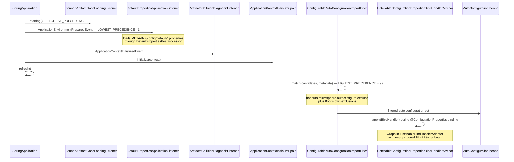

# 开发者文档 — `release` 分支（0.2.x）

> [English](../README.md) · [开发者文档首页：中文](../../zh/README.md) ·
> 本分支用户文档：[中文](../../../user-guide/current/zh/README.md)

> **分支：** `release` · **版本线：** `0.2.x` · **Artifact：** `microsphere-spring-boot-*`
> **Spring Boot：** `3.0.13` – `4.1.1`（由 profile 选择，默认 `3.5.16`） · **Java：** 17

目录：
[1 本分支发布什么](#1-本分支发布什么) ·
[2 仓库形态](#2-仓库形态) ·
[3 模块依赖关系图](#3-模块依赖关系图) ·
[4 扩展点清单](#4-扩展点清单) ·
[5 启动时序与顺序值](#5-启动时序与顺序值) ·
[6 绑定可观测化路径](#6-绑定可观测化路径) ·
[7 模块文档](#7-模块文档) ·
[8 阅读路径](#8-阅读路径) ·
[9 贡献检查清单](#9-贡献检查清单) ·
[10 文档约定](#10-文档约定)

---

## 1. 本分支发布什么

`release` 维护 `0.2.x` 版本线：同一份源码树，针对 Spring Boot `3.0` 到 `4.1` 编译与发布。五个 artifact 上架
Maven Central，有一个刻意不上架。

| 模块 | Artifact | 是否发布 | 是否在 BOM | 主源码文件数 | 测试文件数 |
|---|---|---|---|---|---|
| `microsphere-spring-boot-parent` | pom | 是 | 否 | — | — |
| `microsphere-spring-boot-dependencies` | pom（BOM） | 是 | — | — | — |
| `microsphere-spring-boot-compatible` | jar | **否** | **否** | 10 | 0 |
| `microsphere-spring-boot-test` | jar | 是 | 是 | 4 | 5 |
| `microsphere-spring-boot-core` | jar | 是 | 是 | 47 | 48 |
| `microsphere-spring-boot-webmvc` | jar | 是 | 是 | 3 | 5 |
| `microsphere-spring-boot-webflux` | jar | 是 | 是 | 3 | 4 |
| `microsphere-spring-boot-actuator` | jar | 是 | 是 | 10 | 5 |

这些库没有自带一套生命周期。每个类要么实现 Spring Boot 已有的扩展点，要么支撑一个已经注册好的扩展点。

---

## 2. 仓库形态

```text
microsphere-spring-boot/                      根聚合模块，持有 <revision> 与 <java.version>
├── pom.xml                                   8 个 <modules>，按构建顺序排列
├── microsphere-spring-boot-parent/           按 profile 设定 spring-boot.version，导入第三方 BOM
├── microsphere-spring-boot-dependencies/     BOM：五个已发布 artifact
├── microsphere-spring-boot-compatible/       org.springframework.boot.* 垫片，仅构建期
├── microsphere-spring-boot-test/             AbstractAutoConfigurationTest 及三个 runner 子类
├── microsphere-spring-boot-core/             监听器、初始化器、过滤器、绑定 advisor、诊断
├── microsphere-spring-boot-webmvc/           Servlet 栈自动配置
├── microsphere-spring-boot-webflux/          响应式栈自动配置
├── microsphere-spring-boot-actuator/         端点、调度器指标、端点默认策略
├── .github/workflows/                        maven-build、maven-publish、merge-main-to-branches、
│                                             sync-branches-from-upstream、wiki-publish
└── docs/                                     user-guide/ 与 developer-guide/，各自按分支与语言拆分
```

`compatible` 与 `test` 有意排在 `<modules>` 中 `core` 之前：`core` 的 test 作用域依赖 `test`，而 Boot 4 的
profile 会把 `compatible` 挂到 `core` 上。

---

## 3. 模块依赖关系图

实线是编译依赖；虚线是继承、test 作用域，或由 profile 条件决定的挂载。

```mermaid
graph TD
    PARENT["microsphere-spring-boot-parent"]
    BOM["microsphere-spring-boot-dependencies (BOM)"]
    COMPAT["microsphere-spring-boot-compatible<br/>(never published)"]
    TEST["microsphere-spring-boot-test"]
    CORE["microsphere-spring-boot-core"]
    MVC["microsphere-spring-boot-webmvc"]
    FLUX["microsphere-spring-boot-webflux"]
    ACT["microsphere-spring-boot-actuator"]
    APP["Application"]

    PARENT -. inheritance .-> BOM
    PARENT -. inheritance .-> COMPAT
    PARENT -. inheritance .-> TEST
    PARENT -. inheritance .-> CORE
    PARENT -. inheritance .-> MVC
    PARENT -. inheritance .-> FLUX
    PARENT -. inheritance .-> ACT

    BOM -. version management .-> CORE
    BOM -. version management .-> MVC
    BOM -. version management .-> FLUX
    BOM -. version management .-> ACT

    CORE -. test scope .-> TEST
    MVC --> CORE
    FLUX --> CORE
    ACT --> CORE
    CORE -. profiles spring-boot-4.0 and 4.1 .-> COMPAT

    ACT --> APP
    MVC --> APP
    FLUX --> APP
    CORE --> APP
    TEST -. test scope .-> APP
```

值得记住的几条推论：

* `core` 是所有其他 jar 模块唯一的共同依赖，而它自己不依赖它们中的任何一个。
* `webmvc` 与 `webflux` 是同级关系，不是链式关系：各自由自己的可用性条件独立控制。
* `actuator` 通过自己的 POM 引入 Micrometer 与 Jolokia，因此只依赖 `core` 的应用不会被拖进这些依赖。
* `compatible` 在 profile `spring-boot-4.0` 与 `spring-boot-4.1` 之外完全不可见，也无法从 Maven Central 获取。

---

## 4. 扩展点清单

`core/src/main/resources/META-INF/spring.factories` 就是 core 模块的全部装配——背后没有 `@ComponentScan`，也
不依赖 `spring-boot-autoconfigure` 处理器的魔法：

| `spring.factories` 中的键 | 注册的类 | 触发时机 |
|---|---|---|
| `ApplicationContextInitializer` | `report.ConditionEvaluationReportInitializer` | 容器初始化 |
| `ApplicationContextInitializer` | `env.config.OriginTrackedConfigurationPropertyInitializer` | 容器初始化 |
| `SpringApplicationRunListener` | `classloading.BannedArtifactClassLoadingListener` | 最早，`starting()` |
| `SpringApplicationRunListener` | `listener.FailureReportSpringApplicationRunListener` | `failed()` |
| `ApplicationListener` | `diagnostics.ArtifactsCollisionDiagnosisListener` | `ApplicationContextInitializedEvent` |
| `ApplicationListener` | `report.ConditionEvaluationReportListener` | `ApplicationReadyEvent` |
| `ApplicationListener` | `env.DefaultPropertiesApplicationListener` | `ApplicationEnvironmentPreparedEvent` |
| `SpringBootExceptionReporter` | `report.ConditionEvaluationSpringBootExceptionReporter` | 启动失败 |
| `FailureAnalyzer` | `diagnostics.ArtifactsCollisionFailureAnalyzer` | 启动失败 |
| `AutoConfigurationImportFilter` | `autoconfigure.ConfigurableAutoConfigurationImportFilter` | 自动配置导入 |
| `io.microsphere.spring.boot.env.DefaultPropertiesPostProcessor` | `env.SpringApplicationDefaultPropertiesPostProcessor` | 项目自定义键，由上面那个监听器加载 |

自动配置类通过每个模块自己的 `META-INF/spring/AutoConfiguration.imports` 注册：

| 模块 | 注册的自动配置类 |
|---|---|
| `core` | `io.microsphere.spring.boot.context.autoconfigure.ConfigurationPropertiesAutoConfiguration` |
| `actuator` | `io.microsphere.spring.boot.actuate.autoconfigure.ActuatorAutoConfiguration`、`...ActuatorEndpointsAutoConfiguration` |
| `webmvc` | `io.microsphere.spring.boot.webmvc.autoconfigure.WebMvcAutoConfiguration` |
| `webflux` | `io.microsphere.spring.boot.webflux.autoconfigure.WebFluxAutoConfiguration` |

`core` 的自动配置最值得注意，因为它的条件依赖的是一个 *Microsphere* 类，并且被排在 Boot 自己那个同名自动配置
之前：

```java
@ConditionalOnClass(name = {
        "io.microsphere.spring.context.annotation.BeanCapableImportCandidate"
})
@AutoConfigureBefore(name = {
        "org.springframework.boot.autoconfigure.context.ConfigurationPropertiesAutoConfiguration"
})
@EnableConfigurationPropertiesExtension
public class ConfigurationPropertiesAutoConfiguration {
}
```

`@AutoConfigureBefore` 使用按名字的形式，好让同一份源码在那些目标类换了包的 Boot 版本线上依然能编译——这是本
仓库反复出现的跨版本手法。

此外 `actuator` 还带有 `META-INF/services/io.microsphere.metadata.ConfigurationPropertyLoader`（内容指向
`io.microsphere.metadata.MetadataResourceConfigurationPropertyLoader`），本模块的
`META-INF/config/default/endpoints.properties` 就是这样被发现为一个属性源的。

---

## 5. 启动时序与顺序值

下面的顺序值都是从分支源码里读出来的，不是按惯例推断的：

| 类 | 顺序 | 出处 |
|---|---|---|
| `BannedArtifactClassLoadingListener` | `setOrder(HIGHEST_PRECEDENCE)` | `core/src/main/java/io/microsphere/spring/boot/classloading/BannedArtifactClassLoadingListener.java:79` |
| `ConfigurableAutoConfigurationImportFilter` | `HIGHEST_PRECEDENCE + 99` | `.../autoconfigure/ConfigurableAutoConfigurationImportFilter.java:276` |
| `DefaultPropertiesApplicationListener` | `DEFAULT_ORDER = LOWEST_PRECEDENCE - 1` | `.../env/DefaultPropertiesApplicationListener.java:76` |
| `DefaultPropertiesPostProcessor`（接口默认值） | `LOWEST_PRECEDENCE` | `.../env/DefaultPropertiesPostProcessor.java:67` |
| `OnceApplicationPreparedEventListener`（及其日志子类） | `LOWEST_PRECEDENCE` | `.../context/OnceApplicationPreparedEventListener.java:54`、`LoggingOnceApplicationPreparedEventListener.java:47` |
| `ArtifactsCollisionDiagnosisListener`、`ConditionEvaluationReportListener`、`ConditionEvaluationReportInitializer` | 未实现 `Ordered`，按注册顺序 | 各自的类声明 |



`ConfigurableAutoConfigurationImportFilter` 取 `HIGHEST_PRECEDENCE + 99` 是有意为之：Boot 自身的过滤器排序在它
之下留出了空间，于是排除逻辑会先于标准的 metadata/pattern 过滤器执行，同时仍允许用户自定义过滤器抢先。

---

## 6. 绑定可观测化路径

这是 `core` 真正区别于常规做法的设计：它把 Spring Boot 单向的绑定操作变成可观测的，而完全不改动 Boot 的代码。

```mermaid
flowchart LR
    A["Binder.bind(...)"] --> B["ConfigurationPropertiesBindHandlerAdvisor.apply(BindHandler)"]
    B --> C["ListenableBindHandlerAdapter (decorator)"]
    C --> D["BindListener beans, sorted by Order"]
    D --> E["BindListener callbacks: pre / post / onSuccess / onError / onFinish"]
    E --> F["EventPublishingConfigurationPropertiesBeanPropertyChangedListener"]
    F --> G["ConfigurationPropertiesBeanPropertyChangedEvent"]
    G --> H["Application @EventListener methods"]
```



因此新增一个监听器只需要声明一个 `BindListener` Bean——不需要注册步骤，也不需要改 `spring.factories`——advisor
会通过 `BeanFactoryAware` 拿到的 `BeanFactory` 自动发现它。

---

## 7. 模块文档

| 文档 | 范围 |
|---|---|
| [core.md](./core.md) | 包结构、`spring.factories` 装配、绑定 advisor 链、诊断流水线、设计模式、维护配方 |
| [actuator.md](./actuator.md) | 端点模型、聚合操作、调度器指标装配、`endpoints.properties` |
| [webmvc.md](./webmvc.md) | Servlet 栈 Bean、可用性条件、跨 Boot 线的按名字排序 |
| [webflux.md](./webflux.md) | 响应式栈自动配置及其条件 |
| [test.md](./test.md) | 测试基类层次、泛型 runner 约束、继承而来的断言 |
| [compatible.md](./compatible.md) | 同全限定名的垫片、为何不发布、由 profile 挂载 |
| [parent.md](./parent.md) | 继承链、受管属性、Boot profile 选择 |
| [dependencies.md](./dependencies.md) | BOM 如何组装，新模块要加入需要做什么 |
| [build-and-release.md](./build-and-release.md) | 本地构建、CI 矩阵、发布流水线、分支自动化 |

---

## 8. 阅读路径

三种常用的阅读顺序：

| 如果你要…… | 按这个顺序读 |
|---|---|
| 给 `core` 增加一个诊断或监听器 | 本文件 → `core.md` → `test.md` 与 `build-and-release.md` |
| 新增或修改一个 actuator 端点 | `actuator.md` → `core.md`（默认属性加载链） |
| 支持一个新的 Boot 小版本 | `build-and-release.md` → `compatible.md` → `parent.md` |

每份模块文档都以 *参考* 表结尾；跨文档链接不依赖标题锚点，因为中英文文件的锚点文本并不相同。

---

## 9. 贡献检查清单

在本分支上，一次改动要算完整，下面这些条件必须全部满足。其中第 4–7 条是评审时最常被漏掉的。

1. **代码**在默认 profile 下可编译：`./mvnw -pl <module> -am clean verify`。
2. 该模块的 `src/test/java` 里有**回归覆盖**；自动配置的改动要用 `microsphere-spring-boot-test` 的基类来测，
   而不是起一个完整的 `@SpringBootTest`。
3. 其他 Boot 版本线要做**本地冒烟**：`./mvnw -pl <module> -am -Pspring-boot-3.0 test`；若选 Boot 4 的 profile，
   reactor 必须包含 `compatible`。
4. **跨版本 API 漂移**要用对手法：类只是换了包 → 写进按名字的注解列表；编译期类型真的不存在 → 放进 `compatible`，
   并由需要它的 profile 挂载。
5. **装配**要改在真正生效的地方：监听器/初始化器/过滤器/分析器改 `spring.factories`，自动配置类改
   `AutoConfiguration.imports`，默认值改 `META-INF/config/default/*.properties`。
6. **CI 矩阵**要覆盖新版本线：在 `.github/workflows/maven-build.yml` 的 `maven-profile-spring-boot` 里加上该 profile。
7. **文档**要中英文同步更新，同名文件、相同章节编号：`docs/developer-guide/current/<module>.md` 与
   `docs/developer-guide/current/zh/<module>.md`；如果改动对使用者可见，`docs/user-guide/current/<module>.md`
   及其 `zh/` 镜像也要一起改。
8. 模块 POM 里**不引入版本字面量**；版本只能来自 `${revision}`、Parent POM 或导入的 BOM。
9. **绝不**把 `compatible` 加进 BOM，也不加进任何已发布模块的 compile 作用域。

发版只在 `release` 分支上通过发布工作流完成，详见[build-and-release.md](./build-and-release.md)。

---

## 10. 文档约定

| 约定 | 说明 |
|---|---|
| 分支范围 | 只记录 `release` 与 `release-1.x`；`main`、`dev` 属集成面 |
| 证据 | 类名、方法签名、顺序常量、属性键都取自分支源码，并在结论旁标注路径 |
| 图示 | Mermaid `graph TD`、`flowchart`、`sequenceDiagram`、`classDiagram`；图中每个节点都是本分支真实存在的类 |
| 语言 | 英文在主路径，中文在 `zh/` 同名镜像，章节编号一一对应 |
| Secret | 只出现工作流 secret 的**名字**，绝不出现值 |
