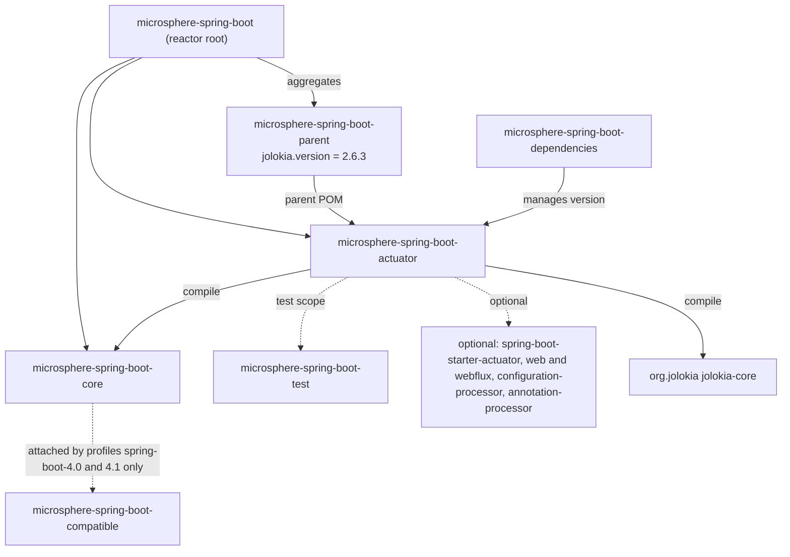
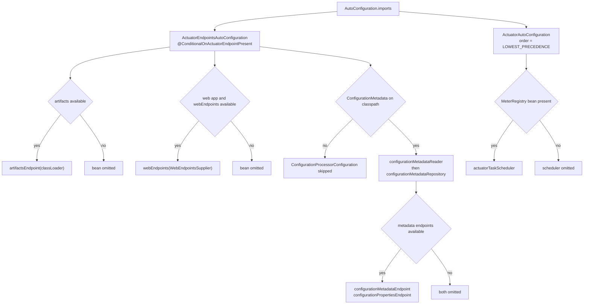
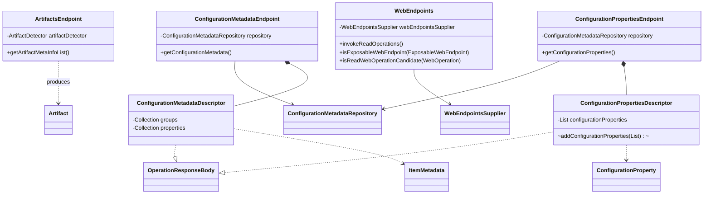
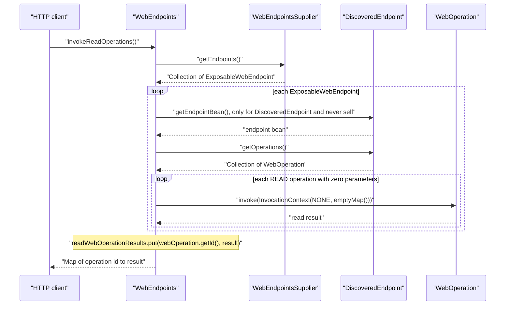
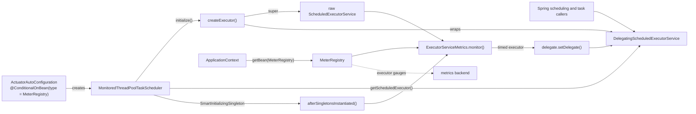
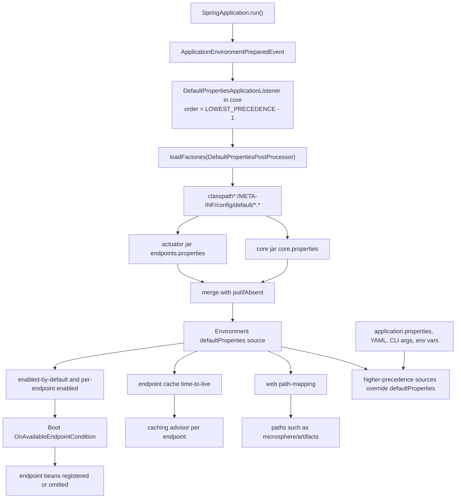

# Actuator 模块

> [English](../actuator.md) · 文档索引：[中文](../../zh/README.md) ·
> 本模块用户文档：[中文](../../../user-guide/current/zh/actuator.md)

> **分支：** `release` · **版本线：** `0.2.x` · **Artifact：** `microsphere-spring-boot-actuator`
> **Spring Boot：** `3.0.13` – `4.1.1` · **Java：** 17

目录：
[1 模块定位](#1-模块定位) ·
[2 包结构地图](#2-包结构地图) ·
[3 自动配置设计](#3-自动配置设计) ·
[4 Endpoint 模型](#4-endpoint-模型) ·
[5 WebEndpoints 聚合流程](#5-webendpoints-聚合流程) ·
[6 MonitoredThreadPoolTaskScheduler](#6-monitoredthreadpooltaskscheduler) ·
[7 自定义条件注解](#7-自定义条件注解) ·
[8 PropertyConstants](#8-propertyconstants) ·
[9 默认属性加载机制](#9-默认属性加载机制) ·
[10 设计模式](#10-设计模式) ·
[11 测试](#11-测试) ·
[12 变更配方](#12-变更配方) ·
[13 参考](#13-参考)

---

## 1. 模块定位

`microsphere-spring-boot-actuator` 是根聚合 POM 中列出的最后一个模块（`pom.xml` 第 66 行），负责可观测性表面：四个自定义 endpoint、一个被 Micrometer 插桩的任务调度器，以及一份为整个应用重塑 Boot endpoint 姿态的默认属性文件。它是 `microsphere-spring-boot-core` 之上的薄层：`ConfigurationMetadataReader`、`ConfigurationMetadataRepository` 以及第 9 节描述的整条默认属性流水线都由 `core` 提供。



最下方的虚线边是刻意区分的：`compatible` 只挂在 `core` 上，从不挂在 `actuator` 上。actuator 的 POM 没有声明任何 Boot 版本 profile，因此本模块在 Boot `3.0` … `4.1` 之间无需改动即可编译；版本容忍度改由按名匹配的条件属性（第 7 节）与测试中成对出现的类名列表（第 11 节）承担。资料来源：`microsphere-spring-boot-actuator/pom.xml`、`microsphere-spring-boot-parent/pom.xml:23`、`microsphere-spring-boot-core/pom.xml`。

---

## 2. 包结构地图

`io.microsphere.spring.boot.actuate` 下的全部十个生产类：

| 包 | 类 | 职责 |
|---|---|---|
| `actuate` | `MonitoredThreadPoolTaskScheduler` | 启动完成后把 `ScheduledExecutorService` 替换为受 Micrometer 监控的委托对象的 `ThreadPoolTaskScheduler`。 |
| `actuate.autoconfigure` | `ActuatorAutoConfiguration` | 注册 `actuatorTaskScheduler` bean，并以 `MeterRegistry` 作为门槛。 |
| `actuate.autoconfigure` | `ActuatorEndpointsAutoConfiguration` | 注册两个无额外依赖的 endpoint，并导入由配置元数据驱动的嵌套配置类。 |
| `actuate.condition` | `ConditionalOnActuatorEndpointPresent` | 元注解：类路径上存在 Actuator `@Endpoint` API。 |
| `actuate.condition` | `ConditionalOnConfigurationProcessorPresent` | 元注解：类路径上存在 Boot configuration-processor 的元数据类。 |
| `actuate.constants` | `PropertyConstants` | `microsphere.spring.boot.actuator.` 属性名前缀。 |
| `actuate.endpoint` | `ArtifactsEndpoint` | endpoint `artifacts`：由 Microsphere 的 `ArtifactDetector` 探测出的类路径构件。 |
| `actuate.endpoint` | `ConfigurationMetadataEndpoint` | endpoint `configMetadata`：原始的 `ItemMetadata` 分组与属性。 |
| `actuate.endpoint` | `ConfigurationPropertiesEndpoint` | endpoint `configProperties`：由 SPI 加载器与配置元数据合并出的 `ConfigurationProperty` 列表。 |
| `actuate.endpoint` | `WebEndpoints` | web endpoint `webEndpoints`：对所有无参读操作做一次性扇出调用。 |

本模块没有独立的 DTO 子包：两个响应类型都是各自 endpoint 的 `public static` 嵌套类（见第 4 节）。

---

## 3. 自动配置设计

`META-INF/spring/org.springframework.boot.autoconfigure.AutoConfiguration.imports` 中恰好两行，顺序为：先 `io.microsphere.spring.boot.actuate.autoconfigure.ActuatorAutoConfiguration`，再 `io.microsphere.spring.boot.actuate.autoconfigure.ActuatorEndpointsAutoConfiguration`。

### 3.1 `ActuatorAutoConfiguration`

`microsphere-spring-boot-actuator/src/main/java/.../autoconfigure/ActuatorAutoConfiguration.java:39` 只带一个排序注解 `@AutoConfigureOrder(LOWEST_PRECEDENCE)`。该类**没有**使用 `@AutoConfigureAfter`，也**没有**使用 `@AutoConfigureBefore`：它唯一需要跟随的 Boot 自动配置是指标那一个，而与其写死类名（该包在不同 Boot 版本线之间迁移过），不如把自身排到全局最后，并依赖 bean 条件。类的其余成员都是常量：`DEFAULT_TASK_SCHEDULER_POOL_SIZE`（`"1"`，`:45`）、`TASK_SCHEDULER_POOL_SIZE_PROPERTY_NAME`（`:55`）、`TASK_SCHEDULER_THREAD_NAME_PREFIX_PROPERTY_NAME`（`:76`）、两个由它们拼出的 `@Value` 表达式（`:61`、`:82`）、bean 名 `"actuatorTaskScheduler"`（`:87`）以及 `METER_REGISTRY_CLASS_NAME`（`:94`）。两个属性名常量都带有 `@ConfigurationProperty(defaultValue = …, source = APPLICATION_SOURCE)`，于是注解处理器会把它们记录成可查阅的元数据——正好通过第 4 节的 endpoint 对外可见。

```java
@ConditionalOnBean(type = METER_REGISTRY_CLASS_NAME)
@Bean(name = ACTUATOR_TASK_SCHEDULER_SERVICE_BEAN_NAME, destroyMethod = "shutdown")
public ThreadPoolTaskScheduler actuatorTaskScheduler(
        @Value(TASK_SCHEDULER_POOL_SIZE_VALUE_EXPRESSION) int poolSize,
        @Value(TASK_SCHEDULER_THREAD_NAME_PREFIX_VALUE_EXPRESSION) String threadNamePrefix) {
```

`type = METER_REGISTRY_CLASS_NAME`（`:112`）是 `@ConditionalOnBean` 的按名形式，判断依据是字符串 `"io.micrometer.core.instrument.MeterRegistry"` 而非编译期引用，因此条件层面从不硬链接 Micrometer。`destroyMethod = "shutdown"` 把执行器生命周期交给容器，`setDaemon(true)`（`:119`）保证线程池不会让 JVM 无法退出。

### 3.2 `ActuatorEndpointsAutoConfiguration`

```java
@ConditionalOnActuatorEndpointPresent
@Import(value = {ActuatorEndpointsAutoConfiguration.ConfigurationProcessorConfiguration.class})
public class ActuatorEndpointsAutoConfiguration implements BeanClassLoaderAware {
```

（`.../autoconfigure/ActuatorEndpointsAutoConfiguration.java:43-45`）第 7 节的自定义条件是这个类的总闸：没有 Actuator 时，本类与被导入的嵌套类都不会被处理。实现 `BeanClassLoaderAware` 只为让 `setBeanClassLoader`（`:182-185`）能把容器的类加载器传给 `ArtifactsEndpoint`。

| Bean | 行号 | 条件 |
|---|---|---|
| `artifactsEndpoint()` | `:59-64` | `@Bean`、`@ConditionalOnMissingBean`、`@ConditionalOnAvailableEndpoint` |
| `webEndpoints(WebEndpointsSupplier)` | `:77-83` | `@Bean`、`@ConditionalOnMissingBean`、`@ConditionalOnWebApplication`、`@ConditionalOnAvailableEndpoint` |
| `configurationMetadataReader()` | `:109-113` | `@Bean`、`@ConditionalOnMissingBean` |
| `configurationMetadataRepository(reader)` | `:127-131` | `@Bean`、`@ConditionalOnMissingBean` |
| `configurationMetadataEndpoint(repo)` | `:144-149` | `@Bean`、`@ConditionalOnMissingBean`、`@ConditionalOnAvailableEndpoint` |
| `configurationPropertiesEndpoint(repo)` | `:163-168` | `@Bean`、`@ConditionalOnMissingBean`、`@ConditionalOnAvailableEndpoint` |

这里所有 `@ConditionalOnAvailableEndpoint` **都没有写属性**，因此 Boot 从 bean 方法的返回类型推断 `EndpointId`，再去查 `management.endpoint.<id>.enabled` 与 `management.endpoints.enabled-by-default`，并结合暴露过滤器。这正是 `endpoints.properties` 作用的接缝（第 9 节）：把 `management.endpoint.artifacts.enabled=false` 之后消失的是 bean 定义而不只是路由，`ActuatorEndpointsAutoConfigurationTest.Disabled` 断言的就是这一点。`webEndpoints` 上的 `@ConditionalOnWebApplication` 对应的事实是：只有 Web 应用里才存在 `WebEndpointsSupplier`。

`ConfigurationProcessorConfiguration`（`:95-169`）是一个包级私有的 `static` 嵌套类，带元条件 `@ConditionalOnConfigurationProcessorPresent`。它的四个 bean 都引用 `org.springframework.boot.configurationprocessor.metadata.ItemMetadata`，而多数应用在运行时并没有该类；把它们隔离在嵌套类里，`artifacts` 与 `webEndpoints` 就仍能正常注册。该嵌套类只通过 `@Import` 进入配置模型，从不出现在 imports 文件里，因此不是顶层自动配置。



---

## 4. Endpoint 模型

| 类 | Endpoint 注解 | id | 读操作 | 返回类型 |
|---|---|---|---|---|
| `ArtifactsEndpoint` | `@Endpoint(id = "artifacts")`（`:18`） | `artifacts` | `getArtifactMetaInfoList()` `@ReadOperation`（`:48`、`:49`） | `List<Artifact>` |
| `WebEndpoints` | `@WebEndpoint(id = "webEndpoints")`（`:36`） | `webEndpoints` | `invokeReadOperations()` `@ReadOperation`（`:60`、`:61`） | `Map<String, Object>` |
| `ConfigurationMetadataEndpoint` | `@Endpoint(id = "configMetadata")`（`:37`） | `configMetadata` | `getConfigurationMetadata()` `@ReadOperation`（`:69`、`:70`） | `ConfigurationMetadataDescriptor` |
| `ConfigurationPropertiesEndpoint` | `@Endpoint(id = "configProperties")`（`:46`） | `configProperties` | `getConfigurationProperties()` `@ReadOperation`（`:78`、`:79`） | `ConfigurationPropertiesDescriptor` |

* **只读，且以中立注解为主。** 整个模块没有 `@WriteOperation`、没有 `@DeleteOperation`，也没有任何 `@Selector`：每个 endpoint 只有一个无参读操作，因此不存在子路径操作。三个 endpoint 使用与技术无关的 `@Endpoint`；只有 `WebEndpoints` 使用 `@WebEndpoint`，因为它需要 `WebEndpointsSupplier`，天生只服务于 Web。
* **Descriptor。** `ConfigurationMetadataEndpoint.ConfigurationMetadataDescriptor`（`.../endpoint/ConfigurationMetadataEndpoint.java:80`）实现 `OperationResponseBody`，持有两个 `Collection<ItemMetadata>` 字段（`:82`、`:84`），由 endpoint 直接从仓库赋值（`:72-73`），对外只有 getter（`:97`、`:112`）。`ConfigurationPropertiesEndpoint.ConfigurationPropertiesDescriptor`（`.../endpoint/ConfigurationPropertiesEndpoint.java:134`）同样实现 `OperationResponseBody`，内部是一个 `LinkedList<ConfigurationProperty>`（`:136`）加上包级私有的流式方法 `addConfigurationProperties(List)`（`:166`），读操作会连续调用它两次（`:83-84`）。
* **适配。** `adaptConfigurationProperty(ItemMetadata)`（`:102-121`）把元数据映射成 `ConfigurationProperty`：名称、类型（元数据类型为 `null` 时用 `String.class.getName()`）、描述、默认值，随后写入 `Metadata.declaredClass = sourceType`、`declaredField = sourceMethod`、`sources.add(APPLICATION_SOURCE)`。
* **构造方式。** 四个 endpoint 全部通过构造器注入协作者（`ArtifactsEndpoint.java:33`、`WebEndpoints.java:51`、`ConfigurationMetadataEndpoint.java:53`、`ConfigurationPropertiesEndpoint.java:62`），模块内没有字段注入。



`Artifact`、`ArtifactDetector`、`ConfigurationProperty` 来自 Microsphere（`io.microsphere.classloading`、`io.microsphere.beans`），`ItemMetadata` 来自 Boot 的 configuration-processor 构件，`ConfigurationMetadataRepository` 来自 `core`。

---

## 5. WebEndpoints 聚合流程

`WebEndpoints` **不会**装饰或替换 Boot 的 endpoint 注册表。它只是一个普通的 `@WebEndpoint` bean，在一次读调用中对 Boot 已经暴露的所有 endpoint 做扇出，并在进程内直接调用它们的读操作（`.../endpoint/WebEndpoints.java:61-88`）：

* 唯一事实来源是 `webEndpointsSupplier.getEndpoints()`（`:62`）；这里没有注册、也没有重新暴露任何 endpoint。
* 只有 `DiscoveredEndpoint` 实例会被处理——`isExposableWebEndpoint` 就是一个 `instanceof`（`:105-107`）——这也正是可以调用 `getEndpointBean()`（`:71`）的前提；自递归由 `endpointBean == this` 的身份判断阻断（`:72-74`）。
* 只有同时满足「是 `AbstractDiscoveredOperation`、`OperationMethod` 类型等于 `OperationType.READ`、`Method.getParameterCount() == 0`」的操作才会被调用（`:121-133`）；需要参数的操作被跳过，而不是被猜测填参。
* 每次请求构造一个 `InvocationContext(SecurityContext.NONE, emptyMap())`（`:66`、`:90-92`），因此 endpoint 侧的安全检查看到的是未认证、无参数的上下文。
* 返回 Map 的键是 `webOperation.getId()`（`:79`）——操作 id 而不是 Web 路径——容器按 endpoint 数量预设容量（`:64`）；id 冲突时后写覆盖先写。



由于 `management.endpoint.webEndpoints.cache.time-to-live` 是 `${microsphere.cache.short-time-to-live}` = `15s`（第 9 节），Boot 的缓存增强器会替这次扇出兜底——这也是这种聚合方式可以承受的唯一体面理由。

---

## 6. MonitoredThreadPoolTaskScheduler

`.../actuate/MonitoredThreadPoolTaskScheduler.java` 继承 `ThreadPoolTaskScheduler`，并实现 `ApplicationContextAware` 与 `SmartInitializingSingleton`（`:43`）。它使用的插桩协作者恰好两个——`io.micrometer.core.instrument.MeterRegistry`（`:19`）与来自 `io.micrometer.core.instrument.binder.jvm.ExecutorServiceMetrics` 的静态方法 `monitor`（`:20`、`:32`）——再加上 Microsphere 的 `DelegatingScheduledExecutorService`（`:21`）。代码没有引用任何 Boot actuator 的指标类：Boot 只通过它自动配置出来的 `MeterRegistry` bean 参与。

| 覆写方法 | 行号 | 作用 |
|---|---|---|
| `createExecutor(int, ThreadFactory, RejectedExecutionHandler)` | `:82-86` | 先调用 `super.createExecutor`，把真实执行器放进新建的 `DelegatingScheduledExecutorService`，返回**未包装**的执行器，使 Spring 自身的生命周期仍作用在原对象上。 |
| `getScheduledExecutor()` | `:102-104` | 返回 `delegate`，这就是后续可替换目标的接缝。注意该覆写省掉了父类的 `IllegalStateException` 保护：初始化之前它直接返回 `null`。 |
| `afterSingletonsInstantiated()` | `:117-121` | 从容器解析 `MeterRegistry`，取 `super.getScheduledExecutor()`，然后执行 `delegate.setDelegate(monitor(registry, scheduledExecutor, beanName))`。 |
| `setBeanName(String)` | `:135-138` | 转调 `super` 并缓存 bean 名，该名字即指标名称。 |
| `setApplicationContext(ApplicationContext)` | `:153-155` | 保存容器引用，供稍后延迟获取 `MeterRegistry`。 |

时序就是设计本身：包装发生在*所有*单例创建完成之后，而不是初始化期间，因为 `MeterRegistry` 可能来自排在本 bean 之后的自动配置——而 `ActuatorAutoConfiguration` 确实声明了 `LOWEST_PRECEDENCE`。`ActuatorAutoConfiguration.java:112-122` 的装配方式是：存在 `MeterRegistry` bean 才创建，bean 名为 `actuatorTaskScheduler`，`poolSize` 与 `threadNamePrefix` 由 `@Value` 表达式注入并带代码内兜底值（`1`、`microsphere-spring-boot-actuator-task-`），线程池设为守护线程，并随容器一起 shutdown。



一个由测试钉住的不对称现象：通过该 bean 观察到的 `getPoolSize()` 在提交任务之前一直是 `0`，因为 `ThreadPoolTaskScheduler` 延迟创建核心线程——`setPoolSize(2)` 配置的是池，而不是预启动池。

---

## 7. 自定义条件注解

两个条件都不是 `SpringBootCondition` 的子类。它们都是**元注解形式的标记注解**，原文引用如下；其中的 `name` 属性是 `@ConditionalOnClass` 的按名形式，使本模块在被检查构件缺失时依旧可编译，并且对 Boot 的包位置迁移免疫。

```java
@Target({TYPE, METHOD})
@Retention(RUNTIME)
@Documented
@ConditionalOnClass(name = "org.springframework.boot.actuate.endpoint.annotation.Endpoint")
public @interface ConditionalOnActuatorEndpointPresent {
}
```

（`.../condition/ConditionalOnActuatorEndpointPresent.java:39-44`）

```java
@Target({TYPE, METHOD})
@Retention(RUNTIME)
@Documented
@ConditionalOnClass(name = "org.springframework.boot.configurationprocessor.metadata.ConfigurationMetadata")
public @interface ConditionalOnConfigurationProcessorPresent {
}
```

（`.../condition/ConditionalOnConfigurationProcessorPresent.java:83-87`）

机制：`@ConditionalOnClass` 自身被 `@Conditional(OnClassCondition.class)` 元注解，而 `OnClassCondition` 正是那个 Boot 的 `SpringBootCondition`，它借助 `ClassNameFilter` 在不加载类的前提下判断类是否存在——于是本模块复用了 Boot 的条件评估机制（包括 `ConditionEvaluationReport` 记录与 `--debug` 输出），却不写一行条件逻辑。两个注解都不声明属性，且都是 `@Target({TYPE, METHOD})`，因此既能闸门整个类，也能闸门单个 bean 方法。

| 注解 | 解决的问题 | 使用位置 |
|---|---|---|
| `@ConditionalOnActuatorEndpointPresent` | `spring-boot-starter-actuator` 是*可选*依赖，因此本 jar 可能出现在没有 Actuator 的应用里；此时引用 endpoint 类型会在解析配置元数据阶段失败。 | `ActuatorEndpointsAutoConfiguration.java:43` |
| `@ConditionalOnConfigurationProcessorPresent` | `spring-boot-configuration-processor` 属于编译期工具，运行时通常不存在，而元数据 bean 的签名要返回或接收 `ItemMetadata`。 | `ActuatorEndpointsAutoConfiguration.java:95` |

`@Import`（`:44`）负责把这个包级私有的静态嵌套类纳入配置模型。历史注记：Boot `2.1`–`2.3` 要达到同样的 endpoint 闸门效果需要手写 shim，因为那时还没有 `@ConditionalOnAvailableEndpoint` 和 `EndpointId`；本分支面向 Boot `3.0`+，两者都是原生能力，所以直接使用注解（`:61`、`:80`、`:146`、`:165`），`microsphere-spring-boot-compatible` 中也就没有任何 actuator shim。

---

## 8. PropertyConstants

`.../constants/PropertyConstants.java` 是一个只有两个常量的接口（`:32`、`:37`）：

```java
String MICROSPHERE_SPRING_BOOT_ACTUATOR_PROPERTY_NAME_PREFIX = MICROSPHERE_SPRING_BOOT_PROPERTY_NAME_PREFIX + "actuator.";
String TASK_SCHEDULER_PROPERTY_NAME_PREFIX = MICROSPHERE_SPRING_BOOT_ACTUATOR_PROPERTY_NAME_PREFIX + "task-scheduler.";
```

父前缀 `microsphere.spring.boot.` 继承自 `core` 中的 `io.microsphere.spring.boot.constants.PropertyConstants`，因此本模块只贡献两级命名空间。由它们拼出的具体键名声明在 `ActuatorAutoConfiguration` 中，每个都带 `@ConfigurationProperty(defaultValue = …, source = APPLICATION_SOURCE)`：

| 键 | 声明位置 | 文档化默认值 |
|---|---|---|
| `microsphere.spring.boot.actuator.task-scheduler.pool-size` | `ActuatorAutoConfiguration.java:55` | `1` |
| `microsphere.spring.boot.actuator.task-scheduler.thread-name-prefix` | `ActuatorAutoConfiguration.java:76` | `microsphere-spring-boot-actuator-task-` |

与 `endpoints.properties` 的关系：没有，这是刻意的。随模块发布的默认文件只包含 `management.*` 键与 `microsphere.cache.*` 阶梯，从未出现 `microsphere.spring.boot.actuator.*`，所以调度器的实际默认值来自 `@Value` 兜底表达式，而不是 default 属性源。可以说 `@ConfigurationProperty` 是对这两个默认值的*文档化*，而 `endpoints.properties` 是对 endpoint 姿态的*强制化*。两条流最终在 `ConfigurationPropertiesEndpoint` 汇合：一条经注解处理器的 SPI，一条经配置元数据仓库。

---

## 9. 默认属性加载机制

本模块的 `META-INF` 下有两个互不相关、容易被混为一谈的扩展点。`META-INF/services/io.microsphere.metadata.ConfigurationPropertyLoader` 只有一行 `io.microsphere.metadata.MetadataResourceConfigurationPropertyLoader`；它是标准 JDK `ServiceLoader` 文件，该类位于可选的 `microsphere-annotation-processor` 构件中（包 `io.microsphere.metadata`）。注册它，才使 `ConfigurationPropertiesEndpoint.loadFromServiceLoaders()`（内部调用静态方法 `ConfigurationPropertyLoader.loadAll()`，见 `.../endpoint/ConfigurationPropertiesEndpoint.java:36`、`:88-90`）在没有直接依赖注解处理器的应用里也能返回内容；它对属性解析**没有任何**影响。第二个文件 `META-INF/config/default/endpoints.properties`（91 行）才是真正进入 `Environment` 的那一个。

加载链路完全在 `core` 中。`core` 的 `META-INF/spring.factories` 把 `io.microsphere.spring.boot.env.DefaultPropertiesApplicationListener` 注册到 `org.springframework.context.ApplicationListener` 键下，并把 `io.microsphere.spring.boot.env.SpringApplicationDefaultPropertiesPostProcessor` 注册到自定义键 `io.microsphere.spring.boot.env.DefaultPropertiesPostProcessor` 下。监听器（`.../core/src/main/java/io/microsphere/spring/boot/env/DefaultPropertiesApplicationListener.java:74`）在 `LOWEST_PRECEDENCE - 1` 顺序（`:76`）处理 `ApplicationEnvironmentPreparedEvent`，从 `Environment` 取得可变的 `defaultProperties` map，并遍历 `SpringFactoriesLoader.loadFactories` 找到的所有后处理器（`:126`）。`SpringApplicationDefaultPropertiesPostProcessor` 只贡献一个模式 `DEFAULT_PROPERTIES_RESOURCES_PATTERN`（`.../env/SpringApplicationDefaultPropertiesPostProcessor.java:39`，在 `:58-60` 加入）：`classpath*:/META-INF/config/default/*.*`。由于该模式覆盖整个类路径，它会同时收集本 jar 的 `endpoints.properties`、`core` 的 `core.properties`——`core` 正是以同样方式注册自己的默认值——以及应用在同一路径下添加的任意文件。每个资源被解析为若干 `PropertySource`，再以 `defaultProperties.putIfAbsent(...)` 合并（`:212`）：同名键先贡献者胜出，后到的模块无法覆盖，重复声明只会打印告警而不替换值。



优先级后果：`defaultProperties` 是 Boot environment 中优先级**最低**的属性源，所以任何应用可见的配置都会覆盖本模块的姿态——默认值强势，却永远可被推翻。测试资源本身就是证明：`src/test/resources/application.properties` 设置 `management.endpoint.loggers.enabled = false`，它压过 `endpoints.properties:22` 的 `true`，而 `DefaultPropertiesTest` 断言的正是被覆盖后的值。

这套姿态由三步构成：`management.endpoints.enabled-by-default = false`（未列出即关闭）；`management.endpoints.web.exposure.include = *` 搭配 `management.endpoints.jmx.exposure.exclude = *`（活下来的 endpoint 一律 Web 可见、JMX 不可见）；以及显式把 `env`、`health`、`info`、`loggers`、`metrics`、`mappings`、`jolokia`、`prometheus` 与四个 Microsphere endpoint 设为 `management.endpoint.<id>.enabled = true`，其余 Boot endpoint 全部钉为 `false`。TTL 阶梯 `microsphere.cache.no-time-to-live = 0s`、`short-time-to-live = 15s`、`middle-time-to-live = 1m`、`long-time-to-live = 1h`、`long-long-time-to-live = 1d`（`:36-40`）被每一条 `management.endpoint.*.cache.time-to-live` 引用，包括 `:73-91` 的四个 Microsphere 组合：`artifacts` → `microsphere/artifacts` 为 `1d`，`webEndpoints` → `microsphere/web/endpoints` 为 `15s`，`configMetadata` → `microsphere/config/metadata` 为 `1d`，`configProperties` → `microsphere/config/properties` 为 `1d`。健康检查被钉在 `no-time-to-live`，并与 `show-details = always`、`show-components = always` 并列，因为缓存过的健康响应会让它失去意义；而由于阶梯键与引用同处一个默认属性源，即使应用只覆盖个别 TTL，`${…}` 占位符依然可解析。

---

## 10. 设计模式

| 模式 | 类或构件 | 依据代码的理由 |
|---|---|---|
| 聚合 / 扇出 | `WebEndpoints` | 单个读操作遍历 `WebEndpointsSupplier.getEndpoints()`，把结果折叠进一个 Map（`:61-88`）。 |
| 自排除保护 | `WebEndpoints.invokeReadOperations` | 身份判断 `endpointBean == this`（`:72`）：聚合者把自己从聚合对象中剔除。 |
| 装饰器 | `MonitoredThreadPoolTaskScheduler` | `getScheduledExecutor()` 返回委托包装器，其目标随后被 `ExecutorServiceMetrics.monitor(...)` 替换（`:102-104`、`:117-121`）。 |
| 延迟初始化 | `MonitoredThreadPoolTaskScheduler.afterSingletonsInstantiated` | 用 `SmartInitializingSingleton` 把 `MeterRegistry` 的获取推迟到所有 bean 创建之后。 |
| 模板方法 | `MonitoredThreadPoolTaskScheduler.createExecutor` | 覆写 `ThreadPoolTaskScheduler` 的受保护钩子，并先调用 `super`（`:82-86`）。 |
| 适配器 | `ConfigurationPropertiesEndpoint.adaptConfigurationProperty` | 把 Boot 的 `ItemMetadata` 转换为 Microsphere 的 `ConfigurationProperty`（`:102-121`）。 |
| 响应 DTO | `ConfigurationMetadataDescriptor`、`ConfigurationPropertiesDescriptor` | `public static` 嵌套类型实现 `OperationResponseBody`，让传输形状不侵入 endpoint 逻辑。 |
| 元注解组合 | 两个 `condition` 注解 | 名字表达意图，全部逻辑就是一个 `@ConditionalOnClass(name = …)`。 |
| 按名条件 | `METER_REGISTRY_CLASS_NAME`、`@ConditionalOnBean(type = …)` | 不硬引用可选类；能在 Boot 包迁移中存活。 |
| 嵌套配置加 `@Import` | `ConfigurationProcessorConfiguration` | 把依赖处理器 bean 关进自己的条件里（`:44`、`:95`）。 |
| 约定优于配置 | `META-INF/config/default/endpoints.properties` | 以数据形式交付模块级姿态，且应用可覆盖。 |
| 服务发现 SPI | `META-INF/services/io.microsphere.metadata.ConfigurationPropertyLoader` | 无需编译期依赖注解处理器即可增加一个元数据加载器。 |
| 常量接口 | `PropertyConstants` | 通过拼接继承来的 `String` 常量完成命名空间组合。 |

---

## 11. 测试

| 测试类 | 钉住了什么 |
|---|---|
| `autoconfigure.ActuatorAutoConfigurationTest` | `testConstants()`（`:54`）冻结四个字面量——池大小默认 `"1"`、两个属性名、以及 `METER_REGISTRY_CLASS_NAME`，最后一项同时对照字符串与 `MeterRegistry.class.getName()`（`:60`），这样 Micrometer 改名会直接让构建失败，而不是悄悄让调度器消失。嵌套类 `MeterRegistryPresent.testActuatorTaskScheduler()`（`:90`）以 `webEnvironment = NONE` 启动，注入 `pool-size=2` 与 `thread-name-prefix=my-prefix`，断言 bean 存在、前缀匹配，并且 `getPoolSize()` 在提交任务过程中按 `0 → 1 → 2` 增长。`MeterRegistryAbsent.testActuatorTaskScheduler()`（`:131`）断言该 bean 为 `null`。 |
| `autoconfigure.ActuatorEndpointsAutoConfigurationTest` | `Defaults`（`:47`）以 `RANDOM_PORT` 启动并带上 `management.endpoint.loggers.enabled=false`，注入全部四个 endpoint bean，再执行 `testArtifactsEndpoint()`（`:62`）、`testInvokeReadOperations()`（`:67`）、`testGetConfigurationMetadata()`（`:73`，groups 与 properties 均非空）、`testGetConfigurationProperties()`（`:80`）。`Disabled`（`:103`）关闭四个 `management.endpoint.*.enabled`，其 `test()`（`:118`）断言四个 bean 全部缺席。 |
| `constants.PropertyConstantsTest` | `testConstants()`（`:36`）钉住两个前缀，使 `core` 中的重构无法悄悄挪动已发布的键空间。 |
| `endpoint.WebEndpointsTest` | 基于 Mockito 的单元测试：`testWebEndpointsOnWriteOperations()`（`:54`）证明 `WRITE` 操作得到空 Map；`testWebEndpointsOnNotDiscoveredEndpoints()`（`:65`）证明裸 `ExposableWebEndpoint` 被跳过；`testIsExposableWebEndpoint()`（`:73`）证明 `null` 不合格；`testIsReadWebOperationCandidateOnWriteOperation()`（`:78`）用真实的 `DiscoveredOperationMethod` 构造测试方法并拒绝之；`testIsReadWebOperationCandidateOnNull()`（`:88`）。内部接口 `WebEndpoint`（`:92`）与 `DiscoveredOperationImpl`（`:95`）是满足编译的最小 Boot 替身。 |
| `env.DefaultPropertiesTest` | `testEndpointsDefaultProperties()`（`:44`）是第 9 节的契约测试：通过注入的 `Environment` 校验 26 个键，包括 `enabled-by-default=false`、`web.exposure.include=*`、`jmx.exposure.exclude=*` 以及逐 endpoint 开关——其中 `loggers` 断言为 `false`（`:60`），尽管 `endpoints.properties:22` 写的是 `true`。 |

`@TestClassOrder(OrderAnnotation.class)` 配合 `@Order(1)`/`@Order(2)`（`ActuatorAutoConfigurationTest.java:50`、`:63`、`:107`，endpoint 测试同样如此）之所以存在，是因为两组测试都会启动真实容器：必须先跑「bean 存在」再跑「bean 缺席」，否则容器缓存命中会掩盖一次失败的排除。那份排除列表包含四个条目（`:117-121`）——Boot `2.x`/`3.x` 的 `org.springframework.boot.actuate.autoconfigure.metrics.*` 与 Boot `4.x`+ 的 `org.springframework.boot.micrometer.metrics.autoconfigure.*`——由 `core` 的 `ConfigurableAutoConfigurationImportFilter` 通过 `microsphere.autoconfigure.exclude` 消费。

---

## 12. 变更配方

**新增一个 endpoint。** 在 `io/microsphere/spring/boot/actuate/endpoint/<Name>Endpoint.java` 创建类，标注 `@Endpoint(id = "<camelCaseId>")`（若协作者只在 Web 环境存在则用 `@WebEndpoint`），并通过构造器接收依赖。至少提供一个无参 `@ReadOperation`；结构化载荷按 `ConfigurationMetadataEndpoint.java:80` 的样式建模为实现 `OperationResponseBody` 的 `public static` 嵌套类。随后在 `ActuatorEndpointsAutoConfiguration` 中以 `@Bean` + `@ConditionalOnMissingBean` + `@ConditionalOnAvailableEndpoint` 注册 bean，若涉及可选类则放进 `ConfigurationProcessorConfiguration`。最后在 `endpoints.properties` 补上三行姿态配置（`enabled`、`web.path-mapping`，以及引用 `microsphere.cache.*` 键的缓存 TTL），并仿照第 73–91 行加上 `### <Name> Endpoint` 段落标题；同步扩展 `Defaults`、`Disabled` 与 `DefaultPropertiesTest`。

**修改默认 TTL。** 全局调整就改 `endpoints.properties:36-40` 的阶梯；单个 endpoint 调整则把对应的 `management.endpoint.<id>.cache.time-to-live` 指向另一个 `microsphere.cache.*` 键。不要把时长字面量写死：阶梯的存在就是为了让策略可读、可检索。TTL 由 Boot 的缓存增强器作用于读操作外层，而 `webEndpoints` 特意停在 `15s`，因为它的开销随暴露的 endpoint 数量增长。

**关闭一整类 endpoint。** 在你自己的 `application.properties` 中设置 `management.endpoints.enabled-by-default = true`，即可把模块的白名单姿态改为黑名单姿态，因为随模块发布的文件只是一个 `defaultProperties` 源（第 9 节）。要关掉单个 endpoint，设置 `management.endpoint.<id>.enabled=false`：消失的是 bean 定义，从而让 `@ConditionalOnAvailableEndpoint` 与暴露过滤器保持一致。要恢复 JMX，覆盖 `management.endpoints.jmx.exposure.exclude` 即可；但请注意 `web.exposure.include = *` 会让所有已启用的 endpoint 继续对外 Web 可见，因此优先选择禁用 endpoint，而不是收窄路径。

---

## 13. 参考

| 文档 | 范围 |
|---|---|
| [README.md](./README.md) | 本分支的开发文档索引。 |
| [core.md](./core.md) | `DefaultPropertiesPostProcessor` 链路，以及本模块使用的元数据 reader/repository。 |
| [compatible.md](./compatible.md) | shim 模块，以及 Boot `3.0`+ 下 `actuator` 为何不需要它。 |
| [../../../user-guide/current/zh/actuator.md](../../../user-guide/current/zh/actuator.md) | 面向用户的 endpoint 地址、示例响应与配置说明。 |
