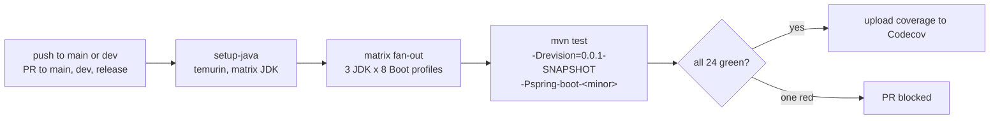
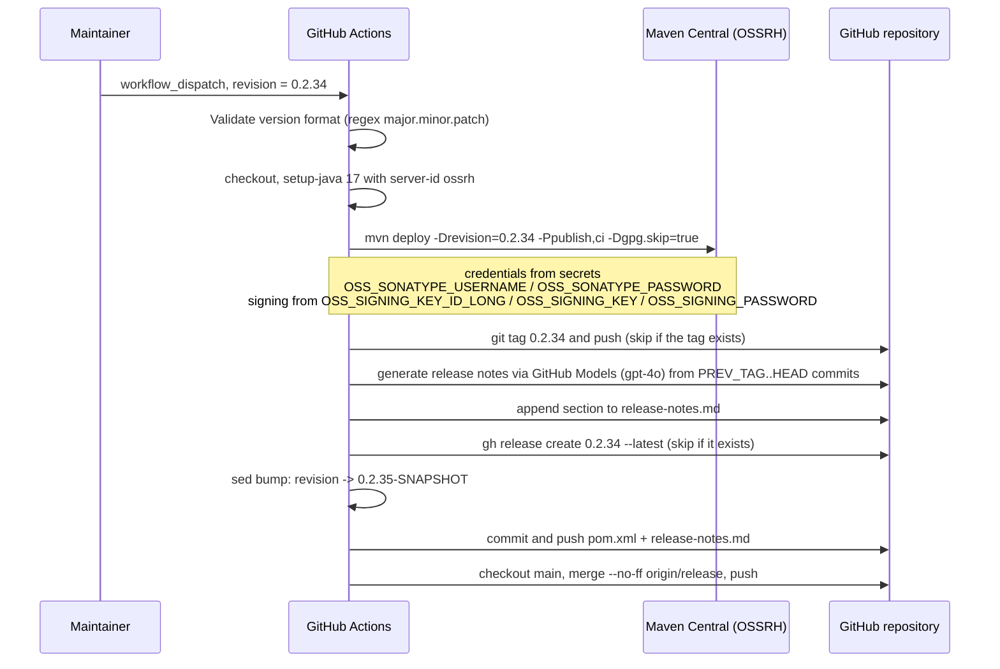
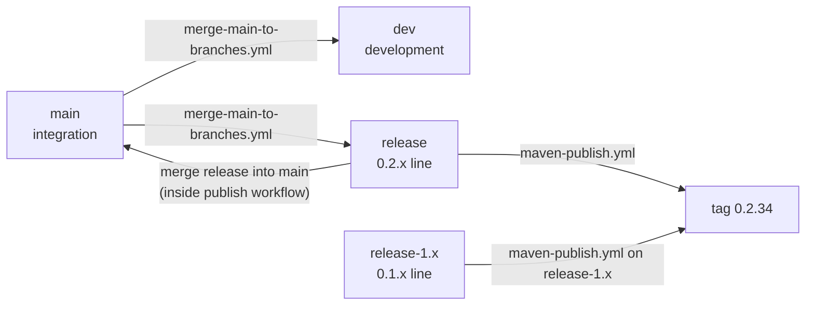

# 构建与发布流水线（Build and Release Pipeline）

> [English](../build-and-release.md) · 文档索引：[中文](../../zh/README.md) ·
> 本分支用户文档：[中文](../../../user-guide/current/zh/README.md)

> **分支：** `release` · **版本线：** `0.2.x` · **范围：** Maven reactor + GitHub Actions

目录：
[1 构建系统要解决的问题](#1-构建系统要解决的问题) ·
[2 Reactor 结构](#2-reactor-结构) ·
[3 revision 扁平化模式](#3-revision-扁平化模式) ·
[4 由 profile 驱动的 Spring Boot 版本选择](#4-由-profile-驱动的-spring-boot-版本选择) ·
[5 本地构建命令](#5-本地构建命令) ·
[6 CI 组成](#6-ci-组成) ·
[7 发布流水线](#7-发布流水线) ·
[8 分支模型与自动化](#8-分支模型与自动化) ·
[9 构建侧的设计模式](#9-构建侧的设计模式) ·
[10 新增一条 Spring Boot 版本线](#10-新增一条-spring-boot-版本线) ·
[11 流水线故障排查](#11-流水线故障排查) ·
[12 参考](#12-参考)

---

## 1. 构建系统要解决的问题

一份源码树、八条 Spring Boot 小版本线、四种 JDK、五个发布 artifact，并且任何版本字面量都不允许在多处重复。
本节描述的每一个机制，都是为了满足下面某一条约束而存在：

| 约束 | 机制 |
|---|---|
| 整个 reactor 只有一个版本号 | 根 POM 里的 `${revision}`，被每个模块继承。 |
| 同一份代码要能在 Boot `3.0` … `4.1` 下编译 | Parent POM 中按小版本线设置 `spring-boot.version` 的 profile，加上由 Boot 4 profile 挂载的 `compatible` 垫片模块。 |
| 跨版本的 API 漂移 | `compatible` 垫片（被移除或迁移的类）与按名字声明的条件属性（换了包的类）。 |
| 不改 POM 也能发布 | `maven-publish.yml`，由 `workflow_dispatch` 输入驱动。 |
| 两条在维护的版本线共享修复 | `merge-main-to-branches.yml` 与 `release` / `release-1.x` 分支配对。 |

---

## 2. Reactor 结构

根聚合模块 `microsphere-spring-boot` 按下列顺序声明八个模块（`pom.xml` 第 58–67 行）：

| # | 模块 | 打包 | 是否发布 | 是否在 BOM |
|---|---|---|---|---|
| 1 | `microsphere-spring-boot-parent` | pom | 是 | 否 |
| 2 | `microsphere-spring-boot-dependencies` | pom | 是 | —（它本身就是 BOM） |
| 3 | `microsphere-spring-boot-compatible` | jar | **否** | **否** |
| 4 | `microsphere-spring-boot-test` | jar | 是 | 是 |
| 5 | `microsphere-spring-boot-core` | jar | 是 | 是 |
| 6 | `microsphere-spring-boot-webmvc` | jar | 是 | 是 |
| 7 | `microsphere-spring-boot-webflux` | jar | 是 | 是 |
| 8 | `microsphere-spring-boot-actuator` | jar | 是 | 是 |

这个顺序不是随意排的：`test` 排在 `core` 之前，因为 `core` 的 test 作用域依赖 `test`；`compatible` 排在
`core` 之前，因为 Boot 4 的 profile 会把它挂到 `core` 上。

```mermaid
graph TD
    ROOT["microsphere-spring-boot (root)<br/>revision=0.2.35-SNAPSHOT, java.version=17"]
    P["...-parent"]
    D["...-dependencies"]
    C["...-compatible"]
    T["...-test"]
    CORE["...-core"]
    MVC["...-webmvc"]
    FLUX["...-webflux"]
    ACT["...-actuator"]

    ROOT --> P
    ROOT --> D
    ROOT --> C
    ROOT --> T
    ROOT --> CORE
    ROOT --> MVC
    ROOT --> FLUX
    ROOT --> ACT

    P -. inheritance .-> D
    P -. inheritance .-> C
    P -. inheritance .-> T
    P -. inheritance .-> CORE
    CORE -. test scope .-> T
    MVC --> CORE
    FLUX --> CORE
    ACT --> CORE
    CORE -. profiles 4.0 and 4.1 .-> C

    classDef unpublished fill:#fdd,stroke:#a55;
    class C unpublished;
```

实线表示聚合或编译依赖，虚线表示继承、test 作用域或 profile 条件依赖。

---

## 3. revision 扁平化模式

每个模块都写 `<version>${revision}</version>`，而不是版本字面量。仓库里唯一的版本字面量是：

```xml
<!-- pom.xml, lines 53-56 -->
<properties>
    <revision>0.2.35-SNAPSHOT</revision>
    <java.version>17</java.version>
</properties>
```

由此带来两个后果：

1. **发布只改一行。** 发布工作流用 `sed` 改写 `pom.xml` 里的 `<revision>` 一次，而不是扫过八个 POM。
2. **发布的 POM 必须被扁平化。** `${revision}` 的解析依赖外部构建父工程 `microsphere-build` 配置的 flatten
   步骤——这正是根 POM 继承 `io.github.microsphere-projects:microsphere-build:0.3.16` 的原因，也是为什么
   一次不完整的构建会在你的本地仓库里留下字面量 `${revision}`。

BOM 里的条目同样使用 `${revision}`，因此一次发布天然让五个 artifact 共享同一版本——只改一个条目就造出
混合版本 BOM 是不可能的。

---

## 4. 由 profile 驱动的 Spring Boot 版本选择

`spring-boot.version` 在根 POM 与 Parent POM 中都没有值；它只定义在 profile 内部，一条 Boot 小版本线一个：

| Profile | Boot 版本 | 额外效果 |
|---|---|---|
| `spring-boot-3.0` | `3.0.13` | |
| `spring-boot-3.1` | `3.1.12` | |
| `spring-boot-3.2` | `3.2.12` | |
| `spring-boot-3.3` | `3.3.13` | |
| `spring-boot-3.4` | `3.4.13` | |
| `spring-boot-3.5` | `3.5.16` | `activeByDefault` |
| `spring-boot-4.0` | `4.0.8` | 把 `compatible` 挂到 `core` |
| `spring-boot-4.1` | `4.1.1` | 把 `compatible` 挂到 `core` |

Parent POM 以 `${spring-boot.version}` 导入 `spring-boot-dependencies`，因此切换 profile 就等于凭一个数字
换掉整张传递依赖图——Spring Framework、Jackson、Micrometer、Servlet API 全在内。

`compatible` 的挂载声明在**依赖方**而不是垫片模块自身：

```xml
<!-- microsphere-spring-boot-core/pom.xml, lines 97-121 (abridged) -->
<profile>
    <id>spring-boot-4.0</id>
    <dependencies>
        <dependency>
            <groupId>io.github.microsphere-projects</groupId>
            <artifactId>microsphere-spring-boot-compatible</artifactId>
            <version>${revision}</version>
        </dependency>
    </dependencies>
</profile>
```

设计说明：挂载方式是*依赖方模块里的一个 profile*，而不是在 `compatible` 里声明 optional 依赖。这样垫片只在
确实需要它的 Boot 版本线下才可见，也让 `compatible` 不绑定任何已发布的消费者。

---

## 5. 本地构建命令

```bash
# 默认 Boot 版本线（3.5.16），完整 reactor，带测试
./mvnw clean verify

# 单个模块及其所有依赖
./mvnw -pl microsphere-spring-boot-core -am -Pspring-boot-3.1 test

# CI 使用的原样命令，对应单个矩阵单元
mvn --batch-mode --update-snapshots --file pom.xml \
    -Drevision=0.0.1-SNAPSHOT \
    -Dsurefire.useSystemClassLoader=false \
    test --activate-profiles test,coverage,spring-boot-4.1

# 垫片到底有没有挂上？
./mvnw -pl microsphere-spring-boot-core -am -Pspring-boot-4.1 dependency:tree | grep compatible
```

| 参数 | 为什么需要它 |
|---|---|
| `-Drevision=0.0.1-SNAPSHOT` | CI 从不需要真实版本号；覆盖它可以避免误以发布版本执行 deploy，也保持本地仓库干净。 |
| `-Dsurefire.useSystemClassLoader=false` | 本项目的类加载诊断所需：测试会检查并隔离 classloader，而 Surefire 默认的隔离系统 classloader 会干扰这一点。 |
| `--activate-profiles test,coverage,<boot-profile>` | `test` 与 `coverage` 来自 `microsphere-build` 父工程，第三个用于选择 Boot 版本线。 |
| `-am` | 当 profile 需要从 reactor 解析 `compatible` 与 `test` 时，一并构建它们。 |

---

## 6. CI 组成

`.github/workflows/maven-build.yml`：

| 元素 | 值 |
|---|---|
| 触发条件 | push 到 `main`、`dev`；PR 指向 `main`、`dev`、`release` |
| Runner | `ubuntu-latest` |
| JDK 矩阵 | `17`、`21`、`25` |
| Boot profile 矩阵 | `spring-boot-3.0` … `spring-boot-4.1`（8 项） |
| 每次 push 的任务数 | 3 × 8 = 24 |
| 构建命令 | 即上文的 `mvn … test --activate-profiles test,coverage,${{ matrix.maven-profile-spring-boot }}` |
| 收尾步骤 | `codecov/codecov-action@v7.1.1`，使用 `CODECOV_TOKEN` secret 为 `microsphere-projects/microsphere-spring-boot` 上传覆盖率 |
| 权限 | `contents: read` |



值得注意的恰恰是 CI 里*没有*什么：没有 deploy、没有发布、没有签名。`maven-build.yml` 只证明矩阵能编译并通过测试。

---

## 7. 发布流水线

`.github/workflows/maven-publish.yml` 包含两个 job。触发条件：push 到 `release`，或带 `revision` 输入的手动
`workflow_dispatch`。



按实现逐步展开：

| 步骤 | 细节 | 失败行为 |
|---|---|---|
| 校验版本 | 对 `revision` 输入执行 `grep -qE '^[0-9]+\.[0-9]+\.[0-9]+$'`。 | 在 checkout 之前就报错退出。 |
| 发布 | `./mvnw --batch-mode --update-snapshots --file pom.xml -Drevision=<v> -Dsurefire.useSystemClassLoader=false -Dgpg.skip=true deploy --activate-profiles publish,ci` | Job 失败；由于 `release` job 声明了 `needs: build`，不会打 tag。 |
| 打 tag | 创建 `<revision>` tag，若已存在则跳过。 | tag 已存在时静默跳过。 |
| Release Notes | 收集 `git log --oneline PREV_TAG..HEAD`，向 GitHub Models 端点（`gpt-4o`）请求 markdown 摘要，把 `## v<revision>` 以及 `**Full Changelog**` 对比链接追加进 `release-notes.md`。 | 模型调用失败时回退为嵌入原始 commit 列表。 |
| GitHub Release | `gh release create <revision> --title <revision> --notes-file … --latest`，已存在则跳过。 | — |
| 版本递增 | 把 `<revision>` 改写为 `major.minor.(patch+1)-SNAPSHOT`。 | — |
| 提交 | 以 `chore: bump version to next patch after publishing <revision>` 提交 `pom.xml` 与 `release-notes.md` 并推送。 | `git diff --cached --quiet` 会短路掉空提交。 |
| 合并到 main | `git checkout main` 然后 `git merge --no-ff origin/release -m "chore: merge release into main [skip ci]"`，推送。 | `main` 缺失或出现冲突时以 `::error::` 退出——需要人工介入。 |

修改这个工作流时应当保留两条安全属性：

* **幂等性。** 打 tag 与创建 release 都先检查对象是否已存在，因此对一次未跑完的发布做重跑不会产生重复物。
* **无版本漂移。** 递增步骤在 deploy *之后*执行，所以 tag 与已发布 artifact 永远携带同一版本。

Secret 只以名字引用（`OSS_SONATYPE_USERNAME`、`OSS_SONATYPE_PASSWORD`、`OSS_SIGNING_KEY_ID_LONG`、
`OSS_SIGNING_KEY`、`OSS_SIGNING_PASSWORD`、`CODECOV_TOKEN`、`GITHUB_TOKEN`、`WORKFLOW_TOKEN`）。
任何时候都不要把 secret 的值写进文档、issue 或提交。

---

## 8. 分支模型与自动化



| 工作流 | 触发条件 | 作用 |
|---|---|---|
| `maven-build.yml` | push 到 `main`/`dev`，PR 指向 `main`/`dev`/`release` | 24 单元的测试矩阵。 |
| `maven-publish.yml` | push 到 `release`，或带 `revision` 的手动 dispatch | deploy、打 tag、生成 notes、创建 release、递增版本、合并到 `main`。 |
| `merge-main-to-branches.yml` | push 到 `main` | 以矩阵方式在每个目标分支执行 `git merge --no-ff origin/main`（`dev` 与 `release`）；目标分支不存在时跳过。 |
| `sync-branches-from-upstream.yml` | push 到 `main`/`dev`/`dev-1.x`，外加 `*/5 * * * *` 定时 | 若仓库是 fork，则用 `--force-with-lease` 把与上游同名的分支从上游父仓库快进同步；跳过 fork 独有分支、已相同的分支，以及领先于上游的分支。仓库不是 fork 时以 0 退出。 |
| `wiki-publish.yml` | 见该文件 | 把文档发布到 wiki。 |
| `dependabot.yml` | `maven` 每日、`github-actions` 每周，根目录，PR 上限 10 | 自动提交版本升级 PR。 |

本仓库的文档约定：只有 `release` 与 `release-1.x` 被视为稳定事实。`main` 与 `dev` 是集成面，可能滞后也可能超前，
这就是本文档集锚定两条发布分支的原因。

---

## 9. 构建侧的设计模式

| 模式 | 出现位置 | 效果 |
|---|---|---|
| 版本单一事实来源 | 根 POM 的 `${revision}` | 每次发布只改一处。 |
| 分层 BOM | Parent POM 导入第三方 BOM；dependencies BOM 管理本项目 artifact | 使用者只需导入一次；模块自身不声明版本。 |
| profile 条件依赖 | `core/pom.xml` 挂载 `compatible` | 版本鸿沟相关的代码只在鸿沟存在时存在。 |
| 显式选择发布 | `compatible` 上的 `maven-deploy-plugin` skip 与 `central-publishing-maven-plugin` skipPublishing | reactor 构建正常，同时没有任何东西泄漏到 Central。 |
| 构建参数化的依赖图 | 以 `${spring-boot.version}` 导入 `spring-boot-dependencies` | 一个数字切换整张图。 |
| 流水线幂等 | tag/release 存在性检查 | 重跑安全。 |
| 发布后归一化 | 先递增 patch，再合并到 `main` | 分支尖端永远是「上一个发布版本 + `-SNAPSHOT`」。 |

---

## 10. 新增一条 Spring Boot 版本线

以「Boot `4.2` 发布」为例，在本分支上的完整操作：

1. **Parent POM：** 新增 `spring-boot-4.2` profile，锁定首个 GA 补丁版本。
2. **判断垫片问题。** 运行 `./mvnw clean verify -Pspring-boot-4.2` 并阅读报错：
   * *只是被按名字引用的类换了包* → 把新类名加入 `webmvc` / `webflux` 条件里的按名字列表。
   * *编译期类型真的不存在* → 把它加入 `microsphere-spring-boot-compatible`。
3. **如需要则挂载垫片：** 在 `microsphere-spring-boot-core/pom.xml` 的 profile 列表里加入 `spring-boot-4.2`，
   照抄 `4.0`/`4.1` 的写法。
4. **CI：** 把该 profile 加入 `maven-build.yml` 的 `maven-profile-spring-boot`（矩阵按 JDK 数量成倍增长）。
5. **兼容表：** 更新用户文档的分支索引以及每个受影响模块的文档，中英文都要。
6. **不要**以任何理由把 `compatible` 加进 BOM。

在 `release-1.x` 上这条配方是反向的：当 Boot `2.x` *缺少*某个 API 时才需要垫片，这也是那边 profile
`2.1`–`2.3` 挂载十二个类而不是十个类的原因。

---

## 11. 流水线故障排查

| 现象 | 原因 | 处理 |
|---|---|---|
| 发布 job 报「version does not match the pattern」 | `revision` 输入带了后缀，例如 `0.2.34-RC1`。 | 流水线只发布 GA 三段式版本；tag 与递增步骤都假定 `major.minor.patch`。 |
| deploy 成功但没有 GitHub release | `release` job 在 `build` 之后中止（notes 或 tag 步骤）。 | 用同一个 `revision` 重跑工作流，幂等检查会跳过已完成的部分。 |
| `Merge conflict detected when merging release into main` | `main` 独立于 `release` 前进了。 | 手工合并，然后重跑或自行推送递增提交。 |
| 只有单个矩阵单元变红 | 某条 Boot 版本线特有的 API 断裂，通常是类被迁移。 | 本地用对应的 `-P` 复现，检查缺的是 `compatible` 垫片还是按名字条件。 |
| 解析后的 POM 里出现 `${revision}` | 本地 install 未做扁平化。 | 通过 reactor 构建（`./mvnw install`），而不是单模块构建。 |
| 找不到 `microsphere-spring-boot-compatible` | 只构建了 `core`，没加 `-am`。 | `-pl microsphere-spring-boot-core -am`。 |
| 测试通过但覆盖率上传失败 | 工作流拿不到 `CODECOV_TOKEN`（fork 上很常见）。 | 不是代码问题；确认仓库 secret 存在。 |

---

## 12. 参考

| 文档 | 范围 |
|---|---|
| [parent.md](./parent.md) | Parent POM 内部实现。 |
| [dependencies.md](./dependencies.md) | BOM 如何组装。 |
| [compatible.md](./compatible.md) | 垫片模块的构建期机制。 |
| [README.md](./README.md) | 仓库结构、扩展点清单、贡献检查表。 |
| [../1.x/build-and-release.md](../../1.x/zh/build-and-release.md) | Boot 2 版本线上的同一条流水线。 |
