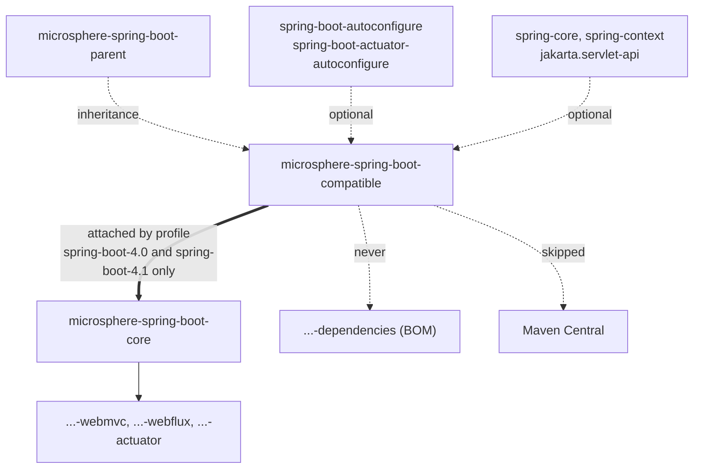

# Compatible 模块

> [English](../compatible.md) · 文档索引：[中文](../../zh/README.md) · 本分支用户文档：[中文](../../../user-guide/current/zh/compatible.md)
>
> **分支：** `release` · **版本线：** `0.2.x` · **Artifact：** `microsphere-spring-boot-compatible`

> **状态：** 不发布 · 不在 BOM 中 · 仅构建期 · 10 个源文件，0 个测试

目录：
[1 构建期问题](#1-构建期问题) ·
[2 模块定位](#2-模块定位) ·
[3 十个文件的清单](#3-十个文件的清单) ·
[4 两个发布熔断开关](#4-两个发布熔断开关) ·
[5 core 如何挂载该模块](#5-core-如何挂载该模块) ·
[6 Reactor 顺序](#6-reactor-顺序) ·
[7 构建期与运行期的同一个 FQCN](#7-构建期与运行期的同一个-fqcn) ·
[8 类冲突的失败模式](#8-类冲突的失败模式) ·
[9 垫片还是按名字条件](#9-垫片还是按名字条件) ·
[10 实操配方](#10-实操配方) ·
[11 不变式](#11-不变式) ·
[12 参见](#12-参见)

---

## 1. 构建期问题

`core` 的源码用全限定类名来指称 Spring Boot 类型——`SpringApplicationRunListenerAdapter.java` 第 3 行与
`LoggingSpringApplicationRunListener.java` 第 21 行都写着
`import org.springframework.boot.ConfigurableBootstrapContext;`，而前者声明
`public void starting(ConfigurableBootstrapContext bootstrapContext)`（第 63 行；后者第 72 行）。`core` 中的测试
代码走得更远，直接实例化属性类：`new ServerProperties()`、`Bindable<ServerProperties>`、
`new ConfigurationPropertiesBeanInfo(MultipartProperties.class)`。

那些名字是 Boot `3.5` 的名字，而 `package-info.java` 把前提说得直白："The classes in this package or
sub-packages are forked from the Spring Boot 3.5.x, which will be used to be compatible with the lower versions
of Spring Boot." reactor 必须让同一套源码在 Boot `3.0.13` … `4.1.1` 上都能编译，而 javac 无法按字符串编译一个
类型引用。于是 `microsphere-spring-boot-compatible` 用原始名字重新提供 Boot `3.5` 的那些类型，让引用得以解析；
同时把它从每一个发布 artifact 与每一条运行期 classpath 上排除，从而让这件事变得无害。

被复制文件里的 `@since` 标签就是每个类型身世的证据：`ServerProperties` `1.0.0`、`MultipartConfigFactory`
`1.4.0`、`JacksonProperties` `1.2.0`、`MultipartProperties` `2.0.0`，以及五个 bootstrap 类型的 `2.4.0`
（`InstanceSupplier` 与 `Scope` 为 `2.4.2`）。

---

## 2. 模块定位



那条双线边是这个模块唯一的产线关系，而且它是有条件的：在那两个 Boot `4` profile 之外没有任何东西依赖
`compatible`，于是 reactor 仍然会构建出这个 jar，但没有模块消费它。虚线的 "never" 与 "skipped" 两条边由第 4 节
与第 11 节的机制保证。

---

## 3. 十个文件的清单

十个文件全部位于 `microsphere-spring-boot-compatible/src/main/java`，每一个都在某个 `org.springframework.boot.*`
包里。`@since` 值取自各文件的 javadoc。

| FQCN | 行数 | 嵌套类型 | `@since` | 本仓库中的使用方 |
|---|---|---|---|---|
| `org.springframework.boot.BootstrapContext` | 92 | — | `2.4.0` | 垫片包之外无人使用 |
| `org.springframework.boot.BootstrapContextClosedEvent` | 56 | — | `2.4.0` | 垫片包之外无人使用 |
| `org.springframework.boot.BootstrapRegistry` | 196 | `InstanceSupplier<T>` (103)、`Scope` (180) | `2.4.0`；嵌套成员 `2.4.2` | 垫片包之外无人使用 |
| `org.springframework.boot.ConfigurableBootstrapContext` | 31 | — | `2.4.0` | `core` 主代码：`listener/SpringApplicationRunListenerAdapter.java` (3, 63)、`listener/LoggingSpringApplicationRunListener.java` (21, 72)；`core` 测试：`LoggingSpringApplicationRunListenerTest.java` (22) |
| `org.springframework.boot.DefaultBootstrapContext` | 137 | — | `2.4.0` | `core` 测试：`LoggingSpringApplicationRunListenerTest.java` (23) |
| `org.springframework.boot.autoconfigure.jackson.JacksonProperties` | 142 | `ConstructorDetectorStrategy` (118) | `1.2.0` | `core` 测试：`properties/bind/ConfigurationPropertiesBeanContextTest.java` (24, 93) |
| `org.springframework.boot.autoconfigure.web.ServerProperties` | 1073 | `Servlet`、`Reactive`、`Reactive.Session`、`Tomcat`、`Tomcat.Accesslog`、`Tomcat.Threads`、`Tomcat.Resource`、`Tomcat.Mbeanregistry`、`Tomcat.Remoteip`、`Tomcat.UseApr` | `1.0.0` | 仅 `core` 测试：`src/test/java/io/microsphere/spring/boot/context/properties/…` 下的七个文件，外加 `util/TestUtils.java` |
| `org.springframework.boot.autoconfigure.web.servlet.MultipartProperties` | 143 | — | `2.0.0` | `core` 测试：`ConfigurationPropertiesBeanInfoTest.java` (23, 68) |
| `org.springframework.boot.web.servlet.MultipartConfigFactory` | 103 | — | `1.4.0` | 只有垫片 `MultipartProperties`，它在第 21 行 import 了它 |
| `org.springframework.boot package-info` | 24 | — | `1.0.0` | 记录从 Boot `3.5.x` 复制而来这一事实 |

其中两条值得说明。`MultipartConfigFactory` 之所以存在，纯粹是因为被复制的 `MultipartProperties` 导入并提到了
它——`core`、`webmvc`、`webflux`、`actuator` 中没有任何东西引用这个类型——而五个 bootstrap 文件里有三个只在垫片
包内部自我引用，保留它们只是为了让同时继承 `BootstrapRegistry` 与 `BootstrapContext` 的
`ConfigurableBootstrapContext` 能够编译。属性类是裁剪过的复制品而不是拷贝：`JacksonProperties` 只声明六个字段，
`MultipartProperties` 只剩访问器，`grep -c createMultipartConfigElement` 返回 `0`，尽管文件仍然导入
`jakarta.servlet.MultipartConfigElement`。第 7 节会解释这为什么重要。

---

## 4. 两个发布熔断开关

发布被关掉两次，一次针对传统 deploy 路径，一次针对 Sonatype Central 发布器。
取自 `microsphere-spring-boot-compatible/pom.xml` 第 58–76 行：

```xml
<build>
    <plugins>
        <plugin>
            <groupId>org.apache.maven.plugins</groupId>
            <artifactId>maven-deploy-plugin</artifactId>
            <configuration>
                <skip>true</skip>
            </configuration>
        </plugin>

        <plugin>
            <groupId>org.sonatype.central</groupId>
            <artifactId>central-publishing-maven-plugin</artifactId>
            <configuration>
                <skipPublishing>true</skipPublishing>
            </configuration>
        </plugin>
    </plugins>
</build>
```

两个都需要，因为它们把守的是不同代码路径：`maven-deploy-plugin` 控制向仓库执行 `mvn deploy`，
`central-publishing-maven-plugin` 控制 Central 的 bundle 上传。只留其中一个，就还剩一条能让装满假
`org.springframework.boot.*` 类的 jar 到达消费者手中的路径。
`.github/workflows/maven-publish.yml` 里的 `deploy` 步骤执行 `./mvnw … deploy --activate-profiles publish,ci`，
所以这两个开关是本平台与 Maven Central 之间唯一的屏障。

该模块继承 `microsphere-spring-boot-parent`（第 6–11 行），并声明五个不带版本的
`<optional>true</optional>` 依赖：`spring-boot-autoconfigure`（24–28）、
`spring-boot-actuator-autoconfigure`（30–34）、`spring-core`（36–41）、`spring-context`（43–47）与
`jakarta.servlet:jakarta.servlet-api`（49–54），位于注释
`<!-- Spring Boot (prevent forking anything) -->` 之下。打包方式是 `jar`（第 16 行）；没有
`<dependencyManagement>`，除上面两个之外没有插件，也完全没有测试源码。

---

## 5. core 如何挂载该模块

`core` 是唯一的使用方，而它在两个 profile 之内挂载这个垫片
（`microsphere-spring-boot-core/pom.xml` 第 97–121 行）：

```xml
<!-- microsphere-spring-boot-core/pom.xml, lines 97-121 -->
<profiles>
    <profile>
        <id>spring-boot-4.0</id>
        <dependencies>
            <!-- Compatible -->
            <dependency>
                <groupId>io.github.microsphere-projects</groupId>
                <artifactId>microsphere-spring-boot-compatible</artifactId>
                <version>${revision}</version>
            </dependency>
        </dependencies>
    </profile>

    <!-- lines 110-120: the spring-boot-4.1 profile repeats the same dependency, identical but for the id -->
</profiles>
```

这个依赖不带 `<scope>`，所以它是 compile 作用域——但仅当那两个 profile 中有任意一个被激活时。发布过程两个都不
激活（`--activate-profiles publish,ci`），于是被部署的 `core` POM 不可能引用一个 Central 上并不存在的 artifact。
这正是本设计最脆弱的一条性质：往发布命令里加一个 Boot `4.x` profile，或者把这个依赖移出 profile，都会发布出
一个任何消费者都无法解析的 `core`。这段之所以重复而不是共享，是因为 Maven profile 不借助第二个 POM 就无法引用
某个片段，所以每新增一条 Boot 版本线就要多一份拷贝。

---

## 6. Reactor 顺序

根 `pom.xml`（第 58–67 行）里的 `<modules>` 把 `microsphere-spring-boot-compatible` 列在第 61 行、
`microsphere-spring-boot-core` 列在第 63 行，并把 `microsphere-spring-boot-parent` 列在第 59 行、位于最前——
`compatible` 继承自那个 parent，所以必须在它之后构建。由于第 5 节的 profile 用 `${revision}` 而不是
`<dependencyManagement>` 条目来声明这个垫片，Maven 会从 reactor 中解析它，而那只有在这个模块于同一会话里已经
构建过时才成立。

因此把 `compatible` 挪到 `core` 之下，会让每一个 Boot `4` 构建因
`io.github.microsphere-projects:microsphere-spring-boot-compatible:${revision}` 无法解析而失败——而且它*只*破坏
这些构建，所以一次默认 profile 的 CI 运行并不会发现。任何顺序调整都必须用
`--activate-profiles spring-boot-4.1` 来验证。

---

## 7. 构建期与运行期的同一个 FQCN

编译期，重复的 FQCN 并不构成冲突：javac 按顺序在 classpath 上解析每个名字，并绑定到恰好一个类文件。
这里没有任何东西做合并、打补丁或反射侵入 Boot，所以唯一的要求是：确实存在*某个*同名类，并带有源码所使用的那些
成员。这就是复制品可以被裁剪的原因——`JacksonProperties` 只需要 `core` 测试碰到的那六个属性，
`MultipartProperties` 只需要它的访问器。

运行期，同一个 jar 就是一笔负债，有三个原因都和本分支相关：

- classloader 先碰到哪一份，那一份就对这个名字的所有使用者胜出，Boot 自己也包括在内。挂载用的 profile 让垫片
  在 compile 作用域对 `core` 可见，所以任何把它泄漏进已发布 POM 的改动，都会把它放上真实应用的 classpath。
- Boot 自己的代码会调用裁剪复制品并未声明的成员。`MultipartProperties` 没有 `createMultipartConfigElement()`，
  于是一次进入垫片版本的调用会以 `NoSuchMethodError` 失败。
- 有些垫片甚至无法从自己包外被驱动。`BootstrapContextClosedEvent` 唯一的构造器是包级私有的（第 33 行），
  所以一个被迁移位置的 Boot 类想发布这个事件时，会对着复制品撞上 `IllegalAccessError`。

对 `@ConfigurationProperties` 类型而言，失败得更安静也更糟：绑定垫片的 `JacksonProperties` 会悄然接受六个属性
并忽略 `spring.jackson.*` 的其余部分，因为垫片和原版一样标注着 `@ConfigurationProperties("spring.jackson")`。

---

## 8. 类冲突的失败模式

具体地说，如果 `microsphere-spring-boot-compatible` 真的在某个同时也提供真实类型的 Boot 版本上到达了应用
classpath，那么症状会按"哪一份胜出"排序：

| 胜出方 | 症状 | 出现时机 |
|---|---|---|
| 垫片 | `createMultipartConfigElement()` 上的 `NoSuchMethodError`，或者那个包级私有事件构造器上的 `LinkageError` | 第一条触碰该类型的代码路径 |
| 垫片 | `spring.jackson.*`、`server.*`、`spring.servlet.multipart.*` 下的属性绑定到那个六字段复制品，未知属性消失 | 上下文刷新 |
| 真实 Boot | 针对垫片形状编译出的 `core` 代码仍然能解析，于是什么都不失败——构建看着没问题，而发布出去的 artifact 却无法验证 | 永不 |

第三行才是陷阱：泄漏的垫片可以通过一次冒烟测试，所以"它能跑"不是证据。真正要紧的检查是第 11 节的不变式清单，
外加第 10.3 节的 `dependency:tree` 配方。

---

## 9. 垫片还是按名字条件

本分支遵循的规则：垫片只留给编译器必须看见的类型。其余一切都用按名字的字符串。

| 情形 | 机制 | 本分支上的证据 |
|---|---|---|
| 类型被当作 Java 类型使用——声明、泛型实参、`Foo.class`、`new Foo()`、方法参数 | `compatible` 里的垫片类，按 profile 挂载 | 七个 `core` 测试文件里的 `ServerProperties`；作为 `starting(…)` 参数的 `ConfigurableBootstrapContext` |
| 类型只在运行期被 Spring *查找*——条件求值、按名字排序 | 按名字字符串，零编译依赖 | `webmvc`/`webflux`/`actuator`/`core` 里的 `@ConditionalOnClass(name = …)` |

**垫片实操示例。** `core` 的 `ConfigurationPropertiesBeanContextTest` 声明
`private static ResolvableType beanType = forRawClass(ServerProperties.class);` 并调用 `new ServerProperties()`。
`Class` 字面量与构造器都是编译期构造，按名字的属性帮不上忙，所以
`org.springframework.boot.autoconfigure.web.ServerProperties` 必须作为一个类型存在，而把它放到那里的正是第 5 节
的 profile——针对 Boot `4` 构建。

**按名字实操示例。**
`microsphere-spring-boot-actuator/src/main/java/io/microsphere/spring/boot/actuate/condition/ConditionalOnActuatorEndpointPresent.java`
第 42 行是 `@ConditionalOnClass(name = "org.springframework.boot.actuate.endpoint.annotation.Endpoint")`，
而 `ConditionalOnWebMvcAvailable.java` 第 46–53 行以字符串形式列出六个类名。这个注解在编译期从不加载任何类，
于是同一份源码在每一条 Boot 版本线上都能原样编译——不需要垫片，也不需要 profile。`core` 的
`ConfigurationPropertiesAutoConfiguration.java` 把这个技巧扩展到排序上，写作
`@AutoConfigureBefore(name = "org.springframework.boot.autoconfigure.context.ConfigurationPropertiesAutoConfiguration")`。

选错方向两个方向都很昂贵：为一个只需查找的类型加垫片，等于往构建图里塞一个不发布的 artifact 却毫无收益；
而把一个编译期引用写成按名字的字符串，会在 Boot `4` profile 上得到 `cannot find symbol`。

---

## 10. 实操配方

### 10.1 新增一个垫片

1. 在 `microsphere-spring-boot-compatible/src/main/java/<boot package path>/` 下创建文件，复制 Boot `3.5.x`
   的源码。保留包名、类名、`@since` 的 javadoc 值与 Apache 头；名字本身就是全部目的。
2. 把它缩减到本仓库真正引用的那些成员，但任何其行为被消费方依赖的注解都要留下——
   `ServerProperties` 上的 `@ConfigurationProperties("server")` 是承重的。
3. 如果这份拷贝需要 Boot、Spring 或 servlet 中某个尚未在本模块 classpath 上的类型，就把它加进
   `microsphere-spring-boot-compatible/pom.xml` 的那五个 optional 依赖——绝不写成非 optional。
4. 如果消费方是 `core`，POM 无需改动：第 5 节的 profile 已经挂上这个 jar。换一个消费方就需要它自己那份该
   profile 块的拷贝。
5. 先用第 10.3 节在两个 Boot `4` profile 上验证，再在默认 profile 上验证。

### 10.2 移除一个已过时的垫片

1. `grep -rn "SimpleTypeName" microsphere-spring-boot-*/src`，确认唯一命中都在
   `microsphere-spring-boot-compatible` 自身内部；嵌套类型要单独算一次，正如 `MultipartProperties` 与
   `MultipartConfigFactory` 那样。
2. 删除文件，分别用 `--activate-profiles spring-boot-4.0` 与 `spring-boot-4.1` 重新构建，然后再跑默认 profile。
3. 只要 `ConfigurableBootstrapContext` 还在，就绝不要删除 `BootstrapContext`、`BootstrapRegistry`、
   `BootstrapContextClosedEvent`：它同时继承前两者，而那个事件类型出现在 `addCloseListener` 的签名里。

### 10.3 验证挂载

```bash
mvn --activate-profiles spring-boot-4.1 --file microsphere-spring-boot-core/pom.xml \
    dependency:tree -Dincludes=io.github.microsphere-projects:microsphere-spring-boot-compatible
mvn --activate-profiles spring-boot-3.5 --file microsphere-spring-boot-core/pom.xml \
    dependency:tree -Dincludes=io.github.microsphere-projects:microsphere-spring-boot-compatible
```

第一条会打印这个模块，第二条必须什么都不打印。随后确认下游解析不到这个 artifact：
`mvn dependency:get -Dartifact=io.github.microsphere-projects:microsphere-spring-boot-compatible:${revision}`
对着 Central 应当失败。

---

## 11. 不变式

| 不变式 | 由谁保证 | 如何检查 |
|---|---|---|
| 绝不进入 BOM | `microsphere-spring-boot-dependencies` 列出五个 artifact，其中没有 `compatible` 条目 | 第 2 节的虚线边、第 10.3 节 |
| 绝不在*已发布*模块默认构建里成为 compile 作用域 | 挂载只活在 `core` 的 `spring-boot-4.0` / `spring-boot-4.1` profile 内，而发布两个都不激活 | POM 第 97–121 行对照发布命令 |
| 绝不被部署 | `<skip>true</skip>` 与 `<skipPublishing>true</skipPublishing>` | POM 第 58–76 行 |
| 包名与类名必须与 Spring Boot 完全一致 | `package-info.java` 记录了复制来源；每个文件都始于某个 `org.springframework.boot.*` 包 | 对这十个文件执行 `grep -n "^package"` |
| 没有测试，没有资源 | 十个文件，全部位于 `src/main/java` 之下 | `find microsphere-spring-boot-compatible -type f` |
| 在 `core` 之前构建 | 根 `<modules>` 的顺序，第 61 行在第 63 行之前 | 第 6 节 |

---

## 12. 参见

- [本模块用户文档](../../../user-guide/current/zh/compatible.md) — 应用开发者需要做什么
- [parent.md](./parent.md) — 选择垫片所编译的那条 Boot 版本线的 profile
- [dependencies.md](./dependencies.md) — 刻意不含本模块的那个 BOM
- [core.md](./core.md) — 唯一的消费方，以及导入 bootstrap 垫片的那些监听器
- [test.md](./test.md) — 发布策略与本模块相反的模块
- [构建与发布流水线](./build-and-release.md) — CI 中的 profile 激活

---

**相关文档：** [本模块用户文档](../../../user-guide/current/zh/compatible.md) · [parent.md](./parent.md) · [dependencies.md](./dependencies.md) · [core.md](./core.md) · [test.md](./test.md) · [构建与发布流水线](./build-and-release.md)
