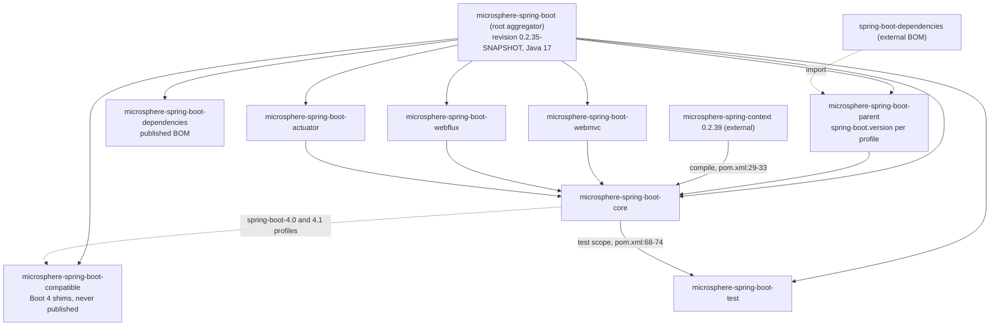
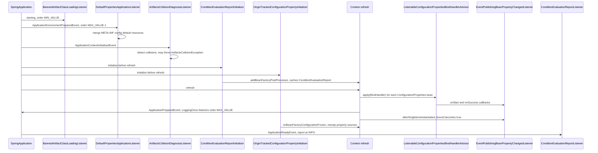
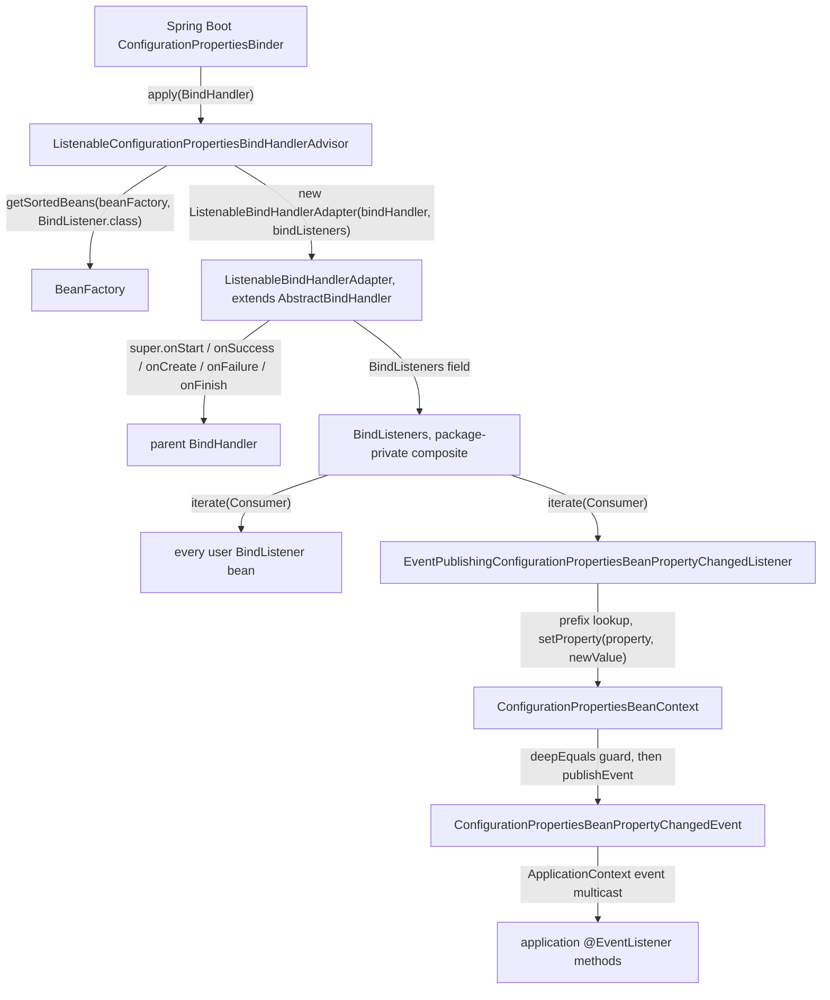
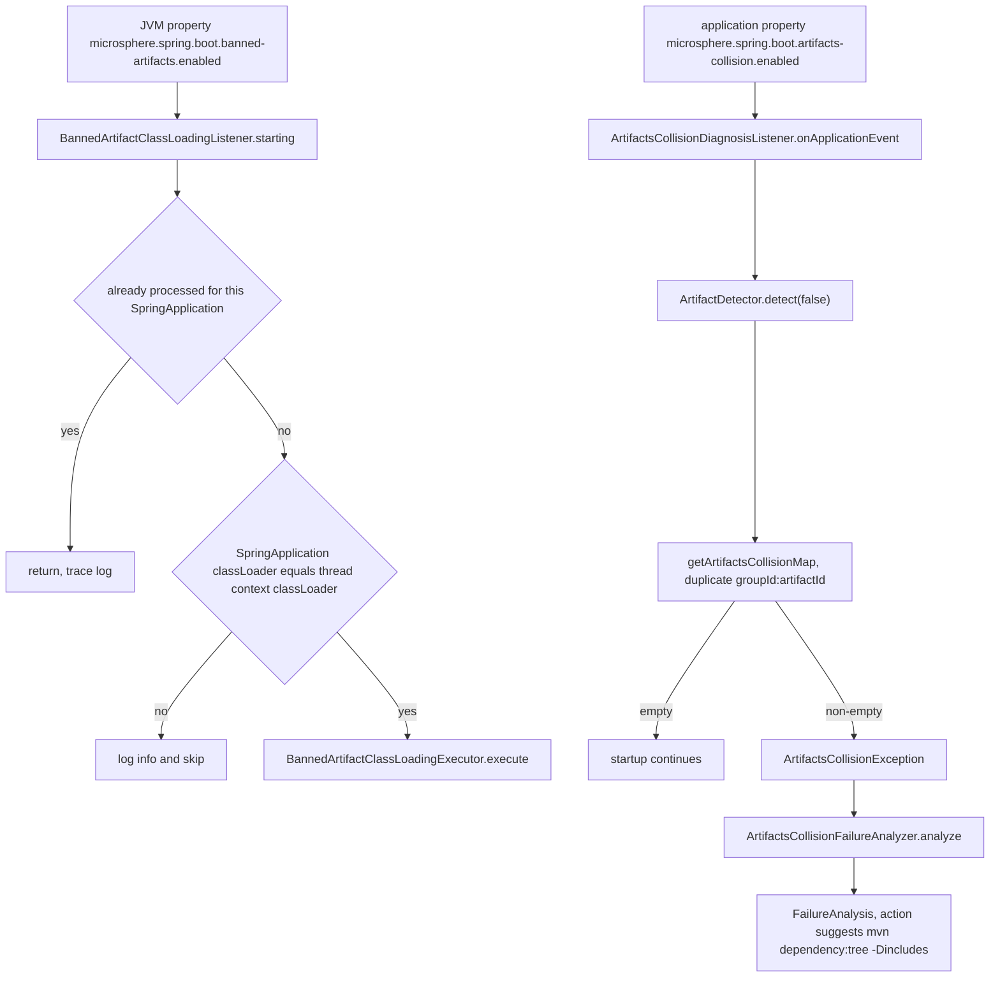
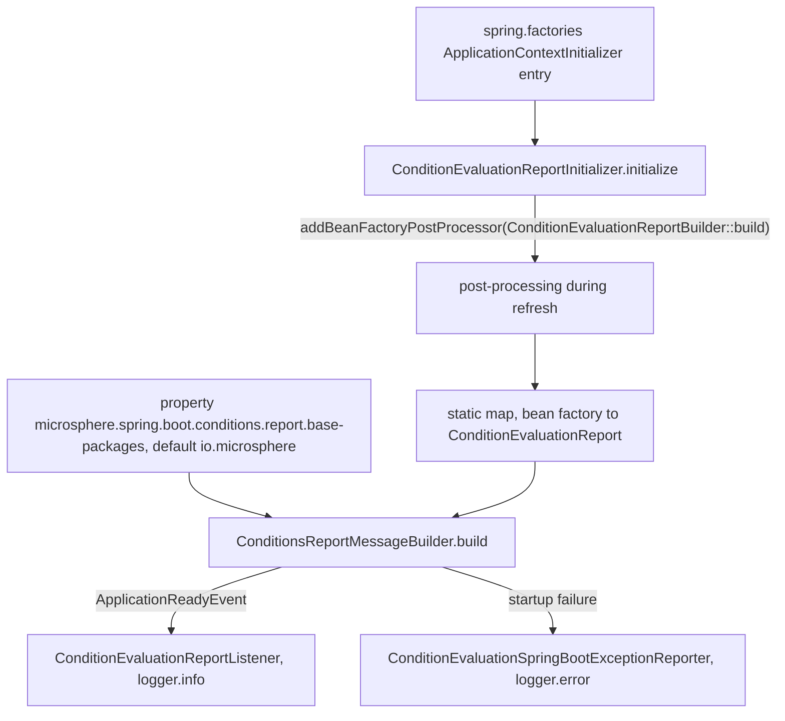
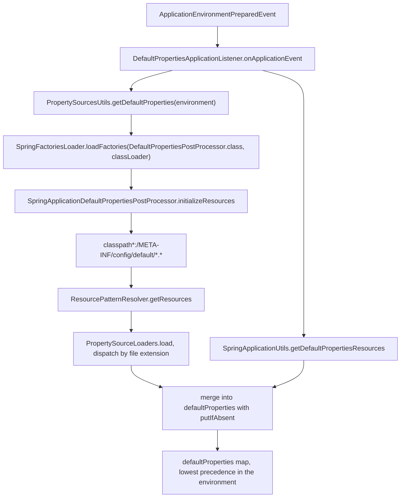

# Core 模块

> [English](../core.md) · 文档索引：[中文](../../zh/README.md) ·
> 本模块用户文档：[中文](../../../user-guide/current/zh/core.md)

> **分支：** `release` · **版本线：** `0.2.x` · **Artifact：** `microsphere-spring-boot-core`
> **Spring Boot：** `3.0.13` – `4.1.1` · **Java：** 17

目录：
[1 在 Reactor 中的位置](#1-在-reactor-中的位置) ·
[2 包结构地图](#2-包结构地图) ·
[3 扩展点装配](#3-扩展点装配) ·
[4 启动顺序与排序值](#4-启动顺序与排序值) ·
[5 绑定顾问链](#5-绑定顾问链) ·
[6 诊断流水线](#6-诊断流水线) ·
[7 默认属性机制](#7-默认属性机制) ·
[8 设计模式清单](#8-设计模式清单) ·
[9 Enable Configuration Properties Extension](#9-enable-configuration-properties-extension) ·
[10 测试清单](#10-测试清单) ·
[11 变更配方](#11-变更配方) ·
[12 陷阱与不变式](#12-陷阱与不变式) ·
[13 参见](#13-参见)

---

## 1. 在 Reactor 中的位置

`microsphere-spring-boot-core` 是根聚合器（`pom.xml:58-67`）所声明的八模块 reactor 里的第五个模块。它是最底层的
*代码*模块：`webmvc`、`webflux`、`actuator` 都把它声明为 compile 依赖
（`microsphere-spring-boot-webmvc/pom.xml:33`、`microsphere-spring-boot-webflux/pom.xml:33`、
`microsphere-spring-boot-actuator/pom.xml:33`），因此在这里注册的一切都会出现在每一个下游 artifact 中。

它自己的 POM（`microsphere-spring-boot-core/pom.xml`）继承自 `microsphere-spring-boot-parent`（第 5–10 行），
于是也继承了聚合器的 `${revision}` = `0.2.35-SNAPSHOT`（`pom.xml:54`）与 `java.version` 17（`pom.xml:55`）。
依赖集合刻意保持精简（第 20–95 行）：

| 依赖 | 作用域 / 是否 optional | 为什么在这里 |
|---|---|---|
| `microsphere-annotation-processor` | optional，`pom.xml:23-27` | 为 `@ConfigurationProperty` 标记生成元数据。 |
| `microsphere-spring-context` | compile（没有 `<optional>`），`pom.xml:29-33` | 提供 `Version`、`BeanSource`、`BeanPropertyChangedEvent`、`ConfigurableApplicationContextInitializer`、`ConfigurationBeanBinder`；版本来自 parent 导入的 `microsphere-spring-dependencies` BOM `0.2.39`（`microsphere-spring-boot-parent/pom.xml:22`、`57-64`）。 |
| `spring-boot-starter` | optional，`pom.xml:36-40` | 编译期的 Boot API；消费者实际使用的 Boot 版本线由 parent 的 profile 决定（`microsphere-spring-boot-parent/pom.xml:78-132`）。 |
| `spring-boot-configuration-processor` / `spring-boot-autoconfigure-processor` | optional，`pom.xml:42-52` | 只是注解处理器，绝不传递。 |
| `microsphere-spring-boot-test`、`spring-boot-starter-test`、`junit-jupiter`、`spring-boot-starter-web`、`spring-boot-loader`、`jakarta.annotation-api` | test，`pom.xml:55-93` | 只用于测试。`jakarta.annotation-api` 有可见的使用者（`autoconfigure/ApplicationAutoConfigurationTest` 里的 `@Resource` 注入）；`spring-boot-starter-web` 与 `spring-boot-loader` 声明在 test 作用域，本模块并没有直接使用它们——`util/TestUtils` 构造的每个 `SpringApplication` 都是 `WebApplicationType.NONE`（`:49`）。 |
| `microsphere-spring-boot-compatible` | **仅**由 `spring-boot-4.0` 与 `spring-boot-4.1` profile 加入，`pom.xml:97-121` | 为 Boot 4 迁移走的类提供构建期垫片；该模块自身不参与 deploy（`microsphere-spring-boot-compatible/pom.xml:62-64`、`70-72`）。 |



---

## 2. 包结构地图

`io.microsphere.spring.boot.*` 下的 47 个类。行号引用相对于
`microsphere-spring-boot-core/src/main/java/io/microsphere/spring/boot/`。

| 包 | 类 | 职责 |
|---|---|---|
| root | `SpringBootVersion` | 自 3.0 起每个 Boot 发布版本的枚举；常量名通过去掉 `SPRING_BOOT_` 前缀解析成 `Version`（`SpringBootVersion.java:250-253`），`CURRENT` 读取运行时 Boot 版本（`:238`）。 |
| `autoconfigure` | `ConfigurableAutoConfigurationImportFilter` | 遵循 `microsphere.autoconfigure.exclude`（`:60`）的 `AutoConfigurationImportFilter`，顺序为 `HIGHEST_PRECEDENCE + 99`（`:276`）。 |
| `classloading` | `BannedArtifactClassLoadingListener` | 当 **JVM** 属性被设置时，禁止冲突构件参与类加载的 run listener（`:55`、`:135`）。 |
| `condition` | `ConditionalOnPropertyPrefix` | 注解，`@Conditional(OnPropertyPrefixCondition.class)`（`:54`），按属性名前缀匹配（`:65`）。 |
| `condition` | `OnPropertyPrefixCondition` | 在 `ConfigurableEnvironment` 的属性名里扫描这些前缀的 `SpringBootCondition`（`:66-86`）。 |
| `constants` | `PropertyConstants` | `microsphere.spring.boot.` 前缀（`:35`）、日志级别属性名及其 `TRACE` 默认值（`:40`、`:49`）。 |
| `constants` | `SpringBootPropertyConstants` | `spring.autoconfigure.exclude`（`:23`）以及与之相邻的 `configurationProperties` 源名（`:30`）。 |
| `context` | `OnceApplicationPreparedEventListener` | 模板基类：每个 context id 最多处理一次 `ApplicationPreparedEvent`（`:46-48`、`:90-118`）。 |
| `context` | `OnceMainApplicationPreparedEventListener` | 追加 Spring Cloud bootstrap 过滤：忽略 bootstrap context 与非 main 上下文（`:37`、`:91-96`）。 |
| `context` | `LoggingOnceApplicationPreparedEventListener` | 具体的一次性 listener，通过 `SpringApplicationUtils.log`（`:66`）打印 `SpringApplication` 状态，并在默认级别时自行关闭（`:86-88`）。 |
| `context` | `LoggingOnceMainApplicationPreparedEventListener` | 同样的日志调用，只作用于 main 上下文的变体（`:32`、`:65`）。 |
| `context.autoconfigure` | `ConfigurationPropertiesAutoConfiguration` | 只有一个注解的类：`@ConditionalOnClass(name = "io.microsphere.spring.context.annotation.BeanCapableImportCandidate")` + `@AutoConfigureBefore` Boot 自己的同名自动配置 + `@EnableConfigurationPropertiesExtension`（`:35-42`）。 |
| `context.config` | `BindableConfigurationBeanBinder` | 建立在 Boot `Binder` 之上的 `ConfigurationBeanBinder`，在空前缀处把一个任意 map 绑定到已存在的 bean（`:97-115`）。 |
| `context.properties` | `ConfigurationPropertiesBeanInfo` | 内省值对象：bean 类 + 注解 + 前缀（取注解的 `prefix`，否则取 `value`，`:111`）+ `PropertyDescriptor[]`（`:120-128`）。 |
| `context.properties` | `ListenableConfigurationPropertiesBindHandlerAdvisor` | `ConfigurationPropertiesBindHandlerAdvisor` + `BeanFactoryAware`；用排序后的 `BindListener` bean 包装 handler（`:95-98`）。 |
| `context.properties.annotation` | `EnableConfigurationPropertiesExtension` | `adviseBindListener`、`publishEvents`、`sources` 三个开关（`:99`、`:116`、`:132`），并 `@Import` 那个 registrar（`:86`）。 |
| `context.properties.annotation` | `EnableConfigurationPropertiesExtensionRegistrar` | 注册 advisor、事件发布 listener，以及从外部发现的 `BindListener` / `ConfigurationPropertiesBindHandlerAdvisor` bean（`:59-74`）。 |
| `context.properties.bind` | `BindListener` | 与 `BindHandler` 一一对应的五个默认空实现绑定回调（`:47-99`）。 |
| `context.properties.bind` | `BindListeners` | 包私有的组合对象，在一个 `Iterable` 上实现 `BindListener`（`:31`、`:148-150`）。 |
| `context.properties.bind` | `ConfigurationPropertiesBeanContext` | 以 `ConfigurationPropertyName` 为键、每个 `@ConfigurationProperties` bean 一份的属性值快照；负责发现变化并发布事件（`:81`、`:303-330`、`:384-390`）。 |
| `context.properties.bind` | `ConfigurationPropertiesBeanProperty` | 可变的属性持有者：字段/读方法/写方法 + 声明类型，惰性名称（`:112-133`）与惰性 `ResolvableType`（`:135-148`）。 |
| `context.properties.bind` | `ConfigurationPropertiesBeanPropertyChangedEvent` | 在 `BeanPropertyChangedEvent` 之上补充属性类型以及触发它的 `ConfigurationProperty`（`:34-56`）。 |
| `context.properties.bind` | `EventPublishingConfigurationPropertiesBeanPropertyChangedListener` | 把绑定回调变成变化事件的那个 `BindListener`；两阶段——`afterSingletonsInstantiated` 之前只做快照，之后才发布（`:53`、`:72-93`、`:177-182`）。 |
| `context.properties.bind` | `ListenableBindHandlerAdapter` | `AbstractBindHandler` 装饰器，把每个回调扇出给 `BindListeners`（`:37`、`:90-193`）。 |
| `context.properties.bind.util` | `BindHandlerUtils` | `createBindHandler(ignoreUnknownFields, ignoreInvalidFields)` 组装 `IgnoreErrorsBindHandler` / `NoUnboundElementsBindHandler`（`:62-71`）。 |
| `context.properties.bind.util` | `BindUtils` | 深度谓词（`:124`、`:153`）、带 listener 的 `bind(...)` 辅助方法（`:190`、`:232`、`:290`）、空安全的 `getBindConstructor`（`:246-272`）。 |
| `context.properties.metadata` | `ConfigurationMetadataReader` | 合并来自 `classpath*:` 的 `spring-configuration-metadata.json` 与 `additional-spring-configuration-metadata.json`（`:49-51`、`:69-74`）。 |
| `context.properties.source.util` | `ConfigurationPropertyUtils` | 针对 `ConfigurationPropertyName` 的前缀运算（`:86-104`）、对 Boot 内部结构的反射读取（`:114`、`:160-190`）、`toDashedForm` 桥接（`:149`）。 |
| `context.properties.util` | `ConfigurationPropertiesUtils` | 持有 `@ConfigurationProperties` 类令牌（`:37`），并从 `Bindable` 自身的注解或它的类型上找到该注解（`:72-82`）。 |
| `diagnostics` | `ArtifactsCollisionDiagnosisListener` | `ApplicationContextInitializedEvent` listener；扫描构件，发现重复就抛异常（`:60`、`:89-112`）。 |
| `diagnostics` | `ArtifactsCollisionException` | 携带冲突 `groupId:artifactId` 集合的 `RuntimeException`（`:11`、`:27-49`）。 |
| `diagnostics` | `ArtifactsCollisionFailureAnalyzer` | 把该异常变成建议执行 `mvn dependency:tree` 的 `FailureAnalysis` 的 `AbstractFailureAnalyzer`（`:17`、`:36-51`）。 |
| `env` | `DefaultPropertiesApplicationListener` | 在 `ApplicationEnvironmentPreparedEvent` 加载 `defaultProperties`，顺序 `LOWEST_PRECEDENCE - 1`（`:76`）。 |
| `env` | `DefaultPropertiesPostProcessor` | SPI：`initializeResources(Set)` + 可选的 `postProcess(Map)`，`Ordered` 默认最低（`:43-68`）。 |
| `env` | `PropertySourceLoaders` | 按文件扩展名分发的复合 `PropertySourceLoader`，外加带 origin 跟踪的重载（`:66`、`:159`、`:177`）。 |
| `env` | `SpringApplicationDefaultPropertiesPostProcessor` | 贡献 `classpath*:/META-INF/config/default/*.*`（`:39`、`:58-61`）。 |
| `env.config` | `OriginTrackedConfigurationPropertyInitializer` | 上下文初始化器；在 bean 工厂配置冻结时，把非 `OriginLookup` 的可枚举源替换为带 origin 跟踪的源（`:50`、`:95-132`）。 |
| `env.config.metadata` | `ConfigurationMetadataRepository` | 把元数据索引进 group/property/hint 三张 map 的 `CommandLineRunner`（`:46`、`:232-268`）。 |
| `listener` | `SpringApplicationRunListenerAdapter` | 已废弃的基类，生命周期钩子全为空实现，`Ordered`，默认顺序 `0`（`:19-20`、`:43-47`）。 |
| `listener` | `LoggingSpringApplicationRunListener` | 已废弃的 adapter 子类，逐个阶段打日志（`:39-40`、`:72-196`）。 |
| `listener` | `FailureReportSpringApplicationRunListener` | 已废弃的 adapter 子类；`failed(...)` 把堆栈打到 `System.err`（`:16-17`、`:52-55`）。 |
| `report` | `ConditionEvaluationReportBuilder` | 包私有的、按 bean 工厂缓存 `ConditionEvaluationReport` 的 map（`:21-39`），id 通过 `getSerializationId` 得到（`:80-85`）。 |
| `report` | `ConditionEvaluationReportInitializer` | 把 `ConditionEvaluationReportBuilder::build` 注册成 `BeanFactoryPostProcessor`（`:30`）。 |
| `report` | `ConditionEvaluationReportListener` | 在 `ApplicationReadyEvent` 以 INFO 级别输出条件报告（`:16`、`:34-53`）。 |
| `report` | `ConditionEvaluationSpringBootExceptionReporter` | 持有上下文的 `SpringBootExceptionReporter`，失败时以 ERROR 级别输出报告并返回 `false`（`:17-35`、`:55-58`）。 |
| `report` | `ConditionsReportMessageBuilder` | 格式化排除项、无条件类以及按基础包过滤后的条件判定结果（`:38`、`:71-100`、`:153-157`）。 |
| `util` | `SpringApplicationUtils` | 程序化默认属性资源注册表（`:37-72`）、资源加载器解析（`:89-95`）、按级别驱动的 `log(...)`（`:127-189`）。 |

---

## 3. 扩展点装配

`microsphere-spring-boot-core/src/main/resources/META-INF/spring.factories` 就是全部的装配面，原文引用：

```
org.springframework.context.ApplicationContextInitializer=\
io.microsphere.spring.boot.report.ConditionEvaluationReportInitializer,\
io.microsphere.spring.boot.env.config.OriginTrackedConfigurationPropertyInitializer

org.springframework.boot.SpringApplicationRunListener=\
io.microsphere.spring.boot.classloading.BannedArtifactClassLoadingListener,\
io.microsphere.spring.boot.listener.FailureReportSpringApplicationRunListener

org.springframework.context.ApplicationListener=\
io.microsphere.spring.boot.diagnostics.ArtifactsCollisionDiagnosisListener,\
io.microsphere.spring.boot.report.ConditionEvaluationReportListener,\
io.microsphere.spring.boot.env.DefaultPropertiesApplicationListener

org.springframework.boot.SpringBootExceptionReporter=\
io.microsphere.spring.boot.report.ConditionEvaluationSpringBootExceptionReporter

org.springframework.boot.diagnostics.FailureAnalyzer=\
io.microsphere.spring.boot.diagnostics.ArtifactsCollisionFailureAnalyzer

org.springframework.boot.autoconfigure.AutoConfigurationImportFilter=\
io.microsphere.spring.boot.autoconfigure.ConfigurableAutoConfigurationImportFilter

io.microsphere.spring.boot.env.DefaultPropertiesPostProcessor=\
io.microsphere.spring.boot.env.SpringApplicationDefaultPropertiesPostProcessor
```

| 扩展点 key | 注册的类 | 实际实现的接口 | 注册机制 |
|---|---|---|---|
| `ApplicationContextInitializer` | `ConditionEvaluationReportInitializer`、`OriginTrackedConfigurationPropertyInitializer` | `ApplicationContextInitializer<ConfigurableApplicationContext>`（`report/ConditionEvaluationReportInitializer.java:13`）/ `ConfigurableApplicationContextInitializer` + `BeanFactoryListenerAdapter`（`env/config/OriginTrackedConfigurationPropertyInitializer.java:50`） | Boot 在 `refresh` 之前加载它们，也就是在 bean 定义被读取之前。 |
| `SpringApplicationRunListener` | `BannedArtifactClassLoadingListener`、`FailureReportSpringApplicationRunListener` | 两者都继承 `SpringApplicationRunListenerAdapter`，后者实现 `SpringApplicationRunListener, Ordered`（`listener/SpringApplicationRunListenerAdapter.java:20`） | Boot 用 `(SpringApplication, String[])` 实例化；adapter 的构造签名见 `BannedArtifactClassLoadingListener.java:77`。 |
| `ApplicationListener` | `ArtifactsCollisionDiagnosisListener`、`ConditionEvaluationReportListener`、`DefaultPropertiesApplicationListener` | 分别定型为 `ApplicationContextInitializedEvent`（`diagnostics/...:60`）、`ApplicationReadyEvent`（`report/...:16`）、`ApplicationEnvironmentPreparedEvent`（`env/...:74`） | 多播器按事件泛型挑选；只有实现了 `Ordered` 的地方才谈得上顺序。 |
| `SpringBootExceptionReporter` | `ConditionEvaluationSpringBootExceptionReporter` | `SpringBootExceptionReporter`（`report/...:17`） | 构造器是 `(ConfigurableApplicationContext)`（`:35`）——见第 12 节。 |
| `FailureAnalyzer` | `ArtifactsCollisionFailureAnalyzer` | `AbstractFailureAnalyzer<ArtifactsCollisionException>`（`diagnostics/...:17`） | 只分析它抛出的那个异常类型。 |
| `AutoConfigurationImportFilter` | `ConfigurableAutoConfigurationImportFilter` | `AutoConfigurationImportFilter, EnvironmentAware, Ordered`（`autoconfigure/...:53`） | 在导入之前过滤候选自动配置类名。 |
| `io.microsphere.spring.boot.env.DefaultPropertiesPostProcessor`（模块私有 key） | `SpringApplicationDefaultPropertiesPostProcessor` | `DefaultPropertiesPostProcessor extends Ordered`（`env/...:43`） | **不是** Spring 的 key：只有 `DefaultPropertiesApplicationListener.java:126` 里的 `SpringFactoriesLoader.loadFactories(DefaultPropertiesPostProcessor.class, classLoader)` 会读它。 |

自动配置走的是 Boot 2.7+ 的文件：
`META-INF/spring/org.springframework.boot.autoconfigure.AutoConfiguration.imports:1` 只有一行，
即 `io.microsphere.spring.boot.context.autoconfigure.ConfigurationPropertiesAutoConfiguration`。

---

## 4. 启动顺序与排序值

从代码中读到的排序常量（`Ordered.HIGHEST_PRECEDENCE` = `Integer.MIN_VALUE`，
`Ordered.LOWEST_PRECEDENCE` = `Integer.MAX_VALUE`）：

| 类 | 排序来源 | 值 |
|---|---|---|
| `BannedArtifactClassLoadingListener` | 构造器里 `setOrder(HIGHEST_PRECEDENCE)`（`classloading/BannedArtifactClassLoadingListener.java:79`） | `Integer.MIN_VALUE` |
| `FailureReportSpringApplicationRunListener` / `LoggingSpringApplicationRunListener` | adapter 构造器 `this.setOrder(0)`（`listener/SpringApplicationRunListenerAdapter.java:46`）；由 `LoggingSpringApplicationRunListenerTest.java:94` 钉住 | `0` |
| `DefaultPropertiesApplicationListener` | `DEFAULT_ORDER = LOWEST_PRECEDENCE - 1`（`env/DefaultPropertiesApplicationListener.java:76`，应用于 `:93`） | `Integer.MAX_VALUE - 1` |
| `ConfigurableAutoConfigurationImportFilter` | `getOrder()` 返回 `HIGHEST_PRECEDENCE + 99`（`autoconfigure/ConfigurableAutoConfigurationImportFilter.java:275-277`） | `Integer.MIN_VALUE + 99` |
| `OnceApplicationPreparedEventListener`（以及 `LoggingOnce*` 子类） | 字段默认值 `LOWEST_PRECEDENCE`（`context/OnceApplicationPreparedEventListener.java:54`），在 `context/LoggingOnceApplicationPreparedEventListener.java:47` 与 `context/LoggingOnceMainApplicationPreparedEventListener.java:45` 被显式重设 | `Integer.MAX_VALUE` |
| `ArtifactsCollisionDiagnosisListener`、`ConditionEvaluationReportListener`、`ConditionEvaluationReportInitializer`、`OriginTrackedConfigurationPropertyInitializer` | 完全没有实现 `Ordered` | 默认 |
| `DefaultPropertiesPostProcessor` 的实现者 | 接口默认 `getOrder()`（`env/DefaultPropertiesPostProcessor.java:66-68`），由 `DefaultPropertiesPostProcessorTest.java:78` 钉住 | `Integer.MAX_VALUE` |

值得注意的是，`setOrder` 与 `getOrder` 在 adapter 里都是 `final`
（`listener/SpringApplicationRunListenerAdapter.java:227`、`:243`），在 prepared 事件基类里也是
（`context/OnceApplicationPreparedEventListener.java:209`、`:226`）：子类可以改变顺序*值*，但永远无法改变顺序的
计算*方式*。



有两点结构性事实是图里画不出来的：(a) `LoggingOnce*PreparedEventListener` 这几个类**没有**注册在 `main` 里——只出现在
本模块的测试 factories（`microsphere-spring-boot-core/src/test/resources/META-INF/spring.factories:15-17`），
所以它们是需要显式引入的；(b) `BannedArtifactClassLoadingListener.starting()` 通过一个静态
`ConcurrentMap<SpringApplication, Boolean>` 防止自己二次执行，并由 shutdown hook 清理该 map
（`:57`、`:60`、`:97`）。

---

## 5. 绑定顾问链



支撑这条链的确切签名：

| 步骤 | 签名 | 位置 |
|---|---|---|
| 顾问入口 | `public BindHandler apply(BindHandler bindHandler)` | `context/properties/ListenableConfigurationPropertiesBindHandlerAdvisor.java:95` |
| listener 发现 | `getSortedBeans(this.beanFactory, BindListener.class)` | 同文件，`:96` |
| 包装器构造器 | `public ListenableBindHandlerAdapter(BindHandler parent, Iterable<BindListener> bindListeners)` | `context/properties/bind/ListenableBindHandlerAdapter.java:69` |
| Start | `public <T> Bindable<T> onStart(ConfigurationPropertyName name, Bindable<T> target, BindContext context)` | `:90` |
| Success | `public Object onSuccess(ConfigurationPropertyName name, Bindable<?> target, BindContext context, Object result)` | `:113` |
| Create | `public Object onCreate(ConfigurationPropertyName name, Bindable<?> target, BindContext context, Object result)` | `:136` |
| Failure | `public Object onFailure(ConfigurationPropertyName name, Bindable<?> target, BindContext context, Exception error) throws Exception` | `:165` |
| Finish | `public void onFinish(ConfigurationPropertyName name, Bindable<?> target, BindContext context, Object result) throws Exception` | `:190` |
| 组合扇出 | `private void iterate(Consumer<BindListener> listenerConsumer)` | `context/properties/bind/BindListeners.java:148` |
| 事件发布钩子 | `void setConfigurationPropertiesBeanProperty(ConfigurationPropertyName name, Bindable<?> target, BindContext context, Object result)` | `.../EventPublishingConfigurationPropertiesBeanPropertyChangedListener.java:141` |
| 变化检测 | `void setProperty(ConfigurationProperty property, Object newValue)` | `.../ConfigurationPropertiesBeanContext.java:303` |
| 发布 | `void publishEvent(ConfigurationProperty property, ConfigurationPropertiesBeanProperty beanProperty, Object oldValue, Object newValue)` | `.../ConfigurationPropertiesBeanContext.java:384` |

返回值纪律是必须保持的不变式：每个非 void 回调返回的都是**父 handler** 的值，listener 的返回值被丢弃
（`ListenableBindHandlerAdapter.java:91-93`、`:114-116`、`:137-139`），因为 `BindListener` 的回调是 `void`
（`bind/BindListener.java:47-99`）。`onFailure` 是例外：只有当父 handler *抛出*异常时 listener 才会被调用，
并且原始错误会被重新抛出（`ListenableBindHandlerAdapter.java:164-172`）；如果父 handler 吞掉了失败，
`onFailure` 就永远不会广播——这一点由 `ListenableBindHandlerAdapterTest.java:84`
（`testOnFailureWithoutThrowingException`）钉住。

事件发布 listener 是两阶段的，正是这一点让事件变得有意义。上下文完全绑定之前它只做快照
（`onStart` → `initConfigurationPropertiesBeanContext`，
`EventPublishingConfigurationPropertiesBeanPropertyChangedListener.java:72-77`、`:95`）；`afterPropertiesSet`
按前缀为每个 `@ConfigurationProperties` bean 建立一个 `ConfigurationPropertiesBeanContext`（`:169`），而
`afterSingletonsInstantiated` 定稿每份快照并把 `bound` 置为 `true`（`:177-182`）。只有在那之后，
`onSuccess` → `setConfigurationPropertiesBeanProperty`（`:89-93`、`:141`）才会走到
`ConfigurationPropertiesBeanContext.setProperty`，后者重新读取活着的 bean，用 `deepEquals` 比较（`:337`），
仅在确实存在差异时才发布（`:324-328`）。

---

## 6. 诊断流水线

### 6.1 禁用构件与构件冲突

这是两套彼此独立的机制，只共用一套词汇；只有第二套会抛出 `ArtifactsCollisionException`。



证据：开关常量 `classloading/BannedArtifactClassLoadingListener.java:55`（用 `Boolean.getBoolean` 读取，`:135`）
与 `diagnostics/ArtifactsCollisionDiagnosisListener.java:72`（从 `Environment` 读取，`:96-100`）；类加载器守卫
`:152-160`；靠 `ids.add(id)` 失败来判定重复 `diagnostics/ArtifactsCollisionDiagnosisListener.java:160-172`；
抛出点在 `:110`；分析器 `diagnostics/ArtifactsCollisionFailureAnalyzer.java:36-51`。`ArtifactsCollisionException`
只是一个携带该集合的普通 `RuntimeException`（`diagnostics/ArtifactsCollisionException.java:11`、`:27`）。

### 6.2 条件评估报告



巧妙的地方是第二步：`applicationContext.addBeanFactoryPostProcessor(ConditionEvaluationReportBuilder::build)`
（`report/ConditionEvaluationReportInitializer.java:30`）把一个接收
`ConfigurableListableBeanFactory` 的方法引用绑定到一个 void 函数式接口上，于是真正起作用的是它的*副作用*——
`reports.computeIfAbsent(beanFactory, ConditionEvaluationReport::get)`
（`report/ConditionEvaluationReportBuilder.java:37`）——正是它填充了报告器后续通过 `getReportsMap()` 读取的缓存
（`:55`，被 `report/ConditionsReportMessageBuilder.java:15` 静态导入）。报告的身份在有可用值时就是 bean 工厂的
serialization id（`report/ConditionEvaluationReportBuilder.java:80-85`）。消息组装先打印排除项、无条件类，
然后只打印以配置的基础包开头的来源（`report/ConditionsReportMessageBuilder.java:102-136`）；
`ConditionEvaluationSpringBootExceptionReporter.reportException` 恒返回 `false`，好让 Boot 保留它自己的报告
（`report/ConditionEvaluationSpringBootExceptionReporter.java:55-59`）。

---

## 7. 默认属性机制

`META-INF/config/default/core.properties` 正是绝大多数使用本模块的应用没有提出任何要求却拿到了优雅停机的原因。
它的真实内容（`microsphere-spring-boot-core/src/main/resources/META-INF/config/default/core.properties`）：

| 属性 | 行号 |
|---|---|
| `server.shutdown = graceful` | `:4` |
| `spring.lifecycle.timeout-per-shutdown-phase = 60s` | `:5` |
| `spring.mvc.hiddenmethod.filter.enabled = false` | `:8` |
| `spring.mvc.formcontent.filter.enabled = false` | `:9` |
| `spring.mvc.favicon.enabled = false` | `:10` |
| `microsphere.autoconfigure.exclude=org.springframework.boot.actuate.autoconfigure.metrics.web.servlet.WebMvcMetricsAutoConfiguration` | `:16-17` |
| `microsphere.spring.event-publishing-bean.enabled = true` | `:21` |
| `microsphere.spring.listenable-autowire-candidate-resolver.enabled = false` | `:22` |
| `microsphere.spring.listenable-environment.enabled = false` | `:23` |



机制内部的顺序，直接来自 `env/DefaultPropertiesApplicationListener.java`：

1. 可变 map 只取一次——`getDefaultProperties(environment)`（`:117`）。
2. 来自私有 `spring.factories` key 的每个 `DefaultPropertiesPostProcessor` 都**按 factory 顺序**执行：
   先 `initializeResources(Set)`，再加载资源，最后 `postProcess(Map)`（`:126-130`、`:146-166`）。
3. 程序化注册表 `SpringApplicationUtils.getDefaultPropertiesResources()` 在**所有** processor 之后被排空，
   作为兼容路径（`:133`、`util/SpringApplicationUtils.java:70-72`，追加入口在 `:48-65`）。
4. 资源由 `PropertySourceLoaders` 解析，它是对 `loadFactories(PropertySourceLoader.class, ...)` 加载到的
   `PropertySourceLoader` 的复合（`env/PropertySourceLoaders.java:115`），并按 `path.endsWith(fileExtension)`
   分发（`:159-168`、`:214-225`）——所以 `properties`、`xml`、`yml`、`yaml` 都能用。
5. 只有 `EnumerablePropertySource` 的结果会被合并（`:194`），并且合并是**先到先得**：`putIfAbsent` 外加一条
   点明被忽略值的警告（`:205-222`）。

因为这个 map 就是 Boot 的 `defaultProperties` 源背后的那个 map，上面每一个值都是最弱的：
`application.properties`、YAML 文件、环境变量或命令行参数永远能覆盖它。`microsphere.autoconfigure.exclude`
这一项由 `ConfigurableAutoConfigurationImportFilter` 消费
（`autoconfigure/ConfigurableAutoConfigurationImportFilter.java:60`、`:138-155`），这是唯一一处默认属性喂给 Boot
扩展点而不是喂给 bean 的地方。

---

## 8. 设计模式清单

| 模式 | 类 | 为什么在这里用它 |
|---|---|---|
| Template Method | `listener/SpringApplicationRunListenerAdapter.java:20`（八个空钩子，`:63-183`）；`context/OnceApplicationPreparedEventListener.java:90`（`final` 算法，`abstract isIgnored` `:175` 与 `abstract onApplicationEvent` `:195`） | 骨架（排序、每上下文一次记账）不允许被覆盖；只有步骤体可变。 |
| Strategy + 继承特化 | `context/OnceMainApplicationPreparedEventListener.java:70`（`final isIgnored` 收窄父类钩子）、`LoggingOnceApplicationPreparedEventListener.java:86`、`LoggingOnceMainApplicationPreparedEventListener.java:32` | 把变化轴之一（对哪个上下文生效）与另一个（做什么）分离开。 |
| Decorator / Wrapper | `bind/ListenableBindHandlerAdapter.java:37` 继承 `AbstractBindHandler` 并先调用 `super.*`，`:69-71`；`bind/util/BindHandlerUtils.java:62-71` 嵌套 `IgnoreErrorsBindHandler` 与 `NoUnboundElementsBindHandler` | Boot 的 `BindHandler` 链只能靠包装扩展；必须在不改变父 handler 结果的前提下加入行为。 |
| Composite | `bind/BindListeners.java:31` 实现它自己聚合的那个 `BindListener` 接口，通过 `iterate` 扇出（`:148`） | 一个对象可以在所有需要 `BindListener` 的地方代替 N 个 listener。 |
| Registry | `bind/BindListeners`（持有 `Iterable`）、`report/ConditionEvaluationReportBuilder.java:23`（以 bean 工厂为键的静态 `ConcurrentHashMap`）、`bind/ConfigurationPropertiesBeanContext.java:107`（以 `ConfigurationPropertyName` 为键的 map）、`autoconfigure/...java:198-242`（具名 `PropertySource`，用 `addFirst` 注册） | 每一处都把"谁被注册"与"谁来遍历"解耦，并且都以一个稳定身份作为键。 |
| Observer | `bind/BindListener.java:38`；`bind/ConfigurationPropertiesBeanPropertyChangedEvent.java:34`；`spring.factories` 中三个 `ApplicationListener` 注册 | 绑定与启动阶段是广播的，不是轮询的；订阅者在外部被发现。 |
| Factory Method / 对象创建 | `bind/ConfigurationPropertiesBeanContext.java:406` `buildConfigurationPropertiesBeanContexts(context)`、`bind/util/BindHandlerUtils.java:62`、`env/config/metadata/ConfigurationMetadataRepository.java:68` | 构造过程需要扫描上下文或组合开关，调用方不应重复这些代码。 |
| Adapter / 防腐桥接 | `context/properties/source/util/ConfigurationPropertyUtils.java:57-64`、`:160-190`（按名字拷贝 Boot 非公开 `JavaBeanBinder$BeanProperty` 的字段）、`context/config/BindableConfigurationBeanBinder.java:57`（把 Boot `Binder` 藏在 `ConfigurationBeanBinder` 契约之后） | Boot 内部结构不是公共 API；桥接把反射局限在一个类里。 |
| Value Object | `context/properties/ConfigurationPropertiesBeanInfo.java:64`、`bind/ConfigurationPropertiesBeanProperty.java:45`（惰性 `getName` `:112`、惰性 `getType` `:135`） | 构造必须便宜、解析却昂贵的描述符。 |
| 注解驱动注册（`@Enable*`） | `annotation/EnableConfigurationPropertiesExtension.java:86` + `annotation/EnableConfigurationPropertiesExtensionRegistrar.java:52` | 库特性必须按上下文显式开启，而不是靠自动配置的副作用。 |
| Null-object / 防御式降级 | `bind/util/BindUtils.java:266`（`execute(..., e -> null)`）、`env/PropertySourceLoaders.java:177-193`（无法重载时原样返回入参）、`context/properties/bind/ConfigurationPropertiesBeanContext.java:529-566`（候选谓词） | 启动诊断绝不能因为内省失败而中止应用。 |
| Defensive copy | `bind/ConfigurationPropertiesBeanContext.java:430-435`（对 `Cloneable` 调用 `clone`）、`:392-404`（`cloneBean`）、`:461-470`（`resolveNewPropertyValue`） | 否则 `oldValue` 与 `newValue` 指向同一实例，`deepEquals` 永远不会报告变化。 |

---

## 9. Enable Configuration Properties Extension

`@EnableConfigurationPropertiesExtension`
（`context/properties/annotation/EnableConfigurationPropertiesExtension.java:87`）被元注解
`@Import(EnableConfigurationPropertiesExtensionRegistrar.class)`（`:86`），带三个属性：
`adviseBindListener()` 默认 `true`（`:99`）、`publishEvents()` 默认 `true`（`:116`）、
`sources()` 默认 `{BEAN_FACTORY, SPRING_FACTORIES, JAVA_SERVICE_PROVIDER}`（`:132`）。registrar 是包私有的
（`EnableConfigurationPropertiesExtensionRegistrar.java:52`），继承
`AnnotatedBeanCapableImportBeanDefinitionRegistrar` 并实现它的模板方法（`:55`）。

注册逻辑，结构完全一致（`:59-74`）：

- 若 `adviseBindListener` 为 `true`：把 `ListenableConfigurationPropertiesBindHandlerAdvisor` 注册为普通 bean
  （`:64`）；如果此外 `publishEvents` 也为 `true`，再注册
  `EventPublishingConfigurationPropertiesBeanPropertyChangedListener`（`:68`）；然后按 `sources` 注册发现的
  `BindListener` bean（`:71`）。
- **无条件**（在 `if` 之外）：按 `sources` 注册 `ConfigurationPropertiesBindHandlerAdvisor` bean（`:74`）。

`ConfigurationPropertiesAutoConfiguration`
（`context/autoconfigure/ConfigurationPropertiesAutoConfiguration.java:42`）只是三个注解的载体：
`@ConditionalOnClass(name = "io.microsphere.spring.context.annotation.BeanCapableImportCandidate")`（`:35-37`）、
`@AutoConfigureBefore(name = "org.springframework.boot.autoconfigure.context.ConfigurationPropertiesAutoConfiguration")`
（`:38-40`）以及裸写的 `@EnableConfigurationPropertiesExtension`（`:41`）。它通过
`META-INF/spring/org.springframework.boot.autoconfigure.AutoConfiguration.imports:1` 被导入。所以整套扩展只有在
可选的 `microsphere-spring-context` 类存在时才生效，并且它刻意运行在 Boot 自己的属性自动配置**之前**，好让它的
advisor 在任何 `@ConfigurationProperties` bean 绑定之前就注册完成。两个条件都写成按名字的形式，这是一种兼容手段——
这些类在各 Boot 版本线之间移动过包位置——配套测试同时断言类存在与类缺失两种情况，并把
`BeanCapableImportCandidate` 列为全局缺失类（`ConfigurationPropertiesAutoConfigurationTest.java`，
`configureGlobalMissingClasses`）。

---

## 10. 测试清单

`microsphere-spring-boot-core/src/test/java` 共有 48 个文件——39 个 `*Test.java` 测试类、8 个 fixture 与辅助类，
以及 1 个刻意留空的 Spring Cloud 桩类。

| 文件 | 它钉住了什么 |
|---|---|
| `SpringBootVersionTest.java` | 跨区间的名字到版本解析（`testVersionRange` `:50`）、`CURRENT` 等于运行时 Boot 版本（`testGetVersion` `:80`）、每一个比较运算符（`testOperators` `:92`）。 |
| `autoconfigure/ApplicationAutoConfigurationTest.java` | 一次完整的 `@EnableAutoConfiguration` 启动，并用 `jakarta.annotation.Resource` 注入 `BeanListener` 集合——证明这套装配不会破坏启动的冒烟测试。 |
| `autoconfigure/ConfigurableAutoConfigurationImportFilterTest.java` | `match()` 的结果向量（`:73`）、来自 binder 的排除项（`:108`）、原始属性源加上 `Binder` 的聚合（`:120`）、`addExcludedAutoConfigurationClass`（`:155`）、`isExcluded`（`:180`）。 |
| `classloading/BannedArtifactClassLoadingListenerTest.java` | `starting()` 对同一个 `SpringApplication` 幂等（`assertListener` `:76`）、默认关闭（`:58`），以及线程上下文类加载器不一致时能容忍（`:68`）。 |
| `condition/OnPropertyPrefixConditionTest.java` | 匹配、不匹配与空环境三种结果，包含不匹配时的消息（`:66-86`）。 |
| `constants/PropertyConstantsTest.java`、`constants/SpringBootPropertyConstantsTest.java` | 字面量属性名与前缀——防止意外重命名。 |
| `context/AbstractApplicationPreparedEventTest.java` | 共享 fixture：启动一个真实的 `SpringApplication`，改写 context id，再把它包进 `ApplicationPreparedEvent`（`:36-41`）。 |
| `context/LoggingOnceApplicationPreparedEventListenerTest.java` | "已忽略 + 已处理"的短路（`:45`），以及每个日志级别一个用例（`:52-72`）。 |
| `context/LoggingOnceMainApplicationPreparedEventListenerTest.java` | 对 bootstrap context 与 main context 的区分，包括 Spring Cloud 类不存在的场景（`:66`、`:95`）。 |
| `context/autoconfigure/ConfigurationPropertiesAutoConfigurationTest.java` | 精确声明该扩展必须贡献哪些类、以及哪个类允许缺失。 |
| `context/config/BindableConfigurationBeanBinderTest.java` | map 到 bean 的绑定，以及在不忽略未知/无效字段时抛出 `BindException`（`:76-78`）。 |
| `context/properties/ConfigurationPropertiesBeanInfoTest.java` | 前缀回退、descriptor 访问、`equals`/`hashCode`/`toString` 契约（`:54-100`）。 |
| `context/properties/ListenableConfigurationPropertiesBindHandlerAdvisorTest.java` | 以三个 listener 启动，其中含 `@Order(1)` 与 `Ordered` 顺序 `2`（`:89`、`:146`），证明有序发现确实接上了。 |
| `context/properties/TestConfigurationProperties.java`、`TestConstructorBindingConfigurationProperties.java` | fixture：JavaBean 形态（map、array、list、嵌套）与构造器绑定形态。 |
| `context/properties/TestConfigurationPropertiesBindHandlerAdvisor.java` | 直通式 advisor，充当 `JAVA_SERVICE_PROVIDER` 的 fixture。 |
| `context/properties/annotation/EnableConfigurationPropertiesExtensionRegistrarTest.java` | 七个嵌套上下文，每个属性/来源组合一个——即权威的注册矩阵（见第 9 节）。 |
| `context/properties/bind/BindListenerTest.java` | 五个默认方法都可调用且都是空实现（`:40-60`）。 |
| `context/properties/bind/ConfigurationPropertiesBeanContextTest.java` | getter 集合、`initializeBean`、`setProperty`、属性读与写以及失败路径、`getInstance`，以及两个候选谓词（`:80-164`）。 |
| `context/properties/bind/ConfigurationPropertiesBeanPropertyTest.java` | 从字段 / setter / getter 惰性解析名称，以及 `toString`（`:60-116`）。 |
| `context/properties/bind/EventPublishingConfigurationPropertiesBeanPropertyChangedListenerTest.java` | 端到端：改动一个属性源，重新绑定 `WebProperties`、`TestConfigurationProperties` 与构造器绑定的 fixture，然后断言发布事件上的 `oldValue`/`newValue`（`:150`、`:177`、`:202`），另有 bean 为 null 的分支（`:223`）。 |
| `context/properties/bind/ListenableBindHandlerAdapterTest.java` | 向父 handler 委托、父返回 `null` 时的 `onCreate`，以及 `onFailure` 的两个分支（`:66-99`）。 |
| `context/properties/bind/TestBindListener.java` | 通过测试 `spring.factories:21` 注册的具体 listener。 |
| `context/properties/bind/util/BindHandlerUtilsTest.java` | 四个布尔组合产生四条 handler 链（`:38`）。 |
| `context/properties/bind/util/BindUtilsTest.java` | 深度谓词、null 入参、map 绑定、构造器解析（`:73-128`）。 |
| `context/properties/metadata/ConfigurationMetadataReaderTest.java` | 两个元数据文件的合并、不可读资源的容忍、resolver 的默认值（`:49-79`）。 |
| `context/properties/source/util/ConfigurationPropertyUtilsTest.java` | `getPrefix` 的深度运算、`toDashedForm`、`getParent`，以及反射拷贝 `BeanProperty`（含 null 分支）（`:59-118`）。 |
| `context/properties/util/ConfigurationPropertiesUtilsTest.java` | 先从 `Bindable` 再从类型上查找注解，以及注解不存在的情况（`:48-55`）。 |
| `diagnostics/ArtifactsCollisionDiagnosisListenerTest.java` | 默认关闭、开启、用假 resolver 走异常路径，以及对三个构件的列表做重复检测并期望恰好一个冲突（`:67-98`）。 |
| `diagnostics/ArtifactsCollisionExceptionTest.java` | 它携带的构件集合（`:38`）。 |
| `diagnostics/ArtifactsCollisionFailureAnalyzerTest.java` | 测试类本身是一个抛出该异常的 `CommandLineRunner`，因此 `springApplication.run()` 必须失败且分析器必须渲染（`:37-39`、`:43-46`）。 |
| `diagnostics/ArtifactsCollisionResourceResolver.java` | `META-INF/services` fixture（`src/test/resources/META-INF/services/io.microsphere.classloading.ArtifactResourceResolver`），带静态 `enable`/`disable`。 |
| `domain/User.java` | `User` 属性的绑定目标 fixture。 |
| `env/DefaultPropertiesApplicationListenerTest.java` | `test.name` 从 `META-INF/config/default/test.properties` 解析为 `test`；resolver 抛 `IOException` 时该属性保持缺失（`:48-56`）。 |
| `env/DefaultPropertiesPostProcessorTest.java` | 接口默认行为：资源集合不被改动、map 不被改动、顺序为 `LOWEST_PRECEDENCE`（`:63-78`）。 |
| `env/PropertiesEmptyPropertySourceLoader.java` | 返回一个空源的 `PropertySourceLoader` fixture，注册在 `src/test/resources/META-INF/spring.factories:2-3`。 |
| `env/PropertySourceLoadersTest.java` | 聚合出的扩展名是 `{properties, xml, yml, yaml}`（`:58`），当源已经是 `OriginLookup` 时带 origin 的重载返回同一实例，以及 `null`/`IOException` 分支（`:62-105`）。 |
| `env/config/OriginTrackedConfigurationPropertyInitializerTest.java` | initialize、IO 失败时的替换、`ResourcePropertySource` 重载、把普通 map 包装成 `OriginTrackedValue`、`NamedOrigin.toString`（`:68-117`）。 |
| `env/config/metadata/ConfigurationMetadataRepositoryTest.java` | `run()` 之后 groups、properties、hints 全部建好索引且彼此一致（`:53-79`）。 |
| `listener/LoggingSpringApplicationRunListenerTest.java` | 每个生命周期钩子都会执行，另有 `testGetOrder` 断言默认顺序为 `0` 且可修改（`:94`）。 |
| `report/ConditionEvaluationReportBuilderTest.java` | 断言 `getBeanFactoryId(null)` 返回空字符串（`:34-36`）。 |
| `report/ConditionEvaluationReportListenerTest.java` | 真实 Boot 启动之后静态报告 map 非空——证明那个 `BeanFactoryPostProcessor` 确实注册了报告（`:51-52`）。 |
| `report/ConditionEvaluationSpringBootExceptionReporterTest.java` | 直接调用 `reportException`，以及在 `SpringApplication.run` 内放一个失败的 `ApplicationInitializer`（`:40-47`）。 |
| `report/ConditionsReportMessageBuilderTest.java` | 在已启动的上下文上构建消息（`:50`）。 |
| `util/SpringApplicationUtilsTest.java` | 注册表的增与取、资源加载器解析、从上下文与从 `PropertyResolver` 解析级别，以及每个级别的 `log`（`:53-118`）。 |
| `util/TestUtils.java` | 共享的 `SpringApplication` 工厂：`WebApplicationType.NONE`、显式类加载器、`PathMatchingResourcePatternResolver`（`:43-55`）。 |
| `org/springframework/cloud/bootstrap/BootstrapApplicationListener.java` | 刻意留空的桩，好让 `isPresent(BOOTSTRAP_APPLICATION_LISTENER_CLASS_NAME, ...)`（`context/OnceMainApplicationPreparedEventListener.java:185-187`）两种情形都能被覆盖。 |

---

## 11. 变更配方

### 11.1 新增一个 `SpringApplicationRunListener`

1. 继承 `listener/SpringApplicationRunListenerAdapter`（它的构造契约 `(SpringApplication, String[])`
   正是 Boot 调用的那一个，`:43`）。如果你的钩子必须在每条 Boot 版本线上都触发，请**同时**覆盖
   `starting()` 与 `starting(ConfigurableBootstrapContext)`——adapter 把两者都留空（`:63`、`:78`），
   而且两者都没有 `@Override`。
2. 如果默认的 `0` 不合适，就像 `classloading/BannedArtifactClassLoadingListener.java:79` 那样在构造器里调用
   `setOrder(...)`。
3. 把全限定类名注册到
   `microsphere-spring-boot-core/src/main/resources/META-INF/spring.factories` 的
   `org.springframework.boot.SpringApplicationRunListener` 之下（目前是第 6–9 行）。
4. 在同一包下补一个测试，用 `util/TestUtils.application(...)` 实例化该 listener 并逐个驱动钩子，
   参照 `listener/LoggingSpringApplicationRunListenerTest.java`。

### 11.2 新增一个默认属性

1. 编辑 `microsphere-spring-boot-core/src/main/resources/META-INF/config/default/core.properties`；
   键沿用文件中已有的 `key = value` 风格（第 4–23 行）。
2. 如果这个属性属于另一个模块，请在同一目录下新增一个兄弟文件——加载模式是
   `classpath*:/META-INF/config/default/*.*`（`env/SpringApplicationDefaultPropertiesPostProcessor.java:39`）。
3. 如果它需要被文档化，就给持有该名字的常量加上 `@ConfigurationProperty`，参照
   `constants/PropertyConstants.java:45-49` 或 `report/ConditionsReportMessageBuilder.java:33-38`。
4. 记住是先到先得：已存在的键绝不会被覆盖（`env/DefaultPropertiesApplicationListener.java:212-220`）。
   若想替换别的 jar 已经贡献的值，你必须注册一个 `DefaultPropertiesPostProcessor`，在 `postProcess` 里改动这个 map。
5. 给 `env/DefaultPropertiesApplicationListenerTest.java` 增加一个用例（像 `:52` 那样通过 `Environment` 断言）。

### 11.3 新增一个 bind listener

1. 实现 `context/properties/bind/BindListener`，只覆盖你需要的回调——五个全部是 `default` 空实现
   （`bind/BindListener.java:47-99`）。
2. 决定发现方式：Spring bean（由 `getSortedBeans` 拾取，
   `context/properties/ListenableConfigurationPropertiesBindHandlerAdvisor.java:96`）、
   `io.microsphere.spring.boot.context.properties.bind.BindListener` 之下的 `spring.factories` 条目
   （本模块自己的测试就是这么做的，`src/test/resources/META-INF/spring.factories:19-21`），
   或者一个 `META-INF/services` provider（`TestConfigurationPropertiesBindHandlerAdvisor` 就是，
   `src/test/resources/META-INF/services/...`）。
3. 若多个 listener 必须按序执行，就用 `@Order` 或 `Ordered` 显式排序。
4. 回调是 `void`：你无法在 `BindListener` 里改变被绑定的值。要否决或改写一个值，请改为实现
   `ConfigurationPropertiesBindHandlerAdvisor` 并返回一个包装后的 handler。
5. 覆盖方式参照本模块对内置 listener 的做法
   （`EventPublishingConfigurationPropertiesBeanPropertyChangedListenerTest`）：加一个属性、重新绑定、
   断言观察到的回调。

---

## 12. 陷阱与不变式

1. **Boot-4 垫片分成两组。** `microsphere-spring-boot-compatible` 以 Boot-3 名字重新提供了被迁移的类：
   bootstrap 一族（`org.springframework.boot.ConfigurableBootstrapContext`、`BootstrapContext`、
   `BootstrapRegistry`、`DefaultBootstrapContext`、`BootstrapContextClosedEvent`）以及
   `@ConfigurationProperties` fixture（`ServerProperties`、`JacksonProperties`、`MultipartProperties`、
   `MultipartConfigFactory`）。main 源码只引用第一组——`listener/SpringApplicationRunListenerAdapter.java:3`
   与 `listener/LoggingSpringApplicationRunListener.java:21`——第二组则恰好被八个测试文件引用
   （`.../ListenableBindHandlerAdapterTest.java`、`.../BindUtilsTest.java`、
   `.../ConfigurationPropertiesUtilsTest.java`、`.../util/TestUtils.java` 以及另外四个）。所以规则不是
   "永远不要引用被迁移的类型"，而是*只引用垫片确实重新提供的那个类型*：该依赖只由 `spring-boot-4.0` /
   `spring-boot-4.1` profile 挂上（`microsphere-spring-boot-core/pom.xml:97-121`），而产出它的模块被排除在
   deploy 与发布之外（`microsphere-spring-boot-compatible/pom.xml:62-64`、`70-72`），因此任何其他被迁移的名字
   在 Boot 4 上能编译，却会打断所有 Boot 3 构建。
2. **按名字的条件是承重的。** `ConfigurationPropertiesAutoConfiguration` 使用的是字符串类名的
   `@ConditionalOnClass(name = ...)` 与 `@AutoConfigureBefore(name = ...)`
   （`context/autoconfigure/ConfigurationPropertiesAutoConfiguration.java:35-40`）。把它们改成强类型属性会触发
   过早类加载，并恰好破坏这些字符串原本服务于的那几条 profile。
3. **`getOrder()` 与 `setOrder()` 都是 final**，两个基类都如此
   （`listener/SpringApplicationRunListenerAdapter.java:227`、`:243`；
   `context/OnceApplicationPreparedEventListener.java:209`、`:226`）。顺序是数据，不是行为：什么都别覆盖，
   只调用 `setOrder`。
4. **每上下文一次的记账是静态的。** `OnceApplicationPreparedEventListener` 按 listener *类*维护一个
   `Map<Class, Set<String>>` 的已处理 context id（`:48`、`:230-232`），因此同一个 JVM 里被复用的 context id
   会被静默跳过，而两个子类各自独立记账。`BannedArtifactClassLoadingListener` 则以
   `SpringApplication` 实例为键（`:57`），并由 shutdown hook 清理（`:60`）。
5. **顾问绝不能吞掉父 handler 的返回值。** `ListenableBindHandlerAdapter` 返回 `super.*` 的结果
   （`:91-93`、`:114-116`、`:137-139`）。返回 listener 的值或跳过 `super` 会破坏 Boot 自己的错误处理，
   `ListenableBindHandlerAdapterTest.testOnCreate` 就演示了这一点（`:73`）。
6. **`onFailure` 只在父 handler 抛出失败时触发**（`bind/ListenableBindHandlerAdapter.java:164-172`）。
   任何"返回而不抛"的 handler 都会抑制这次通知；不要靠"无条件调用 listener"来"修正"它，因为
   `ListenableBindHandlerAdapterTest.java:84` 已经锁定了当前契约。
7. **属性变化事件依赖那个两阶段标志。** `bound`（`bind/EventPublishing...Listener.java:61`）区分快照与发布；
   `afterSingletonsInstantiated` 必须先执行 `bindPropertyValues()`（`:177-182`），否则第一次真实重绑会把每个属性
   都报告为已变化。
8. **只有前缀冲突是可发现的。** `buildConfigurationPropertiesBeanContexts` 以 `beanContext.getPrefix()`
   作为 map 的键（`bind/ConfigurationPropertiesBeanContext.java:418`）；两个 `@ConfigurationProperties` bean
   共用同一个前缀时会静默塌缩成一项，而查找用的是前缀字符串
   （`EventPublishing...Listener.java:122`）。
9. **构造器绑定的 bean 被区别对待。** 当存在绑定构造器时（`bind/util/BindUtils.getBindConstructor` 会把失败
   吞成 `null`——`:266`），上下文改为遍历**字段**并从字段名里去掉下划线
   （`bind/ConfigurationPropertiesBeanContext.java:288`），而不是用 JavaBean descriptor（`:212-219`），并且
   `bindPropertyValues` 从活着的 bean 重新读取而不是回写（`:228-234`）。
10. **变化检测是基于值的。** `setProperty` 用 `Objects.deepEquals` 比较（`:337`），并且在比较之前会 clone map、
    clone bean（`:430-435`、`:461-470`）；缺少这层守卫就会发出 `oldValue == newValue` 的事件。
11. **`DefaultPropertiesPostProcessor` 是一个私有的 `spring.factories` key。** Spring 侧没有任何代码会读
    `io.microsphere.spring.boot.env.DefaultPropertiesPostProcessor`（`spring.factories:29-31`），除了
    `env/DefaultPropertiesApplicationListener.java:126` 里的 `loadFactories`，所以一个名字拼错的 processor
    会静默失效。
12. **processor 顺序与程序化注册表的顺序。** post-processor 先加载它们的资源，之后才轮到
    `SpringApplicationUtils.getDefaultPropertiesResources()`（`:128-133`）；配合 `putIfAbsent` 语义，程序化追加
    就成了所有默认值中最弱的那一个。
13. **filter 的顺序是一个魔数。** `HIGHEST_PRECEDENCE + 99`
    （`autoconfigure/ConfigurableAutoConfigurationImportFilter.java:275-277`）必须排在 Boot 自己的 filter 之前；
    排除集合会被构建两次——对所有属性源做原始扫描（`:138-150`）*以及*一次 `Binder` 读取（`:152-155`）——
    因为原始扫描看不见索引化的列表语法。
14. **`ConditionEvaluationReportBuilder` 是包私有的，并且跨上下文持有状态。** 它的缓存是 `static`（`:23`），
    包外只能访问 `getReportsMap()`（`:55`，`report/ConditionsReportMessageBuilder.java:15` 通过静态导入使用）。
    一个从未见到已刷新上下文的报告器只会什么都不打，而不是失败。
15. **对 Boot 内部结构的反射是被收敛的。**
    `context/properties/source/util/ConfigurationPropertyUtils` 读取 `ConfigurationPropertyName` 私有的
    `elements`/`source` 字段（`:114-117`），并按名字加载 Boot 非公开的 `JavaBeanBinder$BeanProperty` 的字段
    （`:57`、`:64`）；若某次 Boot 升级改了这些名字，代码会降级到 `null`/警告路径，而不是在启动时抛异常。
    只有 `getPrefix(...)` 在生产路径上（静态导入见 `EventPublishing...Listener.java:40`，调用见 `:121`）；
    `newConfigurationPropertiesBeanProperty`（`:160`）目前没有生产调用方，只被
    `ConfigurationPropertyUtilsTest.java:100`、`:120` 执行。新的反射请一律放进这个类。
16. **已废弃但仍被装配。** `SpringApplicationRunListenerAdapter`、`LoggingSpringApplicationRunListener` 与
    `FailureReportSpringApplicationRunListener` 自 `0.2.9` 起就是 `@Deprecated(forRemoval = true)`
    （`listener/SpringApplicationRunListenerAdapter.java:19`、`listener/LoggingSpringApplicationRunListener.java:39`、
    `listener/FailureReportSpringApplicationRunListener.java:16`），但 `FailureReportSpringApplicationRunListener`
    依然注册在 `spring.factories:7-9`。移除它对所有消费者都是行为变更，不是清理。

---

## 13. 参见

- [开发者文档索引](./README.md)
- [Actuator 模块](./actuator.md)
- [Test 模块](./test.md)
- [Compatible 模块](./compatible.md)
- [Parent POM](./parent.md)
- [Core 模块用户文档](../../../user-guide/current/zh/core.md)
