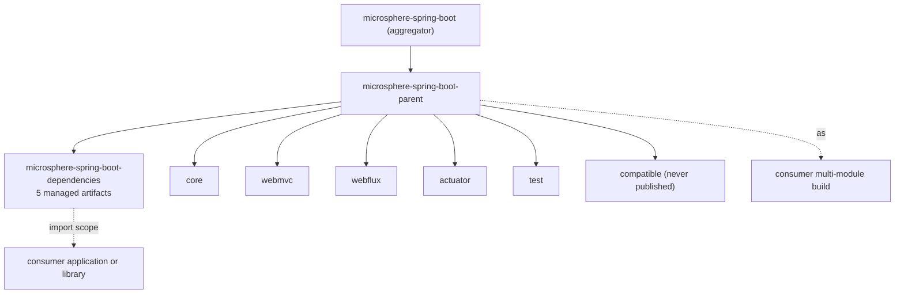

# Dependencies BOM 模块

> [English](../dependencies.md) · 文档索引：[中文](../../zh/README.md) · 本分支用户文档：[中文](../../../user-guide/current/zh/dependencies.md)
>
> **分支：** `release` · **版本线：** `0.2.x` · **Artifact：** `microsphere-spring-boot-dependencies`
> **打包：** `pom` · 会发布 · 五条受管条目 · 无源码、无测试

目录：
[1 在构建中的位置](#1-在构建中的位置) ·
[2 BOM 管理什么](#2-bom-管理什么) ·
[3 刻意不管理什么](#3-刻意不管理什么) ·
[4 发布出去的 POM](#4-发布出去的扁平化-pom) ·
[5 这里不钉 Boot 版本](#5-这里不钉-boot-版本) ·
[6 使用者配方](#6-使用者配方) ·
[7 往 BOM 里加模块](#7-往-bom-里加模块) ·
[8 BOM 与父工程之争](#8-bom-与父工程之争) ·
[9 部署顺序](#9-部署顺序) ·
[10 验证](#10-验证) ·
[11 故障模式](#11-故障模式) ·
[12 参考](#12-参考)

---

## 1. 在构建中的位置

`microsphere-spring-boot-dependencies` 是版本层的面向使用者那一半。`microsphere-spring-boot-parent` 是**构建**契约（模块
编译时继承什么），而 BOM 是**使用**契约（应用导入它之后就不必再写版本号）。



它自己的 `<parent>` 就是 `microsphere-spring-boot-parent`，因此 BOM 会继承 profile 矩阵与上游 BOM 导入 —— 但只导入 BOM 的
使用者并不会自动继承它们，见第 5 节。

---

## 2. BOM 管理什么

恰好五个构件，版本全部是 `${revision}`：

```xml

<dependencyManagement>
    <dependencies>
        <dependency>
            <groupId>io.github.microsphere-projects</groupId>
            <artifactId>microsphere-spring-boot-core</artifactId>
            <version>${revision}</version>
        </dependency>
        <!-- ... the same four additional entries ... -->
    </dependencies>
</dependencyManagement>
```

| 受管构件 | 是否发布 | 是否在 BOM 里 | 说明 |
|---|---|---|---|
| `microsphere-spring-boot-core` | 是 | 是 | 其余每个 jar 模块都依赖它 |
| `microsphere-spring-boot-webmvc` | 是 | 是 | Servlet 栈扩展 |
| `microsphere-spring-boot-webflux` | 是 | 是 | 响应式栈扩展 |
| `microsphere-spring-boot-actuator` | 是 | 是 | 自定义端点与被监听的调度器 |
| `microsphere-spring-boot-test` | 是 | 是 | 测试基类，可在 `test` scope 使用 |
| `microsphere-spring-boot-compatible` | 否 | 否 | 构建期 shim，见 [compatible.md](./compatible.md) |
| `microsphere-spring-boot-parent` | 是 | 否 | 它是 `<parent>`，不是依赖 |
| `microsphere-spring-boot-dependencies` | 是 | 否 | BOM 自身 |

五条条目的顺序与依赖图一致（`core` 在最前），这样新增第六个模块时 diff 仍然好读。

---

## 3. 刻意不管理什么

| 未纳入的东西 | 原因 | 应该怎么做 |
|---|---|---|
| `microsphere-spring-boot-compatible` | 它不部署，且其中的类只是 Boot 4 的 shim，在其它版本上会在运行时冲突 | 什么都不用做 —— `core` 会在 `4.x` profile 激活时于构建期挂载它 |
| 上游 `microsphere-spring-*` 构件 | 它们的版本已由父工程导入的 `microsphere-spring-dependencies` 管理 | 导入那个 BOM，或依赖传递解析 |
| `spring-boot-dependencies` | 在这个 BOM 里钉住 Boot，会与应用自己的 Boot 选择暗中较劲 | Boot 由应用决定；本库只声明受支持的版本范围 |
| 插件管理 | 归 `microsphere-build` | 需要时把 `microsphere-build` 作为构建父工程 |
| `distributionManagement` / repositories | 扁平化会从部署 POM 里剔除 repositories | 在你自己的构建 POM 里声明仓库 |

给模块新增依赖时最该记住第二行：一个新的上游 Microsphere 构件既不需要写版本，**也不需要加 BOM 条目**，因为
`microsphere-spring-dependencies` 已经管住了它。

---

## 4. 发布出去的扁平化 POM

`flatten.mode` = `resolveCiFriendliesOnly` 只把出现各处的 `${revision}` 换成字面值，其余一律不改。因此部署出去的
`0.2.34` BOM 长这样：

```xml

<parent>
    <groupId>io.github.microsphere-projects</groupId>
    <artifactId>microsphere-spring-boot-parent</artifactId>
    <version>0.2.34</version>
    <relativePath>../microsphere-spring-boot-parent/pom.xml</relativePath>
</parent>
<artifactId>microsphere-spring-boot-dependencies</artifactId>
<version>0.2.34</version>
<packaging>pom</packaging>
```

以下结论都来自真实构件本身，每一条都能解释一类用户反馈：

* 五条受管版本全是**字面量**（`0.2.34`），绝不是属性引用。使用者无法靠设置某个属性来"覆盖"它们；想赢必须在导入之前自己
  重新声明该依赖。
* `<parent>` 块带着字面版本保留了下来。Maven 会从仓库解析这个父 POM，忽略此时已无意义的 `<relativePath>`，所以 BOM 的
  有效模型里仍包含父工程的 profile 列表。
* 没有 `<repositories>` 块：`flatten.pomElements.repositories` = `remove`。需要 `spring-milestone` 的使用者得自己声明。
* `<url>` 与 `<scm>` 里带着被追加的模块路径（例如 BOM 的 `<scm><connection>` 重复出现了
  `microsphere-spring-boot-parent/microsphere-spring-boot-dependencies`）。这是根 POM 里的 `${project.scm.url}` 插值遇上
  flatten 的 `scm: resolve` 策略的结果。它只是外观问题，只影响生成的 POM 元数据，绝不影响依赖解析 —— 但在部署 POM 的
  diff 里看着挺吓人。

---

## 5. 这里不钉 Boot 版本

扁平化后 BOM 的 `<dependencyManagement>` **只**含五个 Microsphere 构件。它不会把 `spring-boot-dependencies` 内联进来，
而发布出去的父 POM 里那条导入仍是属性引用：

```xml
<!-- microsphere-spring-boot-parent, as deployed -->
<artifactId>spring-boot-dependencies</artifactId>
<version>${spring-boot.version}</version>
```

并且八个 `spring-boot-*` profile 原样保留在部署 POM 中。实际后果：

* 只 `import` 本 BOM 的使用者**不会**从里拿到 Boot 版本。Boot 版本继续由应用掌控 —— 对一个库来说这正是正确的取舍。
* 把 `microsphere-spring-boot-parent` 当作 `<parent>` 的使用者会继承那份 profile 菜单，并且必须激活其中一个（或接受
  `activeByDefault` 的 `3.5` 线），详见 [parent.md](./parent.md) 第 7 节。
* 由于 BOM 不携带 Boot 钉版，同一个发布版本可以同时装进 Boot 3.0 应用和 Boot 4.1 应用。这才是"支持 `3.0.13` – `4.1.1`"
  的正确读法。

不要"顺手"把 `spring-boot-dependencies` 加进这个 BOM。这是唯一一项会把一个按版本范围服务的库变成钉版库、并破坏所有现存
使用者语义的改动。

---

## 6. 使用者配方

**导入 Boot 应用**（最常见）：

```xml

<dependencyManagement>
    <dependencies>
        <dependency>
            <groupId>io.github.microsphere-projects</groupId>
            <artifactId>microsphere-spring-boot-dependencies</artifactId>
            <version>0.2.34</version>
            <type>pom</type>
            <scope>import</scope>
        </dependency>
    </dependencies>
</dependencyManagement>

<dependencies>
    <dependency>
        <groupId>io.github.microsphere-projects</groupId>
        <artifactId>microsphere-spring-boot-webmvc</artifactId>
    </dependency>
</dependencies>
```

**覆盖某个模块的版本。** 把该模块声明在导入**之前**，因为先声明的受管版本胜出：

```xml

<dependencyManagement>
    <dependencies>
        <dependency>
            <groupId>io.github.microsphere-projects</groupId>
            <artifactId>microsphere-spring-boot-core</artifactId>
            <version>0.2.33</version>
        </dependency>
        <dependency>
            <!-- BOM import: must come after the pin above -->
            <artifactId>microsphere-spring-boot-dependencies</artifactId>
            <type>pom</type>
            <scope>import</scope>
        </dependency>
    </dependencies>
</dependencyManagement>
```

**使用 test 模块。** 它和其它构件一样受管，因此 `microsphere-spring-boot-test` 即使在 `test` scope 也不需要写版本。

---

## 7. 往 BOM 里加模块

1. 创建模块目录，把 `<parent>` 设为 `microsphere-spring-boot-parent` 并带上 `<version>${revision}</version>`。
2. 把它加进根 POM 的 `<modules>` 列表，保持父工程与 BOM 在最前。
3. 在 `microsphere-spring-boot-dependencies/pom.xml` 追加一条 `<dependency>` 条目，版本写 `${revision}`。
4. 检查 `publish` profile（继承自 `microsphere-build`）里的发布过滤确实包含新模块；未被列出的模块能构建但永不部署，这个
   问题往往几周后才以"找不到构件"的形式浮现。
5. 如果这个模块只在构建期存在，就**不要**把它加进 BOM，并给它和 `microsphere-spring-boot-compatible` 一样的两道发布
   熔断 —— 见 [compatible.md](./compatible.md) 第 4 节。
6. 在同一次提交里更新本文档、其中文孪生文件、面向使用者的
   [dependencies.md](../../../user-guide/current/zh/dependencies.md)，以及
   [README.md](./README.md) 里的模块表。

BOM 的改动与 `<modules>` 的改动必须一起落地。在 reactor 里但不在 BOM 里的模块对使用者不可见；BOM 里有条目但没有对应
模块，则所有导入者都会解析失败。

---

## 8. BOM 与父工程之争

| 问题 | BOM | 父工程 |
|---|---|---|
| 它给我什么 | 只有版本号 | 版本、插件、属性、profile、仓库 |
| 能和 `spring-boot-starter-parent` 一起用吗 | 能 —— `import` 与任何既有父工程兼容 | 不能 —— 一个 POM 只有一个 parent |
| 它钉 Boot 版本吗 | 不钉（第 5 节） | 只有你激活它的某个 profile 时才钉 |
| 改动它会破坏使用者吗 | 增删条目会；抬版本不会 | 你改的一切都会被继承 |
| 文档优先的使用者该选哪个 | BOM | 只有想要整套构建契约的内部多模块构建才选父工程 |

这正是两者作为独立 artifact 存在而非合一的原因。

---

## 9. 部署顺序

根 POM 把 `microsphere-spring-boot-parent` 列在 `microsphere-spring-boot-dependencies` 之前，而 Maven 还会按 parent
关系做拓扑排序，因此部署序列是父工程 → BOM → 各 jar 模块。两个后果：

* 发布部分失败（BOM 部署了、`core` 没有）会让使用者拿到一个能解析、却交付不出构件的版本。因此发布流水线把任何模块失败都
  当作整次发布失败，而不是继续往下走。
* 部署时 BOM 自己的 `<parent>` 必须可解析，这就是 `${revision}` 不能换成按模块各自版本属性的原因。

---

## 10. 验证

```bash
# 受管集合，直接读源 POM
grep -A1 "<artifactId>microsphere-spring-boot" microsphere-spring-boot-dependencies/pom.xml | grep artifactId

# Maven 会替使用者解析出什么，在某个模块的构建里查
./mvnw -Pspring-boot-3.5 -pl microsphere-spring-boot-webmvc -am dependency:managedVersions

# 即将被部署的扁平化 POM（在部署之前看）
cat microsphere-spring-boot-dependencies/target/.flattened-pom.xml
```

`target/.flattened-pom.xml` 是这里最有用的调试产物：它就是最终落到仓库里的内容，所以它与 `pom.xml` 的任何差异都能解释
"本地能跑、用户找不到"这一大类反馈。重点比对 `<version>` 是否为字面量，以及 `<repositories>` 是否已被剔除。

---

## 11. 故障模式

| 现象 | 原因 | 处理 |
|---|---|---|
| 使用者加了依赖后报 `'dependencies.dependency.version' ... missing` | 该构件不在 BOM 里（新模块，或 `compatible`） | 按第 7 节加条目，或显式写出版本 |
| BOM 导入成功但拉到了意外的 Boot 版本 | 使用者同时也导入了 `spring-boot-dependencies`，谁先声明谁赢 | 把 Boot 的 BOM 放在前面声明，或对齐两者版本 |
| `Could not find microsphere-spring-boot-parent:0.2.35-SNAPSHOT` | 父工程只有快照版本，而使用者没有配置快照仓库 | 发布或改用正式版；CI 的 `-Drevision=0.0.1-SNAPSHOT` 构建从不发布 |
| 使用者里设置的版本属性没生效 | 扁平化后是字面量而非属性引用（第 4 节） | 在导入之前重新声明该依赖（第 6 节） |
| 部署出去的 `<scm>` 看着像坏了 | flatten 的 `scm: resolve` 叠加 `${project.scm.url}` 插值（第 4 节） | 纯外观问题，可忽略；或规范根 POM 的 SCM 块 |
| 新模块能构建但没人能依赖它 | 缺 BOM 条目，或被发布过滤器排除 | 检查第 7 节的两处 |

---

## 12. 参考

* [parent.md](./parent.md) —— 构建侧的版本契约与 profile 矩阵
* [compatible.md](./compatible.md) —— 那个刻意不在 BOM 里的模块
* [build-and-release.md](./build-and-release.md) —— 发布与流水线
* [README.md](./README.md) —— reactor 形态
* 面向使用者的导入说明：[dependencies.md](../../../user-guide/current/zh/dependencies.md)
