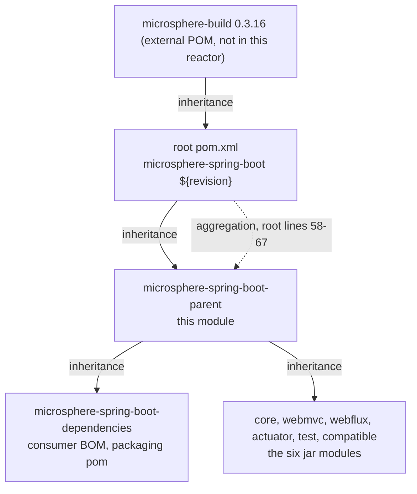

# Parent POM 模块

> [English](../parent.md) · 文档索引：[中文](../../zh/README.md) ·
> [本模块的用户文档](../../../user-guide/current/zh/parent.md)

> **分支：** `release` · **版本线：** `0.2.x` · **Artifact：** `microsphere-spring-boot-parent`
> **打包：** `pom` · 135 行，无源码、无测试 · 会发布 · 被其他七个模块继承 · 自己不声明
> `<modules>`

目录：
[1 在构建中的位置](#1-在构建中的位置) ·
[2 三个 POM，三种职责](#2-三个-pom三种职责) ·
[3 revision 属性](#3-revision-属性) ·
[4 Java 基线](#4-java-基线) ·
[5 受管属性及其消费者](#5-受管属性及其消费者) ·
[6 依赖管理，按 BOM 逐个看](#6-依赖管理按-bom-逐个看) ·
[7 Spring Boot 的 profile](#7-spring-boot-的-profile) ·
[8 spring-milestone 仓库](#8-spring-milestone-仓库) ·
[9 模块声明这个父工程后得到什么](#9-模块声明这个父工程后得到什么) ·
[10 与 microsphere-build 的边界](#10-与-microsphere-build-的边界) ·
[11 配方](#11-配方) ·
[12 参考](#12-参考)

---

## 1. 在构建中的位置

这里同时存在两层彼此无关的 Maven 关系，很容易被混为一谈：**继承**（`<parent>`，它提供属性、
`dependencyManagement` 与插件行为）与**聚合**（`<modules>`，它提供构建顺序）。本仓库刻意把两者拆分到
不同的 POM 中。



这个父工程**既**被根工程聚合（根 `pom.xml` 第 59 行，列在第一位），**又**被其他每一个 POM 继承。它不拥有
任何 `src` 目录，因此单独构建它只会产出一个扁平化后的 POM。

---

## 2. 三个 POM，三种职责

| POM | 坐标 | 打包 | 负责 | 不负责 |
|---|---|---|---|---|
| 根聚合 `pom.xml` | `microsphere-spring-boot:${revision}` | `pom` | `<modules>`（58–67）、`<revision>0.2.35-SNAPSHOT</revision>`（54）、`<java.version>17</java.version>`（55）、组织、许可证、开发者与 SCM 元数据（21–51） | 没有 `dependencyManagement`，没有 profile，没有 `<build>` |
| `microsphere-spring-boot-parent` | `${revision}`，parent = 根工程（5–10） | `pom`（16） | 三个属性（21–26）、四条受管条目（28–66）、`spring-milestone` 仓库（68–74）、八个 `spring-boot-*` profile（76–135） | 没有 `<modules>`，完全没有 `<build>` 块 |
| `microsphere-spring-boot-dependencies` | `${revision}`，parent = 本父工程（5–10） | `pom`（16） | 覆盖五个已发布模块的 `dependencyManagement`，全部为 `${revision}`（21–55） | 没有 profile，没有仓库，没有 `<build>` |

两半都是承重的：正因为根工程带着 `<modules>`，在仓库根目录执行 `mvn` 才会构建整个 reactor；也正因为这个
父工程带着 `dependencyManagement`，模块 POM 才能彻底不写版本。每个 jar 模块都重复同一个 `<parent>` 块，
里面写着 `<version>${revision}</version>` 和一个指向本目录的 `<relativePath>`（`core/pom.xml` 第 5–10 行）——
正是这套 CI 友好的写法让人不再需要 versions 插件。

---

## 3. revision 属性

`revision` 恰好只定义一次，在根 POM 的第 54 行，所以抬一个发布版本只是一行改动：这里的每个 POM，包括
那两个纯 POM 模块，都把自身的版本和 `<parent>` 的版本写成 `${revision}`。对于从仓库下载 POM 的使用者，
Maven 无法解析 `${revision}`，因此部署出去的 POM 必须先把占位符插值掉；这正是继承来的
`flatten-maven-plugin` 以 `resolveCiFriendliesOnly` 模式完成的事（第 9 节）。三个后果：

* 跨模块依赖仍然显式写出 `<version>${revision}</version>`（`core` 依赖 `test`，`core/pom.xml` 第 69–74 行），
  而上游 Microsphere 构件**不带**任何版本，因为第 6 节导入的 BOM 已经提供了版本。
* CI 会针对一个无关的版本构建，以保证没有先前的 install 也依然可解析：`maven-build.yml` 第 45 行为 `test`
  目标传入 `-Drevision=0.0.1-SNAPSHOT`，那次运行不发布任何东西。
* 插值只向下生效：根属性对这个父工程以及每个模块都可见，但只在这里定义的属性
  （`microsphere-spring.version`）对根工程不可见。

---

## 4. Java 基线

`java.version` 是本仓库唯一设置的编译器开关，而且它设在根工程（第 2 节），不在这里。外部的
`microsphere-build:0.3.16` POM 默认 `<java.version>8</java.version>`（第 89 行），由此派生出
`maven.compiler.source`（58）和 `maven.compiler.target`（94），并把两者绑定进 compiler 插件（127–128）；
根工程把它覆盖为 `17`，一处改动就让继承下来的全部七个模块重新定目标。那个 POM 还声明了 JDK 版本区间
profile `java8+`（605）、`java9+`（628）、`java11+`（637）、`java16+`（668）和 `java17+`（693），这就是当 CI
跑在 JDK `17`、`21` 或 `25` 上时同一棵源码树能够自适应的原因（矩阵见 `maven-build.yml` 第 25 行）。绝不
要在模块 POM 里设置 `maven.compiler.source` 或 `target`：它绕开了单点覆盖，会在一条要求 17 的分支上重新
引入 Java 8 基线。

---

## 5. 受管属性及其消费者

第 21–26 行放着三个属性，每个属性恰好只有一个声明它的消费者。下面这层映射来自对工作区内每个 POM 的
grep 结果，因此它同时也是一份“值变了要动哪里”的清单：

| 属性 | 声明行 | 值 | 消费者 |
|---|---|---|---|
| `microsphere-spring.version` | 22 | `0.2.39` | 对 `microsphere-spring-dependencies` 的导入（57–63），它给五个无版本的上游依赖定版本：`microsphere-annotation-processor`（core 23–27、test 23–27、webmvc 24–28、webflux 24–28、actuator 24–28）、`microsphere-spring-context`（core 30–33、test 58–61）、`microsphere-spring-test`（test 64–67）、`microsphere-spring-webmvc`（webmvc 38–41）、`microsphere-spring-webflux`（webflux 38–41） |
| `jolokia.version` | 23 | `2.6.3` | 直接的受管条目（41–45），只有 `microsphere-spring-boot-actuator/pom.xml` 第 38–41 行请求它 |
| `junit-jupiter.version` | 25 | `6.1.3` | 对 `junit-bom` 的导入（32–38），被无版本的 `junit-jupiter` 依赖请求：test 30–34（可选的 compile 作用域）以及 core 55–59、webmvc 64–68、webflux 63–67 和 actuator 75–79（`test` 作用域） |

还有两个属性属于同一份契约，却不在本文件中声明：`spring-boot.version` **只**由 profile 设置（第 7 节），
以及 `java.version` 只在根工程设置（第 4 节）。另外注意 `microsphere-spring.version`（`0.2.39`）与
`${revision}`（`0.2.35-SNAPSHOT`）是两条彼此独立的版本线——上游库按自己的节奏发布。

---

## 6. 依赖管理，按 BOM 逐个看

第 28–66 行恰好声明了四条受管条目，按声明顺序为：`org.junit:junit-bom`（32–38，import）、
`org.jolokia:jolokia-core`（41–45，直接定版本）、
`org.springframework.boot:spring-boot-dependencies`（48–54，import）和
`io.github.microsphere-projects:microsphere-spring-dependencies`（57–63，import）。提供本分支上每一个 Spring
与 Spring Boot 版本的那一条，原样如下：

```xml
<!-- microsphere-spring-boot-parent/pom.xml, lines 47-54 -->
<!-- Spring Boot Dependencies -->
<dependency>
    <groupId>org.springframework.boot</groupId>
    <artifactId>spring-boot-dependencies</artifactId>
    <version>${spring-boot.version}</version>
    <type>pom</type>
    <scope>import</scope>
</dependency>
```

**顺序不是随意的。** 对于导入的 BOM，Maven 采用先声明者优先：给定 `groupId:artifactId` 最早的那条受管声明
会存活。因为 `spring-boot-dependencies` 排在 `microsphere-spring-dependencies` 之前，凡被两边同时描述的构件都
保留 Spring Boot 的版本，只有 Boot 不认识的构件才从 Microsphere BOM 取版本。交换这两个块是一次静默的行为
变更，本分支上没有任何测试能发现它。`jolokia-core` 之所以是唯一的直接钉版，恰恰因为没有导入的 BOM 覆盖它。

---

## 7. Spring Boot 的 profile

第 76–135 行声明了八个 profile。每个都钉住一个 Boot 的**补丁**发布版；恰好只有一个默认激活：

| Profile id | 行号 | `spring-boot.version` | 激活方式 |
|---|---|---|---|
| `spring-boot-3.0` | 77–82 | `3.0.13` | 显式 `-P` |
| `spring-boot-3.1` | 84–89 | `3.1.12` | 显式 `-P` |
| `spring-boot-3.2` | 91–96 | `3.2.12` | 显式 `-P` |
| `spring-boot-3.3` | 98–103 | `3.3.13` | 显式 `-P` |
| `spring-boot-3.4` | 105–110 | `3.4.13` | 显式 `-P` |
| `spring-boot-3.5` | 112–120 | `3.5.16` | `activeByDefault`（114–116） |
| `spring-boot-4.0` | 122–127 | `4.0.8` | 显式 `-P` |
| `spring-boot-4.1` | 129–134 | `4.1.1` | 显式 `-P` |

`spring-boot-3.5` 上的 `activeByDefault` 是这套设计里最脆弱的部分：一旦**同一个 POM 中声明的**另一个 profile
被激活，Maven 就会取消它，此时 `dependencyManagement` 完全无法插值 `${spring-boot.version}`，于是构建会以缺失
版本的错误失败，而不是悄悄挑定一条 Boot 版本线。因此每个 CI 单元都会显式点名一个 Boot profile
（`maven-build.yml` 第 26–28 行和第 48 行）。发布工作流是一个有启发性的例外：`maven-publish.yml` 第 48–56 行
传入 `--activate-profiles publish,ci` 且不带任何 Boot profile，由于这两个 id 声明在外部父工程而不是本 POM 里，
默认激活得以保留，一次发布会解析到 `3.5.16`。所以，任何加到*本* POM 中的 profile 都必须与某个 Boot profile
一起点名。

钉补丁版而不是次版本，让 24 个单元的矩阵（3 个 JDK × 8 个 Boot profile）保持可复现；代价是新的 Boot 补丁版
永远不会被自动采纳，因此这张表需要人工维护（第 11 节）。有两个 profile 做的事不止设置一个属性：在
`spring-boot-4.0` 和 `spring-boot-4.1` 下，`core/pom.xml` 第 97–121 行会把未发布的 `compatible` 模块作为 compile
依赖挂上来——见 [compatible.md](../compatible.md)。

---

## 8. spring-milestone 仓库

第 68–74 行添加了一个仓库，被全部七个模块继承：

```xml
<!-- microsphere-spring-boot-parent/pom.xml, lines 68-74 -->
<repositories>
    <repository>
        <id>spring-milestone</id>
        <name>Spring Portfolio Milestone Repository</name>
        <url>https://repo.spring.io/milestone</url>
    </repository>
</repositories>
```

它存在的意义是让一个 `4.x` profile 能指向 milestone 或候选发布版本，这也是一张本已钉死补丁版的矩阵唯一可能
漂移的通道：milestone 构件在被晋升之前保持可变。它永远不会到达消费者，因为继承来的 flatten 配置设置了
`flatten.pomElements.repositories = remove`（`microsphere-build` 第 95 行）；需要 milestone 的下游项目必须自己
声明。

---

## 9. 模块声明这个父工程后得到什么

凡是 `<parent>` 指向本构件的 POM，什么都不必写就继承到：

* 每一个 Spring Boot、Spring Framework、JUnit 与上游 Microsphere 构件的版本号，这正是模块 POM 得以保持
  无版本的原因（第 5 节、第 6 节），外加 `spring-milestone` 仓库（第 8 节）和八个 Boot profile（第 7 节）
* 再往上一层，经由根工程：绑定到 `${java.version}` 的 compiler 插件，以及 `microsphere-build` 默认
  `<build><plugins>` 中的 `maven-source-plugin` 和 `flatten-maven-plugin`（外部第 457–468 行）
* 让 `${revision}` 可以发布的 flatten 设置——`flatten.mode = resolveCiFriendliesOnly`（外部 60）、
  `parent = expand`（73）、`properties = keep`（82）、`dependencies = resolve`（56）、
  `dependencyManagement = interpolate`（52）、`repositories = remove`（95）、
  `distributionManagement = remove`（63）、`scm = resolve`（78）、`developers = resolve`（80）、
  `flatten.dependency.mode = all`（99），插件版本 `1.7.3`（46）

这个父工程**会**被发布：仓库里仅有的两个发布终止开关是
`microsphere-spring-boot-compatible/pom.xml` 第 64 行和第 72 行的 `<skip>true</skip>` 与
`<skipPublishing>true</skipPublishing>`。正因为第三方把这个 POM 用作他们的 `<parent>`，此处的一次
`dependencyManagement` 改动就是 API 可见的，需要次版本号或主版本号升级，而不是补丁版本号升级。

---

## 10. 与 microsphere-build 的边界

下面是对本仓库做一次 grep 就能证明的内容，也仅限于此：

* CI 激活的四个 profile id——`test`、`coverage`、`publish`、`ci`——在本仓库中**任何地方都不出现**。本地
  定义的 profile id 只有这里的八个 `spring-boot-*`（78–134）和 `core` 里的两个（99、111），所以它们必然来自
  外部父工程，`microsphere-build-0.3.16.pom` 证实了这一点：`release` 480、`publish` 507、`ci` 534、`test` 545、
  `coverage` 561、`docs` 572。
* 这里的任何 POM 都不包含字符串 `flatten`、`gpg`、`surefire`、`distributionManagement`、`maven-javadoc` 或
  `maven-source`；这些设置每一项都来自继承，这正是根工程和本父工程都没有 `<build>` 块的原因。在外部 POM 里，
  `publish`（507–532）激活 javadoc、release、enforcer、gpg、git-commit-id 和
  `central-publishing-maven-plugin`，后者的目标是 `publishingServerId = ossrh` 且 `autoPublish` 为 true
  （209–210）；`test`（545–560）激活 failsafe、checkstyle 和 surefire；`coverage`（561–571）激活 JaCoCo；
  `ci`（534–544）激活 `sign-maven-plugin`。那个 POM 同样没有 `<distributionManagement>` 元素：部署目标是发布
  插件的一项设置，而不是 POM 元素。
* 这里没有任何东西覆盖上述任何一项。升级一个插件版本意味着编辑根 POM 里的 `microsphere-build` 坐标
  （第 5–9 行），而绝不是本文件。

这样的拆分让构建契约在所有 Microsphere 仓库之间共享；一条 Boot 版本线的父工程如果把它 fork 出去，共享的那
一份一改进就会立刻发生漂移。

---

## 11. 配方

**新增一条 Spring Boot 版本线**（下一条 `3.6` 或 `4.2`）：

1. 在第 134 行与第 135 行之间追加一个 profile 块，其中只含一个 `<spring-boot.version>`，其值设为一个**已经
   发布过的**补丁版本，并保持这些 id 按升序排列。
2. 把这个 id 加入 `.github/workflows/maven-build.yml` 的矩阵（第 26–28 行），让某个 CI 单元覆盖它。
3. 如果新的 Boot 版本线挪动了本项目据以排序的某个自动配置类，那就扩展按名字书写的
   `@AutoConfigure*(name = ...)` 数组，而不是添加一层 shim——规则见 [compatible.md](../compatible.md)。
4. 如果这个 id 是一条 `4.x` 版本线，检查 `core/pom.xml` 第 97–121 行是否需要一个对应的 profile 来挂上
   `compatible`。
5. 在同一次提交中更新本文档、[dependencies.md](../dependencies.md)、它们的中文孪生版本以及
   `../../../user-guide/current/parent.md`。

**抬 reactor 版本：** 只编辑根 POM 里的 `<revision>`（第 54 行）。**在同一个次版本内抬 Boot：** 修改相应
profile 里那唯一的字面量，然后运行 `./mvnw -B -Pspring-boot-<minor> test`。**钉住一个没有 BOM 管理的构件：**
在 `<dependencyManagement>` 中紧邻 `jolokia-core` 添加一条直接条目，并在第 21–26 行添加一个属性——绝不要在
模块里写 `<version>`。

---

## 12. 参考

* [../../README.md](../../README.md) — reactor 的形状与各模块文档索引
* [dependencies.md](../dependencies.md) — 由本父工程的产出组装出的面向使用者的 BOM
* [compatible.md](../compatible.md) — `4.x` profile 挂载的那个未发布模块
* [test.md](../test.md) — 消费此处所管理 JUnit 版本的一个 jar 模块
* [build-and-release.md](../build-and-release.md) — CI 与发布流水线如何驱动这些 profile
* 面向使用者的指南：[../../../user-guide/current/zh/parent.md](../../../user-guide/current/zh/parent.md)
