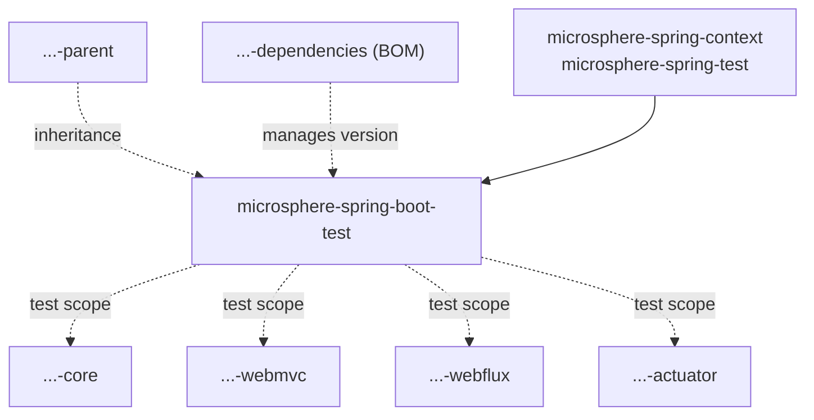
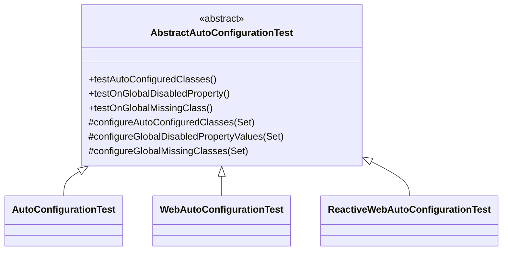

# Test 模块

> [English](../test.md) · 文档索引：[中文](../../zh/README.md) · 本分支用户文档：[中文](../../../user-guide/current/zh/test.md)
>
> **分支：** `release` · **版本线：** `0.2.x` · **Artifact：** `microsphere-spring-boot-test`

目录：
[1 模块定位](#1-模块定位) ·
[2 类层次结构](#2-类层次结构) ·
[3 模板方法契约](#3-模板方法契约) ·
[4 三个 Runner 绑定](#4-三个-runner-绑定) ·
[5 Reactor 内部的消费方式](#5-reactor-内部的消费方式) ·
[6 可选依赖设计](#6-可选依赖设计) ·
[7 模块测试作为实操示例](#7-模块测试作为实操示例) ·
[8 设计模式](#8-设计模式) ·
[9 实操配方](#9-实操配方) ·
[10 参见](#10-参见)

---

## 1. 模块定位

`microsphere-spring-boot-test` 是一个会被发布、且由 BOM 管理版本的 jar，它的全部生产内容就是
`microsphere-spring-boot-test/src/main/java/io/microsphere/spring/boot/test` 下的四个抽象基类。它存在的目的，
是让每个模块为每一个自动配置写一个测试类，而不是为每一个条件写一个测试方法。



`test` 是一片叶子：本 reactor 中没有任何模块是它的 compile 作用域依赖，也没有任何东西在 compile 作用域依赖它；
它仅有的两个必需依赖 `microsphere-spring-context` 与 `microsphere-spring-test` 都是外部 artifact
（POM 第 58–67 行）。

---

## 2. 类层次结构

`AbstractAutoConfigurationTest.java` 第 53 行就是整份契约：

```java
public abstract class AbstractAutoConfigurationTest<A, R extends AbstractApplicationContextRunner> {
```

`A` 是被测试的自动配置类；`R` 是启动它的 Boot context runner。这里的边界刻意写成*原始*的
`AbstractApplicationContextRunner`：Boot 暴露的三个自包含 runner 各自都继承那个五参数基类，所以只有原始形式
能让子类把它们传进来，而不必重复 Boot 的递归泛型。写满边界的形式只出现在三个 static 断言辅助方法上，
即第 202、209 和 218 行——例如
`public static <R extends AbstractApplicationContextRunner<R, C, A>, C extends ConfigurableApplicationContext, A extends ApplicationContextAssertProvider<C>> void assertAutoConfiguredClass(R runner, Class<?> autoConfiguredClass)`。



---

## 3. 模板方法契约

### 3.1 构造函数：采集元数据

构造函数是 `protected AbstractAutoConfigurationTest()`（第 88 行）；它的方法体就是契约：

```java
Class<?> type = getClass();
SpringBootTest springBootTest = type.getAnnotation(SPRING_BOOT_TEST_CLASS);
assertNotNull(springBootTest, "The @SpringBootTest must not be annotated on " + type);
this.springBootTestAttributes = GenericAnnotationAttributes.of(springBootTest);
this.isWebApplication = !NONE.equals(springBootTestAttributes.get("webEnvironment"));
this.abstractAutoConfigurationTestType = forClass(getClass()).as(AbstractAutoConfigurationTest.class);
this.autoConfigurationClass = (Class<A>) abstractAutoConfigurationTestType.resolveGeneric(0);
this.runnerClass = (Class<R>) abstractAutoConfigurationTestType.resolveGeneric(1);
this.runner = newRunner();
if (!isWebApplication) { assertInstanceOf(ApplicationContextRunner.class, this.runner, ...); }
```

维护者必须记住的三个后果：

- 子类**必须**给自己标注 `@SpringBootTest`，否则构造在第 91 行失败。不会启动任何 Spring 测试上下文：该注解
  只是被反射地当作属性载体读取，模块里也不含任何 `@ExtendWith`，因此普通的 Jupiter 引擎直接执行 `@Test` 方法。
- `A` 与 `R` 由 `ResolvableType.as(...)` 加上 `resolveGeneric(0)` / `resolveGeneric(1)` 取回，所以一个绑定了
  无意义类型变量的子类能编译通过、却在运行期失败。`runnerClass` 同样是反射实例化的，因此每个被绑定的 runner
  都需要一个可访问的无参构造函数。
- `isWebApplication` 取决于 `webEnvironment`，而不是取决于继承了哪个子类，随后第 98–101 行的守卫在它取
  `NONE` 时要求 runner 必须是 `ApplicationContextRunner`；把 `WebAutoConfigurationTest` 与 `NONE` 配对就会触发
  `assertInstanceOf`。

### 3.2 Runner 的构造

`protected R newRunner()`（第 104 行）调用 `ConstructorUtils.newInstance(runnerClass)`，并把结果交给
`initRunner`，后者固定了播种顺序（第 109–115 行）：

```java
protected R initRunner(R runner) {
    String[] propertyValues = getPropertyValues();
    Class<?>[] classes = getClasses();
    return (R) runner.withPropertyValues(propertyValues)
            .withConfiguration(of(this.autoConfigurationClass))
            .withConfiguration(of(classes));
}
```

两者都是 `protected` 且非 `final`；`initRunner` 就是子类用来改变上下文播种方式的接缝。

### 3.3 继承而来的三个测试

| 签名 | 行号 | 断言 |
|---|---|---|
| `@Test protected void testAutoConfiguredClasses()` | 117–122 | 对 `getAutoConfiguredClasses()` 中的每个类：`assertThat(context).hasSingleBean(...)` |
| `@Test protected void testOnGlobalDisabledProperty()` | 124–129 | 对 `getGlobalDisabledPropertyValues()` 的每个条目：用 `withPropertyValues(...)` 重新运行，并对每个自动配置类断言 `doesNotHaveBean` |
| `@Test protected void testOnGlobalMissingClass()` | 131–136 | 对 `getGlobalMissingClasses()` 的每个条目：在 `new FilteredClassLoader(...)` 之内重新运行，并对每个自动配置类断言 `doesNotHaveBean` |

### 3.4 锁定的成员与开放的成员

| 签名 | 修饰符 | 行号 |
|---|---|---|
| `protected final String[] getPropertyValues()` | `final` | 139 |
| `protected final Class<?>[] getAutoConfiguredClasses()` | `final` | 144 |
| `protected final Set<String> getGlobalDisabledPropertyValues()` | `final` | 152 |
| `protected final Set<Class<?>> getGlobalMissingClasses()` | `final` | 159 |
| `protected final Class<?>[] getClasses()` | `final` | 165 |
| `protected abstract void configureAutoConfiguredClasses(Set<Class<?>> autoConfiguredClasses)` | abstract | 174 |
| `protected abstract void configureGlobalDisabledPropertyValues(Set<String> globalDisabledPropertyValues)` | abstract | 181 |
| `protected abstract void configureGlobalMissingClasses(Set<Class<?>> globalMissingClasses)` | abstract | 188 |
| `protected void assertAutoConfiguredClass(Class<?> autoConfiguredClass)` | 开放 | 190 |
| `protected void assertDisabledProperty(String propertyValue, Class<?>... beanClasses)` | 开放 | 194 |
| `protected void assertFilteredClass(String filteredClass, Class<?>... beanClasses)` | 开放 | 198 |

这些 `final` 的 getter 让钩子无法回避：`getAutoConfiguredClasses()` 在调用钩子之前先把
`this.autoConfigurationClass` 放进集合（第 146 行），所以子类只能往集合里添加，永远无法替换它。实例上的
`assert…` 方法保持开放，供子类的测试方法直接调用；而 `public static` 辅助方法的存在，是为了让本 reactor 中
不是子类的测试用它们自己的 runner 复用同一套断言。

---

## 4. 三个 Runner 绑定

| 子类 | 每个文件第 33 行的声明 | 所绑定的 Runner |
|---|---|---|
| `AutoConfigurationTest` | `public abstract class AutoConfigurationTest<A> extends AbstractAutoConfigurationTest<A, ApplicationContextRunner>` | `ApplicationContextRunner` |
| `WebAutoConfigurationTest` | `public abstract class WebAutoConfigurationTest<A> extends AbstractAutoConfigurationTest<A, WebApplicationContextRunner>` | `WebApplicationContextRunner` |
| `ReactiveWebAutoConfigurationTest` | `public abstract class ReactiveWebAutoConfigurationTest<A> extends AbstractAutoConfigurationTest<A, ReactiveWebApplicationContextRunner>` | `ReactiveWebApplicationContextRunner` |

它们是**刻意**为空的：每个子类在 `extends` 子句里闭合一个类型变量，因为 `AbstractAutoConfigurationTest`
会在构造期从子类签名中把 `R` 读回来，而 runner 本身已经提供了 Web 语义。往 `WebAutoConfigurationTest` 里放一个
方法，会破坏这一组类的对称性，并把 Servlet 专属行为塞进一个类的 javadoc 只做绑定的承诺——它的 `@since 1.0.0`
与四个文件一致。

---

## 5. Reactor 内部的消费方式

四个模块依赖这个 artifact，每个都写成 `test` 作用域并带上显式的 `${revision}` 而不是受管版本：
`microsphere-spring-boot-core`（POM 第 69–74 行）、`microsphere-spring-boot-webmvc`（78–83）、
`microsphere-spring-boot-webflux`（77–82）、`microsphere-spring-boot-actuator`（89–94），四处的依赖块完全相同：

```xml
<!-- Microsphere Spring Boot Test -->
<dependency>
    <groupId>io.github.microsphere-projects</groupId>
    <artifactId>microsphere-spring-boot-test</artifactId>
    <version>${revision}</version>
    <scope>test</scope>
</dependency>
```

这种重复是承重的：`test` 作用域不具传递性，所以 `webmvc` 不会通过它对 `core` 的依赖继承这个 artifact，
把四个依赖块合并会让三个模块的测试静默地停止编译。Reactor 顺序因同样的原因而重要——根 `pom.xml` 把 `test`
列在第 62 行、`core` 列在第 63 行，因此基类先构建；把 `test` 挪到它的消费方之下会破坏构建。第三方通过 BOM
访问这个 artifact（`microsphere-spring-boot-dependencies` 第 48–52 行），声明时不带版本——它们 classpath 上
真正落下什么，见第 6 节。

---

## 6. 可选依赖设计

必需、compile 作用域：`microsphere-spring-context`（POM 第 58–61 行）与 `microsphere-spring-test`（63–67）。
可选、compile 作用域，每个都带 `<optional>true</optional>`：`microsphere-annotation-processor`（23–27）、
`junit-jupiter`（30–34）、`spring-boot-configuration-processor`（37–41）、`spring-boot-autoconfigure-processor`
（44–48）、`spring-boot-starter-test`（51–55）、`spring-boot-starter-web`（69–74）、
`spring-boot-starter-webflux`（76–81）、`jakarta.servlet-api`（83–88）、`jackson-annotations`（90–95）、
`jackson-databind`（97–101）、`h2`（103–108）。仅 test 作用域：`logback-classic`（113–117）。合计十四个依赖。

没有任何依赖声明版本——该文件里正好两个 `<version>` 标签（第 8 行与第 15 行，即 parent 块和模块自身版本），
所以每个坐标都通过 `microsphere-spring-boot-parent` 解析。

`optional` 的含义是"在我的 compile classpath 上，但对你不传递"，因此消费者只会收到
`microsphere-spring-context` 与 `microsphere-spring-test`，其余必须自备。`junit-jupiter` 与
`spring-boot-starter-test` 实际上是强制性的：编译出的类引用 `org.junit.jupiter.api.Test`、
`FilteredClassLoader`、`AbstractApplicationContextRunner` 与 `ApplicationContextAssertProvider`，
缺了它们子类就无法加载。`spring-boot-starter-web` 只在编译 `WebAutoConfigurationTest` 子类时才需要，
`spring-boot-starter-webflux` 只在编译 `ReactiveWebAutoConfigurationTest` 子类时才需要，这正是两个 starter
都没有被内置的原因：否则非 Web 的消费者会平白继承 Tomcat。

整理这个 POM 之前请注意：`jackson-annotations`、`jackson-databind`、`h2` 与 `jakarta.servlet-api`
没有被本模块 `src/main/java` 或 `src/test/java` 下的任何文件引用，而 `microsphere-spring-test`——非 optional，
因而被传递导出——同样无人引用。删除它们中的任何一个之前，请先跑第 9.3 节的整套 Boot 矩阵，而不是只跑默认
profile。

---

## 7. 模块测试作为实操示例

`microsphere-spring-boot-test/src/test/java/io/microsphere/spring/boot/test` 下的五个文件——两个示例自动配置
与三个测试类——覆盖了全部三种绑定。

| 测试类 | 绑定 | `@SpringBootTest` 属性 | 三个钩子新增什么 |
|---|---|---|---|
| `HttpAutoConfigurationTest` | `WebAutoConfigurationTest<HttpAutoConfiguration>` | `classes = HttpAutoConfigurationTest.class` | `CharacterEncodingFilter.class` 存在；`server.http.enabled=false`；`CharacterEncodingFilter.class` 缺失 |
| `JmxAutoConfigurationTest` | `AutoConfigurationTest<JmxAutoConfiguration>` | `classes = JmxAutoConfigurationTest.class`、`webEnvironment = NONE`、`properties = { "spring.jmx.enabled=true" }` | 存在项为空；`spring.jmx.enabled=false`；`MBeanExporter.class` 缺失 |
| `ReactiveWebApplicationAutoConfigurationTest` | `ReactiveWebAutoConfigurationTest<ReactiveWebApplicationAutoConfiguration>` | `classes = ReactiveWebApplicationAutoConfigurationTest.class` | `JmxProperties.class` 存在；`reactive.web-app.enabled=false`；`JmxProperties.class` 缺失 |

`HttpAutoConfiguration` 带有 `@ConditionalOnWebApplication(type = SERVLET)`、
`@ConditionalOnClass(CharacterEncodingFilter.class)`、
`@ConditionalOnProperty(name = "server.http.enabled", matchIfMissing = true)` 与
`@Import(CharacterEncodingFilter.class)`，所以它的测试是这份契约最小的一次完整使用：一侧四个注解，另一侧三个
单行钩子。`ReactiveWebApplicationAutoConfiguration` 用
`@ConditionalOnWebApplication(type = REACTIVE)`、`@ConditionalOnClass(JmxProperties.class)`、
`@ConditionalOnProperty(name = "reactive.web-app.enabled", matchIfMissing = true)` 与
`@EnableConfigurationProperties(JmxProperties.class)` 与它互为镜像。

`JmxAutoConfigurationTest` 记录了一处值得照抄正确的不对称：`configureAutoConfiguredClasses` 是空的，因为 Boot
自己的 `JmxAutoConfiguration` 提供 `MBeanExporter`，而示例只把它注册成一个*缺失类*；它的 `properties` 条目经
由 `initRunner` 内的 `getPropertyValues()` 到达上下文，所以正向断言之所以通过，只是因为子类打开了 JMX。两个
Web 测试都没有设置 `webEnvironment`，于是 Boot 的默认 `MOCK` 使 `isWebApplication` 为真并跳过
`assertInstanceOf(ApplicationContextRunner.class, …)` 守卫——这正是让它们得以使用 Web runner 的原因。

---

## 8. 设计模式

| 模式 | 位置 | 效果 |
|---|---|---|
| 模板方法 | 三个抽象 `configure…` 钩子，由固定的 `@Test` 三件套驱动 | 一套算法，三个数据槽 |
| 注解即元数据 | 构造函数通过 `GenericAnnotationAttributes` 读取自己的 `@SpringBootTest` | 注解兼作 DSL；无需启动上下文 |
| 自类型绑定 | 三个各只有一行的子类 | 每个 Web 栈只闭合一次 `R`，子类只需写出 `A` |
| 可选依赖隔离 | 十一个 `<optional>true</optional>` 条目 | Servlet 消费者永远不会收到 WebFlux |

---

## 9. 实操配方

### 9.1 新增一个 runner 变体

仅当 Boot 提供一个尚未被绑定的 runner 时才做。

1. 添加 `src/main/java/io/microsphere/spring/boot/test/<Name>AutoConfigurationTest.java`，带上 Apache 头，
   类体为 `public abstract class <Name>AutoConfigurationTest<A> extends AbstractAutoConfigurationTest<A, <RunnerClass>> {}`，
   runner 从 `org.springframework.boot.test.context.runner` 导入。javadoc 要写 `@param <A>`、`@author`、
   `@see AbstractAutoConfigurationTest`、`@see <RunnerClass>` 以及一个 `@since`。
2. 检查第 98–101 行的守卫：它假设"非 Web 就意味着 `ApplicationContextRunner`"，所以一个既非 Web 也非普通
   runner 的实现需要把该条件放宽。
3. 在 `src/test/java` 下按第 7 节补一个示例自动配置与测试，让模块自身的构建证明这个绑定。

### 9.2 向契约新增一个断言

1. 在第 174–188 行旁边声明一个 `protected abstract void configureGlobal…(Set<…>)` 钩子，再加一个
   `protected final Set<…> getGlobal…()` 包装方法，负责播种并返回 `newLinkedHashSet()`。
2. 在第 117–136 行旁边加一个 `@Test protected void testOnGlobal…()` 循环，配套一个
   `public static <R extends AbstractApplicationContextRunner<R, C, A>, …>` 辅助方法，以及一个传入
   `this.runner` 的开放 `protected` 委托方法。
3. 更新三个模块测试以及 `core`、`webmvc`、`webflux`、`actuator` 中的每一个子类，然后在用户文档和中英两份
   开发者文档里记录这个新断言。新的抽象钩子会破坏外部用户：如果它不必强制实现，就给它一个空默认方法体。

### 9.3 验证一次变更

```bash
mvn --batch-mode --file microsphere-spring-boot-test/pom.xml test
mvn --batch-mode --activate-profiles spring-boot-3.5,spring-boot-4.1 test
for p in 3.0 3.1 3.2 3.3 3.4 3.5 4.0 4.1; do
    mvn --batch-mode --activate-profiles spring-boot-$p test || break
done
```

CI 用 JDK `17`、`21`、`25` 跑 `spring-boot-3.0` … `spring-boot-4.1`
（`.github/workflows/maven-build.yml` 第 25–28、48 行）。这里无论怎么改都成立的两条构建事实：打包方式是缺省的
`jar`，没有 `<packaging>` 元素；并且不存在 `src/main/resources`，因此没有 `spring.factories`，也没有任何自行向
Boot 注册的东西。九个源文件全部标注 `@since 1.0.0`，而这个 artifact 会被发布并由 BOM 管理，所以它的类名与钩子
都是公开 API。

---

## 10. 参见

- [本模块用户文档](../../../user-guide/current/zh/test.md) — 面向消费者的用法与示例
- [core.md](./core.md) — 这些基类最大的消费方
- [dependencies.md](./dependencies.md) — 这个 artifact 如何进入消费者的版本清单
- [parent.md](./parent.md) — 本 POM 中每一个不带版本的坐标从何解析
- [compatible.md](./compatible.md) — 与之相反的发布策略
- [构建与发布流水线](./build-and-release.md) — 本模块所编译的 profile 矩阵

---

**相关文档：** [本模块用户文档](../../../user-guide/current/zh/test.md) · [core.md](./core.md) · [dependencies.md](./dependencies.md) · [parent.md](./parent.md) · [compatible.md](./compatible.md) · [构建与发布流水线](./build-and-release.md)
