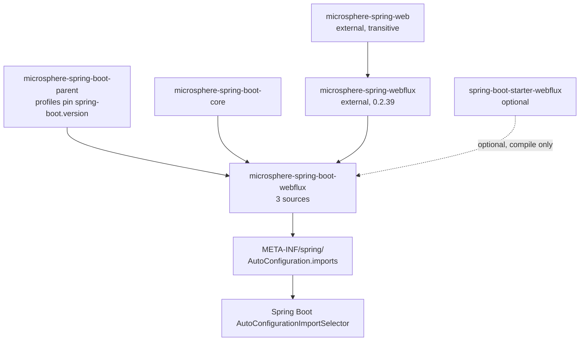
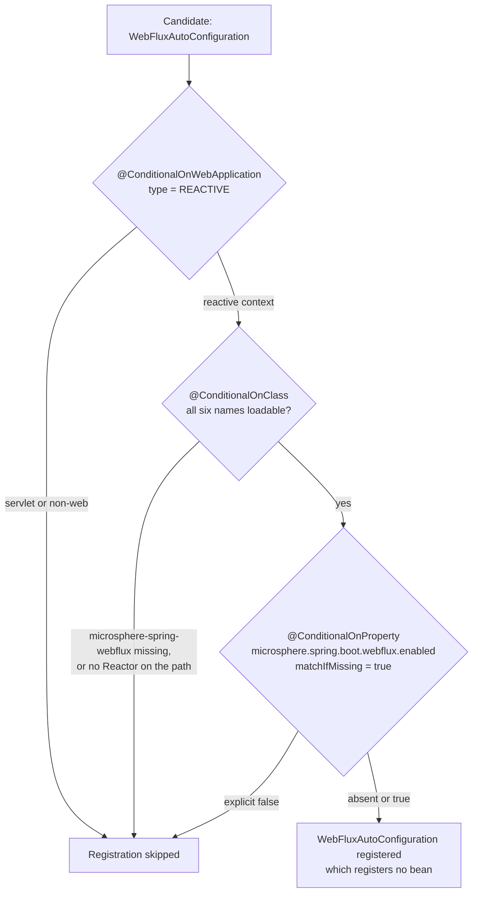
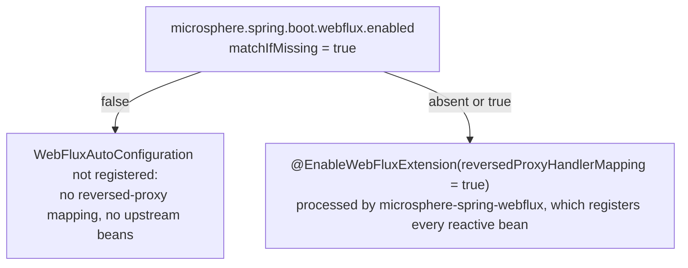

# WebFlux 模块

> [English](../webflux.md) · 文档索引：[中文](../../zh/README.md) ·
> 本模块用户文档：[中文](../../../user-guide/current/zh/webflux.md)

> **分支：** `release` · **版本线：** `0.2.x` · **Artifact：** `microsphere-spring-boot-webflux`
> **Spring Boot：** `3.0.13` – `4.1.1` · **Java：** 17

目录：
[1 模块定位](#1-模块定位) ·
[2 包结构](#2-包结构) ·
[3 可用性条件](#3-可用性条件) ·
[4 WebFluxAutoConfiguration 剖析](#4-webfluxautoconfiguration-剖析) ·
[5 与上游模块的边界](#5-与上游模块的边界) ·
[6 属性命名空间与开关](#6-属性命名空间与开关) ·
[7 设计模式](#7-设计模式) ·
[8 测试](#8-测试) ·
[9 实操配方](#9-实操配方) ·
[10 参考](#10-参考)

---

## 1. 模块定位

`microsphere-spring-boot-webflux` 是 `microsphere-spring-boot-webmvc` 的响应式对应物：形状相同，内容只有其五分之一。
三个源码文件——一个不含 `@Bean` 的自动配置类、一个组合条件、一个只有一个键的属性常量接口。它自己不注册任何 bean，
也不 `@Import` 任何东西；它打开的扩展完全活在 `microsphere-spring-webflux` 里。下文 `WebFluxAutoConfiguration.java`、
`ConditionalOnWebFluxAvailable.java`、`PropertyConstants.java` 指
`microsphere-spring-boot-webflux/src/main/java/io/microsphere/spring/boot/webflux/` 下的文件。



这些边取自 `microsphere-spring-boot-webflux/pom.xml`：parent（`pom.xml:5-10`）、`microsphere-spring-boot-core`
（`pom.xml:31-35`）、不带版本号的 `microsphere-spring-webflux`（`pom.xml:38-41`，由
`microsphere-spring-dependencies` BOM 以 `${microsphere-spring.version}` = `0.2.39` 管理，
`microsphere-spring-boot-parent/pom.xml:22`）、optional 的 `spring-boot-starter-webflux`（`pom.xml:44-48`）；与
webmvc 模块不同，这里没有 `jackson-databind` 测试依赖。发现机制只有一行，见
`src/main/resources/META-INF/spring/org.springframework.boot.autoconfigure.AutoConfiguration.imports:1`，内容是
`io.microsphere.spring.boot.webflux.autoconfigure.WebFluxAutoConfiguration`。

## 2. 包结构

| 包 | 类型 | 职责 |
|---|---|---|
| `io.microsphere.spring.boot.webflux.autoconfigure` | `WebFluxAutoConfiguration` | 承载排序与 `@EnableWebFluxExtension` 开关；类体为空（`WebFluxAutoConfiguration.java:32-39`）。 |
| `io.microsphere.spring.boot.webflux.autoconfigure.condition` | `ConditionalOnWebFluxAvailable`（注解） | Servlet 版门的响应式对应物：`REACTIVE` Web 类型、六个类名、一个属性（`ConditionalOnWebFluxAvailable.java:42-56`）。 |
| `io.microsphere.spring.boot.webflux.constants` | `PropertyConstants`（接口） | 恰好一个前缀、一个默认值、一个开关键（`PropertyConstants.java:31-52`）。 |

没有 `@ConfigurationProperties` 类、没有 `spring.factories`、没有默认属性资源；webmvc 模块正是在这副同一骨架上
多出了三个 bean 方法与一个嵌套日志块。

## 3. 可用性条件

`ConditionalOnWebFluxAvailable.java:42-55`，完整引用：

```java
@Target({TYPE, METHOD})
@Retention(RUNTIME)
@Documented
@ConditionalOnWebApplication(type = REACTIVE)
@ConditionalOnClass(name = {
        "reactor.core.publisher.Flux",                                         // Reactor API
        "org.springframework.context.ApplicationContext",                      // Spring Context API
        "org.springframework.web.method.HandlerMethod",                        // Spring Web API
        "org.springframework.web.reactive.DispatcherHandler",                  // Spring WebFlux API
        "io.microsphere.spring.web.method.support.HandlerMethodInterceptor",   // Microsphere Spring Web API
        "io.microsphere.spring.webflux.annotation.EnableWebFluxExtension"      // Microsphere Spring WebFlux API
})
@ConditionalOnProperty(name = MICROSPHERE_SPRING_BOOT_WEBFLUX_ENALBED_PROPERTY_NAME, matchIfMissing = true)
```

结构与 `ConditionalOnWebMvcAvailable` 完全一致——同样的三个元注解、同样的声明顺序、同样为将来方法级复用预留的
`@Target({TYPE, METHOD})`——实质性差异有这几处：

| 维度 | webmvc | webflux |
|---|---|---|
| Web 类型 | `type = SERVLET`（`ConditionalOnWebMvcAvailable.java:45`） | `type = REACTIVE`（`ConditionalOnWebFluxAvailable.java:45`） |
| 框架探测类 | `jakarta.servlet.Servlet`、`org.springframework.web.servlet.DispatcherServlet` | `reactor.core.publisher.Flux`、`org.springframework.web.reactive.DispatcherHandler` |
| Microsphere 入口 | `io.microsphere.spring.webmvc.annotation.EnableWebMvcExtension` | `io.microsphere.spring.webflux.annotation.EnableWebFluxExtension` |

`HandlerMethod` 与共用的 `io.microsphere.spring.web.method.support.HandlerMethodInterceptor` 同时出现在两份清单里：
拦截模型是两个栈共用的，位于 `microsphere-spring-web`。这里同样用名字代替类字面量，因此类型缺失时注解仍可解析
（`release-notes.md:488`）。还有一处从 Servlet 模块复制过来的过时 Javadoc：类注释写着 "the presence of Spring Web
MVC and a Servlet web application"（`ConditionalOnWebFluxAvailable.java:35`），而条件其实是 `REACTIVE`。



## 4. `WebFluxAutoConfiguration` 剖析

类的全部内容，逐字引用（`WebFluxAutoConfiguration.java:32-39`）：

```java
@ConditionalOnWebFluxAvailable
@AutoConfigureAfter(name = {
        "org.springframework.boot.autoconfigure.web.reactive.WebFluxAutoConfiguration", // Spring Boot API [2.0, 4.0)
        "org.springframework.boot.webflux.autoconfigure.WebFluxAutoConfiguration"       // Spring Boot APP [4.0,)
})
@EnableWebFluxExtension(reversedProxyHandlerMapping = true)
public class WebFluxAutoConfiguration {
}
```

| 元素 | 行号 | 说明 |
|---|---|---|
| `@ConditionalOnWebFluxAvailable` | `32` | 完整的门控，见第 3 节。 |
| `@AutoConfigureAfter(name = {...})` | `33-36` | 两个按名字声明的目标：`4.0` 之前 Boot 的响应式自动配置，以及 `4.0` 起迁移后的 `org.springframework.boot.webflux.autoconfigure` 包——手法与 `WebMvcAutoConfiguration.java:47-50` 一致，第二行行尾注释有拼写错误（`APP`）。 |
| `@EnableWebFluxExtension` | `37` | 只设了一个属性：`reversedProxyHandlerMapping = true`。Servlet 模块设了两个（额外还有 `registerHandlerInterceptors`，见 `WebMvcAutoConfiguration.java:51-54`）。 |
| bean 方法 | — | **没有。** 无 `@Bean`、无 `@Import`、无嵌套配置类。 |

最后一行才是两个模块真实的范围差异，而且它不该被读成缺陷：响应式栈没有需要注册的 Servlet filter（`WebFilter` bean
来自上游），没有对应的 `WebMvcConfigurer`，Servlet 模块所装配的那套日志 advice 在这里也没有响应式孪生体。Javadoc
头部同样是个复制残留：写的是 "MicroSphere Spring Boot WebMVC Auto-Configuration"
（`WebFluxAutoConfiguration.java:25`），而下面的 `@see`（`:28-29`）指向的是响应式 Boot 类。

## 5. 与上游模块的边界

本模块的贡献只有三个元决策——条件、顺序，以及传给上游注解的一个布尔值；`webmvc.md` 第 5 节的策略层覆盖四个注册点，
这里的策略层只有一个：

| 关注点 | 位于上游 | 位于本模块 |
|---|---|---|
| 反向代理 handler mapping | `microsphere-spring-webflux`（`io.microsphere.spring.webflux.handler.ReversedProxyHandlerMapping`） | `reversedProxyHandlerMapping = true` 属性（`:37`） |
| handler interceptor 拦截模型 | `microsphere-spring-web`（`io.microsphere.spring.web.method.support.HandlerMethodInterceptor`） | 条件里的一个类名（`:51`） |
| 端点元数据解析器、被拦截的 handler-method processor、发布请求处理事件的 `WebFilter`、暂存请求体/响应体的 interceptor | `microsphere-spring-webflux`（`...metadata`、`...method`、`...server.filter`） | 什么都没有——它们随 `@EnableWebFluxExtension` 到来，由第 8 节的测试证明 |
| “响应式栈当前可用吗？” | — | `ConditionalOnWebFluxAvailable` |
| 跨 `3.x` / `4.x` 的 Boot 排序 | — | `@AutoConfigureAfter(name = {...})` |
| 属性键、默认值、`@ConfigurationProperty` 元数据 | — | `PropertyConstants` |

## 6. 属性命名空间与开关

`PropertyConstants.java:31-52` 只声明了三个常量：

| 常量 | 行号 | 解析出的键 | 默认值 | 被谁读取 |
|---|---|---|---|---|
| `MICROSPHERE_SPRING_BOOT_WEBFLUX_PROPERTY_NAME_PREFIX` | `36` | `microsphere.spring.boot.webflux.` | — | 命名空间根 |
| `DEFAULT_MICROSPHERE_SPRING_BOOT_WEBFLUX_ENABLED` | `41` | — | `true` | 被下面的注解引用 |
| `MICROSPHERE_SPRING_BOOT_WEBFLUX_ENALBED_PROPERTY_NAME` | `46-51` | `microsphere.spring.boot.webflux.enabled` | `true` | `ConditionalOnWebFluxAvailable.java:54` |

前缀由 `MICROSPHERE_SPRING_BOOT_PROPERTY_NAME_PREFIX`（`"microsphere.spring.boot."`，
`microsphere-spring-boot-core/src/main/java/io/microsphere/spring/boot/constants/PropertyConstants.java:33-35`）
加 `"webflux."` 组合而成，再以 `ENABLED_PROPERTY_NAME` 收尾；`@ConfigurationProperty` 块（`:46-50`）携带
`type = boolean.class`、`defaultValue = DEFAULT_...`、`source = APPLICATION_SOURCE`。



两处结构差异加一个缺口：没有功能级开关（`webmvc` 给 filter、日志、内容协商各自留了键，因此响应式要加功能开关就得
新增常量并新增 `@ConditionalOnProperty`）；没有跨命名空间的键；并且字面量未经测试验证——本模块没有
`PropertyConstantsTest`。

## 7. 设计模式

| 模式 | 位置 | 证据 |
|---|---|---|
| 通过元注解做组合 | `ConditionalOnWebFluxAvailable` | 三个 Boot 条件折叠进一个注解（`:45-54`），只在一处使用（`WebFluxAutoConfiguration.java:32`）。 |
| 门面式自动配置 | `WebFluxAutoConfiguration` | 一个空类，注解就是全部公开面（`:32-39`）。 |
| 注解即配置 | `@EnableWebFluxExtension` | Boot 侧排序加一个布尔值，bean 图由上游注册器构建；这里不存在任何 `@Bean` 方法（`:37`、`:38-39`）。 |
| 常量放在接口里 | `PropertyConstants` | 由 `String` 常量组成的 `public interface PropertyConstants`，通过 `import static` 消费（`ConditionalOnWebFluxAvailable.java:28`）。 |
| 元数据即注解 | `@ConfigurationProperty` | `type = boolean.class`、`defaultValue`、`source = APPLICATION_SOURCE`（`PropertyConstants.java:46-50`），由 optional 的 `microsphere-annotation-processor` 处理（`pom.xml:24-28`）。 |
| 以名字排序换取跨版本能力 | `@AutoConfigureAfter(name = {...})` | Boot 响应式自动配置被迁移后的两个全限定名（`:33-36`）。 |

`webmvc` 的两个模式在此缺席，原因很直白：opt-in bean（根本没有 bean）与条件化分组（没有 `@Import` 可分组）。

## 8. 测试

四个测试源码，位于
`microsphere-spring-boot-webflux/src/test/java/io/microsphere/spring/boot/webflux/autoconfigure/`。

| 测试 | 钉住什么 |
|---|---|
| `AbstractWebFluxAutoConfigurationTest.java` | 基类是真的 `abstract`（`:57`），这点与 webmvc 的夹具不同。`@Disabled`（`:51`）、`@WebAppConfiguration`（`:52`）、`@SpringJUnitConfig(classes = {TestController.class, RouterFunctionTestConfig.class})`（`:53-56`）。`init()` 用 `bindToApplicationContext(context)` 构建 `WebTestClient`（`:67-70`、`:182-185`）。可执行的 `@Test void test()` 由它持有（`:72-80`）：先跑六个端点校验，再对抽象方法 `getRegisteredComponentClasses()`（`:82`）返回的每个类断言 `isBeanPresent(context, componentClass)`（静态导入 `io.microsphere.spring.beans.BeanUtils.isBeanPresent`，`:36`）。端点校验包括：带 `Accept-Language` 的 helloworld（`:106-114`）、greeting、以 `Mono` 为请求体的 JSON `User` POST（`:133-148`）、期望 5xx 的 `/test/error?message=hello`（`:153-158`）、`PUT /test/response-entity`、`PUT /test/person/{id}`（`:163-180`）。 |
| `WebFluxAutoConfigurationTest.java` | 默认值。只有 `@SpringBootTest` + `@EnableAutoConfiguration`（`:36-39`），期望集合是四个上游类：`HandlerMappingWebEndpointMappingResolver`、`InterceptingHandlerMethodProcessor`、`RequestHandledEventPublishingWebFilter`、`ReversedProxyHandlerMapping`（`:43-50`）——也就是在什么都没额外打开时，`@EnableWebFluxExtension(reversedProxyHandlerMapping = true)` 实际注册的东西。 |
| `WebFluxAutoConfigurationAllDisabledTest.java` | 总开关关闭：`microsphere.spring.boot.webflux.enabled=false`（`:39-43`），`getRegisteredComponentClasses()` 返回 `ofSet()`（`:48-50`）。端点仍必须可用，所以它真正证明的是“响应式应用在没有扩展时照样服务”——注意遍历空集并不断言任何东西不存在。 |
| `WebFluxAutoConfigurationAllEnabledTest.java` | 在四个之上再加两个上游组件：`StoringRequestBodyArgumentInterceptor` 与 `StoringResponseBodyReturnValueInterceptor`（`:55-64`）。它们通过 `@TestPropertySource` 的两个键请求：`microsphere.spring.@EnableWebFluxExtension.storeRequestBodyArgument=true` 与 `...storeResponseBodyReturnValue=true`（`:45-50`）。 |

最后一行需要谨慎：这两个键把注解的简单名嵌进了键里，且与本仓库任何常量都对不上——`PropertyConstants` 只声明了
`microsphere.spring.boot.webflux.enabled`；`release-notes.md:204`（"Fixed test property keys for
`EnableWebFluxExtension`"，`0.2.20`）说明它们被改过一次、可能仍是错的。请以上游 artifact 的实际行为为准来验证响应式
默认值，并补上缺失的 `PropertyConstantsTest`。

## 9. 实操配方

**新增一个响应式 bean。** 本模块今天不注册任何 bean，所以借用 Servlet 模块的形状：用新键加
`@ConditionalOnProperty` 守卫的 `@Bean` 方法（`WebMvcAutoConfiguration.java:60-64`），或者当多个 bean 需要同开同关时，
一个带单个属性条件并 `@Import` 的嵌套 `static class`（`:78-85`）。随后扩展
`WebFluxAutoConfigurationTest` 与 `...AllEnabledTest` 的期望集合，在 `...AllDisabledTest` 里关掉新键，并显式断言“不
存在”——空的 `ofSet()` 什么也证明不了。

**新增一个开关。** 加入 `DEFAULT_MICROSPHERE_SPRING_BOOT_WEBFLUX_&lt;FEATURE&gt;_ENABLED` 与组合出来的键（模板见
`PropertyConstants.java:41` 与 `:46-51`），并把 `ConditionalOnWebFluxAvailable.java:54` 的总键保留为唯一的整模块
kill switch，最后用新增的 `constants/PropertyConstantsTest` 钉住字面量。

**为某条 Boot 版本线适配被挪走的类。** 把迁移后的全限定名以字符串追加进 `@AutoConfigureAfter(name = {...})`
（`WebFluxAutoConfiguration.java:33-36`）并保留旧条目及其版本区间注释；顺手修掉这两个文件里的过时 Javadoc（
`WebFluxAutoConfiguration.java:25`、`ConditionalOnWebFluxAvailable.java:35`）。两条边界都要验证：
`mvn -P spring-boot-3.0 -pl microsphere-spring-boot-webflux test` 与把 profile 换成 `-P spring-boot-4.1` 的同一条命令
（profile 定义见 `microsphere-spring-boot-parent/pom.xml:76-135`，默认激活 `spring-boot-3.5`，见 `:113-115`）。

## 10. 参考

| 文档 | 范围 |
|---|---|
| [README.md](./README.md) | 本分支开发者文档索引：reactor 形态、扩展点清单。 |
| [core.md](./core.md) | 本模块声明的 compile 依赖。 |
| [webmvc.md](./webmvc.md) | Servlet 兄弟模块：条件形状相同，但有四个注册点而这里是零个。 |
| [compatible.md](./compatible.md) | 被迁移的 `org.springframework.boot.*` 垫片，以及本模块为何改用按名字排序。 |
| [本模块用户文档](../../../user-guide/current/zh/webflux.md) | 从使用者视角看到的属性表与行为。 |
