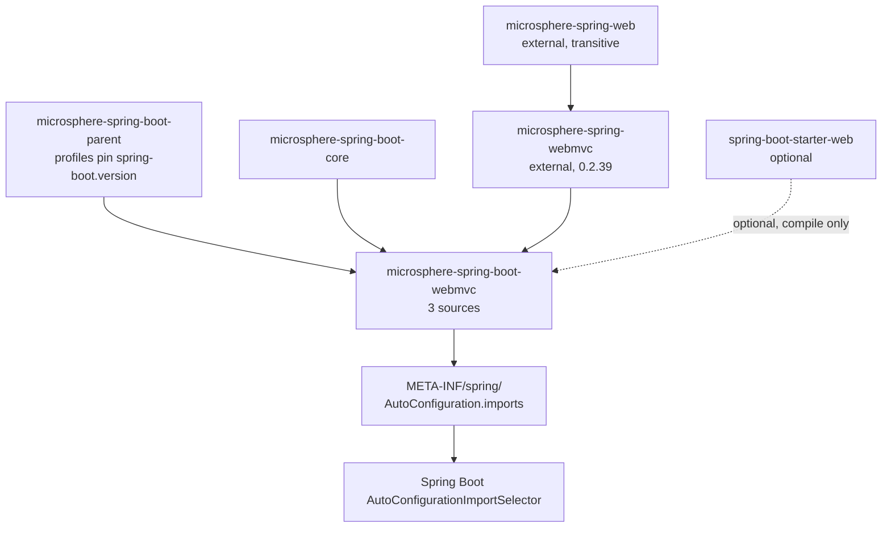
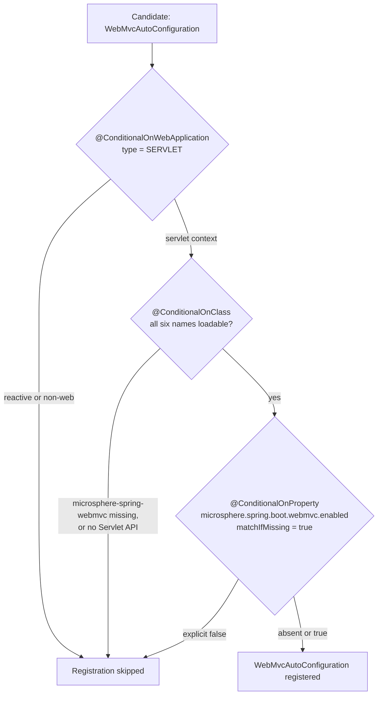
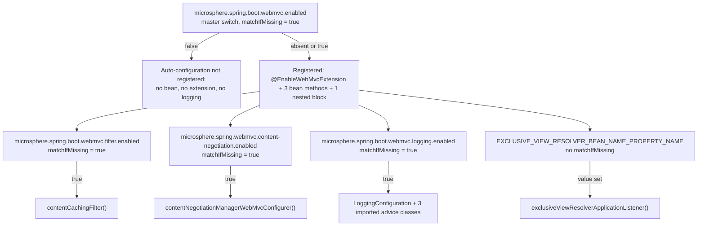

# WebMvc 模块

> [English](../webmvc.md) · 文档索引：[中文](../../zh/README.md) ·
> 本模块用户文档：[中文](../../../user-guide/current/zh/webmvc.md)

> **分支：** `release` · **版本线：** `0.2.x` · **Artifact：** `microsphere-spring-boot-webmvc`
> **Spring Boot：** `3.0.13` – `4.1.1` · **Java：** 17

目录：
[1 模块定位](#1-模块定位) ·
[2 包结构](#2-包结构) ·
[3 可用性条件](#3-可用性条件) ·
[4 WebMvcAutoConfiguration 剖析](#4-webmvcautoconfiguration-剖析) ·
[5 与上游模块的边界](#5-与上游模块的边界) ·
[6 属性命名空间与开关](#6-属性命名空间与开关) ·
[7 设计模式](#7-设计模式) ·
[8 测试](#8-测试) ·
[9 实操配方](#9-实操配方) ·
[10 参考](#10-参考)

---

## 1. 模块定位

`microsphere-spring-boot-webmvc` 是 Servlet 栈的装配模块：只有三个源码文件——一个自动配置类、一个组合条件注解、
一个属性常量接口。它激活的所有行为都由独立的 `microsphere-spring-webmvc` 与 `microsphere-spring-web` artifact
实现；本模块提供的是 Spring Boot 风格的注册与条件。下文 `WebMvcAutoConfiguration.java`、
`ConditionalOnWebMvcAvailable.java`、`PropertyConstants.java` 指
`microsphere-spring-boot-webmvc/src/main/java/io/microsphere/spring/boot/webmvc/` 下的文件。



这些边取自 `microsphere-spring-boot-webmvc/pom.xml`：parent 声明（`pom.xml:5-10`）、作为 compile 依赖的
`microsphere-spring-boot-core`（`pom.xml:31-35`）、不写版本号的 `microsphere-spring-webmvc`——其版本由
`microsphere-spring-dependencies` BOM 以 `${microsphere-spring.version}` = `0.2.39` 管理
（`microsphere-spring-boot-parent/pom.xml:22`，BOM 导入见 `:57-63`），以及标记为
`<optional>true</optional>` 的 `spring-boot-starter-web`（`pom.xml:44-48`）。optional 正是关键：响应式应用即便
传递依赖到这个 jar 也必须能正常启动，这就是第 3 节保证的事。发现机制只有一行，见
`src/main/resources/META-INF/spring/org.springframework.boot.autoconfigure.AutoConfiguration.imports:1`，内容是
`io.microsphere.spring.boot.webmvc.autoconfigure.WebMvcAutoConfiguration`。

## 2. 包结构

| 包 | 类型 | 职责 |
|---|---|---|
| `io.microsphere.spring.boot.webmvc.autoconfigure` | `WebMvcAutoConfiguration` | 唯一的注册面：`@EnableWebMvcExtension`、`@Import`、三个 `@Bean` 方法、一个嵌套条件块（`WebMvcAutoConfiguration.java:46-86`）。 |
| `io.microsphere.spring.boot.webmvc.autoconfigure.condition` | `ConditionalOnWebMvcAvailable`（注解） | 把“是否为 Servlet 应用、Microsphere Web MVC 栈是否存在、模块是否开启”收敛成一个可复用注解（`ConditionalOnWebMvcAvailable.java:42-56`）。 |
| `io.microsphere.spring.boot.webmvc.constants` | `PropertyConstants`（接口） | 声明属性键及其默认值，并为各开关键附上 `@ConfigurationProperty` 元数据（`PropertyConstants.java:33-116`）。 |

本模块没有 `@ConfigurationProperties` 类、没有 `spring.factories`、没有默认属性资源，也没有
`AutoConfigurationImportFilter`——上表三个类型就是全部面积。

## 3. 可用性条件

`ConditionalOnWebMvcAvailable.java:42-55`，完整引用：

```java
@Target({TYPE, METHOD})
@Retention(RUNTIME)
@Documented
@ConditionalOnWebApplication(type = SERVLET)
@ConditionalOnClass(name = {
        "jakarta.servlet.Servlet",                                             // Servlet API
        "org.springframework.context.ApplicationContext",                      // Spring Context API
        "org.springframework.web.method.HandlerMethod",                        // Spring Web API
        "org.springframework.web.servlet.DispatcherServlet",                   // Spring Web MVC API
        "io.microsphere.spring.web.method.support.HandlerMethodInterceptor",   // Microsphere Spring Web API
        "io.microsphere.spring.webmvc.annotation.EnableWebMvcExtension"        // Microsphere Spring Web MVC API
})
@ConditionalOnProperty(name = MICROSPHERE_SPRING_BOOT_WEBMVC_ENALBED_PROPERTY_NAME, matchIfMissing = true)
```

每个元注解各自堵死一种失败模式：

| 元注解 | 行号 | 拦截什么 |
|---|---|---|
| `@Target({TYPE, METHOD})`、`@Retention(RUNTIME)`、`@Documented` | `42-44` | 什么都不拦；只是允许方法级复用、保留运行时反射可见性与 Javadoc 可见性。 |
| `@ConditionalOnWebApplication(type = SERVLET)` | `45` | 非 Web 上下文与响应式上下文。WebFlux 应用永远不会注册这个自动配置，因此两个 Web 模块可以共存于同一 classpath。 |
| `@ConditionalOnClass(name = {...})` | `46-53` | 没有 `jakarta.servlet.Servlet` 的容器；以及最具决定性的——未引入 `microsphere-spring-webmvc` / `microsphere-spring-web` 的应用，因为列表后两项是 Microsphere 类型。 |
| `@ConditionalOnProperty(name = ..., matchIfMissing = true)` | `54` | 显式的 `microsphere.spring.boot.webmvc.enabled=false`。键缺失即为开启。 |

类清单写成 `name = {...}` 字符串而不是 `value = {Servlet.class, ...}`，于是所列举的类型缺失时注解仍可解析，也不会
混进编译期依赖；`release-notes.md:488` 记录了 `0.2.31` 改用字符串类名这件事。Boot 自身的包位置迁移采用同样的
按名字写法，但位置在 `@AutoConfigureAfter`（见第 4 节）。Boot 把这三个 `@Conditional` 元注解当作合取式按声明顺序
求值，遇到第一个不匹配即停止——报告里点名的就是那一项。



## 4. `WebMvcAutoConfiguration` 剖析

类级注解，逐字引用（`WebMvcAutoConfiguration.java:46-57`）：

```java
@ConditionalOnWebMvcAvailable
@AutoConfigureAfter(name = {
        "org.springframework.boot.autoconfigure.web.servlet.WebMvcAutoConfiguration", // Spring Boot API [2.0, 4.0)
        "org.springframework.boot.webmvc.autoconfigure.WebMvcAutoConfiguration"       // Spring Boot API [4.0,)
})
@EnableWebMvcExtension(
        registerHandlerInterceptors = true,
        reversedProxyHandlerMapping = true
)
@Import(value = {
        WebMvcAutoConfiguration.LoggingConfiguration.class
})
public class WebMvcAutoConfiguration {
```

`@AutoConfigureAfter` 清单就是跨版本机制。Boot 在 `4.0` 版本线把自己 Web MVC 自动配置从
`org.springframework.boot.autoconfigure.web.servlet` 挪到了 `org.springframework.boot.webmvc.autoconfigure`；
两个全限定名都以字符串声明，并且同时出现在 `WebMvcAutoConfiguration.java:42-43` 的 Javadoc `@see` 里。classpath
上不存在的那个名字会被顺序计算器直接忽略，所以同一份源码在 `3.0.13` 与 `4.1.1` 下都能正确排序。`compatible`
模块里根本没有 `WebMvcAutoConfiguration` 垫片，因此按名字排序是这里唯一的机制，参见
`docs/developer-guide/current/compatible.md`。

`@EnableWebMvcExtension` 属于上游（`io.microsphere.spring.webmvc.annotation.EnableWebMvcExtension`，在
`WebMvcAutoConfiguration.java:22` 导入），本模块只设置了它的两个属性：`registerHandlerInterceptors = true` 与
`reversedProxyHandlerMapping = true`（`:51-54`）。随后 `:55-57` 的 `@Import` 显式拉入嵌套日志块，而不是依赖嵌套类
的自动处理。

Bean 方法与嵌套块：

| Bean / 成员 | 行号 | 返回类型 | 条件 | 默认 | 作用 |
|---|---|---|---|---|---|
| `contentCachingFilter()` | `60-64` | `io.microsphere.spring.web.servlet.filter.ContentCachingFilter` | `@ConditionalOnProperty(name = MICROSPHERE_SPRING_BOOT_WEBMVC_FILTER_ENALBED_PROPERTY_NAME, matchIfMissing = true)` | 开 | 把上游的缓存 Servlet filter 注册成 bean，之后由 Boot 的 `FilterRegistrationBean` 机制部署。 |
| `contentNegotiationManagerWebMvcConfigurer()` | `66-70` | `ConfigurableContentNegotiationManagerWebMvcConfigurer` | `@ConditionalOnProperty(name = MICROSPHERE_SPRING_WEBMVC_CONTENT_NEGOTIATION_ENABLED_PROPERTY_NAME, matchIfMissing = true)` | 开 | 贡献上游那个重塑 `ContentNegotiationManager` 的 `WebMvcConfigurer`；all-enabled 测试证明它会追加按参数协商的策略。 |
| `exclusiveViewResolverApplicationListener()` | `72-76` | `ExclusiveViewResolverApplicationListener` | `@ConditionalOnProperty(name = EXCLUSIVE_VIEW_RESOLVER_BEAN_NAME_PROPERTY_NAME)`——**没有** `matchIfMissing` | 关，需显式开启 | 一旦其引用的属性（声明在上游，不在本仓库）有任意值，就注册上游的 `ApplicationListener`。 |
| `LoggingConfiguration`（嵌套 `static class`） | `78-85` | 配置块 | `@ConditionalOnProperty(name = MICROSPHERE_SPRING_BOOT_WEBMVC_LOGGING_ENALBED_PROPERTY_NAME, matchIfMissing = true)` | 开 | `@Import` 三个类：`LoggingMethodHandlerInterceptor`、`LoggingPageRenderContextHandlerInterceptor`、`LoggingHandlerMethodArgumentResolverAdvice`（`79-83`）。 |

默认关闭的只有 `exclusiveViewResolverApplicationListener()`；其余三个开关都带 `matchIfMissing = true`，因此仅添加
依赖就会同时打开 filter、内容协商与日志。

## 5. 与上游模块的边界

凡位于 `io.microsphere.spring.web.*` 与 `io.microsphere.spring.webmvc.*` 之下的实现都属于另一个 artifact
（`microsphere-spring-boot-webmvc/pom.xml:38-41`）。boot 模块是一层*策略层*——何时注册、以何顺序、受哪个键约束——
其下是可以被普通 Spring 直接使用的框架无关实现层：

| 关注点 | 位于上游 | 位于本模块 |
|---|---|---|
| 请求/响应体缓存 filter 类 | `microsphere-spring-web`（`io.microsphere.spring.web.servlet.filter.ContentCachingFilter`） | bean 方法 + 开关（`WebMvcAutoConfiguration.java:60-64`） |
| handler interceptor 注册、反向代理 handler mapping | `microsphere-spring-webmvc`（`@EnableWebMvcExtension`、`WebMvcExtensionConfiguration`） | 两个置为 `true` 的属性（`:51-54`） |
| 内容协商策略组装 | `microsphere-spring-webmvc`（`ConfigurableContentNegotiationManagerWebMvcConfigurer`） | bean 方法 + 开关（`:66-70`） |
| 把视图解析限制到单个 bean | `microsphere-spring-webmvc`（`ExclusiveViewResolverApplicationListener`，含其属性常量） | opt-in 的 bean 方法（`:72-76`） |
| interceptor、页面渲染上下文、参数解析器的日志 advice | `microsphere-spring-webmvc`（`...interceptor` 与 `...method.support` 下三个类） | 嵌套条件块（`:78-85`） |
| “这套栈当前可用吗？” | — | `ConditionalOnWebMvcAvailable`（`:42-55`） |
| 跨 `3.x` / `4.x` 的 Boot 排序 | — | `@AutoConfigureAfter(name = {...})`（`:47-50`） |
| 属性键字面量、默认值、`@ConfigurationProperty` 元数据 | — | `PropertyConstants`（`:33-116`） |
| 被 `AutoConfigurationImportSelector` 发现 | — | `AutoConfiguration.imports` 资源 |

## 6. 属性命名空间与开关

`PropertyConstants` 是一个由 `String` 常量组成的 `interface`（`PropertyConstants.java:33`）。前缀一律组合而非复制，
并且每个开关都追加 `ENABLED_PROPERTY_NAME`：`MICROSPHERE_SPRING_BOOT_PROPERTY_NAME_PREFIX`
（`"microsphere.spring.boot."`，`microsphere-spring-boot-core/src/main/java/io/microsphere/spring/boot/constants/PropertyConstants.java:33-35`）
加上第 `38` 行的 `"webmvc."`。

| 常量 | 行号 | 解析出的键 | 声明的默认值 | 被谁读取 |
|---|---|---|---|---|
| `MICROSPHERE_SPRING_BOOT_WEBMVC_PROPERTY_NAME_PREFIX` | `38` | `microsphere.spring.boot.webmvc.` | — | 命名空间根 |
| `MICROSPHERE_SPRING_BOOT_WEBMVC_ENALBED_PROPERTY_NAME` | `63-68` | `microsphere.spring.boot.webmvc.enabled` | `true`（`:43`） | `ConditionalOnWebMvcAvailable.java:54` |
| `FILTER_PROPERTY_NAME_PREFIX` | `73` | `microsphere.spring.boot.webmvc.filter.` | — | 子命名空间 |
| `MICROSPHERE_SPRING_BOOT_WEBMVC_FILTER_ENABLED_PROPERTY_NAME` | `78-83` | `microsphere.spring.boot.webmvc.filter.enabled` | `true`（`:48`） | `WebMvcAutoConfiguration.java:60` |
| `LOGGING_PROPERTY_NAME_PREFIX` | `105` | `microsphere.spring.boot.webmvc.logging.` | — | 子命名空间 |
| `MICROSPHERE_SPRING_BOOT_WEBMVC_LOGGING_ENALBED_PROPERTY_NAME` | `110-115` | `microsphere.spring.boot.webmvc.logging.enabled` | `true`（`:53`） | `WebMvcAutoConfiguration.java:78` |
| `CONTENT_NEGOTIATION_PROPERTY_NAME_PREFIX` | `90` | `microsphere.spring.webmvc.content-negotiation.` | — | 子命名空间，*非 boot* |
| `MICROSPHERE_SPRING_WEBMVC_CONTENT_NEGOTIATION_ENABLED_PROPERTY_NAME` | `95-100` | `microsphere.spring.webmvc.content-negotiation.enabled` | `true`（`:58`） | `WebMvcAutoConfiguration.java:66` |
| `EXCLUSIVE_VIEW_RESOLVER_BEAN_NAME_PROPERTY_NAME` | 上游 | 字面量未在本仓库声明；all-enabled 测试设置的是 `microsphere.spring.webmvc.view-resolver.exclusive-bean-name`（`...AllEnabledTest.java:53`） | — | `WebMvcAutoConfiguration.java:72` |

这些字面量不是猜测：`src/test/java/io/microsphere/spring/boot/webmvc/constants/PropertyConstantsTest.java:45-55`
逐条断言了它们。`microsphere.spring.webmvc.` 这一上级前缀来自上游的
`MICROSPHERE_SPRING_WEBMVC_PROPERTY_NAME_PREFIX`（`PropertyConstants.java:25`，在 `:90` 使用）。

维护者必须记住三点：

1. 层级是一个总开关统辖三个功能开关，而不是四个互不相关的键；view-resolver 是唯一的 opt-in 键。
2. 内容协商刻意落在**非 boot** 命名空间，因为同一个键在普通 Spring 应用里也驱动上游的 configurer；
   `PropertyConstants.java:88` 的 `@see` 指明其来源是
   `ConfigurableContentNegotiationManagerWebMvcConfigurer#PROPERTY_NAME_PREFIX`。
3. 源码拼写并不对称：以 `..._ENALBED_PROPERTY_NAME` 结尾的常量（一个贯穿代码的拼写错误）与名为
   `DEFAULT_..._ENABLED` 的默认值配对。任意一边改名都会破坏 API。



## 7. 设计模式

| 模式 | 位置 | 证据 |
|---|---|---|
| 通过元注解做组合 | `ConditionalOnWebMvcAvailable` | 三个 Boot 条件被折叠进一个注解（`ConditionalOnWebMvcAvailable.java:45-54`），并在 `WebMvcAutoConfiguration.java:46` 复用；`@Target` 允许方法级复用（`:42`）。 |
| 门面式自动配置 | `WebMvcAutoConfiguration` | 一个类、一行 imports 记录，整个 Servlet 扩展对 Boot 可见；类本身不含逻辑（`:58-86`）。 |
| opt-in bean | `exclusiveViewResolverApplicationListener()` | 唯一不带 `matchIfMissing` 的 `@ConditionalOnProperty`（`:72`），键缺失即 bean 缺失——由 `WebMvcAutoConfigurationTest.java:68` 的 `assertNull` 钉住。 |
| 条件化的分组 | `LoggingConfiguration` | 嵌套 `static class` 承载一个属性条件外加三个上游类的 `@Import`（`:78-85`），再由 `:55-57` 导入。 |
| 常量放在接口里 | `PropertyConstants` | 由 `String` 常量组成的 `public interface PropertyConstants`，通过 `import static` 消费（`WebMvcAutoConfiguration.java:33-36`、`ConditionalOnWebMvcAvailable.java:28`）。 |
| 元数据即注解 | 每个开关上的 `@ConfigurationProperty` | `type = boolean.class`、`defaultValue = DEFAULT_...`、`source = APPLICATION_SOURCE`（`PropertyConstants.java:63-67`、`78-82`、`95-99`、`110-114`），由 `pom.xml:24-28` 声明为 optional 的 `microsphere-annotation-processor` 处理。 |
| 以名字排序换取跨版本能力 | `@AutoConfigureAfter(name = {...})` | 同一个 Boot 类在两种包布局下的两个全限定名，各自用行尾注释标明覆盖的版本区间（`:47-50`）。 |

## 8. 测试

五个测试源码，位于 `microsphere-spring-boot-webmvc/src/test/java/io/microsphere/spring/boot/webmvc/`。

| 测试 | 钉住什么 |
|---|---|
| `autoconfigure/AbstractWebMvcAutoConfigurationTest.java` | 是夹具不是测试。`@Disabled`（`:50`）、`@WebAppConfiguration`（`:51`）、`@SpringJUnitConfig(classes = {TestController.class, RouterFunctionTestConfig.class})`（`:52-55`）；`setUp()` 从 `ConfigurableWebApplicationContext` 构建 `MockMvc`（`:66-69`），并暴露 `testWebEndpoints()`（`:81-88`），其中包含六个 `protected` 端点校验——helloworld、greeting 路径变量、经 `POST /test/user` 的 JSON `User` 往返、被包装为 `ServletException` 的 `/test/error`（`:137-140`）、`PUT /test/response-entity`、`PUT /test/person/{id}`。它自己不声明任何 `@Test` 方法，因此单独不构成断言。 |
| `autoconfigure/WebMvcAutoConfigurationTest.java` | **默认值**。没有 `@TestPropertySource`，只有 `@SpringBootTest` + `@EnableAutoConfiguration`（`:40-43`）。把 `WebMvcExtensionConfiguration`、`ContentCachingFilter`、`ConfigurableContentNegotiationManagerWebMvcConfigurer`、`WebMvcAutoConfiguration.LoggingConfiguration` 作为必需注入（`:46-56`），listener 用 `required = false`（`:58-59`）；`test()` 先跑端点，再断言前四个非空、listener 为空（`:61-69`）。默认构建因此证明了“默认为开”的策略。 |
| `autoconfigure/WebMvcAutoConfigurationAllDisabledTest.java` | **关**矩阵。`@TestPropertySource` 设置 `microsphere.spring.webmvc.content-negotiation.enabled=false`、`microsphere.spring.webmvc.filter.enabled=false`、`microsphere.spring.webmvc.logging.enabled=false`（`:51-57`）。真正生效的断言只有 `assertContentNegotiationManager`：策略恰好一个且类型为 `HeaderContentNegotiationStrategy`（`:91-97`），也就是上游 configurer 关掉之后 Boot 原生的 manager——这个键确实对应本模块的条件（`PropertyConstants.java:95-100`）。 |
| `autoconfigure/WebMvcAutoConfigurationAllEnabledTest.java` | **开**矩阵。设置 view-resolver 键，外加内容协商的 `enabled/favorParameter/parameterName=p/favorPathExtension/ignoreUnknownPathExtensions/useRegisteredExtensionsOnly/ignoreAcceptHeader`、`filter.enabled=true`、`logging.enabled=true`（`:51-64`）。六个协作者全部是必需注入（`:68-84`），少一个 bean 上下文就失败；随后 `assertContentNegotiationManager` 要求策略列表非空，并找到参数名为 `p` 的 `ParameterContentNegotiationStrategy`（`:98-107`）。 |
| `constants/PropertyConstantsTest.java` | 每个键字面量与默认值，`:45-55`。改名或换父前缀会最先在这里失败。 |

关于 disabled 测试的两个如实说明，扩展它之前值得先知道：

* 它设置的是 `microsphere.spring.webmvc.filter.enabled` 与 `microsphere.spring.webmvc.logging.enabled`
  （`:54-55`），而条件读取的是 `microsphere.spring.boot.webmvc.filter.enabled` 与
  `...boot.webmvc.logging.enabled`（`PropertyConstants.java:83`、`:115`）——这两行并没有关掉本模块的 bean。
* 它为 filter、`LoggingConfiguration`（`:64-74`）与 listener（`:76-77`）准备的
  `@Autowired(required = false)` 字段从未被断言，所以现有测试并不能证明这些 bean 会消失；能证明的只有内容协商。

修的时候请改用 `...boot.webmvc...` 键并补上显式的 `assertNull`；另外这些测试自建了继承体系，并没有复用
`microsphere-spring-boot-test` 的 `AbstractAutoConfigurationTest`（`pom.xml:77-83`）。

## 9. 实操配方

**新增一个 Servlet 栈 bean。**

1. 在 `PropertyConstants` 中组合出子命名空间前缀及其开关，再加一个 `DEFAULT_...` 常量，并复制
   `@ConfigurationProperty(type = boolean.class, defaultValue = ..., source = APPLICATION_SOURCE)` 块
   （模板见 `PropertyConstants.java:78-83`）。
2. 在 `WebMvcAutoConfiguration` 增加 `@Bean` 方法，并加上
   `@ConditionalOnProperty(name = &lt;your constant&gt;, matchIfMissing = true)`，除非该 bean 是 opt-in；照抄
   `WebMvcAutoConfiguration.java:60-64`。
3. 若若干 bean 必须一起开关，把它们放进带单个属性条件的嵌套 `static class`，再用 `@Import` 引入，形如 `:78-85`
   加上 `:55-57`。
4. 钉住它：把键字面量加进 `PropertyConstantsTest.testConstants()`，把 bean 加进
   `WebMvcAutoConfigurationTest` 与 `...AllEnabledTest` 的必需注入，并在 `...AllDisabledTest` 里用 **boot** 键关掉它。
   `AutoConfiguration.imports` 不用动——类名不变时那一行始终正确。

**只加开关、不加 bean。** 采用 `LoggingConfiguration` 的形状：一个属性、一个嵌套类、一个 `@Import` 列表。总开关
（`ConditionalOnWebMvcAvailable.java:54`）仍是唯一的 kill switch：嵌套的 `enabled` 键绝不能在总开关为 `false` 之后
重新启用任何东西。

**为某条 Boot 版本线适配被挪走的类。** 把新的全限定名以字符串追加进 `@AutoConfigureAfter(name = {...})` 列表并保留
旧名，遵循行尾版本区间注释的约定（`WebMvcAutoConfiguration.java:47-50`）。如果本模块*在代码里引用*的类发生了迁移，
它要么需要 `compatible` 垫片（`docs/developer-guide/current/compatible.md`），要么把该引用降级为
`@ConditionalOnClass` 里的名字（`ConditionalOnWebMvcAvailable.java:46-53`）。两条边界都要验证：
`mvn -P spring-boot-3.0 -pl microsphere-spring-boot-webmvc test` 与把 profile 换成 `-P spring-boot-4.1` 的同一条命令
（profile 定义见 `microsphere-spring-boot-parent/pom.xml:76-135`，默认激活的是 `spring-boot-3.5`，见 `:113-115`）。

## 10. 参考

| 文档 | 范围 |
|---|---|
| [README.md](./README.md) | 本分支开发者文档索引：reactor 形态、扩展点清单。 |
| [core.md](./core.md) | 本模块声明的 compile 依赖：监听器、初始化器、绑定 advisor、诊断。 |
| [webflux.md](./webflux.md) | 响应式兄弟模块——条件形状相同，面积小得多，且一个 bean 都不注册。 |
| [compatible.md](./compatible.md) | 被迁移的 `org.springframework.boot.*` 类型在哪里打垫片，以及为什么这两个 Web 模块不靠它。 |
| [本模块用户文档](../../../user-guide/current/zh/webmvc.md) | 从使用者视角看到的属性表与行为。 |
