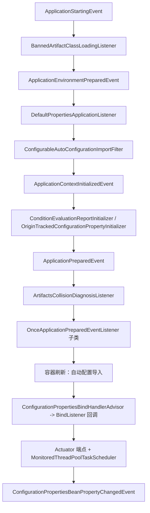
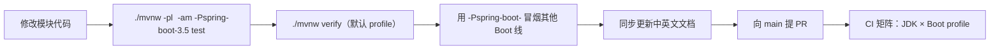

# 开发者文档

> [English](../README.md) · [文档首页（中文）](../../zh/README.md) · [用户文档（中文）](../../user-guide/zh/README.md)

`microsphere-spring-boot` 的实现文档：每个 Maven 模块的代码如何组织、它挂载到 Spring Boot 的哪些扩展点、用了哪些设计
模式、多版本构建与发布流水线如何运作，以及安全修改它们的具体步骤。

如果你只是使用这些库，请阅读[用户文档](../../user-guide/zh/README.md)。

---

## 1. 本套文档覆盖的范围

| 主题 | 位置 |
|---|---|
| 仓库形态、扩展点清单、启动时序、贡献检查清单 | [`current/README.md`](../current/zh/README.md) |
| 模块内部：包结构、逐类说明、设计模式、流程图、测试、维护配方 | `current/zh/<模块>.md` 与 `1.x/zh/<模块>.md` |
| Maven 构建机制：`${revision}` 扁平化、profile 选择 Boot 版本、发布 | [`parent.md`](../current/zh/parent.md)、[`dependencies.md`](../current/zh/dependencies.md) |
| CI 矩阵、发布流水线、分支模型、如何发版 | [`build-and-release.md`](../current/zh/build-and-release.md) |
| Spring Boot 2 线的差异 | [`1.x/README.md`](../1.x/zh/README.md) 及其模块文档 |

---

## 2. 架构速览

这些库不新增 Spring Boot 的生命周期，而是接入 Boot 已有的扩展点。`release`（0.2.x）分支接入的扩展点如下：

| 扩展点 | 模块 | 实现类 |
|---|---|---|
| `AutoConfigurationImportFilter` | `core` | `ConfigurableAutoConfigurationImportFilter` |
| `SpringApplicationRunListener` | `core` | `BannedArtifactClassLoadingListener`、`FailureReportSpringApplicationRunListener` |
| `ApplicationListener` | `core` | `DefaultPropertiesApplicationListener`、`ArtifactsCollisionDiagnosisListener`、`ConditionEvaluationReportListener` |
| `ApplicationContextInitializer` | `core` | `ConditionEvaluationReportInitializer`、`OriginTrackedConfigurationPropertyInitializer` |
| `FailureAnalyzer` / `SpringBootExceptionReporter` | `core` | `ArtifactsCollisionFailureAnalyzer`、`ConditionEvaluationSpringBootExceptionReporter` |
| `ConfigurationPropertiesBindHandlerAdvisor` | `core` | `ListenableConfigurationPropertiesBindHandlerAdvisor` |
| `EnableAutoConfiguration` 注册 | `core`、`actuator`、`webmvc`、`webflux` | 各自的 `*AutoConfiguration` 类 |
| `@Endpoint` / `@WebEndpoint` | `actuator` | `ArtifactsEndpoint`、`WebEndpoints`、`ConfigurationMetadataEndpoint`、`ConfigurationPropertiesEndpoint` |

---

## 3. 文档清单

每个分支目录下，每个 Maven 模块一份文档，另有一个分支总览（`current` 还额外有构建与发布文档）。英文在主路径，中文镜像
在 `zh/`。

| 文档 | 内容 |
|---|---|
| [`README.md`](../current/zh/README.md) | 仓库形态、模块依赖图、装配关系表、启动时序、贡献检查清单 |
| [`core.md`](../current/zh/core.md) | 包结构、监听器顺序与 `spring.factories` 装配、绑定 advisor 链、诊断流水线、设计模式 |
| [`actuator.md`](../current/zh/actuator.md) | 端点模型、聚合操作、调度器指标装配、`endpoints.properties` 默认策略 |
| [`webmvc.md`](../current/zh/webmvc.md) | Servlet 栈 Bean、条件注解、过滤器/拦截器链、与上游库的职责边界 |
| [`webflux.md`](../current/zh/webflux.md) | 响应式栈自动配置及其条件 |
| [`test.md`](../current/zh/test.md) | 测试基类层次、泛型 runner 约束、继承而来的断言 |
| [`compatible.md`](../current/zh/compatible.md) | 同全限定名的 shim、为何不发布、由 profile 挂载 |
| [`parent.md`](../current/zh/parent.md) | 继承链、`${revision}`、Boot profile 表 |
| [`dependencies.md`](../current/zh/dependencies.md) | BOM 内容，以及新增模块需要做什么 |
| [`build-and-release.md`](../current/zh/build-and-release.md) | 本地构建、CI 逐个解析、发布流水线、分支模型 |

Spring Boot 2 线的同一套文档位于 [`1.x/`](../1.x/zh/README.md)，值得关注的差异是：`spring.factories` 与
`AutoConfiguration.imports` 双份注册、`javax.servlet` 命名空间、Java 8 基线，以及由 Boot `2.1`–`2.3` 挂载的更大的
`compatible` shim 集合。

---

## 4. 构建与改动流程

发版分别从 `release`（`0.2.x`）与 `release-1.x`（`0.1.x`）通过发布工作流完成，详见
[`build-and-release.md`](../current/zh/build-and-release.md)。

---

## 5. 本套文档的约定

| 约定 | 说明 |
|---|---|
| 语言 | 英文在主路径，中文在 `zh/` 同名镜像，章节编号一一对应 |
| 证据 | 类名、方法签名、顺序常量、属性键、版本号都取自分支源码，结论旁标注文件路径 |
| 图示 | 对不易理解的路径使用 Mermaid `flowchart`、`sequenceDiagram`、`classDiagram`；图中每个节点都是该分支真实存在的类 |
| 分支范围 | 只记录 `release` 与 `release-1.x`；`main`、`dev`、`dev-1.x` 属开发分支 |
| 链接 | 只用同文件锚点；跨文件链接不携带 `#` 片段 |
