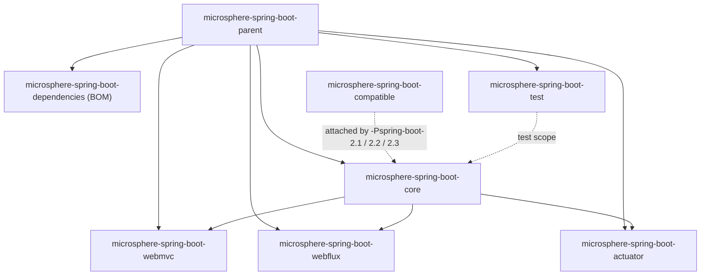

# Branch `release-1.x` (0.1.x) Documentation Overview

> [中文](./zh/README.md) · [Documentation index](../README.md)

> **Branch:** `release-1.x` · **Version line:** `0.1.x` · **Spring Boot:** `2.1.18.RELEASE` – `2.7.18`
>
> Docs for Spring Boot 3/4 are in [../current/README.md](../current/README.md).

---

## 1. Version information

| Item | Value |
|---|---|
| Group ID | `io.github.microsphere-projects` |
| Latest published release | `0.1.34` (Maven Central) |
| Branch in development | `0.1.35-SNAPSHOT` (the `<revision>` property of the root `pom.xml`) |
| Java baseline | No `java.version` and no `maven.compiler.*` configuration anywhere in this branch's POMs — the language level is inherited from the build parent POM `microsphere-build:0.3.14`; CI validates JDK `8 / 11 / 17 / 21 / 25`, so **Java 8 is the practical floor** |
| Build parent | `microsphere-build:0.3.14` |
| Key managed versions | `microsphere-spring:0.1.39` (BOM), `jolokia:1.7.2`, `junit-bom:5.14.4` |
| Milestone repository | **none** (removed from the parent POM since `0.1.11`) |
| License | Apache License 2.0 |

> **Documented discrepancy.** The branch's own `README.md` claims "Java 17+", yet no POM sets a language level and CI
> builds from JDK 8. Code and CI are authoritative: **Java 8 works for Spring Boot 2.x**.

---

## 2. Spring Boot compatibility

The table below comes from `microsphere-spring-boot-parent/pom.xml`. The CI matrix is JDK `8 / 11 / 17 / 21 / 25` ×
these 7 profiles = 35 jobs.

| Profile | Spring Boot | Status |
|---|---|---|
| `-Pspring-boot-2.1` | `2.1.18.RELEASE` | Supported with extra version pins, see [compatible.md](./compatible.md) |
| `-Pspring-boot-2.2` | `2.2.13.RELEASE` | Supported |
| `-Pspring-boot-2.3` | `2.3.12.RELEASE` | Supported |
| `-Pspring-boot-2.4` | `2.4.13` | Supported |
| `-Pspring-boot-2.5` | `2.5.15` | Supported |
| `-Pspring-boot-2.6` | `2.6.15` | Supported |
| `-Pspring-boot-2.7` | `2.7.18` | **Default** (`activeByDefault`) |

Two naming details: profiles **2.1–2.3 carry the `.RELEASE` suffix**, which Spring Boot dropped from 2.4 onwards.

The `SpringBootVersion` enum on this branch models `SPRING_BOOT_2_0` … `SPRING_BOOT_2_7_18`, plus the runtime-detected
`CURRENT` constant; constants such as `SPRING_BOOT_3_*` therefore **do not exist** on `0.1.x`. See
[core.md](./core.md).

---

## 3. Differences from the 0.2.x line

| Aspect | `release-1.x` (0.1.x) | `release` (0.2.x) |
|---|---|---|
| Spring Boot | 2.1 – 2.7 | 3.0 – 4.1 |
| Java | No explicit setting; CI builds from JDK 8 | `17` (root POM) |
| Auto-configuration registration | **both**: `META-INF/spring.factories` (`EnableAutoConfiguration`) **and** `AutoConfiguration.imports` | `AutoConfiguration.imports` only (`core` still keeps a `spring.factories` for non-auto-configuration extension points) |
| Servlet API | `javax.servlet` | `jakarta.servlet` |
| `SpringBootVersion` range | `2.0` – `2.7.18` | `3.0` – `4.1.0` |
| `compatible` shim | 12 classes (incl. `EndpointId`, `@ConstructorBinding`, actuate endpoint conditions and the exposure filter), attached by profiles **2.1/2.2/2.3** | 9 classes (bootstrap and configuration-property classes), attached by profiles **4.0/4.1** |
| Jolokia | `1.7.2` | `2.6.3` |
| JUnit | `5.14.4` | `6.1.3` |
| Upstream Microsphere Spring | `0.1.39` | `0.2.39` |
| `webmvc` ordering declarations | Single class name plus the comment "Spring Boot API [2.0, 4.0)" | Two class names (the Boot 3 and Boot 4 package locations) |

---

## 4. Module inventory

Every module has one user document (English here, Chinese under `zh/`) and one developer document under
`../../developer-guide/1.x/`.

| Module | Artifact ID | In BOM | Published | User Guide | Developer Guide |
|---|---|---|---|---|---|
| Root aggregator | `microsphere-spring-boot` | — | no | [parent.md](./parent.md) | [parent.md](../../developer-guide/1.x/parent.md) |
| Parent POM | `microsphere-spring-boot-parent` | no | yes | [parent.md](./parent.md) · [ZH](./zh/parent.md) | [parent.md](../../developer-guide/1.x/parent.md) |
| BOM | `microsphere-spring-boot-dependencies` | — | yes | [dependencies.md](./dependencies.md) · [ZH](./zh/dependencies.md) | [dependencies.md](../../developer-guide/1.x/dependencies.md) |
| Core | `microsphere-spring-boot-core` | yes | yes | [core.md](./core.md) · [ZH](./zh/core.md) | [core.md](../../developer-guide/1.x/core.md) |
| Actuator | `microsphere-spring-boot-actuator` | yes | yes | [actuator.md](./actuator.md) · [ZH](./zh/actuator.md) | [actuator.md](../../developer-guide/1.x/actuator.md) |
| Web MVC | `microsphere-spring-boot-webmvc` | yes | yes | [webmvc.md](./webmvc.md) · [ZH](./zh/webmvc.md) | [webmvc.md](../../developer-guide/1.x/webmvc.md) |
| WebFlux | `microsphere-spring-boot-webflux` | yes | yes | [webflux.md](./webflux.md) · [ZH](./zh/webflux.md) | [webflux.md](../../developer-guide/1.x/webflux.md) |
| Test | `microsphere-spring-boot-test` | yes | yes | [test.md](./test.md) · [ZH](./zh/test.md) | [test.md](../../developer-guide/1.x/test.md) |
| Compatible | `microsphere-spring-boot-compatible` | **no** | **no** (deploy skip + `skipPublishing`) | [compatible.md](./compatible.md) · [ZH](./zh/compatible.md) | [compatible.md](../../developer-guide/1.x/compatible.md) |



`actuator`, `webmvc` and `webflux` depend on `core`; `core` additionally depends on `compatible` under profiles
2.1/2.2/2.3.

---

## 5. Installation

### 5.1 Import the BOM

```xml

<properties>
    <microsphere-spring-boot.version>0.1.34</microsphere-spring-boot.version>
</properties>

<dependencyManagement>
    <dependencies>
        <dependency>
            <groupId>io.github.microsphere-projects</groupId>
            <artifactId>microsphere-spring-boot-dependencies</artifactId>
            <version>${microsphere-spring-boot.version}</version>
            <type>pom</type>
            <scope>import</scope>
        </dependency>
    </dependencies>
</dependencyManagement>
```

The BOM manages exactly five artifacts: `core`, `webmvc`, `webflux`, `actuator` and `test`; `compatible` and `parent`
are not managed.

### 5.2 Add modules

```xml

<dependencies>
    <dependency>
        <groupId>io.github.microsphere-projects</groupId>
        <artifactId>microsphere-spring-boot-core</artifactId>
    </dependency>

    <dependency>
        <groupId>io.github.microsphere-projects</groupId>
        <artifactId>microsphere-spring-boot-actuator</artifactId>
    </dependency>

    <!-- Servlet stack; use microsphere-spring-boot-webflux for reactive -->
    <dependency>
        <groupId>io.github.microsphere-projects</groupId>
        <artifactId>microsphere-spring-boot-webmvc</artifactId>
    </dependency>

    <dependency>
        <groupId>io.github.microsphere-projects</groupId>
        <artifactId>microsphere-spring-boot-test</artifactId>
        <scope>test</scope>
    </dependency>
</dependencies>
```

> **Do not mix the lines.** Putting `0.2.x` on a Boot 2.x classpath (or `0.1.x` on Boot 3+) fails on
> `javax`/`jakarta`, the registration format and relocated APIs.

### 5.3 Verify

```java
import io.microsphere.spring.boot.SpringBootVersion;
import org.springframework.boot.SpringApplication;
import org.springframework.boot.autoconfigure.SpringBootApplication;

@SpringBootApplication
public class MyApplication {

    public static void main(String[] args) {
        // On Boot 2.7.18 this prints "Spring Boot 2.7.18"
        System.out.println("Spring Boot: " + SpringBootVersion.CURRENT.getVersion());
        SpringApplication.run(MyApplication.class, args);
    }
}
```

Adding `core` immediately makes `server.shutdown` `graceful` — that comes from the module's own default-properties file,
see [core.md](./core.md).

---

## 6. Building from source

```bash
git clone https://github.com/microsphere-projects/microsphere-spring-boot.git
cd microsphere-spring-boot
git checkout release-1.x          # the branch these docs describe

./mvnw verify                     # default profile: Spring Boot 2.7.18
./mvnw verify -Pspring-boot-2.1   # attaches shims and extra pins
./mvnw verify -Pspring-boot-2.4   # another minor line
./mvnw install -DskipTests
```

The command shape CI uses, so you can reproduce it locally:

```bash
./mvnw -Drevision=0.0.1-SNAPSHOT -Dsurefire.useSystemClassLoader=false test \
       --activate-profiles test,coverage,spring-boot-2.7
```

> `-Dsurefire.useSystemClassLoader=false` is not decoration: the diagnostics listeners need a non-system class loader to
> filter and detect missing classes.

---

## 7. Cross-module FAQ

| Question | Answer |
|---|---|
| Does Boot 2.7 need `AutoConfiguration.imports`? | This branch ships both `spring.factories` and the `imports` file, so older Boot 2.x still auto-configures: Boot 2.7 recognizes both, Boot 2.4–2.6 recognize `spring.factories`. |
| Can I use `0.1.x` with Boot 3? | No. Use the `0.2.x` line, see [../current/README.md](../current/README.md). |
| Does it work on a Java 8 application? | Yes, JDK 8 is in the CI matrix. Note that this branch sets no `java.version` — the language level comes from `microsphere-build`. |
| The `jolokia` endpoint behaves differently | This line uses `jolokia-core:1.7.2` (Boot 2-era coordinates and properties), see [actuator.md](./actuator.md). |
| `microsphere-spring-boot-compatible` is missing | By design: unpublished, not in the BOM, attached only when building `core` under profiles 2.1/2.2/2.3, see [compatible.md](./compatible.md). |
