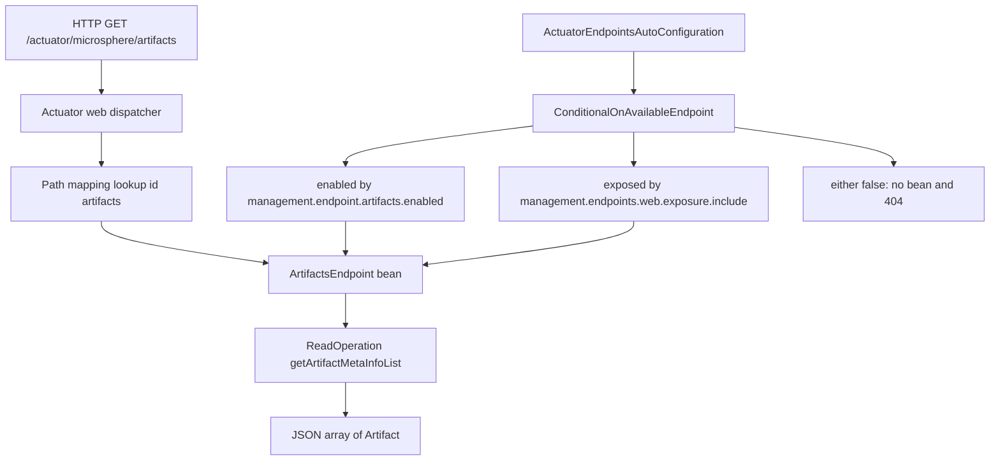

# Actuator Module

> [中文](./zh/actuator.md) · [Documentation index](../README.md)

> **Branch:** `release-1.x` · **Version line:** `0.1.x` · **Artifact:** `microsphere-spring-boot-actuator`
> **Spring Boot:** `2.1.18.RELEASE` – `2.7.18` · **Java:** 8+

Contents:
[1 Module Overview](#1-module-overview) ·
[2 Version Information](#2-version-information) ·
[3 Installation](#3-installation) ·
[4 Custom Endpoints](#4-custom-endpoints) ·
[5 Default Properties](#5-default-properties) ·
[6 Exposure and Enablement Rules](#6-exposure-and-enablement-rules) ·
[7 Task Scheduler Properties](#7-task-scheduler-properties) ·
[8 JMX and Jolokia](#8-jmx-and-jolokia) ·
[9 Usage Examples](#9-usage-examples) ·
[10 Property Reference](#10-property-reference) ·
[11 Version Compatibility](#11-version-compatibility) ·
[12 Troubleshooting](#12-troubleshooting) ·
[13 See Also](#13-see-also)

---

## 1. Module Overview

The actuator module adds four custom endpoints to Spring Boot 2.x's `/actuator` surface - classpath artifacts, an
aggregated read-only view of every web endpoint, configuration metadata, and a catalog of all known configuration
properties - and ships a large `META-INF/config/default/endpoints.properties` file that flips the whole actuator
allow-list to a deliberate, low-noise default (`enabled-by-default = false`, web exposure `*`, JMX exposure excluded)
plus a per-endpoint cache time-to-live.

Everything in the module is *opt-out friendly*: the defaults are published into `defaultProperties`, Spring Boot's
lowest-precedence source, so any value you set in `application.properties` wins.

Base package: `io.microsphere.spring.boot.actuate`

```
io.microsphere.spring.boot.actuate                          MonitoredThreadPoolTaskScheduler
io.microsphere.spring.boot.actuate.autoconfigure            ActuatorAutoConfiguration
                                                            ActuatorEndpointsAutoConfiguration
io.microsphere.spring.boot.actuate.condition                ConditionalOnActuatorEndpointPresent
                                                            ConditionalOnConfigurationProcessorPresent
io.microsphere.spring.boot.actuate.constants                PropertyConstants
io.microsphere.spring.boot.actuate.endpoint                 ArtifactsEndpoint
                                                            WebEndpoints
                                                            ConfigurationMetadataEndpoint
                                                            ConfigurationPropertiesEndpoint
```

Auto-configuration is registered twice, as on the rest of this branch: `META-INF/spring.factories` under
`EnableAutoConfiguration` and in `META-INF/spring/org.springframework.boot.autoconfigure.AutoConfiguration.imports`,
both listing `ActuatorAutoConfiguration` and `ActuatorEndpointsAutoConfiguration`.

The module's hard dependencies are `microsphere-spring-boot-core` (compile) and `microsphere-spring-boot-test`
(test scope only); `spring-boot-starter-actuator`, `spring-boot-starter-web` and `spring-boot-starter-webflux` are all
`<optional>`, so this artifact never forces a web stack on you.

---

## 2. Version Information

| Item | Value |
|---|---|
| Artifact | `io.github.microsphere-projects:microsphere-spring-boot-actuator` |
| Latest published | `0.1.34` |
| Branch in development | `0.1.35-SNAPSHOT` |
| Spring Boot profiles pinned | `2.1.18.RELEASE / 2.2.13.RELEASE / 2.3.12.RELEASE / 2.4.13 / 2.5.15 / 2.6.15 / 2.7.18 (default)` |
| Java | 8 baseline; CI validates JDK `8 / 11 / 17 / 21 / 25` |
| Compile dependency | `microsphere-spring-boot-core` (`${revision}`) |
| Test dependency | `microsphere-spring-boot-test` (`${revision}`, test scope) |
| Non-optional third party | `org.jolokia:jolokia-core`, version managed by the parent property `1.7.2` |
| Profile `spring-boot-2.1` extra pins | `io.micrometer:micrometer-core:1.3.20`, `org.springframework:spring-core:5.2.25.RELEASE` (both optional) |
| Endpoints since | `1.0.0` (all four endpoint classes and both auto-configurations) |

---

## 3. Installation

Import the BOM once, then declare the artifact without a version:

```xml
<dependencyManagement>
    <dependencies>
        <dependency>
            <groupId>io.github.microsphere-projects</groupId>
            <artifactId>microsphere-spring-boot-dependencies</artifactId>
            <version>0.1.34</version>
            <type>pom</type>
            <scope>import</scope>
        </dependency>
    </dependencies>
</dependencyManagement>

<dependencies>
    <dependency>
        <groupId>io.github.microsphere-projects</groupId>
        <artifactId>microsphere-spring-boot-actuator</artifactId>
    </dependency>

    <!-- you still bring the actuator yourself: it is optional here -->
    <dependency>
        <groupId>org.springframework.boot</groupId>
        <artifactId>spring-boot-starter-actuator</artifactId>
    </dependency>
</dependencies>
```

> **The actuator starter is not transitive.** Because `spring-boot-starter-actuator` is declared `<optional>` in this
> module's POM, forgetting it means no `Endpoint` annotation on the classpath, and
> `@ConditionalOnActuatorEndpointPresent` (`@ConditionalOnClass(name = "org.springframework.boot.actuate.endpoint.annotation.Endpoint")`)
> silently switches the whole endpoint auto-configuration off. No error, no 404 hint - just absent endpoints.

---

## 4. Custom Endpoints

The `@Endpoint` / `@WebEndpoint` id, the path mapping and the enablement key are all taken from the sources and
`endpoints.properties`. HTTP paths assume Spring Boot's own default base path `/actuator` (adjustable with Boot's
`management.endpoints.web.base-path`, which this module does not set).

| Endpoint bean | Annotation id | HTTP path (mapped) | Returns | Created when |
|---|---|---|---|---|
| `ArtifactsEndpoint` | `artifacts` (`@Endpoint`) | `/actuator/microsphere/artifacts` | `List<Artifact>` detected from the classpath, `artifactDetector.detect(false)` | bean method annotated `@ConditionalOnMissingBean` + `@ConditionalOnAvailableEndpoint`; enabled by `management.endpoint.artifacts.enabled = true` |
| `WebEndpoints` | `webEndpoints` (`@WebEndpoint`) | `/actuator/microsphere/web/endpoints` | `Map<String, Object>`: read-operation id to result, for every discovered web endpoint | also needs `@ConditionalOnWebApplication`; enabled by `management.endpoint.webEndpoints.enabled = true` |
| `ConfigurationMetadataEndpoint` | `configMetadata` (`@Endpoint`) | `/actuator/microsphere/config/metadata` | descriptor with `groups` and `properties` (`Collection<ItemMetadata>`) | nested `ConfigurationProcessorConfiguration`, i.e. only when the configuration processor is on the classpath |
| `ConfigurationPropertiesEndpoint` | `configProperties` (`@Endpoint`) | `/actuator/microsphere/config/properties` | descriptor whose `getConfigurationProperties()` lists every known `ConfigurationProperty` | same nesting as `configMetadata` |

How the beans are assembled (`ActuatorEndpointsAutoConfiguration`):

```java
@Bean
@ConditionalOnMissingBean
@ConditionalOnAvailableEndpoint
public ArtifactsEndpoint artifactsEndpoint() {
    return new ArtifactsEndpoint(classLoader);   // BeanClassLoaderAware
}

@Bean
@ConditionalOnMissingBean
@ConditionalOnWebApplication
@ConditionalOnAvailableEndpoint
public WebEndpoints webEndpoints(WebEndpointsSupplier webEndpointsSupplier) {
    return new WebEndpoints(webEndpointsSupplier);
}
```

and, inside the `@ConditionalOnConfigurationProcessorPresent` static configuration class
(`@ConditionalOnClass(name = "org.springframework.boot.configurationprocessor.metadata.ConfigurationMetadata")`):

```java
@Bean
@ConditionalOnMissingBean
@ConditionalOnAvailableEndpoint
public ConfigurationMetadataEndpoint configurationMetadataEndpoint(
        ConfigurationMetadataRepository configurationMetadataRepository) {
    return new ConfigurationMetadataEndpoint(configurationMetadataRepository);
}

@Bean
@ConditionalOnMissingBean
@ConditionalOnAvailableEndpoint
public ConfigurationPropertiesEndpoint configurationPropertiesEndpoint(
        ConfigurationMetadataRepository configurationMetadataRepository) {
    return new ConfigurationPropertiesEndpoint(configurationMetadataRepository);
}
```

What the payloads contain:

- **`artifacts`** - every detectable artifact on the classpath (name and version metadata), the quickest way to answer
  "which jars did this instance actually load".
- **`webEndpoints`** - a single round-trip that invokes *every parameterless `@ReadOperation`* of every discovered web
  endpoint and returns them keyed by operation id. The endpoint excludes itself, skips non-`DiscoveredEndpoint`
  implementations and skips anything that is not a `READ` operation with zero parameters, so it never triggers
  write/delete operations and never needs request arguments.
- **`configMetadata`** - the raw `spring-boot-configuration-processor` metadata (`META-INF/spring-configuration-metadata.json`
  groups and properties) as read by `ConfigurationMetadataRepository`.
- **`configProperties`** - a normalized catalog: properties contributed through the
  `io.microsphere.metadata.ConfigurationPropertyLoader` service loader (registered under
  `META-INF/services/`) merged with the processor metadata adapted into `ConfigurationProperty` objects, each carrying
  type, description, default value, declared class and declared field, and the `APPLICATION` source tag.

> **`configMetadata` and `configProperties` need the processor.** Both live in the nested
> `ConfigurationProcessorConfiguration`, gated on `org.springframework.boot.configurationprocessor.metadata.ConfigurationMetadata`
> being loadable at runtime. Add `spring-boot-configuration-processor` as an annotation processor and keep its generated
> metadata; without that class on the classpath those two endpoints are simply not registered, and
> `management.endpoint.configMetadata.enabled=true` will not change that.

---

## 5. Default Properties

`META-INF/config/default/endpoints.properties` is loaded by `DefaultPropertiesApplicationListener` from the
`core` module (see [core.md](./core.md)) and published as `defaultProperties`.

Enablement block - only these built-in endpoints are enabled by default:

```properties
management.endpoints.enabled-by-default = false

management.endpoints.web.exposure.include = *
management.endpoints.jmx.exposure.exclude = *

management.endpoint.env.enabled = true
management.endpoint.health.enabled = true
management.endpoint.info.enabled = true
management.endpoint.loggers.enabled = true
management.endpoint.metrics.enabled = true
management.endpoint.mappings.enabled = true
management.endpoint.jolokia.enabled = true
management.endpoint.prometheus.enabled = true
```

`auditevents`, `beans`, `caches`, `conditions`, `configprops`, `flyway`, `httptrace`, `integrationgraph`, `liquibase`,
`scheduledtasks`, `sessions`, `shutdown`, `threaddump`, `heapdump` and `logfile` are all explicitly set to `false` in
the same file.

Cache time-to-live block - five reusable TTL constants plus one `time-to-live` per endpoint:

```properties
microsphere.cache.no-time-to-live = 0s
microsphere.cache.short-time-to-live = 15s
microsphere.cache.middle-time-to-live = 1m
microsphere.cache.long-time-to-live = 1h
microsphere.cache.long-long-time-to-live = 1d

management.endpoint.health.cache.time-to-live = ${microsphere.cache.no-time-to-live}
management.endpoint.scheduledtasks.cache.time-to-live = ${microsphere.cache.short-time-to-live}
management.endpoint.env.cache.time-to-live = ${microsphere.cache.middle-time-to-live}
management.endpoint.info.cache.time-to-live = ${microsphere.cache.long-time-to-live}
management.endpoint.beans.cache.time-to-live = ${microsphere.cache.long-long-time-to-live}
```

(The file assigns a TTL for every endpoint listed above; the four Microsphere endpoints get `long-long` for
`artifacts`, `configMetadata` and `configProperties`, and `short` for `webEndpoints`.)

Health block:

```properties
management.health.defaults.enabled = true
management.endpoint.health.show-details = always
management.endpoint.health.show-components = always
```

Microsphere endpoints block - id, enablement, path mapping and cache in three lines each:

```properties
management.endpoint.artifacts.enabled = true
management.endpoints.web.path-mapping.artifacts = microsphere/artifacts
management.endpoint.artifacts.cache.time-to-live = ${microsphere.cache.long-long-time-to-live}

management.endpoint.webEndpoints.enabled = true
management.endpoints.web.path-mapping.webEndpoints = microsphere/web/endpoints
management.endpoint.webEndpoints.cache.time-to-live = ${microsphere.cache.short-time-to-live}

management.endpoint.configMetadata.enabled = true
management.endpoints.web.path-mapping.configMetadata = microsphere/config/metadata
management.endpoint.configMetadata.cache.time-to-live = ${microsphere.cache.long-long-time-to-live}

management.endpoint.configProperties.enabled = true
management.endpoints.web.path-mapping.configProperties = microsphere/config/properties
management.endpoint.configProperties.cache.time-to-live = ${microsphere.cache.long-long-time-to-live}
```

> **`show-details = always` is a security decision, not a convenience one.** Health details and components are exposed
> to anyone who can reach `/actuator/health` - including datasource and mail indicators. Override it in your own
> configuration for anything internet-facing; since the module value lives in `defaultProperties`, your setting always
> wins.

---

## 6. Exposure and Enablement Rules

An endpoint bean in this module is created only when **both** conditions hold, which is exactly what
`@ConditionalOnAvailableEndpoint` on the four `@Bean` methods checks (`ActuatorEndpointsAutoConfiguration` lines 61,
80, 146, 165):

- **enabled** - `management.endpoint.<id>.enabled`, falling back to `management.endpoints.enabled-by-default`
  (which this module sets to `false`), falling back to the annotation's `enableByDefault`.
- **exposed** - the endpoint id passes `management.endpoints.web.exposure.include` / `.exclude` for HTTP, and
  `management.endpoints.jmx.exposure.include` / `.exclude` for JMX.



Concretely, with this module on the classpath:

1. Everything is web-exposed (`include = *`) and nothing is JMX-exposed (`jmx.exposure.exclude = *`).
2. Only endpoints explicitly set to `true` - the eight built-ins above plus the four Microsphere ones - actually get
   their beans created; the rest stay disabled even though they are exposed.
3. `WebEndpoints` additionally requires a servlet or reactive web application, and
   `ConfigurationMetadataEndpoint` / `ConfigurationPropertiesEndpoint` additionally require the configuration-processor
   metadata classes.

> **Boot 2.1 shim caveat.** `@ConditionalOnAvailableEndpoint` was introduced by Spring Boot in `2.2.0`. Builds under the
> `spring-boot-2.1` profile resolve that annotation to the copy shipped by `microsphere-spring-boot-compatible`
> (`org.springframework.boot.actuate.autoconfigure.endpoint.condition.ConditionalOnAvailableEndpoint` plus
> `OnAvailableEndpointCondition`), a module attached only for the older Boot profiles `2.1`-`2.3`. The `compatible`
> dependency is not declared by this module's own POM; it reaches the classpath through `microsphere-spring-boot-core`.
> See [compatible.md](./compatible.md) for which shim applies on which Boot version.

---

## 7. Task Scheduler Properties

`ActuatorAutoConfiguration` (registered with `@AutoConfigureOrder(LOWEST_PRECEDENCE)`) contributes one
`ThreadPoolTaskScheduler` for actuator-internal async work:

| Property | Constant evidence | Default | Effect |
|---|---|---|---|
| `microsphere.spring.boot.actuator.task-scheduler.pool-size` | `ActuatorAutoConfiguration.TASK_SCHEDULER_POOL_SIZE_PROPERTY_NAME`, prefix from `PropertyConstants.TASK_SCHEDULER_PROPERTY_NAME_PREFIX` | `1` | core pool size passed to `setPoolSize` |
| `microsphere.spring.boot.actuator.task-scheduler.thread-name-prefix` | `TASK_SCHEDULER_THREAD_NAME_PREFIX_PROPERTY_NAME` | `microsphere-spring-boot-actuator-task-` | thread name prefix |

Both are annotated with `@ConfigurationProperty(defaultValue = ..., source = APPLICATION_SOURCE)` so they appear in the
`configProperties` endpoint output with their documented defaults. The bean name constant is
`ACTUATOR_TASK_SCHEDULER_SERVICE_BEAN_NAME = "actuatorTaskScheduler"`, created with `destroyMethod = "shutdown"`,
as a daemon pool, and its type is `MonitoredThreadPoolTaskScheduler`.

> **It needs Micrometer.** The bean method carries `@ConditionalOnBean(type = "io.micrometer.core.instrument.MeterRegistry")`
> (`METER_REGISTRY_CLASS_NAME`), so without a `MeterRegistry` - i.e. without the metrics auto-configurations - there is
> no `actuatorTaskScheduler` bean at all. Setting `microsphere.spring.boot.actuator.task-scheduler.pool-size` then has
> no observable effect.

```java
@Autowired
@Qualifier(ActuatorAutoConfiguration.ACTUATOR_TASK_SCHEDULER_SERVICE_BEAN_NAME)
private ThreadPoolTaskScheduler actuatorTaskScheduler;
```

---

## 8. JMX and Jolokia

`jolokia-core` is a **compile-scope, non-optional** dependency of this module, with the version managed by the parent
property (`1.7.2`), so the Jolokia endpoint is always present once the actuator is. It is enabled by default here:

```properties
management.endpoint.jolokia.enabled = true
management.endpoint.jolokia.cache.time-to-live = ${microsphere.cache.middle-time-to-live}
```

Two practical consequences:

- HTTP access goes to `/actuator/jolokia` (the id is Spring Boot's own `jolokia`, not remapped by this module).
- **JMX transport is off by default**: `management.endpoints.jmx.exposure.exclude = *`. To publish endpoints over MBeans
  you must override that key, e.g.:

```properties
management.endpoints.jmx.exposure.exclude =
management.endpoints.jmx.exposure.include = health,info,artifacts
```

> Emptying an exclude list is a `defaultProperties` override, so write it as an explicit empty value in your own
> configuration file; leaving it unset keeps every endpoint out of JMX.

---

## 9. Usage Examples

Adapted from the five test classes of this module (`ActuatorAutoConfigurationTest`,
`ActuatorEndpointsAutoConfigurationTest`, `WebEndpointsTest`, `PropertyConstantsTest`, `DefaultPropertiesTest`).

**Verify the four endpoints are created under the shipped defaults** - note the explicit `loggers` switch, which mirrors
what the module disables:

```java
@SpringBootTest(
        webEnvironment = SpringBootTest.WebEnvironment.RANDOM_PORT,
        classes = MyEndpointIT.class,
        properties = "management.endpoint.loggers.enabled=false"
)
@EnableAutoConfiguration
class EndpointsPresentIT {

    @Autowired private ArtifactsEndpoint artifactsEndpoint;
    @Autowired private WebEndpoints webEndpoints;
    @Autowired private ConfigurationMetadataEndpoint configurationMetadataEndpoint;
    @Autowired private ConfigurationPropertiesEndpoint configurationPropertiesEndpoint;

    @Test
    void endpointsRespond() {
        assertFalse(artifactsEndpoint.getArtifactMetaInfoList().isEmpty());
        assertFalse(webEndpoints.invokeReadOperations().isEmpty());
        assertFalse(configurationMetadataEndpoint.getConfigurationMetadata().getGroups().isEmpty());
        assertFalse(configurationPropertiesEndpoint.getConfigurationProperties()
                .getConfigurationProperties().isEmpty());
    }
}
```

**Turning an endpoint off removes the bean entirely** - `@ConditionalOnAvailableEndpoint` is evaluated at
registration time, so this is a startup decision, not a per-request one:

```java
@SpringBootTest(
        webEnvironment = SpringBootTest.WebEnvironment.RANDOM_PORT,
        classes = EndpointsDisabledIT.class,
        properties = {
                "management.endpoint.artifacts.enabled=false",
                "management.endpoint.webEndpoints.enabled=false",
                "management.endpoint.configMetadata.enabled=false",
                "management.endpoint.configProperties.enabled=false"
        }
)
@EnableAutoConfiguration
class EndpointsDisabledIT {

    @Autowired(required = false) private ArtifactsEndpoint artifactsEndpoint;
    @Autowired(required = false) private WebEndpoints webEndpoints;

    @Test
    void noBeansCreated() {
        assertNull(artifactsEndpoint);
        assertNull(webEndpoints);
    }
}
```

**The task scheduler only appears with a `MeterRegistry`** - the absent-case test excludes the metrics
auto-configurations through the mergeable property from the core module:

```java
@SpringBootTest(webEnvironment = SpringBootTest.WebEnvironment.NONE, classes = NoMetricsApp.class, properties = {
        "microsphere.spring.boot.actuator.task-scheduler.pool-size=2",
        "microsphere.spring.boot.actuator.task-scheduler.thread-name-prefix=my-prefix"
})
@EnableAutoConfiguration
class SchedulerPresentIT {

    @Autowired @Qualifier("actuatorTaskScheduler")
    private ThreadPoolTaskScheduler actuatorTaskScheduler;

    @Test
    void schedulerIsConfigured() {
        assertEquals("my-prefix", actuatorTaskScheduler.getThreadNamePrefix());
        assertNotNull(actuatorTaskScheduler);
    }
}
```

```java
@SpringBootTest(webEnvironment = SpringBootTest.WebEnvironment.NONE, classes = NoMetricsApp.class, properties = {
        "microsphere.autoconfigure.exclude[0]=org.springframework.boot.actuate.autoconfigure.metrics.MetricsAutoConfiguration",
        "microsphere.autoconfigure.exclude[1]=org.springframework.boot.actuate.autoconfigure.metrics.CompositeMeterRegistryAutoConfiguration"
})
@EnableAutoConfiguration
class SchedulerAbsentIT {

    @Autowired(required = false) @Qualifier("actuatorTaskScheduler")
    private ThreadPoolTaskScheduler actuatorTaskScheduler;

    @Test
    void noSchedulerWithoutMeterRegistry() {
        assertNull(actuatorTaskScheduler);
    }
}
```

**`WebEndpoints` filtering rules** - a `WRITE` operation never enters the aggregate, and neither does an endpoint that
is not a `DiscoveredEndpoint`:

```java
WebEndpoint webEndpoint = mock(WebEndpoint.class);
WebEndpoints webEndpoints = new WebEndpoints(() -> ofList(webEndpoint));
WebOperation webOperation = mock(WebOperation.class);
when(webOperation.getType()).thenReturn(WRITE);
when(webEndpoint.getOperations()).thenReturn(ofList(webOperation));

assertTrue(webEndpoints.invokeReadOperations().isEmpty());
```

**The defaults really land in the `Environment`** - useful as a regression test of the default-properties mechanism
itself:

```java
@ExtendWith(SpringExtension.class)
@SpringBootTest(classes = DefaultPropertiesIT.class)
class DefaultPropertiesIT {

    @Autowired private Environment environment;

    @Test
    void endpointsDefaultsAreVisible() {
        assertEquals("false", environment.getRequiredProperty("management.endpoints.enabled-by-default"));
        assertEquals("*", environment.getRequiredProperty("management.endpoints.web.exposure.include"));
        assertEquals("*", environment.getRequiredProperty("management.endpoints.jmx.exposure.exclude"));
        assertEquals("true", environment.getRequiredProperty("management.endpoint.jolokia.enabled"));
    }
}
```

---

## 10. Property Reference

| Property | Where it is set | Default | Effect |
|---|---|---|---|
| `microsphere.spring.boot.actuator.task-scheduler.pool-size` | `@Value` expression in `ActuatorAutoConfiguration` | `1` | pool size of `actuatorTaskScheduler` |
| `microsphere.spring.boot.actuator.task-scheduler.thread-name-prefix` | `@Value` expression in `ActuatorAutoConfiguration` | `microsphere-spring-boot-actuator-task-` | thread names of that scheduler |
| `management.endpoints.enabled-by-default` | `endpoints.properties` | `false` | global fallback enablement |
| `management.endpoints.web.exposure.include` | `endpoints.properties` | `*` | expose every enabled endpoint over HTTP |
| `management.endpoints.jmx.exposure.exclude` | `endpoints.properties` | `*` | expose nothing over JMX |
| `management.endpoint.<id>.enabled` | `endpoints.properties`, per endpoint | `true` for `env`, `health`, `info`, `loggers`, `metrics`, `mappings`, `jolokia`, `prometheus`, `artifacts`, `webEndpoints`, `configMetadata`, `configProperties`; `false` for the other 15 built-ins | creates or removes the endpoint bean |
| `management.endpoints.web.path-mapping.<id>` | `endpoints.properties`, the four Microsphere ids | `microsphere/artifacts`, `microsphere/web/endpoints`, `microsphere/config/metadata`, `microsphere/config/properties` | HTTP sub-path |
| `management.endpoint.<id>.cache.time-to-live` | `endpoints.properties`, per endpoint | from the five `microsphere.cache.*` constants | response caching window |
| `microsphere.cache.no-time-to-live` / `short-` / `middle-` / `long-` / `long-long-` | `endpoints.properties` | `0s` / `15s` / `1m` / `1h` / `1d` | reusable TTL placeholders |
| `management.health.defaults.enabled` | `endpoints.properties` | `true` | enables the bundled health indicators |
| `management.endpoint.health.show-details` | `endpoints.properties` | `always` | health details visible |
| `management.endpoint.health.show-components` | `endpoints.properties` | `always` | health components visible |
| `microsphere.autoconfigure.exclude` | consumed from the core module, used by this module's tests | unset | mergeable auto-configuration exclusion |

---

## 11. Version Compatibility

- **Spring Boot `2.1.18.RELEASE`** - `@ConditionalOnAvailableEndpoint` comes from the `compatible` shim (Boot added it
  only in `2.2.0`); the `spring-boot-2.1` profile additionally pins `micrometer-core` to `1.3.20` and `spring-core` to
  `5.2.25.RELEASE`.
- **Spring Boot `2.2` - `2.3`** - the annotation is Boot's own; the `compatible` shim may still be attached by the older
  profiles for other classes.
- **Spring Boot `2.4` - `2.7`** - no shim, no extra pins; `2.7.18` is the default profile and the reference runtime for
  this documentation.
- Endpoint ids `artifacts`, `webEndpoints`, `configMetadata`, `configProperties` are identical on every supported
  profile.
- Java 8 is the baseline; the artifact is also compiled and tested against JDK 11, 17, 21 and 25.
- Built-in endpoint ids referenced in `endpoints.properties` (for example `integrationgraph`, `jolokia`, `prometheus`)
  only have an effect where Spring Boot actually provides that endpoint; extra keys for absent endpoints are simply inert.

---

## 12. Troubleshooting

| Symptom | Cause and fix |
|---|---|
| No `/actuator/microsphere/*` paths at all | `spring-boot-starter-actuator` is missing - it is `<optional>` here. Add it, otherwise `ConditionalOnActuatorEndpointPresent` disables the configuration. |
| Endpoint returns 404 although exposed | It is *disabled*, not unexposed: `management.endpoints.enabled-by-default = false`. Set `management.endpoint.<id>.enabled = true`. |
| `configMetadata` or `configProperties` missing while `artifacts` works | The configuration-processor metadata classes are not on the runtime classpath; both beans live in `ConfigurationProcessorConfiguration`. Packaging setups that strip `spring-boot-configuration-processor` output hit this. |
| `webEndpoints` bean absent | It needs `@ConditionalOnWebApplication`; in a non-web (`WebApplicationType.NONE`) application it is never created, and the endpoint would return 404 anyway. |
| Aggregate `webEndpoints` response is much smaller than expected | Only parameterless `@ReadOperation`s are invoked; operations with arguments, and non-`DiscoveredEndpoint` implementations, are skipped by design. |
| `actuatorTaskScheduler` bean not found | No `MeterRegistry` bean. Add Micrometer metrics auto-configuration, or drop the pool-size settings - they are read only by that bean method. |
| Changing `pool-size` appears to do nothing at first | `getPoolSize()` reflects live threads until tasks run; the scheduler starts empty and grows toward the configured core size as work is submitted. |
| Health response hides components and details | Your own configuration overrides the module defaults - the shipped `always` values live in `defaultProperties` and are the lowest precedence. |
| Endpoints unreachable over JMX | Intended: `management.endpoints.jmx.exposure.exclude = *`. Override the key as shown in section 8. |
| Behavior differs on Boot 2.1 only | The `@ConditionalOnAvailableEndpoint` shim from `microsphere-spring-boot-compatible` is in play; check that the `spring-boot-2.1` profile is active. See [compatible.md](./compatible.md). |

---

## 13. See Also

- [core.md](./core.md) - `DefaultPropertiesApplicationListener`, the `META-INF/config/default/*.*` mechanism and
  `microsphere.autoconfigure.exclude` that this module relies on.
- [test.md](./test.md) - `microsphere-spring-boot-test`, the test-scope dependency of this module.
- [compatible.md](./compatible.md) - the Boot 2.1-2.3 shims, including `ConditionalOnAvailableEndpoint`.
- [README.md](./README.md) - the `1.x` documentation index with all user guides on this version line.
