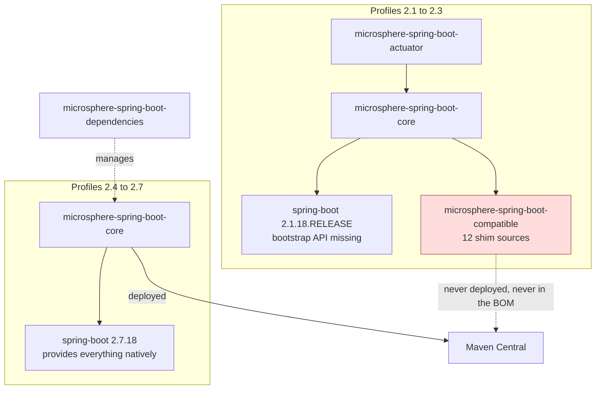

# Compatible Module (Build-Time Shims)

> [中文](./zh/compatible.md) · [Documentation index](../README.md)

> **Branch:** `release-1.x` · **Version line:** `0.1.x` · **Artifact:** `microsphere-spring-boot-compatible`
> **Spring Boot:** `2.1.18.RELEASE` – `2.3.12.RELEASE` (profiles only) · **Published:** no · **In BOM:** no · **Packaging:** jar

Contents:
[1 Module Overview](#1-module-overview) ·
[2 Version Information](#2-version-information) ·
[3 Shim Inventory](#3-shim-inventory) ·
[4 Which Boot Line Needs Which Shim](#4-which-boot-line-needs-which-shim) ·
[5 How the Module Is Attached](#5-how-the-module-is-attached) ·
[6 The Extra Pin Under Profile 2.1](#6-the-extra-pin-under-profile-21) ·
[7 Consumers Inside This Project](#7-consumers-inside-this-project) ·
[8 Guidance for Application Developers](#8-guidance-for-application-developers) ·
[9 Building the Project on Boot 2.1 – 2.3](#9-building-the-project-on-boot-21--23) ·
[10 Failure Modes Without the Shims](#10-failure-modes-without-the-shims) ·
[11 FAQ](#11-faq) ·
[12 See Also](#12-see-also)

---

## 1. Module Overview

On `release-1.x`, `microsphere-spring-boot-compatible` is the same kind of module as on `release` — a
**build-time shim** that re-declares Spring Boot types under their original `org.springframework.boot.*`
package names — but the direction is reversed. Here it does not patch for a *newer* Boot; it supplies the
API that Boot `2.1`–`2.3` did not yet have, so that one source tree can be built against Boot `2.1`
through `2.7`.

`src/main/java/org/springframework/boot/package-info.java` records the intent: the classes are forked
from Spring Boot so that lower versions stay buildable.

The gap this closes: the bootstrap-context API appeared in Boot `2.4`, `@ConditionalOnAvailableEndpoint`
in `2.2`, and `IncludeExcludeEndpointFilter` in `2.2.7`. The project's `core` and `actuator` modules use
all three, so profiles `2.1`, `2.2`, and `2.3` attach the shim.

| Question | Answer |
|---|---|
| Who consumes it | Only `microsphere-spring-boot-core`, under profiles `spring-boot-2.1`, `2.2`, `2.3`. |
| Who must never consume it | Your application, your libraries, and the BOM. |
| What is inside | 12 source files under `src/main/java/org/springframework/boot/`. |

---

## 2. Version Information

| Item | Value |
|---|---|
| Coordinate | `io.github.microsphere-projects:microsphere-spring-boot-compatible` |
| Version | `${revision}`, i.e. `0.1.35-SNAPSHOT` on the branch tip |
| Published releases containing it | **None** — no `0.1.x` release ever deployed it |
| Deploy | `maven-deploy-plugin` `<skip>true</skip>` |
| Central publishing | `central-publishing-maven-plugin` `<skipPublishing>true</skipPublishing>` |
| Managed by `microsphere-spring-boot-dependencies` | No — the BOM manages `core`, `webmvc`, `webflux`, `actuator`, `test` |
| Declared dependencies | `spring-boot-autoconfigure`, `spring-boot-actuator-autoconfigure`, `spring-core`, `spring-context` — all `<optional>true</optional>` |
| Profiles that attach it | `spring-boot-2.1`, `spring-boot-2.2`, `spring-boot-2.3` |
| Profiles that ignore it | `spring-boot-2.4`, `2.5`, `2.6`, `2.7` (default `2.7.18`) |
| Java | 8 source level, same as the rest of the line; CI runs JDK 8/11/17/21/25 |

Unlike the `release` branch, this module declares **no Servlet API dependency** — Boot 2's servlet types
are `javax.servlet.*` and none of these shims need them.

---

## 3. Shim Inventory

| Fully-qualified type | Kind | Introduced in Boot | Role in the shim |
|---|---|---|---|
| `org.springframework.boot.BootstrapContext` | interface | 2.4.0 | `get`, `getOrElse`, `getOrElseSupply`, `getOrElseThrow`, `isRegistered`. |
| `org.springframework.boot.BootstrapRegistry` | interface, nested `InstanceSupplier<T>`, `InstanceScope` | 2.4.0 (scope API 2.4.2) | Registration side of the bootstrap registry. |
| `org.springframework.boot.ConfigurableBootstrapContext` | interface extending `BootstrapRegistry` and `BootstrapContext` | 2.4.0 | The type `core`'s run-listener adapter receives. |
| `org.springframework.boot.DefaultBootstrapContext` | class implementing `ConfigurableBootstrapContext` | 2.4.0 | Default implementation. |
| `org.springframework.boot.BootstrapContextClosedEvent` | class extending `ApplicationEvent` | 2.4.0 | Published when the bootstrap context closes. |
| `org.springframework.boot.actuate.endpoint.EndpointId` | final value class | 2.0.6; `of(Environment, String)` 2.2.0 | Case/insensitive endpoint id with `management.endpoints.migrate-legacy-ids` support. |
| `org.springframework.boot.actuate.autoconfigure.endpoint.condition.ConditionalOnAvailableEndpoint` | `@Conditional(OnAvailableEndpointCondition.class)` annotation, attribute `endpoint()` default `Void.class` | 2.2.0 | Used by the actuator module's endpoint auto-configuration. |
| `org.springframework.boot.actuate.autoconfigure.endpoint.condition.OnAvailableEndpointCondition` | package-private class extending `AbstractEndpointCondition` | 2.2.0-era | Evaluates enablement plus exposure. |
| `org.springframework.boot.actuate.autoconfigure.endpoint.condition.AbstractEndpointCondition` | package-private class extending `SpringBootCondition` | 2.2.0-era | Reads `management.endpoints.enabled-by-default`. |
| `org.springframework.boot.actuate.autoconfigure.endpoint.expose.IncludeExcludeEndpointFilter` | `IncludeExcludeEndpointFilter<E extends ExposableEndpoint<?>> implements EndpointFilter<E>` | 2.2.7 (a constructor from 2.6.0) | Include/exclude exposure filter. |
| `org.springframework.boot.context.properties.ConstructorBinding` | `@Target({TYPE, CONSTRUCTOR})` annotation | 2.2.0 | Marks constructor-bound `@ConfigurationProperties`. |
| `org.springframework.boot.package-info` | javadoc | 1.0.0 | Records the fork provenance. |

Because the fully-qualified names are identical to Spring Boot's own, these classes are duplicates
whenever the running Boot version already provides them. That is why the module is never deployed.

### Difference on the `release` (0.2.x) line

On `release` the same module carries 10 files — the five bootstrap types plus `ServerProperties`,
`MultipartProperties`, `JacksonProperties`, `MultipartConfigFactory` — and is attached by
`spring-boot-4.0`/`4.1` instead, because Boot 4 *relocated* rather than *not yet provided* those types.
See [../current/compatible.md](../current/compatible.md).

---

## 4. Which Boot Line Needs Which Shim

| Shim group | Boot 2.1 | Boot 2.2 | Boot 2.3 | Boot 2.4+ |
|---|---|---|---|---|
| Bootstrap context types (`@since 2.4.0`) | needed | needed | needed | provided |
| `@ConditionalOnAvailableEndpoint` (`@since 2.2.0`) | needed | provided | provided | provided |
| `IncludeExcludeEndpointFilter` (`@since 2.2.7`) | needed | provided by `2.2.13` | provided | provided |
| `EndpointId.of(Environment, String)` (`@since 2.2.0`) | needed | provided | provided | provided |
| `@ConstructorBinding` (`@since 2.2.0`) | needed | provided | provided | provided |

The binding constraint for all three profiles is the bootstrap API: it does not exist before Boot `2.4`,
so `2.1`, `2.2` and `2.3` all need the shim attached, even where the actuate classes arrived earlier in
that range. The whole set is attached unconditionally when a profile activates; the extra classes are
inert when Boot already provides its own version of them at the same coordinate.

---

## 5. How the Module Is Attached

`microsphere-spring-boot-core/pom.xml` (lines 91–127) declares three profiles, each adding the module as
a compile dependency:

```xml
<profile>
    <id>spring-boot-2.1</id>
    <dependencies>
        <dependency>
            <groupId>io.github.microsphere-projects</groupId>
            <artifactId>microsphere-spring-boot-compatible</artifactId>
            <version>${revision}</version>
        </dependency>
    </dependencies>
</profile>
<!-- spring-boot-2.2 and spring-boot-2.3 declare the same dependency -->
```

`actuator`, `webmvc`, `webflux` and `test` do not reference it directly; `actuator` receives the shim
transitively through `core`. In the root POM's `<modules>` order, `compatible` precedes `core`, so a
Boot 2.1–2.3 build compiles the shims first.



---

## 6. The Extra Pin Under Profile 2.1

The module carries one profile of its own, in `microsphere-spring-boot-compatible/pom.xml`:

```xml
<profiles>
    <profile>
        <id>spring-boot-2.1</id>
        <dependencies>
            <dependency>
                <groupId>org.springframework</groupId>
                <artifactId>spring-core</artifactId>
                <version>5.2.25.RELEASE</version>
                <optional>true</optional>
            </dependency>
        </dependencies>
    </profile>
</profiles>
```

Why: Boot `2.1.18.RELEASE` manages an older Spring Framework line, while the shim sources use
`spring-core` APIs that require `5.2.x`. The profile raises exactly one artifact for one profile instead
of moving the whole Boot line. It is build-time only and cannot affect a consumer, since the module is
never published.

The same technique appears in `microsphere-spring-boot-actuator/pom.xml`, where profile `spring-boot-2.1`
pins `io.micrometer:micrometer-core:1.3.20`. See [actuator.md](./actuator.md).

---

## 7. Consumers Inside This Project

| Shim type | Where it is used | File |
|---|---|---|
| `ConfigurableBootstrapContext` | `starting(ConfigurableBootstrapContext)` hook | `microsphere-spring-boot-core/src/main/java/io/microsphere/spring/boot/listener/SpringApplicationRunListenerAdapter.java` |
| `ConfigurableBootstrapContext` | logging run listener | `microsphere-spring-boot-core/src/main/java/io/microsphere/spring/boot/listener/LoggingSpringApplicationRunListener.java` |
| `@ConditionalOnAvailableEndpoint` | four endpoint `@Bean` methods | `microsphere-spring-boot-actuator/src/main/java/io/microsphere/spring/boot/actuate/autoconfigure/ActuatorEndpointsAutoConfiguration.java` |
| `@ConstructorBinding` | constructor-bound properties fixture in tests | `microsphere-spring-boot-core/src/test/java/io/microsphere/spring/boot/context/properties/TestConstructorBindingConfigurationProperties.java` |
| `EndpointId` | required by the endpoint condition and exposure filter chain | internal to the shim set |

---

## 8. Guidance for Application Developers

1. **Do not depend on this artifact.** It is not published; resolution fails with
   `Could not find artifact io.github.microsphere-projects:microsphere-spring-boot-compatible`.
2. **You do not need it on Boot 2.4 – 2.7.** Use `microsphere-spring-boot-dependencies:0.1.34` and the
   regular module coordinates; the released jars already contain what they need.
3. **On Boot 2.1 – 2.3, still do not add it.** The published `0.1.x` artifacts were built per Boot line;
   if you hit a missing bootstrap/actuate API at runtime, the fix is to move to a Boot patch line the
   project supports, not to graft the shim onto your classpath.
4. **Never import the shim's `org.springframework.boot.*` types in your own code.** Those packages belong
   to Spring Boot; the copies exist only inside this reactor, and putting both on one classpath produces
   duplicate-class behavior that depends on classpath order.

Contributors adding a shim: keep the package, class name and member signatures **identical** to Spring
Boot's, and attach the module from the profile that needs it — never from a published module's default
compile scope.

---

## 9. Building the Project on Boot 2.1 – 2.3

```bash
# oldest supported line, shims compiled in
./mvnw clean verify -Pspring-boot-2.1

./mvnw clean verify -Pspring-boot-2.2
./mvnw clean verify -Pspring-boot-2.3

# default line (2.7.18) - module is built but nothing depends on it
./mvnw clean verify

# confirm core picked the shim up
./mvnw -pl microsphere-spring-boot-core -am -Pspring-boot-2.1 dependency:tree | grep microsphere-spring-boot-compatible
```

`-am` matters: building `core` alone without also building `compatible` fails, because the shim exists
only inside the reactor.

---

## 10. Failure Modes Without the Shims

| Error | Reference that needs the shim |
|---|---|
| `cannot find symbol class ConfigurableBootstrapContext` | `SpringApplicationRunListenerAdapter`, `LoggingSpringApplicationRunListener` |
| `cannot find symbol class BootstrapContext` / `BootstrapRegistry` | the same listener hierarchy |
| `cannot find symbol class ConditionalOnAvailableEndpoint` | `ActuatorEndpointsAutoConfiguration` |
| `cannot find symbol class IncludeExcludeEndpointFilter` | the endpoint condition chain inside the shim |
| `cannot find symbol class EndpointId` | same chain |
| `cannot find symbol class ConstructorBinding` | `TestConstructorBindingConfigurationProperties` |
| `package org.springframework.boot.actuate.endpoint.annotation does not exist` | actuator module compiled without `spring-boot-actuator-autoconfigure` on the classpath |

Under Boot 2.4+ none of these appear, because Spring Boot provides the types itself.

---

## 11. FAQ

**Why is the shim attached for 2.2 and 2.3 too, when most classes exist there?**
The bootstrap API (`@since 2.4.0`) is missing on all three lines, so the module must be attached there
regardless. Attaching the full set is simpler than maintaining per-class profiles.

**Why not require applications to stay on Boot 2.4+?**
The branch advertises `2.1.18.RELEASE` and up as supported, and the modules' features are useful on
those lines. The shim is what makes the promise buildable.

**Does a published `0.1.x` jar contain the shim classes?**
No. The shims are used to *compile* `core`, and they live in the `org.springframework.boot` packages of a
separate, never-published artifact.

**What if my application really needs `@ConditionalOnAvailableEndpoint` on Boot 2.1?**
Upgrade Boot. Writing your own copy of a Spring Boot package is not a supported path, and it collides
with the real classes the moment Boot 2.2+ arrives on the classpath.

---

## 12. See Also

| Document | Scope |
|---|---|
| [core.md](./core.md) | The only module that attaches these shims. |
| [actuator.md](./actuator.md) | The consumer of `@ConditionalOnAvailableEndpoint`, and the `micrometer-core:1.3.20` pin. |
| [dependencies.md](./dependencies.md) | The BOM, and why this artifact stays out of it. |
| [parent.md](./parent.md) | The profiles that select the Boot line. |
| [../current/compatible.md](../current/compatible.md) | The Boot 4 side of the same mechanism. |
