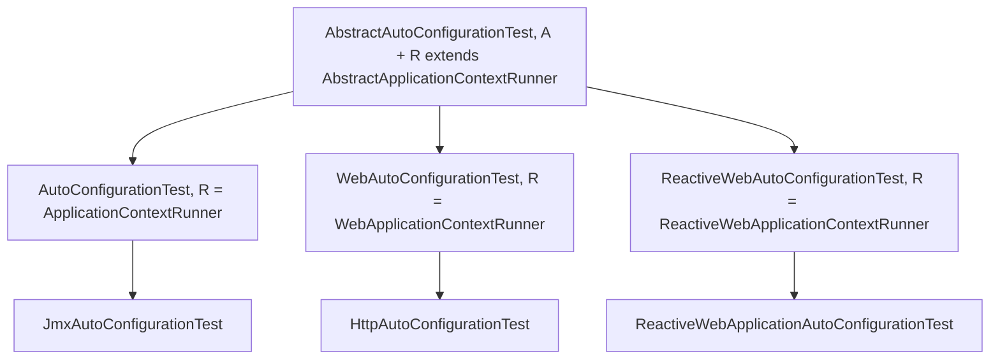

# Test Module

> [中文](./zh/test.md) · [Documentation index](../README.md)

> **Branch:** `release-1.x` · **Version line:** `0.1.x` · **Artifact:** `microsphere-spring-boot-test`
> **Spring Boot:** `2.1.18.RELEASE` – `2.7.18` · **Java:** 8+ · **Scope:** `test`

Contents:
[1 Module Overview](#1-module-overview) ·
[2 Version Information](#2-version-information) ·
[3 Class Hierarchy](#3-class-hierarchy) ·
[4 The Contract](#4-the-contract) ·
[5 Assertion Semantics](#5-assertion-semantics) ·
[6 Examples](#6-examples) ·
[7 Testing This Project's Own Auto-Configurations](#7-testing-this-projects-own-auto-configurations) ·
[8 Dependencies and Consumer POM](#8-dependencies-and-consumer-pom) ·
[9 Spring Boot 2.1 to 2.3 Caveats](#9-spring-boot-21-to-23-caveats) ·
[10 Troubleshooting](#10-troubleshooting) ·
[11 See Also](#11-see-also)

---

## 1. Module Overview

This module turns three expectations about an auto-configuration — **it applies**, **it can be switched off by a
property**, and **it stays off when a required class is missing** — into three **inherited** JUnit 5 tests. Extend the
base class that matches your web type, annotate the subclass with `@SpringBootTest`, implement three
`configure*` methods, and the tests come for free: no hand-written `ApplicationContextRunner` boilerplate per class.

What the base class gives a subclass (`AbstractAutoConfigurationTest.java`):

* three `@Test` methods — `testAutoConfiguredClasses()` (line 118), `testOnGlobalDisabledProperty()` (line 125),
  `testOnGlobalMissingClass()` (line 132);
* a ready runner, built once per test instance in the constructor (line 97) from the `@SpringBootTest` attributes;
* instance assertions plus static generic variants — `assertAutoConfiguredClass` / `assertDisabledProperty` /
  `assertFilteredClass` (lines 190-225).

The module ships **four** production classes and nothing else: `src/main/java` holds only
`io.microsphere.spring.boot.test.{AbstractAutoConfigurationTest, AutoConfigurationTest, WebAutoConfigurationTest,
ReactiveWebAutoConfigurationTest}`, and there is **no `src/main/resources` directory at all** — no `spring.factories`,
no `AutoConfiguration.imports`, no default-properties file. It is a pure test-support library: nothing here can activate
at application runtime. The only other sources are five files under `src/test/java`, listed in §6.

---

## 2. Version Information

| Item | Value |
|---|---|
| Artifact | `io.github.microsphere-projects:microsphere-spring-boot-test` (`pom.xml:13-15`) |
| Version expression | `${revision}` (`pom.xml:15`), `<revision>0.1.35-SNAPSHOT</revision>` (root `pom.xml:54`) |
| Latest published release | `0.1.34` |
| Spring Boot profiles pinned by the parent | `2.1.18.RELEASE / 2.2.13.RELEASE / 2.3.12.RELEASE / 2.4.13 / 2.5.15 / 2.6.15 / 2.7.18 (default)` — `spring-boot-2.1` at `microsphere-spring-boot-parent/pom.xml:70-73`, `spring-boot-2.7` with `<activeByDefault>true</activeByDefault>` at `pom.xml:112-115` |
| Java | Java 8 baseline; CI validates JDK `8 / 11 / 17 / 21 / 25` |
| JUnit | Jupiter BOM `5.14.4`, imported by the parent (`microsphere-spring-boot-parent/pom.xml:25`, `pom.xml:31-38`) |
| Test stack | `org.junit.jupiter.api.Test` (imported at `AbstractAutoConfigurationTest.java:22`) + Spring Boot's `ApplicationContextRunner` family; **no** `@ExtendWith` / `SpringExtension` anywhere in the module |
| Servlet API | `javax.servlet:javax.servlet-api`, optional (`pom.xml:83-88`) — this branch is `javax.*`, never `jakarta.*` |
| Registration | None — the module has no `src/main/resources` |
| Javadoc `@since` | All four classes say `@since 1.0.0` (`AbstractAutoConfigurationTest.java:51`, `AutoConfigurationTest.java:31`, `WebAutoConfigurationTest.java:31`, `ReactiveWebAutoConfigurationTest.java:31`) while the artifact version line is `0.1.x` |

---

## 3. Class Hierarchy

Package: `io.microsphere.spring.boot.test`



| Class | Declaration | Runner | Applies to |
|---|---|---|---|
| `AbstractAutoConfigurationTest<A, R extends AbstractApplicationContextRunner>` | abstract, `AbstractAutoConfigurationTest.java:53` | decided by `R` | — |
| `AutoConfigurationTest<A>` | `extends AbstractAutoConfigurationTest<A, ApplicationContextRunner>`, `AutoConfigurationTest.java:33` | `ApplicationContextRunner` | non-web auto-configurations |
| `WebAutoConfigurationTest<A>` | `…<A, WebApplicationContextRunner>`, `WebAutoConfigurationTest.java:33` | `WebApplicationContextRunner` | Servlet / MVC |
| `ReactiveWebAutoConfigurationTest<A>` | `…<A, ReactiveWebApplicationContextRunner>`, `ReactiveWebAutoConfigurationTest.java:33` | `ReactiveWebApplicationContextRunner` | WebFlux |

The three concrete subclasses are empty except for the `configure*` overrides: each one exists solely to pin `R`
(`AutoConfigurationTest.java:33`, `WebAutoConfigurationTest.java:33`, `ReactiveWebAutoConfigurationTest.java:33`).

**Type parameters, resolved by reflection in the constructor** (`AbstractAutoConfigurationTest.java:94-96`):

```java
this.abstractAutoConfigurationTestType = forClass(getClass()).as(AbstractAutoConfigurationTest.class);
this.autoConfigurationClass = (Class<A>) abstractAutoConfigurationTestType.resolveGeneric(0);
this.runnerClass            = (Class<R>) abstractAutoConfigurationTestType.resolveGeneric(1);
```

So `A` is the auto-configuration class under test, read off your `extends` clause — you never pass it to a constructor.

**Hard constraints, enforced in the constructor:**

* The concrete subclass **must** carry `@SpringBootTest`, or construction fails with
  `"The @SpringBootTest must not be annotated on " + type` (`AbstractAutoConfigurationTest.java:90-91`).
* `isWebApplication` is `!NONE.equals(webEnvironment)` (line 93); when it is `false`, the runner **must** be an
  `ApplicationContextRunner`, otherwise the message is
  `"The runner class[{}] must be ApplicationContextRunner when the auto-configuration test is not a web application"`
  (lines 98-101).
* The runner is created reflectively: `newInstance(runnerClass)` (line 105), i.e. `R` needs a public no-argument
  constructor — true for the three Boot runners the module binds.

---

## 4. The Contract

The base class configures itself entirely from the `@SpringBootTest` annotation — that annotation is the input device of
this module:

| Source | Use in `initRunner(R)` (`AbstractAutoConfigurationTest.java:109-115`) |
|---|---|
| `@SpringBootTest(properties = {...})` | `runner.withPropertyValues(getPropertyValues())` — the baseline properties (`String[]`, line 140) |
| `@SpringBootTest(classes = {...})` | `runner.withConfiguration(of(getClasses()))` — extra configuration classes (`Class<?>[]`, line 166) |
| `@SpringBootTest(webEnvironment = ...)` | decides `isWebApplication` and therefore the legal runner type (line 93) |
| The type argument `A` | `runner.withConfiguration(of(this.autoConfigurationClass))` — the class under test (line 113) |

A subclass **must** implement three `protected abstract` methods, each of which receives the set to fill:

```java
protected abstract void configureAutoConfiguredClasses(Set<Class<?>> autoConfiguredClasses);        // line 174
protected abstract void configureGlobalDisabledPropertyValues(Set<String> globalDisabledPropertyValues); // line 181
protected abstract void configureGlobalMissingClasses(Set<Class<?>> globalMissingClasses);          // line 188
```

| Method | What goes in | Drives |
|---|---|---|
| `configureAutoConfiguredClasses` | bean classes expected besides the class under test — may stay **empty** | `testAutoConfiguredClasses()` |
| `configureGlobalDisabledPropertyValues` | `"key=false"` switches, verified one by one | `testOnGlobalDisabledProperty()` |
| `configureGlobalMissingClasses` | classes whose absence must stop the auto-configuration | `testOnGlobalMissingClass()` |

The three accessors that call them are `final` and additive, which is why the first set may be empty:

```java
protected final Class<?>[] getAutoConfiguredClasses() {   // line 144
    Set<Class<?>> autoConfiguredClasses = newLinkedHashSet();
    autoConfiguredClasses.add(this.autoConfigurationClass);   // the class under test is always asserted
    configureAutoConfiguredClasses(autoConfiguredClasses);
    return autoConfiguredClasses.toArray(EMPTY_CLASS_ARRAY);
}
```

Other usable members: `newRunner()` (line 104, builds and initializes a fresh runner), `initRunner(R)` (line 109),
`getPropertyValues()` (line 139), `getClasses()` (line 165), `getGlobalDisabledPropertyValues()` (line 152),
`getGlobalMissingClasses()` (line 159), the fields `runner`, `autoConfigurationClass`, `runnerClass`,
`isWebApplication`, `springBootTestAttributes`, and the constant
`public static final Class<SpringBootTest> SPRING_BOOT_TEST_CLASS` (line 58).

---

## 5. Assertion Semantics

The instance methods (lines 190-200) delegate to the static ones (lines 202-225), so the semantics are exactly Boot's
`ApplicationContextAssertProvider` assertions:

| Assertion | What it really asserts |
|---|---|
| `assertAutoConfiguredClass(Class<?>)` | `runner.run(context -> assertThat(context).hasSingleBean(autoConfiguredClass))` — **exactly one** bean of that type, so a second one also fails |
| `assertDisabledProperty(String propertyValue, Class<?>...)` | `runner.withPropertyValues(propertyValue).run(...)` then `doesNotHaveBean` for **every** class in `getAutoConfiguredClasses()` |
| `assertFilteredClass(String filteredClass, Class<?>...)` | `runner.withClassLoader(new FilteredClassLoader(filteredClass)).run(...)` then `doesNotHaveBean` for every bean class |

Static signature shape (`AbstractAutoConfigurationTest.java:202`):

```java
public static <R extends AbstractApplicationContextRunner<R, C, A>,
               C extends ConfigurableApplicationContext,
               A extends ApplicationContextAssertProvider<C>>
void assertAutoConfiguredClass(R runner, Class<?> autoConfiguredClass)
```

Notes that decide pass/fail in practice:

* **The baseline is the annotation.** Only `@SpringBootTest(properties = ...)` is read; an `application.properties` on
  the test classpath is *not* consulted, because a runner builds its own closed context.
* **`assertDisabledProperty` asserts against the whole set**, not only the class under test — a property that disables
  one bean but leaves another in `getAutoConfiguredClasses()` alive fails the test.
* **`FilteredClassLoader` filters by class name** (`missingClass.getName()`, line 134; `new FilteredClassLoader(filteredClass)`,
  line 220). The hidden class must therefore be one the auto-configuration actually guards with `@ConditionalOnClass`;
  hiding an unrelated class changes nothing and `doesNotHaveBean` fails.
* **Boot runners are immutable**: lines 211 and 220 use the *returned* runner, so `this.runner` keeps the annotation
  baseline and each assertion starts from it.
* Each of the three generated tests loops over its own set, so a set with *n* entries performs *n* context creations.

---

## 6. Examples

All five files below are the module's own `src/test/java` sources; they are the reference usage, not invented samples.

### 6.1 Non-web: `JmxAutoConfigurationTest`

`src/test/java/io/microsphere/spring/boot/test/JmxAutoConfigurationTest.java`

```java
@SpringBootTest(classes = {
        JmxAutoConfigurationTest.class
}, webEnvironment = NONE,
        properties = {
                "spring.jmx.enabled=true"
        })
public class JmxAutoConfigurationTest extends AutoConfigurationTest<JmxAutoConfiguration> {

    @Override
    protected void configureAutoConfiguredClasses(Set<Class<?>> autoConfiguredClasses) {
    }

    @Override
    protected void configureGlobalDisabledPropertyValues(Set<String> globalDisabledPropertyValues) {
        globalDisabledPropertyValues.add("spring.jmx.enabled=false");
    }

    @Override
    protected void configureGlobalMissingClasses(Set<Class<?>> globalMissingClasses) {
        globalMissingClasses.add(MBeanExporter.class);
    }
}
```

`NONE` (line 26, statically imported) makes `isWebApplication` false, which is precisely the case where only
`ApplicationContextRunner` is legal — the constraint from §3 is satisfied by choosing `AutoConfigurationTest`.
Leaving `configureAutoConfiguredClasses` empty is valid: the base class always adds `A` to the asserted set.

### 6.2 Servlet: `HttpAutoConfigurationTest` over `HttpAutoConfiguration`

The fixture auto-configuration, `src/test/java/io/microsphere/spring/boot/test/HttpAutoConfiguration.java`:

```java
@ConditionalOnWebApplication(type = SERVLET)
@ConditionalOnClass(CharacterEncodingFilter.class)
@ConditionalOnProperty(name = "server.http.enabled", matchIfMissing = true)
@Import(CharacterEncodingFilter.class)
public class HttpAutoConfiguration {
}
```

The test, `src/test/java/io/microsphere/spring/boot/test/HttpAutoConfigurationTest.java`:

```java
@SpringBootTest(
        classes = HttpAutoConfigurationTest.class
)
public class HttpAutoConfigurationTest extends WebAutoConfigurationTest<HttpAutoConfiguration> {

    @Override
    protected void configureAutoConfiguredClasses(Set<Class<?>> autoConfiguredClasses) {
        autoConfiguredClasses.add(CharacterEncodingFilter.class);
    }

    @Override
    protected void configureGlobalDisabledPropertyValues(Set<String> globalDisabledPropertyValues) {
        globalDisabledPropertyValues.add("server.http.enabled=false");
    }

    @Override
    protected void configureGlobalMissingClasses(Set<Class<?>> globalMissingClasses) {
        globalMissingClasses.add(CharacterEncodingFilter.class);
    }
}
```

Here `@SpringBootTest` uses the default `webEnvironment` (`MOCK`), so `isWebApplication` is `true` and the Servlet
runner is allowed. Note the discipline of the three sets: `server.http.enabled` matches the `@ConditionalOnProperty`
`name` with `matchIfMissing = true`; `CharacterEncodingFilter` is both the imported bean and the
`@ConditionalOnClass` target, so it legitimately appears twice.

### 6.3 Reactive: `ReactiveWebApplicationAutoConfigurationTest`

The fixture, `src/test/java/io/microsphere/spring/boot/test/ReactiveWebApplicationAutoConfiguration.java`:

```java
@ConditionalOnWebApplication(type = REACTIVE)
@ConditionalOnClass(value = JacksonProperties.class)
@ConditionalOnProperty(name = "reactive.web-app.enabled", matchIfMissing = true)
@EnableConfigurationProperties(value = JacksonProperties.class)
public class ReactiveWebApplicationAutoConfiguration {
}
```

The test, `src/test/java/io/microsphere/spring/boot/test/ReactiveWebApplicationAutoConfigurationTest.java`:

```java
@SpringBootTest(
        classes = {
                ReactiveWebApplicationAutoConfigurationTest.class
        }
)
public class ReactiveWebApplicationAutoConfigurationTest
        extends ReactiveWebAutoConfigurationTest<ReactiveWebApplicationAutoConfiguration> {

    @Override
    protected void configureAutoConfiguredClasses(Set<Class<?>> autoConfiguredClasses) {
        autoConfiguredClasses.add(JacksonProperties.class);
    }

    @Override
    protected void configureGlobalDisabledPropertyValues(Set<String> globalDisabledPropertyValues) {
        globalDisabledPropertyValues.add("reactive.web-app.enabled=false");
    }

    @Override
    protected void configureGlobalMissingClasses(Set<Class<?>> globalMissingClasses) {
        globalMissingClasses.add(JacksonProperties.class);
    }
}
```

A property-backed bean rather than an imported one: `@EnableConfigurationProperties(JacksonProperties.class)` supplies
the bean the positive test asserts, and `@ConditionalOnClass(JacksonProperties.class)` supplies the filter target.

### 6.4 Adding your own assertions on top

Because `newRunner()` is `protected` (line 104) and returns the initialized, generic runner, a subclass can add
`@Test` methods of its own without losing the inherited three:

```java
@SpringBootTest(classes = MyAutoConfiguration.class, webEnvironment = NONE,
        properties = "my.feature.pool-size=3")
class MyAutoConfigurationTest extends AutoConfigurationTest<MyAutoConfiguration> {

    @Test
    void poolSizeIsApplied() {
        newRunner().run(context ->
                assertThat(context.getBean(MyProperties.class).getPoolSize()).isEqualTo(3));
    }

    @Override
    protected void configureAutoConfiguredClasses(Set<Class<?>> classes) {
        classes.add(MyProperties.class);
    }

    @Override
    protected void configureGlobalDisabledPropertyValues(Set<String> values) {
        values.add("my.feature.enabled=false");
    }

    @Override
    protected void configureGlobalMissingClasses(Set<Class<?>> missing) {
        missing.add(MyProperties.class);
    }
}
```

(`MyAutoConfiguration` / `MyProperties` are placeholders for your own classes; nothing in this section is invented about
the module's API — the runner and assertion entry points are those of §4 and §5.)

---

## 7. Testing This Project's Own Auto-Configurations

The recipe below is what `JmxAutoConfigurationTest`, `HttpAutoConfigurationTest` and
`ReactiveWebApplicationAutoConfigurationTest` demonstrate, applied to the auto-configurations of the `microsphere-spring-boot-*`
modules in this repository (see [core.md](./core.md) and [actuator.md](./actuator.md) for what each module registers).

1. **Pick the base class from the web type, not from the module name.**
   `webEnvironment = NONE` + `AutoConfigurationTest` for a plain auto-configuration;
   `WebAutoConfigurationTest` (Servlet, `javax.servlet` on the classpath, see `pom.xml:83-88`);
   `ReactiveWebAutoConfigurationTest` (WebFlux).
2. **Put the test class in the same package as the auto-configuration** the way this module does
   (`io.microsphere.spring.boot.test` here), and list the test class itself in `classes = {...}` — that is the pattern in
   all three shipped examples, and it is what lets `@Import`/`@EnableConfigurationProperties` on the outer class be
   picked up.
3. **Set the enabling switches in `properties`, not in a file.** The runner only sees
   `getStringArray("properties")` (`AbstractAutoConfigurationTest.java:140`). `JmxAutoConfigurationTest` needs
   `spring.jmx.enabled=true` for the positive case, exactly as your own `microsphere.*.enabled` switches would.
4. **Derive the three sets mechanically from the conditions of the class under test**, as `HttpAutoConfiguration` shows:
   `@ConditionalOnProperty(name = ...)` gives the `"name=false"` entry; `@ConditionalOnClass(X.class)` gives
   `configureGlobalMissingClasses`; the imported or `@EnableConfigurationProperties` bean gives
   `configureAutoConfiguredClasses`.
5. **No registration file is needed.** `initRunner` calls `withConfiguration(of(autoConfigurationClass))` (line 113)
   with the class named directly, so these tests do not care whether your module lists the auto-configuration in
   `META-INF/spring.factories` or in `META-INF/spring/org.springframework.boot.autoconfigure.AutoConfiguration.imports`
   — that also means the tests pass on Boot 2.1-2.6, which do not read the `imports` file at all (on this branch
   `core` registers both files; see [core.md](./core.md)).
6. **Run one profile at a time**: `mvn -Pspring-boot-2.7 test`, `mvn -Pspring-boot-2.1 test`, … The profiles are
   defined in the parent POM and only the pinned Boot version is on the classpath per build.

---

## 8. Dependencies and Consumer POM

**Install** — the version comes from the BOM:

```xml
<dependencyManagement>
    <dependencies>
        <dependency>
            <groupId>io.github.microsphere-projects</groupId>
            <artifactId>microsphere-spring-boot-dependencies</artifactId>
            <version>0.1.34</version>
            <type>pom</type>
            <scope>import</scope>
        </dependency>
    </dependencies>
</dependencyManagement>

<dependencies>
    <dependency>
        <groupId>io.github.microsphere-projects</groupId>
        <artifactId>microsphere-spring-boot-test</artifactId>
        <scope>test</scope>
    </dependency>
</dependencies>
```

**Why almost everything here is `<optional>true</optional>`.** A test-support library is only useful inside someone
else's test classpath, where the versions of JUnit, Boot and the servlet container are already decided by that project.
Marking the dependencies optional keeps this artifact from dragging a WebFlux starter, a Jackson stack or an H2 database
into a project that tests a non-web auto-configuration; it also avoids version fights with the consumer's own BOM. The
consequence is explicit: **the base classes reference those APIs at compile time, so the consumer must supply whatever
its chosen base class touches.**

From `microsphere-spring-boot-test/pom.xml`:

| Declared dependency | POM lines | Optional | You must add it when |
|---|---|---|---|
| `io.github.microsphere-projects:microsphere-annotation-processor` | `23-27` | yes | never (build-time only) |
| `org.junit.jupiter:junit-jupiter` | `30-34` | **yes** | always — `@Test` is on the base class |
| `org.springframework.boot:spring-boot-configuration-processor` | `37-41` | yes | never (build-time only) |
| `org.springframework.boot:spring-boot-autoconfigure-processor` | `44-48` | yes | never (build-time only) |
| `org.springframework.boot:spring-boot-starter-test` | `51-55` | **yes** | always — runners, `FilteredClassLoader`, `@SpringBootTest`, AssertJ |
| `io.github.microsphere-projects:microsphere-spring-context` | `58-61` | **no** | never — arrives transitively (`GenericAnnotationAttributes`) |
| `io.github.microsphere-projects:microsphere-spring-test` | `63-67` | **no** | never — arrives transitively |
| `org.springframework.boot:spring-boot-starter-web` | `70-74` | yes | you extend `WebAutoConfigurationTest` |
| `org.springframework.boot:spring-boot-starter-webflux` | `77-81` | yes | you extend `ReactiveWebAutoConfigurationTest` |
| `javax.servlet:javax.servlet-api` | `83-88` | yes | you extend `WebAutoConfigurationTest` |
| `com.fasterxml.jackson.core:jackson-annotations` / `jackson-databind` | `90-95`, `97-101` | yes | your tests assert Jackson beans |
| `com.h2database:h2` | `104-108` | yes | your tests boot a DataSource |
| `ch.qos.logback:logback-classic` | `113-117` | `test` scope, module-local | never — it does not leak |

Two entries are **not** optional, so be aware that `microsphere-spring-context` and `microsphere-spring-test` are
transitive compile dependencies of this artifact (`pom.xml:58-61`, `pom.xml:63-67`); everything the base classes need
from third parties is optional. Note also that **AssertJ is declared nowhere in this POM**, yet
`AbstractAutoConfigurationTest.java:37` imports `org.assertj.core.api.Assertions` — it is expected to come from
`spring-boot-starter-test`.

**Minimum test-scoped set for a Servlet test on Boot 2.7:**

```xml
<dependencies>
    <dependency>
        <groupId>io.github.microsphere-projects</groupId>
        <artifactId>microsphere-spring-boot-test</artifactId>
        <scope>test</scope>
    </dependency>
    <dependency>
        <groupId>org.junit.jupiter</groupId>
        <artifactId>junit-jupiter</artifactId>
        <scope>test</scope>
    </dependency>
    <dependency>
        <groupId>org.springframework.boot</groupId>
        <artifactId>spring-boot-starter-test</artifactId>
        <scope>test</scope>
    </dependency>
    <dependency>
        <groupId>org.springframework.boot</groupId>
        <artifactId>spring-boot-starter-web</artifactId>
        <scope>test</scope>
    </dependency>
    <dependency>
        <groupId>javax.servlet</groupId>
        <artifactId>javax.servlet-api</artifactId>
        <scope>test</scope>
    </dependency>
</dependencies>
```

For a reactive test, swap `spring-boot-starter-web` + `javax.servlet-api` for `spring-boot-starter-webflux`. A
non-web `AutoConfigurationTest` needs only the first three entries.

---

## 9. Spring Boot 2.1 to 2.3 Caveats

* **JUnit API level.** `AbstractAutoConfigurationTest.java:38` imports `org.junit.jupiter.api.Assertions.assertInstanceOf`,
  used at line 99. That method is a Jupiter 5.8+ API. It resolves because the parent imports `junit-bom` at `5.14.4`
  (`microsphere-spring-boot-parent/pom.xml:25`, `pom.xml:31-38`) — **not** because of the Boot profile. Under
  `-Pspring-boot-2.1` / `2.2` / `2.3` the Boot-managed Jupiter is far older, so keep the parent BOM in charge of JUnit
  and do not pin Jupiter from the Boot BOM.
* **JUnit 4 leftovers.** On the 2.1-2.3 line, `spring-boot-starter-test` also brings the JUnit 4 / vintage stack. The
  base class is Jupiter-only (`org.junit.jupiter.api.Test`, line 22): if your consumer project excludes the Jupiter
  engine or binds Surefire to JUnit 4, the three inherited tests are silently **not executed**. Verify with
  `mvn -Pspring-boot-2.1 test` output that the Jupiter engine is present.
* **Servlet namespace.** Anything copied from the `0.2.x` docs that references `jakarta.servlet.*` is wrong here;
  this branch pins `javax.servlet:javax.servlet-api` (`pom.xml:83-88`). `WebApplicationContextRunner` cannot even be
  constructed without a Servlet API on the test classpath.
* **No `AutoConfiguration.imports`.** Boot reads that file only from 2.7. This is harmless for these tests because the
  class under test is passed explicitly to `of(...)` (line 113), but it does mean that if you rely on Boot's own
  auto-configuration discovery for a *fixture* auto-configuration, only `META-INF/spring.factories` works on 2.1-2.6
  (see [core.md](./core.md) §2 and §12).
* **Java 8 source level.** Stay on Java 8 APIs in test bodies — no `List.of`, no `toArray(new Class[0])` idioms beyond
  what the module itself does (`EMPTY_CLASS_ARRAY`, line 36 and line 148).
* **Reactive fixture beans.** `@ConditionalOnWebApplication(type = REACTIVE)` and `type = SERVLET` are both required in
  your own fixtures, mirroring `HttpAutoConfiguration.java:35` and
  `ReactiveWebApplicationAutoConfiguration.java:35`; the runners differ, so a copied fixture will not activate.

---

## 10. Troubleshooting

| Symptom | Cause and fix |
|---|---|
| Construction fails with `The @SpringBootTest must not be annotated on …` | The concrete subclass has no `@SpringBootTest` (`AbstractAutoConfigurationTest.java:90-91`). Add it, exactly as the three shipped examples do. |
| `The runner class[...] must be ApplicationContextRunner when the auto-configuration test is not a web application` | `webEnvironment = NONE` was combined with `WebAutoConfigurationTest` or `ReactiveWebAutoConfigurationTest` (lines 98-101). Use `AutoConfigurationTest`, or move to a non-`NONE` web environment. |
| Reflection error while building the runner | `newRunner()` calls `newInstance(runnerClass)` (line 105); only the three Boot runners bound by this module have the required public no-arg constructor. Do not pass a custom `R`. |
| `testAutoConfiguredClasses` fails although the bean exists locally | Runners do not read `application.properties` from the classpath; put the enabling property into `@SpringBootTest(properties = ...)` (line 140). |
| `testAutoConfiguredClasses` fails with "no beans present" / context failure | The class under test is not an auto-configuration candidate, or its `@ConditionalOnWebApplication` type contradicts the chosen base class — compare `HttpAutoConfiguration.java:35`. |
| `testOnGlobalDisabledProperty` fails for a property you are sure about | Either the auto-configuration has no such switch, or another class in `getAutoConfiguredClasses()` is still created, because the assertion loops over the whole set (`AbstractAutoConfigurationTest.java:127`, `213`). Drop the entry, or express the condition through `configureGlobalMissingClasses`. |
| `testOnGlobalMissingClass` fails | `FilteredClassLoader` hides classes **by name** (lines 134, 220): the entry must be a real `@ConditionalOnClass` target of the class under test. Hiding a class nobody checks leaves the beans in place and `doesNotHaveBean` fails. |
| `NoClassDefFoundError` for AssertJ or `org.springframework.boot.test.context.runner.*` | `spring-boot-starter-test` is optional here (`pom.xml:51-55`) and AssertJ is not declared at all; add both test-scoped in the consumer POM (§8). |
| `NoClassDefFoundError: javax/servlet/...` when extending `WebAutoConfigurationTest` | `javax.servlet-api` is optional (`pom.xml:83-88`); add it, plus `spring-boot-starter-web` (`pom.xml:70-74`). |
| `ClassNotFoundException: org.springframework.web.reactive.*` when extending `ReactiveWebAutoConfigurationTest` | `spring-boot-starter-webflux` is optional (`pom.xml:77-81`); add it in test scope. |
| The three tests never run in CI | Jupiter engine missing or Surefire bound to JUnit 4 — see §9, and keep the parent's `junit-bom:5.14.4` in charge. |

---

## 11. See Also

* [core.md](./core.md) — conditions, properties and the registration files these tests deliberately bypass.
* [actuator.md](./actuator.md) — auto-configuration classes of this repository worth covering this way.
* [README.md](./README.md) — documentation index for the `release-1.x` branch.
