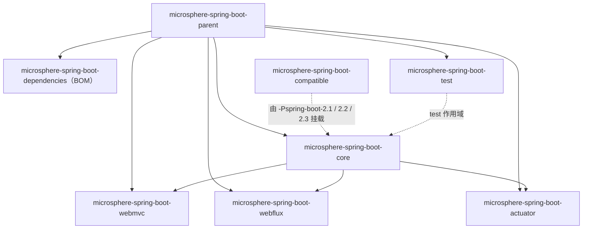

# `release-1.x` 分支（0.1.x）文档总览

> [English](../README.md) · 文档索引：[中文](../../zh/README.md) / [English](../../README.md)

> **分支：** `release-1.x` · **版本线：** `0.1.x` · **Spring Boot：** `2.1.18.RELEASE` – `2.7.18`
>
> 面向 Spring Boot 3/4 的文档见 [../../current/zh/README.md](../../current/zh/README.md)。

---

## 1. 版本信息

| 项目 | 值 |
|---|---|
| Group ID | `io.github.microsphere-projects` |
| 最新发布版本 | `0.1.34`（Maven Central） |
| 分支在研版本 | `0.1.35-SNAPSHOT`（根 `pom.xml` 的 `<revision>` 属性） |
| Java 基线 | 本分支的各处 POM 中既没有 `java.version`，也没有 `maven.compiler.*` 配置——语言级别继承自构建父 POM `microsphere-build:0.3.14`；CI 校验 JDK `8 / 11 / 17 / 21 / 25`，因此 **Java 8 是实际下限** |
| 构建父 POM | `microsphere-build:0.3.14` |
| 关键受管版本 | `microsphere-spring:0.1.39`（BOM）、`jolokia:1.7.2`、`junit-bom:5.14.4` |
| Milestone 仓库 | **无**（自 `0.1.11` 起已从父 POM 中移除） |
| 许可 | Apache License 2.0 |

> **文档口径不一致的说明.** 本分支自己的 `README.md` 声称需要 "Java 17+"，但没有任何 POM 设定语言级别，而 CI 是从
> JDK 8 开始构建的。以代码与 CI 为准：**Java 8 可以运行 Spring Boot 2.x**。

---

## 2. Spring Boot 兼容范围

下表来自 `microsphere-spring-boot-parent/pom.xml`。CI 矩阵是 JDK `8 / 11 / 17 / 21 / 25` × 这 7 个 profile = 35 个作业。

| Profile | Spring Boot | 状态 |
|---|---|---|
| `-Pspring-boot-2.1` | `2.1.18.RELEASE` | 支持，但需额外的版本锁定，见 [compatible.md](./compatible.md) |
| `-Pspring-boot-2.2` | `2.2.13.RELEASE` | 支持 |
| `-Pspring-boot-2.3` | `2.3.12.RELEASE` | 支持 |
| `-Pspring-boot-2.4` | `2.4.13` | 支持 |
| `-Pspring-boot-2.5` | `2.5.15` | 支持 |
| `-Pspring-boot-2.6` | `2.6.15` | 支持 |
| `-Pspring-boot-2.7` | `2.7.18` | **默认**（`activeByDefault`） |

两个命名细节：profile **2.1–2.3 带有 `.RELEASE` 后缀**，Spring Boot 从 2.4 起不再使用该后缀。

本分支的 `SpringBootVersion` 枚举建模的是 `SPRING_BOOT_2_0` … `SPRING_BOOT_2_7_18`，外加运行时探测得到的 `CURRENT`
常量；因此 `0.1.x` 上**不存在** `SPRING_BOOT_3_*` 这类常量，详见 [core.md](./core.md)。

---

## 3. 与 0.2.x 版本线的差异

| 方面 | `release-1.x`（0.1.x） | `release`（0.2.x） |
|---|---|---|
| Spring Boot | 2.1 – 2.7 | 3.0 – 4.1 |
| Java | 无显式设定；CI 从 JDK 8 构建 | `17`（根 POM） |
| 自动配置注册 | **两者皆有**：`META-INF/spring.factories`（`EnableAutoConfiguration`）**与** `AutoConfiguration.imports` | 仅 `AutoConfiguration.imports`（`core` 仍为非自动配置扩展点保留一份 `spring.factories`） |
| Servlet API | `javax.servlet` | `jakarta.servlet` |
| `SpringBootVersion` 范围 | `2.0` – `2.7.18` | `3.0` – `4.1.0` |
| `compatible` shim | 12 个类（含 `EndpointId`、`@ConstructorBinding`、actuate 端点条件与暴露过滤器），由 profile **2.1/2.2/2.3** 附加 | 9 个类（bootstrap 与配置属性类），由 profile **4.0/4.1** 附加 |
| Jolokia | `1.7.2` | `2.6.3` |
| JUnit | `5.14.4` | `6.1.3` |
| 上游 Microsphere Spring | `0.1.39` | `0.2.39` |
| `webmvc` 排序声明 | 单个类名，并带注释 "Spring Boot API [2.0, 4.0)" | 两个类名（Boot 3 与 Boot 4 的包位置） |

---

## 4. 模块清单

每个模块都有一份用户文档（中文在此，英文为同名 `../<file>.md`）和一份位于 `../../../developer-guide/1.x/zh/` 的开发者文档。

| 模块 | Artifact ID | BOM 管理 | 发布 | 用户文档 | 开发者文档 |
|---|---|---|---|---|---|
| 反应堆根 | `microsphere-spring-boot` | — | 否 | [parent.md](./parent.md) | [parent.md](../../../developer-guide/1.x/zh/parent.md) |
| Parent POM | `microsphere-spring-boot-parent` | 否 | 是 | [parent.md](./parent.md) · [English](../parent.md) | [parent.md](../../../developer-guide/1.x/zh/parent.md) |
| BOM | `microsphere-spring-boot-dependencies` | — | 是 | [dependencies.md](./dependencies.md) · [English](../dependencies.md) | [dependencies.md](../../../developer-guide/1.x/zh/dependencies.md) |
| Core | `microsphere-spring-boot-core` | 是 | 是 | [core.md](./core.md) · [English](../core.md) | [core.md](../../../developer-guide/1.x/zh/core.md) |
| Actuator | `microsphere-spring-boot-actuator` | 是 | 是 | [actuator.md](./actuator.md) · [English](../actuator.md) | [actuator.md](../../../developer-guide/1.x/zh/actuator.md) |
| Web MVC | `microsphere-spring-boot-webmvc` | 是 | 是 | [webmvc.md](./webmvc.md) · [English](../webmvc.md) | [webmvc.md](../../../developer-guide/1.x/zh/webmvc.md) |
| WebFlux | `microsphere-spring-boot-webflux` | 是 | 是 | [webflux.md](./webflux.md) · [English](../webflux.md) | [webflux.md](../../../developer-guide/1.x/zh/webflux.md) |
| Test | `microsphere-spring-boot-test` | 是 | 是 | [test.md](./test.md) · [English](../test.md) | [test.md](../../../developer-guide/1.x/zh/test.md) |
| Compatible | `microsphere-spring-boot-compatible` | **否** | **否**（deploy skip + `skipPublishing`） | [compatible.md](./compatible.md) · [English](../compatible.md) | [compatible.md](../../../developer-guide/1.x/zh/compatible.md) |



`actuator`、`webmvc`、`webflux` 都依赖 `core`；在 profile 2.1/2.2/2.3 下构建时，`core` 还会额外依赖 `compatible`。

---

## 5. 安装

### 5.1 导入 BOM

```xml

<properties>
    <microsphere-spring-boot.version>0.1.34</microsphere-spring-boot.version>
</properties>

<dependencyManagement>
    <dependencies>
        <dependency>
            <groupId>io.github.microsphere-projects</groupId>
            <artifactId>microsphere-spring-boot-dependencies</artifactId>
            <version>${microsphere-spring-boot.version}</version>
            <type>pom</type>
            <scope>import</scope>
        </dependency>
    </dependencies>
</dependencyManagement>
```

该 BOM 恰好管理五个产物：`core`、`webmvc`、`webflux`、`actuator`、`test`；`compatible` 与 `parent` 不在受管之列。

### 5.2 添加模块

```xml

<dependencies>
    <dependency>
        <groupId>io.github.microsphere-projects</groupId>
        <artifactId>microsphere-spring-boot-core</artifactId>
    </dependency>

    <dependency>
        <groupId>io.github.microsphere-projects</groupId>
        <artifactId>microsphere-spring-boot-actuator</artifactId>
    </dependency>

    <!-- Servlet 栈；响应式请改用 microsphere-spring-boot-webflux -->
    <dependency>
        <groupId>io.github.microsphere-projects</groupId>
        <artifactId>microsphere-spring-boot-webmvc</artifactId>
    </dependency>

    <dependency>
        <groupId>io.github.microsphere-projects</groupId>
        <artifactId>microsphere-spring-boot-test</artifactId>
        <scope>test</scope>
    </dependency>
</dependencies>
```

> **不要混用两条版本线。** 把 `0.2.x` 放到 Boot 2.x 的 classpath 上（或把 `0.1.x` 放到 Boot 3+ 上），会因为
> `javax`/`jakarta`、注册格式以及已迁移的 API 而失败。

### 5.3 验证安装

```java
import io.microsphere.spring.boot.SpringBootVersion;
import org.springframework.boot.SpringApplication;
import org.springframework.boot.autoconfigure.SpringBootApplication;

@SpringBootApplication
public class MyApplication {

    public static void main(String[] args) {
        // 在 Boot 2.7.18 上这会打印 "Spring Boot 2.7.18"
        System.out.println("Spring Boot: " + SpringBootVersion.CURRENT.getVersion());
        SpringApplication.run(MyApplication.class, args);
    }
}
```

引入 `core` 后，`server.shutdown` 会立刻变成 `graceful`——这来自该模块自带的默认属性文件，详见 [core.md](./core.md)。

---

## 6. 从源码构建

```bash
git clone https://github.com/microsphere-projects/microsphere-spring-boot.git
cd microsphere-spring-boot
git checkout release-1.x          # 本文档对应的分支

./mvnw verify                     # 默认 profile：Spring Boot 2.7.18
./mvnw verify -Pspring-boot-2.1   # 会附加 shim 与额外的版本锁定
./mvnw verify -Pspring-boot-2.4   # 另一条 minor 线
./mvnw install -DskipTests
```

CI 使用的命令形态（便于你在本地复现）：

```bash
./mvnw -Drevision=0.0.1-SNAPSHOT -Dsurefire.useSystemClassLoader=false test \
       --activate-profiles test,coverage,spring-boot-2.7
```

> `-Dsurefire.useSystemClassLoader=false` 不是摆设：诊断监听器需要非系统类加载器，才能过滤并探测缺失的类。

---

## 7. 常见问题（跨模块）

| 问题 | 结论 |
|---|---|
| Boot 2.7 需要 `AutoConfiguration.imports` 吗？ | 本分支同时提供 `spring.factories` 与 `imports` 文件，因此较旧的 Boot 2.x 仍能自动配置：Boot 2.7 两者都认，Boot 2.4–2.6 认 `spring.factories`。 |
| 可以把 `0.1.x` 用在 Boot 3 上吗？ | 不行。请改用 `0.2.x` 版本线，见 [../../current/zh/README.md](../../current/zh/README.md)。 |
| 能跑在 Java 8 应用上吗？ | 可以，JDK 8 在 CI 矩阵中。注意本分支不设定 `java.version`——语言级别来自 `microsphere-build`。 |
| `jolokia` 端点行为不一样 | 本版本线使用 `jolokia-core:1.7.2`（Boot 2 时代的坐标与属性），见 [actuator.md](./actuator.md)。 |
| 找不到 `microsphere-spring-boot-compatible` | 有意为之：不发布、不在 BOM 中，只在 profile 2.1/2.2/2.3 下构建 `core` 时附加，见 [compatible.md](./compatible.md)。 |
