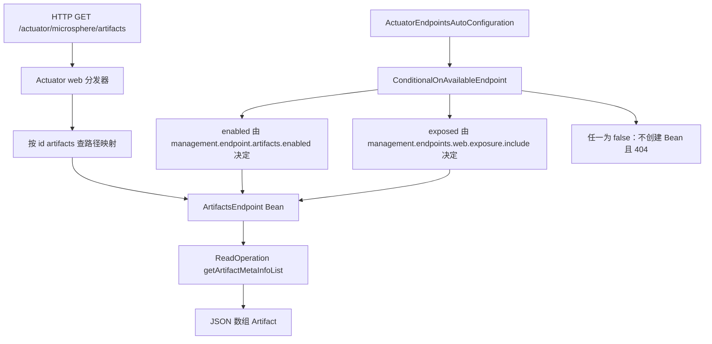

# Actuator 模块

> [English](../actuator.md) · 文档索引：[中文](../../zh/README.md)

> **分支：** `release-1.x` · **版本线：** `0.1.x` · **Artifact：** `microsphere-spring-boot-actuator`
> **Spring Boot：** `2.1.18.RELEASE` – `2.7.18` · **Java：** 8+

目录：
[1 模块概览](#1-模块概览) ·
[2 版本信息](#2-版本信息) ·
[3 安装](#3-安装) ·
[4 自定义端点](#4-自定义端点) ·
[5 默认属性](#5-默认属性) ·
[6 暴露与启用规则](#6-暴露与启用规则) ·
[7 任务调度器属性](#7-任务调度器属性) ·
[8 JMX 与 Jolokia](#8-jmx-与-jolokia) ·
[9 使用示例](#9-使用示例) ·
[10 属性参考](#10-属性参考) ·
[11 版本兼容性](#11-版本兼容性) ·
[12 故障排查](#12-故障排查) ·
[13 相关阅读](#13-相关阅读)

---

## 1. 模块概览

actuator 模块为 Spring Boot 2.x 的 `/actuator` 端点面新增了四个自定义端点：classpath 构件清单、所有 web 端点的只读聚合视图、
配置元数据、以及全部已知配置属性的目录；同时随包提供一份体量不小的 `META-INF/config/default/endpoints.properties`，
把整套 actuator 白名单显式翻转成“低噪声”默认值（`enabled-by-default = false`、web 暴露 `*`、JMX 暴露全部排除），
并为每个端点指定缓存 time-to-live。

模块的一切都**易于覆盖**：默认值最终发布进 `defaultProperties`，即 Spring Boot 优先级最低的属性源，
因此你在 `application.properties` 里写的任何值都会胜出。

基础包：`io.microsphere.spring.boot.actuate`

```
io.microsphere.spring.boot.actuate                          MonitoredThreadPoolTaskScheduler
io.microsphere.spring.boot.actuate.autoconfigure            ActuatorAutoConfiguration
                                                            ActuatorEndpointsAutoConfiguration
io.microsphere.spring.boot.actuate.condition                ConditionalOnActuatorEndpointPresent
                                                            ConditionalOnConfigurationProcessorPresent
io.microsphere.spring.boot.actuate.constants                PropertyConstants
io.microsphere.spring.boot.actuate.endpoint                 ArtifactsEndpoint
                                                            WebEndpoints
                                                            ConfigurationMetadataEndpoint
                                                            ConfigurationPropertiesEndpoint
```

自动配置在本分支一贯地**注册两次**：`META-INF/spring.factories` 的 `EnableAutoConfiguration` 键，
以及 `META-INF/spring/org.springframework.boot.autoconfigure.AutoConfiguration.imports` 文件，两处都列出
`ActuatorAutoConfiguration` 与 `ActuatorEndpointsAutoConfiguration`。

模块的硬依赖只有 `microsphere-spring-boot-core`（compile）与 `microsphere-spring-boot-test`（test 作用域）；
`spring-boot-starter-actuator`、`spring-boot-starter-web`、`spring-boot-starter-webflux` 全部声明为 `<optional>`，
所以本构件永远不会把 web 技术栈强加给你。

---

## 2. 版本信息

| 项 | 值 |
|---|---|
| Artifact | `io.github.microsphere-projects:microsphere-spring-boot-actuator` |
| 最新发布版本 | `0.1.34` |
| 开发中的分支版本 | `0.1.35-SNAPSHOT` |
| Spring Boot profile 锁定版本 | `2.1.18.RELEASE / 2.2.13.RELEASE / 2.3.12.RELEASE / 2.4.13 / 2.5.15 / 2.6.15 / 2.7.18（默认）` |
| Java | 以 8 为基线；CI 校验 JDK `8 / 11 / 17 / 21 / 25` |
| compile 依赖 | `microsphere-spring-boot-core`（`${revision}`） |
| test 依赖 | `microsphere-spring-boot-test`（`${revision}`，test 作用域） |
| 非 optional 第三方 | `org.jolokia:jolokia-core`，版本由父 POM 属性 `1.7.2` 管理 |
| profile `spring-boot-2.1` 额外锁定 | `io.micrometer:micrometer-core:1.3.20`、`org.springframework:spring-core:5.2.25.RELEASE`（均 optional） |
| 端点引入版本 | `1.0.0`（四个端点类与两个自动配置类） |

---

## 3. 安装

先导入 BOM，再声明依赖时不写版本：

```xml
<dependencyManagement>
    <dependencies>
        <dependency>
            <groupId>io.github.microsphere-projects</groupId>
            <artifactId>microsphere-spring-boot-dependencies</artifactId>
            <version>0.1.34</version>
            <type>pom</type>
            <scope>import</scope>
        </dependency>
    </dependencies>
</dependencyManagement>

<dependencies>
    <dependency>
        <groupId>io.github.microsphere-projects</groupId>
        <artifactId>microsphere-spring-boot-actuator</artifactId>
    </dependency>

    <!-- actuator 仍需你自己引入：本模块中它是 optional -->
    <dependency>
        <groupId>org.springframework.boot</groupId>
        <artifactId>spring-boot-starter-actuator</artifactId>
    </dependency>
</dependencies>
```

> **actuator starter 不会传递进来。** 由于本模块 POM 把 `spring-boot-starter-actuator` 声明为 `<optional>`，
> 一旦漏掉它，classpath 上就没有 `Endpoint` 注解，而
> `@ConditionalOnActuatorEndpointPresent`（即
> `@ConditionalOnClass(name = "org.springframework.boot.actuate.endpoint.annotation.Endpoint")`）会静默关闭整套端点自动配置。
> 没有报错、也没有 404 提示，只是端点不存在。

---

## 4. 自定义端点

下表中的 `@Endpoint` / `@WebEndpoint` id、路径映射与启用键都取自源码与 `endpoints.properties`。
HTTP 路径按 Spring Boot 自身默认的基础路径 `/actuator` 书写（可用 Boot 的 `management.endpoints.web.base-path` 调整，本模块未设置该项）。

| 端点 Bean | 注解 id | HTTP 路径（映射后） | 返回内容 | 创建条件 |
|---|---|---|---|---|
| `ArtifactsEndpoint` | `artifacts`（`@Endpoint`） | `/actuator/microsphere/artifacts` | `List<Artifact>`，由 `artifactDetector.detect(false)` 从 classpath 探测 | Bean 方法带 `@ConditionalOnMissingBean` + `@ConditionalOnAvailableEndpoint`；由 `management.endpoint.artifacts.enabled = true` 启用 |
| `WebEndpoints` | `webEndpoints`（`@WebEndpoint`） | `/actuator/microsphere/web/endpoints` | `Map<String, Object>`：读操作 id 到结果，覆盖所有已发现的 web 端点 | 还要求 `@ConditionalOnWebApplication`；由 `management.endpoint.webEndpoints.enabled = true` 启用 |
| `ConfigurationMetadataEndpoint` | `configMetadata`（`@Endpoint`） | `/actuator/microsphere/config/metadata` | 含 `groups` 与 `properties`（`Collection<ItemMetadata>`）的描述符 | 位于嵌套的 `ConfigurationProcessorConfiguration`，仅当配置处理器在 classpath 上 |
| `ConfigurationPropertiesEndpoint` | `configProperties`（`@Endpoint`） | `/actuator/microsphere/config/properties` | 描述符的 `getConfigurationProperties()` 列出所有已知 `ConfigurationProperty` | 与 `configMetadata` 同一嵌套类 |

`ActuatorEndpointsAutoConfiguration` 的装配方式：

```java
@Bean
@ConditionalOnMissingBean
@ConditionalOnAvailableEndpoint
public ArtifactsEndpoint artifactsEndpoint() {
    return new ArtifactsEndpoint(classLoader);   // BeanClassLoaderAware
}

@Bean
@ConditionalOnMissingBean
@ConditionalOnWebApplication
@ConditionalOnAvailableEndpoint
public WebEndpoints webEndpoints(WebEndpointsSupplier webEndpointsSupplier) {
    return new WebEndpoints(webEndpointsSupplier);
}
```

以及位于带 `@ConditionalOnConfigurationProcessorPresent`
（即 `@ConditionalOnClass(name = "org.springframework.boot.configurationprocessor.metadata.ConfigurationMetadata")`）
的静态嵌套配置类中：

```java
@Bean
@ConditionalOnMissingBean
@ConditionalOnAvailableEndpoint
public ConfigurationMetadataEndpoint configurationMetadataEndpoint(
        ConfigurationMetadataRepository configurationMetadataRepository) {
    return new ConfigurationMetadataEndpoint(configurationMetadataRepository);
}

@Bean
@ConditionalOnMissingBean
@ConditionalOnAvailableEndpoint
public ConfigurationPropertiesEndpoint configurationPropertiesEndpoint(
        ConfigurationMetadataRepository configurationMetadataRepository) {
    return new ConfigurationPropertiesEndpoint(configurationMetadataRepository);
}
```

各载荷的含义：

- **`artifacts`** —— classpath 上所有可探测到的构件（名称与版本元数据），是回答“这个实例到底加载了哪些 jar”的最快途径。
- **`webEndpoints`** —— 一次请求即可调用**所有已发现 web 端点中无参的 `@ReadOperation`**，按操作 id 聚合返回。
  该端点会排除自己，跳过非 `DiscoveredEndpoint` 实现，并跳过任何不是 `READ` 或带参数的操作，
  因此绝不会触发写/删除操作，也不需要请求参数。
- **`configMetadata`** —— 由 `ConfigurationMetadataRepository` 读取的、`spring-boot-configuration-processor`
  生成的原始元数据（`META-INF/spring-configuration-metadata.json` 中的 groups 与 properties）。
- **`configProperties`** —— 归一化后的属性目录：通过 `io.microsphere.metadata.ConfigurationPropertyLoader`
  service loader（注册在 `META-INF/services/` 下）贡献的属性，与把处理器元数据适配成 `ConfigurationProperty`
  的结果合并；每项带类型、描述、默认值、声明类、声明方法，以及 `APPLICATION` 来源标记。

> **`configMetadata` 与 `configProperties` 依赖处理器。** 两个 Bean 都在嵌套的 `ConfigurationProcessorConfiguration` 里，
> 其门槛是运行期可加载 `org.springframework.boot.configurationprocessor.metadata.ConfigurationMetadata`。
> 请把 `spring-boot-configuration-processor` 作为注解处理器加入并保留其生成元数据；
> 若该类不在 classpath 上，这两个端点根本不会注册，`management.endpoint.configMetadata.enabled=true` 也无济于事。

---

## 5. 默认属性

`META-INF/config/default/endpoints.properties` 由 `core` 模块的 `DefaultPropertiesApplicationListener` 加载
（见 [core.md](./core.md)），最终以 `defaultProperties` 属性源发布。

启用块 —— 默认只开启这些内置端点：

```properties
management.endpoints.enabled-by-default = false

management.endpoints.web.exposure.include = *
management.endpoints.jmx.exposure.exclude = *

management.endpoint.env.enabled = true
management.endpoint.health.enabled = true
management.endpoint.info.enabled = true
management.endpoint.loggers.enabled = true
management.endpoint.metrics.enabled = true
management.endpoint.mappings.enabled = true
management.endpoint.jolokia.enabled = true
management.endpoint.prometheus.enabled = true
```

同一文件中把 `auditevents`、`beans`、`caches`、`conditions`、`configprops`、`flyway`、`httptrace`、`integrationgraph`、
`liquibase`、`scheduledtasks`、`sessions`、`shutdown`、`threaddump`、`heapdump`、`logfile` 全部显式设为 `false`。

缓存 time-to-live 块 —— 五个可复用的 TTL 常量，加上每个端点一条 `time-to-live`：

```properties
microsphere.cache.no-time-to-live = 0s
microsphere.cache.short-time-to-live = 15s
microsphere.cache.middle-time-to-live = 1m
microsphere.cache.long-time-to-live = 1h
microsphere.cache.long-long-time-to-live = 1d

management.endpoint.health.cache.time-to-live = ${microsphere.cache.no-time-to-live}
management.endpoint.scheduledtasks.cache.time-to-live = ${microsphere.cache.short-time-to-live}
management.endpoint.env.cache.time-to-live = ${microsphere.cache.middle-time-to-live}
management.endpoint.info.cache.time-to-live = ${microsphere.cache.long-time-to-live}
management.endpoint.beans.cache.time-to-live = ${microsphere.cache.long-long-time-to-live}
```

（文件中为上述每个端点都指定了 TTL；四个 Microsphere 端点里，`artifacts`、`configMetadata`、`configProperties`
取 `long-long`，`webEndpoints` 取 `short`。）

health 块：

```properties
management.health.defaults.enabled = true
management.endpoint.health.show-details = always
management.endpoint.health.show-components = always
```

Microsphere 端点块 —— 每个端点三行：id、启用、路径映射与缓存：

```properties
management.endpoint.artifacts.enabled = true
management.endpoints.web.path-mapping.artifacts = microsphere/artifacts
management.endpoint.artifacts.cache.time-to-live = ${microsphere.cache.long-long-time-to-live}

management.endpoint.webEndpoints.enabled = true
management.endpoints.web.path-mapping.webEndpoints = microsphere/web/endpoints
management.endpoint.webEndpoints.cache.time-to-live = ${microsphere.cache.short-time-to-live}

management.endpoint.configMetadata.enabled = true
management.endpoints.web.path-mapping.configMetadata = microsphere/config/metadata
management.endpoint.configMetadata.cache.time-to-live = ${microsphere.cache.long-long-time-to-live}

management.endpoint.configProperties.enabled = true
management.endpoints.web.path-mapping.configProperties = microsphere/config/properties
management.endpoint.configProperties.cache.time-to-live = ${microsphere.cache.long-long-time-to-live}
```

> **`show-details = always` 是一个安全决策，而非便利决策。** 健康详情与组件会对任何能访问 `/actuator/health` 的人可见，
> 其中包含数据源、邮件等指示器。凡是对外暴露的服务都应覆盖它；由于模块值位于 `defaultProperties`，你的配置总是优先。

---

## 6. 暴露与启用规则

本模块的端点 Bean **只有在两个条件同时成立时**才会创建 —— 这正是四个 `@Bean` 方法上的
`@ConditionalOnAvailableEndpoint`（`ActuatorEndpointsAutoConfiguration` 第 61、80、146、165 行）所检查的内容：

- **已启用 enabled** —— `management.endpoint.<id>.enabled`，回退到 `management.endpoints.enabled-by-default`
  （本模块设为 `false`），再回退到注解的 `enableByDefault`。
- **已暴露 exposed** —— 端点 id 能通过 `management.endpoints.web.exposure.include` / `.exclude`（HTTP），
  以及 `management.endpoints.jmx.exposure.include` / `.exclude`（JMX）的过滤。



就本模块在 classpath 上的实际效果：

1. 所有端点都走 web 暴露（`include = *`），没有任何端点走 JMX 暴露（`jmx.exposure.exclude = *`）。
2. 只有被显式设为 `true` 的端点 —— 上面八个内置端点加四个 Microsphere 端点 —— 才会创建 Bean；
   其余即使处于暴露列表中，也因未启用而不存在。
3. `WebEndpoints` 额外要求 servlet 或 reactive web 应用；
   `ConfigurationMetadataEndpoint` 与 `ConfigurationPropertiesEndpoint` 额外要求配置处理器的元数据类。

> **Boot 2.1 shim 注意事项。** `@ConditionalOnAvailableEndpoint` 是 Spring Boot 在 `2.2.0` 才引入的注解。
> 在 `spring-boot-2.1` profile 下构建时，该注解解析到 `microsphere-spring-boot-compatible` 提供的同名副本
> （`org.springframework.boot.actuate.autoconfigure.endpoint.condition.ConditionalOnAvailableEndpoint` 及
> `OnAvailableEndpointCondition`），该模块只为 `2.1`–`2.3` 这些低版本 profile 而挂载。
> 需要注意 `compatible` 依赖并不由本模块自己的 POM 声明，而是通过 `microsphere-spring-boot-core` 传递到 classpath。
> 哪个 Boot 版本对应哪些 shim，见 [compatible.md](./compatible.md)。

---

## 7. 任务调度器属性

`ActuatorAutoConfiguration`（带 `@AutoConfigureOrder(LOWEST_PRECEDENCE)`）为 actuator 内部异步工作贡献一个
`ThreadPoolTaskScheduler`：

| 属性 | 常量出处 | 默认值 | 作用 |
|---|---|---|---|
| `microsphere.spring.boot.actuator.task-scheduler.pool-size` | `ActuatorAutoConfiguration.TASK_SCHEDULER_POOL_SIZE_PROPERTY_NAME`，前缀来自 `PropertyConstants.TASK_SCHEDULER_PROPERTY_NAME_PREFIX` | `1` | 传给 `setPoolSize` 的核心线程数 |
| `microsphere.spring.boot.actuator.task-scheduler.thread-name-prefix` | `TASK_SCHEDULER_THREAD_NAME_PREFIX_PROPERTY_NAME` | `microsphere-spring-boot-actuator-task-` | 线程名前缀 |

两者都标注了 `@ConfigurationProperty(defaultValue = ..., source = APPLICATION_SOURCE)`，
因此会带着默认值出现在 `configProperties` 端点的输出中。Bean 名常量是
`ACTUATOR_TASK_SCHEDULER_SERVICE_BEAN_NAME = "actuatorTaskScheduler"`，以 `destroyMethod = "shutdown"` 创建，
线程为守护线程，实现类型是 `MonitoredThreadPoolTaskScheduler`。

> **它依赖 Micrometer。** 该 Bean 方法带
> `@ConditionalOnBean(type = "io.micrometer.core.instrument.MeterRegistry")`（常量 `METER_REGISTRY_CLASS_NAME`），
> 因此没有 `MeterRegistry` —— 也就是没有 metrics 自动配置 —— 就完全没有 `actuatorTaskScheduler` Bean，
> 此时设置 `microsphere.spring.boot.actuator.task-scheduler.pool-size` 没有任何可观察效果。

```java
@Autowired
@Qualifier(ActuatorAutoConfiguration.ACTUATOR_TASK_SCHEDULER_SERVICE_BEAN_NAME)
private ThreadPoolTaskScheduler actuatorTaskScheduler;
```

---

## 8. JMX 与 Jolokia

`jolokia-core` 是本模块的 **compile 作用域、非 optional** 依赖，版本由父 POM 属性管理（`1.7.2`），
所以只要引入本模块，Jolokia 端点就一定在 classpath 上；而且这里默认开启：

```properties
management.endpoint.jolokia.enabled = true
management.endpoint.jolokia.cache.time-to-live = ${microsphere.cache.middle-time-to-live}
```

两个实践结论：

- HTTP 访问路径是 `/actuator/jolokia`（id 是 Spring Boot 自带的 `jolokia`，本模块未重映射）。
- **JMX 通道默认关闭**：`management.endpoints.jmx.exposure.exclude = *`。若要通过 MBean 暴露端点，
  必须覆盖该键，例如：

```properties
management.endpoints.jmx.exposure.exclude =
management.endpoints.jmx.exposure.include = health,info,artifacts
```

> 清空 exclude 列表属于对 `defaultProperties` 的覆盖，因此要在自己的配置文件里显式写成空值；
> 不写就仍然所有端点都不进 JMX。

---

## 9. 使用示例

以下示例由本模块的五个测试类（`ActuatorAutoConfigurationTest`、`ActuatorEndpointsAutoConfigurationTest`、
`WebEndpointsTest`、`PropertyConstantsTest`、`DefaultPropertiesTest`）改写而来。

**验证默认配置下四个端点都被创建** —— 注意其中显式关闭 `loggers`，与模块默认保持一致：

```java
@SpringBootTest(
        webEnvironment = SpringBootTest.WebEnvironment.RANDOM_PORT,
        classes = MyEndpointIT.class,
        properties = "management.endpoint.loggers.enabled=false"
)
@EnableAutoConfiguration
class EndpointsPresentIT {

    @Autowired private ArtifactsEndpoint artifactsEndpoint;
    @Autowired private WebEndpoints webEndpoints;
    @Autowired private ConfigurationMetadataEndpoint configurationMetadataEndpoint;
    @Autowired private ConfigurationPropertiesEndpoint configurationPropertiesEndpoint;

    @Test
    void endpointsRespond() {
        assertFalse(artifactsEndpoint.getArtifactMetaInfoList().isEmpty());
        assertFalse(webEndpoints.invokeReadOperations().isEmpty());
        assertFalse(configurationMetadataEndpoint.getConfigurationMetadata().getGroups().isEmpty());
        assertFalse(configurationPropertiesEndpoint.getConfigurationProperties()
                .getConfigurationProperties().isEmpty());
    }
}
```

**关闭某个端点会连 Bean 一起去掉** —— `@ConditionalOnAvailableEndpoint` 在注册期求值，
所以这是启动期决定，而不是每次请求判定：

```java
@SpringBootTest(
        webEnvironment = SpringBootTest.WebEnvironment.RANDOM_PORT,
        classes = EndpointsDisabledIT.class,
        properties = {
                "management.endpoint.artifacts.enabled=false",
                "management.endpoint.webEndpoints.enabled=false",
                "management.endpoint.configMetadata.enabled=false",
                "management.endpoint.configProperties.enabled=false"
        }
)
@EnableAutoConfiguration
class EndpointsDisabledIT {

    @Autowired(required = false) private ArtifactsEndpoint artifactsEndpoint;
    @Autowired(required = false) private WebEndpoints webEndpoints;

    @Test
    void noBeansCreated() {
        assertNull(artifactsEndpoint);
        assertNull(webEndpoints);
    }
}
```

**只有存在 `MeterRegistry` 时才有任务调度器** —— “不存在”场景的测试通过 core 模块那个可合并的排除属性
把 metrics 自动配置排除掉：

```java
@SpringBootTest(webEnvironment = SpringBootTest.WebEnvironment.NONE, classes = NoMetricsApp.class, properties = {
        "microsphere.spring.boot.actuator.task-scheduler.pool-size=2",
        "microsphere.spring.boot.actuator.task-scheduler.thread-name-prefix=my-prefix"
})
@EnableAutoConfiguration
class SchedulerPresentIT {

    @Autowired @Qualifier("actuatorTaskScheduler")
    private ThreadPoolTaskScheduler actuatorTaskScheduler;

    @Test
    void schedulerIsConfigured() {
        assertEquals("my-prefix", actuatorTaskScheduler.getThreadNamePrefix());
        assertNotNull(actuatorTaskScheduler);
    }
}
```

```java
@SpringBootTest(webEnvironment = SpringBootTest.WebEnvironment.NONE, classes = NoMetricsApp.class, properties = {
        "microsphere.autoconfigure.exclude[0]=org.springframework.boot.actuate.autoconfigure.metrics.MetricsAutoConfiguration",
        "microsphere.autoconfigure.exclude[1]=org.springframework.boot.actuate.autoconfigure.metrics.CompositeMeterRegistryAutoConfiguration"
})
@EnableAutoConfiguration
class SchedulerAbsentIT {

    @Autowired(required = false) @Qualifier("actuatorTaskScheduler")
    private ThreadPoolTaskScheduler actuatorTaskScheduler;

    @Test
    void noSchedulerWithoutMeterRegistry() {
        assertNull(actuatorTaskScheduler);
    }
}
```

**`WebEndpoints` 的过滤规则** —— `WRITE` 操作绝不进入聚合结果，非 `DiscoveredEndpoint` 的端点同样不会：

```java
WebEndpoint webEndpoint = mock(WebEndpoint.class);
WebEndpoints webEndpoints = new WebEndpoints(() -> ofList(webEndpoint));
WebOperation webOperation = mock(WebOperation.class);
when(webOperation.getType()).thenReturn(WRITE);
when(webEndpoint.getOperations()).thenReturn(ofList(webOperation));

assertTrue(webEndpoints.invokeReadOperations().isEmpty());
```

**默认值确实落进 `Environment`** —— 可作为默认属性机制本身的回归测试：

```java
@ExtendWith(SpringExtension.class)
@SpringBootTest(classes = DefaultPropertiesIT.class)
class DefaultPropertiesIT {

    @Autowired private Environment environment;

    @Test
    void endpointsDefaultsAreVisible() {
        assertEquals("false", environment.getRequiredProperty("management.endpoints.enabled-by-default"));
        assertEquals("*", environment.getRequiredProperty("management.endpoints.web.exposure.include"));
        assertEquals("*", environment.getRequiredProperty("management.endpoints.jmx.exposure.exclude"));
        assertEquals("true", environment.getRequiredProperty("management.endpoint.jolokia.enabled"));
    }
}
```

---

## 10. 属性参考

| 属性 | 设置位置 | 默认值 | 作用 |
|---|---|---|---|
| `microsphere.spring.boot.actuator.task-scheduler.pool-size` | `ActuatorAutoConfiguration` 的 `@Value` 表达式 | `1` | `actuatorTaskScheduler` 的线程数 |
| `microsphere.spring.boot.actuator.task-scheduler.thread-name-prefix` | `ActuatorAutoConfiguration` 的 `@Value` 表达式 | `microsphere-spring-boot-actuator-task-` | 该调度器的线程名前缀 |
| `management.endpoints.enabled-by-default` | `endpoints.properties` | `false` | 全局回退启用值 |
| `management.endpoints.web.exposure.include` | `endpoints.properties` | `*` | 所有已启用端点通过 HTTP 暴露 |
| `management.endpoints.jmx.exposure.exclude` | `endpoints.properties` | `*` | JMX 不暴露任何端点 |
| `management.endpoint.<id>.enabled` | `endpoints.properties`，逐端点 | `env`、`health`、`info`、`loggers`、`metrics`、`mappings`、`jolokia`、`prometheus`、`artifacts`、`webEndpoints`、`configMetadata`、`configProperties` 为 `true`；其余 15 个内置端点为 `false` | 决定端点 Bean 是否创建 |
| `management.endpoints.web.path-mapping.<id>` | `endpoints.properties`，四个 Microsphere id | `microsphere/artifacts`、`microsphere/web/endpoints`、`microsphere/config/metadata`、`microsphere/config/properties` | HTTP 子路径 |
| `management.endpoint.<id>.cache.time-to-live` | `endpoints.properties`，逐端点 | 取自五个 `microsphere.cache.*` 常量 | 响应缓存时长 |
| `microsphere.cache.no-time-to-live` / `short-` / `middle-` / `long-` / `long-long-` | `endpoints.properties` | `0s` / `15s` / `1m` / `1h` / `1d` | 可复用的 TTL 占位符 |
| `management.health.defaults.enabled` | `endpoints.properties` | `true` | 启用自带的健康指示器 |
| `management.endpoint.health.show-details` | `endpoints.properties` | `always` | 健康详情可见 |
| `management.endpoint.health.show-components` | `endpoints.properties` | `always` | 健康组件可见 |
| `microsphere.autoconfigure.exclude` | 由 core 模块提供，本模块测试中使用 | 未设置 | 可合并的自动配置排除 |

---

## 11. 版本兼容性

- **Spring Boot `2.1.18.RELEASE`** —— `@ConditionalOnAvailableEndpoint` 来自 `compatible` shim（Boot 直到 `2.2.0` 才有该注解）；
  `spring-boot-2.1` profile 还额外锁定 `micrometer-core` 为 `1.3.20`、`spring-core` 为 `5.2.25.RELEASE`。
- **Spring Boot `2.2` – `2.3`** —— 注解由 Boot 自己提供；低版本 profile 仍可能为了其他类挂载 `compatible` shim。
- **Spring Boot `2.4` – `2.7`** —— 无 shim、无额外锁定；`2.7.18` 是默认 profile，也是本文的参考运行时。
- 端点 id `artifacts`、`webEndpoints`、`configMetadata`、`configProperties` 在所有受支持 profile 上完全一致。
- Java 8 为基线；该构件同时在 JDK 11、17、21、25 上编译与测试。
- `endpoints.properties` 引用的内置端点 id（例如 `integrationgraph`、`jolokia`、`prometheus`）
  只在 Spring Boot 确实提供该端点时才有效果；针对不存在端点的键保持惰性，不会报错。

---

## 12. 故障排查

| 现象 | 原因与处理 |
|---|---|
| 完全没有 `/actuator/microsphere/*` 路径 | 缺少 `spring-boot-starter-actuator`（本模块中它是 `<optional>`）。补上它，否则 `ConditionalOnActuatorEndpointPresent` 会关闭整套配置。 |
| 端点已暴露却返回 404 | 它是**未启用**而非未暴露：`management.endpoints.enabled-by-default = false`。设置 `management.endpoint.<id>.enabled = true`。 |
| `artifacts` 可用但 `configMetadata` / `configProperties` 缺失 | 配置处理器的元数据类不在运行期 classpath 上：两个 Bean 都位于 `ConfigurationProcessorConfiguration`。打包时剔除 `spring-boot-configuration-processor` 产物就会踩到。 |
| 没有 `webEndpoints` Bean | 它需要 `@ConditionalOnWebApplication`；非 web 应用（`WebApplicationType.NONE`）中永不创建，即使创建也无法通过 HTTP 访问。 |
| `webEndpoints` 聚合结果明显偏少 | 设计如此：只调用无参的 `@ReadOperation`，带参数的操作与非 `DiscoveredEndpoint` 实现都会被跳过。 |
| 找不到 `actuatorTaskScheduler` Bean | 没有 `MeterRegistry` Bean。补上 Micrometer metrics 自动配置，或删掉这些 pool-size 配置项 —— 只有该 Bean 方法会读取它们。 |
| 改 `pool-size` 一开始看不到效果 | `getPoolSize()` 反映的是活跃线程：调度器初始为空，随任务提交才增长到配置的核心线程数。 |
| health 响应不展示组件与详情 | 是你自己的配置覆盖了模块默认 —— 随包的 `always` 值位于 `defaultProperties`，优先级最低。 |
| 端点无法经 JMX 访问 | 预期行为：`management.endpoints.jmx.exposure.exclude = *`。按第 8 节覆盖该键。 |
| 仅在 Boot 2.1 上行为不同 | 生效的是 `microsphere-spring-boot-compatible` 提供的 `@ConditionalOnAvailableEndpoint` shim；确认 `spring-boot-2.1` profile 已激活。详见 [compatible.md](./compatible.md)。 |

---

## 13. 相关阅读

- [core.md](./core.md) —— 本模块依赖的 `DefaultPropertiesApplicationListener`、`META-INF/config/default/*.*` 机制，
  以及 `microsphere.autoconfigure.exclude`。
- [test.md](./test.md) —— `microsphere-spring-boot-test`，本模块的 test 作用域依赖。
- [compatible.md](./compatible.md) —— Boot 2.1–2.3 的 shim 清单，含 `ConditionalOnAvailableEndpoint`。
- [README.md](./README.md) —— `1.x` 中文文档索引，本版本线的全部用户指南。
