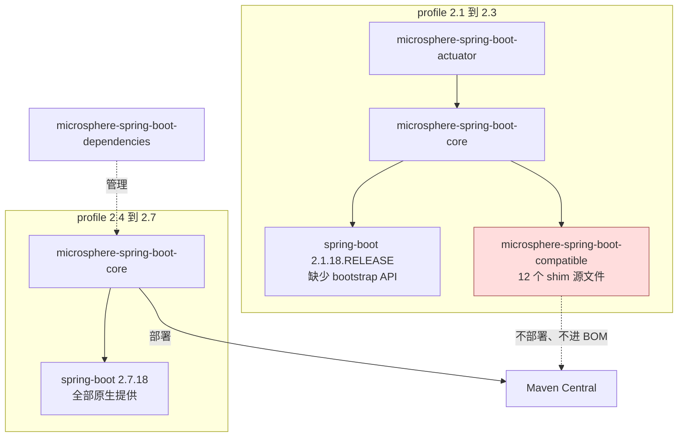

# Compatible 模块（构建期兼容层）

> [English](../compatible.md) · 文档索引：[中文](../../zh/README.md)

> **分支：** `release-1.x` · **版本线：** `0.1.x` · **Artifact：** `microsphere-spring-boot-compatible`
> **Spring Boot：** `2.1.18.RELEASE` – `2.3.12.RELEASE`（仅 profile） · **是否发布：** 否 · **是否在 BOM：** 否 · **打包：** jar

目录：
[1 模块概览](#1-模块概览) ·
[2 版本信息](#2-版本信息) ·
[3 shim 清单](#3-shim-清单) ·
[4 哪条 Boot 线需要哪个 shim](#4-哪条-boot-线需要哪个-shim) ·
[5 模块如何被挂载](#5-模块如何被挂载) ·
[6 profile 2.1 下的额外固定版本](#6-profile-21-下的额外固定版本) ·
[7 项目内部的消费者](#7-项目内部的消费者) ·
[8 给应用开发者的建议](#8-给应用开发者的建议) ·
[9 在 Boot 2.1 – 2.3 下构建本项目](#9-在-boot-21--23-下构建本项目) ·
[10 缺少 shim 时的报错形态](#10-缺少-shim-时的报错形态) ·
[11 常见问题](#11-常见问题) ·
[12 参考](#12-参考)

---

## 1. 模块概览

在 `release-1.x` 上，`microsphere-spring-boot-compatible` 与 `release` 上的性质相同 —— 一个在原始
`org.springframework.boot.*` 包名下重新声明 Spring Boot 类型的**构建期兼容层** —— 但方向是反的：这里不是
为*更新*的 Boot 打补丁，而是补上 Boot `2.1`–`2.3` **还没有**的 API，从而让同一份源码能覆盖 Boot `2.1` 到 `2.7`。

`src/main/java/org/springframework/boot/package-info.java` 记录了意图：这些类 fork 自 Spring Boot，
用于让更低版本也能构建。

它补齐的缺口是：bootstrap 上下文 API 出现于 Boot `2.4`，`@ConditionalOnAvailableEndpoint` 出现于 `2.2`，
`IncludeExcludeEndpointFilter` 出现于 `2.2.7`。而本项目的 `core` 与 `actuator` 都用到这三者，所以
profile `2.1`、`2.2`、`2.3` 都要挂载该模块。

| 问题 | 回答 |
|---|---|
| 谁使用它 | 只有 `microsphere-spring-boot-core`，且仅在 profile `spring-boot-2.1`、`2.2`、`2.3` 下。 |
| 谁绝不能使用它 | 你的应用、你的库，以及 BOM。 |
| 里面有什么 | `src/main/java/org/springframework/boot/` 下 12 个源文件。 |

---

## 2. 版本信息

| 项目 | 取值 |
|---|---|
| 坐标 | `io.github.microsphere-projects:microsphere-spring-boot-compatible` |
| 版本 | `${revision}`，分支尖端即 `0.1.35-SNAPSHOT` |
| 包含它的已发布版本 | **无** —— 任何 `0.1.x` 发布版本都未部署它 |
| 部署 | `maven-deploy-plugin` `<skip>true</skip>` |
| Central 发布 | `central-publishing-maven-plugin` `<skipPublishing>true</skipPublishing>` |
| 是否被 `microsphere-spring-boot-dependencies` 管理 | 否 —— BOM 只管理 `core`、`webmvc`、`webflux`、`actuator`、`test` |
| 声明的依赖 | `spring-boot-autoconfigure`、`spring-boot-actuator-autoconfigure`、`spring-core`、`spring-context` —— 全部 `<optional>true</optional>` |
| 挂载它的 profile | `spring-boot-2.1`、`spring-boot-2.2`、`spring-boot-2.3` |
| 不使用它的 profile | `spring-boot-2.4`、`2.5`、`2.6`、`2.7`（默认 `2.7.18`） |
| Java | 8 源码级别，与本线其余模块一致；CI 覆盖 JDK 8/11/17/21/25 |

与 `release` 分支不同，本模块**不声明任何 Servlet API 依赖** —— Boot 2 的 servlet 类型是
`javax.servlet.*`，这些 shim 都不需要它们。

---

## 3. shim 清单

| 全限定类型 | 形态 | Boot 中引入版本 | 在兼容层中的作用 |
|---|---|---|---|
| `org.springframework.boot.BootstrapContext` | 接口 | 2.4.0 | `get`、`getOrElse`、`getOrElseSupply`、`getOrElseThrow`、`isRegistered`。 |
| `org.springframework.boot.BootstrapRegistry` | 接口，嵌套 `InstanceSupplier<T>`、`InstanceScope` | 2.4.0（scope API 为 2.4.2） | bootstrap 注册侧。 |
| `org.springframework.boot.ConfigurableBootstrapContext` | 接口，继承 `BootstrapRegistry` 与 `BootstrapContext` | 2.4.0 | `core` 的 run-listener 适配器接收的类型。 |
| `org.springframework.boot.DefaultBootstrapContext` | 实现 `ConfigurableBootstrapContext` 的类 | 2.4.0 | 默认实现。 |
| `org.springframework.boot.BootstrapContextClosedEvent` | 继承 `ApplicationEvent` 的类 | 2.4.0 | bootstrap 上下文关闭时发布的事件。 |
| `org.springframework.boot.actuate.endpoint.EndpointId` | final 值类 | 2.0.6；`of(Environment, String)` 为 2.2.0 | 大小写/语法字符无关的端点 id，支持 `management.endpoints.migrate-legacy-ids`。 |
| `org.springframework.boot.actuate.autoconfigure.endpoint.condition.ConditionalOnAvailableEndpoint` | `@Conditional(OnAvailableEndpointCondition.class)` 注解，属性 `endpoint()` 默认 `Void.class` | 2.2.0 | actuator 模块端点自动配置使用它。 |
| `org.springframework.boot.actuate.autoconfigure.endpoint.condition.OnAvailableEndpointCondition` | 包级私有类，继承 `AbstractEndpointCondition` | 2.2.0 期 | 判定"已启用"且"已暴露"。 |
| `org.springframework.boot.actuate.autoconfigure.endpoint.condition.AbstractEndpointCondition` | 包级私有类，继承 `SpringBootCondition` | 2.2.0 期 | 读取 `management.endpoints.enabled-by-default`。 |
| `org.springframework.boot.actuate.autoconfigure.endpoint.expose.IncludeExcludeEndpointFilter` | `IncludeExcludeEndpointFilter<E extends ExposableEndpoint<?>> implements EndpointFilter<E>` | 2.2.7（其中一个构造器来自 2.6.0） | 暴露 include/exclude 过滤器。 |
| `org.springframework.boot.context.properties.ConstructorBinding` | `@Target({TYPE, CONSTRUCTOR})` 注解 | 2.2.0 | 标记构造器绑定的 `@ConfigurationProperties`。 |
| `org.springframework.boot.package-info` | javadoc | 1.0.0 | 记录 fork 来源。 |

由于全限定名与 Spring Boot 自身的完全相同，当运行期 Boot 版本已经提供这些类时它们就是重复类。
这正是该模块永不部署的原因。

### `release`（0.2.x）线的差异

`release` 上同一个模块是 10 个文件 —— 五个 bootstrap 类型外加 `ServerProperties`、`MultipartProperties`、
`JacksonProperties`、`MultipartConfigFactory` —— 并由 `spring-boot-4.0`/`4.1` 挂载，因为 Boot 4 是
*迁移*了这些类型，而不是*尚未提供*。见
[Compatible 模块（current 线）](../../current/zh/compatible.md)。

---

## 4. 哪条 Boot 线需要哪个 shim

| shim 分组 | Boot 2.1 | Boot 2.2 | Boot 2.3 | Boot 2.4+ |
|---|---|---|---|---|
| bootstrap 上下文类型（`@since 2.4.0`） | 需要 | 需要 | 需要 | 已提供 |
| `@ConditionalOnAvailableEndpoint`（`@since 2.2.0`） | 需要 | 已提供 | 已提供 | 已提供 |
| `IncludeExcludeEndpointFilter`（`@since 2.2.7`） | 需要 | `2.2.13` 已提供 | 已提供 | 已提供 |
| `EndpointId.of(Environment, String)`（`@since 2.2.0`） | 需要 | 已提供 | 已提供 | 已提供 |
| `@ConstructorBinding`（`@since 2.2.0`） | 需要 | 已提供 | 已提供 | 已提供 |

三条 profile 的共同硬约束是 bootstrap API：Boot `2.4` 之前完全不存在，因此 `2.1`、`2.2`、`2.3` 都必须挂载，
即使部分 actuate 类在该区间内早已出现。profile 一旦激活就整套挂载；当 Boot 在相同坐标已自带这些类时，
多余的那些不起作用。

---

## 5. 模块如何被挂载

`microsphere-spring-boot-core/pom.xml`（第 91–127 行）声明了三个 profile，各自把该模块加为 compile 依赖：

```xml
<profile>
    <id>spring-boot-2.1</id>
    <dependencies>
        <dependency>
            <groupId>io.github.microsphere-projects</groupId>
            <artifactId>microsphere-spring-boot-compatible</artifactId>
            <version>${revision}</version>
        </dependency>
    </dependencies>
</profile>
<!-- spring-boot-2.2 与 spring-boot-2.3 声明同样的依赖 -->
```

`actuator`、`webmvc`、`webflux`、`test` 不直接引用它；`actuator` 通过 `core` 传递获得 shim。根 POM 的
`<modules>` 顺序里 `compatible` 排在 `core` 之前，因此 Boot 2.1–2.3 构建会先编译 shim。



---

## 6. profile 2.1 下的额外固定版本

该模块自己也带了一个 profile，位于 `microsphere-spring-boot-compatible/pom.xml`：

```xml
<profiles>
    <profile>
        <id>spring-boot-2.1</id>
        <dependencies>
            <dependency>
                <groupId>org.springframework</groupId>
                <artifactId>spring-core</artifactId>
                <version>5.2.25.RELEASE</version>
                <optional>true</optional>
            </dependency>
        </dependencies>
    </profile>
</profiles>
```

原因：Boot `2.1.18.RELEASE` 管理的 Spring Framework 版本更老，而 shim 源码用到了需要 `5.2.x` 的
`spring-core` API。于是 profile 只提升这一个 artifact，而不是把整条 Boot 版本线搬高。它只作用于构建期，
且由于该模块从不发布，不可能影响使用者。

同样的技巧出现在 `microsphere-spring-boot-actuator/pom.xml`：其 `spring-boot-2.1` profile 把
`io.micrometer:micrometer-core` 固定为 `1.3.20`。见 [actuator 模块](./actuator.md)。

---

## 7. 项目内部的消费者

| shim 类型 | 使用位置 | 文件 |
|---|---|---|
| `ConfigurableBootstrapContext` | `starting(ConfigurableBootstrapContext)` 回调 | `microsphere-spring-boot-core/src/main/java/io/microsphere/spring/boot/listener/SpringApplicationRunListenerAdapter.java` |
| `ConfigurableBootstrapContext` | 日志 run listener | `microsphere-spring-boot-core/src/main/java/io/microsphere/spring/boot/listener/LoggingSpringApplicationRunListener.java` |
| `@ConditionalOnAvailableEndpoint` | 四个端点 `@Bean` 方法 | `microsphere-spring-boot-actuator/src/main/java/io/microsphere/spring/boot/actuate/autoconfigure/ActuatorEndpointsAutoConfiguration.java` |
| `@ConstructorBinding` | 测试用的构造器绑定属性夹具 | `microsphere-spring-boot-core/src/test/java/io/microsphere/spring/boot/context/properties/TestConstructorBindingConfigurationProperties.java` |
| `EndpointId` | 端点条件与暴露过滤器链需要 | shim 集合内部 |

---

## 8. 给应用开发者的建议

1. **不要依赖这个 artifact。** 它没有发布，解析必然失败：
   `Could not find artifact io.github.microsphere-projects:microsphere-spring-boot-compatible`。
2. **在 Boot 2.4 – 2.7 上你完全不需要它。** 直接使用 `microsphere-spring-boot-dependencies:0.1.34` 与常规模块坐标，
   已发布的 jar 自身就够了。
3. **在 Boot 2.1 – 2.3 上同样不要加它。** 已发布的 `0.1.x` 构件是按 Boot 版本线构建的；如果运行期真的缺
   bootstrap/actuate API，正确做法是换到项目支持的 Boot patch 线，而不是把 shim 硬塞进 classpath。
4. **不要在你自己的代码里 import shim 的 `org.springframework.boot.*` 类型。** 这些包属于 Spring Boot，
   副本只存在于本 reactor 内；两者同时出现在 classpath 上会产生依赖顺序的重复类行为。

贡献者新增 shim 时：包名、类名与方法签名必须与 Spring Boot **完全一致**，并且只在需要它的 profile 内挂载 ——
绝不加入已发布模块的默认 compile 作用域。

---

## 9. 在 Boot 2.1 – 2.3 下构建本项目

```bash
# 最老的支持线，编译入 shim
./mvnw clean verify -Pspring-boot-2.1

./mvnw clean verify -Pspring-boot-2.2
./mvnw clean verify -Pspring-boot-2.3

# 默认线（2.7.18）：模块仍会构建，但无人依赖它
./mvnw clean verify

# 确认 core 是否真的拿到了 shim
./mvnw -pl microsphere-spring-boot-core -am -Pspring-boot-2.1 dependency:tree | grep microsphere-spring-boot-compatible
```

`-am` 很关键：只构建 `core` 而不一起构建 `compatible` 会失败，因为 shim 只存在于 reactor 之内。

---

## 10. 缺少 shim 时的报错形态

| 报错 | 需要 shim 的引用位置 |
|---|---|
| `cannot find symbol class ConfigurableBootstrapContext` | `SpringApplicationRunListenerAdapter`、`LoggingSpringApplicationRunListener` |
| `cannot find symbol class BootstrapContext` / `BootstrapRegistry` | 同一套 listener 层次 |
| `cannot find symbol class ConditionalOnAvailableEndpoint` | `ActuatorEndpointsAutoConfiguration` |
| `cannot find symbol class IncludeExcludeEndpointFilter` | shim 内部的端点条件链 |
| `cannot find symbol class EndpointId` | 同上 |
| `cannot find symbol class ConstructorBinding` | `TestConstructorBindingConfigurationProperties` |
| `package org.springframework.boot.actuate.endpoint.annotation does not exist` | actuator 模块编译时 classpath 缺少 `spring-boot-actuator-autoconfigure` |

在 Boot 2.4+ 下这些错误都不出现，因为 Spring Boot 自己提供了这些类型。

---

## 11. 常见问题

**既然 2.2、2.3 大多已具备这些类，为什么还要挂载 shim？**
bootstrap API（`@since 2.4.0`）在这三条线上都不存在，所以必须挂载。整套挂载比为每个类维护独立 profile
更简单。

**为什么直接要求使用者升到 Boot 2.4+？**
本分支对外声明的支持范围包含 `2.1.18.RELEASE` 起，这些线上的功能确有用处；shim 正是让这个承诺可以被构建的东西。

**已发布的 `0.1.x` jar 里包含 shim 类吗？**
不包含。shim 只用于*编译* `core`，它们位于另一个从不发布的构件里，包名为 `org.springframework.boot`。

**我的应用确实要在 Boot 2.1 上用 `@ConditionalOnAvailableEndpoint` 怎么办？**
升级 Boot。自己复制一份 Spring Boot 包不是受支持的做法，一旦 Boot 2.2+ 进入 classpath 就会与真实类冲突。

---

## 12. 参考

| 文档 | 范围 |
|---|---|
| [core 模块](./core.md) | 唯一挂载这些 shim 的模块。 |
| [actuator 模块](./actuator.md) | `@ConditionalOnAvailableEndpoint` 的使用者，以及 `micrometer-core:1.3.20` 的固定位置。 |
| [Dependencies BOM](./dependencies.md) | BOM，以及该 artifact 为何不进 BOM。 |
| [Parent POM](./parent.md) | 选择 Boot 版本线的 profile。 |
| [Compatible 模块（current 线）](../../current/zh/compatible.md) | 同一机制在 Boot 4 侧的形态。 |
