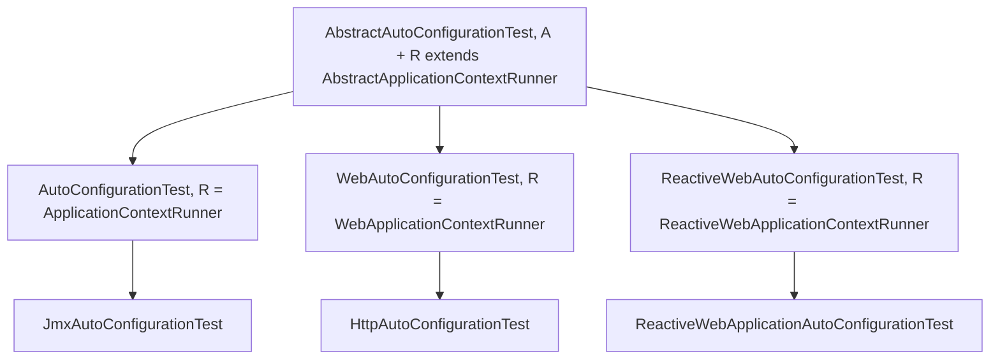

# Test 模块

> [English](../test.md) · 文档索引：[中文](../../zh/README.md)

> **分支：** `release-1.x` · **版本线：** `0.1.x` · **Artifact：** `microsphere-spring-boot-test`
> **Spring Boot：** `2.1.18.RELEASE` – `2.7.18` · **Java：** 8+ · **作用域：** `test`

目录：
[1 模块概览](#1-模块概览) ·
[2 版本信息](#2-版本信息) ·
[3 类继承体系](#3-类继承体系) ·
[4 子类契约](#4-子类契约) ·
[5 断言语义](#5-断言语义) ·
[6 示例](#6-示例) ·
[7 测试本项目自身的自动配置](#7-测试本项目自身的自动配置) ·
[8 依赖与消费方 POM](#8-依赖与消费方-pom) ·
[9 Spring Boot 2.1 至 2.3 的注意事项](#9-spring-boot-21-至-23-的注意事项) ·
[10 故障排查](#10-故障排查) ·
[11 参见](#11-参见)

---

## 1. 模块概览

本模块把关于自动配置的三条期望——**能够生效**、**能被属性开关关掉**、**缺少必需类时不生效**——固化为三个
**被继承的** JUnit 5 测试。继承与 Web 类型匹配的基类、在子类上标注 `@SpringBootTest`、实现三个 `configure*`
方法，三个测试即自动生成，无需为每个类手写 `ApplicationContextRunner` 样板代码。

基类为子类提供的能力（`AbstractAutoConfigurationTest.java`）：

* 三个 `@Test` 方法——`testAutoConfiguredClasses()`（第 118 行）、`testOnGlobalDisabledProperty()`（第 125 行）、
  `testOnGlobalMissingClass()`（第 132 行）；
* 一个开箱即用的 runner，在构造器中按测试实例创建一次（第 97 行），其配置全部来自 `@SpringBootTest`；
* 实例断言方法以及同名的静态泛型变体——`assertAutoConfiguredClass` / `assertDisabledProperty` /
  `assertFilteredClass`（第 190-225 行）。

模块的产物类只有 **4 个**：`src/main/java` 下仅有 `io.microsphere.spring.boot.test.{AbstractAutoConfigurationTest,
AutoConfigurationTest, WebAutoConfigurationTest, ReactiveWebAutoConfigurationTest}`，并且**完全不存在
`src/main/resources` 目录**——没有 `spring.factories`，没有 `AutoConfiguration.imports`，也没有默认属性文件。
它是纯粹的测试支撑库，应用运行期不会因它激活任何东西。其余源码只有 `src/test/java` 下的 5 个文件，见第 6 节。

---

## 2. 版本信息

| 项目 | 取值 |
|---|---|
| Artifact | `io.github.microsphere-projects:microsphere-spring-boot-test`（`pom.xml:13-15`） |
| 版本表达式 | `${revision}`（`pom.xml:15`），根 POM `<revision>0.1.35-SNAPSHOT</revision>`（`pom.xml:54`） |
| 已发布的最新正式版 | `0.1.34` |
| 父 POM 固定的 Spring Boot profile | `2.1.18.RELEASE / 2.2.13.RELEASE / 2.3.12.RELEASE / 2.4.13 / 2.5.15 / 2.6.15 / 2.7.18（默认）`——`spring-boot-2.1` 见 `microsphere-spring-boot-parent/pom.xml:70-73`，`spring-boot-2.7` 带 `<activeByDefault>true</activeByDefault>` 见 `pom.xml:112-115` |
| Java | 以 Java 8 为基线；CI 校验 JDK `8 / 11 / 17 / 21 / 25` |
| JUnit | Jupiter BOM `5.14.4`，由父 POM 导入（`microsphere-spring-boot-parent/pom.xml:25`、`pom.xml:31-38`） |
| 测试技术栈 | `org.junit.jupiter.api.Test`（`AbstractAutoConfigurationTest.java:22` 导入）+ Spring Boot 的 `ApplicationContextRunner` 家族；模块内**没有** `@ExtendWith` / `SpringExtension` |
| Servlet API | `javax.servlet:javax.servlet-api`，optional（`pom.xml:83-88`）——本分支是 `javax.*`，绝非 `jakarta.*` |
| 自动配置注册 | 无——本模块没有 `src/main/resources` |
| Javadoc `@since` | 四个类都写 `@since 1.0.0`（`AbstractAutoConfigurationTest.java:51`、`AutoConfigurationTest.java:31`、`WebAutoConfigurationTest.java:31`、`ReactiveWebAutoConfigurationTest.java:31`），而 artifact 版本线是 `0.1.x` |

---

## 3. 类继承体系

包名：`io.microsphere.spring.boot.test`



| 类 | 声明位置 | Runner | 适用场景 |
|---|---|---|---|
| `AbstractAutoConfigurationTest<A, R extends AbstractApplicationContextRunner>` | 抽象基类，`AbstractAutoConfigurationTest.java:53` | 由 `R` 决定 | — |
| `AutoConfigurationTest<A>` | `extends AbstractAutoConfigurationTest<A, ApplicationContextRunner>`，`AutoConfigurationTest.java:33` | `ApplicationContextRunner` | 非 Web 自动配置 |
| `WebAutoConfigurationTest<A>` | `…<A, WebApplicationContextRunner>`，`WebAutoConfigurationTest.java:33` | `WebApplicationContextRunner` | Servlet / MVC |
| `ReactiveWebAutoConfigurationTest<A>` | `…<A, ReactiveWebApplicationContextRunner>`，`ReactiveWebAutoConfigurationTest.java:33` | `ReactiveWebApplicationContextRunner` | WebFlux |

三个具体子类除 `configure*` 覆写之外是空的：它们存在的唯一意义就是固定 `R`
（`AutoConfigurationTest.java:33`、`WebAutoConfigurationTest.java:33`、
`ReactiveWebAutoConfigurationTest.java:33`）。

**类型参数由构造器内的反射解析**（`AbstractAutoConfigurationTest.java:94-96`）：

```java
this.abstractAutoConfigurationTestType = forClass(getClass()).as(AbstractAutoConfigurationTest.class);
this.autoConfigurationClass = (Class<A>) abstractAutoConfigurationTestType.resolveGeneric(0);
this.runnerClass            = (Class<R>) abstractAutoConfigurationTestType.resolveGeneric(1);
```

因此 `A` 就是被测的自动配置类，直接取自你的 `extends` 子句——无需通过构造器传入。

**构造器强制的硬性约束：**

* 具体子类**必须**标注 `@SpringBootTest`，否则实例化即失败，异常消息为
  `"The @SpringBootTest must not be annotated on " + type`（`AbstractAutoConfigurationTest.java:90-91`）。
* `isWebApplication` 的判定是 `!NONE.equals(webEnvironment)`（第 93 行）；当它为 `false` 时 runner **必须**是
  `ApplicationContextRunner`，否则报错
  `"The runner class[{}] must be ApplicationContextRunner when the auto-configuration test is not a web application"`
  （第 98-101 行）。
* runner 通过反射创建：`newInstance(runnerClass)`（第 105 行），即 `R` 必须有公共无参构造器——本模块绑定的三个
  Boot runner 都满足。

---

## 4. 子类契约

基类的全部配置都读自 `@SpringBootTest` 注解——这个注解就是本模块的输入装置：

| 来源 | 在 `initRunner(R)` 中的用途（`AbstractAutoConfigurationTest.java:109-115`） |
|---|---|
| `@SpringBootTest(properties = {...})` | `runner.withPropertyValues(getPropertyValues())`——测试上下文的基线属性（`String[]`，第 140 行） |
| `@SpringBootTest(classes = {...})` | `runner.withConfiguration(of(getClasses()))`——参与装配的额外配置类（`Class<?>[]`，第 166 行） |
| `@SpringBootTest(webEnvironment = ...)` | 决定 `isWebApplication`，从而决定合法的 runner 类型（第 93 行） |
| 类型参数 `A` | `runner.withConfiguration(of(this.autoConfigurationClass))`——被测类（第 113 行） |

子类**必须**实现三个 `protected abstract` 方法，每个方法收到待填充的集合：

```java
protected abstract void configureAutoConfiguredClasses(Set<Class<?>> autoConfiguredClasses);        // 第 174 行
protected abstract void configureGlobalDisabledPropertyValues(Set<String> globalDisabledPropertyValues); // 第 181 行
protected abstract void configureGlobalMissingClasses(Set<Class<?>> globalMissingClasses);          // 第 188 行
```

| 方法 | 放什么 | 驱动哪个测试 |
|---|---|---|
| `configureAutoConfiguredClasses` | 除被测类外应当存在的 bean 类——可以留**空** | `testAutoConfiguredClasses()` |
| `configureGlobalDisabledPropertyValues` | 形如 `"key=false"` 的开关，逐条校验 | `testOnGlobalDisabledProperty()` |
| `configureGlobalMissingClasses` | 缺失时必须让自动配置不生效的类 | `testOnGlobalMissingClass()` |

调用它们的访问器都是 `final` 且只做叠加，这正是第一个集合可以留空的原因：

```java
protected final Class<?>[] getAutoConfiguredClasses() {   // 第 144 行
    Set<Class<?>> autoConfiguredClasses = newLinkedHashSet();
    autoConfiguredClasses.add(this.autoConfigurationClass);   // 被测类永远在断言集合中
    configureAutoConfiguredClasses(autoConfiguredClasses);
    return autoConfiguredClasses.toArray(EMPTY_CLASS_ARRAY);
}
```

其他可用成员：`newRunner()`（第 104 行，构建并初始化一个新 runner）、`initRunner(R)`（第 109 行）、
`getPropertyValues()`（第 139 行）、`getClasses()`（第 165 行）、`getGlobalDisabledPropertyValues()`（第 152 行）、
`getGlobalMissingClasses()`（第 159 行），字段 `runner`、`autoConfigurationClass`、`runnerClass`、`isWebApplication`、
`springBootTestAttributes`，以及常量
`public static final Class<SpringBootTest> SPRING_BOOT_TEST_CLASS`（第 58 行）。

---

## 5. 断言语义

实例方法（第 190-200 行）只是委托给静态方法（第 202-225 行），因此语义完全等同 Boot 的
`ApplicationContextAssertProvider` 断言：

| 断言 | 真正断言的内容 |
|---|---|
| `assertAutoConfiguredClass(Class<?>)` | `runner.run(context -> assertThat(context).hasSingleBean(autoConfiguredClass))`——**恰好一个**该类型 bean，多出第二个同样失败 |
| `assertDisabledProperty(String propertyValue, Class<?>...)` | `runner.withPropertyValues(propertyValue).run(...)`，随后对 `getAutoConfiguredClasses()` 中**每个**类断言 `doesNotHaveBean` |
| `assertFilteredClass(String filteredClass, Class<?>...)` | `runner.withClassLoader(new FilteredClassLoader(filteredClass)).run(...)`，随后对每个 bean 类断言 `doesNotHaveBean` |

静态方法的签名形态（`AbstractAutoConfigurationTest.java:202`）：

```java
public static <R extends AbstractApplicationContextRunner<R, C, A>,
               C extends ConfigurableApplicationContext,
               A extends ApplicationContextAssertProvider<C>>
void assertAutoConfiguredClass(R runner, Class<?> autoConfiguredClass)
```

实际决定成败的几条：

* **基线只来自注解。** 只读取 `@SpringBootTest(properties = ...)`；测试类路径上的 `application.properties`
  不会被查询，因为 runner 会自建一个封闭的上下文。
* **`assertDisabledProperty` 断言的是整个集合**，而不只是被测类——若某个属性只关掉了其中一个 bean、
  集合里另一个依然存在，测试就会失败。
* **`FilteredClassLoader` 按类名过滤**（第 134 行的 `missingClass.getName()`，第 220 行的
  `new FilteredClassLoader(filteredClass)`）。被隐藏的类必须确实是被测类某个 `@ConditionalOnClass` 的守卫目标；
  隐藏一个无关类不会改变任何装配结果，`doesNotHaveBean` 随即失败。
* **Boot runner 是不可变的**：第 211、220 行使用**返回的新** runner，所以 `this.runner` 始终保持注解基线，
  每条断言都从基线出发。
* 三个生成的测试各自遍历自己的集合，集合里有 *n* 个元素就会创建 *n* 次上下文。

---

## 6. 示例

以下 5 个文件都是本模块 `src/test/java` 下的真实源码，它们是参考用法，而非虚构样例。

### 6.1 非 Web：`JmxAutoConfigurationTest`

`src/test/java/io/microsphere/spring/boot/test/JmxAutoConfigurationTest.java`

```java
@SpringBootTest(classes = {
        JmxAutoConfigurationTest.class
}, webEnvironment = NONE,
        properties = {
                "spring.jmx.enabled=true"
        })
public class JmxAutoConfigurationTest extends AutoConfigurationTest<JmxAutoConfiguration> {

    @Override
    protected void configureAutoConfiguredClasses(Set<Class<?>> autoConfiguredClasses) {
    }

    @Override
    protected void configureGlobalDisabledPropertyValues(Set<String> globalDisabledPropertyValues) {
        globalDisabledPropertyValues.add("spring.jmx.enabled=false");
    }

    @Override
    protected void configureGlobalMissingClasses(Set<Class<?>> globalMissingClasses) {
        globalMissingClasses.add(MBeanExporter.class);
    }
}
```

`NONE`（第 26 行的静态导入）使 `isWebApplication` 为 `false`，而这恰好是只允许 `ApplicationContextRunner` 的场景——
第 3 节的约束通过选择 `AutoConfigurationTest` 得到满足。`configureAutoConfiguredClasses` 留空是合法的：基类总会把
`A` 加入断言集合。

### 6.2 Servlet：`HttpAutoConfigurationTest` 与 `HttpAutoConfiguration`

作为夹具的自动配置，`src/test/java/io/microsphere/spring/boot/test/HttpAutoConfiguration.java`：

```java
@ConditionalOnWebApplication(type = SERVLET)
@ConditionalOnClass(CharacterEncodingFilter.class)
@ConditionalOnProperty(name = "server.http.enabled", matchIfMissing = true)
@Import(CharacterEncodingFilter.class)
public class HttpAutoConfiguration {
}
```

对应的测试，`src/test/java/io/microsphere/spring/boot/test/HttpAutoConfigurationTest.java`：

```java
@SpringBootTest(
        classes = HttpAutoConfigurationTest.class
)
public class HttpAutoConfigurationTest extends WebAutoConfigurationTest<HttpAutoConfiguration> {

    @Override
    protected void configureAutoConfiguredClasses(Set<Class<?>> autoConfiguredClasses) {
        autoConfiguredClasses.add(CharacterEncodingFilter.class);
    }

    @Override
    protected void configureGlobalDisabledPropertyValues(Set<String> globalDisabledPropertyValues) {
        globalDisabledPropertyValues.add("server.http.enabled=false");
    }

    @Override
    protected void configureGlobalMissingClasses(Set<Class<?>> globalMissingClasses) {
        globalMissingClasses.add(CharacterEncodingFilter.class);
    }
}
```

这里 `@SpringBootTest` 使用默认的 `webEnvironment`（`MOCK`），因此 `isWebApplication` 为 `true`，Servlet runner 合法。
注意三个集合的取值纪律：`server.http.enabled` 对应 `@ConditionalOnProperty` 的 `name` 且 `matchIfMissing = true`；
`CharacterEncodingFilter` 既是被 `@Import` 的 bean 又是 `@ConditionalOnClass` 的目标，所以它合理地出现在两处。

### 6.3 Reactive：`ReactiveWebApplicationAutoConfigurationTest`

夹具类，`src/test/java/io/microsphere/spring/boot/test/ReactiveWebApplicationAutoConfiguration.java`：

```java
@ConditionalOnWebApplication(type = REACTIVE)
@ConditionalOnClass(value = JacksonProperties.class)
@ConditionalOnProperty(name = "reactive.web-app.enabled", matchIfMissing = true)
@EnableConfigurationProperties(value = JacksonProperties.class)
public class ReactiveWebApplicationAutoConfiguration {
}
```

对应的测试，`src/test/java/io/microsphere/spring/boot/test/ReactiveWebApplicationAutoConfigurationTest.java`：

```java
@SpringBootTest(
        classes = {
                ReactiveWebApplicationAutoConfigurationTest.class
        }
)
public class ReactiveWebApplicationAutoConfigurationTest
        extends ReactiveWebAutoConfigurationTest<ReactiveWebApplicationAutoConfiguration> {

    @Override
    protected void configureAutoConfiguredClasses(Set<Class<?>> autoConfiguredClasses) {
        autoConfiguredClasses.add(JacksonProperties.class);
    }

    @Override
    protected void configureGlobalDisabledPropertyValues(Set<String> globalDisabledPropertyValues) {
        globalDisabledPropertyValues.add("reactive.web-app.enabled=false");
    }

    @Override
    protected void configureGlobalMissingClasses(Set<Class<?>> globalMissingClasses) {
        globalMissingClasses.add(JacksonProperties.class);
    }
}
```

这是一个由属性支撑的 bean，而不是被 `@Import` 的 bean：`@EnableConfigurationProperties(JacksonProperties.class)`
提供正向断言的 bean，`@ConditionalOnClass(JacksonProperties.class)` 提供被过滤的目标。

### 6.4 在其之上追加自己的断言

由于 `newRunner()` 是 `protected`（第 104 行）并返回已初始化好的泛型 runner，子类可以在保留三个继承而来的测试之外，
追加自己的 `@Test`：

```java
@SpringBootTest(classes = MyAutoConfiguration.class, webEnvironment = NONE,
        properties = "my.feature.pool-size=3")
class MyAutoConfigurationTest extends AutoConfigurationTest<MyAutoConfiguration> {

    @Test
    void poolSizeIsApplied() {
        newRunner().run(context ->
                assertThat(context.getBean(MyProperties.class).getPoolSize()).isEqualTo(3));
    }

    @Override
    protected void configureAutoConfiguredClasses(Set<Class<?>> classes) {
        classes.add(MyProperties.class);
    }

    @Override
    protected void configureGlobalDisabledPropertyValues(Set<String> values) {
        values.add("my.feature.enabled=false");
    }

    @Override
    protected void configureGlobalMissingClasses(Set<Class<?>> missing) {
        missing.add(MyProperties.class);
    }
}
```

（`MyAutoConfiguration` / `MyProperties` 是你自己类的占位符；本段没有虚构模块 API——runner 与断言入口都来自第 4、5 节。）

---

## 7. 测试本项目自身的自动配置

下面这套做法就是 `JmxAutoConfigurationTest`、`HttpAutoConfigurationTest`、
`ReactiveWebApplicationAutoConfigurationTest` 三个示例所演示的，把它套用到本仓库各
`microsphere-spring-boot-*` 模块的自动配置上（各模块注册了什么，见 [core.md](./core.md) 与 [actuator.md](./actuator.md)）。

1. **按 Web 类型而不是按模块名选基类。** 普通自动配置用 `webEnvironment = NONE` + `AutoConfigurationTest`；
   Servlet 场景用 `WebAutoConfigurationTest`（类路径上是 `javax.servlet`，见 `pom.xml:83-88`）；
   WebFlux 场景用 `ReactiveWebAutoConfigurationTest`。
2. **测试类与被测自动配置放在同一个包**，正如本模块自身位于 `io.microsphere.spring.boot.test`；并把测试类自己写进
   `classes = {...}`——三个示例都是这个写法，也正是它让外层类上的 `@Import`/`@EnableConfigurationProperties` 生效。
3. **开启开关写进 `properties`，不要放进文件。** runner 只读取 `getStringArray("properties")`
   （`AbstractAutoConfigurationTest.java:140`）。`JmxAutoConfigurationTest` 为了正向断言需要
   `spring.jmx.enabled=true`，你自己的 `microsphere.*.enabled` 开关同理。
4. **三个集合按被测类的条件机械推导**，`HttpAutoConfiguration` 是范本：
   `@ConditionalOnProperty(name = ...)` 给出 `"name=false"` 条目；`@ConditionalOnClass(X.class)` 给出
   `configureGlobalMissingClasses`；被 `@Import` 或由 `@EnableConfigurationProperties` 注册的 bean 给出
   `configureAutoConfiguredClasses`。
5. **不需要任何注册文件。** `initRunner` 直接调用 `withConfiguration(of(autoConfigurationClass))`（第 113 行）点名被测类，
   所以这些测试与你的模块是否在 `META-INF/spring.factories` 或
   `META-INF/spring/org.springframework.boot.autoconfigure.AutoConfiguration.imports` 里登记了该自动配置无关——
   这也意味着它们在 Boot 2.1-2.6 上同样通过，而那些版本根本不读 `imports` 文件（本分支的 `core` 两个文件都登记，
   见 [core.md](./core.md)）。
6. **一次只跑一个 profile**：`mvn -Pspring-boot-2.7 test`、`mvn -Pspring-boot-2.1 test`……。profile 定义在父 POM，
   每次构建类路径上只有被固定的那一个 Boot 版本。

---

## 8. 依赖与消费方 POM

**引入**——版本交由 BOM 管理：

```xml
<dependencyManagement>
    <dependencies>
        <dependency>
            <groupId>io.github.microsphere-projects</groupId>
            <artifactId>microsphere-spring-boot-dependencies</artifactId>
            <version>0.1.34</version>
            <type>pom</type>
            <scope>import</scope>
        </dependency>
    </dependencies>
</dependencyManagement>

<dependencies>
    <dependency>
        <groupId>io.github.microsphere-projects</groupId>
        <artifactId>microsphere-spring-boot-test</artifactId>
        <scope>test</scope>
    </dependency>
</dependencies>
```

**为什么这里几乎所有依赖都是 `<optional>true</optional>`。** 测试支撑库只在别人的测试类路径里发挥作用，而那个工程里
JUnit、Boot、Servlet 容器的版本早已由它自己决定。声明为 optional，本 artifact 就不会把一个 WebFlux starter、
一整套 Jackson 或一个 H2 数据库塞进只需要测试非 Web 自动配置的工程，也避免了与消费方自有 BOM 的版本冲突。
代价很明确：**基类在编译期引用了这些 API，因此消费方必须自己补齐所选基类触及到的依赖。**

依据 `microsphere-spring-boot-test/pom.xml`：

| 声明的依赖 | POM 行号 | 是否 optional | 你必须在什么时候自己加 |
|---|---|---|---|
| `io.github.microsphere-projects:microsphere-annotation-processor` | `23-27` | 是 | 不需要（仅构建期） |
| `org.junit.jupiter:junit-jupiter` | `30-34` | **是** | 始终需要——基类上有 `@Test` |
| `org.springframework.boot:spring-boot-configuration-processor` | `37-41` | 是 | 不需要（仅构建期） |
| `org.springframework.boot:spring-boot-autoconfigure-processor` | `44-48` | 是 | 不需要（仅构建期） |
| `org.springframework.boot:spring-boot-starter-test` | `51-55` | **是** | 始终需要——runner、`FilteredClassLoader`、`@SpringBootTest`、AssertJ |
| `io.github.microsphere-projects:microsphere-spring-context` | `58-61` | **否** | 不需要——随传递依赖进来（`GenericAnnotationAttributes`） |
| `io.github.microsphere-projects:microsphere-spring-test` | `63-67` | **否** | 不需要——随传递依赖进来 |
| `org.springframework.boot:spring-boot-starter-web` | `70-74` | 是 | 继承 `WebAutoConfigurationTest` 时 |
| `org.springframework.boot:spring-boot-starter-webflux` | `77-81` | 是 | 继承 `ReactiveWebAutoConfigurationTest` 时 |
| `javax.servlet:javax.servlet-api` | `83-88` | 是 | 继承 `WebAutoConfigurationTest` 时 |
| `com.fasterxml.jackson.core:jackson-annotations` / `jackson-databind` | `90-95`、`97-101` | 是 | 测试要断言 Jackson bean 时 |
| `com.h2database:h2` | `104-108` | 是 | 测试要启动 DataSource 时 |
| `ch.qos.logback:logback-classic` | `113-117` | `test` 作用域，仅模块自身 | 不需要——不会泄漏到消费方 |

其中两项**不是** optional，请留意：`microsphere-spring-context` 与 `microsphere-spring-test` 是本 artifact 的传递性
compile 依赖（`pom.xml:58-61`、`pom.xml:63-67`）；而基类所需的所有第三方依赖都是 optional。另外，**本 POM 完全没有声明
AssertJ**，但 `AbstractAutoConfigurationTest.java:37` 导入了 `org.assertj.core.api.Assertions`——它期望由
`spring-boot-starter-test` 提供。

**Boot 2.7 下一个 Servlet 测试的最小 test 作用域集合：**

```xml
<dependencies>
    <dependency>
        <groupId>io.github.microsphere-projects</groupId>
        <artifactId>microsphere-spring-boot-test</artifactId>
        <scope>test</scope>
    </dependency>
    <dependency>
        <groupId>org.junit.jupiter</groupId>
        <artifactId>junit-jupiter</artifactId>
        <scope>test</scope>
    </dependency>
    <dependency>
        <groupId>org.springframework.boot</groupId>
        <artifactId>spring-boot-starter-test</artifactId>
        <scope>test</scope>
    </dependency>
    <dependency>
        <groupId>org.springframework.boot</groupId>
        <artifactId>spring-boot-starter-web</artifactId>
        <scope>test</scope>
    </dependency>
    <dependency>
        <groupId>javax.servlet</groupId>
        <artifactId>javax.servlet-api</artifactId>
        <scope>test</scope>
    </dependency>
</dependencies>
```

Reactive 测试则把 `spring-boot-starter-web` + `javax.servlet-api` 换成 `spring-boot-starter-webflux`；
非 Web 的 `AutoConfigurationTest` 只需要前三条。

---

## 9. Spring Boot 2.1 至 2.3 的注意事项

* **JUnit 的 API 层级。** `AbstractAutoConfigurationTest.java:38` 导入了
  `org.junit.jupiter.api.Assertions.assertInstanceOf`，并在第 99 行使用。该方法是 Jupiter 5.8+ 的 API，
  它能解析是因为父 POM 以 `5.14.4` 导入了 `junit-bom`（`microsphere-spring-boot-parent/pom.xml:25`、`pom.xml:31-38`），
  **而**不是因为 Boot profile。在 `-Pspring-boot-2.1` / `2.2` / `2.3` 下 Boot 管理的 Jupiter 版本要老得多，
  所以请让父 POM 的 BOM 继续主导 JUnit，不要从 Boot BOM 反向固定 Jupiter。
* **JUnit 4 残留。** 在 2.1-2.3 这一版本线上，`spring-boot-starter-test` 还会带入 JUnit 4 / vintage 栈。
  基类是纯 Jupiter 的（第 22 行的 `org.junit.jupiter.api.Test`）：如果消费方工程排除了 Jupiter 引擎、或把 Surefire
  绑到 JUnit 4，三个继承而来的测试会被**静默跳过**。请用 `mvn -Pspring-boot-2.1 test` 的输出确认 Jupiter 引擎在位。
* **Servlet 命名空间。** 任何从 `0.2.x` 文档复制而来、引用 `jakarta.servlet.*` 的写法在本分支都是错的；
  本分支固定的是 `javax.servlet:javax.servlet-api`（`pom.xml:83-88`）。类路径上没有 Servlet API 时，
  `WebApplicationContextRunner` 连构造都做不到。
* **没有 `AutoConfiguration.imports`。** Boot 从 2.7 起才读取该文件。对这些测试是无害的，因为被测类是通过
  `of(...)` 显式点名的（第 113 行）；但如果你依赖 Boot 自身的自动配置发现机制来装配一个*夹具*自动配置，
  那么在 2.1-2.6 上只有 `META-INF/spring.factories` 有效（见 [core.md](./core.md) 第 2 节与第 12 节）。
* **Java 8 源码级别。** 测试方法体里保持 Java 8 API——不要用 `List.of`，也不要超出模块自身用法的
  `toArray(new Class[0])` 之类写法（它用的是 `EMPTY_CLASS_ARRAY`，见第 36、148 行）。
* **Reactive 夹具的条件。** 你自己的夹具要像 `HttpAutoConfiguration.java:35` 与
  `ReactiveWebApplicationAutoConfiguration.java:35` 那样分别写清 `@ConditionalOnWebApplication(type = SERVLET)` 与
  `type = REACTIVE`；两种 runner 不同，直接复制过来的夹具不会生效。

---

## 10. 故障排查

| 现象 | 原因与处理 |
|---|---|
| 构造失败：`The @SpringBootTest must not be annotated on …` | 具体子类没有标注 `@SpringBootTest`（`AbstractAutoConfigurationTest.java:90-91`）。按三个示例的写法补上。 |
| `The runner class[...] must be ApplicationContextRunner when the auto-configuration test is not a web application` | 把 `webEnvironment = NONE` 与 `WebAutoConfigurationTest` 或 `ReactiveWebAutoConfigurationTest` 组合使用了（第 98-101 行）。改用 `AutoConfigurationTest`，或换成非 `NONE` 的 web 环境。 |
| 构造 runner 时出现反射错误 | `newRunner()` 会调用 `newInstance(runnerClass)`（第 105 行）；只有本模块绑定的三个 Boot runner 具备所需的公共无参构造器，不要传入自定义的 `R`。 |
| 本地明明有该 bean，`testAutoConfiguredClasses` 仍失败 | runner 不读取类路径上的 `application.properties`；把开启用的属性写进 `@SpringBootTest(properties = ...)`（第 140 行）。 |
| `testAutoConfiguredClasses` 报“没有 bean”或上下文启动失败 | 类型参数不是可装配的自动配置类，或其 `@ConditionalOnWebApplication` 类型与所选基类矛盾——对照 `HttpAutoConfiguration.java:35` 检查。 |
| 确信属性存在，`testOnGlobalDisabledProperty` 仍失败 | 要么该自动配置根本没有这个开关，要么 `getAutoConfiguredClasses()` 中另一个类仍被创建，因为断言会遍历整个集合（第 127、213 行）。请移除该条目，或改用 `configureGlobalMissingClasses` 来表达这个条件。 |
| `testOnGlobalMissingClass` 失败 | `FilteredClassLoader` 是**按类名**隐藏（第 134、220 行）：条目必须确实是被测类的某个 `@ConditionalOnClass` 目标。隐藏无人检查的类不会改变装配结果，`doesNotHaveBean` 随即失败。 |
| 关于 AssertJ 或 `org.springframework.boot.test.context.runner.*` 的 `NoClassDefFoundError` | `spring-boot-starter-test` 在本模块是 optional（`pom.xml:51-55`），AssertJ 更是完全未声明；两者都要在消费方 POM 里以 test 作用域补上（第 8 节）。 |
| 继承 `WebAutoConfigurationTest` 时 `NoClassDefFoundError: javax/servlet/...` | `javax.servlet-api` 是 optional（`pom.xml:83-88`）；补上它以及 `spring-boot-starter-web`（`pom.xml:70-74`）。 |
| 继承 `ReactiveWebAutoConfigurationTest` 时 `ClassNotFoundException: org.springframework.web.reactive.*` | `spring-boot-starter-webflux` 是 optional（`pom.xml:77-81`）；以 test 作用域补上。 |
| CI 里这三个测试从未执行 | 缺少 Jupiter 引擎，或 Surefire 被绑到 JUnit 4——见第 9 节，并让父 POM 的 `junit-bom:5.14.4` 继续主导。 |

---

## 11. 参见

* [core.md](./core.md) —— 条件、属性，以及这些测试刻意绕开的注册文件。
* [actuator.md](./actuator.md) —— 本仓库中值得用这种方式覆盖的自动配置类。
* [README.md](./README.md) —— `release-1.x` 分支的文档索引。
