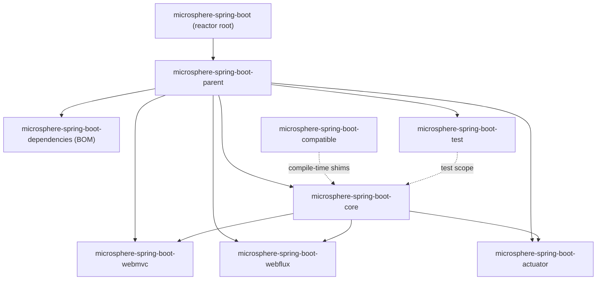

# User Guide

> [中文](./zh/README.md) · [Documentation home](../README.md) · [Developer Guide](../developer-guide/README.md)

Usage documentation for `microsphere-spring-boot`: what each Maven module offers, how to add it to your build, code
examples taken from the modules' own test cases, the configuration keys it reads, and the exact Spring Boot versions it
is built and tested against.

Internal design (startup wiring, source analysis, build and release pipeline) lives in the
[Developer Guide](../developer-guide/README.md).

---

## 1. Choose your version line

| Your Spring Boot | Use | Version line | Branch | Docs |
|---|---|---|---|---|
| `3.0` – `3.5` | `0.2.x` | `3.0.13` – `3.5.16` | `release` | [`current/`](./current/README.md) · [中文](./current/zh/README.md) |
| `4.0` – `4.1` | `0.2.x` | `4.0.8` – `4.1.1` | `release` | [`current/`](./current/README.md) · [中文](./current/zh/README.md) |
| `2.1` – `2.7` | `0.1.x` | `2.1.18.RELEASE` – `2.7.18` | `release-1.x` | [`1.x/`](./1.x/README.md) · [中文](./1.x/zh/README.md) |

The lines are not interchangeable: `0.1.x` compiles against `javax.servlet` and registers auto-configurations in
`spring.factories`, while `0.2.x` uses `jakarta.servlet` and `AutoConfiguration.imports`. Take the latest patch of the
line that matches your Boot generation (`0.2.34` for `0.2.x`, `0.1.34` for `0.1.x`).

---

## 2. Module documents

One file per Maven module. English at the primary path, Chinese in `zh/`.

### `release` branch — 0.2.x ([branch index](./current/README.md))

| Document | Artifact | Published | Read it for |
|---|---|---|---|
| [core](./current/core.md) | `microsphere-spring-boot-core` | Yes | Overridable default properties, `SpringBootVersion` version guards, `microsphere.autoconfigure.exclude`, `@ConditionalOnPropertyPrefix`, `BindListener` binding callbacks, property-change events, banned-artifact and artifact-collision diagnostics, condition-evaluation reporting |
| [actuator](./current/actuator.md) | `microsphere-spring-boot-actuator` | Yes | The four custom endpoints (`artifacts`, `webEndpoints`, `configMetadata`, `configProperties`), endpoint exposure and cache defaults, `MonitoredThreadPoolTaskScheduler` |
| [webmvc](./current/webmvc.md) | `microsphere-spring-boot-webmvc` | Yes | Servlet-stack extensions: content caching filter, content negotiation, handler/interceptor logging, exclusive view resolver |
| [webflux](./current/webflux.md) | `microsphere-spring-boot-webflux` | Yes | Reactive-stack extension |
| [test](./current/test.md) | `microsphere-spring-boot-test` | Yes | Base classes that turn auto-configuration expectations into inherited tests |
| [compatible](./current/compatible.md) | `microsphere-spring-boot-compatible` | No | Boot 4.x shims the build attaches automatically — what they are and why you must not depend on them |
| [dependencies](./current/dependencies.md) | `microsphere-spring-boot-dependencies` | Yes (BOM) | The BOM: which artifacts it manages and how to import it |
| [parent](./current/parent.md) | `microsphere-spring-boot-parent` | Yes (pom) | Parent POM: Java baseline, upstream BOM imports, the Boot version profiles |

### `release-1.x` branch — 0.1.x ([branch index](./1.x/README.md))

| Document | Artifact | What differs from 0.2.x |
|---|---|---|
| [core](./1.x/core.md) | `microsphere-spring-boot-core` | `SpringBootVersion` models Boot `2.0` – `2.7.18`; dual registration in `spring.factories` and `AutoConfiguration.imports` |
| [actuator](./1.x/actuator.md) | `microsphere-spring-boot-actuator` | jolokia `1.7.2`; profile `2.1` pins `micrometer-core:1.3.20` and `spring-core:5.2.25.RELEASE` |
| [webmvc](./1.x/webmvc.md) | `microsphere-spring-boot-webmvc` | Conditions use `javax.servlet` |
| [webflux](./1.x/webflux.md) | `microsphere-spring-boot-webflux` | Single `@AutoConfigureAfter` class name (Boot 2 package only) |
| [test](./1.x/test.md) | `microsphere-spring-boot-test` | All upstream dependencies declared `optional` |
| [compatible](./1.x/compatible.md) | `microsphere-spring-boot-compatible` | Larger shim set (bootstrap, `EndpointId`, `@ConstructorBinding`, actuate endpoint conditions), attached by profiles `2.1`–`2.3` |
| [dependencies](./1.x/dependencies.md) | `microsphere-spring-boot-dependencies` | Same managed artifact set, `0.1.x` versions |
| [parent](./1.x/parent.md) | `microsphere-spring-boot-parent` | 7 Boot profiles, Java 8 floor, no `spring-milestone` repository |

---

## 3. Module dependency graph



For application builds the practical picture is simpler: import the BOM, then add `core` and whichever of
`actuator`, `webmvc`, `webflux` you need. `test` is `test`-scope only, `compatible` and `parent` are never declared
directly by an application.

---

## 4. Install at a glance

`0.2.x` (Spring Boot 3 / 4):

```xml

<properties>
    <microsphere-spring-boot.version>0.2.34</microsphere-spring-boot.version>
</properties>

<dependencyManagement>
    <dependencies>
        <dependency>
            <groupId>io.github.microsphere-projects</groupId>
            <artifactId>microsphere-spring-boot-dependencies</artifactId>
            <version>${microsphere-spring-boot.version}</version>
            <type>pom</type>
            <scope>import</scope>
        </dependency>
    </dependencies>
</dependencyManagement>
```

`0.1.x` (Spring Boot 2) uses the same snippet with `<microsphere-spring-boot.version>0.1.34</microsphere-spring-boot.version>`.
After importing the BOM, add modules without versions:

```xml

<dependencies>
    <dependency>
        <groupId>io.github.microsphere-projects</groupId>
        <artifactId>microsphere-spring-boot-core</artifactId>
    </dependency>
</dependencies>
```

---

## 5. Feature to module map

| I want to | Module | Key API |
|---|---|---|
| Ship overridable defaults with my library | `core` | `META-INF/config/default/*.properties`, `DefaultPropertiesPostProcessor` |
| Exclude auto-configurations from several independent sources | `core` | `microsphere.autoconfigure.exclude` |
| React when a bound property changes | `core` | `BindListener`, `ConfigurationPropertiesBeanPropertyChangedEvent` |
| Guard code by Boot version | `core` | `SpringBootVersion.CURRENT.ge(...)` |
| Activate a bean when any `my.feature.*` property exists | `core` | `@ConditionalOnPropertyPrefix` |
| Fail fast on duplicate or banned jars | `core` | `ArtifactsCollisionDiagnosisListener`, `BannedArtifactClassLoadingListener` |
| Inspect jars, mappings, metadata and bound properties over HTTP | `actuator` | `/actuator/microsphere/**` endpoints |
| Get metrics for scheduled tasks | `actuator` | `MonitoredThreadPoolTaskScheduler` |
| Extend the servlet or reactive web stack | `webmvc` / `webflux` | `microsphere.spring.boot.webmvc.enabled`, `microsphere.spring.boot.webflux.enabled` |
| Test my own auto-configuration | `test` | `AutoConfigurationTest`, `WebAutoConfigurationTest`, `ReactiveWebAutoConfigurationTest` |

---

## 6. Conventions used here

| Convention | Detail |
|---|---|
| Language | English at the primary path, Chinese mirrored in `zh/` with identical filenames and identical section numbering |
| Versions | Every document states the artifact coordinates, the latest published release, the in-development version and the tested Boot matrix of its branch |
| Examples | Taken from real test classes in the same branch; the source file is named next to the snippet |
| Links | Same-file anchors only; cross-file links never carry `#fragments` |
| Precedence | Module defaults land in `defaultProperties`, the lowest-precedence source, so your own configuration always wins |
